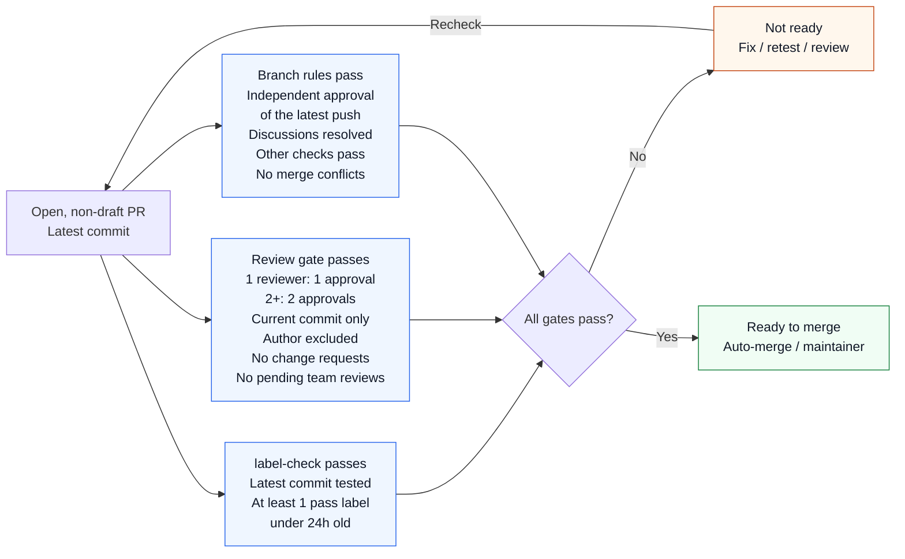

# Contributing to HyperParallel

**English** | [简体中文](CONTRIBUTING.zh.md)

HyperParallel welcomes bug reports, documentation improvements, tests, model integrations, performance work, and new
parallel capabilities. You can contribute through a fork without write access to the upstream repository.
Use public issues and pull requests to make designs, review decisions, and validation results available to the community.

## Start here

| Task | Where to go |
| --- | --- |
| Choose an issue or propose a change | [Contribution types](#choose-a-contribution) |
| Prepare tools for your change | [Development environment](#prepare-your-development-environment) |
| Check style and test results | [Standards](#follow-the-coding-and-documentation-standards) · [Validation](#validate-the-change) |
| Open or update a PR | [Submission steps](#submit-and-iterate-on-a-pull-request) |
| Understand merge requirements | [Merge flowchart](#ci-review-and-merge) |
| Unblock a PR | [Gate troubleshooting](#when-a-gate-fails) |
| Plan a release or integration | [Release and integration guidance](#releases-and-downstream-integration) |

Before requesting final review:

- [ ] Keep one focused change and one commit, based on the intended upstream branch.
- [ ] Complete the relevant local checks and record results for the current commit, including unrun cases.
- [ ] Update affected documentation and its translation; check links and examples.
- [ ] Fill in the PR template with the problem, resulting behavior, compatibility impact, and actual evidence.
- [ ] Mark the completed PR ready, request the relevant reviewers, and confirm CI has started for the current commit.

## Choose a contribution

- **Report a problem:** Search [existing issues](https://github.com/mindspore-ai/hyper-parallel/issues) first, then use the
  [bug-report template](https://github.com/mindspore-ai/hyper-parallel/issues/new/choose).
- **Improve documentation or tests:** Small corrections can go directly into a focused PR. Update English documents and
  their sibling `.zh.md` translations together.
- **Propose a feature or integration:** Open a Feature Issue or RFC before substantial implementation. Describe the use
  case, proposed interfaces, compatibility impact, supported hardware, and acceptance criteria. Ask the relevant
  [module owners](CODEOWNERS) to review the design.
- **Optimize performance:** Explain the workload and bottleneck, then provide reproducible correctness and performance
  comparisons with the same model, hardware, precision, parallel configuration, and measurement method.

If you are unsure where a change belongs, describe it in an issue and refer to [CODEOWNERS](CODEOWNERS).
Keep discussion respectful, respond to technical feedback, and record decisions in the issue or PR.

## Prepare your development environment

Fork [HyperParallel on GitHub](https://github.com/mindspore-ai/hyper-parallel), replace `YOUR_GITHUB_USERNAME` below, and
create a branch from the intended upstream target. Normal development targets `master`; coordinate release fixes with
the release maintainer before targeting a release branch.

```bash
git clone https://github.com/YOUR_GITHUB_USERNAME/hyper-parallel.git
cd hyper-parallel
git remote add upstream https://github.com/mindspore-ai/hyper-parallel.git
git fetch upstream
git switch -c feat/your-change upstream/master
```

Choose the environment for the work you are doing:

| Contribution | Local setup |
| --- | --- |
| Documentation only | Git, an isolated Python environment with `pre-commit` and `PyYAML`, and the [documentation checks](#follow-the-coding-and-documentation-standards). PyTorch, a package install, and NPU/GPU runtimes are unnecessary unless you are validating a runtime example. |
| Python logic or unit tests | A supported Python/PyTorch environment, this checkout installed in editable mode, pytest, and dependencies used by the affected module. |
| Distributed or native code | The code-development environment plus the selected test's devices, runtime, and build tools. Coordinate unavailable hardware validation with the module/CI maintainer before requesting final review. |

For all contribution types, create and activate an isolated Python environment using your preferred tool, such as
`venv` or Conda. Documentation-only work can then continue with the checks below. For code development, also follow
the runtime installation steps:
Choose a Python version supported by the installation guide; the environment name is up to you.
Install a supported PyTorch and hardware runtime combination following the [installation guide](docs/installation.md).
Then run the following commands in that environment to install this checkout in editable mode:

```bash
python -m pip install -e .
python -m pip install pytest
python -c "import hyper_parallel; print(hyper_parallel.__file__)"
```

The printed path must point to this checkout. If it points to another checkout or an old installation, reinstall from
the intended repository. Native components need their own build and environment activation steps in the installation
guide; an editable Python install alone does not build them.

See [development setup](docs/contributing/dev_environment.md) for dependencies and the
[GitHub collaboration manual](docs/contributing/github_development_manual.md) for authentication and account setup.
For RL work, start with the [RL entry rules](.agent/rules/hyper-rl.md), including its separate runtime setup.

## Follow the coding and documentation standards

Read [AGENTS.md](AGENTS.md) and the [coding standards](.agent/rules/code-style.md) before editing.
The coding standards are the authoritative reference, including their documented exceptions.

- Add the Apache 2.0 header to Python files. Follow PEP 8 with lines around 120 characters, public API type hints, and
  Google-style docstrings. C++ follows the repository's `.clang-format` and C++ conventions.
- Use module-level imports and native PyTorch APIs. Follow the
  [distributed implementation rules](.agent/rules/distributed.md) when changing sharding, communication, streams, or
  memory management.
- Keep changes focused. Include tests and documentation for changed behavior, public interfaces, dependencies, and
  checkpoint compatibility.
- Keep English as the default document language and update the corresponding `.zh.md` version. Check relative links,
  anchors, example commands, and API signatures.
- Fix lint and test failures at their cause. Explain necessary exceptions or untested configurations in the PR.

Install the local pre-commit hooks and run the repository checks from the activated environment:

```bash
python -m pip install pre-commit PyYAML
bash scripts/pre-commit/install.sh
# Replace these paths with every changed or new file in your contribution.
python -m pre_commit run --files CONTRIBUTING.md CONTRIBUTING.zh.md
python .agent/scripts/check_agents_catalog.py
git diff --check
```

The configured hooks select pylint, lizard, and markdownlint by file type. Passing explicit paths includes new files
before they are staged and allows a committed PR to be checked again without creating another change.
The catalog check is required whenever Markdown changes; it checks the agent catalog, so check documentation links
separately. See the [pre-commit guide](scripts/pre-commit/README.md) for installation and tool coverage.

For additional code checks such as C++/shell lint and codespell, use
`python .agent/skills/autogit/scripts/autogit.py check` in a focused working tree. It inspects uncommitted changes,
temporarily stages tracked files, and resets staging afterward; add new files explicitly before running it.
Its Markdown dependency setup requires Node.js/npm on `PATH` and may install `markdownlint-cli2` globally;
the pre-commit-managed tools above do not put that executable on `PATH`. AutoGit's remote PR workflow targets GitCode;
use Git and GitHub tooling for GitHub submissions.

## Validate the change

Run tests appropriate to the changed behavior. Follow the [testing rules](.agent/rules/testing.md) and
[testing guide](docs/contributing/testing.md) for test locations, markers, and launchers.

| Change | Expected evidence |
| --- | --- |
| Documentation only | Markdown lint, catalog check, changed links/anchors, and verification of changed commands or examples where applicable. Explain why runtime tests are not applicable. |
| Independently testable logic | Affected unit tests in `tests/ut/`, including a regression test for a bug fix. |
| Sharding, collectives, parallel combinations, or checkpoint restore | Relevant distributed ST on the affected hardware, including numerical and state-restoration checks where applicable. |
| Performance or memory optimization | Correctness checks plus baseline and changed results under the same configuration; report throughput/step time, peak memory, and measurement conditions as applicable. |
| Package or dependency change | Build, clean-environment installation, imports, and relevant examples on the declared supported combinations. |

For example, run the affected shard UT, or the full unit suite when the scope calls for it:

```bash
python -m pytest -vs tests/ut/core/shard/
python -m pytest -vs tests/ut/
```

Unit tests must not initialize a distributed job. Distributed ST uses the repository launchers described in the testing
rules; follow the selected test's device requirements rather than wrapping every launcher in another `torchrun`.
RL ST runs separately from the main-project PR gate; a main-project CI pass does not establish RL ST acceptance.

In the PR, record the tested commit, commands, model/configuration, Python and PyTorch versions, device model/count, and
results. Include `torch-npu`, CANN, and driver versions for Ascend; include CUDA and driver versions for NVIDIA GPU.
List unavailable hardware and unrun cases explicitly, and coordinate required hardware validation with maintainers.
Do not report a skipped test or a configuration that only parsed successfully as a passed hardware test.

## Submit and iterate on a pull request

1. Keep one independently reviewable change per PR. Use a Conventional Commit such as `docs: clarify installation`,
   with an imperative subject around 80 characters.
2. Keep exactly one commit per PR. Squash work-in-progress changes before submission and amend subsequent fixes into
   that commit. Back up before rewriting history. Update only your PR's source branch with `--force-with-lease` and the
   expected remote SHA; never force-push a shared main or release branch.
3. Push to your fork and open a PR against the intended upstream branch. Use the repository's
   [PR template](.github/PULL_REQUEST_TEMPLATE.md) or [Chinese template](.github/PULL_REQUEST_TEMPLATE.zh-CN.md).
   Explain the problem, resulting behavior, scope, compatibility impact, and actual test results. Link real issues;
   when none applies, state that explicitly. Complete checklist items truthfully.
4. Use a Draft PR while design, implementation, or required evidence is incomplete. Request review from the relevant
   owners in [CODEOWNERS](CODEOWNERS) when ready.
5. Address review feedback, update tests and both documentation languages, and obtain fresh CI and review results for
   the latest commit. Resolve discussions after their concerns have been addressed.

For a PR paired with a GitCode request, update the agreed source branch and let the synchronization service handle its
counterpart. Avoid competing edits on both platforms. Follow the target branch's current
[repository rules](https://github.com/mindspore-ai/hyper-parallel/rules) and any applicable identity/CLA checks.

## CI, review, and merge

Jenkins runs the project pipeline and reports test/build results to the PR. GitHub workflows enforce CI-label validity
and the review quorum. The flow below summarizes normal merge eligibility for the current commit. CI and reviews can
run in parallel; all three groups of requirements must be satisfied.



The diagram describes the normal path without bypass privileges. The current `master` gates include:

| Gate | What contributors need to do |
| --- | --- |
| `label-check` | Obtain CI results for the current commit and at least one valid `ci-pipeline-passed` or `ci-pipeline-passed-but-overtime` label. Each label expires 24 hours after its latest recorded addition; either valid label meets the age requirement. The overtime label retains the indication of an abnormal duration. |
| `all-reviewers-approved` | Obtain one approval with one reviewer, or two distinct approvals with two or more reviewers. Approvals must apply to the current commit; the author does not count. A valid CI label is also required. Resolve outstanding change requests and pending team-review requests. A Draft PR or a PR without independent reviewers cannot pass. |
| Native branch rules | Obtain independent approval of the latest push, resolve review discussions, pass other required checks, and resolve merge conflicts. New pushes invalidate stale approvals. Follow the target branch's [live rules](https://github.com/mindspore-ai/hyper-parallel/rules) for additional requirements. |

### CI validity and auto-merge

- Pushes require fresh CI and approvals for the new commit. If a label expires, rerun CI and let CI renew it; comments
  and reviews do not extend its lifetime. Do not manually add pass labels.
- The automated path checks the current commit and label age before publishing approval success and before enabling
  auto-merge. GitHub may still wait for other merge requirements afterward.
- **Expiry enforcement is asynchronous: merging is not guaranteed to stop at the exact 24-hour boundary.** Scheduling
  delays or API failures can leave an earlier success in place. Accounts allowed to bypass the live branch rules remain
  outside these gates.

See [review and merge rules](docs/contributing/github_auto_merge.md) for reviewer eligibility, the check/status pair
named `label-check`, shared-commit behavior, event triggers, scheduling, and enforcement limits. That document maintains
the detailed policy and implementation; this guide covers the contributor steps.

### When a gate fails

Start from the PR's **Checks** details and the latest `mindspore-ai-bot` pipeline report in **Conversation**. Match the
build's commit to the current PR head before using its result.

| Symptom | Where to look | Action and owner |
| --- | --- | --- |
| CI pass label missing or expired | `label-check` details and the latest Jenkins report | The author requests a Jenkins retest using the steps below. Wait for a successful current-commit result and a renewed label. |
| Jenkins test or code check failed | The failing stage and log linked by the bot | The author fixes regressions with the module maintainer, runs relevant local checks, then requests a retest. CI maintainers handle runner, environment, and reporting failures. |
| Approval gate pending or failed | `all-reviewers-approved` details and the Reviewers sidebar | Mark a complete PR ready, obtain the required current-commit approvals, and ask the relevant reviewer/team to address outstanding requests. If CI has expired, retest first. |
| Discussion unresolved or merge conflict | Review threads and the PR merge box | The author addresses feedback and resolves conflicts; resolve threads once concerns are addressed. A new commit needs fresh CI and approvals. |
| Fresh CI/approvals but stale gate status | Linked GitHub Actions run and its error/queue details | Ask a CI maintainer to inspect or rerun the gate workflow. Refreshing a gate does not rerun Jenkins or renew expired CI. |
| Description or CLA check failed | The specific bot message or check details | The author fixes the reported fields or identity mapping. For description-only changes, use `/check-pr` as directed by the PR template; follow the CLA check's own instructions for CLA failures. |

To request a Jenkins retest, explain what was fixed or why renewal is needed, then post `/retest` as a separate
**Conversation** comment on the GitHub PR. This entry point is evidenced by a [retest request](https://github.com/mindspore-ai/hyper-parallel/pull/1476#issuecomment-6766402177)
and the [bot's build acknowledgement](https://github.com/mindspore-ai/hyper-parallel/pull/1476#issuecomment-6766413958).
Confirm a new build link appears, then inspect its final report and tested commit. If the command is rejected or no
build appears, provide the PR link, head SHA, command, and any bot/error response to a CI maintainer in the PR.
Avoid repeated requests while a build is running. Do not disable checks or manually add pass labels to unblock merging.

## Releases and downstream integration

Use the [release process](docs/contributing/release.md) for versioning, packaging, release notes, and upgrade guidance.
The [release and integration plan](docs/contributing/release_and_integration_plan.md) records the planned cadence,
Q4 2026 compatibility targets, and proposed VeOmni validation and responsibilities.

Downstream integration PRs should include the installation path, user configuration, a runnable example, compatibility
boundaries, and reproducible correctness/performance results. Record both project commits and the exact environment,
and update the downstream usage guide alongside the adapter. Follow the integration's enabled checks for acceptance.

## Maintenance and issue follow-up

Use a [public issue](https://github.com/mindspore-ai/hyper-parallel/issues/new/choose) for a reproducible defect or a
cross-PR problem; keep PR-specific findings on the PR. Include expected/actual behavior, versions, device details,
configuration, minimal reproduction, and sanitized logs. For numerical or performance reports, include the comparison
method and baseline. Remove credentials and private training data from attachments.

Module owners review design and implementation changes. PR authors address regressions they introduce, while CI
maintainers own infrastructure failures. Record the root cause, affected/fixed versions, and regression results in
the original issue.

## License

Contributions are made under the repository's [Apache 2.0 license](LICENSE). Include the required attribution and
license information for any third-party code and update the
[third-party notices](Third_Party_Open_Source_Software_Notice) when applicable.
