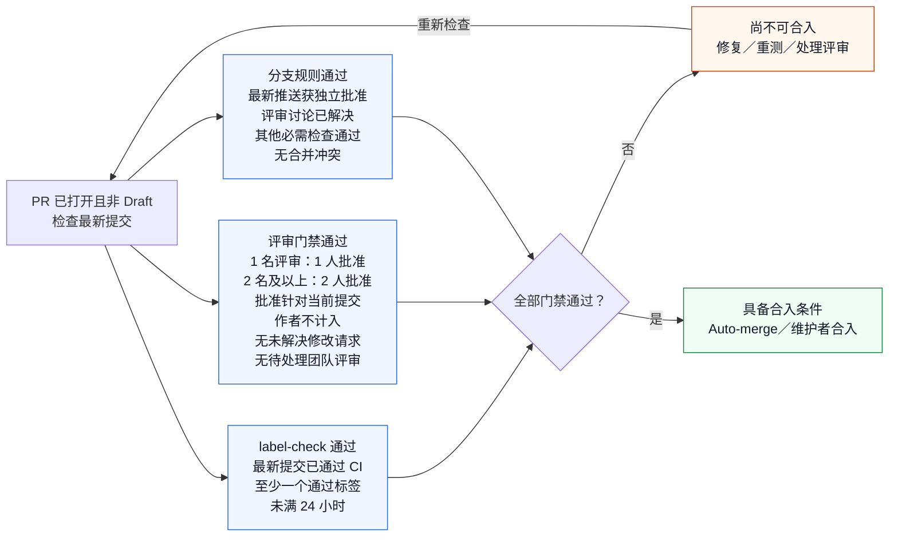

# 参与 HyperParallel 社区贡献

[English](CONTRIBUTING.md) | **简体中文**

HyperParallel 欢迎问题反馈、文档改进、测试、模型接入、性能优化和新并行能力贡献。无需上游仓库写权限，即可通过 Fork 参与开发。
请使用公开 Issue 和 Pull Request 记录方案、评审决定和验证结果，便于社区共同维护。

## 快速入口

| 任务 | 阅读入口 |
| --- | --- |
| 选择问题或提出修改 | [贡献方向](#选择贡献方向) |
| 按修改准备工具 | [开发环境](#准备开发环境) |
| 检查规范与测试结果 | [编程与文档规范](#遵循编程与文档规范) · [验证修改](#验证修改) |
| 创建或更新 PR | [提交步骤](#提交并迭代-pull-request) |
| 了解合入条件 | [合入流程图](#ci评审与合入) |
| 处理阻塞的 PR | [门禁排障](#门禁失败后的处理) |
| 规划发布或接入 | [发布与下游接入](#发布与下游接入) |

请求最终评审前：

- [ ] 基于正确的上游分支，保持一个聚焦的修改和一个提交。
- [ ] 完成相关本地检查，记录当前提交的结果以及未运行用例。
- [ ] 更新受影响的文档及译文，检查链接与示例。
- [ ] 如实填写 PR 模板，说明问题、修改后行为、兼容性影响和验证证据。
- [ ] 完成 PR 后取消 Draft，请求相关维护者评审，确认 CI 已针对当前提交启动。

## 选择贡献方向

- **反馈问题**：先搜索[已有 Issue](https://github.com/mindspore-ai/hyper-parallel/issues)，再使用[问题模板](https://github.com/mindspore-ai/hyper-parallel/issues/new/choose)提交。
- **改进文档或测试**：小范围修正可以直接提交聚焦的 PR。英文文档与同目录的 `.zh.md` 中文版本同步更新。
- **提出新功能或框架接入**：较大实现开始前，先提交 Feature Issue 或 RFC，说明使用场景、接口、兼容性影响、硬件范围和验收标准，并请[相关模块维护者](CODEOWNERS)评审方案。
- **优化性能**：说明工作负载和瓶颈，在相同模型、硬件、精度、并行配置及测量方法下，提供可复现的正确性与性能对比。

不确定修改归属时，可在 Issue 中描述需求，并参考 [CODEOWNERS](CODEOWNERS) 联系模块维护者。
请保持尊重、回应技术意见，并将决定记录在 Issue 或 PR 中。

## 准备开发环境

先在 GitHub 上 Fork [HyperParallel](https://github.com/mindspore-ai/hyper-parallel)，替换以下命令中的 `YOUR_GITHUB_USERNAME`，从目标上游分支创建开发分支。
普通开发面向 `master`；版本修复应先与发布维护者确认目标版本分支。

```bash
git clone https://github.com/YOUR_GITHUB_USERNAME/hyper-parallel.git
cd hyper-parallel
git remote add upstream https://github.com/mindspore-ai/hyper-parallel.git
git fetch upstream
git switch -c feat/your-change upstream/master
```

按本次贡献选择环境：

| 贡献类型 | 本地准备 |
| --- | --- |
| 纯文档 | Git、安装了 `pre-commit` 与 `PyYAML` 的独立 Python 环境，以及[文档检查](#遵循编程与文档规范)。除非需要验证运行时示例，否则不需要安装 PyTorch、项目包或 NPU/GPU 运行时。 |
| Python 逻辑或单元测试 | 支持的 Python/PyTorch 环境、当前仓库的 editable 安装、pytest 及受影响模块所需依赖。 |
| 分布式或原生代码 | 代码开发环境，以及所选测试需要的设备、运行时和构建工具。缺少硬件时，在请求最终评审前与模块／CI 维护者协调验证。 |

各类贡献都应先用自己习惯的工具（如 `venv` 或 Conda）创建并激活独立 Python 环境。
纯文档修改随后可直接进入下方检查步骤；代码开发还需执行运行时安装。Python 版本需符合安装指南要求，环境名称自行选择。
按照[安装指南](docs/installation.zh.md)准备支持的 PyTorch 与硬件运行时组合，再在该环境中执行以下命令，以 editable 模式安装当前代码：

```bash
python -m pip install -e .
python -m pip install pytest
python -c "import hyper_parallel; print(hyper_parallel.__file__)"
```

输出路径必须指向当前代码目录。若指向其他工作区或旧安装，请在目标仓库重新安装。
原生组件还需按照安装指南执行构建及环境激活，单独的 Python editable 安装不会构建这些组件。

依赖详情见[开发环境](docs/contributing/dev_environment.zh.md)，身份认证与账号配置见 [GitHub 协作手册](docs/contributing/github_development_manual.zh.md)。
涉及 RL 的工作从 [RL 入口规则](.agent/rules/hyper-rl.md)开始，并完成其独立运行时配置。

## 遵循编程与文档规范

修改前阅读 [AGENTS.md](AGENTS.md) 和[编程规范](.agent/rules/code-style.md)。具体要求及例外以编程规范为准。

- Python 文件添加 Apache 2.0 头，遵循 PEP 8，行宽约 120 字符，公开 API 提供类型标注和 Google 风格文档字符串。C++ 遵循仓库 `.clang-format` 及 C++ 规范。
- 默认在模块顶部导入，直接使用原生 PyTorch API。涉及分片、通信、流或内存管理时，遵循[分布式实现规则](.agent/rules/distributed.md)。
- 保持修改聚焦。行为、公开接口、依赖和检查点兼容性变化需要配套测试与文档。
- 默认文档使用英文，同步修改对应 `.zh.md`。检查相对链接、锚点、示例命令和 API 签名。
- 修复 lint 和测试失败的根因；必要例外及未验证配置应在 PR 中说明。

在已激活的环境中安装本地提交钩子并执行检查：

```bash
python -m pip install pre-commit PyYAML
bash scripts/pre-commit/install.sh
# 将以下路径替换为本次贡献中所有修改或新增的文件。
python -m pre_commit run --files CONTRIBUTING.md CONTRIBUTING.zh.md
python .agent/scripts/check_agents_catalog.py
git diff --check
```

已配置的钩子按文件类型选择 pylint、lizard 和 markdownlint。显式传入路径可覆盖尚未暂存的新文件，
也可在提交后重新检查 PR，无需制造额外修改。
修改 Markdown 必须运行目录检查；该检查只校验技能与代理目录，因此文档链接需单独检查。
安装方式与工具覆盖见 [pre-commit 指南](scripts/pre-commit/README.md)。

需要 C++／Shell lint、codespell 等额外代码检查时，在聚焦的工作区执行
`python .agent/skills/autogit/scripts/autogit.py check`。它检查未提交修改，临时暂存已跟踪文件后重置暂存区；
新增文件需先显式 `git add`。其 Markdown 依赖安装需要 `PATH` 中可用的 Node.js/npm，且可能全局安装 `markdownlint-cli2`；
上方 pre-commit 管理的工具不会将该命令加入 `PATH`。AutoGit 的远程 PR 流程面向 GitCode，GitHub 提交使用 Git 和 GitHub 工具。

## 验证修改

根据变化的行为选择测试。目录、标记和启动方式见[测试规则](.agent/rules/testing.md)与[测试指南](docs/contributing/testing.zh.md)。

| 修改类型 | 所需验证证据 |
| --- | --- |
| 纯文档 | Markdown lint、目录检查、修改的链接和锚点，以及适用的命令或示例验证。说明运行时测试不适用的原因。 |
| 可独立测试的逻辑 | `tests/ut/` 中受影响的单元测试，问题修复应包含回归用例。 |
| 分片、集合通信、并行组合或检查点恢复 | 在受影响硬件上执行相关分布式 ST，并按场景验证数值与状态恢复。 |
| 性能或内存优化 | 正确性检查，以及相同配置下修改前后的对比；按场景记录吞吐、单步时间、峰值内存及测量条件。 |
| 安装包或依赖修改 | 在声明支持的组合上验证构建、干净环境安装、导入和相关示例。 |

例如执行受影响的 shard 单元测试；影响范围需要时再运行全量单元测试：

```bash
python -m pytest -vs tests/ut/core/shard/
python -m pytest -vs tests/ut/
```

单元测试不能初始化分布式任务。分布式 ST 使用测试规则中指定的仓库启动器，遵循选定用例的设备要求，不要统一再套一层 `torchrun`。
RL ST 独立于主项目 PR 门禁运行，主项目 CI 通过不代表 RL ST 已完成验收。

在 PR 中记录被测提交、命令、模型与配置、Python 和 PyTorch 版本、设备型号与数量及结果。
Ascend 还需记录 `torch-npu`、CANN 和驱动版本；NVIDIA GPU 需记录 CUDA 和驱动版本。
明确列出缺少的硬件与未运行用例，并与维护者协调必要的硬件验证。跳过测试或仅成功解析配置不能记为硬件验证通过。

## 提交并迭代 Pull Request

1. 每个 PR 聚焦一个可独立评审的修改。使用 Conventional Commit，例如 `docs: clarify installation`，英文主题使用祈使句，长度约 80 字符。
2. 每个 PR 保持一个提交。提交 PR 前压缩开发过程中的临时提交，后续修复 amend 到同一提交。改写历史前先备份；仅更新自己的 PR 源分支，并使用带预期远端 SHA 的 `--force-with-lease`。禁止强推共享主分支或版本分支。
3. 推送至个人 Fork，并向正确的上游分支发起 PR。使用仓库[默认模板](.github/PULL_REQUEST_TEMPLATE.md)或[中文模板](.github/PULL_REQUEST_TEMPLATE.zh-CN.md)，说明问题、修改后行为、范围、兼容性影响与实际测试结果。关联真实 Issue；没有适用 Issue 时明确说明，如实填写自检项。
4. 设计、实现或必要证据尚未完成时使用 Draft PR。准备好后，向 [CODEOWNERS](CODEOWNERS) 中相关维护者请求评审。
5. 回应评审意见，同步更新测试与中英文文档，并为最新提交取得有效 CI 和评审结果。相关问题得到处理后再解决评审讨论。

对于与 GitCode 配对的 PR，更新约定的源分支，由同步服务处理对应请求，避免在两端产生竞争修改。
遵循目标分支的实时[仓库规则](https://github.com/mindspore-ai/hyper-parallel/rules)以及适用的身份与 CLA 检查。

## CI、评审与合入

Jenkins 执行项目流水线并向 PR 回报测试及构建结果。GitHub 工作流检查 CI 标签有效期和评审票数。
下图概括当前提交正常合入所需的条件。CI 和评审可以并行进行，三组要求必须全部满足。



图中展示的是不使用绕过权限的正常路径。当前 `master` 门禁包括：

| 门禁 | 贡献者需要完成的事项 |
| --- | --- |
| `label-check` | 当前提交需有 CI 结果，并具有至少一个有效的 `ci-pipeline-passed` 或 `ci-pipeline-passed-but-overtime` 标签。每个标签从最近一次有记录的添加事件起计时，满 24 小时失效；任一标签有效即可满足时间要求。超时标签保留耗时异常信息。 |
| `all-reviewers-approved` | 一名评审人时需一次批准；两名及以上时需两名不同评审人批准。批准针对当前提交，作者不计入，还需有效 CI 标签。处理未解决的修改请求与待处理团队评审。Draft PR 或没有独立评审人的 PR 不能通过。 |
| 原生分支规则 | 最新推送获得独立批准，解决评审讨论，通过其他必需检查，消除合并冲突。新推送使旧批准失效；其他要求以目标分支的[实时规则](https://github.com/mindspore-ai/hyper-parallel/rules)为准。 |

### CI 有效期与自动合并

- 推送后需针对新提交取得新的 CI 和批准。标签过期后重新运行 CI，由 CI 续期；评论或评审不会延长有效期。不要手工添加通过标签。
- 自动流程在发布审批成功前和开启 Auto-merge 前，检查当前提交与标签年龄。之后 GitHub 仍可能等待其他合入条件。
- **过期拦截是异步的，不能保证在满 24 小时的瞬间阻止合并。** 调度延迟或 API 故障可能使旧成功状态暂时保留。
  实时分支规则中允许绕过的账号不受这些门禁约束。

评审人资格、同名 `label-check` 检查与提交状态、共享提交、事件触发、调度和执行边界统一维护在
[评审与合入规则](docs/contributing/github_auto_merge.zh.md)中；本指南保留贡献者需要执行的步骤。

### 门禁失败后的处理

先查看 PR 的 **Checks** 详情和 **Conversation** 中 `mindspore-ai-bot` 最新流水线报告，核对构建对应的提交是否为当前 PR head。

| 现象 | 查看位置 | 操作与责任人 |
| --- | --- | --- |
| CI 通过标签缺失或过期 | `label-check` 详情与最新 Jenkins 报告 | 作者按下方步骤申请 Jenkins 重测，等待当前提交测试成功并取得续期后的标签。 |
| Jenkins 测试或代码检查失败 | 机器人链接中的失败阶段与日志 | 作者与模块维护者修复回归，完成相关本地检查后申请重测；执行资源、环境和回报问题由 CI 维护者处理。 |
| 审批门禁等待或失败 | `all-reviewers-approved` 详情及 Reviewers 侧栏 | 完成 PR 后取消 Draft，取得足够的当前提交批准，并请相关评审人／团队处理未完成请求。CI 过期时先重测。 |
| 讨论未解决或存在合并冲突 | 评审讨论和 PR 合并区域 | 作者处理反馈及冲突，在问题解决后关闭讨论。产生新提交后，需重新取得 CI 与批准。 |
| CI 和批准已更新，门禁状态仍旧 | 对应 GitHub Actions 的排队情况与错误详情 | 在 PR 中请 CI 维护者排查或重新运行门禁工作流。刷新门禁不会重跑 Jenkins，也不会为过期 CI 续期。 |
| 描述或 CLA 检查失败 | 对应机器人消息或检查详情 | 作者修正字段或身份映射。仅修改描述时，按 PR 模板提示使用 `/check-pr`；CLA 失败按对应检查的指引处理。 |

申请 Jenkins 重测时，先说明已修复的问题或续期原因，再在 GitHub PR 的 **Conversation** 中单独发表评论 `/retest`。
该入口已有[重测请求](https://github.com/mindspore-ai/hyper-parallel/pull/1476#issuecomment-6766402177)和
[机器人构建回执](https://github.com/mindspore-ai/hyper-parallel/pull/1476#issuecomment-6766413958)作为依据。
确认出现新的构建链接，再检查最终报告与被测提交。如果命令被拒绝或没有启动构建，在 PR 中向 CI 维护者提供 PR 链接、
当前 head SHA、所用命令及机器人／错误回复。构建运行期间避免重复申请，不要通过关闭检查或手工添加通过标签促成合入。

## 发布与下游接入

版本命名、打包、发布说明和升级指引见[发布流程](docs/contributing/release.zh.md)。计划中的发布节奏、
2026 年 Q4 兼容性目标及 VeOmni 验证与责任分工集中记录在[发布与接入计划](docs/contributing/release_and_integration_plan.zh.md)。

下游接入 PR 应提供安装方式、用户配置、可运行示例、兼容边界及可复现的正确性／性能结果，记录两个项目的提交和精确环境，
并与适配代码同步更新下游使用指南。按该接入已启用的检查完成验收。

## 日常维护与问题跟进

可复现缺陷或跨 PR 问题通过[公开 Issue](https://github.com/mindspore-ai/hyper-parallel/issues/new/choose)提交，PR 特定问题保留在该 PR 中。
提供预期与实际行为、版本、设备、配置、最小复现和脱敏日志。数值或性能问题补充比较方法与基线，附件中移除凭据和私有训练数据。

模块维护者评审方案与实现，PR 作者处理其引入的回归，CI 维护者处理基础设施问题。
在原 Issue 中记录根因、受影响与修复版本以及回归结果。

## 许可证

贡献遵循仓库的 [Apache 2.0 许可证](LICENSE)。引入第三方代码时，保留必要署名与许可信息，并按需更新[第三方软件声明](Third_Party_Open_Source_Software_Notice)。
