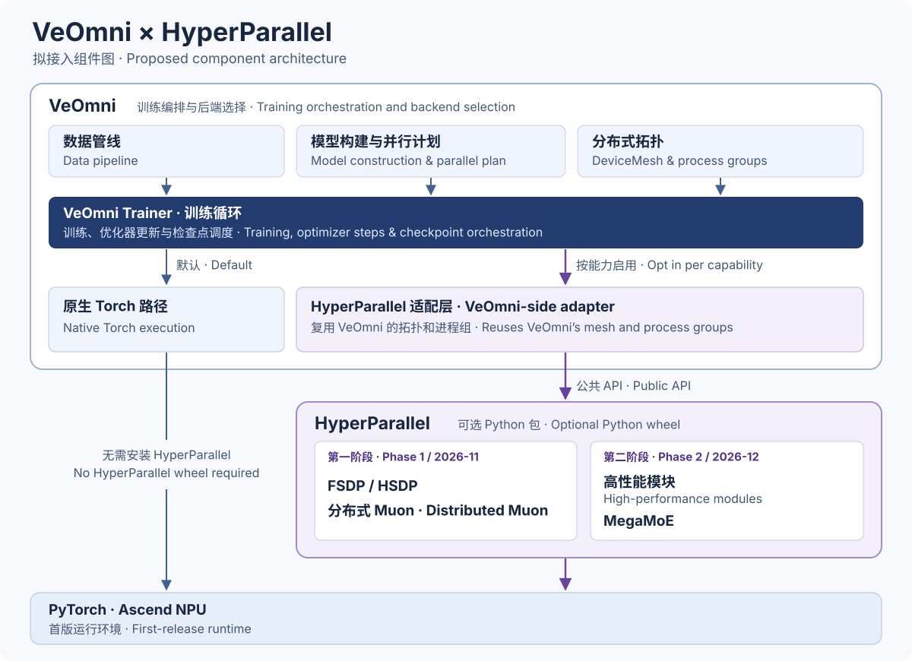

# [RFC] Integrating HyperParallel into VeOmni

**English** | [简体中文](RFC_HyperParallel_VeOmni.zh.md)

## Feature request

We propose integrating HyperParallel's FSDP/HSDP, distributed Muon, high-performance modules, and MegaMoE into VeOmni as optional capabilities to improve communication overlap, optimizer updates, and MoE execution efficiency. Before submitting the implementations, we would like to align with the community on the integration approach and contribution scope.

## Proposed scope

FSDP, Muon, and module implementations would be selected independently. Hyper would remain an optional dependency, loaded only when selected, with existing defaults unchanged.

### Phase 1 (November 2026)

- **FSDP/HSDP**: Integrate Hyper's parameter sharding and communication scheduling, including compute-stage wrapping, forward/backward prefetching, and gradient reduction scheduling optimizations.
- **Distributed Muon**: Reduce redundant computation based on parameter layouts and overlap communication with computation, with efficient batched Newton–Schulz (NS) computation.

An adapter branch already covers FSDP2/HSDP and optional Muon. [Adapter tracking issue](https://github.com/mindspore-ai/hyper-parallel/issues/1124)

### Phase 2 (December 2026)

- **High-performance modules**: Use VeOmni's existing module and operator extension mechanisms to optionally integrate semantically compatible Hyper implementations while preserving model parameters and computation semantics.
- **MegaMoE**: Integrate coordinated expert communication and computation for expert parallelism (EP), with support for composition with FSDP and Muon.

For each high-performance module proposed for upstreaming, the implementation PR would name the module, the models it applies to, and how to enable it. Support for each capability or combination would be recorded against the configuration actually tested.

## Integration approach

VeOmni would retain ownership of model construction, data processing, and training loops, while Hyper would provide distributed execution and high-performance module implementations. The integration would reuse existing runtime and module extension mechanisms through an adapter layer, minimizing backend-specific branching in shared workflows.

VeOmni would continue to construct the `DeviceMesh`. The adapter would reuse that mesh and its process groups when invoking HyperParallel's public APIs. HyperParallel would publish a versioned wheel. VeOmni would declare it as an optional dependency in `pyproject.toml` and pin the tested version in `uv.lock`. The native Torch configuration would remain usable without installing the wheel. [VeOmni package configuration](https://github.com/ByteDance-Seed/VeOmni/blob/main/pyproject.toml)

We propose reusing or extending the existing parallel plan to describe the model stages needed for wrapping and prefetching, rather than accumulating model-specific logic in the adapter. The first release will support Ascend NPUs only, with GPU support planned for a later release.

We suggest starting with Qwen-family models for end-to-end integration and validation, then gradually expanding model and modality coverage. We will confirm the specific validation scope with the VeOmni community.

### User configuration example

<!-- Add the user-facing configuration example here. -->

## Validation

Maintain regression coverage for the native Torch path. Validate forward/backward numerics, gradient accumulation, and activation checkpointing for each capability and their supported combinations. Compare end-to-end step time, optimizer time, and peak device memory under matched model and training configurations, and use profiling to examine communication–computation overlap.

HyperParallel would extend the existing experiments with the cases requested by VeOmni. We would attach a full report to this RFC and to the implementation PR, identifying the revisions actually tested. The PR would also add a guide in the VeOmni repository with the wheel installation command, a minimal training configuration, a launch command, and expected output. [Initial HSDP experiments](https://github.com/mindspore-ai/hyper-parallel/issues/637)

## CI and release coordination

HyperParallel proposes to run the VeOmni compatibility pipeline on its own Ascend resources in Q4 2026.

| Trigger | Verification and decision |
| --- | --- |
| Weekly VeOmni refresh | Pin an upstream VeOmni commit, its release tag if available, and any adapter patch still needed. Run the HyperParallel mainline wheel against that combination on Ascend. Promote it to the PR baseline only after the required tests pass. If a refresh fails, retain the previous baseline, record the failing commit and assign an owner. |
| Before merging a HyperParallel PR | Build a wheel from the current PR commit and install it with the pinned VeOmni baseline in a clean environment. Run multi-device forward/backward and update comparisons, same-topology save/resume, and the agreed cases for each enabled capability. A failed, skipped or missing required result blocks the HyperParallel PR. Rerun when either the PR commit or the baseline changes. |
| Before a Beta or Stable release | Install the candidate package and run the quick start and multi-device tests for the declared combinations. For Stable, also validate the upgrade path and a representative downstream job. Publish the package, dependency versions, compatibility results, limitations and upgrade instructions. |

Each result would identify both project revisions, the model and enabled capabilities, device type and count, PyTorch version, accelerator runtime, and a test report. HyperParallel's broader Q4 matrix targets PyTorch 2.9 through the latest stable release on Ascend NPU and NVIDIA GPU. The first VeOmni integration would validate compatible Ascend combinations and record torch-npu and CANN versions. The broader GPU matrix would record CUDA versions. Combinations awaiting runtime support would be marked as pending. HyperParallel also aims to meet PyTorch Ecosystem Project criteria, including tracking the latest two PyTorch releases and providing working CI for declared architectures. [PyTorch Ecosystem criteria](https://github.com/pytorch-fdn/tac/blob/main/docs/governance/PyTorch_Ecosystem_Process.md#ecosystem-projects-requirements)

The projects would release independently. HyperParallel targets approximately one Beta per month for downstream testing and one Stable per quarter. HyperParallel uses semantic versioning and documents the maturity of individual features. VeOmni can update its pin once a new combination passes integration testing. [HyperParallel release policy](https://github.com/mindspore-ai/hyper-parallel/blob/master/docs/contributing/release.md)

### HyperParallel contribution and merge checks

HyperParallel contributors use an issue or RFC to agree on scope and acceptance criteria. Each focused PR provides a single commit and the relevant unit or distributed test results. Contributors follow the project's Python and C++ conventions, including typed public Python APIs and Google-style docstrings. Local pre-commit checks run pylint, lizard and markdownlint on applicable changes. [Coding conventions](https://github.com/mindspore-ai/hyper-parallel/blob/master/.agent/rules/code-style.md) · [Pre-commit configuration](https://github.com/mindspore-ai/hyper-parallel/blob/master/.pre-commit-config.yaml)

HyperParallel's current mainline checks include `label-check` for the Jenkins result and `all-reviewers-approved` for the review quorum. A passing CI label is valid for 24 hours. With one reviewer, one approval is required. With multiple reviewers, two approvals are required. Code Owner review, independent approval of the latest push and resolution of review discussions also apply. [HyperParallel merge rules](https://github.com/mindspore-ai/hyper-parallel/blob/master/docs/contributing/github_auto_merge_zh.md)

## Ownership and issue handling

HyperParallel would maintain the wheel, adapter code, VeOmni usage guide, Ascend test resources and weekly compatibility runs. VeOmni maintainers would review changes to their repository and decide what to merge and release. We propose that both projects name a primary and a backup contact before the first release.

HyperParallel would take first responsibility for Ascend training failures and numerical discrepancies. For a HyperParallel PR regression, the author would fix the change with support from the integration maintainer. For a weekly incompatibility involving a VeOmni interface, HyperParallel would provide a minimal reproduction and coordinate the adapter fix. For supported GPU configurations, the maintainer of the affected module would lead the fix.

## Feedback requested

Feedback is welcome on the integration boundaries, model-stage declarations, and initial model and hardware coverage.
