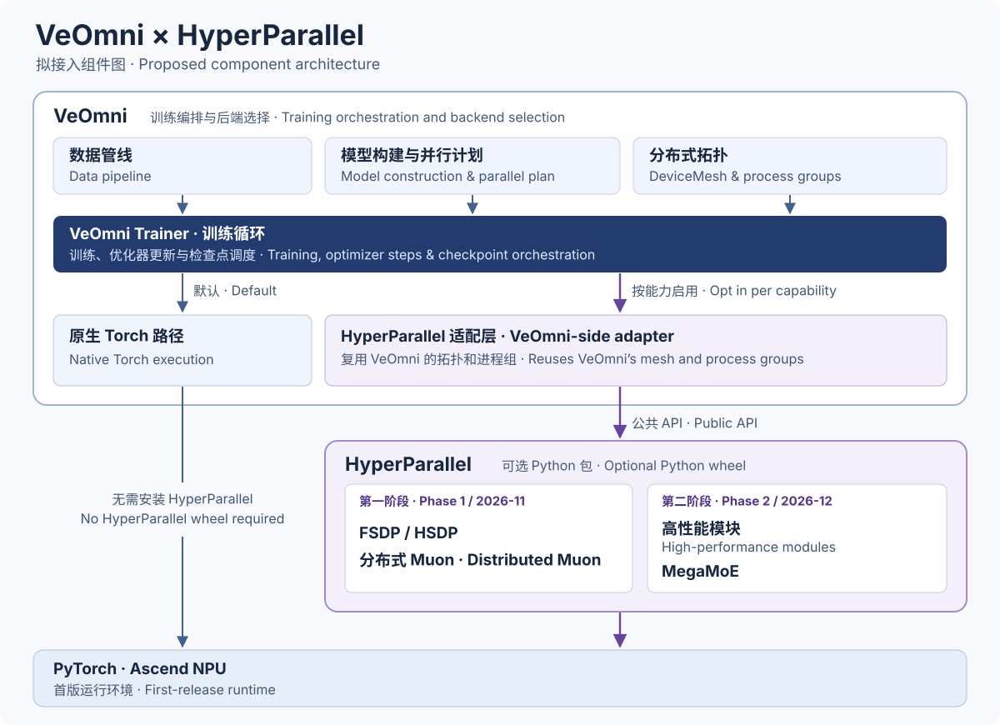

# [RFC] 将 HyperParallel 接入 VeOmni

[English](RFC_HyperParallel_VeOmni.md) | **简体中文**

## 功能提案

我们提议将 HyperParallel 的 FSDP/HSDP、分布式 Muon、高性能模块和 MegaMoE 作为可选能力接入 VeOmni，使通信与计算更充分地重叠，并提高优化器更新和 MoE 执行效率。在提交实现之前，我们希望先与 VeOmni 社区就接入方式和贡献范围达成共识。

## 拟接入范围

用户可以分别选择 FSDP、Muon 和各模块的实现。HyperParallel 作为可选依赖，仅在用户选用对应能力时加载。VeOmni 现有配置继续沿用原有的默认行为。

### 第一阶段（2026 年 11 月）

- **FSDP/HSDP**。接入 HyperParallel 的参数分片与通信调度，包括按计算阶段封装模块、前向与反向预取，以及梯度归约调度优化。
- **分布式 Muon**。根据参数布局减少重复计算，使通信与计算重叠，并高效地批量执行 Newton–Schulz（NS）迭代。

已有适配分支覆盖 FSDP2/HSDP 和可选的 Muon。[适配跟踪单](https://github.com/mindspore-ai/hyper-parallel/issues/1124)

### 第二阶段（2026 年 12 月）

- **高性能模块**。复用 VeOmni 现有的模块和算子扩展机制，允许用户选择语义兼容的 HyperParallel 实现，保持模型参数和计算语义一致。
- **MegaMoE**。在专家并行（EP）中协同调度专家间通信与计算，并支持与 FSDP 和 Muon 组合使用。

对于每个拟合入的高性能模块，实现 PR 将列明模块名称、适用模型和启用方式。各项能力及其组合的支持范围以实际测试的配置为依据。

## 接入方案

VeOmni 继续负责模型构建、数据处理和训练循环，HyperParallel 提供分布式执行能力和高性能模块实现。适配层将复用 VeOmni 现有的运行时和模块扩展机制，减少公共训练流程中针对特定后端的条件分支。

`DeviceMesh` 继续由 VeOmni 构建。适配层调用 HyperParallel 公共 API 时，复用该设备网格及其进程组。HyperParallel 将发布带版本号的 wheel 安装包。VeOmni 在 `pyproject.toml` 中将它声明为可选依赖，并在 `uv.lock` 中锁定已测试的版本。沿用原生 Torch 配置的用户无需安装该 wheel。[VeOmni 依赖配置](https://github.com/ByteDance-Seed/VeOmni/blob/main/pyproject.toml)

我们建议复用或扩展现有的并行计划，由模型声明哪些计算阶段需要封装和预取，使适配层可以统一处理不同模型。首版仅支持 Ascend NPU，GPU 支持计划在后续版本中提供。

建议先从 Qwen 系列模型开始端到端接入和验证，再逐步扩展到其他模型和模态。具体的验证范围将与 VeOmni 社区共同确认。

### 用户配置示例

<!-- 在此补充供用户使用的配置示例。 -->

## 验证方案

保留原生 Torch 路径的回归测试。针对每项能力及其支持的组合，验证前向与反向计算的数值结果、梯度累积和激活重计算。在相同的模型与训练配置下，对比端到端单步耗时、优化器耗时和设备峰值显存，并通过性能分析检查通信与计算的重叠情况。

HyperParallel 将以现有实验为基础，根据 VeOmni 社区提出的用例补测。我们会在本 RFC 和实现 PR 中附上完整报告，注明实际测试的代码版本。实现 PR 还将在 VeOmni 仓库中补充使用指南，给出 wheel 安装命令、最小训练配置、启动命令和预期输出。[HSDP 初步实验记录](https://github.com/mindspore-ai/hyper-parallel/issues/637)

## CI 与版本发布协作

HyperParallel 提议在 2026 年 Q4 使用自身的 Ascend 资源运行 VeOmni 兼容性验证流水线。

| 触发时机 | 验证内容与通过条件 |
| --- | --- |
| 每周更新 VeOmni 基线 | 固定 VeOmni 上游提交、对应的发布标签（如有）及仍需使用的适配补丁。在 Ascend 上用 HyperParallel 主线构建的 wheel 验证该组合。必测项全部通过后，再将其设为 PR 测试基线。更新失败时保留上一条基线，记录失败的提交并指定负责人。 |
| HyperParallel PR 合入前 | 从 PR 当前提交构建 wheel，并与固定版本的 VeOmni 一起安装到干净环境。在多卡上对照前向、反向和参数更新结果，验证相同拓扑下的保存与续训，并运行双方为各项已启用能力约定的用例。必测项失败、跳过或缺少结果时，阻止该 HyperParallel PR 合入。PR 提交或测试基线变更后重新验证。 |
| Beta 或 Stable 发布前 | 安装候选包，针对声明支持的组合验证快速入门示例和多卡用例。发布 Stable 前，还需验证升级路径和代表性下游训练任务。发布内容包括安装包、依赖版本、兼容性结果、已知限制和升级说明。 |

每份测试报告都应记录两个项目的代码版本、模型及启用的能力、设备类型与数量、PyTorch 版本、加速器运行时和验证结果。HyperParallel 的 Q4 验证矩阵计划覆盖从 PyTorch 2.9 到最新稳定版的 Ascend NPU 和 NVIDIA GPU 环境。VeOmni 首版将在兼容的 Ascend 组合上验收，记录 torch-npu 和 CANN 版本；HyperParallel 的 GPU 验证矩阵则记录 CUDA 版本。仍待运行时适配的组合标记为“待验证”。HyperParallel 还计划满足 PyTorch Ecosystem Project 标准，包括跟进最近两个 PyTorch 发布版本，并为声明支持的架构提供可运行的 CI。[PyTorch Ecosystem Project 标准](https://github.com/pytorch-fdn/tac/blob/main/docs/governance/PyTorch_Ecosystem_Process.md#ecosystem-projects-requirements)

两个项目独立发版。HyperParallel 计划约每月发布一个 Beta 供下游测试，约每季度发布一个 Stable。版本号遵循语义化版本规范，并逐项说明功能成熟度。新组合通过集成验证后，VeOmni 即可更新锁定的依赖版本。[HyperParallel 发布规范](https://github.com/mindspore-ai/hyper-parallel/blob/master/docs/contributing/release.md)

### HyperParallel 的贡献与合入检查

贡献者通过 Issue 或 RFC 商定改动范围与验收条件。每个 PR 聚焦一项变更，整理为一个提交，并附相关单元测试或分布式测试结果。贡献者遵循项目的 Python 和 C++ 编程规范，为公共 Python API 提供类型标注和 Google 风格的文档字符串。本地 pre-commit 钩子针对适用的改动运行 pylint、lizard 和 markdownlint。[编程规范](https://github.com/mindspore-ai/hyper-parallel/blob/master/.agent/rules/code-style.md) · [pre-commit 配置](https://github.com/mindspore-ai/hyper-parallel/blob/master/.pre-commit-config.yaml)

HyperParallel 当前的主线门禁包括检查 Jenkins 结果的 `label-check`，以及检查评审批准人数的 `all-reviewers-approved`。CI 通过标签的有效期为 24 小时。一位评审人时需一人批准，多位评审人时需两人批准。合入还需满足 Code Owner 评审、最近一次推送获独立批准，以及评审讨论已解决等条件。[HyperParallel 合入规则](https://github.com/mindspore-ai/hyper-parallel/blob/master/docs/contributing/github_auto_merge_zh.md)

## 维护分工与故障处理

HyperParallel 将负责 wheel 安装包、适配代码、VeOmni 仓内使用指南、Ascend 测试资源和每周兼容验证。VeOmni 维护者负责评审其仓库的变更，并决定合入和发布范围。建议双方在首版发布前各指定一位主联系人和一位备份联系人。

Ascend 上出现训练失败或数值偏差时，由 HyperParallel 首接。若 HyperParallel PR 引入回归，由 PR 作者在接入维护者的协助下修复。若每周验证发现与 VeOmni 接口不兼容，HyperParallel 将提供最小复现并协调修复适配代码。对于已支持的 GPU 配置，由故障模块的维护者牵头修复。

## 征求反馈

欢迎 VeOmni 社区就接入边界、模型计算阶段的声明方式，以及首批模型与硬件的覆盖范围提出意见。
