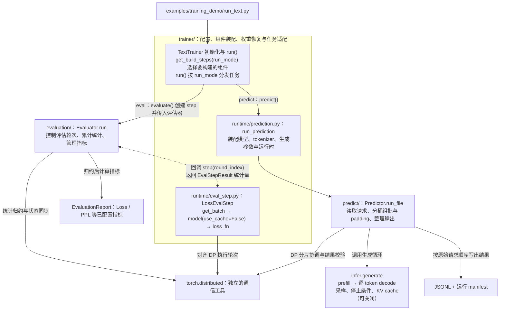
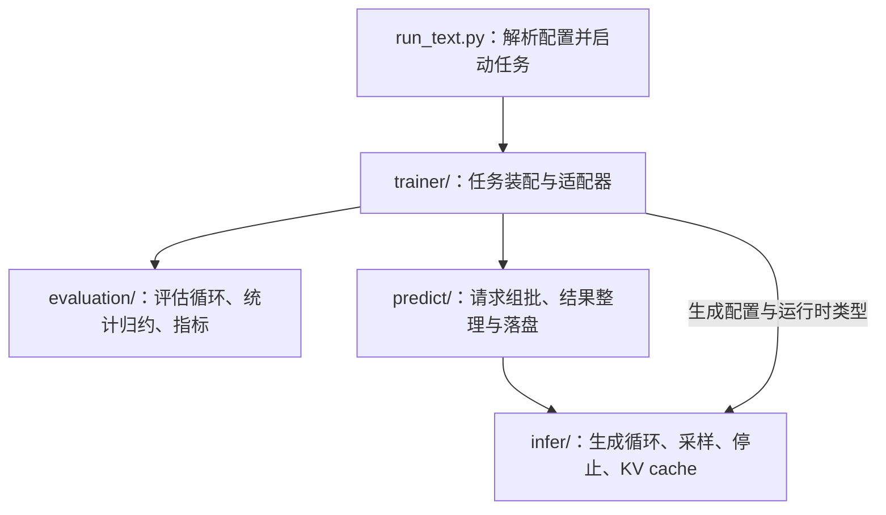

# HyperParallel Eval 与 Predict 设计方案

本文统一说明 P0 独立 loss 评估与 P1 离线生成的整体设计，并单独列出后续规划。
代码通过两个独立 PR 交付；单独检出其中一个分支时，仅包含对应功能及其所需的公共宿主代码。
读者应能据此回答：评估的是什么、一次调用执行哪些步骤、结果怎样统计、哪些能力尚未实现。

| 项目 | 内容 |
| --- | --- |
| 实现范围 | P0：独立 Loss/PPL 评估；P1：离线批量文本生成 |
| 交付方式 | eval 与 predict 分别提交；取代原合并实现 [PR #1650](https://github.com/mindspore-ai/hyper-parallel/pull/1650) |
| 使用说明 | [eval 中文指南](https://github.com/wang-hua-2019/hyper-parallel/blob/feat/standalone-eval-p0/docs/guide/trainer/evaluation.zh.md)、[predict 中文指南](https://github.com/wang-hua-2019/hyper-parallel/blob/feat/offline-predict-p1/docs/guide/trainer/predict.zh.md) |
| 代码约束 | [AGENTS.md](../../AGENTS.md)、[代码规范](../../.agent/rules/code-style.md)、[分布式规则](../../.agent/rules/distributed.md) |

## 1. 要解决什么问题

### 1.1 G1：在相同条件下比较不同 checkpoint

checkpoint 是某个时刻保存的模型权重。“跨 checkpoint 比较”就是分别加载这些权重，
在相同评估数据和计算规则下计算指标，比较各份权重的表现。例如：

| 权重 | 使用的数据与计算规则 | 比较内容 |
| --- | --- | --- |
| step 1000 保存的权重 | 固定验证集、相同分词和 mask、按有效 token 加权 | Loss/PPL |
| step 2000 保存的权重 | 与上面相同 | Loss/PPL |
| step 3000 保存的权重 | 与上面相同 | Loss/PPL |

在这些条件一致时，较低的纯语言模型 Loss/PPL，通常表示模型对这份数据中的真实文本预测得更好。
它不能直接证明模型在问答、数学或代码任务上的最终答案更好；这些任务还需要相应判分。
若使用 `max_batches` 截断评估，还应保持组批配置和 DP 拓扑一致，否则相同轮数可能处理不同的样本，
失去“在相同数据上比较”的前提。

训练日志中的 loss 可以正确反映当时的训练情况，但通常不能直接替代这种固定条件下的比较：

- 不同训练步骤看到的 batch 不同，模型参数也在不断更新，日志不是固定权重遍历固定验证集的结果。
- loss 可能包含 router aux、MTP 或其他辅助项；对混合损失取指数不能得到语言模型 PPL。
- 如果日志平均的是 batch 均值，长短 batch 的权重可能不正确。例如 10 个 token 的平均 loss 为 2，
  90 个 token 的平均 loss 为 1，全体平均应为 `(10 × 2 + 90 × 1) / 100 = 1.1`，不是 `1.5`。
- dropout、数据切分、监督 mask 等设置也会影响结果，需要明确并保持一致。

因此 G1 提供独立的评估入口：加载指定权重、选择明确的数据范围、关闭训练行为，并统一统计口径。
“独立”表示可以脱离训练循环单独运行，不表示完全不复用 `Trainer` 的装配能力。

### 1.2 G2：给定输入，批量生成文本

G2 解决的是模型实际会回答什么：读取 prompt 或对话历史，生成下一段文本，并按输入顺序保存结果。
它不要求先运行 eval，也不自动对生成结果评分。

### 1.3 G3 与 G4：多卡正确性和结果记录

G3 要求在已开放的并行拓扑下，不遗漏、重复统计或错误归约数据。
G4 要求记录本次生成使用的模型来源、输入、模板、参数、seed 和环境，使结果可检查和复算。
当前 manifest 提供运行信息与完整性校验；请求级随机流和断点续跑属于后续 B0 阶段。

### 1.4 当前功能与后续规划

| 功能 | 当前状态 |
| --- | --- |
| 固定范围上的全局 token 加权 Loss/PPL | P0 已实现 |
| 指定 checkpoint 的 model-only 恢复 | P0/P1 已实现 |
| 多指标配置，内置 Loss 与 Perplexity | P0 已实现；自定义指标的数据边界见第 4 节 |
| txt/jsonl/json 输入，prompt 或完整 messages | P1 已实现 |
| 批量生成、按输入长度排序组批、按原序输出 JSONL | P1 已实现 |
| 单卡及独立 DP predict，每个分片持有完整模型 | P1 已实现 |
| 单卡、DP、dense FSDP/HSDP loss eval | P0 已开放；实际验证范围见第 8 节 |
| 生成式评估、ROUGE/BLEU 等 | P3 规划，当前入口明确拒绝 |
| TP/CP/EP/PP/SP 的独立任务支持 | P2 及后续逐项开放，当前拒绝 |
| FSDP/HSDP 分片模型生成 | 后续规划，当前 predict 拒绝 |
| 每请求多个候选、请求级 RNG、断点续跑 | B0 规划 |
| continuous batching、在线服务、beam search | 本次范围外 |

旧训练循环和周期评估回调保留原有职责。不能由训练支持某种拓扑，推断独立 eval 或 predict 也支持。

## 2. 整体架构与模块职责

### 2.1 整体架构：两条任务路径

下图统一展示 P0 eval 与 P1 predict；两个独立 PR 各自实现对应路径。
实线表示任务装配、调用或通信，虚线表示注入的 step 回调及其返回值；**这里不是 import 依赖图**。
训练路径保持原有实现，图中只展开 eval 与 predict。



读取这张图时，重点看三点：

- **eval 直接前向计算 loss**：`Evaluator` 调用传入的 `LossEvalStep`，后者取 batch、调用模型和 loss 函数。
  当前 loss eval 不经过 `infer.generate`，并显式关闭 KV cache。
- **predict 调用生成循环**：`Predictor` 负责请求与文件，`infer.generate` 负责模型生成。
  生成结果返回 `Predictor` 后，再按原输入顺序写入文件。
- **回调不等于导入依赖**：`LossEvalStep` 位于 Trainer 侧，但 `Evaluator` 只持有一个可调用的 step，
  无需导入 `trainer/`。`torch.distributed` 为两条任务路径提供通信，不属于 `infer/`。

### 2.2 模块依赖图：哪些包可以导入哪些包

下图箭头表示代码依赖，不表示每一次函数调用；省略 Torch 等通用依赖。



- `evaluation/` 和 `predict/` 不导入 `trainer/`，两者也不互相导入。
- 当前 `evaluation/` 不依赖 `infer/`。Loss 评估的模型前向由 Trainer 侧适配器执行。
- `predict/` 复用 `infer.generate`，不另写一套生成循环。
- `trainer/` 从 `infer/` 导入 `GenerationOptions` 和 `GenerationRuntime`，用于配置和装配生成任务；这不表示 loss eval 调用生成循环。
- `torch.distributed` 是通信工具。评估统计的归约使用它，但这不意味着评估必须经过 `infer/`。

运行时，评估器会回调 Trainer 创建的 `LossEvalStep`，如 2.1 节所示。
因此应说“`evaluation/` 不导入 `trainer/`”，不能笼统地说“eval 不调用 trainer”。

### 2.3 什么是 step 注入，为什么这样设计

这里的 step 是“执行一轮评估的可调用对象”；注入是把它作为参数交给评估器：

```python
step = LossEvalStep(trainer, split_name="valid")
evaluator = Evaluator(step, metrics, context, device)
report = evaluator.run(max_batches=20)
```

评估器每轮执行 `result = step(round_index)`。例如 step 返回本轮 loss 总和为 200、有效 token 数为 100，
评估器拿到的是这些统计量，不是原始文本、标签或 logits。

| 职责 | `LossEvalStep` | `Evaluator` |
| --- | --- | --- |
| 读取 batch、适配模型输入和标签 | 负责 | 不直接读取 |
| 调用模型与 loss 函数 | 负责 | 调用注入的 step 获取结果 |
| 计数有效 token、真实样本 | 负责 | 累计各轮结果 |
| 轮数上限、指标生命周期、最终归约 | 配合提供数据耗尽状态 | 负责 |

采用这种分工是为了集中处理 Trainer 接口适配，复用现有输入处理逻辑，同时让统计循环独立维护。
验证 token 加权是否正确时，可以传入返回已知数值的假 step，不必加载模型或运行 NPU。
另一个调用方也可以提供自行持有模型和 DataLoader 的 step，复用同一个 `Evaluator`。

当前默认 step 确实使用 `trainer.get_batch / model / loss_fn`，因此放在 `trainer/runtime/eval_step.py`
作为适配器。这个位置是当前实现的选择，不是所有 step 都必须依赖 Trainer 的定义。
当前 YAML 尚无自定义 step 的配置入口；替换 step 需在 Python 中装配 `Evaluator` 或扩展宿主入口。

### 2.4 初始化步骤与评估 step 是两种概念

`get_build_steps(run_mode)` 返回该模式需要启用的组件初始化步骤名称，本身不执行构建。
返回 tuple 用作组件启用清单，实际调用顺序由 `TextTrainer` 的装配代码决定。
它不是上一节“执行一轮评估”的 step，也不是按 tuple 自动执行的调度器。

| 组件 | train | eval | predict |
| --- | --- | --- | --- |
| 运行环境、模型、tokenizer/模板 | 构建 | 构建 | 构建 |
| model-only 恢复入口 | 使用训练恢复路径 | 使用 | 使用 |
| 数据集、DataLoader、loss 函数 | 构建 | 构建 | 不构建；Predictor 自己读请求文件 |
| optimizer、scheduler、训练上下文、callbacks | 构建 | 不构建 | 不构建 |

查询函数只接受 `run_mode` 参数。`EvaluationConfig.mode` 用于明确区分已实现的 loss 评估和预留的生成式评估。
配置树继续位于 `trainer/config/`，本次不迁移整个共享配置层，避免扩大对训练等模块的影响。

## 3. Loss 评估如何执行

### 3.1 `mode: loss` 与 `mode: generation`

| 项目 | loss：当前实现 | generation：后续规划 |
| --- | --- | --- |
| 输入 | 已有文本及监督标签 | prompt 与单独保存的参考答案或判分规则 |
| 模型执行 | 在因果注意力约束下，一次前向计算各位置的预测 | 从 prompt 开始逐 token 生成 |
| 各位置的上下文 | 前面的真实 token，称为 teacher forcing | prompt 和模型已经生成的 token |
| 指标 | Loss/PPL | 答案准确率、ROUGE/BLEU 等 |
| 底层路径 | step 直接调用模型，`use_cache=False` | 生成部分应复用 `infer.generate` |

例如问题为“中国的首都是哪里”，参考答案为“北京”：loss 评估检查模型给参考答案各 token
分配的概率；生成式评估让模型自行回答，再检查答案质量。参考答案不能泄漏到生成 prompt 中。

当前 `evaluation.mode: generation` 会抛出 `NotImplementedError`，不会自动变成 predict。
predict 已能生成文本，但完整的生成式评估还需要评估数据与判分逻辑。

### 3.2 数据范围：评估哪些记录，执行多少轮

评估默认使用明确选定的 `valid` 或 `test` 切分；`split: dataset` 用于单个未切分 Dataset。
不隐式选择训练集。`evaluation.dataset` 和 `evaluation.dataloader` 可以覆盖顶层数据配置。

| 字段 | 含义 |
| --- | --- |
| `max_samples` | 在选定数据集的全局原始记录范围上设置上限，然后再做 DP 分片 |
| `max_batches` | 每个 DP 分片最多执行的前向轮数，不是所有卡轮数之和，也不是样本条数 |
| 两者均为 `null` | 对支持自然有限范围的数据源，评估完整选定切分 |

例如 `max_samples: 1000`、`max_batches: 20`：先最多选择 1000 条原始记录，执行时遇到数据耗尽
或 20 轮上限即停止。因此不保证最终处理完全部 1000 条。
原始记录经过 transform 后可能产生多个模型窗口，报告中的 `num_samples` 与原始记录数不一定相同。

数据源约束如下：

- Online Mapping 可按自然切分遍历完整数据，超出的上限截断到实际大小。
- 多个加权来源采用无放回选择；权重影响顺序，一个来源耗尽后继续从其他来源取数据。
  固定 seed 时改变上限仍保留相同的选择前缀。
- Iterable 来源需要 `max_samples`，先物化有限前缀再分片。
- Indexed 构建器需要明确样本计划，由 `max_samples` 或构建器自身显式 split sizes 提供。

### 3.3 动态组 batch：按 token 预算选择样本

当前文本 eval 示例使用 `TokenBatchLoader`。每个 DP 分片独立组批，默认每轮预算为：

```text
token_budget = evaluation.batch_size × data_transform.max_seq_len
```

也可以在 DataLoader 配置中显式设置 `token_budget`。
这里计数的是编码后模型样本的 `input_ids` 长度，不是字符数，也不是去掉监督 mask 后的有效标签数。
`evaluation.batch_size` 在此路径中用于源数据读取和默认预算推导，不是最终前向批次的样本数硬上限。

例如 `batch_size: 2`、`max_seq_len: 1024` 对应 2048 token 预算。
候选数据合适时，一轮可以包含 2 条 1024-token 样本，也可以包含 4 条 512-token 样本。

样本长度不同时，不要求刚好拼满。假设候选缓冲区依次有：

| 样本 | token 数 | 当前轮处理 |
| --- | ---: | --- |
| A | 900 | 选入，累计 900 |
| B | 700 | 选入，累计 1600 |
| C | 600 | 超出剩余 448，保留到后续轮次 |
| D | 400 | 选入，累计 2000 |

本轮选择 A、B、D，C 保留在缓冲区；不会为了填满剩余 48 个位置而切开 C。
算法按候选顺序扫描，遇到放不下的样本后继续检查后面的样本，不做长度排序，也不保证最优填充。
跨批次的执行顺序可能因这种跳过而变化。

`min_buffered_samples` 控制候选池准备门槛，不是最终 batch 大小。
正常读取期间，要同时满足候选条数门槛和候选 token 总量达到预算才开始取批；数据耗尽时仍会排空尾部。
如果单条编码后的样本已经超过本轮 token 预算，当前 loader 会让它单独成批，不在组批阶段截断。
因此该预算不能当作单样本的绝对长度或显存上限。

选中样本由 `TextPackingCollator` 拼接，记录 `cu_seq_lens` 作为各样本边界。
默认只补到并行执行需要的对齐长度；设置 `pad_to_length` 才补到指定长度，超过指定长度会报错。
padding 标签使用 `IGNORE_INDEX`，不计入有效 loss/token 统计。

### 3.4 一轮评估返回什么

`LossEvalStep` 在 `torch.no_grad()` 下执行模型，明确使用 `use_cache=False`。
`TextTrainer.evaluate()` 在运行前切换模型到 eval 状态，结束后恢复原来的训练状态。
评估没有逐 token 生成循环，不需要在解码步骤之间保留 KV cache。

每个有名称的统计项返回两个可相加的标量，以及一个 NLL 标记：

```python
@dataclass
class LossStatistics:
    numerator: torch.Tensor
    denominator: torch.Tensor
    is_lm_nll: bool = False
```

- `numerator`：本轮损失总量。
- `denominator`：与该损失匹配的权重；token 加权损失使用有效 token 数。
- `is_lm_nll`：是否为纯语言模型负对数似然。默认 `False`，用于判断能否计算 PPL。

`EvalStepResult.statistics` 保存这些有名称的统计量；`sample_count` 保存本轮实际处理且含有效监督的模型样本数。
packing 后的一个 tensor row 可能包含多条样本，不能按 tensor 的行数代替样本数。

### 3.5 为什么保留 `is_lm_nll`

PPL 的定义要求纯语言模型 NLL：

```text
平均 NLL = 全局 NLL 总和 / 全局有效 token 数
PPL = exp(平均 NLL)
```

若某个 loss 已经混入辅助项，例如 `NLL + 0.1 × router_aux_loss`，就必须标记为 `False`。
它仍可以输出为普通 loss，但让 `PerplexityMetric` 使用它会明确报错。
这个标记不改变 loss 数值，也不触发反向传播。

适配器按统计项判定该标记：标准 `foundation` 默认按语言模型 NLL 处理，其他统计项默认不作为 NLL。
loss 模块可通过 `statistic_is_lm_nll` 映射或可调用对象声明覆盖值；
`LossEvalStep` 也接受同名的 Python 映射参数。返回值必须为布尔值，声明函数可用 `None` 表示未声明。
自定义 loss 如果把辅助项混进 `foundation`，必须明确声明 `False`，不能依靠名称推断纯度。
当前 `ChunkedCausalLMLoss` 会根据是否折入非零 router aux 项进行声明。

同名统计在不同 batch 或不同 rank 上的标记必须一致，否则报错。
这个标记只表达是否为纯 NLL，不扩展成通用的损失分类体系。

### 3.6 归一化、累计与多卡归约

loss 模块通过 `loss_normalization` 声明返回值的口径：

| 声明 | loss 模块返回值 | step 如何转换 |
| --- | --- | --- |
| `token_mean` | 本地有效 token 的均值 | 分子 = 均值 × 本地有效 token 数 |
| `sum` | 本地损失总和 | 直接作为分子 |
| `global_mean` | 已完成跨域归约的均值 | 跳过，避免重复计数 |

未声明的口径会报错。额外 loss 项需要对应的有效 token 计数，不能自动借用 `foundation` 的分母。
全部被 mask 的 batch 贡献零权重，不将空交叉熵的 NaN 传播到最终报告。

最终 loss 使用所有唯一贡献的分子之和除以分母之和，不平均 batch 均值或 rank 均值。
内置 Loss/PPL 和样本数共用一次最终数值归约；归约前还会交换统计名称、NLL 标记和错误状态。
这不表示整个任务只有一次通信：FSDP 前向以及每轮是否仍有数据的检查也可能通信。

CPU/CUDA 使用 FP64 累加；NPU 使用带补偿的 FP32 累加，避免部分 FP64 转换回退造成的小量丢失。
样本数先保持 int64，数值通信使用 FP32 高低位对，最后在 CPU FP64 中合并。
补偿能减少累计误差，但两路 FP32 集合通信仍有舍入误差，不等价于精确 FP64 集合运算。
统计存储量不随评估 batch 数增长，不为记录指标而逐 batch 同步到主机。

DP 各分片只贡献各自真实数据，不重复有效样本补齐尾批。
为了保持 FSDP 前向轮次一致，已耗尽数据的分片执行零权重占位前向，不计入指标和真实样本数。
重复运行评估时，step 复位 DataLoader 游标及动态候选缓冲，再次遍历相同的数据范围。

## 4. 多指标与自定义指标

### 4.1 当前内置指标

| 类 | 默认输出名 | 作用 |
| --- | --- | --- |
| `LossMetric` | `loss` | 指定统计项的全局加权均值 |
| `PerplexityMetric` | `perplexity` | 对标记为纯 NLL 的全局均值取指数 |

可通过 `statistic` 选择已有统计项，通过 `name` 指定输出名。同一轮评估可以配置多个指标实例，
但配置一个统计名称不会自动让 step 产生这种统计。不同输出指标应使用不同名称。
PPL 指数溢出时，报告保留可用的有限指标，并通过状态说明 PPL 溢出，不把无穷大写成正常结果。

报告还包含 `num_samples`、`num_tokens`、`num_batches`、`seconds`、`status`，它们是运行统计与状态。
其中 `num_samples` 是全局真实模型样本数，`num_batches` 是本 rank 的前向轮数。
`TextTrainer.evaluate()` 返回 `EvaluationReport`；命令行入口将其写入日志，当前不提供 eval 结果文件配置。

### 4.2 自定义指标怎样接入

配置中的 `_target_` 指向可导入的 `Metric` 子类，不需要新增一个中心注册表。
生命周期为：

```text
reset → 每个 batch 调用 update(statistics) → synchronize → compute
```

`update()` 接收 `Mapping[str, LossStatistics]`；`compute()` 返回 `{指标名: 数值}`，不能再次触发通信。
自定义 `Metric` 默认执行自己的累计和同步逻辑。
`LossMetric` 子类若保留原有 `update/synchronize`，只修改最终换算，就能复用共享归约。
若覆盖其中任一方法，默认保留自己的生命周期；只有明确能消费共享原始统计的指标，才应主动声明
`supports_shared_reduction=True` 并提供 `set_reduced_statistics`。

例如已有纯 NLL，希望输出 bits/token，可以放在可导入的 `my_project/metrics.py` 中：

```python
import math

from hyper_parallel.evaluation.metrics import LossMetric


class BitsPerTokenMetric(LossMetric):
    """Convert the global mean LM NLL from natural-log units to bits."""

    def __init__(self, statistic: str = "foundation", name: str = "bits_per_token") -> None:
        super().__init__(statistic=statistic, name=name)

    def compute(self) -> dict[str, float]:
        values = super().compute()
        if values and not self._reduced.is_lm_nll(self.statistic):
            raise ValueError("bits_per_token requires pure LM NLL")
        return {name: value / math.log(2) for name, value in values.items()}
```

这里沿用内置 `PerplexityMetric` 子类读取基类 `_reduced` 的方式，属于继承实现细节。
在项目已有 eval 配置中追加：

```yaml
evaluation:
  metrics:
    - _target_: hyper_parallel.evaluation.metrics.LossMetric
    - _target_: hyper_parallel.evaluation.metrics.PerplexityMetric
    - _target_: my_project.metrics.BitsPerTokenMetric
```

Accuracy、F1、BLEU、ROUGE 当前没有内置。现有指标输入也没有 logits、标签、生成文本或参考答案，
因此不能仅加一个 YAML 指标项就实现这些功能。例如 token accuracy 需要在前向侧额外返回正确数和有效数，
F1 需要相应计数，ROUGE 需要生成文本与参考文本；必须同时扩展 step 的数据产出和宿主装配。

## 5. Predict 如何执行

### 5.1 输入、生成与输出

`TextTrainer.predict()` 使用配置中的输入和输出文件路径，返回 `PredictionSummary`。
它目前不是 `predict(messages)` 形式的内存接口；生成文本保存在输出 JSONL 中。

```text
读取并校验请求文件
    → 按 DP 分片分配请求
    → 编码 prompt 或 messages
    → 规划静态 batch
    → infer.generate
    → 解码实际 completion
    → 写分片、校验并合并，按输入顺序发布 JSONL
```

输入支持 `.txt`、`.jsonl`、`.json`。每条请求使用 `prompt` 或 `messages`，二者互斥。
缺失 ID 时使用稳定输入序号，同一个输入文件中的重复 ID 会报错。
`messages` 支持 system/user/assistant/tool 的文本历史，并要求显式配置 `model_assets.chat_template`。
普通 prompt 直接分词，不自动套对话模板。

`GenerationOptions` 保存可序列化的生成参数，如 `max_new_tokens`、`do_sample`、`top_k`、`top_p`、
`temperature`、`repetition_penalty`、EOS/PAD ID、`use_cache`。
设备、模型适配器、进程组和 RNG 放在代码注入的 `GenerationRuntime` 中。
旧 `generate()` 默认返回 Tensor 的入口保留；Predictor 使用结构化结果获得真实长度和停止原因。

模型必须通过 `ModelAdapterSpec.supports_generation` 声明生成能力。
当前 Qwen3 和 Qwen3-MoE 原生文本模型已声明该能力，其他模型或替换算子、量化组合需单独验收。

### 5.2 批量生成为什么需要 padding

`prediction.batch_size` 是每个 DP 分片一次最多处理的请求数。各请求独立生成回答，不拼成一个共享上下文。
当前生成接口用 `[batch_size, prompt_width]` 的规则二维张量，短 prompt 在左侧补齐：

```text
[PAD, PAD, A1, A2, A3]
[B1,  B2,  B3, B4, B5]
```

attention mask 标记有效位置；最终输出剥离补齐部分。
只要求同一个 batch 内长度对齐，不要求所有 batch 长度一样。

### 5.3 按长度分桶怎样减少 padding

当前“分桶”的具体实现是：在每个 DP 分片内，按编码后的 prompt token 数升序排序，再顺序组批。
没有预先设定固定长度区间，也不会预测回答将生成多长。

例如同一个 DP 分片内有四条请求，长度依次为 100、900、120、880，每批两条，token 预算充足时：

| 方式 | 第一批 | 第二批 | 两批合计 padding |
| --- | --- | --- | ---: |
| 原始顺序 | 100、900，对齐至 900 | 120、880，对齐至 880 | 1560 token |
| 长度排序 | 100、120，对齐至 120 | 880、900，对齐至 900 | 40 token |

减少的是补齐后的输入张量空间，不等于按同样比例减少总耗时。执行顺序改变后，输出仍按原始输入序号恢复。

每批同时满足：

```text
请求数 ≤ prediction.batch_size
请求数 × 本批最长 prompt 长度 ≤ prediction.max_batch_tokens
```

`max_batch_tokens: null` 表示不使用第二个约束。该预算包含 prompt padding，不包含后续生成 token，
不能代替总上下文长度或 KV cache 显存预算。单条 prompt 已超出预算会报错，不静默截断。
这一规则与 eval 的“编码样本 token 长度求和”不同。

### 5.4 静态 batch、continuous batching 与 KV cache

当前一次规划好批次，整批生成结束后再处理下一批。某条请求先遇到 EOS 时，后续位置补 PAD，
有效生成长度不再增长，但这一行仍保留在本批的模型前向中，不会中途换入新请求。

continuous batching 解决的是动态移出完成请求、补入新请求的调度问题；它不会自动消除输入 padding。
如果执行接口仍使用规则矩形张量，连续批处理也可能补齐输入。
减少或消除这类 padding 需要变长序列执行以及配套的注意力和缓存管理，本次没有实现。

predict 可配置 `use_cache: true`，在同一次生成调用中复用历史 token 的 Key/Value，避免每步重复计算历史。
当前示例默认开启，也可关闭。loss eval 明确关闭 KV cache；后续生成式 eval 可以复用生成侧的缓存能力。
当前 predict 不跨独立调用复用 prefix/KV cache。

### 5.5 怎样由调用方实现多轮对话

Predict 支持“给定完整历史，生成下一条 assistant 回复”。例如第二轮输入：

```json
{"id":"chat-1","messages":[{"role":"user","content":"我叫小王。"},{"role":"assistant","content":"你好，小王！"},{"role":"user","content":"我叫什么？"}]}
```

调用方可以维护以下循环：追加 user 消息 → 提交完整 messages → 读取生成结果 → 追加 assistant 消息。
当前文件接口需要每轮更新输入 JSON/JSONL，调用 `predict()`，再读取输出的 `generated_text`。
使用新输出路径或显式允许覆盖；同一进程可复用已加载模型，不必每轮重新加载权重。
多卡调用仍须遵守同一个 DP 任务的协同执行方式，不能只在一个 rank 上调用集体文件任务。

每次调用都重新编码提交的完整历史并执行 prefill；调用方需要管理历史长度，使其符合模型上下文限制。
“不内置交互循环”表示 Predictor 不负责等待用户、保存会话状态和循环调用，不表示无法利用它实现多轮对话。

### 5.6 输出、manifest 与失败处理

每条输入当前只有一个结果，`sample_idx` 固定为 0，例如：

```json
{"id":"chat-1","ordinal":0,"sample_idx":0,"generated_text":"你叫小王。","prompt_tokens":20,"generated_tokens":6,"finish_reason":"eos"}
```

以上 token 数仅示意，实际长度由 tokenizer 和生成结果决定。
`generated_tokens` 包含停止 EOS，不包含补齐 PAD；解码文本会去掉特殊 token。
停止原因包括 `eos`、`length`，以及代码注入的 stopping criteria 所产生的 `stop`。

DP 输出使用共享文件系统。各分片在同一个运行临时目录中写各自的 `rank-N.jsonl` 和
`rank-N.manifest.json`，协调 rank 校验校验和、数量、归属和输入覆盖，再按 ordinal 合并并原子发布 JSONL，
避免把部分结果当成完整输出。
现有输出默认报错，只有 `overwrite: true` 才替换。锁文件阻止并发 writer 写同一目标。

最终 `<output_file>.manifest.json` 记录输入/输出校验和、模型和 checkpoint 来源、tokenizer 指纹、
模板、生成参数、seed、batch 策略与环境。JSONL 是原子提交点，manifest 是独立附属文件，
读取方可用 `output_sha256` 核对两者一致性。
失败会保留带 run ID 的临时分片，但当前不会读取旧分片自动续跑。

## 6. 后续扩展的具体含义

### 6.1 B0：每请求多个候选、请求级 RNG 与续跑

| 能力 | 要解决的问题 | 当前情况 |
| --- | --- | --- |
| `n > 1` | 同一个 prompt 生成多个候选，使用 `(input_id, sample_idx)` 区分 | 每请求一个候选 |
| 请求级 RNG | 给每个请求和候选稳定、独立的随机流，避免其他请求改变它消耗的随机数 | 每个 DP 分片共用一个 RNG |
| 续跑 manifest | 核对原任务配置，识别完整且已保存的候选，只补算未完成部分 | 只有运行记录与输出校验，无续跑入口 |

例如 1000 个请求各生成 3 个候选，总计 3000 个结果。中断前可靠保存了 1800 个，续跑时应核对
模型权重、数据、模板、生成参数和 seed 等实验条件，然后只生成剩下的 1200 个。
这是按完整请求/候选恢复进度，不意味着恢复某条答案生成到一半时的 KV cache。

请求级 RNG 可以由全局 seed、稳定请求 ID 和候选序号派生。它控制随机流的独立性，
并不自动保证不同硬件或数值执行方式下生成结果逐位一致。
当前各 DP 分片按 `training.seed + dp_rank` 创建 RNG，组批方式、请求顺序或卡数变化都可能改变某个请求的采样结果。
多个候选通常结合随机采样使用，但不保证候选文本互不相同。

### 6.2 P2–P4 与基准任务

| 阶段 | 后续工作 | 验收重点 |
| --- | --- | --- |
| P2 | eval 的 EP、PP、CP、TP/SP；predict 的分片与模型并行 | 正确统计贡献域、同步停止、空分片、与单卡参考比较 |
| P3 | 生成式评估 | 复用 infer 生成，参考答案不泄漏，判分及分布式汇总正确 |
| P4 | 多模态评估与生成 | processor、视觉输入、有效计数及缓存契约 |
| B1 | AIME 类任务适配 | 答案提取与判分规则 |
| B2 | LiveCodeBench 类任务适配 | 外部执行环境与官方判分工具 |
| B3 | SWE-bench 类任务适配 | 外部 agent 和官方验收流程 |

这些是后续计划，不由配置字段或训练端支持情况自动获得。本次不新增生成式评估、在线聊天服务、
连续批处理、beam search、请求级 RNG 或断点续跑能力。

## 7. 配置与使用入口

完整配置以仓库示例为准，先替换模型、输入和输出路径：

- [eval.yaml](../../examples/training_demo/qwen3/eval.yaml)
- [predict.yaml](https://github.com/wang-hua-2019/hyper-parallel/blob/feat/offline-predict-p1/examples/training_demo/qwen3/predict.yaml)

以下为任务相关的配置片段，需要与示例中的模型、tokenizer、数据配置一起使用。

```yaml
run_mode: eval
evaluation:
  mode: loss
  split: valid
  batch_size: 2
  max_samples: 1000
  max_batches: 20
  metrics:
    - _target_: hyper_parallel.evaluation.metrics.LossMetric
    - _target_: hyper_parallel.evaluation.metrics.PerplexityMetric
```

```yaml
run_mode: predict
prediction:
  input: /inputs/prompts.jsonl
  output_file: /outputs/predictions.jsonl
  batch_size: 4
  max_batch_tokens: 8192
  bucket_by_length: true
  overwrite: false
  generation:
    max_new_tokens: 256
    do_sample: false
    use_cache: true
```

`checkpoint.restore_from` 可指定已有 DCP checkpoint，或设为 `LATEST` 并配置 `checkpoint.checkpoint_dir`。
独立任务只恢复模型，不创建 optimizer，也不恢复训练 scheduler、数据游标和训练 RNG 状态。
指定 checkpoint 缺失时明确报错；未指定恢复时使用模型构建入口提供的权重。

以下命令分别在 eval 与 predict 对应分支执行；两项功能合并后可在同一检出目录运行。

```bash
# eval 分支
torchrun --nproc_per_node=1 examples/training_demo/run_text.py \
  examples/training_demo/qwen3/eval.yaml

# predict 分支
torchrun --nproc_per_node=2 examples/training_demo/run_text.py \
  examples/training_demo/qwen3/predict.yaml
```

Ascend 示例使用 `training.backend: hccl`；NVIDIA 环境应选择对应后端。
独立任务当前拒绝训练编译、activation checkpoint、activation swap、HyperOffload 和 worker recovery。
这些能力依赖训练反向或训练恢复流程，当前独立任务未接入相应生命周期。
predict 的每个 DP 分片须持有完整模型，示例将 `dp_shard_size` 与 `edp_shard_size` 设为 1。

## 8. 验证与边界

### 8.1 测试分工

| 测试 | 主要验证内容 |
| --- | --- |
| `tests/ut/evaluation` | token 加权、NLL 标记、PPL 拒绝混合损失、重复评估、范围与配置、共享归约 |
| `tests/ut/infer`、`tests/ut/predict` | 采样参数、停止、缓存、输入校验、组批、顺序、输出提交与失败 |
| `tests/ut/trainer`、loss/data/checkpoint 相关 UT | 宿主装配、损失声明、数据与恢复兼容性 |
| `tests/torch/evaluation` | 真实模型参考数值、DP/FSDP 数据范围、空分片、NPU/HCCL 累计精度 |
| `tests/torch/predict` | HF greedy token 对齐、缓存开关、DP 输出与失败、model-only 恢复 |

关键性质包括：同一份数据不因 batch 均值平均而改变权重；dummy/padding 不进入有效分母；
同名统计的 NLL 标记一致；混入 aux 的 loss 不能计算 PPL；重复读取指标不重复通信；
predict 对每个输入只输出一个有序结果，未开放拓扑明确拒绝。

```bash
# eval 分支
pytest -q tests/ut/evaluation
pytest -q tests/torch/evaluation/test_eval_e2e.py

# predict 分支
pytest -q tests/ut/infer tests/ut/predict
pytest -q tests/torch/predict/test_predict_e2e.py
```

系统测试需要匹配的真实设备及后端；launcher 与 worker 按仓库测试规范分离。
CPU 上的逻辑测试或 gloo 验证不能代替真实 NPU/GPU 的模型与通信验收。

### 8.2 本次拆分版本的硬件验证

2026-11-25 在本地 Ascend 910B3 物理 6、7 号卡上，分别使用指向各自工作区的 editable 安装验证。
两分支均基于主干 `9a096414`，环境为 Torch 2.9.1、torch_npu 2.9.1、CANN 9.1.0、
Transformers 5.16.1，分布式后端为 HCCL。

| 分支 | 本次结果 | 验证内容 |
| --- | --- | --- |
| predict | NPU 3/3；CPU 回归 616 项、532 个 subtests | HF greedy 对齐、cache 开关、DP 非整除/空分片、失败传播、LATEST 恢复 |
| eval | NPU 6/6；CPU 回归 687 项、670 个 subtests | 单卡/双卡指标、范围与空分片、真实 FSDP 参数分片、HCCL 累计精度、LATEST 恢复后的独立 CE/PPL 对照 |

配置校验整理后，另补跑了 predict 69 项、eval 68 项相关回归，再分别复跑全部 NPU 系统测试。
其中 eval 恢复用例先改变权重并保存 DCP checkpoint，再通过 `LATEST` 重建，精确比较权重，
并用独立交叉熵循环校验指标，避免仅验证“恢复接口没有报错”。

这次验收使用两层随机初始化 FP32 小模型与合成数据，不代表全尺寸模型、四卡 HSDP、BF16、
量化或替换算子组合均已验收。后续实现变动仍需对应回归。

## 9. 主要实现位置

两个 PR 各自携带必要的公共任务宿主、资产与恢复逻辑，只注册本分支对应的模式。
它们不依赖另一功能包；先合并一个 PR 后，另一个需要对齐主干并合并共享装配入口。

| 职责 | 源码 |
| --- | --- |
| 配置字段及默认值 | [eval 版本](../../hyper_parallel/trainer/config/tasks.py)、[predict 版本](https://github.com/wang-hua-2019/hyper-parallel/blob/feat/offline-predict-p1/hyper_parallel/trainer/config/tasks.py) |
| 初始化组件清单与能力检查 | [eval 版本](../../hyper_parallel/trainer/runtime/run_mode.py)、[predict 版本](https://github.com/wang-hua-2019/hyper-parallel/blob/feat/offline-predict-p1/hyper_parallel/trainer/runtime/run_mode.py) |
| 宿主入口与组件装配 | [eval 版本](../../hyper_parallel/trainer/text_trainer.py)、[predict 版本](https://github.com/wang-hua-2019/hyper-parallel/blob/feat/offline-predict-p1/hyper_parallel/trainer/text_trainer.py) |
| loss 评估单步适配器 | [eval_step.py](../../hyper_parallel/trainer/runtime/eval_step.py) |
| 独立评估数据范围 | [eval_data.py](../../hyper_parallel/trainer/runtime/eval_data.py) |
| 统计类型与评估循环 | [types.py](../../hyper_parallel/evaluation/types.py)、[evaluator.py](../../hyper_parallel/evaluation/evaluator.py) |
| 归约及内置指标 | [aggregation.py](../../hyper_parallel/evaluation/aggregation.py)、[metrics/base.py](../../hyper_parallel/evaluation/metrics/base.py) |
| eval 候选样本选择与拼接 | [dynamic_batch.py](../../hyper_parallel/data/batching/dynamic_batch.py)、[build_collate_fn.py](../../hyper_parallel/data/batching/build_collate_fn.py) |
| predict 任务与组批 | [predictor.py](https://github.com/wang-hua-2019/hyper-parallel/blob/feat/offline-predict-p1/hyper_parallel/predict/predictor.py)、[batching.py](https://github.com/wang-hua-2019/hyper-parallel/blob/feat/offline-predict-p1/hyper_parallel/predict/batching.py) |
| 输出、分片校验与 manifest | [io.py](https://github.com/wang-hua-2019/hyper-parallel/blob/feat/offline-predict-p1/hyper_parallel/predict/io.py) |
| 生成循环与缓存执行 | [generation.py](https://github.com/wang-hua-2019/hyper-parallel/blob/feat/offline-predict-p1/hyper_parallel/infer/generation.py) |
