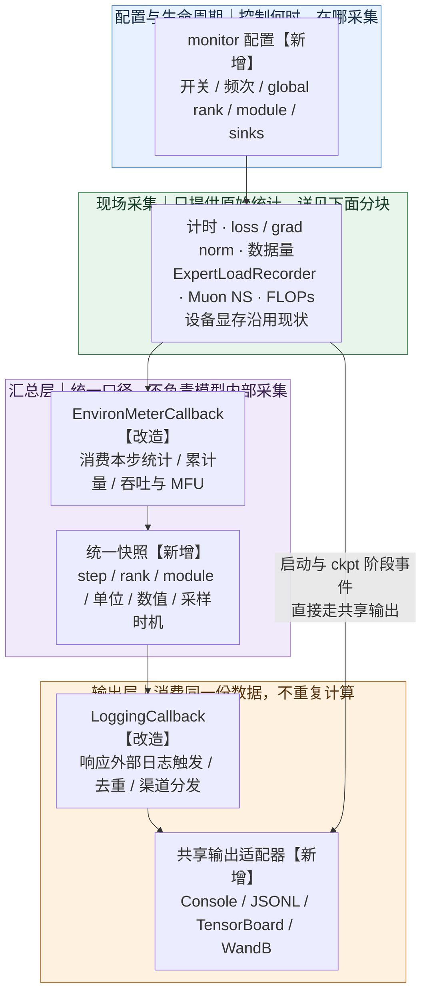
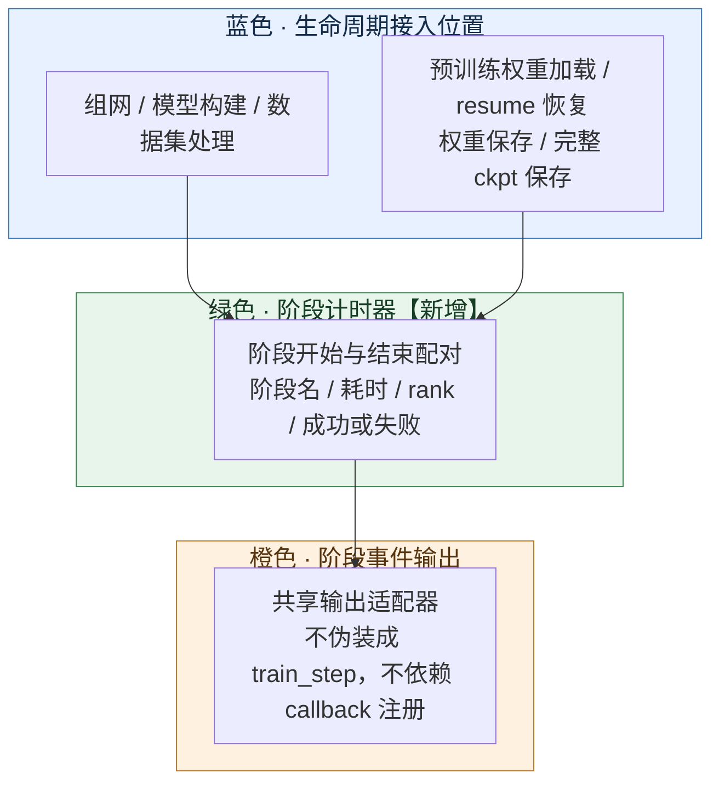
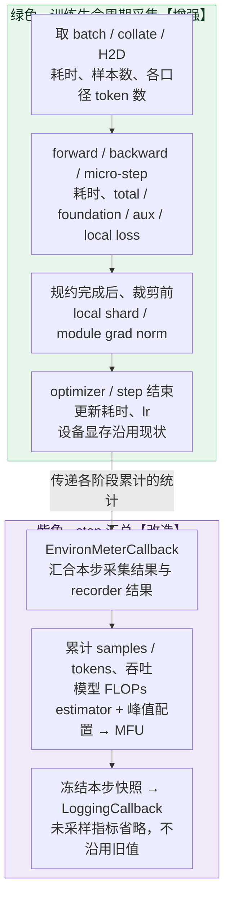
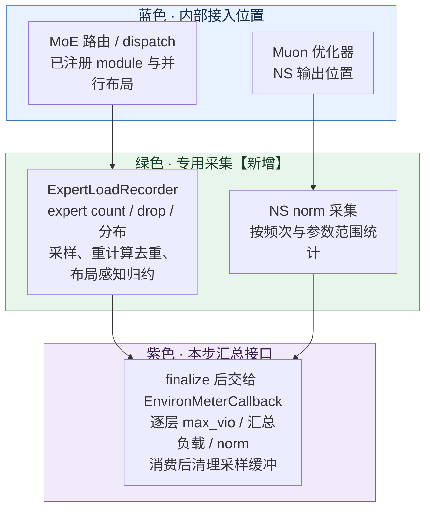
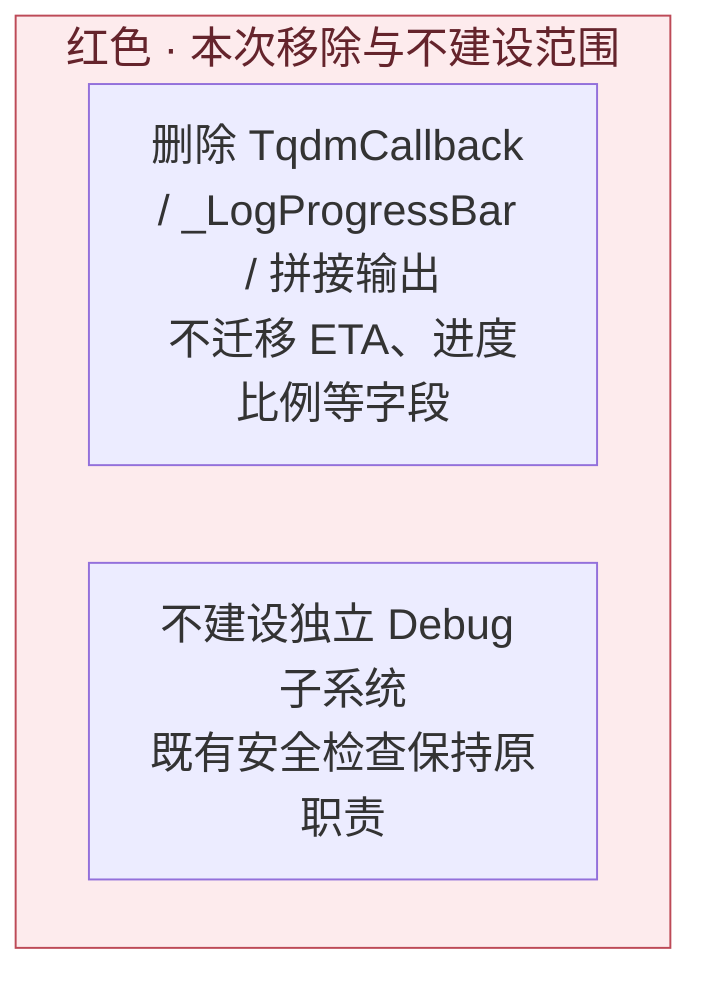

# 通用 Trainer 训练监控与日志改造方案

状态：设计草案，尚未实现。新增接口、文件名和配置字段为建议。
范围：`hyper_parallel/trainer`；需求来源为 [Issue #1174](https://github.com/mindspore-ai/hyper-parallel/issues/1174)。
基线：`upstream/master@c75f5f9f`，2026-11-05 的 Qwen3.6 MoE 纯文本 20-step 实跑。

## 1. 方案架构：增加什么、去掉什么

颜色表示职责分区，框内的【新增 / 改造】表示变更类型；各图使用相同配色。
**蓝色：配置与生命周期；绿色：现场采集；紫色：汇总与快照；橙色：输出；红色：移除项。**

**总架构：从采集到输出**



**分块 A：启动与阶段计时——在 callback 注册前也能记录**



**分块 B：训练 step——现场采集与通用汇总分开**



图中梯度位置对应默认 `post_reduce_pre_clip`；可选 `pre_reduce` 必须另接规约前位置并标明口径。
local loss 直接复用训练流程产生的 loss，不要求用户指定 module 路径。

**分块 C：模型与优化器内部——通过 recorder 暴露统计**



Recorder 不负责打印，不持有完整 activation、router logits 或梯度副本。
local 统计不新增通信；global EP 统计的参与进程按并行布局确定，不能按打印 rank 过滤。



### 1.1 增删清单

| 动作 | 对象 | 本次方案的变化 |
| --- | --- | --- |
| 删除 | `TqdmCallback`、`_LogProgressBar` | 移除 Trainer 注册、导出、write 调用和对应测试；不影响其他组件使用 tqdm |
| 不迁移 | elapsed、ETA、完成比例、平均速度、额外 total_steps | 保留既有 step、epoch，不建设 progress 指标分类 |
| 改造 | `EnvironMeterCallback` | 统一 step 指标出口，接入 recorder/计时结果；不承载所有现场采集逻辑 |
| 改造 | `LoggingCallback` | 直接分发结构化记录；router aux loss 移到共享快照，不再由日志独享 |
| 增加 | 启动/分块计时器 | 分布式组网、模型构建、ckpt 加载、数据处理、训练块与保存耗时 |
| 增加 | local loss / module grad norm 采集 | 独立开关、打印频次、global rank；module 筛选仅用于 grad norm |
| 增加 | `ExpertLoadRecorder` | 逐层 expert load、max_vio、可用的 drop 与分布 |
| 增加 | Muon NS 采集 | 在 NS 输出位置记录 norm，不改变更新算法 |
| 扩展 | 数据、FLOPs 统计 | 计数语义、续训累计量、模型适配和可信 MFU |
| 沿用 | 设备显存 | 保持现有采集、字段和统计口径 |
| 增加 | JSONL、TensorBoard、WandB 输出适配 | 消费同一份指标，按 run/step 管理生命周期 |
| 移出本方案 | Debug 子系统及新异常处置流程 | 不删除原有数据合法性、NaN/Inf、FSDP 等安全检查；首步渲染保留为 `monitor.datasets` 可选数据输出 |

### 1.2 共同实现边界

- 不改 loss 归一化、并行算法、MoE 路由、expert bias 更新或优化器数学语义。
- 不建设完整 profiler、checkpoint 或高可用系统；仅复用 checkpoint 扩展保存监控累计状态。
- local 指标默认不增加通信；global 指标说明通信组并优先复用已有结果。
- 关闭新增监控后，不增加其采集 hook、缓冲、统计通信或设备同步。
- **训练流程中的 Recorder 不影响训练性能及显存：**作为实现与验收约束，关闭或未采样时不执行额外 tensor 计算、拷贝、统计通信或设备同步；启用采样后优先复用已有统计，采用有界缓冲，不滞留计算图或大 tensor。以同配置对照实测确认吞吐、step 耗时及峰值显存无超出测量波动的退化，且长跑显存不持续增长；未达标的采集项必须优化或降采样后重新验收，不能仅凭 Recorder 封装宣称零开销。
- 不保留 batch、大 activation、router logits、完整梯度副本或计算图。
- 字段和配置兼容迁移必须显式，缺少指标不伪造零值。

### 1.3 最终 YAML 配置形态（设计草案）

以下展示改造后训练 YAML 中的 `monitor` 配置段，其他模型、数据和并行配置保持各自入口。
这是拟实现的配置接口，尚不能直接用于当前 master；可选的细粒度采集默认关闭。
不再提供 tqdm 或独立 debug 配置。

```yaml
monitor:
  enabled: true
  sinks: [console, jsonl]  # 可选增加 tensorboard、wandb；默认不启用远端输出
  output_dir: ./outputs/metrics

  timing: true  # 启动、训练分块、权重加载/保存及 checkpoint 耗时
  mfu: false  # 新增 MFU 利用率；复用已有 FLOPs 估算与 step 耗时

  wandb:  # 仅在 sinks 包含 wandb 时生效；否则不初始化 SDK 或上传
    project: hyper-parallel
    entity: null
    mode: online
    run_id: null
    resume: never  # 续训时指定原 run_id，并设置 must

  local_loss:
    enabled: false
    ranks: [0]
    sampler_steps: 100
    granularity: both
    micro_steps: all

  local_grad_norm:
    enabled: false
    ranks: [0]
    sampler_steps: 100
    capture: post_reduce_pre_clip
    norm_type: 2
    include_children: true
    include_experts: true
    modules:
      - match: exact
        pattern: "model.layers.0"  # 按实际模型规范路径设置

  moe:
    enabled: false
    sampler_steps: 100
    recorder: expert_load
    scope: global  # local 不增加统计通信；global 按注册布局归约
    modules: []  # 空列表表示全部已注册且支持统计的 MoE 层
    per_layer: false  # false 仅输出汇总，但内部仍按层计算 max_vio
    record_distribution: false
    flush: true  # 输出时消费并清理本次采样缓冲

  optimizer:
    ns_norm:
      enabled: false
      sampler_steps: 100

  datasets:
    ranks: [0]  # global rank；详细统计默认仅反映所选 rank
    sampler_steps: 100  # 采样 step 内汇总全部 micro-batch
    token_distribution: true  # input/有效监督长度分布、padding/ignored 占比
    top_n_tokens: 20  # 非 padding 输入 token 的频次 Top-N；0 表示关闭
    packing_stats: true  # 拼接数、填充率、截断与 segment 长度
    packing_boundary_check: true  # 采样检查边界、position、attention 与 label 对齐
    log_first_rendered_template: false
```

## 2. 分模块设计

每个模块按“监控功能 → 接入与边界 → 验收”描述。
文件定位以基线代码为准；新增模块路径是候选，不表示文件已经存在。

### 2.1 统一采集、汇总与配置

**监控功能**

统一采样计划、指标元数据和 step 快照，供所有输出渠道使用。
每项定义单位、分母、local/global、通信组、采集时机及可用性。
各 Recorder 的 `sampler_steps` 控制可降采样统计；日志输出时机由外部 Trainer 的既有配置与生命周期控制。`monitor` 不再提供顶层采样频次或日志频次开关；累计消费量不能因降采样遗漏。

**接入与边界**

- 配置入口：`trainer/config/`；Trainer 生命周期：`trainer/base.py`、`text_trainer.py`、`vlm_trainer.py`。
- step 汇总：`trainer/callbacks/environ_meter_callback.py`；复用现有字典或引入只读快照数据契约。
- recorder 在相应执行位置采集，必须先 finalize，再由 meter 汇总，最后 logging 消费。
- 新数据契约、采样计划可置于候选 `trainer/runtime/monitor/`，不把模型实现导入通用日志模块。
- 启动事件不伪装成 step 0；未采样值不沿用上一轮结果冒充当前值。
- 配置中的 global rank/module 过滤与集合通信参与条件分开；不能因不打印而跳过必需通信。

**验收**

- 测试 Recorder 开关、采样与外部日志触发的组合；重复触发同一记录时不重复输出。
- 快照消费者不互相修改数据，重复 finalize 不重复累计或通信。
- 关闭统计后无新增采集资源；旧配置映射和冲突报错有覆盖。
- step 计数和累计状态在续训后连续。

#### 训练内部 tensor 采集：统一 Recorder 机制

所有为监控而进入 forward、backward、路由、优化器或数据处理流程读取 tensor 的逻辑，
统一遵循 Recorder 的采样、生命周期与资源约束。`ExpertLoadRecorder` 是其中的 EP 专用实现，
不扩展成包含所有统计公式的单一类。共享采样计划、注册管理与快照协议；具体 recorder 保留各自采集时机和计算语义。

| 采集对象 | 专用 recorder（候选名称） | 现场与保留数据 |
| --- | --- | --- |
| local / micro loss | `LossRecorder` | loss 产生处；只保留脱离计算图的标量统计 |
| local / module grad norm | `GradNormRecorder` | 明确的规约前或规约后裁剪前位置；复用已有 norm 或按需计算，不复制完整梯度 |
| EP expert load | `ExpertLoadRecorder` | router/dispatch；只保留 expert 计数小向量 |
| Muon NS norm | `OptimizerStatsRecorder` | NS 输出现场；计算统计后立即释放中间矩阵引用 |
| token 长度、重复度、Top-N、模板样本 | `DatasetStatsRecorder` | 数据处理/batch 现场；有界摘要或限长样本，不缓存完整 batch |

普通 CPU 阶段计时、设备内存 API 查询、配置驱动的 FLOPs 估算不必强行套 tensor recorder；
它们复用统一快照出口。当前计时方案仅提供 host 墙钟耗时，不加入设备 event 采集配置。

**共用执行边界**

1. 初始化时解析 module/rank 筛选并注册必要采集点；关闭时不注册额外 hook 或分配统计 buffer。
2. step 开始按 `sampler_steps` 决定是否采集，在训练现场执行新增 tensor 运算之前检查采样开关；未采样时不计算后丢弃。
3. 优先复用训练已有统计；必要时在现场计算小型摘要。`detach()` 仅断开计算图，仍可能共享大 tensor 的存储，不能据此允许长期保存切片或原 tensor。
4. 热路径不逐 micro-step/layer 执行 `.item()`、`.cpu()` 或打印设备 tensor。按既定完成边界批量取得摘要；如需跨流读取，明确 event/wait，不能读未完成结果。
5. global 统计明确通信组、顺序与参与者；输出 rank 筛选不能改变集合通信参与条件。local 统计不额外通信。
6. finalize 只生成一次快照；交给输出层的是 CPU 数值或有界结构，不把设备 tensor 放进日志/上传队列。消费、异常退出和 close 均释放引用。

统一 Recorder 能让开销可控、可验证，不能保证开启后零开销。norm、Top-N、全局归约和设备到主机读取仍可能增加计算、临时显存或同步等待。
采集点需逐个接入真实生命周期；不通过全模型通用 hook 自动推断所有 tensor 的含义，也不默认抓取 activation。

**共同验收**

- 对比关闭、开启但未命中采样、命中采样三种状态；分别测稳态 step 耗时、采样步耗时、峰值显存和长跑显存趋势。
- 检查关闭/未采样时没有新增 tensor 归约、主机拷贝、统计通信或设备同步；开启后的临时缓冲有明确大小上限。
- 覆盖重计算、梯度累积、PP micro-batch、重复 finalize、异常中止与续训；无重复采集、计算图滞留或失效 tensor 引用。
- 先独立验收每个 recorder，再验证组合开关；以相同训练配置对照 loss/梯度/更新结果，允许范围沿用训练数值精度标准。

### 2.2 日志输出与 WandB

**监控功能**

Console、JSONL、TensorBoard、WandB 使用相同字段与数值。
常规汇总仅 global rank 0 输出；local/module 记录按选定 rank 独立保存。
交互和非交互终端均采用结构化 step 行，不保留进度条。

**接入与边界**

- 改造 `trainer/callbacks/logging_callback.py`；删除 `tqdm_callback.py` 及 callback exports/注册/调用。
- 输出适配器放在独立 runtime 模块，供启动期和 LoggingCallback 共用。
- JSONL 使用 schema_version、run_id、event、rank；step/epoch/module 仅在适用时携带。
- 同一 step 指标合并上报一次。WandB 直接接收指标字典，不使用日志正则解析。
- 远端输出只有一个 run；支持显式在线/离线、恢复 run_id、有界重试和退出 flush/finish。
- 上传失败告警并保留本地记录，不无限阻塞训练或增长内存。详细 rank 数据上传如需通信必须显式启用。
- 对请求但不支持的指标只解释一次；不开启的指标不逐项刷缺失告警。
- 具体输出协议与改前/改后日志见第 3 节；远端细则见附录 E。

**验收**

- 外部每步触发输出时，20 steps 恰好 20 条 train_step，无 tqdm、回车刷新和重复摘要。
- 外部每 5 步触发输出时，输出第 5、10、15、20 步；最终记录是否触发遵循外部生命周期，monitor 不另设补发策略。
- 两节点以上确认仅 global rank 0 输出汇总；不是每台 local rank 0 各输出一份。
- Console、JSONL、TensorBoard、WandB 同名指标一致，展示舍入不影响原始记录。
- 验证断网、离线、恢复、重复 step、队列上限和正常退出；可选依赖未安装时行为明确。

### 2.3 分块耗时

统一由 `monitor.timing: true/false` 控制，不再分别设置 startup、step、checkpoint 开关。
启用后记录实际执行的各阶段；未执行的阶段不产生耗时指标。

**监控功能**

| 阶段 | 监控内容 |
| --- | --- |
| 启动组网 | rendezvous/默认进程组、DeviceMesh 与子组初始化 |
| 模型初始化 | 构建模块树、预训练权重读取/转换/加载、并行替换与包装 |
| 数据初始化 | tokenizer/assets、数据集读取/映射、dataloader 构建 |
| 续训恢复 | checkpoint 的模型、optimizer、scheduler、RNG、dataloader 状态加载 |
| Step 数据 | 获取 batch、预处理、collate、H2D |
| Step 计算 | 前向/反向、梯度裁剪、optimizer、scheduler |
| 权重保存 | 模型权重导出/保存时长，包括必要的权重收集、转换、序列化与写入完成 |
| 完整 checkpoint 保存 | 模型及 optimizer、scheduler 等续训状态的整体保存时长；区分同步保存与异步提交/完成 |

**接入与边界**

- 在 Trainer 初始化入口创建轻量计时器，早于 `_setup()` 和 `_init_callbacks()`。
- 启动阶段接入 `base.py` 的构建调用和模型 checkpoint loader；恢复/保存接入 `callbacks/checkpoint_callback.py` 的真实调用边界。
- 数据时间在 `data/` 的 transform、collate、batch 获取/H2D 实际执行位置采集。
- step 计算时间围绕 text/VLM 训练路径及优化器调用采集，不假设所有 PP 路径都能拆开 forward/backward。
- CPU 墙钟使用单调时钟；统计 host 调用耗时；不将异步设备任务的提交耗时称为设备执行时间。
- 不为每块增加全设备同步；嵌套、重叠和不同 rank 的 max 不能相加解释成关键路径。
- 权重加载与续训恢复分开，未执行不填零；无法拆分的 from_pretrained 路径只报可测父阶段。
- 权重保存计时接在实际权重导出/保存入口，覆盖定期保存与训练结束导出；复用 `monitor.timing` 开关。完整 checkpoint 内可拆分的权重保存作为子阶段，不与父阶段重复相加；无法拆分则只报整体保存耗时。
- worker 的预处理耗时和主进程等待时间分开。异步保存用 checkpoint_id 关联提交和完成；完成时长从保存请求开始计到保存接口确认写入完成，不把提交返回当作保存完成。
- 详细字段及计时边界见附录 D。

**验收**

- 受控延时验证计时边界、嵌套关系、次数与本地累计结果。
- 启动 phase_start/end 能配对；初始化失败时保留已获得阶段信息。
- 验证不加载、预训练加载、续训恢复三条路径及同步/异步保存。
- 覆盖仅保存权重、完整 checkpoint、训练结束导出；验证权重保存边界包含实际写入，异步提交与完成可关联，失败记录状态且不误报成功。
- 多 worker 下不把 batch_fetch 冒充 preprocess；计时不引入额外设备同步。
- 实跑比较监控前后稳态耗时，不以 host 提交时间宣称设备执行时间。

### 2.4 Loss、梯度与 module 监控

**监控功能**

- 总 loss、分项 loss、学习率、训练链路使用的 global grad norm。
- 可配置 local loss、micro loss 和 module local grad norm。
- local loss/norm 独立启用，支持打印频次和 global rank；module 路径及可选参数过滤仅用于 grad norm。

**接入与边界**

- global loss/norm 复用训练循环和裁剪结果；meter 不再为同一语义重复求均值或重算 norm。
- local loss 在 loss provider 跨 rank 规约前取得，保留分子、分母及 scale。
- local loss 由训练 loss 产生位置直接采集，不提供 module 路径配置，也不构造逐层 loss。
- local step loss 使用全部 micro-batch 分子分母，不以采样 micro loss 均值代替。
- local norm 默认在规约后、裁剪前读取本地梯度分片；pre_reduce 单独配置，在实际梯度通信前采集。
- pre_reduce 接入点可能涉及 `core/fully_shard/` 或其他后端通信路径；不改通信算法，不复制完整梯度强行实现。
- 规范 module 名由模型映射到包装后的执行对象；PP stage 不拥有目标模块时不制造记录。
- 共享参数去重，明确 unscale、expert 参数和递归子模块语义；micro norm 不能相加充当 step norm。
- 完整字段、筛选规则和配置语义见附录 C。

**验收**

- 独立开关、频次和 rank 过滤有效；grad norm 的 module 过滤生效且无匹配时明确报告；local loss 无需配置模块路径。
- local step loss 与独立分子分母统计一致，不受 micro 输出筛选影响。
- pre/post-reduce、混精 unscale、共享参数、expert 参数、PP 所有权均有用例。
- global norm 与实际裁剪使用值一致；采集不改变梯度和更新结果。

### 2.5 数据量、数据质量与吞吐

数据相关的监控配置统一归入 `monitor.datasets`；配置分组不改变 `data/`、`performance/` 指标分类。

**监控功能**

- 每步与累计 input/valid token、padding/ignored 统计、全局逻辑样本。
- 长度分布、packing 边界/拼接数、token Top-N/重复度、可选首步渲染。
- input tokens/s 与 valid tokens/s 分开输出；前者对应输入规模，后者对应有效监督量。

| 配置 | 监控内容与输出 |
| --- | --- |
| `token_distribution` | 本采样 step 全部 micro-batch 中，每条输入序列的非 padding 长度与有效监督长度分别输出 min/max/mean、P50/P90/P99 和分桶计数；另报 padding、ignored 比例及其分母 |
| `top_n_tokens` | 统计非 padding 输入中每个 token ID 的出现次数，输出前 N 项的 ID、count、占非 padding input tokens 的比例；频次相同按 token ID 排序，默认不解码文本 |
| `packing_stats` | 输出 packing 是否启用、packed 行数、原始样本数、每行 segment 数分布、segment 长度分布和填充率；metadata 可用时增加截断样本数/丢弃 token 数 |
| `packing_boundary_check` | 按实际 packing 策略检查 segment 偏移、长度、position IDs、attention 分段与 shifted labels/监督 mask 的边界一致性；输出检查数、失败数、检查项和有界定位信息 |
| `log_first_rendered_template` | 在选定 rank 限长输出首步实际渲染结果；一次性输出，不受周期采样漏过首步 |

`sampler_steps` 控制这些详细统计与边界抽查，不影响基础 token/sample 累计量逐步更新。
“本 step”只指命中采样的 optimizer step，不将前 100 步混成该步分布；每份记录附 step、rank、scope 和采样样本数。
长度分布按实际输入行统计；packing 前的 segment 长度单列，避免把 packed 行当成原始样本。
Top-N 使用 token ID 频次，和序列长度分布是两类统计；padding 按有效位置 mask 排除，不能仅按 pad token ID 排除。

**接入与边界**

- 数据 metadata 在 `data/` 生成；Trainer batch 接口携带小规模计数，meter 累计和计算吞吐。
- 有效监督计数复用 loss 实际使用的 shifted labels/分母；原始输入计数不能直接按 label mask 得出。
- input、padding、ignored、valid 不天然组成互斥集合，必须按字段定义。
- CP 切片求和与副本去重按数据布局处理，不能所有字段都统一除 CP size。
- packing 后的 batch 行数不等于原始样本数，缺少 metadata 则原始样本计数不可用。
- 只提交完成的训练消费；预取但未训练的 batch 不推进累计计数。
- 通过既有 checkpoint 扩展保存/恢复累计量，不新建 checkpoint 系统。
- Top-N/重复度限频统计；首步渲染通过 `monitor.datasets.log_first_rendered_template` 显式开启，限定 rank、长度和次数。
- 详细数据统计由 `DatasetStatsRecorder` 接入，优先消费 collate 后、H2D 前的 CPU 数据与 packing metadata，不为统计把完整设备 batch 拷回主机。
- Top-N 汇总采样 step 内全部 token 计数后再选取，不能只合并各 micro-batch 的 Top-N。计数结构按词表大小或显式容量约束，临时工作空间和样本缓冲需有上限；分位数采用有界直方图近似时必须标明近似口径。
- 默认输出所选 rank 的本地分布，不标成全局分布；CP 切片前后范围需标识。未来全局 Top-N 需要完整计数归约或有误差说明的算法，不能拼接各 rank Top-N 冒充精确全局结果。
- packing 边界检查以实际策略为准：isolated 策略验证禁止跨 segment attention/监督；允许拼接的策略按既定语义验证，不强制 position 重置或一律隔离。检查 offsets 单调、起止合法、segment 覆盖与有效输入一致，并核对 loss shift 是否意外跨界。
- 不构造新的完整 S×S attention mask；通过 offsets/cu_seqlens、position IDs 和实际 mask 构建参数检查。只能验证 metadata 时标明覆盖范围，不能宣称已验证 kernel 行为。
- packing 未启用时标为 disabled；缺少 metadata 的检查标为 unavailable，不能当作通过或填零。抽查失败输出有界定位，不新增独立 Debug 流程，也不替代或关闭原有逐 batch 合法性检查。

**验收**

- 小样本手工复算 token、sample、shift、mask、packing 和 CP 去重。
- 外部每 5 步输出与每步输出时的累计量一致；恢复前后与 dataloader 游标一致。
- 覆盖全 ignored label、padding、重复 token、特殊 token、空输入的边界。
- 首步渲染只在选定 rank 输出一次，反映模型实际输入，不默认输出全文。
- 用已知 token ID 频次和序列长度的多 micro-batch 数据复算分布与 Top-N；覆盖频次并列、N 大于唯一 token 数、pad/eos 同 ID 和空有效输入。
- 构造正确 packing 及 offsets 越界/重叠/缺失、错误 position、attention 配置不一致、shifted label 意外跨界等样本；确认按策略检测且报告检查覆盖范围。
- 分别验证 packing 关闭、metadata 缺失、截断和多 segment 情形，缺少的信息不伪造；详细统计关闭或未采样时无新增扫描、设备拷贝和通信。
- JSONL 保留分桶和 token ID/count 对应关系；WandB 显式启用时分布/Top-N 转 Table 或 Histogram，标量与本地记录一致。

### 2.6 EP 负载均衡：ExpertLoadRecorder

**监控功能**

逐层有效 expert load、max_vio、空 expert 数；模型可提供时增加 drop 和物理 padding 槽位。
按需输出完整分布，常规日志默认仅汇总标量。

**接入与边界**

- 新增 Trainer 持有的 `ExpertLoadRecorder`，候选位置 `trainer/runtime/monitor/`；遵循第 2.1 节的统一 Recorder 机制，专注 EP 统计。
- model/router adapter 注册规范 module、expert 全局 ID、所有权及计数副本/分片关系。
- Router/dispatch 提供已有小向量；一份 recorder 管理多个层，不为每层注册 callback。
- 生命周期：register → begin_step → record → finalize_step → meter 合并 → logging → reset。
- Top-k 负载默认是 assignment 次数，不是唯一 token 数；drop assignment 不能冒充 token drop。
- local 模式不增加通信；global 按注册布局拼接/求和并去除路由副本，不能机械 all-reduce。
- activation checkpoint 重计算不重复记录，共享模块多次真实调用不能漏计。
- 不介入既有 MoEMonitorCallback 的 expert bias 更新，不保存 logits 或 token→expert 大索引。
- finalize 幂等；缓冲固定规模并消费后清理。接口、统计公式和边界详见附录 F。

**验收**

- 用显式路由参考复算 load、max_vio、drop；覆盖 top-k、空 batch/expert、padding。
- EP 分片、重复路由副本和 DP/CP/TP/PP 组合统计正确。
- 重计算、共享模块调用、重复 finalize 不漏计、不重复累计或通信。
- 长训练缓冲不增长；关闭 recorder 无额外采集，开启后训练结果不变。

### 2.7 Muon NS norm

**监控功能**

NS 迭代输出矩阵 norm；可选迭代前 norm 与相对变化。支持采样频次、module/参数和 rank 过滤。

**接入与边界**

- 在 `components/optim/` 下实际 Muon/NS 执行路径输出产生后、更新应用前采集。
- 模块参数选择在初始化时解析，传递稳定参数身份；不能靠逐步扫描模型树关联。
- 只记录 detached 标量，meter 合并；不保存 NS 中间矩阵，不改变迭代次数、精度和算法。
- 不新增 Debug 或自动异常处置流程；既有安全检查保持原有职责。
- 非 Muon 优化器启用该指标时明确不可用。

**验收**

- 小矩阵与独立 norm 参考一致，零输入、前后 norm 和相对变化分母规则明确。
- 过滤、频次和 rank 生效；未启用时不执行新增 norm 计算。
- 开启前后参数更新一致，无矩阵引用残留和额外全局通信。

### 2.8 设备显存：沿用现状

设备显存不在本次改造范围内。保留现有采集逻辑、字段名、单位和统计口径，既有结果继续进入统一输出。
不新增 current 指标、跨 rank 聚合或窗口峰值，也不调整 peak 重置行为。
监控自身的显存开销仍作为 Recorder 和整体方案的验收项，见第 4.2 节。

### 2.9 FLOPs、TFLOP/s 与 MFU

`monitor.mfu: true/false` 仅控制新增 MFU 利用率，默认关闭，不接管已有 `training.log_tflops`。
master 已有 `estimate_step_flops()` 和 `performance/tflops_per_device` 输出，由 `training.log_tflops` 控制；FLOPs 运算量目前是中间结果，并未作为独立指标输出。现有 estimator 仅支持 `qwen3_moe`，本次扩展模型适配并复用该计算链路。
两个开关任一开启时按需估算一次 FLOPs：TFLOP/s 字段仍由 `training.log_tflops` 控制，MFU 字段由 `monitor.mfu` 控制；只开启 MFU 时内部复用计算，不强制额外输出 TFLOP/s。关闭 MFU 不关闭既有 TFLOP/s 功能。
MFU 依赖既有 step 耗时，不要求打开分块计时 `monitor.timing`；日志输出仍由外部 Trainer 控制。

**监控功能**

复用理论 step FLOPs 与每设备 TFLOP/s 的计算，在设备峰值可信时输出 MFU%。`model_flops_per_step` 的独立输出属于可选扩展，不是 master 已有字段。
模型公式不支持时不输出估算值；仅设备峰值缺失时保留已启用的 TFLOP/s 输出，省略 MFU，并一次性说明不可用原因。

```text
TFLOP/s/device = F_step / (dt × device_count × 10^12)
MFU_percent   = 100 × F_step / (dt × device_count × peak_flops_per_device)
```

**接入与边界**

- 扩展 `trainer/runtime/flops.py` 的模型 estimator；模型 adapter 提供结构参数，数据层提供输入几何。
- meter 只进行时间/设备数归一化，输出层不再计算 MFU。
- Qwen3.6 单独核算标准 attention、GDN、top-k/shared expert、router 和 LM head，不套总参数量。
- 输入 prompt 被 loss mask 仍参与计算；不能用有效监督吞吐替代计算规模。
- 变长 attention 使用实际长度平方和，混合结构走专门 estimator。
- 明确因果三角/完整平方、重计算是否计入、设备 SKU/dtype/dense-sparse 和 estimator 版本。
- 不把 checkpoint/组网启动时间混入稳态 MFU；窗口指标使用 sum(F)/sum(dt)。
- 模型不支持或峰值未知时输出不可用原因，不输出零或硬编码通用设备峰值。
- Megatron、Bridge、TorchTitan、VeOmni 的算法差异见附录 B。

**验收**

- 小模型独立公式复算，覆盖 Dense/MoE、top-k/shared expert、变长与 packing。
- Qwen 混合 attention 按实际层类型验证，不能仅测试 Dense Transformer。
- 多卡设备数归一化不重复除；输入/监督 token 不混用。
- 不支持模型、未知设备峰值和低精度混合场景明确不可用或采用显式约定。
- 与其他框架比较时先统一估算约定和时间窗口，不只比较 MFU 数值。

## 3. 输出效果：改前与改后

### 3.1 改前

以下是实际第 3 步日志的节选，为阅读方便换行：

```text
Training: 15%|...| 3/20 [00:22<02:08, 7.54s/step,
loss=10.5977, grad_norm=51.1115, lr=9.510e-06,
foundation_loss=10.5977, tokens/s=993.369, step_time=3.297s]
| step=3 epoch=0 data/consumed_samples=24 data/consumed_tokens=7802
performance/step_time=3.29686 performance/tokens_per_second=993.369
training/total_loss=10.5977 ...
```

`7.54s/step` 是进度条启动以来的累计平均耗时，受首步预热影响；
`3.29686s` 是当前第 3 步耗时。两者不是同一指标。

### 3.2 改后：终端和文件统一结构化记录

交互与非交互终端采用相同规则，不创建动态进度条。
以下使用实跑值和建议字段名；为方便阅读换行，实际每条记录占一行：

```text
event=train_step step=3 epoch=0 rank=0
training/total_loss=10.5977 training/foundation_loss=10.5977
training/grad_norm=51.1115 training/lr=9.50953e-06
performance/step_time_s=3.29686 performance/valid_tokens_per_second=993.369
data/step_valid_tokens=3275 data/consumed_valid_tokens=7802
data/step_samples=8 data/consumed_samples=24
memory/device_max_allocated_gb=51.0571 memory/device_max_reserved_gb=53.7422
```

删除 tqdm 后不迁移其 elapsed、ETA、完成比例、平均速度或额外的 total_steps 字段。
沿用 LoggingCallback 的 step、epoch 和训练指标，不新增 progress 指标分类。
当前步耗时及启动/训练分块耗时继续保留，用于性能分析。

| 场景 | 规则 |
| --- | --- |
| 交互终端 / 重定向 | global rank 0 输出结构化 step 行，不输出 tqdm |
| Console 和文件同时启用 | 各写入一次同一记录，不通过抓取 stdout 生成文件 |
| 多机 | 仅 global rank 0 输出汇总；不按各节点 local rank 0 输出 |
| 指定 rank 的详细统计 | 按 rank 独立文件，携带真实 global rank |
| 最后一步未命中外部日志间隔 | 遵循外部是否触发最终记录的决定；monitor 仅去重和分发 |

### 3.3 分块耗时记录

阶段开始时立即记录 `phase_start`，完成时记录 `phase_end`，便于判断训练卡在哪个阶段。
以下是格式模板，占位符不代表实测值：

```text
event=phase_start phase=checkpoint_load rank=0 phase_id=<id>
event=phase_end phase=checkpoint_load rank=0 phase_id=<id> duration_s=<seconds> status=completed
event=phase_end phase=distributed_init rank=0 phase_id=<id> duration_s=<seconds> status=completed
```

嵌套阶段携带 `parent_phase_id`；失败时保存已获得的耗时和失败状态，不新增异常处置逻辑。
训练 step 的分段耗时使用 `performance/step/*_s`，启动阶段使用 `performance/startup/*_s`。

### 3.4 启动说明与不可用指标

启动时记录一次采样、输出和统计口径说明，例如：

```text
 event=monitor_config output_rank=0
 loss_scope=dp_cp token_basis=valid_labels
 sample_count=global_cp_deduplicated memory_unit=GiB
```

具体模型仍需提供准确的 loss 归一化、时间窗口和并行组定义，不能只依赖上述简写。
对用户明确请求、却无法提供的指标只解释一次：

```text
 event=metric_unavailable metric=performance/tflops_per_device
 reason=unsupported_model_type model_type=qwen3_5_moe_text
```

不伪造 `0`，不每步打印 `N/A`；未启用指标无需逐项报缺失。
JSONL 可保存结构化的不可用事件，TensorBoard 和 WandB 不写伪造数值。

## 4. 实施顺序与交付验收

| 批次 | 实现模块 | 交付证据 |
| --- | --- | --- |
| 1 | 2.1 统一契约、2.2 结构化日志及输出适配 | 删除 tqdm 的代码检查，改前/改后日志，Console/JSONL/WandB 一致性，多机 rank 输出验证 |
| 2 | 2.3 分块耗时、2.5 数据 | 启动/加载/训练阶段日志，数据计数复算与续训恢复 |
| 3 | 2.4 local/module、2.6 EP recorder、2.7 Muon | 独立参考结果，过滤/频次用例，EP 布局/重计算边界和数值不变验证 |
| 4 | 2.9 模型 FLOPs/MFU | estimator 与设备峰值来源，公式复算，模型/设备不支持的输出示例 |

每批次对应模块的验收项必须落地，不以全量 UT 通过代替指标口径验证。
参考源码入口见附录 I；后续实现如调整模块位置，保持各模块职责边界不变。

### 4.1 集成验证

- 复用附录 A 的 20-step 配置，保存 command、revision、环境、退出码与原始指标文件。
- 仅输出改造时比较 loss、norm、lr、数据消费，确认训练语义不变。
- 增加真实多机验证，单机八卡不能证明各节点不重复输出。
- 验证保存/恢复、外部最终日志触发、远端故障、详细采样组合，不因 rank 分支导致死锁。

### 4.2 性能与显存验收

- 同配置比较关闭、基础监控、详细采样三种模式，排除预热后报告 step time 分布和峰值显存。
- 检查关闭功能无其额外 hook、buffer、统计通信和设备同步。
- 检查详细采样频率、批量规约和有界输出队列，长训练无 buffer 增长。
- 不保留完整梯度、activation、router logits 或计算图。
- 性能开销阈值在对应模块实现前明确，不预设未经验证的百分比。

### 4.3 模块级待确认项

| 模块 | 实现前需固定 | 不允许的回退 |
| --- | --- | --- |
| Local norm | 各后端 pre_reduce 的可用粒度和采集点 | 用规约后的 .grad 冒充规约前数据 |
| 数据 | packed 行、原始样本、已完成消费的映射 | 缺 metadata 时伪造原始样本数 |
| 计时 | 每条路径的起止边界、host/device 与嵌套关系 | 用提交耗时冒充设备完成时间 |
| 输出 | schema 迁移、WandB resume 去重和有界重试 | 同名字段静默改变语义 |
| MFU | 模型公式及设备峰值的版本化来源 | 未支持时套 Dense 公式或通用峰值 |

## 附录 A：当前实现与实跑证据

### A.1 验证配置

| 项目 | 本次基线 |
| --- | --- |
| 设备 | 单机 8 × Ascend 910B3 |
| 模型 | Qwen3.6-35B-A3B，沿用 20 层模型视图 |
| 模型类型 | `qwen3_5_moe_text` |
| 训练 | 纯文本，20 个 optimizer steps |
| 并行 | CP=2、EP=2、TP=1、PP=1，沿用 recipe 的 FSDP 配置 |
| 数据 | `decif-30k.jsonl`，最大序列长度 4096，全局 batch size 8 |
| 环境 | Torch 2.9.0+cpu、torch_npu 2.9.0.post6、Transformers 5.13.0、CANN 9.1 |
| 指标开关 | `logging_steps=1`、`log_tflops=true` |
| 结果 | 20 步完成，退出码 0；每个 step 的结构化记录各出现一次 |

此次是单机验证，不能替代多机 global rank 输出验证。
完整服务器产物位于 `/home/chaoran/youchu_valid/trainer-metrics-master-c75f5f9f-20steps/`，
包括 `train.log`、`command.txt`、`environment.txt`、`revision.txt` 和 `exit_code.txt`。

### A.2 已输出指标

以下 12 个指标均在 20/20 步出现，解析结果均为有限数值。

| 指标 | 第 20 步 |
| --- | ---: |
| `training/total_loss` | 5.05664 |
| `training/foundation_loss` | 5.05664 |
| `training/grad_norm` | 10.3072 |
| `training/lr` | 1e-6 |
| `performance/step_time` | 3.66267 秒 |
| `performance/tokens_per_second` | 727.885 |
| `data/step_tokens` | 2666 |
| `data/consumed_tokens` | 49641 |
| `data/step_samples` | 8 |
| `data/consumed_samples` | 160 |
| `memory/device_max_allocated_gb` | 51.0602 GiB |
| `memory/device_max_reserved_gb` | 54.2344 GiB |

本次未输出：

- `performance/tflops_per_device`：已启用开关，但估算器只支持 `qwen3_moe`，不支持本次模型类型。
- `training/router_aux_loss`：本次模型路径未提供监控所读取的 `last_aux_loss`。

没有输出某指标，不等于整个仓库没有该能力；核心库具备能力，也不等于通用 Trainer 已接入。

### A.3 当前调用链

```text
TextTrainer.train_step()
  └─ TextTrainer.on_step_end()
      └─ BaseTrainer.on_step_end()
          ├─ EnvironMeterCallback：生成指标字典
          ├─ LoggingCallback：组装完整日志
          │   └─ TqdmCallback.write(message)
          └─ TqdmCallback.on_step_end()
              ├─ set_postfix(..., refresh=False)
              └─ update(...)
```

两个 callback 各注册一次、每步各调用一次，并有 step 去重保护。
本次非交互路径中，`write()` 只暂存消息；随后 `_LogProgressBar.update()` 拼接摘要和完整日志并输出一次。
成功交给 tqdm 后不会再调用 `logger.info()` 输出同一条消息。
因此当前问题是内容重复展示，而非 callback 重复执行。

`EnvironMeterCallback` 写入的是内存中的 `step_train_metrics` 和 `step_env_metrics`，不负责落盘。
本次文件来自 shell 重定向。

## 附录 B：主流框架 MFU 算法调研

先列算法与口径差异，再决定 HyperParallel 的实现。核对日期为 2026-11-05。
Megatron-LM 与 VeOmni 使用本地干净源码的固定提交；其余来源注明为官方文档或搜索索引快照，
不将历史路径的公式视为最新主线实现。

**统一符号与比较基准：**

- `F_step`：整个模型处理一个全局 optimizer step 的理论训练 FLOPs。
- `dt`：与该 FLOPs 统计范围对应的墙钟时间，单位秒。
- `W`：参与该模型训练的物理加速设备数，不能只取 DP size。
- `P_peak`：单设备、指定精度及稀疏性口径的理论峰值 FLOP/s。
- `N_mm`：参与矩阵乘的参数量；MoE 使用激活路径，而非全部 expert 参数。
- `L`：层数，`H`：hidden size，`S`：序列长度，`B`：全局序列数，`V`：词表大小。
- `T = sum(S_i)`，`Q = sum(S_i²)`：全局输入序列的 token 总量和长度平方和。

```text
TFLOP/s/device = F_step / (dt × W × 10^12)
MFU_ratio     = F_step / (dt × W × P_peak)
MFU_percent   = 100 × MFU_ratio
```

如果已有 per-device tokens/s，则 `MFU = F_token × tps_device / P_peak`，不能再除一次 W。
FLOPs 是运算量，FLOP/s 是速率，二者在接口和日志中分开。
MFU 的分子通常不含 activation checkpoint 额外重计算；重计算增加耗时会降低 MFU。
将重计算加入分子得到的是不同的硬件工作量估计，应另称 HFU，不能用它抬高同名 MFU。

**算法对照：**

| 框架与核对范围 | FLOPs 分子 | 利用率计算与特点 | 需要注意 |
| --- | --- | --- | --- |
| Megatron-LM，`31fbdf03` | 按 attention、Dense/MoE FFN、logits 等结构求和；训练矩阵乘通常是 forward ×3 | 训练日志先输出 `F_step / dt / W / 1e12`，再除明确设备峰值才得到 MFU | TFLOP/s/GPU 本身不是 MFU；支持的 GDN/MLA/MTP 等必须走对应分支 |
| Megatron Bridge，官方 FLOPs 接口 | 接受序列长度和、平方和、视觉 patch 等运行时统计，也允许模型提供 estimator | 先获得模型 FLOPs，再与训练耗时和设备数结合 | 特别适合变长/packing；不能只用平均长度平方代替平方和 |
| TorchTitan，官方搜索索引快照 | 模型提供 `num_flops_per_token` | 日志窗口内 `MFU%=100×F_token×tps_device/P_peak` | 此快照量化启用时不输出 BF16 基准 MFU；旧文件路径当前返回 404，需锁定可访问版本后再移植 |
| VeOmni，`617cc0fb` | 根据 model_type 使用结构公式，输入实际长度列表；涵盖 Qwen MoE/混合注意力等 | estimator 返回当前输入范围的 TFLOP/s 与单设备峰值，调用方仍需正确处理分布式范围 | 数据范围不能从函数名猜测；不能把 supervised-token 数当输入长度 |

**A. Megatron-LM：结构展开法**

在核对版本的标准 GQA/SwiGLU 路径中，记 query 投影宽度为 `Dq`，KV 投影宽度为 `Dkv`，
则无 output gate 的每层 attention 训练量可整理为：

```text
F_attn_layer = 6 × B × S × [H × (Dq + 2Dkv) + Dq × H + Dq × S]
```

最后一项使用因果三角注意力约定。SwiGLU 的 Dense FFN 为 `18 × B × S × H × I`；
MoE routed FFN 为 `18 × B × S × H × I_expert × top_k`，共享 expert 另计。
Logits 项是 `6 × B × S × H × V`。各类层分别累计；MLA、GDN、MTP 等有专门路径，
不能将全部层直接套标准 attention 公式。
其日志使用一个日志窗口的平均 iteration 耗时计算 TFLOP/s/GPU，
另有 job/cumulative throughput，时间窗口不同不能混比。

来源：[固定提交 training.py](https://github.com/NVIDIA/Megatron-LM/blob/31fbdf03643f8dc7aaa0671b3587cca558bb48ad/megatron/training/training.py)。

**B. Megatron Bridge：运行时长度与模型 estimator**

官方接口接受 `seqlen_sum`、`seqlen_squared_sum`，并为视觉、交叉注意力提供独立规模输入；
支持模型提供运行时 FLOPs estimator。对变长训练，可将线性项写成 `a×T`，
标准全注意力项写成 `b×Q`，而不是对所有样本都使用固定最大长度。
这是一种实现方向，不表示任意混合架构都能缩成同一组 a/b 系数。

来源：[Bridge FLOPs 实现](https://github.com/NVIDIA-NeMo/Megatron-Bridge/blob/main/src/megatron/bridge/training/utils/flop_utils.py)。

**C. TorchTitan：模型 FLOPs/token × 日志窗口吞吐**

官方索引快照中，先按 non-data-parallel size 将本地 token 速率换算为 per-device 吞吐，
然后计算 TFLOP/s 和 MFU%。模型 FLOPs/token 由模型侧提供，指标层只负责窗口计时及归一化。
该快照明确在 FP8/MX 等量化场景跳过基于 BF16 峰值的 MFU。
本次旧路径原文访问为 404，因此仅作为已索引设计参考，不宣称已核实当前 main 的模型系数或 MoE 公式。
实施前需补齐可访问提交，不能用第三方转述代替模型实现。

来源：[官方索引对应 metrics.py 路径](https://github.com/pytorch/torchtitan/blob/main/torchtitan/components/metrics.py)。

**D. VeOmni：按模型族和实际长度估算**

核对版本以 `sum(batch_seqlens)` 和模型 config 计算，训练线性层一般为 `6×N_mm×T`，
注意力等额外项由各模型函数实现。Qwen3.5 family 有 Dense/MoE、混合注意力和视觉分支；
MoE 区分 top-k 激活 expert、共享 expert、router、shared gate，embedding lookup 不按 LM head 矩阵乘计费。
LoRA/frozen 路径对 forward、输入梯度、权重梯度使用不同系数，不能一律乘 6。
设备峰值来自表；该版本未知设备返回 infinity、不支持模型可返回零，这种缺失值处理不用于本方案。
设备名称匹配也不能替代具体 SKU、精度与稀疏性核验。

来源：[固定提交 count_flops.py](https://github.com/ByteDance-Seed/VeOmni/blob/617cc0fb7d7af70c07f4507fc31d871f4eef55d0/veomni/utils/count_flops.py)。

**对 HyperParallel 的设计结论（建议，尚未实现）：**

1. 采用模型侧 estimator + 运行时几何统计 + 指标层计时/归一化的分工。
2. 优先输出 `model_flops_per_step` 和 `tflops_per_device`，峰值信息完整后再输出 `mfu_percent`。
3. Qwen3.6 应分别核算标准 attention、GDN、top-k routed/shared FFN、router、LM head，
   不能使用总参数量或直接复用现有仅支持 qwen3_moe 的 estimator。
4. 输入 prompt 即使被 loss mask 也参与模型计算；同时保留 input/valid tokens/s，但 MFU 不用监督 token 吞吐替代计算规模。
5. 明确 causal-triangular/full-square 约定，记录 estimator 名称与版本，跨框架对比先统一公式。
6. MoE recorder 的有效 assignment 可辅助观察实际路由负载；padding、drop 或容量变化导致的实际额外工作量
   与标准模型工作量分开记录，不无说明地改变 MFU 分子。
7. 设备峰值支持显式配置，记录 SKU、dtype、dense/sparse 和来源。FP8/BF16 混合计算不套单一未知峰值。
8. 每步及窗口 MFU 分开命名；窗口使用 `sum(F_step)/sum(dt)`，不是简单平均各步 MFU。
   checkpoint 加载、组网等启动耗时另报，不能混入稳态 step MFU；端到端利用率如提供需独立命名。
9. 未支持模型或未确认设备峰值时输出不可用原因，不报零、不回退到任意设备数值。

## 附录 C：Local loss 与 module norm 详细规则

复用训练链路的 step loss 和实际用于裁剪的 global norm，不由 callback 再计算一次。
local loss 与 local grad norm 均支持独立开关、指定 global rank 和打印频次；仅 local grad norm 支持 module 筛选。
这些属于 monitor，不引入 Debug 配置或 callback。

### C.1 Module 选择与输出频次

- 以下 module 选择规则仅用于 local grad norm；local loss 不配置 `modules`。
- `modules` 按模型规范模块路径选择，使用显式的 `match: exact | glob | regex` 规则。
- 初始化时解析模块选择并记录命中结果；无匹配时明确报错，不能静默不输出。
- 以并行包装前的规范模块名标识，保留到实际执行模块的映射；某个 PP stage 不拥有目标模块时正常跳过。
- `ranks` 使用 global rank；grad norm 同时匹配 rank 与 module，local loss 仅匹配 rank 和采样条件，不额外全局规约。
- `sampler_steps` 表示每 N 个 optimizer step 采集一次；输出由外部日志触发控制，记录保留实际采样 step，不将旧采样值标成当前值。
- `micro_steps: all | last | [0, 1, ...]` 选择采样 step 内的 micro-batch，编号从 0 开始。
- 每个 local 事件携带 step、micro_step（如适用）、rank、PP stage 和采集阶段；module 仅在 grad norm 等适用事件中携带。
- JSONL 按 rank 保存，console 输出明确标识 rank；远端汇总只在开启相应输出时有界收集，不能冒充零通信。

### C.2 Local / micro loss

- 在跨 rank 规约前的 loss 产生位置采集；记录原始分子、有效分母及 reduction/scale 语义。
- `granularity: micro | step | both` 控制输出粒度。step 级 local loss 使用该 rank 全部 micro-batch
  的分子和分母汇总，不能仅对采样出的 micro loss 直接取均值。
- micro-step 过滤只控制详细记录；请求 step local loss 时仍需取得该 step 的完整统计。
- 直接从训练流程取得 local/micro loss，不需要 module 路径或用户注册 loss provider；普通 decoder/block 不生成逐层 loss。
- 仅在实际计算 loss 的 PP stage 记录该 loss；其他 stage 不制造同名 loss。

### C.3 Gradient local norm

Issue 的“规约前”定义与“规约后”采集时机存在冲突，配置显式区分：

| `capture` | 含义 | 输出键 |
| --- | --- | --- |
| `pre_reduce` | 训练梯度通信前，当前 rank 可观测的梯度范数 | `training/grad_norm_local_pre_reduce` |
| `post_reduce_pre_clip` | 训练通信完成后、裁剪前的本地梯度/分片范数 | `training/grad_norm_local_post_reduce_pre_clip` |

module 选择对 norm 只统计该 module 的参数，提供 `include_children`、`include_experts` 和可选参数名过滤。
共享参数按参数身份去重；逐 module 输出与跨 module 总计的去重规则分别说明。
`norm_type` 默认 2，支持明确配置；混精时以 unscaled 梯度为统计目标，并说明累计和缩放状态。

默认采用 `post_reduce_pre_clip`，不把它称为规约前 local norm，也不把本地分片 norm 称为 global norm。
FSDP/DDP 可能在 backward 中已执行通信，因此 `pre_reduce` 需要在实际通信前接入采集点；
不能简单在 backward 结束后读取 `.grad` 冒充规约前结果。
如果当前并行路径无法低开销取得指定粒度的规约前累计梯度，应报告不支持，不能保存完整梯度副本强行实现。
不同 micro-batch norm 不能直接相加得到累计梯度 norm，因其缺少梯度间的交叉项。

分项 loss 需说明是否包含 MoE auxiliary、MTP 等项，不能假定各模型总 loss 都有相同组成。

## 附录 D：分块耗时字段与计时规则

### D.1 启动阶段

“组网”分别统计分布式通信初始化和模型网络构建，避免两者同名。

| 阶段 | 建议字段（均为秒） | 起止范围 |
| --- | --- | --- |
| 分布式初始化 | `performance/startup/distributed_init_s` | rendezvous / 默认进程组初始化；记录可测部分 |
| 并行组构建 | `performance/startup/parallel_groups_s` | DeviceMesh 及 DP/CP/TP/PP/EP 子组构建 |
| 模型构建 | `performance/startup/model_build_s` | config 解析后至模块树构建结束 |
| 预训练权重加载 | `performance/startup/pretrained_load_s` | 权重读取、转换和加载，可细分子阶段 |
| 并行包装 | `performance/startup/parallel_wrap_s` | 替换、分片、FSDP 等并行配置应用 |
| 数据初始化 | `performance/startup/data_init_s` | tokenizer/assets、数据集读取/映射、dataloader 构建 |
| 优化器初始化 | `performance/startup/optimizer_init_s` | optimizer 与 scheduler 构建 |
| 续训 checkpoint 加载 | `performance/startup/checkpoint_restore_s` | 模型、优化器、scheduler、RNG、dataloader 状态恢复 |
| 总启动时间 | `performance/startup/total_s` | Trainer 初始化入口至可开始首个训练 step |

预训练权重加载和续训 checkpoint 恢复分别记录，未执行的阶段标记为未执行，不能编造加载耗时。
某些 from_pretrained 路径将构建、读取、转换交织执行，应保留真实嵌套关系；
无法准确拆分时先记录父阶段，不靠总耗时相减猜测。
启动计时器必须在 `_setup()` 等初始化之前可用，不能等 `_init_callbacks()` 后才开始计时。
进程组尚不可用时先本地记录，之后按需汇总，不为计时提前初始化通信组。

### D.2 Step 内分块

| 阶段 | 建议字段 | 统计方式 |
| --- | --- | --- |
| 获取 batch / 等待 | `performance/step/batch_fetch_s` | 主进程获取本步各 micro-batch 的耗时之和 |
| 样本处理 | `performance/step/preprocess_s` | transform/tokenize 等实际执行位置采集 |
| Collate | `performance/step/collate_s` | batch 组装耗时，多 worker 时携带执行范围 |
| H2D | `performance/step/h2d_host_s` | host 提交/阻塞时间，不冒充设备传输完成耗时 |
| 前向与反向 | `performance/step/forward_backward_host_s` | 调用路径 host 墙钟时间；能准确拆分时再细分 |
| 梯度裁剪 | `performance/step/grad_clip_host_s` | 实际裁剪调用范围 |
| 优化器更新 | `performance/step/optimizer_host_s` | optimizer.step 调用范围 |
| 调度器 | `performance/step/scheduler_host_s` | scheduler.step 调用范围 |
| 权重保存 | `performance/checkpoint/weights_save_s` | 同步权重保存，从请求开始至保存接口确认写入完成，包含必要的收集、转换和序列化 |
| 异步权重保存 | `performance/checkpoint/weights_save_submit_s`、`weights_save_complete_s` | 分别为提交调用耗时、请求开始至完成确认的时长，通过 checkpoint_id 关联 |
| 完整 checkpoint 保存 | `performance/checkpoint/save_submit_s`、`save_complete_s` | 整体保存；同步时记录完成时长，异步时区分提交和完成。包含权重子阶段时不可重复相加 |

设备 event 计时作为后续扩展，本次不提供相关配置或 `_device_s` 字段。
不为每个块增加全设备同步，也不把 host 提交时间解释成 kernel 耗时。
通信与计算重叠时，不根据同步 API 调用耗时推断真实通信占比；完整重叠分析属于 profiler。

### D.3 时间聚合原则

- CPU 墙钟采用单调时钟；同一阶段明确 inclusive/exclusive 口径。
- 嵌套或重叠块不能直接相加等于 step 时间；数据 worker 时间不能当成主进程等待时间。
- micro-batch 同类耗时在本地 step 内累计，附带次数；按需提供均值和最大值。
- 跨 rank 聚合先保留 local 值，再以明确组给出 max/min/mean；不同块的 max 可能来自不同 rank。
- 全局 max 的和不等于实际关键路径，输出和文档不能这样解释。
- 未观测到的 worker 处理时间标记不可用，不用主进程 batch_fetch 代替。
- 保留既有 step_time 基线口径；如另设端到端时间，单独命名，不能静默替换吞吐分母。

## 附录 E：输出协议与 WandB 细则

WandB 直接消费统一指标字典和元数据，**不解析 console 文本，也不要求用户按日志正则上传**。
Console 面向阅读，JSONL 是机器可读记录，TensorBoard/WandB 分别实现输出适配器。

**格式适配与直接上报：**

默认 `sinks: [console, jsonl]`，不初始化 WandB SDK，也不上传。
用户显式加入 `wandb`（如 `sinks: [console, jsonl, wandb]`）后，由适配器调用 SDK 直接上传；无需先生成或转换日志文件。
在线模式需要安装 SDK、配置凭据并能访问服务；离线模式写入 W&B 本地 run 数据，之后同步。
JSONL 是独立的本地记录，不会被 W&B 自动识别为训练曲线；补传 JSONL 需要显式转换工具。

| 数据类型 | W&B 表示 | 适配边界 |
| --- | --- | --- |
| loss、norm、lr、耗时、吞吐、显存、MFU | `run.log()` 的扁平数值字典 | 保留 `training/total_loss` 等字段名，值为 CPU 端 Python int/float，不传格式化字符串或设备 tensor |
| 训练步数 | 自定义 `global_step` 横轴 | 用 `define_metric` 绑定训练指标前缀；W&B 内部 history step 不等同于训练 step |
| EP 逐 expert 计数 | `wandb.Table` | 列含 step、rank/scope、module、expert_id、count；保留 expert 身份，不默认生成每 expert 一条曲线 |
| 负载数值分布 | 可选 `wandb.Histogram` | 只表示负载分布，不能替代表格中的 expert ID 对应关系 |
| 启动与 ckpt 事件 | 事件 Table；一次性启动标量可写 summary | 不伪造训练 step；反复保存的事件不能只用 summary 覆盖 |
| 模型、并行配置、版本 | run config / 元数据 | 初始化时写入，过滤凭据等敏感配置 |

以下为适配器调用示意，初始化和最终 `finish()` 由生命周期管理；仅 global rank 0 调用：

```python
run.define_metric("global_step")
for prefix in ("training", "performance", "data", "memory", "moe", "optimizer"):
    run.define_metric(f"{prefix}/*", step_metric="global_step")

# 每个输出步汇总后调用一次；metrics 为已转换的数值字典。
run.log({"global_step": step, **metrics})
```

- 采样指标只在实际采集的 step 上报；不补零、不复用旧值。同一步各标量先合并再 log。
- 多 rank 细节默认留在各 rank 本地文件；需要上传时显式汇集到 global rank 0，再转 Table。
- resume 恢复原 run ID 与发送进度，适配器处理去重；自定义横轴本身不保证去重。
- 验收增加：20-step 在线 run 曲线与 JSONL 对齐、EP 表格 ID/计数一致、离线同步后结果一致、续训不重复记录。

SDK 格式依据：[W&B 自定义横轴与字典上报文档](https://docs.wandb.ai/models/track/log/customize-logging-axes)。

- 同一训练 run 仅由 global rank 0 初始化一次远端输出，记录代码版本、模型、并行配置和 schema 版本。
- 同一采样 step 的常规指标合并上报，保持统一 global_step 轴，避免多 callback 分别重复发送。
- 启动耗时与 checkpoint 生命周期事件使用独立事件/汇总字段，不作为虚假的训练 step。
- rank/层细节按稳定命名或表格/分布表示，避免默认展开所有 expert 导致指标数量失控。
- JSONL 公共字段包含 schema_version、run_id、event、rank；step/epoch 仅在适用时出现。
- 正常 step 标量使用数值类型，单位通过字段或元数据固定；缺失值不填零。
- WandB 为显式启用的可选输出，支持在线/离线模式；凭据不写入 YAML 或日志。
- 初始化、flush、finish 与训练生命周期一致；恢复时明确 run_id、resume 策略和已发送 step。
- 上传失败默认告警并保留 JSONL，远端重试采用有界缓冲，不无限阻塞训练或增长内存。
- 原有 wandb 配置映射到新输出入口，冲突时明确报错；SDK 接口在实现时核对官方文档。

详细监控记录保留 `micro_step`、`moe_layer`、`optimizer_metrics`，携带必要的 rank/层/参数信息。
不设置 Debug callback、debug 配置段或独立调试子系统。

## 附录 F：ExpertLoadRecorder 接口与统计语义

增加独立的 `ExpertLoadRecorder`，由 Trainer 持有，model/router adapter 注册采集点。
一个 recorder 管理已选择的 MoE 层，不为每层创建 callback；不直接打印或调用 WandB。
现有 `MoEMonitorCallback` 的 expert bias 更新职责不迁入 recorder，避免监控改变训练算法。

```text
Trainer step_begin → recorder.begin_step(step)
Router / Dispatch → recorder.record(layer, micro_step, invocation, counters)
Trainer step_end → recorder.finalize_step()
                 → EnvironMeterCallback 合并标量与分布快照
                 → LoggingCallback → Console / JSONL / TensorBoard / WandB
                 → recorder.reset_step()
```

Recorder 在组网完成、模型完成并行包装后初始化，注册规范 module 名、expert 全局 ID、
本地 expert 所有权、相关通信组及计数副本/切片关系。模型不暴露可靠计数时标记不支持。

**接口草案：**

| 接口 | 职责 |
| --- | --- |
| `register_layer(spec)` | 注册 module 路径、expert 数量、ID 映射、分布式布局、计数语义和能力 |
| `begin_step(step)` | 按统一采样计划启用当前 step，清空上一轮状态 |
| `record(layer_id, micro_step, invocation_id, counters, phase)` | 收集当前实际 forward 的轻量计数，忽略重计算 phase |
| `finalize_step()` | 按预定组和顺序聚合，生成一次不可变快照；重复调用不重复通信或累计 |
| `reset_step()` | 消费结束或中止后释放引用、重置缓冲；可复用固定大小计数 buffer |
| `close()` | 解除采集注册、释放资源；不负责销毁训练通信组 |

接口名称是设计草案。常规路由只复用现有小规模计数，不额外保存 router logits、
完整 token→expert 索引、hidden states 或梯度。

**原始数据约定：**

| 数据 | 含义 |
| --- | --- |
| `accepted_assignments_per_expert` | 每个 expert 实际接收的有效路由分配次数，排除物理 padding |
| `attempted_assignments_per_expert` | 容量裁剪前的路由分配次数，仅源端提供时采集 |
| `dropped_assignments_per_expert` | 被丢弃的路由分配次数，仅源端明确提供时采集 |
| `physical_slots_per_expert` | 含对齐/padding 的物理处理槽位，可选，和有效负载分开 |
| `valid_input_tokens` | 对应路由输入中的有效 token 数，不是监督 label token 数 |

Top-k 路由中一个 token 可以贡献多次 assignment，因此 expert load 默认以 assignment 计数。
`dropped_assignments / attempted_assignments` 只能称分配丢弃率；
若要输出唯一 token 丢弃率，必须由 router 提供明确定义的 token 去重统计，不能直接换名。
计数 buffer 使用 detached 整数向量，首次采集复制到自有 buffer，避免源张量复用后改变记录。

**分布式归约语义：**

- 优先采用 dispatch 接收端的有效计数，此时各 EP rank 贡献自己拥有的 expert，按全局 expert ID 拼接。
- 若源端计数来自互不重叠的输入 token 分片，则按 expert ID 求和；若多个 rank 看到同一份路由数据，
  只计一次，不能机械 all-reduce 后重复累加。
- CP/TP、expert replication、DP/EDP 的副本和分片关系由 adapter 的 layer spec 明确给出，
  不能仅根据 world size 推断；跨数据副本汇总也要注明通信组和观察窗口。
- PP 各 stage 只拥有部分层；逐层统计在所属 stage 完成，再按显式流程向汇总 rank 传递。
- 采样与通信顺序由参与组一致决定，不能因为只有 rank 0 打印，就让其他 rank 跳过通信。
- `scope: local` 不增加通信；`scope: global` 的通信仅在采样步发生，并尽量批量处理多层计数。

**派生指标与输出：**

每层输出 assignment 总量、max、mean、空 expert 数和 `max_vio`，可选保存完整 expert 计数向量。
`max_vio = max(load) / mean(load) - 1`，总量为零时定义 `max_vio=0` 并标记 `empty_batch=true`；
expert 数量为零属于注册错误。所有 expert 负载应参与均值，包括零负载 expert。
汇总先计算各层 max_vio，再输出跨层最大值；不能把不同层的 expert 数和负载直接混合计算。
完整 expert 向量在 JSONL 保留 ID 对应关系；远端图表可使用表格/分布，不默认创建每 expert 一条曲线。

```text
event=moe_layer step=<step> module=<canonical_module> scope=<scope>
count_unit=assignment accepted_total=<count> load_max=<count> load_mean=<count>
max_vio=<value> empty_experts=<count> empty_batch=<bool>
```

每次快照附带采样 step、micro-batch 次数、聚合组/范围和计数语义。
采样步统计整步全部实际 micro-batch，默认每个采样步输出，不与前后未采样步混合。
未采样步不沿用上一轮结果；只有明确启用跨步窗口时才累计并输出窗口范围。

**重计算、共享模块与资源管理：**

- activation checkpoint 的反向重计算不重复记录；不能仅凭 grad_enabled 区分，因为重计算模式不同。
- 使用实际 forward/recompute 上下文以及调用身份区分；同一 module 在同一 micro-step 合法调用多次时都应统计。
- 每步状态转换为 idle → collecting/skipped → finalized → reset，异常中止同样清理。
- `flush: true` 指将采样快照交给统一输出层并消费当前缓冲，不表示每层同步设备或立即网络上传。
- 缓冲按“已选择层数 × expert 数”固定规模，不随 token 数或训练步数增长。
- 关闭时不创建 recorder 统计 buffer 或额外 hook，不改变 router 的输出、expert bias 和梯度。

**验收：**

- 以小规模显式路由结果独立复算 expert load、max_vio 和 assignment drop。
- 覆盖 top-k、空 batch、空 expert、padding、重复路由副本、EP 分片及 DP/CP/TP/PP 组合。
- 验证重计算不重复计数，共享 module 多次真实调用不漏计，finalize 重入不重复通信。
- 关闭和开启时的训练数值一致；采样间隔/模块过滤生效，buffer 长时间运行不增长。
- 未提供 drop 统计的 router 不输出伪造的零 drop；local/global 输出名称与 scope 明确区分。

## 附录 G：配置语义与兼容规则

完整 YAML 见第 1.3 节，以下补充采样、输出和兼容语义。

详细规则：

- `sampler_steps` 控制可降采样的统计，累计消费量仍逐步维护或由可靠的累计源提供。
- 输出频率由外部 Trainer 控制，`monitor` 不定义 `logging_steps`；当前步指标不自动解释成间隔平均值。
- 未在某步采集的可选指标不得沿用旧值冒充当前值；需要携带采样 step 或省略。
- 详细指标的 rank、层/参数过滤、norm 类型和 Top-N 由对应 monitor 配置段定义。
- 沿用外部训练配置的日志策略，不在 `monitor` 新增日志间隔、兼容别名或优先级规则。
- 主输出固定 global rank 0；详细指标 rank 配置独立。
- 文件命名包含 run 标识，详细指标文件再包含 global rank，避免多进程竞争写入。

## 附录 H：字段兼容与迁移

第一阶段展示变更不得静默改变数值口径。
新字段名最终确定后提供 schema 版本和完整迁移表，以下为建议映射：

| 旧字段 | 建议字段 | 条件 |
| --- | --- | --- |
| `performance/step_time` | `performance/step_time_s` | 时间窗口保持一致 |
| `performance/tokens_per_second` | `performance/valid_tokens_per_second` | 确认来源是有效监督 token；不能对所有回退路径机械重命名 |
| `data/step_tokens` | `data/step_valid_tokens` | 同上 |
| `data/consumed_tokens` | `data/consumed_valid_tokens` | 同上，恢复状态同步迁移 |

可提供可选旧格式，不默认同时输出两套名称。

## 附录 I：参考实现

以下链接固定到本次分析和实跑版本：

- [Callback 注册与分发](https://github.com/mindspore-ai/hyper-parallel/blob/c75f5f9f/hyper_parallel/trainer/base.py)
- [纯文本训练循环](https://github.com/mindspore-ai/hyper-parallel/blob/c75f5f9f/hyper_parallel/trainer/text_trainer.py)
- [EnvironMeterCallback](https://github.com/mindspore-ai/hyper-parallel/blob/c75f5f9f/hyper_parallel/trainer/callbacks/environ_meter_callback.py)
- [LoggingCallback](https://github.com/mindspore-ai/hyper-parallel/blob/c75f5f9f/hyper_parallel/trainer/callbacks/logging_callback.py)
- [TqdmCallback](https://github.com/mindspore-ai/hyper-parallel/blob/c75f5f9f/hyper_parallel/trainer/callbacks/tqdm_callback.py)
- [模型 FLOPs 估算](https://github.com/mindspore-ai/hyper-parallel/blob/c75f5f9f/hyper_parallel/trainer/runtime/flops.py)
