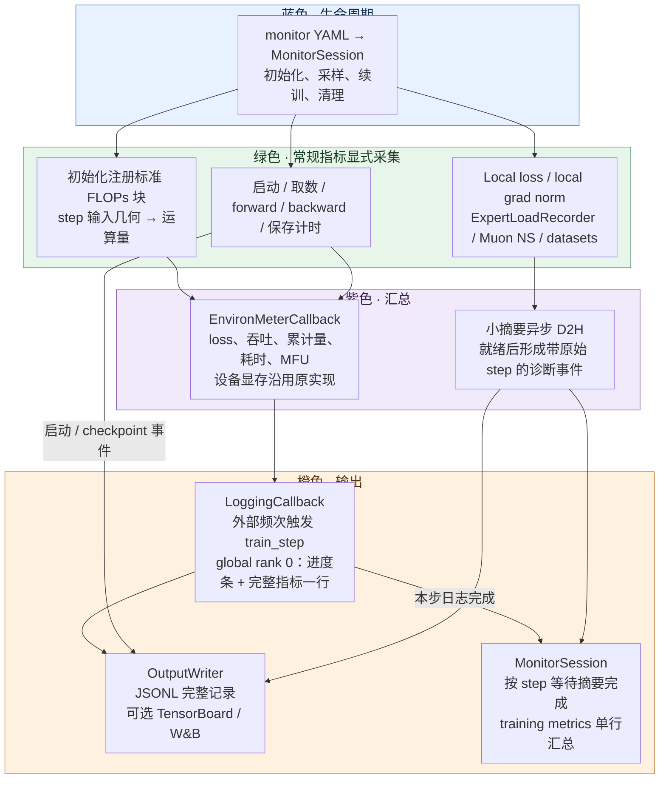
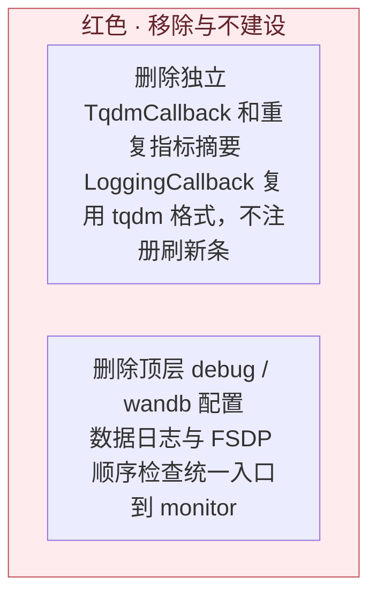

# 通用 Trainer 训练监控与日志方案

范围：Base/Text/VLM Trainer；需求来自 [Issue #1174](https://github.com/mindspore-ai/hyper-parallel/issues/1174)。
本文件只保留架构、配置、模块边界和验收要求；具体字段见 [使用说明](../trainer_monitor_usage.md)，
指标的问题定位方法见 [诊断说明](../trainer_monitor_diagnostics.md)，设备实测见 [Qwen3.6 验收报告](../trainer_monitor_qwen36_validation.md)。
设计要求不等于已经通过设备验收。

## 1. 架构与配置

蓝色表示生命周期，绿色表示现场采集，紫色表示汇总，橙色表示输出，红色表示移除项。





`EnvironMeterCallback` 汇总基础 step 指标；`MonitorSession` 管理采集生命周期；
`LoggingCallback` 按外部频次输出一行进度与完整指标；`OutputWriter` 负责结构化落盘、可选 SDK 和阶段计时输出。
进度只显示百分比、条形和当前步/总步数，不读取或再次显示训练指标。
MonitorSession 另按 step 汇总采样诊断，每个外部日志步只打印一条 `training metrics:`。
启动、checkpoint 和异步诊断事件直接复用 writer，不伪装成另一条 `train_step`。

### YAML

以下是完整默认配置。只暴露功能开关、采样频次和输出设置，不提供内部 recorder 的配置项。

```yaml
monitor:
  enabled: true
  sinks: [console, jsonl]  # 可选 tensorboard、wandb；不默认上传
  output_dir: ./outputs/metrics
  timing: true
  check_fsdp_runtime: false
  mfu: false
  wandb:
    project: hyper-parallel
    mode: online
  local_loss: false
  local_grad_norm: false
  moe:
    enabled: false
    sampler_steps: 100
    record_distribution: false
    layers: null  # 全部层；例如 [0, 5, 10] 只采集指定层，层号从 0 开始
  optimizer:
    ns_norm:
      enabled: false
      sampler_steps: 100
  datasets:
    sampler_steps: 100
    token_distribution: true
    top_n_tokens: 20  # 0 关闭
    packing_stats: true
    packing_boundary_check: true
    log_first_rendered_template: false
    log_level: null  # debug / info / warn；null 跟随全局日志级别
```

- `sampler_steps` 统一表示采集间隔；基础日志沿用外部 `training.logging_steps`，monitor 不重复定义输出频次。
- `local_loss`、`local_grad_norm` 直接使用布尔开关，采集跟随外部 `training.logging_steps`，不再配置 `enabled` 或 `sampler_steps`。
- `local_loss` 是整体 loss；`local_grad_norm` 每个 rank 只有一个值，均不配置 module。
- 持有数据的 rank 都参与采集，不增加 `ranks` 或 `include_children` 开关；不持有 loss 的 PP stage 不制造 loss。
- `training.log_tflops` 控制已有 TFLOP/s 输出，`monitor.mfu` 控制 MFU；两者复用标准块估算。
- W&B 只有显式加入 sinks 才启动；entity/run ID 等实验管理信息复用外部入口。

## 2. 模块职责、问题定位与验收

| 模块 | 监控内容 / 可定位问题 | 实现边界 | 验收依据 |
| --- | --- | --- | --- |
| 基础日志 | total/foundation/router AUX loss、lr、global grad norm；观察收敛与异常 | 保留既有全局聚合语义，LoggingCallback 不重新算指标 | 同一 step 无重复基础日志；全局 AUX 不被 rank-local 值覆盖 |
| 分块耗时 | 组网、模型/数据构建、权重加载/保存、checkpoint、训练各阶段；定位等待与保存阻塞 | 主机墙钟，嵌套阶段不相加；不新增逐块设备同步 | 成功/失败都有记录；异步完成仍属于提交 step |
| Local/micro loss | 规约前 micro loss、token 加权 step loss；定位脏数据与 rank/micro 差异 | loss 计算后、全局规约前显式采集，不改变 backward loss，不新增通信 | 不等长 micro 加权正确；零分母不可用；监控开关前后参数一致 |
| Local grad norm | 当前 rank 全部有梯度的可训练参数的本地分片 L2；定位梯度异常 | Partial 规约后、clip 前；优先 main_grad，复用裁剪视图，包含本地 expert 参数 | 不修改梯度；不增加 collective；没有规约后视图时明确不可用 |
| datasets | 本 step token 长度分布、Top-N、packing 与边界；定位样本异常、低填充与跨样本监督错误 | CPU 源 batch，CP/H2D 前；合并全部 micro 后取 Top-N | 对齐 shift/IGNORE_INDEX/loss_mask/EOD；不分配 S×S mask；缺 metadata 不报成功 |
| EP | expert assignment、max/mean、max_vio、空 expert、drop、可选分布；定位路由倾斜 | ExpertLoadRecorder 按 layers 筛选后固定层序；只记录真实 forward，按布局规约 | 筛选同时限制计数、通信和输出；top-k 计数守恒；重计算不重复；未执行层不可用；本地之和与全局一致 |
| Muon NS | NS 后、LR/RMS 缩放前的逐矩阵 Frobenius norm；定位优化器更新尺度异常 | 显式插在优化器内部，保留 parameter/transform/call 归属 | norm 与独立复算相符，不保留完整更新 tensor，不改变权重更新 |
| MFU | 标准模块 FLOPs、每设备 TFLOP/s、step/window MFU；定位计算利用率变化 | 初始化建立块清单，step 只代入几何；模型完整覆盖且峰值可信才报 MFU | 独立公式核算；无重复块；缺模型块或峰值不输出误导性数值 |
| 设备显存 | 既有 allocated/reserved 峰值 | 保持既有实现、字段与统计口径 | 与基线输出一致，检查 recorder 是否造成额外峰值或长期增长 |

诊断步骤与前提只维护在 [指标诊断说明](../trainer_monitor_diagnostics.md)，
相关验证 skill 链接该文档，不复制一套公式或诊断表。

### 显式插入和 Hook

| 位置 | 接入方式 |
| --- | --- |
| Trainer 启动、取数、forward、梯度准备、optimizer、checkpoint | `monitor_phase(..., observe=True)` 合并计时与现场采集作用域 |
| backward、scheduler 等仅计时阶段 | `monitor_phase(...)`，不打开 tensor 观察，避免重计算重复统计 |
| loss、clip-grad、MoE dispatch、Muon NS、CPU batch | 原始计算点显式提交已有 tensor / 统计；组件接口不导入 Trainer |
| MFU | 初始化读取模型 metadata，不用 forward hook 逐次计数 |

常规指标采集不安装 forward/backward hook；可选 `monitor.check_fsdp_runtime` 复用原有执行跟踪 hook，默认关闭。
若新模型只能借助 hook 适配，必须单独验证 hook 调用次数、
重计算去重、编译兼容、耗时和显存；不能把 hook 的成本当作零。

### 共同实现边界

- 不改变 loss 归一化、梯度、路由、expert bias 或优化器算法。
- 关闭或未采样时不创建诊断 tensor；只借用现场 tensor，保留有界小摘要，不持有完整 activation、梯度或路由 logits。
- 摘要在训练线程生成，D2H 异步传输；event 就绪后才能读 CPU。异步不代表没有现场 kernel 或 CPU 成本。
- 设备摘要最多 32 槽、每份最多 65,536 元素。EP 所有层打包后提交；溢出显式计数，不无限积压。
- collective 在训练线程上按固定层序执行，不按打印 rank 或路由结果决定是否参加。后台线程只处理 CPU 输出。
- recorder 不应造成可观测的训练性能回退或显存增长；必须通过关闭/开启对照验收，不能只靠代码结构承诺。
- compiled 区域不为 Python 采集插入 graph break；缺失采集点或 external gradient owner 无适配时明确 unavailable。

### MFU 标准模块方案

按 Linear、attention、GDN、Dense/routed/shared FFN、router、LM head 分块求和。
模型可声明 `monitor_flops_blocks`，块名唯一表示逻辑调用；冻结/LoRA 等需声明真实梯度倍率。
纯文本 Qwen3.6 的 GDN、带 output gate 的全注意力、routed/shared MoE 必须完整覆盖。
详细块公式及 20/40 层独立核算值只维护在 [MFU 完整性](../trainer_monitor_usage.md#mfu-完整性)。

```text
T = sum(input_sequence_lengths)
Q = sum(input_sequence_lengths²)
TFLOP/s/device = F_step / (step_seconds × device_count × 10¹²)
MFU_percent = 100 × F_step / (step_seconds × device_count × dense_peak_FLOPs_per_second)
window_MFU_percent = 100 × sum(F_step) / (sum(step_seconds) × device_count × dense_peak)
```

标准训练块使用 forward×3、causal attention 三角近似；不将重计算、通信或 optimizer 工作加入 MFU 分子。
峰值由部署提供真实 SKU/dtype/dense 来源；缺峰值时 MFU 为 `unavailable_peak`，TFLOP/s 仍由 `training.log_tflops` 控制；
缺模型块则不输出部分模型的 TFLOP/s/MFU。异构设备和未知混合精度不套一个猜测峰值。

## 3. 输出前后与渠道边界

改前：tqdm 展示指标摘要，Logging 再展示完整字段；重定向时虽然已拼成一行，指标仍在行内重复。
两个 callback 原本就限制 global rank 0，不能把 rank 限制归功于本次修改。

```text
Training: 15%|...| 3/20 [... loss=10.5977, tokens/s=993.369] | step=3 epoch=0 ...
```

改后：控制台和重定向日志都按 `training.logging_steps` 输出一条进度/基础指标行，
再由 monitor 输出一条 `training metrics:` 诊断汇总，不额外刷新进度条。
仅 global rank 0 输出；没有 tqdm 依赖或没有可用总步数时退回纯指标行。

```text
Training:  15%|###                 | 3/20 | step=3 epoch=0 performance/tokens_per_second=993.369 training/total_loss=10.5977
training metrics: step=3 rank=0 moe/max_vio=0.24 training/grad_norm_local_post_reduce_pre_clip=18.2 training/local_foundation_loss=10.5977
```

JSONL 和远端仍使用结构化事件，不包含进度条文本；下例省略 run ID 等公共字段：

```json
{"event":"train_step","rank":0,"step":3,"epoch":0,"metrics":{"training/total_loss":10.5977,"performance/tokens_per_second":993.369}}
{"event":"local_micro_loss","rank":0,"step":3,"micro_step":0,"name":"foundation_loss","values":[10.6,1600]}
{"event":"timing","rank":0,"step":3,"phase":"checkpoint_persist","clock":"host_wall","duration_seconds":2.1,"outcome":"ok"}
```

Console 只由 global rank 0 输出；诊断汇总等待本步摘要到齐，只打印一次，晚到仍用原 step。
未采样不沿用旧值，丢弃计数明确显示；不为汇总增加设备同步或跨 rank 收集。JSONL 按 rank 保存完整记录。
W&B/TensorBoard 显式启用，只写 rank 0 已持有的数据；不新增跨 rank 明细汇集。
渠道格式、离线上传和队列限制见 [使用说明](../trainer_monitor_usage.md#wandb--tensorboard)。

## 4. 验收与当前边界

- **单测**：配置约束、原始 step、计数/权重、采样、不修改 tensor、重计算去重、缺失值、队列就绪、输出格式及恢复。
- **训练回归**：真实 TextTrainer tiny MoE / GDN hybrid 各 20 steps；开关前后参数一致，输出频次和事件数量符合配置。
- **设备验收**：同模型、数据和并行配置，对照关闭 / JSONL / SDK；统计预热后 P50/P95、峰值显存和长跑趋势。
- **分布式验收**：所有 rank 参与顺序一致；计数不重复，CP/TP/EP 范围正确；多机只有 global rank 0 控制台输出。
- **checkpoint**：同步/异步 DCP、HF 权重导出及恢复；完成事件对应原提交 step，累计量与 run ID 连续。

此前的全面设备证据是 [2026-11-16 至 17 日 Qwen3.6 八卡验收](../trainer_monitor_qwen36_validation.md)，
对应 `f49fa939`，发现 packing 尾部 padding 误报和完整 SDK 输出开销；不得标记整体验收通过。
2026-11-18 已追加当前工作区的八卡 20-step 输出复验，两类 step 日志各 20 条、无重复或丢弃；
完整性能对照与保存恢复不在这次输出复验范围。
当前未覆盖范围统一维护在 [使用说明](../trainer_monitor_usage.md#验收状态与已知限制)。
