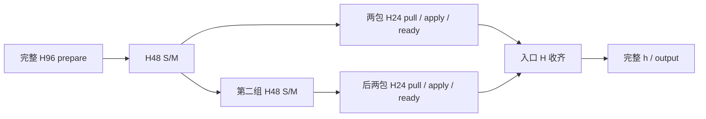

# KDA 单边状态流水：显式实验接口

本接口将四包 head 流水接入共享 KDA core，显式选择完整摘要生产或两组生产；默认 HCCL P2P 保持不变。
当前实现面向 Ascend A2、BF16 B1、K=V128、BT64，支持定长与现有 TND 的真实文档 reset。
CP 使用通信组内编号，不要求二次幂，也不要求完整 WORLD；head 数可以显式配置，包宽允许不相等。
CP1 继续走已有本地 KDA 路径，不构造单边 transport。算法层不再限制为 CP2/4/8，
但还要求 SDK 能映射每一对相邻 peer 的对称内存。
初始化会集体检查这种可达性；解除规模白名单不等于取得跨机或超节点资格。

一个进程仍只支持一个兼容的 SHMEM 通信域。不同进程上的互不相交 CP 子组可以各有自己的端点；
同一进程同时参与多个重叠域尚未实现。Ulysses 接入、A5、实际超过八卡的部署另行验收。

## 配置和所有权

先初始化 HCCL 和 CP mesh，再创建显式 transport；所有 rank 的构造和关闭顺序必须相同。
`bootstrap_uri` 与 `SHMEM_UID_SESSION_ID` 指定两个独立、可达且没有被其他任务占用的 SDK 端点，均与 HCCL 端口区分。
单边原生扩展是可选组件；没有构建时使用本接口会明确报错，普通 `import hyper_parallel` 和默认路径不加载它。

```python
from hyper_parallel.distributed.context_parallel.kda_onesided import KDAOneSidedP2P
from hyper_parallel.distributed.context_parallel.kimi_delta_attention import KimiDeltaAttentionCoreCP

transport = KDAOneSidedP2P(
    cp_mesh.get_group(),
    bootstrap_uri=shmem_bootstrap_uri,
    num_heads=96,
    packets=4,
    producer_groups=2,
    reserved_workers=0,
)
core = KimiDeltaAttentionCoreCP(
    cp_mesh,
    backend="triton",
    state_cp_method="p2p",
    p2p_transport=transport,
)
# 使用现有 core 输入和 sequence_info；正常执行 forward/backward。
# 所有 rank 完成使用后集体调用，且不能留有尚需首次 backward 的图。
transport.close()
```

整层 `KimiDeltaAttentionLayerCP` 也透传相同的 `p2p_transport`，无须全局替换函数。
除来自真实投影/卷积的 core 对照外，已验证两个完整 KDA 层、三个微批次与 AdamW 更新。
这是多层状态通信生命周期资格，不代表已覆盖完整训练框架的所有 PP/FSDP 调度。

H96、`packets=4`、`producer_groups=2` 时，是两组 H48 摘要、四个 H24 通信包。
一般 H 使用 `offset[i] = floor(i*H/q)`，其中 `q=min(packets,H)`；如 H7 的四包为 H1/H2/H2/H2，
两组生产分别覆盖 H3/H4。H1 自动使用一包、一组。H 必须与实际投影头数一致。
`producer_groups=1` 在完整摘要完成后发四包；`producer_groups=2` 在第一组摘要完成后发前两包。
两者均保留为显式选项，构造默认仍为 2；更早发出首包不代表整体更快，应同时计入摘要生产成本和末包完成。
当前生产组只开放 1/2；它与通信包数是两个参数。
`reserved_workers=16` 仅限制第二组 S/G 的并发 program 数，每个 program 顺序处理多个 head；它不限制 M，也不绑定物理核心。
普通调度与限 worker 调度共用逐 head 算术。默认不限制 worker，因为当前证据未证明其进一步降低 CP 增长斜率。

## 数据流



反向用同一协议逆向传递 D；G 分两组生成，M 复用前向缓存并预转置一次。
S/G 每个 head 的乘法、加法、缩放和舍入顺序不变；原生 relay 仍调用 FP32 ATen matmul 后 add，未做算术融合。
共享 HCCL P2P 的 state/adjoint apply 同样显式维持 FP32，不允许外层 BF16 autocast 静默改变状态乘法。
这使 AMP 下的 HCCL 与单边协议比较遵循同一个边界算术契约。
存在内部 reset 时，独立出口先发布，再接收另一文档的入口；不会因为无关的入状态阻塞独立出口。

每个包的设备顺序是：等待上游 ready → SDMA pull 到本次调用独占的 H/D → 回 credit → 等待本地槽位旧 credit → apply 或端点复制 → 发布下游 ready。
ready 表示源包可读；credit 表示远端读完，源槽可重用。两个方向使用各自的 epoch 和双槽。
H/D 不借用循环槽，三个以上在途 forward 也不会覆盖 backward 保存的边界状态。

接收流写入普通 Torch 分配时，必须等待分配流此前对同一存储的使用完成。
`record_stream` 只保护后续释放/复用，不能替代这一入站事件。发送组已有生产完成事件；纯接收路径也显式等待分配事件。

## 工程边界

- `KDAOneSidedP2P`：KDA 的摘要分组和显式 producer 接口。
- `StatePullArena`：对称缓冲区、每次调用、epoch/credit、跨流依赖和 autograd lease。
- `_hp_state_pull`：SDK 初始化/释放、对称内存和保持既有算术的设备 relay。
- 共享 `_KDAStateP2PFunction`：继续负责 prepare、h/dhu、本地完整梯度及保存张量；不复制一套完整 backward。

兼容的多个 arena 共享同一个带引用计数的 SDK runtime，各自拥有缓冲区和 epoch。
构造时累计检查所需对称内存，超出 `heap_bytes` 时在申请新 arena 前拒绝，保留已有 arena。
源摘要的保活结束条件是最后一次 relay 读完成，不再额外等完整 h/dhu；仍保留跨流事件和 `record_stream`。
`arena.collect_completed()` 可以无阻塞回收已完成负载；每次 `begin` 也会回收。
关闭先集体检查待反向图；输出仍存活但已经完成第一次 backward 时允许释放。
关闭后再次执行 `retain_graph=True` 留下的 backward 会明确报错。
发生中途异常时，该调用仍保持 busy，避免再次使用可能在途的槽位；当前需要终止并重新启动该分布式作业。
每个进程只支持一个 host 提交者；未完成提交会阻止下一次提交，不支持多线程同时调用。
设备故障或某 rank 中途退出后的集体恢复尚不支持；不能把强制释放在途对称内存当成恢复办法。

原生构建目录为 `hyper_parallel/core/context_parallel/onesided_native`。CMake 使用外部 `SHMEM_SDK`、当前 CANN 和 Torch/NPU，自动读取 Torch ABI；目标固定为 A2 的 `dav-c220-vec`。
本轮未将它加入主 wheel 的自动构建，也未引入 YAML 自动选择；调用者需显式构建并持有 transport。

## 与现有 KDA 实现的关系

单边通信复用现有 Triton KDA 的本地计算与 FP32 state apply；Ascend C 后端继续使用其原有路径。共享 functional 层按
摘要准备、状态交换与本地计算分阶段组织，原生 relay 的输入校验也按职责拆分；
prepare/h/dhu 的算术、P2P 的预接收/reset 早发顺序和源张量生命周期保持不变。
稳定配置仍为四包，完整生产和两组生产均参与集中回归。

## 阶段评估与收束

当前版本继续保留串行 packet relay。四包、相同 FP32 算术的隔离两流原型曾尝试把下一包 SDMA 与当前包 apply/ready 重叠；它没有进入本 PR 的执行路径。

在本机 A2、B1/H96/K=V128 的预生成摘要对照中，一次前向加反向状态接力时间如下。数据不含 S/M/G 生产和本地 KDA core；每次取最慢 rank，再取七次中位数，普通计时不启用 profiler。

| 四包配置 | CP4 / ms | CP8 / ms |
|---|---:|---:|
| 本版本串行 relay，满摘要发布 | 2.259 | 2.468 |
| 隔离两流预读，满摘要发布 | 2.513 | 2.685 |
| 本版本串行 relay，两组发布 | 3.108 | 3.259 |
| 隔离两流预读，两组发布 | 3.388 | 3.570 |

两流在 CP8 满摘要七个样本中还有 6.055/3.975 ms 长尾，不能只依据较小的 CP4→8 中位数差分推广。两组在本表中事先全部就绪，因此这里没有测量真实第一组摘要早产的价值。

Level0 的预排队控制实验确认硬件可重叠：中间六个 rank 的前后向共36对相邻包，全部出现下一包读取与当前 apply/ready 的交叠，交叠中位约15 μs；通知间隔约95→80 μs。但同一包从 SDMA 开始到 ready 仍约94 μs。预排队先将任务提交再放行，不能把这个设备上限当成实际调用收益；普通下发只有19/36对出现重叠，整体时间反而增加。

固定包数时，跨包重叠主要减少流水排空项。同一包跨 rank 的读取→apply→ready 依赖仍在，不能将被隐藏的 apply 时间乘 CP size 来宣称斜率下降。后续优先研究真正缩短每包关键路径的 tile 消费与紧凑设备调度，以及长期训练的显存生命周期。当前不进一步推广更多流或更多小包。

原型的边界状态与多次在途 epoch 已通过逐位检查，但未做新的完整 core 接入验收；本 PR 的完整 KDA 和多层能力仍以已有资格记录为准。

## 能力完善的优先级

优先处理 CP 规模、真实训练生命周期和设备调度；通用安装、YAML、Ulysses 接入后置。
当前实现已解除二次幂、固定 H96 和完整 WORLD 的限制，并增加多层及显存预算验证。
接下来仍需围绕实际每跳服务、最慢 rank 的末包和跨层在途状态推进：

1. 用同一包数与生产切点分解 host 提交、ready 等待、SDMA、apply、credit，判断哪一项暴露在大 CP 串行路径上。
2. 仅在获得实际证据后缩紧设备调度；不能为了减少事件移除跨流依赖。
3. 资源池必须同时满足远端 credit、本地完成事件和 autograd 消费；当前每层独立 arena 保持明确所有权。
4. 对多线程提交、设备故障和重叠通信域分别设计协议；当前失败后停止并重启作业。

## 可选组件构建与回归

验证依赖为 Torch/torch-npu 2.10.0、完整 CANN 9.1.0-beta.3，Triton-Ascend distribution
`3.2.2+gitc22984ba`（Python frontend 显示 3.2.0）。固定 FLA commit 为
`6b6f546f9bd10a97be1e8cf2f0120de70cfca482`。

SHMEM 使用 `d30702bb55d0c9ce028a241ea608ae38dbaebc8e`，与仓库的
[依赖锁](../../hyper_parallel/core/multicore/_build/dependencies.lock.json)及其 runtime-symbol 适配一致。
`SHMEM_SDK` 指向包含 include、src/device 和 lib 的已构建 SDK 根目录；测试使用私有
`libhyper_parallel_shmem.so`。不能将未经验证的系统 `libshmem.so` 当成等价依赖。
独立组件尚未加入主 wheel；以下命令从仓库根目录运行，先加载完整 CANN 环境并安装固定 FLA。

```bash
python -m pip install --no-deps --no-build-isolation -e .
cmake -S hyper_parallel/core/context_parallel/onesided_native \
      -B build/kda_onesided \
      -DPython3_EXECUTABLE="$(command -v python)" \
      -DSHMEM_SDK="$SHMEM_SDK"
cmake --build build/kda_onesided -j2
export PYTHONPATH="$PWD/build/kda_onesided${PYTHONPATH:+:$PYTHONPATH}"
```

集中回归只有一个入口，默认不在缺少可选 SDK 的环境自动运行。明确启用后，缺失依赖或数值不一致应报错。
端口只是示例，运行前选取本作业独占端口；HCCL 设备端口也应与共卡作业隔离。

```bash
export SHMEM_UID_SESSION_ID=127.0.0.1:55982
export STATE_PULL_BOOTSTRAP=tcp://127.0.0.1:55981
export KDA_ONESIDED_TEST=1
export KDA_ONESIDED_CP=4  # 启动进程数，不要求为二次幂
export KDA_ONESIDED_HEADS=96
export KDA_TEST_DP_SIZE=1  # 例如八进程配 2，会创建两组 CP4
export KDA_TEST_LENGTH=8192
python -m pytest -s tests/torch/context_parallel/test_kda_onesided.py
```

验收固定相同投影/ShortConv 后的输入、`do` 与 local 8K，逐位比较输出以及
q/k/v/gate/beta/A_log/dt_bias 七组梯度；覆盖单长文档、混合 reset、完全 reset、
无 packed 元数据的 dense 分支、完整生产与两组生产（含第二组限 worker）、三个在途 forward 的反序 backward、
零 loss 隔离、非重入 checkpoint，以及 close 对未完成反向的拒绝和图丢弃后的释放。
补充验收使用两个完整 KDA 层、FP32 权重、BF16 autocast、三个微批次，以及相同 AdamW 状态：
定长反序 backward、TND 交错前反向、非重入 checkpoint 各两步，检查输出、hidden 梯度、参数梯度和实际权重更新。
此项严格逐位比较启用确定性计算，排除卷积归约的运行间波动；生产后端不全局开启确定性。
通过这些对照证明的是相同本地算术下的协议与生命周期一致性，不是相对任意高精度参考的全模型误差证明。

## 显存与大 CP 的解释边界

B1/H96/K=V128 的一份 FP32 状态为 6 MiB。每 arena 的双方向、双槽状态区为 24 MiB，
ready/credit 合计 17 KiB；两层的有效对称区合计约 48.033 MiB。
默认 192 MiB SDK heap 由兼容 arena 共享，必须与所有层同时存活的总预算匹配；它容纳不了八份 H96 arena。
增加层数时应集体配置足够的 heap。Torch allocator 统计不能覆盖这份外部分配；
有效 arena 字节和 SDK heap 容量应分别报告，不将两者相加。每次调用保存的入口 H、需要时保存的 M、反向独占 D 和 M 转置临时区另计。

`arena.memory_stats()` 报告本 arena 字节、runtime 累计 arena 字节、heap 容量、
待释放的唯一 Torch 负载存储字节和待首次反向图数。它不替代 Torch 的峰值统计，也不重复统计 autograd 保存的 H/M。

通信四包不等同于将整个 core 分成四次：完整 prepare、h/dhu 的工作区仍在。
多层若各创建一个 arena，会线性消耗对称区。未来的 arena 池必须同时满足远端 credit、
本地事件和 autograd 消费完成，不能只按 Python 对象是否离开作用域复用。

固定包数的 P2P 仍是 O(CP size) 串行依赖。包流水旨在减小每跳系数；第一包提前不保证末包更早。
当前 relay 仍由 host 排入 wait/pull/matmul/add/signal，尚非单个常驻设备调度 kernel。
数值和生命周期回归不代替性能测量，也不将单机资格外推为 CP256 实测。

## 与 Python 分 head 的区别

| 切分方式 | prepare 与完整 h/dhu | 摘要与通信 | 主要取舍 |
|---|---|---|---|
| core 入口就分 head | 每份分别执行 | 每份分别执行 | 可降低部分工作区峰值；增加算子启动和小 head 效率损失 |
| 只在 Python 分摘要/通信 | 仍为完整 heads | Python/HCCL 每包协调 | 同样可以早发，切分本身不是单边特有能力 |
| 当前单边两组/四包 | 仍为完整 heads | 摘要两组；设备 ready/credit 驱动四包接力 | 解耦生产与传输粒度、直接写入 H/D 和源槽，减少逐包交接 |

这里先等完整 H96 prepare 结束，再用独立的 kernel 调用分别生成两组 H48 摘要。
当前不是从一个仍在运行的 H96 prepare 或摘要 kernel 中读取已经完成的一半输出。
完整 prepare 与“等完整 S/M 才发送”是两回事。第一组 S/M 完成后便可发布前两包，
第二组生产与前两包接力可以重叠。当前仍由 host 提交多个设备任务；没有实现全部 KDA 的常驻设备 kernel。
若 Python 基线也是同一生产切点，应把收益归因于传输、提交和布局，而不能再次计入 head 分包本身的收益。
