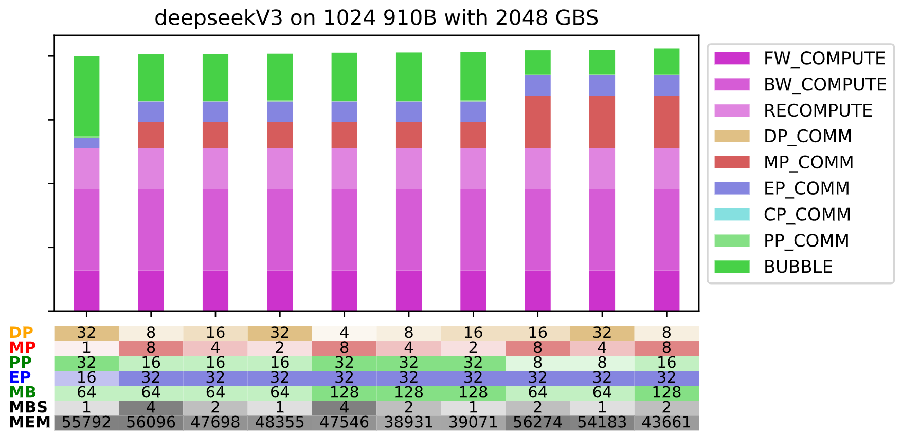
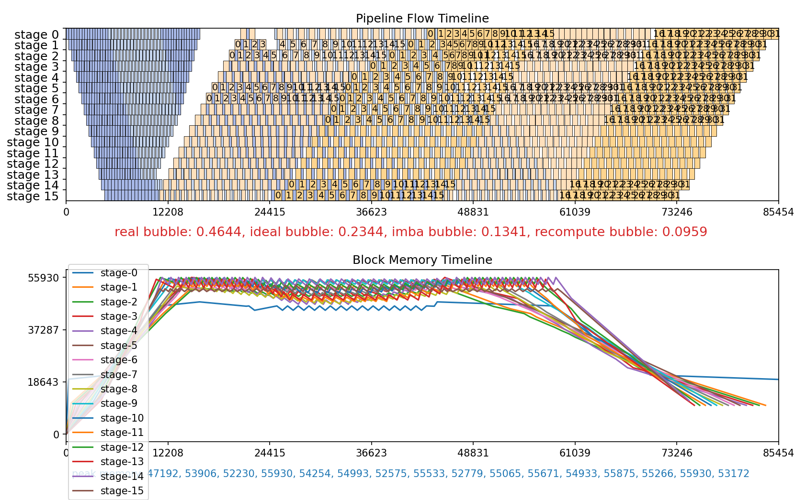

# Automatic Parallelism Guide

**English** | [简体中文](auto_parallel.zh.md)

HyperParallel provides automatic parallelism through SAPP-ND and SAPP-PPB. SAPP-ND searches multidimensional hybrid parallel strategies; SAPP-PPB balances pipeline parallel stages and jointly tunes offsets and recomputation.

## Core Concepts

| Module | Description | Use case |
|------|------|----------|
| SAPP-ND | N-dimensional parallel strategy generation, returning the top T configurations | Automatic DP, TP, PP, and EP configuration |
| SAPP-PPB | Pipeline Parallelism Balancing, automatically balancing computation and memory across PP stages | Joint tuning of PP stage offsets and recomputation |

---

## SAPP-ND: ND Search <!-- codespell:ignore nd -->

ND generates N-dimensional parallel strategies. It creates candidate configurations from model configuration, hardware scale, global batch size, and memory budget, filters out OOM configurations using memory estimates, and ranks the remaining candidates using performance estimates. Both estimates are analytical, so ND search does not require online profiling and can run in a CPU-only environment. <!-- codespell:ignore nd -->

```bash
# codespell:ignore-next-line nd
python -m hyper_parallel.auto_parallel.sapp_nd.nd.run_nd \
    -y <yaml> \
    -l DP MP PP EP MB MBS \
    -d 1024 \
    -b 2048 \
    -t 10
```

Typical inputs include:

- Model type and hyperparameters
- Parallel dimensions to search
- Hardware type and device count
- Global batch size and memory budget

SAPP-ND exposes these parallel dimensions:

- `DP`: Data parallelism
- `TP`: Model or tensor parallelism
- `SP`:Megatron sequence parallel
- `EP`: Expert parallelism
- `PP`: Pipeline parallelism
- `MB`: Number of micro-batches
- `MBS`:micro-batch size
- `VPP`:virtual pipeline parallelism
- `CP`: Context parallelism (integration in progress)
- `OP`: Optimizer or ZeRO-DP parallelism (integration in progress)

The SAPP-ND module contains:

- `nd/`: ND search entry point, parallel search space construction, and ranking <!-- codespell:ignore nd -->
- `memory_estimation/`: Memory estimation
- `perf_estimation/`: Performance estimation

ND returns ranked candidates that satisfy memory constraints and generates a performance comparison chart for global parallel strategies, helping select the best configuration under the current constraints. <!-- codespell:ignore nd -->



The chart compares and ranks candidate configurations by performance.

In addition to the top results selected by `-t`, you can include configurations where each dimension listed in `-l` has a value greater than 1:

| Option | Behavior |
| --- | --- |
| `-e N` / `--exhaustive N` | Show at least N qualifying configurations per dimension, counting the top results |
| `-ee N` / `--force_exhaustive N` | Add N configurations per dimension; if a larger `-e` is also specified, continue filling its quota |
| `-eee N` / `--fforce-exhaustive N` | Add N distinct configurations per dimension, without reusing additions across dimensions; positive values take precedence over `-e` and `-ee` |

All three options accept nonnegative integers and default to 0. With `-e` and `-ee`, one added configuration can satisfy multiple dimensions, so the total number of additions may be smaller than the number of dimensions multiplied by N. `-eee` selects unused configurations in `-l` order and returns the available candidates if fewer than requested exist.

For example, `-t 5 -l DP EP MP CP OP -eee 2 -o output/nd_perf` shows the top five results and adds ten distinct configurations when enough candidates exist. Verbosity defaults to 2, and the chart is written to `output/nd_perf/results.pdf`. A black vertical line separates the top results from additions when additions are present.

These options apply to standard ND search; nonzero values cannot be combined with `--real_csv`, `--search-config`, or `--verify`. See the [ND option reference](../../hyper_parallel/auto_parallel/sapp_nd/README.md#exhaustive-plot-selection) for precedence, counting examples, and output details. <!-- codespell:ignore nd -->

When using `-ar` with per-layer choices of recomputation modes, you can add `-rp` / `--recompute_potentials`:

| Parameter | Behavior |
| --- | --- |
| `-rp` / `--recompute_potentials` | For each configuration satisfying memory constraints, keep parallel degrees and memory budget fixed, fully recompute one additional layer at each step, and report the cost model's estimate for every step |

This option is disabled by default, so the search skips these calculations unless requested. When enabled, it additionally writes `recompute_potentials.csv`, `result_recompute_inc.pdf`, and `result_recompute_full_next.pdf` under `-o`. Every value estimates step time using the same cost model as search ranking. Measurements may differ; the difference between two plans represents the model's expected cost of recomputing one more layer, not a measured or guaranteed benefit. This option is for standard ND search and cannot be combined with `--real_csv`, `--search-config`, or `--verify`. See the [ND parameter documentation](../../hyper_parallel/auto_parallel/sapp_nd/README.md#recompute-potentials). <!-- codespell:ignore nd -->

---

## SAPP-PPB:Pipeline Parallelism Balancing

SAPP-PPB balances pipeline stages. It reads timing and memory information for each layer type under different recomputation or swap strategies, together with pipeline configuration such as stage count, micro-batch count, interleave count, and scheduling strategy. It formulates an integer linear programming problem, and the solver returns layer assignments, offsets, and recomputation settings. A simulator visualizes the resulting pipeline.

> **Note**: PPB's `recompute` searches recomputation strategies at the PP stage level. This is a different configuration level from the Activation Checkpoint / Swap APIs in `hyper_parallel.core.activation_checkpoint`; they can be combined but have independent semantics.

```bash
python hyper_parallel/auto_parallel/sapp_ppb/run_pipeline_balance.py \
    -m llama2_70b \
    -s 16 \
    -mb 32 \
    -i 2 \
    -O 2
```

The SAPP-PPB workflow:

1. Parse layer descriptions and pipeline configuration to formulate the ILP problem.
2. Solve it with a third-party solver; PuLP is the default, with Gurobi optional.
3. Output the balancing results and visualize them with the pipeline simulator.

The SAPP-PPB module contains:

- `run_pipeline_balance.py`: PPB command-line entry point
- `sapp/`: Problem formulation and ILP solving
- `simulator/`: Pipeline block scheduling simulation and visualization
- `layers/`: Sample layer descriptions
- `cfgs/`: Sample manual configurations

PPB outputs pipeline simulator visualizations and layer assignments, offsets, and recomputation settings that can be applied directly to training configuration.



The chart shows execution timelines and load distribution across PP stages.

```yaml
offset:    [[0,0,0,0, 0,0,0,0, 0,0,0,0, 0,0,1,1], [0,0,0,0, 0,0,0,0, 0,0,0,0, 0,0,0,-2]]
recompute: [[3,1,1,1, 1,0,0,0, 0,0,0,0, 0,0,0,0], [0,0,0,0, 0,0,0,0, 0,0,0,0, 0,0,0, 0]]
```

`offset` specifies the layer-count offset for each virtual stage; `recompute` specifies the recomputation strategy for each stage.

---

## Performance Recommendations

1. **Use SAPP-ND for global parallel configuration**: Search combinations such as DP/MP/PP/EP/MB/MBS to obtain candidates that satisfy memory constraints and are ranked by performance.
2. **Use SAPP-PPB for pipeline tuning**: When PP stage allocation, VPP, offsets, or recomputation are the main concern, use PPB to balance pipeline load.
3. **Choose the global configuration before fine-tuning the pipeline**: First select a promising overall configuration with ND, then use PPB to adjust offsets and recomputation for that configuration. <!-- codespell:ignore nd -->
4. **Currently a demo feature**: These capabilities are being improved and extended.
