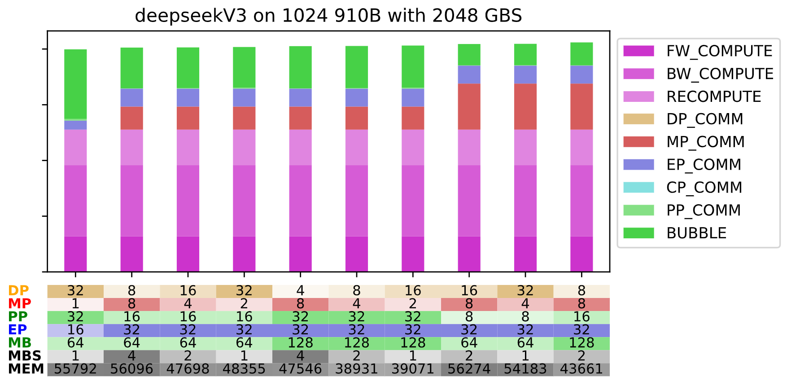
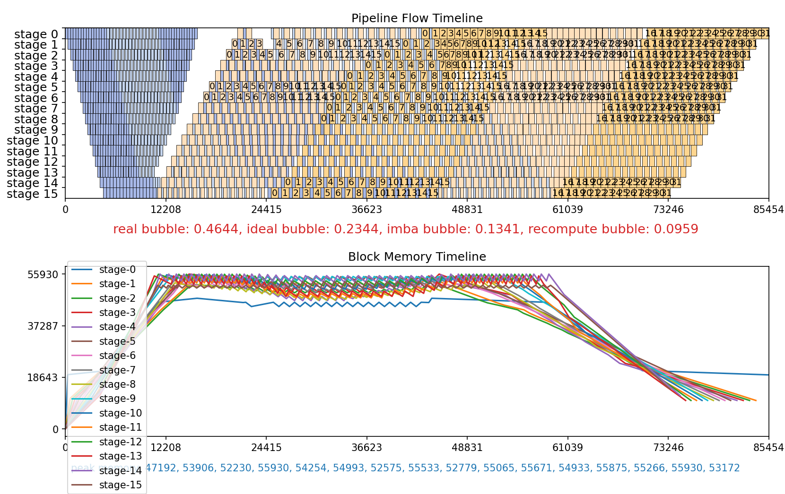

# 自动并行使用指南

HyperParallel 提供 AutoParallel（自动并行）能力，主要包含 SAPP-ND 和 SAPP-PPB：SAPP-ND 用于多维混合并行策略搜索，SAPP-PPB 用于 Pipeline Parallel stage 负载均衡和 offset/recompute 联合调优。

## 核心概念

| 模块 | 说明 | 适用场景 |
|------|------|----------|
| SAPP-ND | N Dimensional Parallelism 并行策略生成，提供 top T 个最优并行配置 | DP, TP, PP, EP 多维并行自动配置 |
| SAPP-PPB | Pipeline Parallelism Balancing，自动平衡 PP stage 的计算和内存负载 | PP stage offset 和 recompute 联合自动调优 |

---

## SAPP-ND：ND 搜索

ND 提供 N 维并行策略的生成。它会根据模型配置、硬件规模、全局 batch size 和内存预算生成候选并行配置，先通过内存估算过滤 OOM 配置，再通过性能估算对剩余配置排序。由于内存和性能都采用解析式估算，ND 搜索不依赖在线 profiling，可以在 CPU-only 环境中完成规划。

```bash
python -m hyper_parallel.auto_parallel.sapp_nd.nd.run_nd \
    -y <yaml> \
    -l DP MP PP EP MB MBS \
    -d 1024 \
    -b 2048 \
    -t 10
```

常用输入包括：

- 模型类型和模型超参数
- 待搜索的并行维度
- 硬件类型和设备数
- global batch size 和内存预算

SAPP-ND 开放的并行维度：

- `DP`：数据并行
- `TP`：模型并行或张量并行
- `SP`：Megatron sequence parallel
- `EP`：专家并行
- `PP`：流水线并行
- `MB`：micro-batch 数
- `MBS`：micro-batch size
- `VPP`：virtual pipeline parallelism
- `CP`：context parallelism (适配中)
- `OP`：优化器或 ZeRO-DP 并行 (适配中)

SAPP-ND 模块包含：

- `nd/`：ND 搜索入口、并行空间构造和排序逻辑
- `memory_estimation/`：内存估算
- `perf_estimation/`：性能估算

ND 的输出会给出满足内存约束的候选配置和排序结果，并生成全局并行策略的性能对比图，便于选择当前约束下的最优并行配置。



图中展示候选并行配置的性能排序和对比结果。

可以在 `-t` 指定的前若干个结果之外，补充 `-l` 中各维度取值大于 1 的配置：

| 参数 | 行为 |
| --- | --- |
| `-e N` / `--exhaustive N` | 将前若干个结果计入，每个维度至少展示 N 个符合条件的配置 |
| `-ee N` / `--force_exhaustive N` | 每个维度强制补充 N 个配置；如果同时指定更大的 `-e`，继续补足其数量要求 |
| `-eee N` / `--fforce-exhaustive N` | 每个维度补充 N 个独立配置，补充配置不在不同维度间重复分配；正值优先于 `-e` 和 `-ee` |

三个参数均接受非负整数，默认值为 0。`-e` 和 `-ee` 的同一个补充配置可以满足多个维度，因此最终图中的新增配置数可能小于维度数乘以 N。`-eee` 按 `-l` 的顺序选择尚未使用的配置，候选不足时返回可用的配置。

例如 `-t 5 -l DP EP MP CP OP -eee 2 -o output/nd_perf` 展示前 5 个结果，并在候选充足时增加 10 个独立配置。默认 verbosity 为 2，图写入 `output/nd_perf/results.pdf`；有补充结果时，黑色竖线分隔前若干个结果和补充结果。

这些参数用于标准 ND 搜索，非零值不能与 `--real_csv`、`--search-config` 或 `--verify` 同时使用。完整的优先级、计数示例和输出说明见 [ND 参数文档](../../hyper_parallel/auto_parallel/sapp_nd/README.md#exhaustive-plot-selection)。

使用 `-ar` 并给出每层可选的重计算模式时，可加 `-rp` / `--recompute_potentials`：

| 参数 | 行为 |
| --- | --- |
| `-rp` / `--recompute_potentials` | 对每个满足内存约束的配置，保持其并行度和内存预算不变，依次多全量重计算一层，给出代价模型对每一步的估计 |

该选项默认关闭，不指定时搜索不做这部分计算；指定时在 `-o` 目录下额外写出 `recompute_potentials.csv` 以及 `result_recompute_inc.pdf` 和 `result_recompute_full_next.pdf`。其中每个数值都是代价模型对单步耗时的估计，与搜索排序用的估计一致，实测结果可能与之不符，因此两个计划之间的差值应理解为代价模型预期多重计算一层的代价，而不是实测或保证的收益。该选项用于标准 ND 搜索，不能与 `--real_csv`、`--search-config` 或 `--verify` 同时使用，详见 [ND 参数文档](../../hyper_parallel/auto_parallel/sapp_nd/README.md#recompute-potentials)。

---

## SAPP-PPB：Pipeline Parallelism Balancing

SAPP-PPB 用于 Pipeline Parallel stage 负载均衡。它读取每类 layer 在不同重计算或 swap 策略下的耗时和内存信息，以及 PP stage 数、micro-batch 数、interleave 数、调度策略等流水线配置，然后构造整数线性规划问题，由求解器返回 layer 分配、offset 和 recompute 配置，并可通过 simulator 查看流水线效果。

> **说明**：PPB 中的 `recompute` 指 PP stage 级的重计算策略搜索，与 `hyper_parallel.core.activation_checkpoint` 中的 Activation Checkpoint / Swap API 是不同层面的配置，可组合使用但语义独立。

```bash
python hyper_parallel/auto_parallel/sapp_ppb/run_pipeline_balance.py \
    -m llama2_70b \
    -s 16 \
    -mb 32 \
    -i 2 \
    -O 2
```

SAPP-PPB 的核心流程：

1. 解析 layer 描述和 pipeline 配置，生成 ILP 问题。
2. 使用第三方求解器求解；默认使用 PuLP，可选 Gurobi。
3. 输出 balancing 结果，并通过 pipeline simulator 生成可视化结果。

SAPP-PPB 模块包含：

- `run_pipeline_balance.py`：PPB 命令行入口
- `sapp/`：问题构造和 ILP 求解逻辑
- `simulator/`：pipeline block 级调度模拟和可视化
- `layers/`：layer 描述样例
- `cfgs/`：手动配置样例

PPB 的输出包括 pipeline simulator 可视化图，以及可直接落到训练配置里的 layer 分配、offset 和 recompute 结果。



图中展示不同 PP stage 的执行时间线和负载分布。

```yaml
offset:    [[0,0,0,0, 0,0,0,0, 0,0,0,0, 0,0,1,1], [0,0,0,0, 0,0,0,0, 0,0,0,0, 0,0,0,-2]]
recompute: [[3,1,1,1, 1,0,0,0, 0,0,0,0, 0,0,0,0], [0,0,0,0, 0,0,0,0, 0,0,0,0, 0,0,0, 0]]
```

`offset` 表示各 virtual stage 的层数偏移，`recompute` 表示各 stage 采用的重计算策略。

---

## 性能建议

1. **ND 并行配置调优用 SAPP-ND**：先用 ND 搜索 DP/MP/PP/EP/MB/MBS 等多维组合，得到满足内存约束并按性能排序的候选配置。
2. **Pipeline 调优用 SAPP-PPB**：当 PP stage 分配、VPP、offset 或 recompute 成为主要问题时，用 PPB 做流水线负载均衡。
3. **建议先定全局并行配置，再细调流水线**：优先用 ND 确认较优的整体并行配置，再基于该配置使用 PPB 调整 pipeline offset 和 recompute。
4. **当前为 demo 特性**：相关功能正在逐渐完善及扩展。
