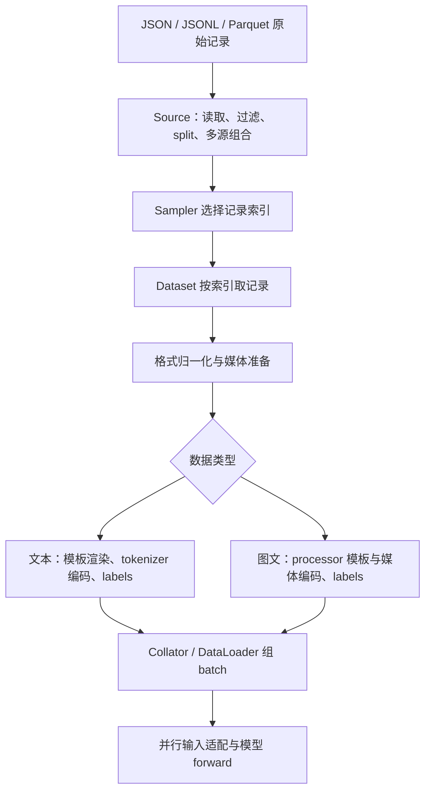

# SFT 数据处理特性

本文介绍纯文本和图文 SFT 的数据格式、模板编码、监督标签、采样及组批配置。
完整训练配置可参考 [Qwen Dense 文本 recipe](../../../hyper_parallel/models/qwen3_8/recipes/train_online.yaml)
和 [Qwen MoE 图文 recipe](../../../hyper_parallel/models/qwen3_6_moe/recipes/train_online_vlm.yaml)。
下面的 YAML 均为数据相关配置片段，需要与模型、优化器和训练配置组合使用。

## 1. 数据如何进入训练

初始化先构建 tokenizer/processor、transform、source 和 Dataset，再构建 sampler、DataLoader。
读取阶段由 sampler 选择索引，Dataset 取原始记录后调用 transform；不是先把整个数据集编码进内存。



| 能力 | 纯文本 SFT | 通用图文 SFT（AutoProcessorTransform） |
| --- | --- | --- |
| 对话格式 | OpenAI 风格 messages、ShareGPT | messages/openai/hf、显式 sharegpt |
| Instruction 列映射 | 支持 instruction、可选 input、output | 需先准备成图文 messages |
| 监督范围 | 默认监督各轮 assistant，支持显式 loss_mask | 监督最后一条 assistant |
| 模板来源 | tokenizer 原生模板；也有内置模板 | processor 原生模板 |
| tools/thinking 配置 | tokenizer 模板路径支持，具体语义由模板决定 | 不自动继承纯文本模板配置 |
| 图片路径、bytes | 不适用 | 支持路径和外部 images 中的 bytes/path |
| 长度限制 | 模板编码保留尾部，再构建 shifted 输入与标签 | 超长报错，不截断媒体序列 |
| Packing | 由 loader/collator 配置决定 | 设置 `dataloader._target_` 为 `OmniPackingLoader`，并配置 `token_budget` |

## 2. 纯文本样本与配置

### 2.1 Messages 与 ShareGPT

OpenAI 风格记录：

```json
{"messages":[{"role":"user","content":"什么是数据并行？"},{"role":"assistant","content":"不同设备处理不同样本，并同步模型梯度。"}]}
```

ShareGPT 记录：

```json
{"conversations":[{"from":"human","value":"什么是数据并行？"},{"from":"gpt","value":"不同设备处理不同样本，并同步模型梯度。"}]}
```

使用 `data_type: sharegpt`，通过 `text_keys` 选择记录中的对话列。
格式层将 `from/value` 转为 `role/content`，并保留 `loss_mask`、`tool_calls` 等字段。

```yaml
dataset:
  _target_: hyper_parallel.data.text.build_dataset.build_online_text_mapping_dataset
  data_path: /data/train.jsonl
  data_config:
    labels_are_shifted: true
  model_assets:
    chat_template: tokenizer
    tokenizer:
      _target_: hyper_parallel.data.text.build_tokenizer.AutoTokenizer.from_pretrained
      pretrained_model_name_or_path: /models/model
      local_files_only: true
  data_transform:
    _target_: hyper_parallel.data.text.text_transform.build_text_transform
    data_type: sharegpt
    text_keys: messages
    max_seq_len: 32768
```

ShareGPT 示例设置 `data_type: sharegpt`、`text_keys: conversations`。省略 text_keys 时，
plaintext/sharegpt 分别默认读取 text/conversations 列；role/content 消息同样使用 sharegpt，
通过 text_keys 指定其所在列。

### 2.2 Alpaca / Instruction 列映射

```json
{"prompt":"翻译为英文","context":"你好","answer":"Hello"}
```

替换上面配置中的 `data_transform`：

```yaml
data_transform:
  _target_: hyper_parallel.data.text.text_transform.build_text_transform
  data_type: alpaca
  column_mapping:
    instruction: prompt
    input: context
    output: answer
  input_separator: "\n\n"
  max_seq_len: 32768
```

`InstructionMessages` 读取映射列，组成 user/assistant 消息，然后复用 `TextConversationTransform` 编码。
instruction 和 output 必须是非空字符串；input 可省略或为空，此时不追加分隔符。
`tools_key` 用于 sharegpt，alpaca 不接受该参数。

## 3. 模板、tools 与监督标签

### 3.1 渲染和编码是两个步骤

`chat_template: tokenizer` 使用 tokenizer 自带的模板。先通过
`apply_chat_template(tokenize=False)` 得到文本，再编码为 token IDs；不会生成一套新的模型模板。

默认 user/system/tool 消息不参与监督，assistant 参与监督。支持消息上的显式 `loss_mask`；
被屏蔽的位置填 `-100`。多轮对话保留先前 assistant 的监督标签。
前导 system 消息与首条 user 合并处理边界时，不支持在该部分开启监督。

assistant 的生成提示与回答在字符边界处可能发生 BPE 合并。文本路径分别编码新增 prompt 和回答，
保留已编码的历史，避免 prompt 与回答跨界合并导致标签错位。
因此这里的 token 序列不保证等于对完整渲染字符串一次性编码的结果。
模板若改写已经编码的历史且无法保持前缀关系，会明确报错。

文本模板按 `max_seq_len` 保留尾部，随后 transform 生成 `input_ids[:-1]` 与 `labels[1:]`。
所以最终长度至多为 `max_seq_len - 1`；shift 后没有有效监督 token 的样本返回空结果。

### 3.2 Tools 和 thinking

样本可以携带工具定义及工具调用消息：

```json
{
  "messages": [
    {"role": "user", "content": "查一下北京天气"},
    {"role": "assistant", "content": "", "tool_calls": [{"id": "call_1", "type": "function", "function": {"name": "weather", "arguments": "{\"city\":\"北京\"}"}}]},
    {"role": "tool", "tool_call_id": "call_1", "content": "晴"},
    {"role": "assistant", "content": "北京天气晴。"}
  ],
  "tools": [{"type": "function", "function": {"name": "weather", "description": "查询天气", "parameters": {"type": "object", "properties": {"city": {"type": "string"}}}}}]
}
```

在 `dataset.data_transform` 中配置 `tools_key: tools` 才会读取该列；接受工具列表或其 JSON 字符串。
工具调用的具体表示必须符合所用 tokenizer 模板的要求。这里只渲染训练记录，不执行工具。

模板参数通过 `dataset.model_assets.chat_template_kwargs` 传入，例如：

```yaml
chat_template_kwargs:
  enable_thinking: true
  preserve_thinking: true
```

这些参数需要模型模板支持。`preserve_thinking` 可用于支持它的模板保留历史思考内容，避免多轮渲染
删除历史内容；它不是在数据层自动生成或补回 reasoning。

需要查看首次渲染结果时，在训练配置顶层设置：

```yaml
debug:
  log_first_rendered_template: true
```

该开关可独立开启；此处对应纯文本 tokenizer 模板日志。

## 4. 图文 SFT

### 4.1 消息与媒体

```json
{
  "messages": [
    {"role": "user", "content": [{"type": "image", "url": "/data/images/cat.jpg"}, {"type": "text", "text": "图中是什么？"}]},
    {"role": "assistant", "content": "一只猫。"}
  ]
}
```

也可使用图像占位符配合外部 `images` 列。Parquet 中常见的记录结构如下；`bytes` 是二进制值，
不是 JSON 中的普通字符串或自动解码的 Base64：

```python
sample = {
    "messages": [
        {"role": "user", "content": [{"type": "image"}, {"type": "text", "text": "图中是什么？"}]},
        {"role": "assistant", "content": "一只猫。"},
    ],
    "images": [{"bytes": image_bytes, "path": None}],
}
```

图片按占位符顺序绑定；bytes 非 None 时优先使用，否则使用 path。bytes 由 Pillow 解码为 RGB，损坏内容报错。
图片数量不匹配会报错。记录带有 source 路径元数据时，相对媒体路径按源文件目录解析；
直接调用 transform 而未提供该元数据时，应使用绝对路径。

### 4.2 Processor 与 labels

```yaml
dataset:
  _target_: hyper_parallel.data.omni.build_dataset.build_online_omni_mapping_dataset
  training_mode: sft
  data_path: /data/train.parquet
  data_config: {}
  model_assets:
    _target_: hyper_parallel.data.omni.omni_transform.build_auto_processor
    pretrained_model_name_or_path: /models/model
  data_transform:
    _target_: hyper_parallel.data.omni.omni_transform.AutoProcessorTransform
    sample_format: messages
    max_seq_len: 8192
```

ShareGPT 图文数据使用 `sample_format: sharegpt` 和 `conversations` 列。
通用路径要求最后一条消息是 assistant，使用 processor 分别编码完整对话和带生成提示的历史。
只监督最后一条 assistant，历史部分设为 `-100`；有 `mm_token_type_ids` 时，还会屏蔽媒体位置。
它不采用纯文本路径的逐轮 `loss_mask` 编码流程。

若 prompt 与回答交界发生 BPE 合并，保留 processor 原始 tokens，并把跨界 token 整体屏蔽。
这样不会改变图片 token 与媒体张量的对齐。无法确认边界、没有有效监督 token 或超过 `max_seq_len`
都会报错。这里不截断或填充媒体序列，也不提前 shift labels；shift 由模型 loss 或并行适配处理。

## 5. Source、采样与组批

在线 mapping 数据支持本地 JSON、JSONL、Parquet。数据过滤、文件路由、预分割路径和比例 split
详见 [Online 数据接入说明](deepseek_v41_vlm_online_data_guide.md)。多源使用 `data_config.sources`：

```yaml
data_path: null
data_config:
  sources:
    - data_path: /data/source_a.jsonl
      weight: 0.7
    - data_path: /data/source_b.jsonl
      weight: 0.3
```

显式 sources 与顶层非空 data_path 不能同时配置。
`sampler_type: cyclic` 时，单源保留完整 source，epoch shuffle 和循环由 sampler 完成；
多源仍按权重构建 source 选择计划，但不再对每个 source 内部额外 shuffle。
`single` 模式可以根据训练目标样本数构建索引，不能假定两种模式顺序相同。
数值对比除 seed 外，还需固定 source、采样模式、batch 与并行参数。

通用 Omni 数据链路通过以下配置开启 packing：

```yaml
dataloader:
  _target_: hyper_parallel.data.batching.OmniPackingLoader
  collate_fn:
    _target_: hyper_parallel.data.batching.build_omni_collate_fn
  get_batch:
    _target_: hyper_parallel.data.batching.OmniParallelBatch
    encoder_dp: false
  sampler_type: single
  token_budget: 8192
  min_buffered_samples: 1
  num_workers: 0
```

`token_budget` 设置每次选择样本的 token 预算，`min_buffered_samples` 设置候选缓冲的最少样本数。
`token_budget` 不截断单个样本。配置与输入字段说明见 [Omni Online 数据接入指南](omni_online_data_guide.md)。
此配置使用通用 `OmniParallelBatch`；Qwen 专用的 `QwenVLMParallelBatch` 当前不接受 packed sequence。

模型相关的 CP 输入由 runtime adapter 完成。Qwen 图文适配需要先计算全局 mRoPE、完成全局 labels shift，
再切分序列并确定各 rank 的图片 token 区间；这不是所有 VLM 自动具备的通用能力。

离线预分词数据的准备方式见 [离线数据准备指南](offline_preparation_guide.md)。
