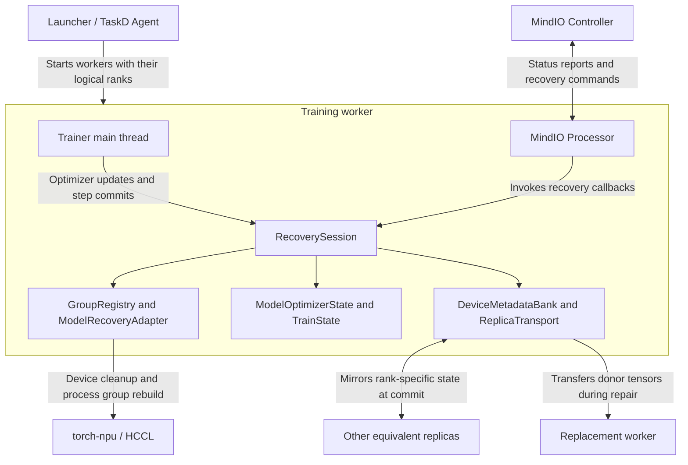
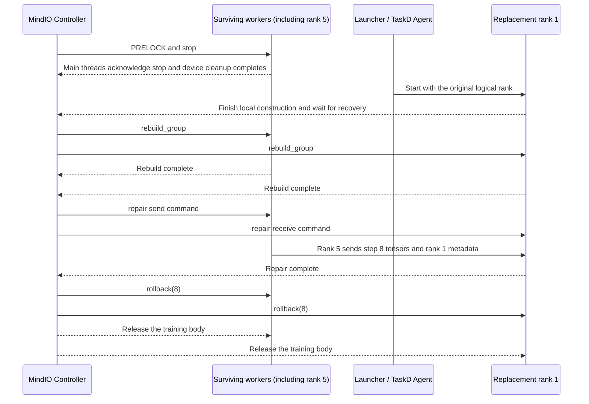

# Process-Level Recovery Guide

**English** | [简体中文](process_recovery.zh.md)

HyperParallel process-level recovery lets a distributed training job resume from surviving replicas after some workers exit. The launcher starts replacements with the original logical ranks, and MindIO coordinates communication rebuild across surviving and replacement workers. Each replacement receives model and optimizer tensors from an equivalent replica over HCCL, then restores its original rank's data position and random state. Surviving workers keep their existing training objects, and all ranks resume from the same committed step.

## Core Concepts

| Concept | Description |
|---------|-------------|
| Equivalent replicas | Ranks with matching model parameter shards and optimizer state ownership. HyperParallel derives these groups from the DeviceMesh, placements, and actual optimizer layout. |
| Committed step | A completed optimizer update. HyperParallel reports it to MindIO after model parameters, optimizer state, and scheduler state are updated and training metadata is mirrored successfully. |
| Training metadata | Data cursors, RNG state, explicit generators, mutable model buffers, and extra state are restored for the original rank. The donor supplies replica-equivalent state such as training progress and scheduler state. |
| PRELOCK | A MindIO mechanism that limits how far workers can advance into subsequent optimizer updates during fault coordination. |

## Quick Start

Before starting the job, check the runtime and training configuration, then choose one Controller hosting mode. BaseTrainer, TextTrainer, and VLMTrainer integrate with the recovery session automatically.

### Runtime Requirements

Run eager training on Ascend NPUs with HCCL. The environment needs MindIO TTP, a `torch_npu` build that can stop and restart devices and rebuild process groups, and a launcher that can restart workers with their original ranks and a fixed `WORLD_SIZE`. The data loader must support saving and restoring its cursor. HyperParallel's `FixedBatchDataLoader` and the loader underlying dynamic batching use torchdata multiprocessing snapshots and support `num_workers > 0`. A replacement worker must be able to access the original data and required indexes and initialize its data pipeline independently.

In both hosting modes, the launcher supplies `RANK`, `WORLD_SIZE`, and `LOCAL_RANK`. Replacement workers require `TORCH_DIST_INIT_BARRIER=0` and must omit `device_id` when initializing the default HCCL group. Choose a single Controller host and keep the Controller and rendezvous store available throughout recovery.

When deploying across nodes, the physical placement of replicas determines which faults the job can tolerate. If a replica group resides on a single node, failure of that node may remove every donor in the group.

### Usage Limits

- Use HyperParallel AdamW or Muon. The recovery path currently excludes PP, UCE, AMSGrad, `torch.compile`, Trainer evaluation data state, PEFT, and external model state.
- Set `dataloader.use_background_prefetcher` to `false` when recovery is enabled. TextTrainer and VLMTrainer iterate over their data loaders directly in their respective training loops.
- When rolling back multiprocessing data loading, `FixedBatchDataLoader` shuts down the old iterator's workers before loading the committed snapshot. The original training loop then rebuilds the iterator. The worker count and data configuration must match the original run. Save and restore random augmentation and mutable custom Dataset state through the Dataset's `state_dict()` and `load_state_dict()` so that data worker state is restored alongside the training process's RNG state.
- `model_integration` supports model onboarding and numerical debugging. Set `model_integration.mode` to `off` when recovery is enabled.
- Protected model buffers must reside on the worker's device. Recovery can stage CPU offload or optimizer swap state through the communication device. See [Validation Tests](#validation-tests) for test entry points.

### Configure and Start Training

#### Controller Hosted by Rank 0

Add `worker_recovery` at the top level of the Trainer YAML. Replace the example IP with a rank 0 address that the other workers can reach.

```yaml
worker_recovery:
  enable_worker_reboot: true
  controller_ip: "192.168.1.10"
  controller_port: 8000
```

`enable_worker_reboot` defaults to `false`. When `controller_ip` is set, `controller_port` defaults to `8000`. This mode requires the Controller on rank 0 to remain available during recovery.

#### Controller Hosted by TaskD

```yaml
worker_recovery:
  enable_worker_reboot: true
```

The deployment starts the Controller and Agent and supplies the Controller address and port. HyperParallel checks `PROCESSOR_ADDR`, `CONTROLLER_ADDR`, `TTP_ADDR`, and `MASTER_ADDR` in that order and reads the port from `TTP_PORT`. Set these variables before loading the TaskD or MindIO shared libraries.

#### Start Training

After configuring the Controller, launch the Trainer job through your usual entry point. HyperParallel derives the replica groups from the model and optimizer layouts.

## How Recovery Works

Recovery uses existing equivalent replicas as the source of model and optimizer tensors and preserves the training state specific to each rank.

### Architecture



- **Worker lifecycle.** The launcher or TaskD Agent starts the original workers and replaces failed workers while preserving their logical ranks and the world size.
- **Recovery coordination.** The MindIO Controller collects worker status and coordinates the recovery step and repair commands. The Processor on each worker invokes the registered `RecoverySession` callbacks in response.
- **Trainer integration.** The Trainer main thread runs its usual data loading, forward and backward passes, and optimizer updates. It uses `RecoverySession` to pause at step boundaries and report completed updates. On failure, the main thread exits the current training body, waits for the SDK to release it, and reenters the same training entry point.
- **Communication and state.** HyperParallel records process groups and training object layouts. It uses torch-npu for device cleanup and restart and to rebuild HCCL communication. During repair, the transport verifies and installs training state for the target committed step.

### How Equivalent Replicas Are Selected

`ReplicaTopology` derives candidate replicas from each parameter's DeviceMesh and placements. Candidate ranks can differ along `Replicate` dimensions. Coordinates along sharded dimensions such as TP and EP must match. HyperParallel intersects the candidate sets across all local parameters, then filters the result by actual optimizer state ownership. Each rank that needs repair must have a donor holding its full set of local parameter shards and corresponding optimizer state.

Consider HSDP on eight NPUs with mesh `[[0, 1, 2, 3], [4, 5, 6, 7]]` and placements `[Replicate(), Shard(0)]`. The model replica candidates are `(0, 4)`, `(1, 5)`, `(2, 6)`, and `(3, 7)`. Rank 5 can serve as rank 1's donor if their optimizer state ownership also matches. For Muon, check the actual deduplication groups associated with `hsdp_replica_count`. With four model replicas split into two deduplication subgroups of size two, matching owners can be paired across subgroups. If two model replicas split all optimizer state between them, state binding fails because neither has a complete donor. Recovery uses the existing Muon grouping configuration.

At binding time, original workers exchange layout descriptions and check that replica relationships are symmetric, optimizer ownership matches, and replica groups have the same number of members. Replacement workers derive the same relationships locally from the original mesh and optimizer groups, then verify the supplied layout and ownership during repair. Each target rank receives its state from one complete donor. The same donor can repair multiple targets while it holds the required version.

### How Training State Is Protected

| State | During normal training | During recovery |
|-------|------------------------|-----------------|
| Model parameters, FP32 master parameters, AdamW moments, and Muon momentum | Training keeps the tensors it already uses. No full weight or optimizer state copy is made or sent at each step. | The donor reads its valid tensors for the target step and sends them in chunks over HCCL. The receiver verifies the layout and writes to its local parameters and optimizer state slots. |
| Data cursors, RNG state, explicit generators, module extra state, and mutable buffers | State is mirrored within the equivalent replica group by original rank and committed step. Metadata is serialized into device byte buffers, and committed copies of model buffers stay on the device. | The replacement restores the failed rank's own data position, random state, and model buffers for the target step. |
| Replica-equivalent state such as training progress and learning rate scheduler state | Each rank saves this state locally at each step through `TrainState.replica_providers`. | The replacement uses the donor's snapshot for the same committed step. |

Each original rank's metadata and buffers retain two versions. Local provider snapshots also retain two versions by step. Model parameters and optimizer tensors come from the donor's current storage, so even if older metadata remains available, recovery still requires a donor whose tensor version matches that step exactly. The standard device path transfers these tensors directly over HCCL. With CPU offload or optimizer swap, host-resident state is staged through the communication device for transfer.

In `TrainState.capture()`, `rank_state` stores the data cursor, Python, NumPy, Torch CPU, and NPU RNG state, and registered explicit generators. `replica_state` stores state from the objects in `replica_providers`, such as the Trainer's `global_step`, `epoch`, and learning rate scheduler position. `ModelOptimizerState` handles model buffers and module extra state separately and preserves their original rank ownership. Cleanup discards activations, temporary gradients, and communication Work handles from the interrupted iteration. Training recomputes them after recovery.

### Startup and Step Commits

The Trainer binds the recovery session at startup and commits recoverable state as the optimizer updates. MindIO can select a recovery step once the first valid commit exists.

#### Trainer Startup and Session Binding

1. **Start the Processor.** With recovery enabled, the constructor wrapper for BaseTrainer, TextTrainer, or VLMTrainer creates a `RecoverySession`, selects the local NPU, connects to the MindIO Controller, and calls `tft_is_reboot_node()` to identify whether the process is a replacement.
2. **Build training objects and register process groups.** The Trainer builds the mesh, model, and optimizer within `session.groups`. `GroupRegistry` records HCCL group membership and creation order for in-place rebuild after a fault. `init_process_group()` initializes the default group, which recovery rebuilds separately. Register pre-existing groups or groups created outside the managed path explicitly.
3. **Bind protected objects.** When `train()` starts, the Trainer uses `session.attach()` to bind the materialized parameters, optimizer, and `TrainState`, register the complete replica groups and recovery callbacks with MindIO, and resolve the metadata communication group. It then seals the group registry. Recovery cannot rebuild regular process groups created dynamically after this point.
4. **Initialize progress and start training.** The original process runs the Trainer's usual training entry point under `session.run()`. After the startup callbacks and before the first batch, the Trainer aligns the initial step counter and verifies the bound layout. Even a job that starts from a nonzero step must complete its first optimizer update and metadata mirror in the current run before it has a recoverable committed step.

#### Normal Training and Step Commits

1. After the forward and backward passes and gradient processing, `RecoverySession.update(k)` synchronizes the update boundary with a barrier on the default HCCL group, then tells MindIO the update is starting. While the update is in progress, the current model and optimizer tensors cannot serve as donor state.
2. Once the optimizer update, master parameter copy-back, and scheduler update complete, synchronize the device and capture that step's metadata and buffers.
3. Exchange metadata and buffers within the HCCL group whose membership exactly matches the equivalent replica group, and wait for installation to complete. This group is resolved at binding time and reused throughout training.
4. After mirroring succeeds, report completion of step `k` to MindIO and publish the session's progress. A partial update or failed mirror prevents step `k` from being committed.

Enabling recovery adds synchronization at the update boundary, metadata and buffer collection, and communication within replica groups. Large model and optimizer tensors are transferred across replicas during fault repair.

To mirror metadata, the replica group exchanges byte lengths first, then gathers metadata padded to the same length and gathers device buffers. The group then confirms installation. An HCCL group that also contains ranks outside the replica group cannot be used for these collectives because those extra ranks would have to participate. If mirroring fails, the session raises `MetadataMirrorError` and preserves the last published step. The current update may already have overwritten the tensors, so recovering the earlier step still requires another donor that holds that version.

### Fault Recovery and Resumption

Suppose rank 1 exits during the step 9 forward pass after step 8 has committed. Its equivalent replica, rank 5, still holds valid step 8 model and optimizer tensors and has mirrored rank 1's step 8 metadata and buffers. The sequence below assumes MindIO selects step 8 for recovery.



The diagram shows dependencies between recovery phases. The deployment coordinates the timing of surviving worker cleanup and replacement worker startup.

#### Stop and Cleanup

PRELOCK limits optimizer progress. If surviving workers are already waiting on step 9 device computation or collective communication, the `stop` callback stops their devices. The main threads exit the current training body when a device error interrupts it or when they observe the stop flag at the next step boundary. The SDK waits for the stop acknowledgments before running `clean`, so the training threads have finished using the state being cleaned up.

For HSDP, cleanup discards invalid Work handles and gradients from the interrupted iteration and restores temporarily unsharded parameters to their persistent shards. After device restart, it releases temporary state that depends on device synchronization, such as state from supported asynchronous CP or attention swap paths.

#### Replacement Startup and Communication Rebuild

The replacement uses the same construction entry point while surviving processes may still be waiting for recovery. During construction, the built-in model distribution path uses local slicing, and Muon defers collecting shard shapes until global rollback. After `attach()`, the replacement enters the SDK-wrapped training entry point for the first time and signals `ARF FINISH` to wait for recovery. It starts actual training after communication rebuild and rollback. Replacement identity remains available for lazily opened data indexes. The logic that skips initialization communication applies only through `attach()`.

During `rebuild_group`, surviving workers retain their existing process group references, and replacement workers use the groups created during construction. Both rebuild the default group first and then rebuild their member groups in registration order.

#### Repair, Rollback, and Reentry

- **Install tensors with `repair`.** Rank 5 verifies that it still holds valid step 8 tensors and supplies the original rank 1's step 8 metadata. The replacement receives a header, validates the target rank, step, layout, and optimizer ownership, and prepares receive slots. It then receives model parameters, master parameters, and optimizer tensors, followed by the target rank's committed buffer copies. Repair reuses an HCCL group with exactly the commanded membership where possible. Otherwise it creates a temporary group and destroys it after the transfer.
- **Align training progress with `rollback`.** After repair, each surviving and replacement worker validates its local tensor version. Muon refreshes its shard shape information at this stage. Workers restore their own model buffers and extra state, then restore the data cursor, Trainer progress, and learning rate scheduler. TrainState stages the committed RNG and explicit generator states during rollback. On the training main thread, the native epoch initialization decorator calls restore_pending_rng() after startup callbacks and iterator construction, before the first batch is consumed. Without pending recovery state, ordinary epoch initialization does not rewind random streams. If separate master parameters exist, rollback also copies their values back to the model's compute parameters.
- **Reenter the training body.** After the SDK releases the workers, survivors continue with their existing model and optimizer objects, and replacements use their newly populated objects. Both rerun `on_train_begin` and construct an iterator before continuing with step 9. Initialization callbacks and iterator construction can consume random numbers, so later random sequences can differ from an uninterrupted run.

Recovery requires a donor with valid tensors for the target step and complete metadata for the target rank and step. It fails if all equivalent replicas are lost, the donor's optimizer update was interrupted, its tensors have advanced to a different step, or the required rank metadata is missing.

Initialization callbacks such as `on_train_begin` must be reentrant. If a custom callback uses collectives, ensure the process group is ready and all members participate in the same order.

## Integration and Implementation Reference

### Custom Training Loop

A custom training entry point using `RecoverySession` and `TrainState` follows the same lifecycle as the Trainer.

1. Call `session.initialize()` to start the Processor, then build the mesh, model, and optimizer within `session.groups`. Before the first run, bind local training state with `session.attach(model, optimizer, train_state, step)`.
2. Pass a reentrant, zero-argument training function to `session.run(body)`. In `body`, call `session.initialize_training_progress(step)` after local startup and before fetching the first batch. Use the actual number of completed updates for `step`. Initial progress synchronization takes effect only on the original worker's first entry.
3. Recreate the native iterator after startup and epoch callbacks, then call `train_state.restore_pending_rng()` before consuming data. The pending snapshot is cleared only after successful application. Register a data loader generator through `TrainState.generators`; for token batching, use the inner `source_dataloader.generator`. Native DataLoader checkpoint schemas and iterator implementations remain unchanged. Call `session.pause()` before fetching data so the loop can respond to MindIO pause requests. Include the optimizer update, master parameter copy-back, and scheduler update together in `session.update(next_step)`. The next step must immediately follow the session's committed step. After rollback, read the loop counter and data position from the restored state objects.
4. If construction or binding raises an exception, call `session.close()` to release initialized resources. Once `run()` begins, the session manages cleanup. At the end of training, keep the custom entry point's usual end callbacks and training process group teardown.

The data loader and each object in `replica_providers` must implement `state_dict()` and `load_state_dict()`. Capture and restore their state locally. Use `replica_providers` for state that is interchangeable across equivalent replicas. Pass rank-specific custom state through its loader, explicit generator, or module extra state. See [Fault Recovery and Resumption](#fault-recovery-and-resumption) for callback order.

### Module Overview

| File | Purpose |
|------|---------|
| `high_availability/config.py` | Defines the recovery switch and Controller endpoint. |
| `high_availability/recovery_session.py` | Manages the MindIO session, optimizer step commits, and recovery callbacks. |
| `high_availability/replica_topology.py` | Derives complete equivalent replicas from the model and optimizer layouts. |
| `high_availability/group_registry.py` | Registers groups during construction and rebuilds them in place during recovery. |
| `high_availability/model_recovery.py` | Registers and clears temporary state owned by parallel strategies after an interrupted iteration. |
| `high_availability/recovery_state.py` | Binds model and optimizer tensors and captures and restores training metadata. |
| `high_availability/replica_transport.py` | Mirrors metadata and transfers recovery tensors in chunks. |
| `high_availability/validation.py` | Defines recovery checks for configuration, materialized models, and state providers. |
| `trainer/runtime/process_recovery.py` | Invokes configuration checks before Trainer construction, registers progress, loaders, and callbacks, and connects the session to training. |

## Validation and Troubleshooting

### Validation Tests

```bash
pytest -q tests/ut/high_availability
```

With MindIO configured and idle NPUs available, run the low-level replacement test to verify process group rebuild, state transfer, and rollback. Then use the full TextTrainer test for the Trainer entry point and offline data pipeline.

```bash
HP_RUN_MINDIO_RECOVERY_ST=1 HP_RECOVERY_FAULT_PHASE=forward \
  pytest -vs tests/torch/high_availability/test_process_recovery.py::test_worker_replacement
```

With MindIO, TaskD, and idle NPUs available, run the TextTrainer worker replacement test.

```bash
HP_RUN_TEXT_TRAINER_RECOVERY_ST=1 HP_RECOVERY_FAULT_PHASE=forward \
  pytest -vs tests/torch/high_availability/test_process_recovery.py::test_text_trainer_replacement
```

The full TextTrainer test uses eight NPUs by default. It injects a failure in the step 9 forward pass after step 8 commits and compares exported recovered state with an uninterrupted baseline. Set `HP_RECOVERY_TEST_FAULT_RANKS=4,5,6,7` to verify replacement of multiple workers in one batch. Compare logical ranks, PIDs before and after failure, repair sources, and the step where training resumes. The test management driver injects a worker process failure and coordinates worker replacement.

### Troubleshooting

Correlate Controller, Processor, and training logs by logical rank and target step. Surviving workers can log `Recovery device stopped`, `Recovery device cleaned`, `Recovery groups rebuilt`, and `Recovery rollback completed` in order. A replacement receiving state also logs `Recovery state received` with its source rank and received step.

| Symptom | What to check |
|---------|---------------|
| `no complete device replica` during binding | Check for a `Replicate` dimension, matching shard coordinates, and a complete replica of the actual Muon owner's state on another rank. If the error mentions `uniform replica counts`, check the number of members in each complete replica group. |
| A replacement worker does not enter recovery waiting | Compare its startup parameters, Controller address, and `LOCAL_RANK` with the original rank. Check store reachability and lazy HCCL initialization. Look for custom construction code that waits for other ranks in a collective before `attach()`. |
| Some ranks do not log `Recovery groups rebuilt` | Check that the default group, training groups, and optimizer groups were created and registered in their original order. Check whether custom groups bypassed the managed group creation path. |
| `MetadataMirrorError` or `exact training metadata unavailable` | Compare metadata group membership and commits across ranks. The former indicates a failed mirror at this step. The latter indicates that the requested original rank and step have no available mirror. |
| Repair reports no `valid device state` or a `schema/layout mismatch` | Check whether the Controller's requested step matches the donor's valid step and whether the replacement preserves the original sharding, dtype, and optimizer ownership. |
| Rollback completes, but the first resumed step hangs | Check the callbacks and first collective after the training entry point resumes. Verify that all group members reach the same phase and call the collectives in the same order. |
