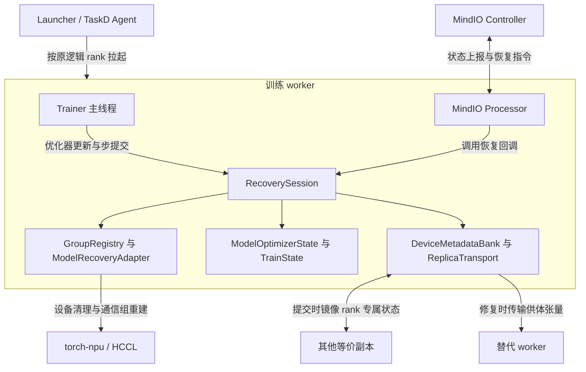
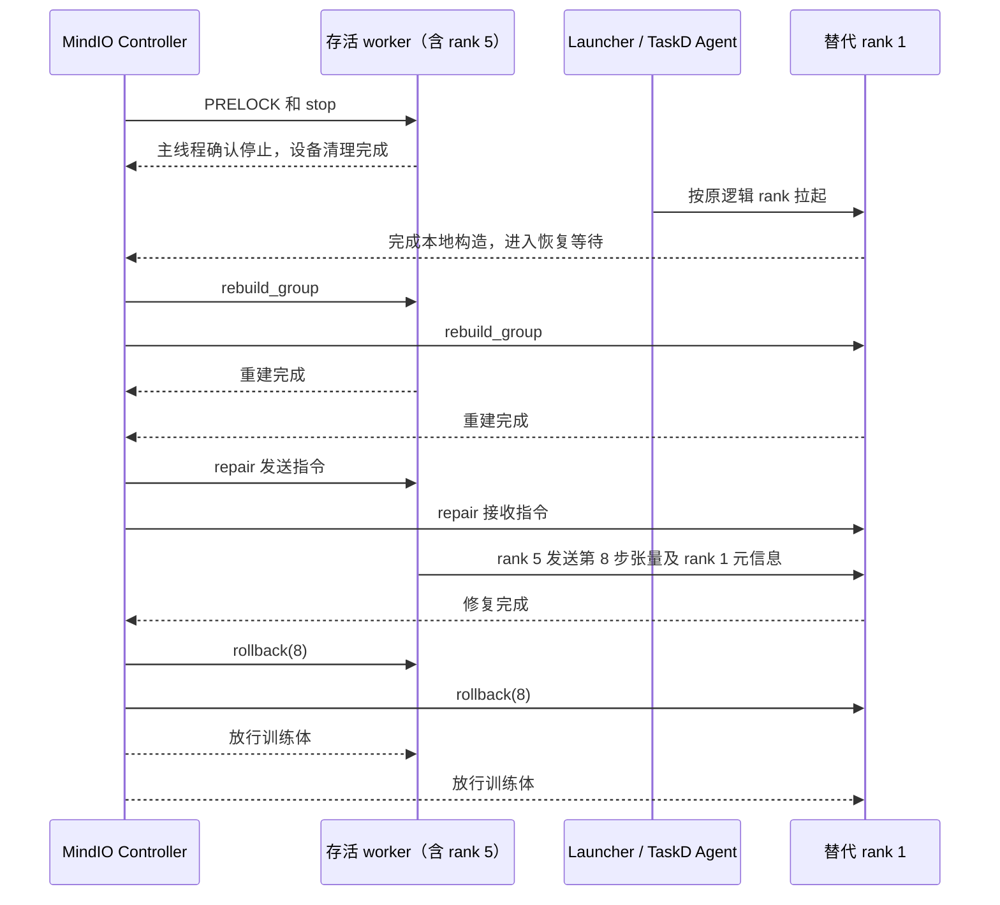

# 进程级快恢使用指南

[English](process_recovery.md) | **简体中文**

HyperParallel 进程级快恢用于在分布式训练的部分 worker 退出后，从同一作业中的存活副本继续训练。启动器以故障 worker 的原逻辑 rank 拉起替代进程，MindIO 协调存活进程和替代进程重建通信。替代进程通过 HCCL 接收等价副本当前持有的模型和优化器张量，再恢复原 rank 的数据位置和随机状态。存活进程保留已构造的训练对象，各 rank 从选定的提交步共同恢复训练。

## 核心概念

| 概念 | 说明 |
|------|------|
| 等价副本 | 模型参数分片和优化器状态归属都相同的一组 rank。HyperParallel 根据 DeviceMesh、placements 和实际优化器布局推导副本。 |
| 提交步 | 一次完整的优化器更新边界。参数、优化器状态和调度器更新完成，且训练元信息镜像成功后，才向 MindIO 提交该步。 |
| 训练元信息 | 数据游标、RNG、显式 Generator、模型可变 buffer 和 extra state 按原 rank 恢复。训练进度和调度器状态等副本等价状态由供体提供。 |
| PRELOCK | MindIO 在故障协调阶段使用的限步机制，用于约束 worker 进入后续优化器更新。 |

## 快速上手

在启动作业前，先检查运行环境与训练配置，再选择一种 Controller 托管方式。BaseTrainer、TextTrainer 和 VLMTrainer 会自动接入恢复会话。

### 运行环境

使用 Ascend NPU、HCCL 和 eager 训练。环境需要 MindIO TTP、提供设备停止与重启和通信组重建接口的 `torch_npu`，以及能以原 rank 和固定 `WORLD_SIZE` 重拉 worker 的部署环境。数据加载器须支持保存和恢复游标。框架的 FixedBatchDataLoader 和动态 batching 的底层 loader 复用 torchdata 的多进程快照，允许 `num_workers>0`。替代 worker 需要能访问原始数据和必要索引，并独立完成数据管线初始化。

两种托管方式都由启动器提供 `RANK`、`WORLD_SIZE` 和 `LOCAL_RANK`。替代 worker 的通信初始化要求 `TORCH_DIST_INIT_BARRIER=0`，初始化默认 HCCL 组时应省略 `device_id`。部署时只选择一个 Controller 启动方，并确保 Controller 和 rendezvous store 在恢复期间可用。

部署到多节点时，副本的物理位置决定作业可以承受哪类故障。如果一个副本域全部位于同一节点，该节点故障可能同时移除该域的全部供体。

### 使用限制

- 优化器使用 HyperParallel AdamW 或 Muon。DeepSeek V4.1 Host Engram 额外支持通过现有优化器协调器管理的 CPU SparseAdam。PP、UCE、AMSGrad 和 `torch.compile` 暂未接入。Trainer 的评估数据状态、PEFT 和其他外部模型状态也在当前恢复范围之外。
- 开启快恢时，`dataloader.use_background_prefetcher` 必须为 `false`。TextTrainer 和 VLMTrainer 使用各自的训练循环直接迭代 DataLoader。
- 多进程取数回滚时，FixedBatchDataLoader 先关闭旧迭代器的 worker，再加载已提交快照；原训练循环重建迭代器。worker 数和数据配置须与原训练一致。随机数据增强和自定义 Dataset 的可变状态须由 Dataset 的 state_dict/load_state_dict 保存和恢复，训练主进程的 RNG 快照不能替代子进程的随机状态。
- 快恢通过 `TrainState` 保存显式 Generator；固定 batching 取 DataLoader 的 generator，动态 batching 取内层 `source_dataloader.generator`。rollback 先恢复数据游标和公共 provider，仅暂存 RNG。主线程执行开始/epoch 回调并构造原生 iterator 后，`@recovery_epoch_initialized` 在原生初始化方法返回时调用 `TrainState.restore_pending_rng()`，一次性应用 Python、NumPy、Torch CPU/NPU 和显式 Generator 状态。没有待恢复状态时不改随机源；DataLoader 不增加专用快照字段，也不覆盖其原生 `_get_iterator()`。
- `model_integration` 用于模型接入和精度调试。开启快恢时，`model_integration.mode` 必须为 `off`。
- 受保护的模型 buffer 须在 worker device 上。CPU offload 和 optimizer swap 的参数或优化器状态可通过通信设备暂存后恢复。组合验证与测试入口见[验证用例](#验证用例)。

### 训练配置与启动

#### 由 rank 0 托管 Controller

在 Trainer YAML 顶层加入 `high_availability` / `worker_recovery`。示例 IP 应替换为其他 worker 可以访问的 rank 0 地址。

```yaml
high_availability:
  worker_recovery:
    enable: true
    controller_ip: "192.168.1.10"
    controller_port: 8000
```

`enable` 默认关闭。指定 `controller_ip` 时，`controller_port` 默认是 `8000`。此部署模式要求 rank 0 上的 Controller 在恢复期间可用。

`high_availability.worker_recovery.mirror_metadata` 默认是 `true`。只有完整副本之间的 RNG、数据加载器及
generator 状态、模型 buffer 和 module extra state 也可以共用时，才可设置为 `false`。关闭后跳过每步元信息
通信、序列化及元信息 H2D，本地元信息以独立 CPU 快照保留，模型 buffer 的提交快照仍保留在原 device。
rollback 直接读取本地快照；只有 repair 实际发送恢复头时才序列化并搬到 NPU。
repair 时发送供体自身目标提交步的快照，不再读取故障 rank 的镜像。参数及优化器
张量仍从供体的实时持久状态获取。权重互为副本不代表训练元信息可共用；存在 rank 专属数据游标或 RNG 时关闭
此选项，可能改变恢复后的训练结果。

训练状态和 extra state 在捕获层生成独立快照，再将所有权移交给元信息容器，入库时不重复深拷贝。
repair 解码得到的快照也走同一移交路径。读取元信息时只新建外层字典，内部快照数据按只读方式复用，
序列化前不再复制；恢复适配器在调用可变状态的加载入口前执行必要的隔离复制。

#### 由 TaskD 托管 Controller

```yaml
high_availability:
  worker_recovery:
    enable: true
```

由部署侧启动 Controller 和 Agent，并提供 Controller 地址和端口。框架依次查找 `PROCESSOR_ADDR`、`CONTROLLER_ADDR`、`TTP_ADDR`、`MASTER_ADDR`，端口取 `TTP_PORT`。在加载 TaskD 或 MindIO 动态库前注入这些变量。

#### 启动训练

配置完成后，沿用现有入口启动 Trainer 作业。框架会根据模型和优化器布局推导副本域。

## 工作原理

快恢以已有的等价副本作为参数和优化器张量的来源，并为每个 rank 保存独有的训练状态。

### 整体架构



- **进程管理。** Launcher 或 TaskD Agent 负责首次启动和故障后的局部重拉，替代进程沿用原逻辑 rank 和 world size。
- **恢复协调。** MindIO Controller 收集 worker 状态，协调恢复步和修复指令。每个 worker 内的 Processor 接收指令，通过已注册的回调调用 `RecoverySession`。
- **训练接入。** Trainer 主线程运行原有的取数、前反向和优化器更新逻辑，通过 `RecoverySession` 配合步边界暂停和更新提交。故障时，主线程退出当前训练体并等待 SDK 放行，恢复后重新进入同一训练入口。
- **通信与状态。** HyperParallel 记录进程组和训练对象的布局，通过 torch-npu 清理、重启设备并重建 HCCL 通信。修复时，传输模块按目标提交步校验并安装训练状态。

### 如何选择等价副本

`ReplicaTopology` 从各参数的 DeviceMesh 和 placements 推导候选副本。候选 rank 只能在 `Replicate` 维度改变坐标，TP、EP 等分片坐标必须一致。框架对所有本地参数的候选集合取交集，再按优化器状态的实际归属筛选完整副本。每个需要恢复的 rank 都必须有一个同时持有整套本地参数分片和对应优化器状态的供体。

以 8 卡 HSDP 为例，mesh 为 `[[0, 1, 2, 3], [4, 5, 6, 7]]`，布局为 `[Replicate(), Shard(0)]`，模型候选域为 `(0, 4)`、`(1, 5)`、`(2, 6)`、`(3, 7)`。如果 rank 1 和 rank 5 也持有相同归属的优化器状态，rank 5 就能作为 rank 1 的供体。使用 Muon 时，要进一步检查 `hsdp_replica_count` 对应的实际去重分组。四个模型副本分为两个大小为 2 的去重子组时，可在组间匹配相同的 owner。如果两个模型副本把优化器状态完全分摊在彼此之间，绑定训练状态时会因缺少完整供体而报错。快恢沿用已有的 Muon 分组配置。

原始 worker 在绑定阶段交换布局描述，检查副本关系是否对称、优化器归属是否一致，并要求各副本域的成员数相同。替代 worker 根据原有的 mesh 和优化器分组在本地推导同样的关系，修复接收时再校验实际发送的布局和归属。每个目标 rank 从一个完整供体接收状态，同一个供体可以在保持有效版本的前提下修复多个目标。

### 如何保护训练状态

| 状态 | 正常训练期间 | 故障恢复时 |
|------|----------------|------------|
| 模型参数、FP32 主参数、AdamW 矩或 Muon 动量 | 使用训练本身持有的张量，无需逐步克隆或传输整份权重与优化器状态。 | 供体读取目标步的当前有效张量，通过 HCCL 分块传输，接收端校验布局并写入本地参数和优化器状态槽。 |
| 数据游标、RNG、显式 Generator、module extra state 和可变 buffer | 以原 rank 和提交步为索引，在等价副本域内镜像。训练元信息序列化为设备字节缓冲，buffer 的提交副本保存在设备上。 | 取故障 rank 自己在目标步的状态，恢复其数据位置、随机状态和模型 buffer。 |
| 训练进度、学习率调度器等副本等价状态 | 由 `TrainState.replica_providers` 按步在各 rank 本地保存。 | 替代进程使用供体在同一提交步的快照。 |

元信息和 buffer 按原 rank 保留两个版本，公共 provider 快照也按步保留两个版本。参数和优化器张量使用供体的当前存储，因此旧步的元信息即使仍在，也必须有张量版本恰好匹配该步的供体才能恢复。默认设备训练路径直接通过 HCCL 传输参数和优化器张量。对于 CPU offload 或 optimizer swap，位于主机上的状态通过通信设备暂存后传输。

`TrainState.capture()` 中的 `rank_state` 保存数据游标、Python、NumPy、Torch CPU 和 NPU 的 RNG，以及登记过的显式 Generator。`replica_state` 保存 `replica_providers` 内各对象的状态，例如 Trainer 的 `global_step`、`epoch` 和学习率调度位置。模型的 buffer 和 module extra state 由 `ModelOptimizerState` 单独处理，仍以原 rank 为归属。中断迭代的激活、临时梯度和通信 Work 在清理阶段丢弃，恢复后重新执行该步的计算。

### 启动与提交

Trainer 在启动时绑定恢复会话，随后随优化器更新提交可恢复状态。首个有效提交产生后，MindIO 才能选步协调恢复。

#### Trainer 启动与会话绑定

1. **接入 Processor。** BaseTrainer、TextTrainer 和 VLMTrainer 启用快恢后，构造器包装先创建 `RecoverySession`，选择本地 NPU，连接 MindIO Controller，再由 `tft_is_reboot_node()` 识别原始进程或替代进程。
2. **构造训练对象并登记通信组。** Trainer 在 `session.groups` 上下文中构造 mesh、模型和优化器。`GroupRegistry` 保留各 HCCL 组的成员和创建顺序，供故障后原位重建。默认组由 `init_process_group()` 初始化，在重建时单独处理。预先创建或绕过受管入口的训练组需要显式登记。
3. **绑定保护对象。** 进入 `train()` 时，Trainer 通过 `session.attach()` 绑定已物化的参数、优化器和 `TrainState`，向 MindIO 注册完整副本域和恢复回调，并确定元信息通信组。完成后封存组目录，后续动态创建的常规通信组无法纳入恢复。
4. **初始化进度，进入训练。** 原始进程在 `session.run()` 管理下执行原有训练入口。开始回调结束后、首次取数前，Trainer 同步初始步号并校验之前绑定的布局。初始步号只用于对齐训练进度，即使作业从一个非零步启动，也要等本次运行的第一次优化器更新和元信息镜像完成，才产生第一个快恢提交步。

#### 正常训练与步提交

1. 前反向计算和梯度处理完成后，`RecoverySession.update(k)` 通过默认 HCCL 组的同步 barrier 对齐更新边界，再通知 MindIO 开始更新。更新期间，当前参数和优化器张量暂时失去供体资格。
2. 优化器更新、主参数回写和调度器更新完成后，同步设备，再采集该步的训练元信息和 buffer。
3. 在成员与等价副本域完全匹配的 HCCL 组内交换各 rank 的元信息和 buffer，等待组内安装完成。该组在绑定训练状态时确定，可在训练期间持续复用。
4. 镜像成功后向 MindIO 上报第 `k` 步更新完成，并发布会话进度。局部更新或元信息镜像失败时，第 `k` 步无法提交。

启用快恢会增加更新边界同步、元信息与 buffer 的采集和副本域通信。模型和优化器大张量的跨副本传输发生在故障修复阶段。

元信息镜像先在等价副本域内交换各 rank 的字节长度，再收集补齐到相同长度的元信息和设备上的 buffer，最后在该组内确认安装。即使一个现有 HCCL 组包含所有等价副本，只要还有其他成员，就不能直接用它做这次集合通信，因为额外成员也必须参与同样的调用。若镜像失败，会话会抛出 `MetadataMirrorError`，保留上一次已发布的进度。本次更新可能已改写参数，旧步能否恢复仍取决于是否有其他供体保有对应版本。

### 故障恢复与续训

以第 8 步已完成提交、rank 1 在第 9 步 forward 中退出为例。rank 5 与 rank 1 等价，仍持有第 8 步的有效参数和优化器张量，并已镜像 rank 1 的第 8 步元信息和 buffer。假设 MindIO 最终选定第 8 步恢复，流程如下。



图中展示的是恢复阶段的依赖关系。存活进程清理和替代进程拉起的具体时机由部署侧协调。

#### 停止与清理

PRELOCK 约束优化器推进。若存活 worker 已在第 9 步等待设备计算或集合通信，`stop` 回调会停止设备，主线程因设备异常或在下一处步边界检测到停止标记而退出当前训练体。SDK 得到停止应答后才执行 `clean`，避免训练线程仍在使用要清理的状态。

以 HSDP 为例，清理会丢弃失效 Work 和失败迭代的梯度，将临时展开的参数恢复为持久分片。设备重启后，再释放需要等待设备同步的临时状态，例如已接入的异步 CP 或 attention swap 状态。

#### 替代进程构造与通信重建

替代进程沿用同一构造入口，但构造时存活进程仍可能在等待恢复。内置模型分发在这一阶段走本地切片路径，Muon 将分片形状收集延后到全体回滚。替代进程完成 `attach()` 后，在首次进入 SDK 包装的训练入口时通过 `ARF FINISH` 信号进入恢复等待。通信重建和回滚完成后，替代 worker 才开始实际训练。替代身份还可用于延迟打开数据索引，跳过构造期初始化通信的条件则在 `attach()` 完成后关闭。

进行 `rebuild_group` 时，存活进程保留原通信组引用，替代进程使用构造阶段创建的组，双方先重建默认组，再按登记顺序重建各自的成员组。

#### 修复、回滚与重入

- **`repair` 安装张量。** Rank 5 确认自身仍持有第 8 步的有效张量，并带上原 rank 1 第 8 步的训练元信息。新 rank 1 先接收恢复头，检查目标 rank、步号、布局和优化器归属，并建立所需的接收槽。随后接收参数、主参数和优化器张量，再接收目标 rank 的 buffer 提交副本。修复优先复用与指令成员完全一致的 HCCL 组，必要时创建并在传输结束后销毁临时组。
- **`rollback` 对齐全体进度。** 修复结束后，存活与替代进程分别校验本地张量版本。Muon 在此阶段更新所需的分片形状信息。各进程写回自己的模型 buffer 和 extra state，再恢复数据游标、Trainer 进度和学习率调度器，并暂存待恢复的随机状态。存在独立主参数时，回滚也会把主参数数值写回计算参数。
- **重入原训练体。** SDK 放行后，存活进程继续使用原有模型和优化器，替代进程使用已安装状态的新对象。两者都重新执行 `on_train_begin` 并创建迭代器，从第 9 步继续。完成开始/epoch 回调和原生 iterator 构造后，主线程在首次取数前应用提交步的 RNG，消除恢复初始化的额外随机消耗。正常 epoch 不存在待恢复 RNG，不执行回退。

初始进度同步统一由 `BaseTrainer.on_train_begin()` 上的 `@recovery_train_initialized` 在所有开始回调返回后执行；三个训练循环不再显式调用快恢初始化函数。TextTrainer/VLMTrainer 通过普通的 `_create_data_iterator()` 创建 iterator，其装饰器在返回后收尾 RNG。已有 BaseTrainer 入口保留原 iterator/回调先后顺序，通过 `_initialize_train_epoch()` 的同类装饰器收尾。

恢复要求供体持有目标步的有效张量，且该步的目标 rank 元信息完整。若所有等价副本均失效、供体已进入中断的优化器更新或其张量已推进到其他步，或目标 rank 的必要元信息缺失，本次快恢会失败。

`on_train_begin` 等初始化回调须可重入。若自定义回调包含集合通信，需要保证通信组已可用且所有成员按相同顺序参与。

## 接入与实现参考

### 自定义训练循环

使用 `RecoverySession` 和 `TrainState` 时，自定义训练入口需要遵循与 Trainer 相同的生命周期。

1. 调用 `session.initialize()` 启动 Processor，在 `session.groups` 作用域内构造 mesh、模型和优化器。在第一次运行前用 `session.attach(model, optimizer, train_state, step)` 绑定本地训练状态。
2. 将可重入、无参数的训练函数传给 `session.run(body)`。在 `body` 完成本地启动逻辑后、首次取数前，调用 `session.initialize_training_progress(step)`，其中 `step` 是当前实际完成的更新步数。初始进度同步只在原始 worker 的首次进入时生效。完成 epoch 初始化并构造 `iterator = iter(loader)` 后、首次 `next(iterator)` 前，调用 `train_state.restore_pending_rng()` 应用本轮待恢复的 RNG；普通启动时该调用不改随机状态。
3. 在取数前通过 `session.pause()` 响应 MindIO 的暂停请求。将优化器更新、主参数回写和调度器更新一起放进 `session.update(next_step)`；`next_step` 必须与会话已提交进度连续。回滚后，循环计数和数据位置应取自恢复的状态对象。
4. 在构造或绑定期间发生异常时调用 `session.close()` 释放已初始化的资源，进入 `run()` 后由会话管理清理。训练结束沿用原入口的结束回调和训练通信组销毁流程。

数据加载器和 `replica_providers` 中的对象须提供 `state_dict()` 和 `load_state_dict()`，状态采集和写回应能在本地完成。只有在等价副本间可以互换的状态才适合放入 `replica_providers`。属于特定 rank 的自定义状态应通过对应的 loader、显式 Generator 或模型 extra state 接入。回调顺序见[故障恢复与续训](#故障恢复与续训)。

### 模块一览

| 文件 | 说明 |
|------|------|
| `high_availability/config.py` | 定义快恢开关和 Controller 端点。 |
| `high_availability/recovery_session.py` | 管理 MindIO 会话、优化器步提交和故障恢复回调。 |
| `high_availability/replica_topology.py` | 根据模型和优化器布局推导完整的等价副本。 |
| `high_availability/group_registry.py` | 登记构造阶段的进程组并在恢复时原位重建。 |
| `high_availability/model_recovery.py` | 登记并清理中断迭代中的并行策略临时状态。 |
| `high_availability/recovery_state.py` | 绑定模型与优化器的训练张量，捕获和恢复训练元信息。 |
| `high_availability/replica_transport.py` | 镜像元信息并分块传输恢复张量。 |
| `high_availability/validation.py` | 集中维护快恢的配置、模型和状态接口校验规则。 |
| `trainer/runtime/worker_recovery.py` | 构造 Trainer 前调用配置校验，登记训练进度、loader 和回调，并将会话接入原训练流程。 |

## 验证与排查

### DeepSeek V4.1 Host Engram

Host Engram 按 EP owner 将表的行保存在 CPU，由独立的 SparseAdam 更新，不使用 HSDP 的 CPU offload policy。快恢要求存在一个存活副本，同时持有相同的 dense 分片、Host 表行区间及优化器状态。框架自动将已有 dense/Muon 副本域与 Host 表的同 owner mesh 域取交集；没有完整副本时，在注册恢复关系前报错，不增加用户配置。

替代进程在本地分配 CPU 表存储，不加载 checkpoint，也不随机初始化行内容。repair 传输供体当前的表权重、SparseAdam 的 `exp_avg`、`exp_avg_sq`、标量步数和参数组设置；尚未初始化的矩状态保持未初始化。传输时每次最多通过 worker device 暂存一个 4 MiB 块，不把整张 CPU 表或矩状态搬到设备。正常训练不增加这些大张量的每步镜像；已有优化器更新事务涵盖 dense 与 sparse 两部分更新，全部完成后才向 MindIO 提交步数。

clean 阶段，存活进程在清理 HSDP 迭代状态的同时，丢弃 Host 表中尚未提交的稀疏梯度，将 Host 优化器协调器重置为 `ACCUMULATING`，并丢弃梯度范数计划缓存。替代进程在初始化时已经具有这些空状态，rollback 不再重复重置；后续训练使用恢复后的通信组重新构造范数计划。Host 模型原有的精度组合与同步 checkpoint 要求继续适用。

专项 CPU 用例使用真实的 Host 查询、autograd、梯度准备及 SparseAdam，仅模拟跨 rank 传输：

```bash
pytest -q tests/ut/high_availability/test_host_engram_recovery.py
```

覆盖副本域交集、缺少完整副本、行区间不匹配、替代节点分配、稀疏梯度清理、设备暂存上限、优化器惰性状态，以及连续修复后的 loss 和状态精确对齐。这些用例不代替完整 DeepSeek V4.1 训练作业的 MindIO/HCCL 硬件验证。

### 验证用例

```bash
pytest -q tests/ut/high_availability
```

在配置好 MindIO 且有空闲 NPU 的环境中，可先运行底层替换用例，验证副本组重建、状态传输与回滚，再通过完整 TextTrainer 用例验证 Trainer 入口和实际离线数据链路。

```bash
HP_RUN_MINDIO_RECOVERY_ST=1 HP_RECOVERY_FAULT_PHASE=forward \
  pytest -vs tests/torch/high_availability/test_process_recovery.py::test_worker_replacement
```

在配置好 MindIO、TaskD 且有空闲 NPU 的环境中，可运行 TextTrainer 的 worker 替换用例。

```bash
HP_RUN_TEXT_TRAINER_RECOVERY_ST=1 HP_RECOVERY_FAULT_PHASE=forward \
  pytest -vs tests/torch/high_availability/test_process_recovery.py::test_text_trainer_replacement
```

完整 TextTrainer 用例默认使用 8 卡、在第 8 步提交后从第 9 步 forward 注入故障，并将恢复后导出的状态与无故障基线比较。`HP_RECOVERY_TEST_FAULT_RANKS=4,5,6,7` 可用于验证同批替换。验收时可对照逻辑 rank、故障前后 PID、修复来源和继续训练的步号。测试范围是由测试管理驱动触发的 worker 进程故障与恢复。

### 故障排查

按同一逻辑 rank 和目标步号串联 Controller、Processor 和训练日志。存活进程可依次看到 `Recovery device stopped`、`Recovery device cleaned`、`Recovery groups rebuilt` 和 `Recovery rollback completed`。参与接收的替代进程还会记录 `Recovery state received`，其中包含来源 rank 和接收步号。

| 现象 | 核对项 |
|------|--------|
| 绑定时出现 `no complete device replica` | 检查是否有 `Replicate` 维度、各分片坐标是否匹配，以及实际 Muon owner 是否在其他 rank 有完整副本。若提示 `uniform replica counts`，检查各完整副本域的成员数。 |
| 替代进程迟迟没有进入恢复等待 | 对照原 rank 的启动参数、Controller 地址和 `LOCAL_RANK`。检查 Store 是否可达、HCCL 是否使用懒初始化，并定位自定义构造代码是否在 `attach()` 前等待其他 rank 参加集合通信。 |
| 部分 rank 缺少 `Recovery groups rebuilt` | 核对默认组、训练组及优化器组是否按原顺序创建和登记，检查自定义组是否绕过了受管建组入口。 |
| 报 `MetadataMirrorError` 或 `exact training metadata unavailable` | 对照元信息组成员和各 rank 的提交记录。前者表示本步镜像失败，后者表示请求的原 rank 和步号没有可用镜像。 |
| 修复失败并提示供体没有 `valid device state`，或出现 `schema/layout mismatch` | 核对 Controller 指定的步号是否等于供体有效步，以及替代进程的分片、dtype、优化器归属是否沿用原配置。 |
| 回滚已完成，但首个恢复步仍阻塞 | 检查原训练入口重入后执行的回调与首个集合通信，确认各成员均已进入相同阶段且调用顺序一致。 |
