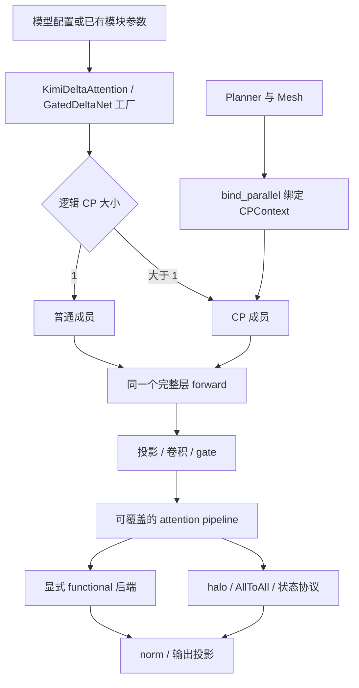

# KDA / GDN 模块族与上下文并行

KDA 与 Gated DeltaNet（GDN）采用完整层的模块族入口。普通成员负责投影、卷积、gate、状态递推、
输出 norm 和投影；CP 成员复用普通成员的 `forward`，只覆盖需要通信的计算阶段。
本地算子由 `backend` 选择，卷积由独立的 `conv_backend` 选择。

## 配置方式

配置匹配的是**模块路径**，不再是 `.forward` 方法。只匹配实际的线性注意力层，不能把同名的
full-attention 层替换为 KDA/GDN。以下是配置增量，CP 总大小仍由训练的并行配置决定。

KDA 的 Ulysses × RD：

```yaml
plan_overrides:
  - match: "model.layers.0.self_attn"
    replace:
      kind: module
      implementation:
        _target_: hyper_parallel.components.modules.KimiDeltaAttention
        backend: triton
        conv_backend: eager
        ulysses_degree: 2
        state_cp_method: recursive_doubling
```

GDN 的状态 P2P：

```yaml
plan_overrides:
  - match: "model.layers.0.linear_attn"
    replace:
      kind: module
      implementation:
        _target_: hyper_parallel.components.modules.GatedDeltaNet
        backend: triton
        conv_backend: eager
        ulysses_degree: 1
```

纯 Ulysses 使用 `ulysses_degree: null`，可同时设置 `conv_backend: triton` 或 `ascendc`。
`null` 的含义是绑定时使用整个 CP 域，且采用先交换 token/head、再做本地卷积的调度。
KDA 中显式的整数 `ulysses_degree=P` 则保留状态 CP 入口的调度：先沿原序列交换 halo 和卷积，
再做 AllToAll，状态域退化为 1。二者都没有跨卡状态递推，但卷积位置和默认后端并不相同。

不设置 `when: cp` 时，同一模块请求在 CP1 选择普通成员，在 CP>1 选择 CP 成员。
若只希望更改 CP 作业而保留来源模型的 CP1 实现，可加 `when: cp`。
选择新模块后应移除该模块上的旧 CP method wrapper，不能让两者同时拥有通信。

## 参数和当前能力

| 选项 | 含义 |
|---|---|
| `backend` | `eager`、`triton`、`ascendc`；新模块工厂默认 `eager`，训练配置应明确指定。 |
| `conv_backend` | 独立选择卷积；建议显式配置，避免把 core 后端和卷积性能混在一起比较。 |
| `input_layout` | `BSH` 或 `TH`；用于声明外部 token 分片轴，分别为 1 和 0。flat packed 输入配置 `TH`。 |
| `chunk_size` | 默认 64。融合后端要求 64；eager 可显式使用其他正整数。不是通信包长。 |
| `ulysses_degree` | 正整数或 `null`；CP>1 时整数必须整除总 CP 和 query/value head 数。 |
| `state_cp_method` | KDA 专用：`p2p`、`allgather`、`grouped_allgather_p2p`、`recursive_doubling`。 |
| `allgather_group_size` | KDA 分组 AG 专用，必须整除状态域大小；其他协议保持 1。 |

| 算法与后端 | 当前 CP 能力 |
|---|---|
| KDA eager | 本地、纯 Ulysses（含状态域退化为 1 的情形） |
| KDA Triton / Ascend C | P2P、AG、分组 AG＋P2P、RD，以及现有 Ulysses 混合 |
| GDN eager | 本地、纯 Ulysses |
| GDN Triton | 纯 Ulysses、状态 P2P |
| GDN Ascend C | 本地与纯 Ulysses |

这次整理不为 GDN 开放 AG/RD 或 Ulysses × P2P，也不为模块族承诺 TP 或推理状态缓存。
已有来源模型的推理/TP 路径继续保留；不要在这些作业上配置本训练模块族替换。
显式选择后端时缺少依赖或能力会报错，不自动切换到另一后端。

省略卷积选项时，为兼容原调度：普通成员和纯 Ulysses 跟随 `backend`；KDA 状态/混合入口的
Triton/eager 默认 eager 卷积，Ascend C 默认 Ascend C 卷积；GDN P2P 默认 eager 卷积。

## TND 与模型适配

支持 `[B,S,H]`、packed `[1,T,H]` 和 flat `[T,H]`。CP rank 仍拥有等长、连续、非空的 token 区间。
`cu_seq_lens` / `cu_seqlens` 或 `packed_sequence_info` 表示全局文档边界，不把 CP 切口当作 reset。
Ulysses 后重新推导本地片段边界；不会通过拼接局部 offsets 人为新增 reset。
详细契约见 [TND CP](linear_attention_tnd_cp.md)。

dense 状态 CP 的融合卷积同样保留收到的 halo：沿 token 维拼接各 batch 自己的历史，
卷积后裁掉历史前缀对应的输出，梯度通过原有 halo 通信返回。普通 dense 输入不需要伪造
packed 文档元数据；batch 样本保持独立，CP 切口不能被当作新文档。

Qwen 来源 decoder 的线性分支不会自动把任意 kwargs 传入 mixer，因此 packed 作业仍需要 decoder
元数据转发规则。它只是保留来源 decoder 的 residual/MLP 流程并转发本次调用的文档信息，
不是第二个 CP 执行器：

```yaml
plan_overrides:
  - match: "model.layers.0.linear_attn"
    replace:
      kind: module
      implementation:
        _target_: hyper_parallel.components.modules.GatedDeltaNet
        backend: triton
        conv_backend: eager
  - match: "model.layers.0.forward"
    replace:
      kind: method
      implementation:
        _target_: hyper_parallel.models.qwen3_5.adapter.linear_attention_decoder.qwen3_5_linear_attention_decoder_wrapper
```

只匹配线性 decoder，不能无区别替换 full-attention decoder。Kimi/Qwen 的 runtime input adapter
仍负责把数据管道的紧凑累计长度转换为每次调用的不可变元数据。

## 架构和生命周期



- `components/modules/attention/kimi_delta_attention/`：完整本地层和族工厂独立。`cp_kimi_delta_attention.py` 包含层级 CP 调度、mesh 拆分、AG/分组协议与 Triton 状态 autograd；`cp_state_ascendc.py` 仅适配原生状态前反向，由 CP 层调用，并非另一套完整层；`cp_recursive_doubling.py` 保留 RD 计划和执行。
- `components/modules/attention/gated_delta_net/`：完整本地层、族工厂和 `cp_gated_delta_net.py`；Ulysses/P2P 层级调度及当前状态 autograd 在同一个 CP 文件中。
- `components/modules/attention/linear_attention/`：`layer_adapter.py` 负责来源参数与输入适配，`cp_sharding.py` 负责当前 TP1 布局，`cp_convolution.py` 包含 Q/K/V halo 打包、相邻 rank 交换及本地卷积调度。`sequence_layout.py` 集中文档区间、状态槽位、局部文档执行和 chunk 索引；它只依赖 Torch 与标准库，供 functional、模块族及模型 runtime 共同使用。
- `components/functional/`：每个算法使用公共数学入口、Triton、Ascend C 三个文件。公共入口包含 eager 及简单状态 apply，Triton 文件包含本地阶段和 summary/merge 前端，原始 kernels 保留在 `_triton/`。本地卷积独立；这些文件不持有通信组、不执行跨卡通信。
- `distributed/context_parallel/collectives.py`：保留公共 Tensor 交换原语；因果卷积专用的邻居选择归 `linear_attention/cp_convolution.py`。
- `models/qwen3_5/adapter/linear_attention_decoder.py`：将本次调用的文档边界透传给 Qwen 线性注意力 decoder 内的 GDN，不负责数据打包或算法后端选择。

构造模块时只记录逻辑选项；绑定时借用 CP mesh、创建已有协议对象与子组。每次前向的 H、M、G、
收发 buffer 和 autograd cache 属于该调用，不挂到共享协议对象上。RD 的 reset 剪枝、无消费者
省摘要、紧凑转移缓存和元数据复用保持原有规则。

从来源模块转换时，参数对象、参数名、共享关系和 `requires_grad` 保持不变，不增加 `module.` 前缀。
普通成员晋升为 CP 成员也不重新初始化权重。参数归约仍由 DP/FSDP 负责，CP 协议不额外归约权重梯度。
已绑定通信资源或应用布局的成员不能直接 `deepcopy`；应复制未绑定权重或通过 checkpoint 重建。

Triton RD 反向复用前向 M；Ascend C 仍按原生 G/N 合同执行反向 scan。目录和阶段统一不意味着
更换算术顺序或把 N 当成 M 的转置。跨协议/后端的有限精度差异不属于本次结构迁移的数值保证。

## 旧接口迁移

旧 `components.modules.kimi_delta_attention` / `gated_delta_net` 重导出、LayerCP/CoreCP wrapper、
`TritonGDN` primitive 替换及 `gdn_ulysses` 方法拦截已删除。模块从
`hyper_parallel.components.modules` 导入，数学函数从 `components.functional` 的对应实现导入。
旧方法替换配置需迁移为上述完整模块替换，不能继续使用旧 wrapper 路径。

重复的 eager state-P2P 分布式实现已删除；eager 保留本地数学参考与纯 Ulysses。状态 CP 显式选择
已支持的 Triton/Ascend C 后端，不会静默把 eager 切换为融合后端。

`KimiDeltaAttention` 现在是模块族工厂，具体类型为 `KimiDeltaAttentionModule` 或
`CPKimiDeltaAttentionModule`。类型判断和继承应使用具体普通类，不应对工厂使用 `isinstance`。
GDN 对应 `GatedDeltaNetModule` / `CPGatedDeltaNetModule`。

### 本地数学与协议的边界

`gated_delta_net_triton.py` 和 `kimi_delta_attention_triton.py` 集中相应后端的本地阶段及摘要入口；
KDA 的 FLA 适配也在后者，不再单列 `kimi_delta_attention_fla_adapter.py`。纯 Torch 状态 apply
归各算法的公共数学文件。KDA 和 GDN 保留各自已有的 autocast 与舍入行为；只有实际选择相应
融合路径时才加载可选依赖，缺失时明确报错。

公共 `sequence_layout.py` 是无模块初始化和通信副作用的基础依赖。逐文档 eager 调用只消费
局部 offsets；原生 KDA/GDN 共用主机 offsets 和 chunk 索引构造，设备 offsets 仍由原生入口
明确拒绝，避免新增隐式主机同步。CP 区间和真实 reset 的判定仍由模块层使用，不传给底层通信原语。

Ascend C 的 prepare、forward finalize、backward prepare/finalize 由本地入口与 CP 驱动复用。
CP 驱动负责注入 H/dHT、执行通信和保存每次调用的资源；后端阶段保留自己的 layout、保存张量和
反向合同。Triton 复用缓存的前向 M，Ascend C 使用原生反向 G/N，不能把 N 默认为 M 的转置。

### Ulysses 拓扑与卷积位置

拓扑统一为 `CP = ulysses_size × state_size`。`state_size=1` 直接调用本地 core，
不构造状态通信执行器。卷积位置是独立的内部调度，保持既有行为：

- `ulysses_degree=None`：先交换投影结果，再对局部 heads 卷积。
- KDA 的整数 U 配置：先在原 CP token 分片上执行 halo 卷积，再交换 heads；即使 U 等于 CP 大小也保留此顺序。

独立的 `conv_backend`、来源 Parameter 对象、checkpoint 参数名及每调用缓存生命周期均保留。
GDN 当前仍只支持纯 Ulysses 或 Triton P2P，不由公共目录自动获得 KDA 的 AG/RD 或混合协议能力。
