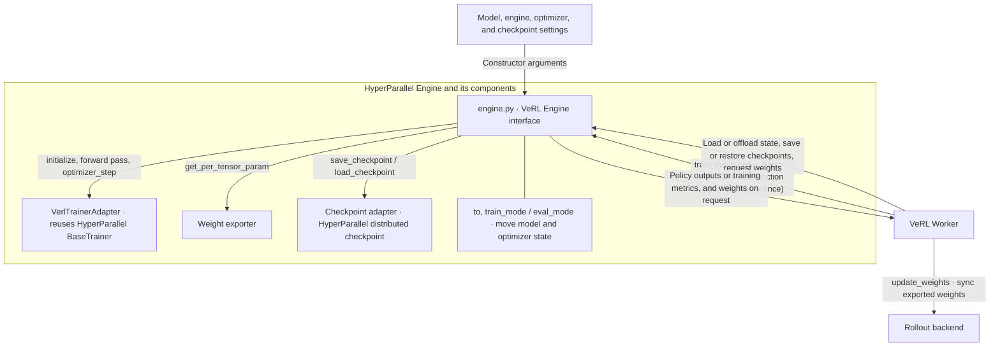

# Use HyperParallel with VeRL

[中文](verl.zh.md) · [run.sh environment variables](../examples/verl/README.md)

HyperParallel runs the model's forward and backward passes and updates the optimizer. VeRL manages data, the reinforcement learning algorithm, and rollout. The integration targets VeRL **v0.9.1**.

## Quick start

This example runs 10 GRPO training steps on the full **Qwen3-30B-A3B-Base** model using **16 Ascend NPU devices on one host**. HyperParallel trains with TP=2, CP=4, and EP=8. Rollout uses vLLM Ascend.

### 1. Set up the environment

Install VeRL from the **v0.9.1** tag. Follow the Ascend tutorial to set up the device runtime, PyTorch, torch-npu, and the rollout backend. [Official VeRL Ascend tutorial (Chinese)](https://verl.readthedocs.io/en/latest/ascend_tutorial/zh/index.html)

Activate the environment and make the model weights and Parquet datasets available locally.

### 2. Start training

From the HyperParallel repository, set the local model and dataset paths and start training.

```bash
cd /path/to/hyper-parallel

export MODEL_PATH=/dev/shm/Qwen3-30B-A3B-Base
export TRAIN_DATA_PATH=/path/to/datasets/dapo-math-17k/train.parquet
export VAL_DATA_PATH=/path/to/datasets/aime-2024/test_unique.parquet

bash examples/verl/run.sh trainer.total_training_steps=10
```

If you change the device count, update both the training and rollout resource and parallelism settings. Use the data fields and reward settings that VeRL expects for your task.

| Environment variable | Purpose |
|---|---|
| `MODEL_PATH` | Local directory containing the model and tokenizer. |
| `TRAIN_DATA_PATH` / `VAL_DATA_PATH` | Paths to the training and validation Parquet files. |

For debugging, deterministic execution, and rollout cache settings, see the launcher reference. [run.sh environment variables](../examples/verl/README.md)

## Integrate a new model

Start from the complete example and use the excerpt below to identify the settings to adapt for a new model. Retain a recipe path or provide a complete native `trainer_config`, including the model builder. The full example also provides the dataset, rollout, and device settings. [HyperParallel example](../examples/verl/hyper_parallel.yaml)

```yaml
# @package _global_
defaults:
  - /ppo_trainer
  - override /model_engine: hyper_parallel
  - _self_
actor_rollout_ref:
  model:
    path: ${oc.env:MODEL_PATH}
    use_remove_padding: true
    use_fused_kernels: false
  actor:
    ppo_max_token_len_per_gpu: ${cp_token_budget:${data.max_prompt_length},${data.max_response_length},${actor_rollout_ref.actor.engine.trainer_config.accelerator.cp_size}}
    engine:
      param_offload: true
      optimizer_offload: true
      dtype: float32
      trainer_config:
        accelerator:
          tp_size: 2
          cp_size: 4
          ep_size: 8
          sequence_parallel: true
          loss_parallel: true
        fsdp_config:
          requires_grad_sync: false
          edp_shard_size: 2
          mix_precision:
            param_dtype: bfloat16
            reduce_dtype: float32
            output_dtype: bfloat16
        optimizer:
          _target_: hyper_parallel.components.optim.AdamW
          adamw_config:
            adamw_lr: 1.0e-6
            adamw_weight_decay: 0.01
            adamw_betas: [0.9, 0.999]
            adamw_eps: 1.0e-8
        lr_scheduler:
          lr_decay_style: constant
          lr_config:
            lr: 1.0e-6
            lr_warmup_steps: 0
trainer:
  use_v1: true
hydra:
  searchpath:
    - pkg://verl.trainer.config
    - pkg://hyper_parallel.integration.verl.yaml
```

Point `actor_rollout_ref.model.path` to the new model. Use `actor_rollout_ref.actor.engine.recipe_path` to reference a HyperParallel recipe, or supply the native training configuration directly in `engine.trainer_config`. If you provide both, the inline settings override the corresponding recipe settings. Review any parallelism, optimizer, and precision overrides before reusing the example with another model.

## How it works

VeRL manages data loading, the reinforcement learning algorithm, rollout, and the outer training loop. HyperParallel Engine implements the VeRL Engine interface and uses a trainer adapter that reuses HyperParallel's native training components.



**Engine registration.** The launcher sets `VERL_USE_EXTERNAL_MODULES` so that VeRL imports HyperParallel's external module. This registers the `hyper_parallel` backend and applies the VeRL V1 compatibility patches at runtime. VeRL selects the engine through `strategy: hyper_parallel`, and `HyperParallelEngineConfig` supplies the native training settings from `recipe_path` or `trainer_config`. [External module](../hyper_parallel/integration/verl/patch/__init__.py)

**Engine interface.** The engine provides interfaces to create the model and optimizer, move their state between the accelerator and CPU, export weights, and save or restore checkpoints. During an iteration, it splits the batch according to VeRL's batching rules and converts model outputs to log probabilities and optional entropy. During training, it invokes the VeRL loss, runs backpropagation, and delegates optimizer updates at the point defined by VeRL. Log-probability recomputation and reference-policy evaluation use forward-only iterations with gradients disabled. [Engine implementation](../hyper_parallel/integration/verl/engine/transformer_impl.py)

**Trainer adapter.** `VerlTrainerAdapter` extends HyperParallel's `BaseTrainer`. The engine delegates model, optimizer, and scheduler construction, input preparation, forward passes, gradient handling, and optimizer updates to the adapter. The engine triggers backpropagation with the VeRL loss inside the trainer's backward context. This lets HyperParallel reuse its training configuration, parallelism, and components while the engine handles VeRL's calling conventions and data formats. [Trainer adapter](../hyper_parallel/integration/verl/engine/trainer.py)

**Weight synchronization and checkpoints.** The VeRL worker requests weights from the engine and passes them to the rollout backend. The exporter converts each parameter to a format the backend can load. For checkpoint save and restore, the engine uses HyperParallel's distributed checkpoint implementation for the actor's model, optimizer, scheduler, and RNG state. VeRL manages the DataLoader state. [Weight exporter](../hyper_parallel/integration/verl/engine/weight_export.py) · [Checkpoint adapter](../hyper_parallel/integration/verl/engine/checkpoint.py)
