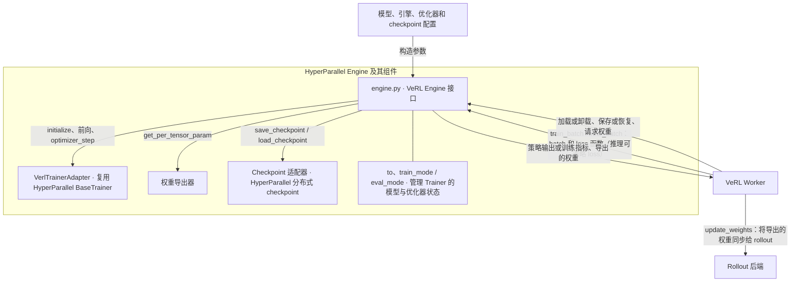

# 在 VeRL 中使用 HyperParallel

[English](verl.md) · [run.sh 环境变量说明](../examples/verl/README.md)

HyperParallel 可作为 VeRL 的训练后端，负责模型前反向和优化器更新；数据、强化学习算法和 rollout 由 VeRL 管理。当前适配 VeRL **v0.9.1**。

## Quick start

本示例在单机 **16 个 Ascend NPU 设备**上，使用 HyperParallel 后端对 **Qwen3-30B-A3B-Base** 完整模型执行 10 步 GRPO 训练。训练侧采用 TP=2、CP=4、EP=8，rollout 使用 vLLM Ascend。

### 1. 安装环境

按照 [VeRL 官方 Ascend 安装教程](https://verl.readthedocs.io/en/latest/ascend_tutorial/zh/index.html) 安装设备运行时、Torch、torch-npu 和 rollout 后端等依赖。VeRL 使用 **v0.9.1 tag** 对应的源码。

激活安装好的环境，准备本地模型和 Parquet 数据。启动脚本不会安装依赖或下载模型、数据集。

### 2. 启动训练

进入 HyperParallel 仓库，设置本地模型和数据集路径后启动训练。

```bash
cd /path/to/hyper-parallel

export MODEL_PATH=/dev/shm/Qwen3-30B-A3B-Base
export TRAIN_DATA_PATH=/path/to/datasets/dapo-math-17k/train.parquet
export VAL_DATA_PATH=/path/to/datasets/aime-2024/test_unique.parquet

bash examples/verl/run.sh trainer.total_training_steps=10
```

调整设备数量时，需要同时修改训练和 rollout 的资源及并行配置。数据字段和 reward 设置应符合 VeRL 对相应任务的要求。

| 环境变量 | 用途 |
|---|---|
| `MODEL_PATH` | 本地模型和 tokenizer 路径。 |
| `TRAIN_DATA_PATH` / `VAL_DATA_PATH` | 训练和验证 Parquet 文件路径。 |

更多调试、确定性和 rollout 缓存设置，见 [run.sh 环境变量说明](../examples/verl/README.md)。

## 接入新模型

从完整示例出发，参考下面的片段调整新模型需要的字段。保留 recipe 路径，或提供包含模型构建器的完整原生 `trainer_config`。数据集、rollout 和设备配置也见完整示例。[示例配置](../examples/verl/hyper_parallel.yaml)

```yaml
# @package _global_
defaults:
  - /ppo_trainer
  - override /model_engine: hyper_parallel
  - _self_
actor_rollout_ref:
  model:
    path: ${oc.env:MODEL_PATH}
    use_remove_padding: true
    use_fused_kernels: false
  actor:
    ppo_max_token_len_per_gpu: ${cp_token_budget:${data.max_prompt_length},${data.max_response_length},${actor_rollout_ref.actor.engine.trainer_config.accelerator.cp_size}}
    engine:
      param_offload: true
      optimizer_offload: true
      dtype: float32
      trainer_config:
        accelerator:
          tp_size: 2
          cp_size: 4
          ep_size: 8
          sequence_parallel: true
          loss_parallel: true
        fsdp_config:
          requires_grad_sync: false
          edp_shard_size: 2
          mix_precision:
            param_dtype: bfloat16
            reduce_dtype: float32
            output_dtype: bfloat16
        optimizer:
          _target_: hyper_parallel.components.optim.AdamW
          adamw_config:
            adamw_lr: 1.0e-6
            adamw_weight_decay: 0.01
            adamw_betas: [0.9, 0.999]
            adamw_eps: 1.0e-8
        lr_scheduler:
          lr_decay_style: constant
          lr_config:
            lr: 1.0e-6
            lr_warmup_steps: 0
trainer:
  use_v1: true
hydra:
  searchpath:
    - pkg://verl.trainer.config
    - pkg://hyper_parallel.integration.verl.yaml
```

换模型时，将 `actor_rollout_ref.model.path` 指向新模型。HyperParallel 的训练配置可通过 `actor_rollout_ref.actor.engine.recipe_path` 引用，也可直接写入同级的 `trainer_config`。如果沿用示例里的 `trainer_config`，请检查其中的并行、优化器和精度设置，因为它们会覆盖新 recipe 的对应项。

## 实现原理

VeRL 负责数据加载、强化学习算法、rollout 和外层训练循环。HyperParallel Engine 实现 VeRL 的 Engine 接口，内部持有一个 Trainer 适配器，由它复用 HyperParallel 的原生训练能力。



**启动与注册。** 启动脚本通过 `VERL_USE_EXTERNAL_MODULES` 让 VeRL 导入 HyperParallel 的外部模块。模块在运行时注册 `hyper_parallel` 后端，并应用 VeRL V1 兼容补丁。VeRL 根据 `strategy: hyper_parallel` 创建引擎，`HyperParallelEngineConfig` 通过 `recipe_path` 或 `trainer_config` 提供 HyperParallel 训练配置。[外部模块入口](../hyper_parallel/integration/verl/patch/__init__.py)

**Engine 接口。** `transformer_impl.py` 对接 VeRL 的模型和优化器创建、设备与 CPU 间加载和卸载、权重导出及 checkpoint 接口。每次迭代由 Engine 按 VeRL 规则拆分 batch，并将模型输出转换为 log-prob 和按需计算的 entropy。训练迭代使用 VeRL 提供的 loss 进行反向，并在 VeRL 的更新时机调用优化器。仅前向迭代在无梯度模式下执行，供 log-prob 重算和参考策略使用。[Engine 接口实现](../hyper_parallel/integration/verl/engine/transformer_impl.py)

**复用 HyperParallel Trainer。** `trainer.py` 中的 `VerlTrainerAdapter` 继承 HyperParallel 的 `BaseTrainer`。Engine 调用它构建模型、优化器和调度器，准备模型输入并执行前向、梯度处理及优化器更新。反向在 Engine 中用 VeRL loss 触发，执行时使用 Trainer 提供的反向上下文。这个分工让适配代码集中在 VeRL 的调用约定和数据转换上，模型构建、并行配置和训练组件仍沿用 HyperParallel 的原生实现。[Trainer 适配](../hyper_parallel/integration/verl/engine/trainer.py)

更新 rollout 模型时，VeRL Worker 调用 Engine 导出权重，再将权重传给 rollout 后端。权重导出器负责将训练侧参数转换为 rollout 可加载的格式。保存和恢复时，Engine 通过 HyperParallel 分布式 checkpoint 管理 actor 的模型、优化器、调度器及随机状态，VeRL 保存数据加载器状态。[权重导出](../hyper_parallel/integration/verl/engine/weight_export.py) · [Checkpoint 适配](../hyper_parallel/integration/verl/engine/checkpoint.py)
