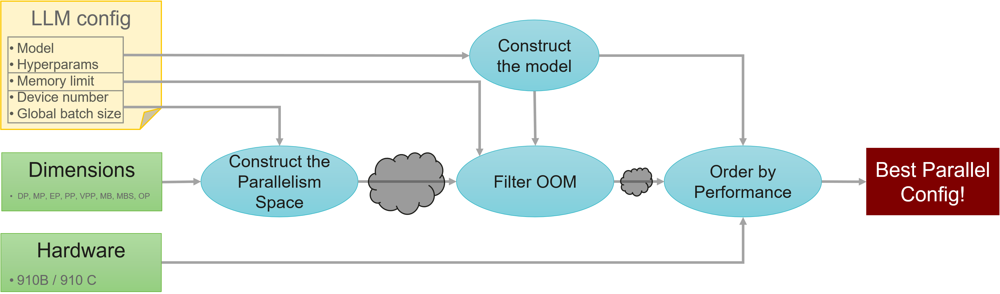
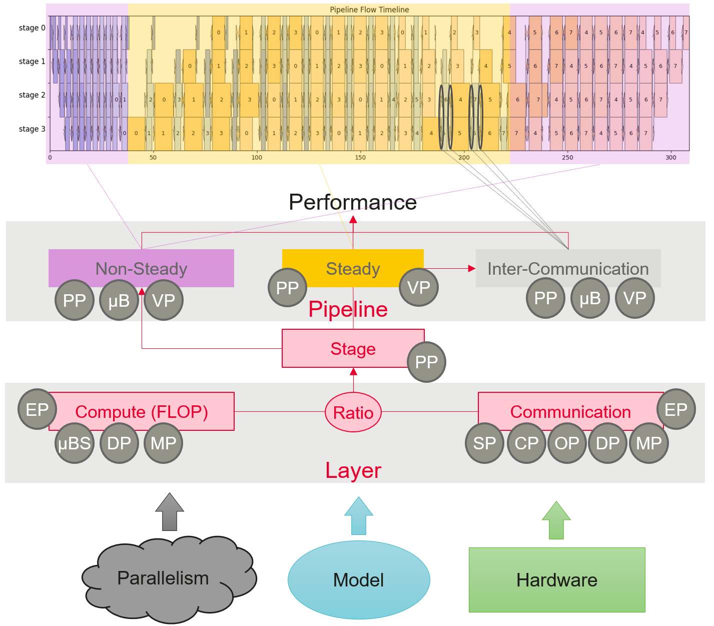

# ND: Parallelizing N Dimensions with Symbolic Estimation

ND provides symbolic search over N parallelism dimensions. It generates candidate parallel strategies, filters out-of-memory configurations with memory estimation, and ranks the remaining configurations with performance estimation.

Because both estimations are analytic, ND does not require online profiling during search. This enables exhaustive exploration, fast CPU-only search, and no dependency on the execution cluster during planning.



## Inputs

- Large language model type.
- Model hyperparameters.
- Parallel dimensions to explore.
- Hardware type and device count.
- Global batch size and memory budget.

### HyperParallel configurations (`-f hyper_v2`)

A HyperParallel `train.yaml` needs only the checkpoint and the training
sequence length. The dimensions are read from the Transformers config, so
nothing about the model is restated here:

```yaml
model:
  pretrained_model_name_or_path: /path/to/Qwen3-30B-A3B
  torch_dtype: bfloat16

dataset:
  data_transform:
    max_seq_len: 4096      # or the legacy data.max_seq_len
```

Without a sequence length ND costs the model's context limit, which for a
long-context model puts every candidate out of memory; it warns when it
falls back. `training`, `accelerator`, `fsdp_config`, `activation_checkpoint`
and `context` are accepted but optional: the search varies those dimensions
itself, and the device count, batch size and memory budget come from `-d`,
`-b` and `-M`. Give them only when costing one fixed strategy.

### Search configurations (`-s`)

`-s` adds what the CLI cannot express: a candidate list per dimension, pinned
degrees, and a `resolved.yaml` written back for the trainer. A search config
either restates the model itself (see `auto_parallel/examples/*_search.yaml`)
or points at a train.yaml:

```yaml
train_yaml: "./train.yaml"
cluster:
  num_nodes: 4
  cards_per_node: 16     # optional: defaults to the -A device type
  device_memory_gb: 58.0
parallelism:
  tp: 4                  # scalar -> fixed
  pp: [1, 2, 4, 8]       # list   -> search candidates
  dp: auto               # auto   -> the searcher decides
constraint:
  global_batch_size: 128
  memory_limit_gb: 58.0  # candidates above this are dropped
recompute: "full"
```

`recompute` names the activation checkpoint mode the run states, `off`,
`selective` or `full`. The search prices every candidate fully recomputed,
as the pipeline balancing gives it, and `resolved.yaml` states `full` so the
trainer runs what was priced. The candidates are checked against
`memory_limit_gb`, which is compared with the memory ND estimates a run
allocates. A run also holds what its allocator reserves beyond that, 7 to
16 GiB a rank on the Qwen3.5-MoE crop at 8192 tokens, so set the limit below
what the device leaves by that much.

Both are run the same way:

```bash
python -m hyper_parallel.auto_parallel.sapp_nd.nd.run_nd     -y train.yaml -s search.yaml -f hyper_v2     -d 64 -b 128 -A A3 -M 58GB -o out
```

### The model spec and the run spec

Whatever the input format, ND prices a model from two typed specs:

- The model spec (`auto_parallel/_model_spec.py`, `ModelSpec`) states the
  model under any strategy: its dimensions, its experts, its layer stack
  (`layers`), its family (`arch`) and, where they differ from the family's,
  its op counts per layer kind (`ops`). A Transformers config resolves into
  one, and `model.config_overrides` states its fields offline.
- The run spec (`auto_parallel/_exec_spec.py`, `ExecSpec`) states how the
  model is trained: the parallel degrees, the pipeline layout, the batch,
  the optimizer and gradient sharding, the recompute, the precisions, the
  kernels, the sequence length and the device memory. A HyperParallel
  configuration states it in the train.yaml; `offset`, `full_rec`,
  `sel_rec`, `capacity_factor`, `use_gmm` and `seq_length` in
  `config_overrides` belong to it.

Every other field is derived from the two. What neither states comes from
the model's family, in its op profile (`auto_parallel/op_profiles/<arch>.yaml`):
its op counts per layer kind, and defaults such as its byte widths. A run
spec states recompute as ranges of layers in model order, the body layers
first and the MTP layers last, so a search can give each layer its own
option; `{option: full}` alone recomputes every layer.

A configuration that states `context.census` has each layer kind measured on
a fake layer, the layer census, which takes tens of seconds on a laptop. A
census is kept in `~/.cache/hyper_parallel/census` and read back by later
runs of the same model, length and module replacements on the same torch and
Transformers, until a file of the package it ran on changes; ND's own search
code is not one of them. `ND_CENSUS_CACHE` names another folder, or `off`
keeps none.

## Workflow

1. Construct the model.

   ND selects the model and layer types from the framework configuration by default, or from the `--model` option. Tensor shapes, data types, and model-specific features are filled from the model hyperparameters.

2. Construct the parallelism space.

   The search space is constructed from the dimensions passed with `-l`. Each dimension must satisfy its own constraints and must be compatible with the device number passed with `-d` and global batch size passed with `-b`.

3. Filter out-of-memory configurations.

   Memory filtering is delegated to `memory_estimation/`. See `memory_estimation/README.md` for the memory estimator interface and supported model details.

4. Rank configurations by performance.

   Remaining configurations are ranked by `perf_estimation/`.



## Usage

ND runs on a CPU. Besides HyperParallel's `requirements.txt`, it imports four
libraries that file does not list, for its tables, its correlations and its
plots: pandas, matplotlib, SciPy and Pillow. Install them once:

```bash
pip install pandas matplotlib scipy pillow
```

Run the ND entrypoint as a Python module from the repository root:

```bash
python -m hyper_parallel.auto_parallel.sapp_nd.nd.run_nd \
    -y <mindformers_yaml> \
    -l DP MP PP EP MB MBS \
    -d 1024 \
    -b 2048 \
    -t 10
```

This example varies data parallelism, model or tensor parallelism, pipeline parallelism, expert parallelism, micro-batch number, and micro-batch size. The `-d` option fixes the total number of devices, `-b` fixes the global batch size, and `-t` controls how many top configurations are printed.

In HyperParallel, the ND module should be imported as:

```python
from hyper_parallel.auto_parallel.sapp_nd import nd
```

The command prints valid configurations, the subset fitting the memory budget, the top ranked strategies, and timing for search and ordering. From verbosity level 2, ND can also generate debug CSV files and plots.


## Command Options

```text
python -m hyper_parallel.auto_parallel.sapp_nd.nd.run_nd
    -y YAML_CONFIG
    [-d DEVICES]
    [-b GLOBAL_BATCH_SIZE]
    [-m MODEL]
    [-l [DIMENSIONS ...]]
    [-v VERBOSITY]
    [-A DEVICE_TYPE]
    [-mppb | --manual_pipeline_balance]
    [-t TOP_CONFIG_NUMBER]
    [-mem MEM_FOR_PPB]
    [-o OUTPUT_DIR]
    [--ranking_csv RANKING_CSV]
```

- `-y`, `--yaml_config`: path to the framework yaml configuration file.
- `-d`, `--devices`: number of devices. If omitted, ND uses the yaml value.
- `-b`, `--global_batch_size`: global batch size. If omitted, ND uses the yaml value.
- `-m`, `--model`: model name. If omitted, ND uses the yaml value.
- `-l`, `--dimensions`: parallel dimensions to vary.
- `-v`, `--verbosity`: verbosity in range `[0, 6]`, default `2`. Plots and
  debug CSV files are generated from level `2`.
- `-A`, `--device_type`: device type, such as `A2` or `A3`.
- `-mppb`, `--manual_pipeline_balance`: read offset and recompute from yaml.
- `-t`, `--top_config_number`: number of top configurations to print and plot.
- `-mem`, `--mem_for_ppb`: memory reserved for pipeline balancing.
- `-o`, `--output-dir`: directory for the standard search's `results.pdf`,
  `debug.csv`, and `debug_mem.csv`; also controls resolved search-config
  output. Without it, standard search debug artifacts go to `nd/output/`
  inside the SAPP-ND package.
- `--ranking_csv`: also write every configuration the search keeps, in ND's
  order, to a CSV: rank, degrees, peak memory in MB, score and the parts of
  the score. Scores keep full precision, so configurations ND cannot tell
  apart show as ties. This is what a sweep reads to profile ND's best
  configurations.

Use a fresh output directory for each run: `debug.csv` and `debug_mem.csv`
append rows to existing files, while `results.pdf` is replaced. The full
ranking of configurations that fit memory is available through
`--ranking_csv`; its `rank` column holds the same positions as `TOP` in the
CLI and plot.

## Structure

```text
sapp_nd/
|-- README.md
|-- figures/
|-- memory_estimation/
|-- nd/
|   |-- common/
|   |   |-- framework_parsers/
|   |   |-- _cost_model_variables.py
|   |   |-- arch_hooks.py
|   |   |-- config.py
|   |   |-- cost_model_preprocess.py
|   |   |-- generate_partitions.py
|   |   |-- hardware.py
|   |   `-- layer_type.py
|   |-- balancing_adapter.py
|   |-- debug.py
|   |-- dimensions.py
|   |-- global_config.py
|   |-- logger.py
|   |-- parallelize.py
|   `-- run_nd.py
`-- perf_estimation/
```

## Supported Scope

### Framework Configurations

- HyperParallel yaml configurations (`-f hyper_v2`), with or without a search config.
- MindSpore and MindFormers yaml configurations.
- Megatron json configurations.
- TorchTitan toml configurations are planned but not complete in this PR.

### Models

- Transformer dense models, including Llama-series and Qwen-series up to Qwen 2.5.
- Qwen3-series, including MoE variants, and Qwen3.5, whose stack alternates
  linear and full attention: the model's `layer_types` names each layer's
  kind, and each layer is priced as its kind. A model that states no
  `layer_types`, or names a kind its op profile lacks, is priced as the
  profile's default kind throughout.
- Mixture-of-Experts models, including DeepSeekV3.
- Multimodal models are in progress.

### Hardware

- Ascend A2.
- Ascend A3.
- Other Ascend variants and GPU support are future work.

### Parallel Dimensions

- `DP`: data parallelism.
- `MP`: model or tensor parallelism.
- `SP`: Megatron sequence parallelism.
- `EP`: expert parallelism.
- `PP`: pipeline parallelism.
- `OP`: optimizer or ZeRO-DP parallelism: how many data-parallel ranks the
  optimizer shards a parameter over, on top of TP.
- `MB`: micro-batch number.
- `MBS`: micro-batch size.
- `VPP`: virtual pipeline parallelism.
- `CP`: context parallelism. Its time is what the algorithm exchanges each
  layer: the keys and values ring and hybrid CP gather, the query, key, value
  and output Ulysses all-to-alls, or a linear-attention layer's recurrent
  state. Its memory is a rank's share of the sequence, plus the other ranks'
  keys and values where the algorithm gathers them.

## Notes

The original toolkit also contains validation scripts, result CSV files, yaml examples, DSL utilities, regression utilities, and PPB code. Those assets are not part of this SAPP-ND PR2 package. Pipeline balancing is maintained separately in the SAPP-PPB module.
