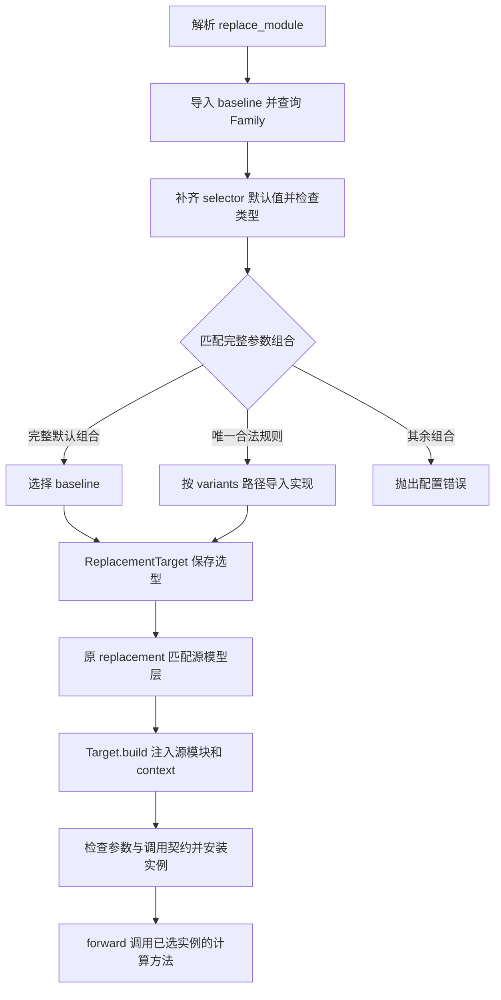

# Module Family

Module Family 在构建阶段为同一种模块选择具体实现。用户通过统一的 replacement 入口填写选择参数，框架根据模块族声明的白名单规则选出实现，再复用现有的 Module Replacement 完成模型层匹配和实例安装。

当前内置 `GroupedExperts` Family，提供默认高性能实现、MXFP8 和融合 MXFP8。更多模块可通过注册自己的 Family 接入。

## 使用 GroupedExperts Family

将以下片段加入完整训练配置。`match` 使用模型中实际的模块路径，`module_type` 使用源模块的类型。

```yaml
accelerator:
  tp_size: 1
  cp_size: 1
  ep_size: 1
  pp_size: 1

plan_overrides:
  - match: "model.layers.*.mlp.experts"
    module_type: transformers.models.qwen3_moe.modeling_qwen3_moe.Qwen3MoeExperts
    exact_type: true
    replace_module:
      _target_: hyper_parallel.components.modules.GroupedExperts
      use_mxfp8: true
      use_fused_mxfp8: true
```

两个开关均为严格的布尔类型，默认值均为 `false`：

| `use_mxfp8` | `use_fused_mxfp8` | 构建结果 |
| --- | --- | --- |
| `false` | `false` | `GroupedExperts`，沿用源模型的参数 dtype |
| `true` | `false` | `MXFP8GroupedSwiGLU` |
| `true` | `true` | `FusedMXFP8GroupedSwiGLU` |
| `false` | `true` | 配置错误 |

省略两个开关等价于选择默认实现。`true` 与字符串 `"true"`、整数 `1` 是不同类型，后两者不能替代布尔值。

- `match` 和 `module_type` 确定替换模型中的哪些实例；`exact_type: true` 排除源类型的子类。
- `replace_module._target_` 指定已注册的 baseline；选择参数确定本次使用的具体实现。
- MXFP8 变体支持三维 packed、无 bias、标准 SwiGLU，并要求路由权重在第二次 GMM 后由外层应用。隐藏维度和专家中间维度须为 32 的倍数。
- 当前 MXFP8 变体要求 `TP=CP=EP=PP=1`。Family 选择本身不增加并行支持；其他模块原有的并行能力保持各自契约。
- 运行环境需提供 MXFP8 GMM；融合另需 `npu_swiglu_mx_quant_with_dual_axis` 和 `_npu_swiglu_backward_mx_quant_with_dual_axis`。缺少能力时会报错。

这里的两个开关直接选择固定 MXFP8 路径，不通过 `training.low_precision` 选择数值策略。配置中不要再给同一替换条目绑定 W4/fake 等命名 dtype scheme。Scheme 驱动的 QAT 接口不属于本页描述的入口。

默认实现和低精实现共用 [GroupedExperts](grouped_experts.py) 的持久权重布局与 checkpoint 转换：Gate/Up 为 `[E,H,2I]`，Down 为 `[E,I,H]`。非 meta 源参数需要转置时复制已有值；布局已匹配时复用原 Parameter；meta 参数通过原 checkpoint 或初始化流程填值。应在替换完成后建立优化器。

## 配置如何生效



选择发生在配置构建阶段。训练 forward 使用已经安装的模块，不再解释规则。没有注册 Family 的普通 replacement 继续使用原 Target 解析和执行流程。

`ReplacementTarget` 同时保留用户请求的 baseline、显式选择参数和最终 callable。重新选择或序列化时保留配置意图；真正构建时，选择参数已从普通构造参数中移除。

```python
from hyper_parallel.components.modules import GroupedExperts
from hyper_parallel.trainer.config.replacement import ReplacementTarget

target = ReplacementTarget(
    GroupedExperts,
    target_path="hyper_parallel.components.modules.GroupedExperts",
    use_mxfp8=True,
)
fused = target.replace(use_fused_mxfp8=True)
baseline = fused.replace(use_mxfp8=False, use_fused_mxfp8=False)
serialized = fused.to_dict()
```

`.replace()` 返回新的构建配置，不修改已有模型实例。关闭低精与融合时应同时恢复合法组合。`to_dict()` 保存原 baseline 路径和显式选择参数，省略的 selector 不补写。

## Family 声明与规则

[family.py](family.py) 提供以下声明：

| 类型／字段 | 含义 |
| --- | --- |
| `SelectorSpec(value_type, default)` | 选择参数的精确类型与 baseline 默认值 |
| `VariantRule(when, variant)` | 完整的具名参数组合与对应变体名 |
| `ModuleFamily.name` | 模块族名称 |
| `ModuleFamily.baseline` | 对外入口 callable，通常是模块类 |
| `ModuleFamily.variants` | 变体名到可导入 callable 路径的映射 |
| `ModuleFamily.selector_specs` | 本模块族接受的选择参数 |
| `ModuleFamily.variant_rules` | 明确允许的非默认参数组合 |

允许集合由完整默认组合和全部显式规则组成。缺省字段先补默认值；非默认组合必须完整匹配一条规则。没有部分匹配、规则优先级或未命中后回退。

注册时检查规则字段完整性、参数类型、变体引用和条件重复。每条规则须包含全部且仅有已声明的 selectors，默认组合无需重复登记。选择参数采用 `bool`、`int`、有限 `float` 或 `str`；矩阵大小、配置对象等普通构造参数由选中的实现处理。

注册表保存声明的只读副本，并按 baseline 对象身份查询。一个子类不会自动取得父类的 Family。`variants` 使用字符串路径延迟导入；导入失败会报错。构造接口中的 `module`、`module_fqn`、`context` 等运行时字段不能声明为 selector。

## 扩展一个 Family

### 1. 实现具有相同契约的替换模块

下面的 CPU Linear 示例展示注册方法，可放入接入方的 `my_project/linear_family.py`。它只匹配原生 `torch.nn.Linear`，两种实现共用源 weight、bias 和训练状态。

```python
from collections.abc import Mapping
from typing import Any

import torch
from torch import nn

from hyper_parallel.components.modules.family import (
    ModuleFamily,
    SelectorSpec,
    VariantRule,
    register_module_family,
)
from hyper_parallel.models.replacement import module_replacement


@module_replacement
class ExampleLinear(nn.Linear):
    """Baseline replacement preserving native Linear parameters."""

    def __init__(
        self,
        *,
        module: nn.Linear,
        module_fqn: str = "",
        context: Mapping[str, Any] | None = None,
    ) -> None:
        # Avoid allocating and initializing a second set of weights.
        nn.Module.__init__(self)
        self.in_features = module.in_features
        self.out_features = module.out_features
        self.register_parameter("weight", module.weight)
        self.register_parameter("bias", module.bias)
        self.train(module.training)


@module_replacement
class MatmulLinear(ExampleLinear):
    """Alternative local computation with the same forward signature."""

    def forward(self, input: torch.Tensor) -> torch.Tensor:
        output = input @ self.weight.t()
        return output if self.bias is None else output + self.bias


register_module_family(ModuleFamily(
    name="example_linear",
    baseline=ExampleLinear,
    variants={"matmul": "my_project.linear_family.MatmulLinear"},
    selector_specs={"implementation": SelectorSpec(str, "reference")},
    variant_rules=(
        VariantRule({"implementation": "matmul"}, "matmul"),
    ),
))
```

继承可以复用参数与外部流程；也可以让 Family 选择满足同一 replacement 契约的工厂函数。`@module_replacement` 声明构造入口，实际替换仍由原执行器完成。

### 2. 配置模块路径与选择参数

确保 `my_project` 在训练进程中可导入。解析以下 target 时会导入上面的文件并执行注册：

```yaml
plan_overrides:
  - match: "model.projection"
    module_type: torch.nn.Linear
    exact_type: true
    replace_module:
      _target_: my_project.linear_family.ExampleLinear
      implementation: matmul
```

省略 `implementation` 或填写 `reference` 选择 baseline；填写 `matmul` 选择另一实现；其他值报错。新增这个 Family 无需修改通用 resolver。

如果注册放在独立文件，应用需在解析配置前导入该文件。每个 baseline 只注册一次，不应在 forward 或逐层构造循环中重复注册。

### 3. 验证共享契约

替换实现应保持源模块的 forward 调用协议、训练／冻结状态，以及参数和 buffer 的注册契约。参数名称或布局变化时，通过 `make_transforms()` 提供 checkpoint 转换，并保留已加载源参数的正确数值。保留 hook、别名和参数身份的条件由原 replacement 执行器检查。

新增变体时，应在真实配置解析和 replacement 路径中验证合法／非法组合、选中 callable、初始参数、输出、输入／权重梯度及更新；测试助手不应在替换后额外填权重来弥补构造行为。数值算法有变化时，为该实现单独定义精度和设备验收条件。

给已有 Family 增加 selector 时，更新所有规则，使每条条件仍然完整；默认值应保持旧配置的选择结果。增加变体只能扩展已验证的计算组合，不自动改变并行或底层算子的支持范围。

## 代码与测试入口

| 位置 | 职责 |
| --- | --- |
| [family.py](family.py) | 注册、白名单匹配与构造参数检查 |
| [grouped_experts.py](grouped_experts.py) | 内置 Family 登记、参数与路由契约 |
| [mxfp8_grouped_swiglu.py](mxfp8_grouped_swiglu.py) | 两种低精模块的本地计算 |
| [trainer/config/replacement.py](../../trainer/config/replacement.py) | 选型配置、复制与序列化 |
| [trainer/config/resolver.py](../../trainer/config/resolver.py) | replacement 专用解析入口 |
| [trainer/config/parallelism.py](../../trainer/config/parallelism.py) | 配置到替换规格的接线 |
| [models/replacement.py](../../models/replacement.py) | 原模块匹配、构造检查与实例安装 |
| [Family 单元测试](../../../tests/ut/components/modules/test_module_family_selectors.py) | 规则与注册契约 |
| [配置集成测试](../../../tests/ut/trainer/test_module_family_replacement.py) | 实际 replacement、参数和配置往返 |
| [MXFP8 单设备测试](../../../tests/torch/expert_parallel/test_family_mxfp8_local.py) | 非融合与融合的设备计算验证 |

通用高性能模块的安装与替换说明见 [modules README](README.md)。
