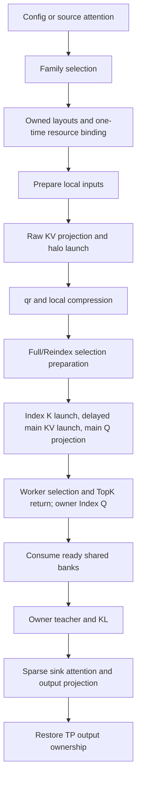

# Compressed Sparse Attention 2 (CSA2)

`CompressedSparseAttention2` is the complete DeepSeek-V4.1 shared attention family. It owns the raw KV, low-rank query, compressed KV and Indexer projections, selection, auxiliary KL learning, sink attention and output projection. It can be built from a V4.1 configuration or replace an existing `DeepseekV41Attention` while preserving its parameters, buffers and checkpoint names.

The `2` identifies the V4.1 attention variant; it is not a fixed compression ratio.
The family covers sliding-only layers and layers with compression ratios 1 and 2.

## Construction and selection

```python
from hyper_parallel.components.modules import CompressedSparseAttention2

attention = CompressedSparseAttention2(
    config=config,  # V4.1 config with compression ratios and source-layer IDs
    layer_idx=layer_idx,
    mesh=mesh_context,  # an existing job mesh; omit for local construction
    use_fused_ops=True,
)
```

To retain loaded weights, pass `module=source_attention` instead of `config`. Parameter construction does not create process groups. When construction only receives a logical parallel context, the generic model builder applies parameter layouts and binds the existing job resources before the first forward.

| CP degree | `use_fused_ops` | Selected implementation |
| --- | --- | --- |
| 1 | false | Local reference CSA2 |
| 1 | true | Local fused CSA2 |
| >1 | false | CP reference CSA2 |
| >1 | true | CP fused CSA2 |

The boolean selects the existing Lightning Indexer V2, Sparse Flash MLA and sparse Indexer KL adapters together. Unsupported fused inputs raise errors; they do not fall back to reference operations. Fusion and Indexer load balancing currently require TP=1. Reference TP and TP sequence parallel use the family's declared projection layouts and framework-owned TP/SP input/output boundaries.

## Model configuration

[The V4.1 model spec](../../../../models/deepseek_v41/deepseek_v41_spec.py) declares this family as the default attention replacement. A Trainer override can select fusion and communication options:

```yaml
plan_overrides:
  - match: "model.layers.*.self_attn"
    module_type: hyper_parallel.models.deepseek_v41.modeling_deepseek_v41.DeepseekV41Attention
    replace:
      kind: module
      implementation:
        _target_: hyper_parallel.components.modules.attention.compressed_sparse_attention2.CompressedSparseAttention2
        use_fused_ops: true
        main_kv_comm: all_to_all_v
        index_k_comm: all_to_all_v
        indexer_paged_k: true
        indexer_load_balance: greedy
        indexer_balance_block_size: 2048
```

`main_kv_comm` and `index_k_comm` independently accept `all_gather` (default) and
document-prefix `all_to_all_v`. SWA raw KV uses the document-aware halo A2AV path.
Index K dispatch covers both worker selection and original-owner KL demand;
only the latter contributes gradients. Full/Reindex consumers must use matching
dispatch settings. `indexer_paged_k` defaults to false and enables LI V2 shared
physical pages for repeated logical prefixes, independently of transport. It
requires fused selection and a native LI V2 with `PA_BBND` support.

`indexer_load_balance` accepts `none`, `zigzag`, `greedy` and `hybrid`.
Greedy/hybrid accept `indexer_balance_block_size`; hybrid also requires
`indexer_zigzag_min_length`. These options preserve low-rank `qr` transport and
owner-side KL semantics. See the [CP guide](../../../../../docs/guide/deepseek_v41_indexer_cp.md)
for complete configuration, immutable batch plans and optional CPU prefetch.

For a family target, remove the old `*.self_attn.forward` replacement and `tp_divide_attrs: [num_groups]` rules. The family layout and CP stage binding own these responsibilities; the former model-owned attention wrapper is no longer an importable entry.

## Parameter construction and normalization

Direct construction currently uses the Transformers `deepseek_v4` parameter skeleton,
then installs the V4.1 Compressor/Indexer and removes V4's post-query normalization.
The forward algorithm is the CSA2 implementation in this directory. Retaining the
construction order preserves seeded initialization and checkpoint names; it does not
select the HF V4 attention algorithm.

The four CSA2 normalization sites use the public `RMSNorm` family on direct construction.
Its reference member preserves FP32 normalization, the cast before scale multiplication,
and the existing scale Parameter. The V4.1 initializer restores these scales to one after
meta materialization. Adopting a source attention preserves its existing child modules.

CSA2 `use_fused_ops` controls Indexer, attention and KL, independently of normalization.
To select fused normalization explicitly, add an RMSNorm replacement, for example:

```yaml
plan_overrides:
  - match: "model.layers.*.self_attn.q_a_norm"
    replace:
      kind: module
      implementation:
        _target_: hyper_parallel.components.modules.RMSNorm
        use_fused_ops: true
```

The same rule can target `kv_norm`, `compressor.norm` or `indexer.k_norm` where present.
Changing normalization kernels needs its own numerical comparison; the refactor keeps
the reference normalization default.

## Parameter and activation sharding

The source of truth is `_sharding` in
[compressed_sparse_attention2_family.py](compressed_sparse_attention2_family.py).
These are logical model-parallel layouts, before any separately configured
FSDP/HSDP storage sharding. A `Shard(i)` below splits dimension `i` of the stored
parameter; PyTorch linear weights have shape `[out_features, in_features]`.

Notation: `P` is the TP degree, `D` the hidden size, `H`/`d` the main attention
head count/dimension, `Rq` the query low rank, `G` the output group count, `Ro`
the output low rank per group, and `I`/`di` the Indexer head count/dimension.
All parameter names below are relative to `model.layers.<layer>.self_attn`.

| Parameter | Full shape | TP layout | Local shape for TP=P |
| --- | --- | --- | --- |
| `q_a_proj.weight` | `[Rq, D]` | `Replicate` | `[Rq, D]` |
| `q_a_norm.weight` | `[Rq]` | `Replicate` | `[Rq]` |
| `q_b_proj.weight` | `[H*d, Rq]` | `Shard(0)`, complete query heads | `[(H/P)*d, Rq]` |
| `kv_proj.weight` | `[d, D]` | `Replicate` | `[d, D]` |
| `kv_norm.weight` | `[d]` | `Replicate` | `[d]` |
| `sinks` | `[H]` | `Shard(0)`, aligned with main heads | `[H/P]` |
| `o_a_proj.weight` | `[G*Ro, H*d/G]` | `Shard(0)`, complete output groups | `[(G/P)*Ro, H*d/G]` |
| `o_b_proj.weight` | `[D, G*Ro]` | `Shard(1)`, matching `o_a_proj` groups | `[D, (G/P)*Ro]` |
| `compressor.wkv.weight` | `[d, D]` | `Replicate` | `[d, D]` |
| `compressor.wgate.weight` | `[d, D]` | `Replicate` | `[d, D]` |
| `compressor.norm.weight` | `[d]` | `Replicate` | `[d]` |
| `indexer.q_b_proj.weight` | `[I*di, Rq]` | `Shard(0)`, complete Indexer heads | `[(I/P)*di, Rq]` |
| `indexer.weights_proj.weight` | `[I, D]` | `Shard(0)`, same Indexer heads | `[I/P, D]` |
| `indexer.wk.weight` | `[di, d]` | `Replicate` | `[di, d]` |
| `indexer.k_norm.weight` | `[di]` | `Replicate` | `[di]` |

Only existing parameters receive a layout. SWA layers have no Compressor or
Indexer. Full layers own both; Reindex layers own Index Q/weights but consume
the source layer's main KV and Index K; Reuse layers own neither. `wgate` exists
only for compression ratios greater than one. Current V4.1 projections are
bias-free. No checkpoint parameter names or global tensor shapes are changed.

`H`, `G`, and, where present, `I` must be divisible by `P`. In particular,
`o_a_proj` keeps each group's full input width `H*d/G`: TP selects whole groups,
then `o_b_proj` produces a partial hidden output from those local groups. It does
not split the head dimension or independently split the two output projections.
The family rejects incompatible layout overrides.

All of these attention parameters are replicated on CP and EP axes when those
axes are present. CP partitions token rows and communicates activation banks;
it does not shard these weights. EP expert-weight ownership belongs to the MoE
family. FSDP/HSDP may additionally shard the stored attention parameters according
to the job configuration; the table describes the TP-visible weights while the
module executes, not their resting storage between calls.

For hidden states `[B, S, D]`, the declared ports are:

| Boundary | TP with SP off | TP with SP on | CP |
| --- | --- | --- | --- |
| Model input to attention | `Replicate` | `Shard(1)` | `Shard(1)` |
| Inside attention | `Replicate` | `Replicate` after TP input gather | `Shard(1)` |
| Partial output from `o_b_proj` | `Partial(SUM)` | `Partial(SUM)` | `Shard(1)` |
| Output returned to model | `Replicate` after TP SUM | `Shard(1)` after TP SUM reduce-scatter | `Shard(1)` |

With TP=1 the TP transformations are absent. SP gathers only the current CP
rank's token interval; it does not gather the global sequence. The common
boundary executor owns these transformations. Independently, reference Indexer
scores and teacher head statistics need an internal TP SUM before TopK and KL
normalization. The CP/TP member binds that reduction to the existing TP group;
an output-only reduction would not provide the same selection or teacher.

Raw KV, compressed main KV and Index K each have one head shared by the query
heads within a TP rank,
while Q and sinks have local heads. `main_kv_comm` selects how CP distributes the
main activation bank and does not change any parameter placement. Fusion and
Indexer task balancing still require TP=1; this table does not extend their
supported topology.

## Responsibilities and execution

- [Algorithm](compressed_sparse_attention2.py): complete local CSA2 forward, interleaved partial RoPE and per-forward shared bank state. It does not own process groups or communication scheduling.
- [CP member](cp_compressed_sparse_attention2.py): raw halo, compressed boundary/bank exchange, Indexer input/TopK dispatch and launch/wait ordering. It also binds the reference path's TP head SUM before TopK and teacher normalization; TP/SP ports use the common boundary executor.
- [Compressor](compressor.py): learned non-overlapping pooling and normalization. The CP subclass completes projected boundary rows inside the managed compressor call.
- [Indexer](indexer.py): owner/worker projections and reference/fused selection. The CP subclass schedules key exchange and selection dispatch inside the managed Indexer call, retaining FSDP/checkpoint boundaries.
- [Indexer KL](indexer_kl_loss.py): the owner-side KL objective, precomputed reference gradients and strict native dispatch.
- [Document layout](document_layout.py): immutable document boundaries, local complete-block plans, prepared indices and graph-packing representations. Communication is explicit in the CP member, not hidden in metadata preparation.
- [Family](compressed_sparse_attention2_family.py): allowlisted selection, parameter/port sharding and validation of the runtime stage protocol.

The shared RoPE helper stays in the attention algorithm. Construction passes that same helper to the Compressor and Indexer, avoiding both duplicated formulas and circular imports. No new rotary file or public rotary API is introduced.



The CP callback submits main KV after Index K and records the real pending handle before preparing main Q. Consumer `wait()` only waits; it never triggers a deferred submission. The algorithm retains the established launch/wait order; stage declarations do not automatically schedule asynchronous work. Full publishes compressed KV and Index K; Reindex consumes shared banks and publishes new TopK; Reuse consumes the corresponding source entries. Raw SWA KV remains per-layer. Natural document compression never groups tokens from different documents.

Shared banks belong to one model forward and are passed explicitly as `SharedCompressedAttentionState`. The state publication methods reject replay writes at their shared interface. Validation records only actual publications. Pending work belongs to one communication call. Neither is stored as a reusable module activation cache. Checkpoint replay suppresses repeated state publication and pins discrete selection; worker Q is not retained solely for replay.

## Migration

The previous shared-attention entry module and model-owned CP wrapper have been removed.
Import the family from `hyper_parallel.components.modules.CompressedSparseAttention2`;
internal algorithms and document layouts are imported from their owning files in this directory.
`SharedCompressedAttentionState` is defined beside the attention algorithm; `CSA2IndexerOutput`
is defined beside the Indexer. CP pending handles remain private to the CP member.
Execution uses class-defined stages rather than assigning a CP wrapper to `forward`.
Old checked-in codegen output is removed with the obsolete wrapper; generate a fresh
bundle from the current training YAML instead of importing the old artifact.

The teacher formula, Q chunk size and candidate-pool restrictions retain their
existing behavior. CP row addresses are derived from the CP rank and local
sequence length; RoPE position IDs may reset within a document and are not used
as communication addresses. Packed local/global bounds are still validated.
An optional `cp_batch_plan` is validated and carried by the current call, never
stored as mutable module state. Index K dispatch, shared-page selection and AG
de-padding do not change the existing collective submission order or add fused TP.
