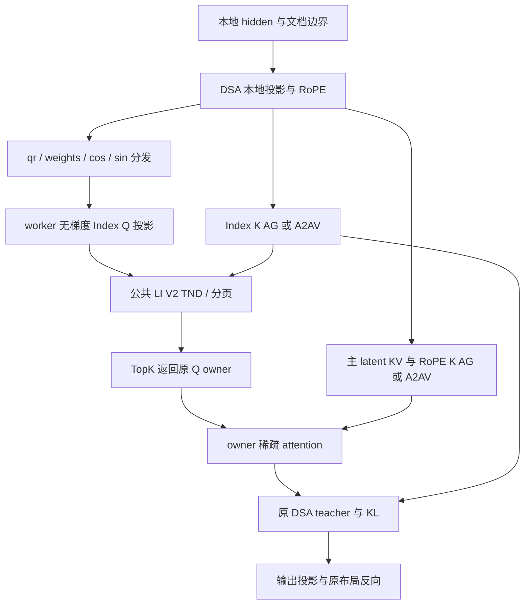

# DeepSeek Sparse Attention

`DeepseekSparseAttention` 提供 DeepSeek-V3.2 的稀疏注意力，使用 Indexer 为每个 query
选择参与计算的 key。训练配方通过替换完整的注意力模块接入，支持单卡、KV AllGather 与 packed 文档因果前缀 A2AV 上下文并行。

## 公共模块族入口

原生模型直接构造公共族，不替换模型的 `forward`：

```python
from hyper_parallel.components.modules import DeepseekSparseAttention

attention = DeepseekSparseAttention(
    config=config, mesh=mesh, kv_cp_size=2,
    main_kv_comm="all_to_all_v", index_k_comm="all_gather",
    indexer_load_balance="greedy", indexer_balance_block_size=2048,
    indexer_paged_k=False,
)
```

`mesh` 是作业已经建立的 mesh。模块族选择本地/CP 成员，声明参数布局并借用 CPContext；
调用方不安装 CP 方法 wrapper，不自行建立第二套通信组。已有 HF 模型也能通过下面的整模块替换入口使用同一族。

## YAML 配置

下面是 TP1、CP2 的配置片段，合入已有模型训练配方；完整示例见
[V3.2 并行配方](../../../../models/deepseek_v32/recipes/train_parallel_offline.yaml)。

```yaml
accelerator:
  tp_size: 1
  cp_size: 2
  sequence_parallel: false

plan_overrides:
  - match: "*.self_attn"
    replace:
      kind: module
      implementation:
        _target_: hyper_parallel.components.modules.DeepseekSparseAttention
        kv_cp_size: 2
        kv_cp_strategy: allgather
        cp_comm_overlap: true
```

HF 转换入口的 CP 配置参数写在 `replace.implementation` 下：

| 参数 | 默认值 | 含义 |
| --- | --- | --- |
| `kv_cp_size` | `1` | 上下文并行大小，与 `accelerator.cp_size` 保持一致；1 表示不开启 CP。 |
| `kv_cp_strategy` | `allgather` | 保留旧配置兼容值；具体 bank 的传输由下列两个通信选项决定。 |
| `cp_comm_overlap` | `false` | AG 基线是否先提交再等待；worker/A2AV 路径使用显式 launch/wait。 |
| `main_kv_comm` | `all_gather` | 主 latent KV 与 RoPE K 使用 AG，或 `all_to_all_v` 文档因果前缀分发。 |
| `main_kv_comm_fusion` | `false` | 合并同路由的 latent KV / RoPE K 载荷；减少通信次数，不减少字节数。 |
| `index_k_comm` | `all_gather` | Index K 独立选择 AG 或 `all_to_all_v`；A2AV 同时覆盖 worker 选择与 owner KL 的需求。 |
| `indexer_load_balance` | `none` | `none`、`zigzag`、`greedy`、`hybrid`；只分配 sparse 阶段的无梯度选择任务。 |
| `indexer_balance_block_size` | `null` | greedy/hybrid 未设置时解析为 2048；none/zigzag 不接受显式 block size。 |
| `indexer_zigzag_min_length` | `null` | hybrid 的长文档阈值；长文档主体 zigzag，余数及短文档进入 greedy 池。 |
| `indexer_paged_k` | `false` | LI V2 使用共享物理 K 页面，减少选择侧重复前缀物化；不改变 owner KL 的布局。 |

TP 度和总 CP 度仍写在 `accelerator` 中，改 `accelerator.cp_size` 时须同步改 `kv_cp_size`。
`*.self_attn` 匹配完整的注意力模块，框架自动选择本地或上下文并行实现；
通用规则见 [Attention YAML 配置通用规则](../readme.md#yaml-配置通用规则)。

## 参数切分：sparse_attention_sharding

[`sparse_attention_sharding`](deepseek_sparse_attention_family.py) 声明参数和输入输出的并行布局。
下面是 TP > 1 时的参数切分方式，线性层权重的形状为 `[输出维, 输入维]`：

| 参数 | TP 布局 | 切分方式 |
| --- | --- | --- |
| `q_b_proj`、`kv_b_proj` | `Shard(0)` | 按输出维切分，每张卡负责部分主注意力头；若有 bias 则同样切分 |
| `o_proj.weight` | `Shard(1)` | 按输入维切分，与本卡负责的注意力头对应 |
| `o_proj.bias`（若有） | `Replicate()` | 在 TP 组内复制 |
| `linear_qkv`、`q_a_layernorm`、`kv_a_layernorm` 的全部参数 | `Replicate()` | 低秩投影和归一化保持完整 |
| `indexer.wq_b`、`indexer.wk`、`indexer.k_norm`、`indexer.weights_proj` 的全部参数 | `Replicate()` | Indexer 在 TP 组内复制，保留完整的 Indexer 头 |

CP 按序列维切分输入和输出，不切分参数。例如 TP2 × CP2 时，每张卡负责一半主注意力头和
一半 query token，Indexer 仍保留完整的头数。TP1 时所有参数都不做 TP 切分。

表中描述的是计算布局；启用 FSDP 后，参数的存储分片仍由 FSDP 管理。

## Packed 文档与训练阶段

文档边界使用全局 batch-major 坐标。某个 rank 可以没有某篇文档的 Q，这篇文档会从该 rank 的调用中排除。
普通 AG 保留多 batch 行以及跨行文档的行为。新增均衡、分页、前缀 A2AV 和 CPU 预取当前要求
**TP1、CP>1、物理 batch=1、等长连续 Q 分片**，且 Q/K 文档边界一致；不满足时明确报错。

DSA 不进行 CSA2 的压缩。共享代码中的 `ratio=1` 只表达未压缩 key 的因果可见范围。
DSA TopK 是文档内的 ID，维持原生顺序；CSA2 的适配层把它转为 bank ID 并排序。两种返回约定没有混用。

- sparse：owner 保留可微的 Index Q/K/weights，用于原 KL；worker 接收 `qr`、weights 和 RoPE，
  无梯度重投影并执行 LI，返回 TopK。worker GEMM 保持原 owner 行数的数值兼容策略。
- dense warm-up：不发起 worker 选择/TopK 返回，使用原 dense FA、Indexer LSE 和 dense KL。
  保留可变阶段开关；进入 sparse 后才采用配置的均衡模式。dense KL 本身未做负载均衡。
- Index K A2AV：前向分发请求并集；反向只从 owner KL 的可微视图回传，多源梯度执行 SUM。
  没有把 worker 选择加入梯度图。



这张图表示依赖；同一 HCCL 组上的通信仍需遵守所有 rank 一致的提交顺序。异步提交不等于保证完全重叠。

## 公共 CPU 计划与可选预取

`hyper_parallel.distributed.context_parallel.batch_plan` 为每个 batch 构造不可变主机计划。
DSA 使用 `ratios: [1]`、`windows: []`；CSA2 额外规划压缩块和 SWA。任务与通信地址复用同一套
`indexer_balance`、`index_key_dispatch`、`sequence_dispatch` 和 `sequence_pack`，不复制 DSA 专用调度器。

以下片段替换已有配方的 `dataloader.get_batch`；dataset 必须输出带 `input_ids` 和
`cu_seq_lens` 的 CPU batch。`plan_options` 要与 attention 完全一致：

```yaml
get_batch:
  _target_: hyper_parallel.data.batching.cp_batch.build_cp_planned_text_batch
  source_type: online
  attention_mode: compressed
  runtime_input_adapter:
    _target_: hyper_parallel.data.batching.runtime_input.PackedAttentionRuntime
  prefetch: true
  plan_options:
    ratios: [1]
    windows: []
    mode: greedy
    block_size: 2048
    main_kv_comm: all_to_all_v
    index_k_comm: all_gather
```

该预取只在线程中准备 CPU 数据与地址，不执行 NPU 操作或 collective。最多预取一个 batch；
每个 GAS micro-batch 各带自己的计划，checkpoint 保存已消费游标。它是 eager/TP1 可选入口，
不叠加在已有 device/distributed prefetch loader 上。未开启时，在 attention 内按需取得相同的公共缓存计划。


## 可选通信合并与 TopK 恢复

`main_kv_comm_fusion=True` 将同路由的主 latent KV 和 RoPE K 在最后一维拼接后，
交给 `main_kv_comm` 选择的同一次 AG/A2AV。消费前拆成连续的两个字段；反向在字段梯度汇合后
执行一次原 SUM 归约。Index K 仍使用独立的 `index_k_comm`。所有 CP rank 必须使用一致配置。
该选项不改变文档计划，不减少有效通信字节；它减少 collective 次数，同时增加拼接、拆分和梯度汇合。
默认关闭，需要按目标形状测量。当前适用范围与上述新增 CP 功能相同，dense warm-up 也可使用。
它属于 attention 模块选项，不需要加入 CPU `plan_options`。

稀疏主 Q 和 rotary Q 的连续布局只建立一次，供 SFA 前向、KL teacher 和 SFA 反向复用。
CP 稀疏路径将这次连续化放在 TopK 回传提交后、等待前，提供不依赖返回 ID 的覆盖窗口。
它保留可微链路，不改变投影、TopK 和 attention 公式；通信与拷贝可能竞争带宽，实际覆盖量取决于目标拓扑。

DSA 与 CSA2 共用的 TopK 返回路径可以通过现有 OpSelect 配置选择融合恢复：

```yaml
ops:
  indexer_topk_restore: triton_ascend
```

融合入口把本地 worker 选择和已收到的远端选择直接写入 owner 行顺序，省去本地 gather 的中间结果
和两次独立落位。它保持整数位模式、槽位顺序与 `-1`，不排序、不减少通信字节、不参与梯度。
Triton Ascend 是这个可选入口的依赖；显式指定后，不支持的设备或缺失依赖会报错。
默认 `auto/native` 保留原 Torch 路径，允许本地结果先写回并与远端通信重叠；融合入口在通信完成后
合并写回，局部 kernel 加速不等价于相同幅度的整层收益。配置契约见
[OpSelect 指南](../../../../../docs/guide/op_select.zh.md)。
