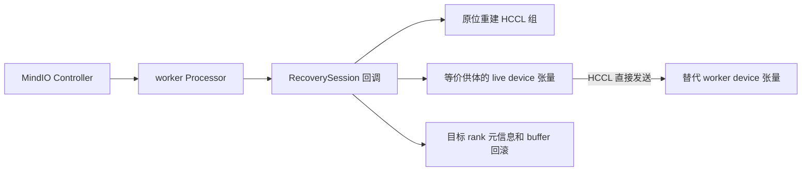

# HyperParallel 进程级快恢：device 副本拷贝

恢复时直接发送存活等价副本 device 上的模型参数、FP32 主参数、AdamW 矩或 Muon 动量，写入替代 worker 的 device。
正常训练不生成、传输或保留这些张量的 CPU 快照；不提供磁盘 checkpoint 恢复兜底。
本版本替换此前 CPU 完整快照实现，旧版验收结果不能作为本版本的通过结论。

## 用户配置

rank 0 托管 Controller：

```yaml
worker_recovery:
  enable_worker_reboot: true
  controller_ip: "192.168.1.10"
  controller_port: 8000
```

TaskD 托管时省略 IP/port，仅配置 `enable_worker_reboot: true`。框架依次从部署环境中的
`PROCESSOR_ADDR`、`CONTROLLER_ADDR`、`TTP_ADDR`、`MASTER_ADDR` 查找地址，端口读取 `TTP_PORT`。
部署信息应在导入 TaskD/Go 动态库前注入。框架不会自行创建 TaskD 进程。
不增加用户副本列表、run ID、worker 地址或状态端口配置。

## 等价副本与优化器状态

`ReplicaTopology` 从参数 DeviceMesh/placements 的 Replicate 维度推导候选副本，
并检查全模型参数及优化器布局一致性，再按 Muon 实际 `owned_params` 筛选优化器状态归属也相同的 rank。
TP/EP 分片坐标必须相同；不会按 world size 任意配对。
仅有 TP/EP、没有冗余的分片会在 attach 阶段报错。普通本地参数不会被自动视为其他 rank 的副本。

保留 Muon 的 `hsdp_replica_count` 及其实际二次分组，不为快恢自动改写状态去重配置。
例如四个模型副本分为两个大小为 2 的优化器去重子组时，同一 owner 角色可跨子组形成状态副本。
仅有两个模型副本且状态在两者间完全去重时，没有完整状态副本，attach 会提前报错，不能开启快恢。
参数值为 1 时各模型副本保有自己的动量；是否存在完整副本仍由实际布局和状态归属共同确认。
模型、mesh 和优化器必须在 `session.groups` 中构造；Trainer 接入自动覆盖此阶段。

## 模块与流程



- `state.py`：绑定 live 张量，描述布局和优化器非张量配置，分配接收槽；不导出权重快照。
- `topology.py`：推导等价副本；原始 worker 交换描述，替代 worker 从现有 rendezvous store 读取已验证布局。
- `transport.py`：直接分块发送 device 张量。`DeviceMetadataBank` 仅保留训练元信息和可变 buffer。
- `groups.py`：记录并原位重建训练组、优化器组及修复组。
- `adapters.py`：清理中断迭代的梯度、失效 Work 和分片调度临时状态。
- `session.py`：提交、stop/clean/rebuild/repair/rollback 和训练体重入。

正常训练先同步 forward/backward 并确认更新边界，再调用 `tft_start_updating_os()`。
优化器、主参数回写、调度器完成并同步后，记录有效 device step，保存少量训练元信息，
调用 `tft_end_updating_os(k)`，随后交换必须保留目标 rank 身份的训练元信息。参数和优化器矩不参与该交换。
Trainer 的进度、调度器及补日志 provider 不再进入每步发送的 device 字节缓冲，
只在本地按 step 保留两个版本；修复时从有效供体取得所选步数的快照，再随恢复头发送。

故障时依次停止设备、取得主线程停止应答、清理和重启设备、更新保留张量安全标记、重建通信。
Muon 全体刷新分片形状元数据。供体必须持有恰好对应所选 step 的有效 device 状态，
直接发送自身参数、主参数及优化器张量；接收端原位写入，再恢复目标 rank 的 RNG、游标、buffer 等。
不会从 CPU 权重快照把存活 worker 回滚到较早步数。

替代 worker 的 Trainer 数据构造也走本地重建：indexed 路径解析在原始启动时将实际结果按 rank 写入现有 store，
替代 worker 读取该清单，不重新扫描或 all-gather，保持原始 blend 顺序；清单缺失时直接报错。
数据集缓存构建保留输入 rank 的归属，但不等待旧缓存构建 rank 的 barrier，可读已有缓存或本地重建。
对象存储 `.idx` 缓存命中时直接复用，缺失时由替代 worker 本地下载并原子发布，不执行全局 barrier。
这些操作只发生在数据管线构造或缓存首次打开时，没有新增每步训练通信或用户配置。
自定义构造中的 collective 仍须逐项适配；rendezvous store 和原数据来源必须可用。

## 训练元信息与限制

不同 rank 的 RNG、数据游标和自定义 rank provider 不能直接套用供体状态。这些元信息序列化为 device 字节缓冲，
与目标 rank 的可变 buffer 一起保留在等价副本域内；可变 buffer 的提交副本也在 device 上。
恢复时 CPU 可以解析 Python 元信息，但权重、主参数及优化器矩不经过 CPU。
普通游标、动态 batching 缓存及所有 model buffer 的保护本轮保持原样，
不根据名字、形状或 `persistent=False` 猜测它们是否可以省略。

底层 `TrainState(..., replica_providers=(...))` 可显式声明从供体同一步快照恢复的 provider；
默认不声明，任意自定义 provider 仍按目标 rank 保护。Trainer 自动声明其进度、调度器和日志，无新增训练配置。
日志是观测数据，替代 worker 取得供体同一步已记录指标，`source_rank` 标识供体，
不承诺复原故障 rank 原始的局部 loss。RNG 和 loader 不允许通过该声明省略。
本 rank 元信息长度已达到组内最大值时，直接复用原 device 字节缓冲发送；只有较短输入才分配填充缓冲。
本轮仅缩减发送内容和冗余中间拷贝，仍保留必要元信息的逐步通信、barrier 和 end 前后的原有次序；
end 到必要元信息完成复制之间的窗口仍存在，不能据此声称恢复协议已无窗口或训练已零开销。

没有有效供体、device step 不匹配或目标 rank 的精确元信息尚未复制完成时明确失败。
中断的优化器更新不能作为有效供体。所有副本同时失效时无法恢复。
要求固定 world size、HCCL、HP AdamW/Muon、eager 和可恢复游标；Trainer 要求 meta 构造、
`num_workers=0`、无后台预取；当前只检查外层 loader 的 worker 属性，包装 loader 的底层值仍须保证为 0。
CP/PP、offload/swap、FP16、UCE、AMSGrad、compile、激活重计算暂不支持，受保护 model buffer 必须位于 worker device。
rank 0 托管模式不覆盖 rank 0/Controller 同时丢失；worker 重拉起由现有 launcher/TaskD Agent 负责。

## 验证

```bash
pytest -q tests/ut/fault_tolerance
HP_RUN_MINDIO_RECOVERY_ST=1 HP_RECOVERY_TEST_OPTIMIZER=muon_adamw HP_RECOVERY_TEST_DTYPE=bf16 HP_RECOVERY_FAULT_PHASE=forward pytest -vs tests/torch/fault_tolerance/test_process_recovery.py
```

默认 8 卡 HSDP；优化器选项为 `adamw`、`muon`、`muon_adamw`。
测试 harness 默认显式使用 Muon `hsdp_replica_count=1`；生产配置由实际优化器参数决定，不由快恢改写。
测试中设置 `HP_RECOVERY_TEST_HSDP_REPLICAS=4` 与 `HP_RECOVERY_TEST_MUON_REPLICA_COUNT=2`，
可在 8 卡上验证 4×2 HSDP 保留 Muon 状态去重、跨去重子组选择完整副本的路径。
用例在第 8 步提交后、第 9 步 forward 终止 rank 1，恢复后运行到第 12 步，与基线精确比较状态及 PID。
验收结束后写出的 CPU 文件仅供比较，恢复代码不读取这些文件。
`HP_RECOVERY_TEST_CONTROLLER=taskd` / `HP_RECOVERY_TEST_AGENT=taskd` 启用真实 TaskD 适配接口。
ClusterD 仍是协议测试对端，Manager→Agent 命令由测试驱动投递；不代表生产管理链路或物理断电验收。

具体调用见 [实现流程与接口](<../../../reports/HyperParallel 进程级快恢实现流程与接口.md>)。
