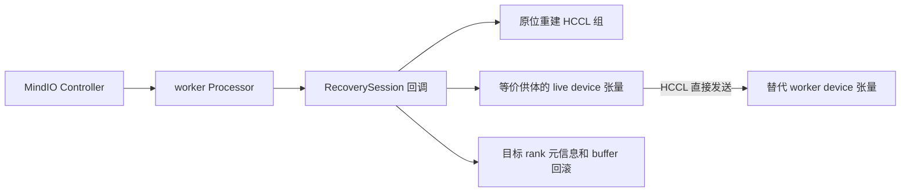

# HyperParallel 进程级快恢：device 副本拷贝

恢复时直接发送存活等价副本 device 上的模型参数、FP32 主参数、AdamW 矩或 Muon 动量，写入替代 worker 的 device。
正常训练不生成、传输或保留这些张量的 CPU 快照；不提供磁盘 checkpoint 恢复兜底。
本版本替换此前 CPU 完整快照实现，旧版验收结果不能作为本版本的通过结论。

## 用户配置

rank 0 托管 Controller：

```yaml
worker_recovery:
  enable_worker_reboot: true
  controller_ip: "192.168.1.10"
  controller_port: 8000
```

TaskD 托管时省略 IP/port，仅配置 `enable_worker_reboot: true`。框架依次从部署环境中的
`PROCESSOR_ADDR`、`CONTROLLER_ADDR`、`TTP_ADDR`、`MASTER_ADDR` 查找地址，端口读取 `TTP_PORT`。
部署信息应在导入 TaskD/Go 动态库前注入。框架不会自行创建 TaskD 进程。
不增加用户副本列表、run ID、worker 地址或状态端口配置。

`RANK`、`WORLD_SIZE`、`LOCAL_RANK` 由 torchrun/TaskD 启动器提供，替代 worker 沿用原逻辑身份。
通信组初始化前从环境读取全局 rank/world size；初始化后使用通信组 API。
本地设备编号统一调用 `dist.get_node_local_rank()`，该 API 不依赖通信组初始化；缺少 `LOCAL_RANK` 时直接报错。

## 等价副本与优化器状态

`ReplicaTopology` 从参数 DeviceMesh/placements 的 Replicate 维度推导候选副本，
并检查全模型参数及优化器布局一致性，再按 Muon 实际 `owned_params` 筛选优化器状态归属也相同的 rank。
TP/EP 分片坐标必须相同；不会按 world size 任意配对。
仅有 TP/EP、没有冗余的分片会在 attach 阶段报错。普通本地参数不会被自动视为其他 rank 的副本。

保留 Muon 的 `hsdp_replica_count` 及其实际二次分组，不为快恢自动改写状态去重配置。
例如四个模型副本分为两个大小为 2 的优化器去重子组时，同一 owner 角色可跨子组形成状态副本。
仅有两个模型副本且状态在两者间完全去重时，没有完整状态副本，attach 会提前报错，不能开启快恢。
参数值为 1 时各模型副本保有自己的动量；是否存在完整副本仍由实际布局和状态归属共同确认。
模型、mesh 和优化器必须在 `session.groups` 中构造；Trainer 接入自动覆盖此阶段。

`is_recovery_enabled()` 表示当前执行上下文属于恢复会话，不是直接读取配置开关。
`is_recovery_reboot()` 保留替代 worker 身份，供数据管线构造或延迟首次打开索引时避免等待旧 rank。
模型分发、模型 materialize 和 Muon 初始化使用 `is_recovery_bootstrapping()`：
只有替代 worker 且 attach 尚未封闭组登记时，才跳过初始化通信；attach 完成后恢复正常通信语义。
不能简单清除替代身份，否则延迟打开缓存又可能进入原始 worker 的 barrier。
`run()` 必须在 Processor 已初始化、训练对象已 attach 时调用；会话关闭后不能直接再次运行训练。
`close()` 不在 SDK 训练/恢复循环运行期间销毁资源。离开循环后，按实际资源标记先释放 Processor、
再释放本进程持有的 Controller；只有销毁成功才清除标记。异常清理失败会记录日志并保留原始训练异常，
正常结束的清理失败则继续向外报错。Trainer 外层清理也遵循此规则。

## 模块与流程



- `state.py`：绑定 live 张量，描述布局和优化器非张量配置，分配接收槽；不导出权重快照。
- `topology.py`：从布局和 Muon 实际 owner 计划本地推导完整副本；原始 worker 交换描述校验一次，替代 worker 不读取 Store 拓扑缓存。
- `transport.py`：直接分块发送 device 张量。`DeviceMetadataBank` 仅保留训练元信息和可变 buffer。
- `groups.py`：记录并原位重建训练组、优化器组及元信息组；不保存 Store 就绪标记。
- `adapters.py`：清理中断迭代的梯度、失效 Work 和分片调度临时状态。
- `session.py`：提交、stop/clean/rebuild/repair/rollback 和训练体重入。

Trainer 接入保留 BaseTrainer、TextTrainer、VLMTrainer 各自原有的 `train()` 方法体，
由 `recovery_train_loop` 将原函数交给 `session.run()` 执行；修复后重新进入同一原函数，
快恢适配器不复制 epoch/step 循环。通用装饰器负责步首暂停、optimizer 提交保护及恢复初始化。
迭代器沿用原工厂（Base 的 HyperIter、Text/VLM 的普通 iterator），重入初始化完成后才应用提交时的 RNG。
原 step 的计数时机保持不变；提交快照使用本次 optimizer 的提交步号，避免 Text/VLM 后置自增造成快照少一步。
VLM 已接入同一套机制，其原生循环已有 CPU 重入回归；不代表多模态模型、数据及额外状态的 NPU 恢复均已验收。
原 train 正常执行 on_train_begin，存活和替代 worker 在恢复重入时均执行原始回调分发，不再整体拦截。
Checkpoint callback 的 _load_checkpoint 根据替代身份或待恢复 RNG 跳过初始读盘；配置打印及后续保存保留，
tqdm 在重入时先关闭旧进度条再重建。正常启动的初始 checkpoint 仍可加载。
原 on_train_begin 完成后通过 recovery_train_initialized 发布加载后的步数和初始元信息，
并重新绑定、验证模型与优化器布局；已修复的恢复重入不会再发布初始状态。
Session.run 统一只接收训练体，不在 body 前发布状态；底层自定义训练体也须在初始化完成、取数之前
显式调用 session.publish_initial_state(session.step)。原始进程仅首次调用生效，替代进程及恢复重入均直接返回。
run 不额外增加首次 world barrier；初始状态发布所需的副本通信仍由 mirror_metadata 执行。

**callback 初始化通信限制**：on_train_begin 中的初始化应能在本地执行。新增 callback 若调用 barrier、broadcast、
all-gather 等集体通信，须专门适配并验证通信组已可用、所有成员会在同一阶段按相同顺序参与；
替代 worker 单独执行而存活成员仍在恢复等待时，可能因通信不匹配而阻塞。
框架不会自动识别或跳过任意 callback 中的通信，不能因内置本地回调可运行就默认新增通信回调也受支持。
开始回调还须可重入，本地句柄等重复初始化资源应由 callback 自身关闭或复用。

memory_profiler.stop 由原 train 的正常/异常路径负责，快恢外层不重复调用。
abort_profilers 不再拦截，按原生异常路径正常清理；当前快恢仍禁止启用内存和性能分析。
Trainer 外层仅在 finally 中调用 session.close，兜底处理 attach 等进入 Session.run 前的失败，不重复清理 profiler。
on_train_end 和 destroy_distributed 保留在原 train 中正常执行，外层不重复调用。
不缓存已完成训练的返回值；SDK 若在销毁阶段异常后返回 RETRY，可能重入已完成训练体，当前只注释说明，不增加预埋处理。
MindIO 的退出控制使用 TCP，正常销毁由 tft_exception_handler 完成，Session 不额外增加退出 barrier 或预先销毁 Processor。

正常训练先同步 forward/backward 并确认更新边界，再调用 `tft_start_updating_os()`。
优化器、主参数回写、调度器完成并同步后，记录有效 device step，保存少量训练元信息，
先交换必须保留目标 rank 身份的训练元信息并完成副本域安装确认，成功后才调用 `tft_end_updating_os(k)` 并更新 session.step。参数和优化器矩不参与该交换。镜像失败抛出 MetadataMirrorError（直接继承 Exception），保留原异常链；SDK 通用异常分支上报 RS_UNKNOWN 后向外抛出，不提交本步、不进入 RuntimeError 恢复重试。异常上报可能等待退出协调。镜像成功是提交的必要条件，仍需存在目标步的完整有效供体才能恢复。
Trainer 的进度和调度器 provider 不进入每步发送的 device 字节缓冲，
只在本地按 step 保留两个版本；修复时从有效供体取得所选步数的快照，再随恢复头发送。

故障时依次停止设备、取得主线程停止应答、清理和重启设备、更新保留张量安全标记、重建通信。
MindIO 等待全体本地重建完成后下发 repair；修复方按其 rank_list 创建临时 HCCL 修复组，结束即释放。
全体 rollback 时 Muon 才刷新分片形状元数据，避免较慢 rank 清理旧建链 key 时提前发起 collective。
供体必须持有恰好对应所选 step 的有效 device 状态，
直接发送自身参数、主参数及优化器张量；接收端原位写入，再恢复目标 rank 的 RNG、游标、buffer 等。
不会从 CPU 权重快照把存活 worker 回滚到较早步数。

原始和替代 worker 的 indexed 路径均本地解析，目录及文件按确定顺序遍历；显式 blend 保留配置顺序。
不缓存 Store 路径清单，不执行目录发现 all-gather；要求原始数据路径、文件集合及必要索引保持稳定且可访问。
数据集缓存构建保留输入 rank 的归属，但不等待旧缓存构建 rank 的 barrier，可读已有缓存或本地重建。
对象存储 `.idx` 缓存命中时直接复用，缺失时由替代 worker 本地下载并原子发布，不执行全局 barrier。
这些操作只发生在数据管线构造或缓存首次打开时，没有新增每步训练通信或用户配置。
自定义构造中的 collective 仍须逐项适配；rendezvous store 和原数据来源必须可用。

## 训练元信息与限制

不同 rank 的 RNG、数据游标和 module extra state 不能直接套用供体状态。这些元信息序列化为 device 字节缓冲，
与目标 rank 的可变 buffer 一起保留在等价副本域内；可变 buffer 的提交副本也在 device 上。
正常镜像使用成员完全匹配的 HCCL 组 all_gather 长度、payload 和 buffer，最后在该组内确认安装完成。
attach 通过 get_created_group 查询 EXISTING_COMM_GROUPS，并校验实际成员及后端；全 world 副本复用默认组。
缺失时只补建本 rank 所属域的懒初始化元信息组，并登记原位重建，不在每步创建或销毁组。
替代构造要求 TORCH_DIST_INIT_BARRIER=0、默认组未绑定 device_id，以避免局部建组时等待存活 worker。
repair 的临时组和供体选择仍以 MindIO 指令为准；模型参数和优化器矩不参与每步镜像。
恢复时 CPU 可以解析 Python 元信息，但权重、主参数及优化器矩不经过 CPU。
普通游标、动态 batching 缓存及所有 model buffer 的保护本轮保持原样，
不根据名字、形状或 `persistent=False` 猜测它们是否可以省略。

底层 `TrainState(loader, replica_providers={"progress": ..., "scheduler_0": ...}, device=..., generators=...)`
只接收一份“名称到对象”的公共状态映射；其中每个对象都须实现无 collective 的 state_dict/load_state_dict，
且状态必须在完整副本间等价。Trainer 自动登记其进度和调度器，无新增训练配置。
loader、各类 RNG 和 generators 独立保存并按原 rank 恢复；不再保留通用 providers 与额外名称集合两套字段。
TrainState 快照分为 rank_state 与 replica_state：rank_state 内含 loader、rng、generators，按 owner 镜像；
replica_state 是 replica_providers 中各对象的 state_dict() 结果，整体在本地留版本。rollback 先恢复 loader、公共状态，
将提交时的 RNG/generators 独立暂存为待应用状态；开始回调、epoch 开始回调及 iterator 重建完成后，
各原生 train 在 on_epoch_begin 和 iterator 构造均完成后调用 recovery_epoch_initialized，
入口只判断 TrainState.rng_restore_pending；仅 rollback 留下待恢复 RNG 时，才调用
session.finish_restore → TrainState.finish_restore，成功后清除待应用状态，自动撤销一次性触发。
正常启动和后续普通 epoch 均不调用这两个收尾接口；失败则保留待恢复状态供重试，再次 rollback 会重新激活。
该入口每个 epoch 只做一次状态判断，不在每个 step 检查恢复；恢复 epoch 即使无剩余 step，也先完成 RNG 恢复，
保留下一 epoch 正常初始化的随机数消耗，不再在 on_epoch_end 前新增 pause 检查。
iterator 重建不再次保存或恢复 loader/provider；正常启动、新 epoch 及恢复后的后续 step 不重设 RNG。
自定义训练体在重建完成后、取下一批数据前，仅当 train_state.rng_restore_pending 成立时调用一次
session.finish_restore；模型 buffer/extra 路径不变。
不能将 rank 专属的自定义状态放进 replica_providers；模型 extra state、数据游标等应通过其所属的恢复路径接入。
历史 loss、loss_dict、grad_norm 不再由快恢额外采集、保存或传输；恢复后原 Trainer 计算并输出新训练步的指标，
不补写故障前的历史日志。RNG 和 loader 不允许通过该声明省略。
元信息长度不等时，短输入补齐到本组最大长度供 all_gather，最大长度输入直接复用原 device 缓冲；
接收按原长度截取，保留本 rank 原快照，避免用 all_gather 的本 rank 输出再替换一份持久副本。
本轮仅缩减发送内容和冗余中间拷贝，仍保留必要元信息的逐步通信、barrier 和 end 前后的原有次序；
end 到必要元信息完成复制之间的窗口仍存在，不能据此声称恢复协议已无窗口或训练已零开销。

没有有效供体、device step 不匹配或目标 rank 的精确元信息尚未复制完成时明确失败。
中断的优化器更新不能作为有效供体。所有副本同时失效时无法恢复。
要求固定 world size、HCCL、HP AdamW/Muon、eager 和可恢复游标；Trainer 要求 meta 构造、
`num_workers=0`、无后台预取；当前只检查外层 loader 的 worker 属性，包装 loader 的底层值仍须保证为 0。
CP/PP、offload/swap、FP16、UCE、AMSGrad、compile、激活重计算暂不支持，受保护 model buffer 必须位于 worker device。
rank 0 托管模式不覆盖 rank 0/Controller 同时丢失；worker 重拉起由现有 launcher/TaskD Agent 负责。

## 验证

```bash
pytest -q tests/ut/fault_tolerance
HP_RUN_MINDIO_RECOVERY_ST=1 HP_RECOVERY_TEST_OPTIMIZER=muon_adamw HP_RECOVERY_TEST_DTYPE=bf16 HP_RECOVERY_FAULT_PHASE=forward pytest -vs tests/torch/fault_tolerance/test_process_recovery.py
```

完整 TextTrainer、缩小 Qwen3 MoE 和真实离线 Indexed Dataset 的验收入口：

```bash
HP_RUN_TEXT_TRAINER_RECOVERY_ST=1 HP_RECOVERY_FAULT_PHASE=forward pytest -vs tests/torch/fault_tolerance/test_process_recovery.py::test_text_trainer_replacement
```

该用例根据 full offline demo 自动生成本地小模型/数据，调用正式 `train_text.main()`，
默认使用 TaskD 托管 Controller/Agent 和 2×4 HSDP、混合 Muon/AdamW FP32。
2026-11-09 在 zbx 上，rank 1 故障和 rank 4～7 同批故障两组均通过，恢复后与基线精确一致。
2026-11-10 改为重入原始 train 后，两组完整 TextTrainer 再次通过；CPU 组合回归为 157 项、106 个子用例，
包含 Base/Text/VLM 原始循环、跨 epoch、一次性生命周期和原生迭代器的恢复检查，数量不与历史阶段累加。
同日将替代开始初始化改为调用原始 Trainer 入口后，含 checkpoint callback 的 CPU 组合回归为 181 项、108 个子用例；
8 卡四进程故障再次通过，并检查四个替代进程分别在第 8 步执行一次完整开始入口，存活进程不重复执行。
删除历史 LOGS 恢复后，含原有 Logging/Tqdm/EnvironMeter 回调的 CPU 组合回归为 189 项、114 个子用例；
8 卡四进程故障再验通过，最终受保护状态与基线精确一致，仅保留 progress/scheduler provider，恢复后的正常日志继续输出。
将公共状态注册进一步精简为唯一 replica_providers 对象映射后，相关 CPU 组合回归仍为 189 项、114 个子用例；
8 卡四进程故障复验通过，导出状态采用 replica_providers 字段，已移除旧 providers 字段及独立名称集合。
快照进一步按 rank_state（loader/rng/generators）与 replica_providers 分组后，CPU 组合回归为 190 项、114 个子用例；
8 卡四进程故障复验通过，两类快照结构和全部最终受保护状态均完成检查，模型 buffer/extra 路径保持不变。
随后只将公共快照字段更名为 replica_state，对象映射仍叫 replica_providers；相关 CPU 回归为 72 项、38 个子用例，
本次命名调整未重跑 NPU，前述多卡记录保留各自版本的真实字段名称。
随后曾将 iterator 保护精简为临时捕获 RNG/generators，相关 CPU 回归为 72 项、38 个子用例，未重跑 NPU。
当前进一步改为暂存并最终应用提交快照 RNG，避免替代开始回调及重入 epoch 初始化再次推进随机序列；
CPU 组合回归为 193 项、114 个子用例；8 卡 TextTrainer 在开始/epoch 回调主动消耗各类随机数时，
rank 4～7 同批故障复验通过，全部最终受保护状态与基线精确一致。跨 epoch 随机回调由 CPU 回归覆盖，
本轮 NPU 仍为单 epoch。最新验证范围见实现文档第 7 节，历史记录仍对应各自代码版本。
随后将 RNG 收尾改为每 epoch 初始化完成后调用，恢复原生 on_train_end，并缓存完成训练的结果以避免退出重试重跑；
2026-11-10 该版本 CPU 组合回归 195 项、114 个子用例通过，8 卡 rank 4～7 同批故障复验通过，全部最终状态精确一致。
2026-11-11 将收尾触发收紧为仅待恢复时调用，并恢复原生 on_train_begin，加载条件在 checkpoint callback 内判断；
13 项本地协议专项检查通过，覆盖一次性触发、重入回调、初始加载进度发布及本地进度条重建。
本轮 zbx SSH 端口 22 连接超时，本地无 Torch/pytest，未执行完整仓库 UT 或 NPU 复验；本地检查不代替它们。
checkpoint 写出关闭，未验收完整 30B、Trainer BF16 或活跃 checkpoint 保存组合；详见实现文档第 7 节和附录 E。

前一个底层用例默认 8 卡 HSDP；优化器选项为 `adamw`、`muon`、`muon_adamw`。
测试 harness 默认显式使用 Muon `hsdp_replica_count=1`；生产配置由实际优化器参数决定，不由快恢改写。
测试中设置 `HP_RECOVERY_TEST_HSDP_REPLICAS=4` 与 `HP_RECOVERY_TEST_MUON_REPLICA_COUNT=2`，
可在 8 卡上验证 4×2 HSDP 保留 Muon 状态去重、跨去重子组选择完整副本的路径。
用例在第 8 步提交后、第 9 步 forward 终止 rank 1，恢复后运行到第 12 步，与基线精确比较状态及 PID。
验收结束后写出的 CPU 文件仅供比较，恢复代码不读取这些文件。
`HP_RECOVERY_TEST_CONTROLLER=taskd` / `HP_RECOVERY_TEST_AGENT=taskd` 启用真实 TaskD 适配接口。
默认注入 rank 1；设置 `HP_RECOVERY_TEST_FAULT_RANKS=4,5,6,7` 可同时终止后四个 worker，
通过一条 TaskD Agent 重启消息批量拉起，并检查全部故障 PID 替换、存活 PID 保持和最终状态精确一致。
该变量仅用于验证脚本，不是训练快恢配置。
HSDP 用例还会在故障恢复重入后执行一次真实张量分发，检查全部 rank 的广播/scatter 结果，
确保替代 worker 不再跳过正常训练通信；该检查仅存在于测试，不增加产品训练路径的通信。
2026-11-09，zbx 上 TaskD 模式的 HSDP + Muon FP32、HSDP + AdamW FP32 四进程用例均通过。
首轮发现的通信组清理与新 collective 竞争已增加恢复阶段 CPU Store 同步；两组修正后复验均恢复到第 12 步，
最终状态与基线精确一致，正常退出。详见实现文档附录 A.7。
同日后续设计复审完成替代身份/构造阶段分离及关闭会话检查，相关 CPU 组合回归 131 项、76 个子用例通过；
Muon 四进程故障与 AdamW 单进程故障重新通过，8 个 rank 均通过恢复后的张量分发检查。
源码摘要及结果见实现文档第 7 节的设计复审验证记录；历史测试数量不累加。
ClusterD 仍是协议测试对端，Manager→Agent 命令由测试驱动投递；不代表生产管理链路或物理断电验收。

具体调用见 [实现流程与接口](<../../../reports/HyperParallel 进程级快恢实现流程与接口.md>)。
