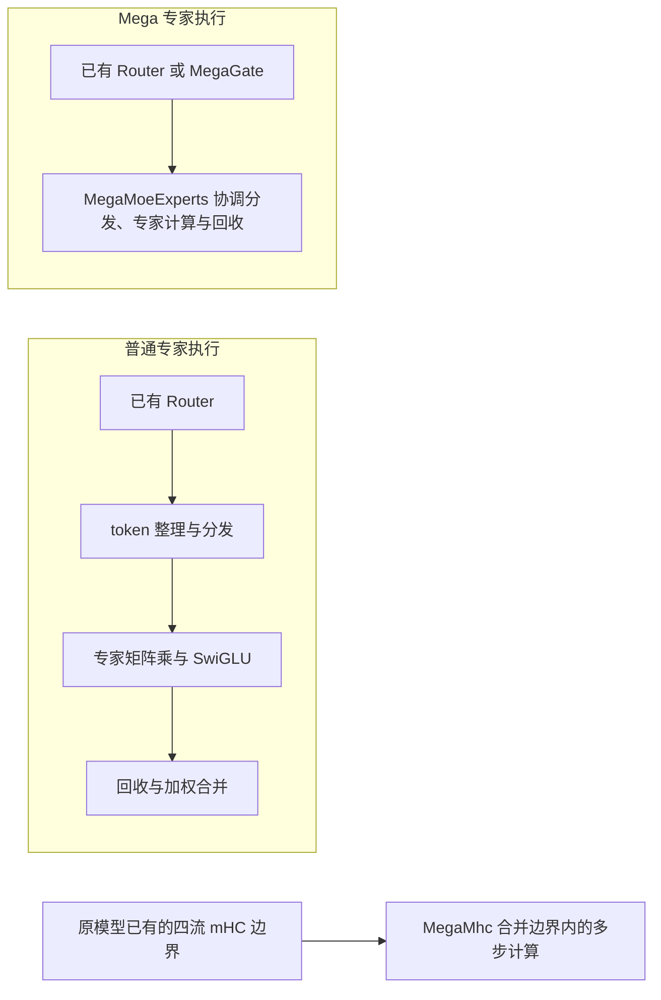

# 三个 MegaKernel 的模型接入指南

Multicore 为已有 Torch 模型提供专家执行、路由和四流 mHC 的独立加速组件。
它把部分细粒度操作交给统一的多核调度，并在 MoE 专家执行中协调通信与计算。
接入时保留原网络的结构、评分函数和训练参数；是否获益需要在相同模型与负载下测量。

## 技术概览与适用性



mHC 是独立的跨层连接结构，和 MoE 并无绑定关系。只有原网络已有兼容的四流 shifted mHC，
才使用 `MegaMhc` 替换其边界计算。三个接口可以分别接入，第一次使用不需要组合整网、固定 EP8 或了解通信策略。

| 接口 | 适用结构与替换范围 | 设备与精度 | 保留的模型逻辑 |
| --- | --- | --- | --- |
| `MegaMoeExperts` | TopK 路由后的 grouped SwiGLU 专家；覆盖分发、专家计算和回收 | Ascend NPU、BF16 输入及专家权重 | Router、共享专家、外层并行与优化器 |
| `MegaGate` | 线性投影、评分与 TopK；NPU `sqrtsoftplus` 使用原生 Route | 投影与评分按公开契约执行；`softmax`、`sigmoid`、非 NPU 或空输入使用 Torch | 原评分函数、修正偏置更新及辅助 loss |
| `MegaMhc` | 四流 shifted mHC 边界、映射预测及 RMSNorm | Ascend NPU、BF16 激活/RMSNorm 权重、FP32 映射预测器 | 原残差结构、显式跨层状态及 block 计算 |

`MegaGate.backend_for(input)` 可以查询实际 Route 选择及原因，不需要逐步打印。
`MegaMhc.execution_requirements(device)` 返回芯片对应的最小本地训练 token 数；
同时给出 hidden size 对齐、最大训练 hidden size、精度及固定 Sinkhorn 迭代次数。
当前训练要求 H 为 128 的倍数且不超过 5760，Sinkhorn 固定为 20 次；其他形状不会被静默填充或回退。

## 推荐阅读顺序

1. 从下方单组件命令判断环境与形状是否适用。
2. 按[已有模块与权重迁移](examples/README.md#已有模块与权重迁移)替换原模块。
3. 在[组合训练示例](examples/README.md#组合训练验证)中验证状态传递、梯度及优化器更新。
4. 用[训练接入与运行检查](docs/mega_moe_integration.md)核对参数归属、初始化和实际执行状态，
   在原训练循环中按需开启 `diagnostics.execution_monitor`，无需业务源码注入。
5. 有测量需求时再阅读本文的容量/通信调优，以及[内部架构](docs/architecture.md)、
   [构建与交付](docs/build.md)、[Profiling](docs/mega_kernel_profiling.md)和[私有 SHMEM 生命周期](docs/shmem.md)。

## 单组件最小示例

激活 CANN 与同一 checkout 构建的 native payload，并完成 editable 安装后，分别运行：

```bash
python -m hyper_parallel.core.multicore.examples.minimal_gate
python -m hyper_parallel.core.multicore.examples.minimal_moe
python -m hyper_parallel.core.multicore.examples.minimal_mhc
```

每个命令只使用对应组件，默认单张 NPU，不要求其余两个组件或组合网络环境，
并检查输出和梯度。Gate 还可以用 `--device cpu` 验证 Torch 路径；实际后端会写入结果。
输入参数与环境准备见[独立示例说明](examples/README.md#单组件最小示例)。

## 公共接口与模型参数迁移

公共 Python 名称为 `MegaGate`、`MegaMoeExperts`、`MegaMhc`。
`HyperMegaMhc` 作为原名称的兼容别名保留；ACLNN、CANN 算子及底层 ABI 名称维持原有前缀。
业务 API 从 `hyper_parallel.core.multicore` 显式导入，HyperParallel 根包不导出这些接口。
SHMEM 的初始化与资源回收由组件管理。

### MegaGate 与 MegaMoeExperts

分布式模型显式传入选定的 EP 组，组件从组中推导大小；不需要同时填写 `ep_size`。
未指定组仅用于独立单 rank，分布式进程不会默认选择 WORLD；显式 `ep_size` 保留为一致性检查。

```python
from hyper_parallel.core.multicore import MegaGate, MegaMoeExperts

gate = MegaGate.from_module(old_router)
experts = MegaMoeExperts.from_module(old_grouped_experts, top_k=gate.top_k, ep_group=ep_group)
route = gate(hidden_states)
routed_output = experts(hidden_states, topk_ids=route.ids, topk_weights=route.weights)
output = routed_output + shared_expert(hidden_states)
```

`hidden_states` 可以保留 `[B, S, H]`；专家输出保持相同形状。
`GateOutput` 包含 `logits`、`weights`、`ids`，也兼容原有三元组解包。
`tokens_per_expert` 默认由内部生成。只有已有 Router 提供精确 histogram 并希望复用时，才传入该高级选项。
实际 token 容量由组件自动维护，无需预估上限，也不需要动态/静态模式开关，见后面的输入契约。

`from_module` 的适用权重布局、参数持有及 checkpoint/优化器边界见
[迁移教程](examples/README.md#已有模块与权重迁移)。

### MegaMhc 与显式状态

```python
import torch
from hyper_parallel.core.multicore import MegaMhc, MhcState

model.mhc = MegaMhc.from_module(model.mhc)
model.to(device=device, dtype=torch.bfloat16)
state = MhcState.initialize(hidden_states)
result = model.mhc(state)
block_output = block(result.hidden_states)
state = result.next_state(block_output)
output = state.finish()
```

`MhcState` 持有 previous output、residual、pre/post/residual mix；每次调用显式传递，
可以独立保留多份状态。首层初始化和末层合并不再要求从 examples 导入辅助函数。
`MegaMhcOutput` 含具名的更新后 residual、映射和 `hidden_states`；原有五张量调用及解包仍可使用。
整网 BF16 转换会保护 mHC 的 `phi`、`alpha`、`bias` 及 Gate 的修正偏置，使其保留原始 FP32 值；
mHC 的 `norm_weight` 与普通模型权重使用 BF16。参数迁移应在构造优化器前完成。

### DSV4.1 的 TP/SP 与 CP 集成

DSV4.1 适配器在 push 和 pull 模式下均支持 CP，以及配合序列并行使用的 TP。
开启 TP 时要求 `sequence_parallel: true` 且 `ep_size > 1`；PP 必须保持为 1。
框架从展平后的 dense DP/CP/TP 域生成 EP mesh。
路由专家仅沿专家维度分片，保留完整的隐藏维度和中间维度；
稠密层及共享专家沿用各自的 TP 布局，不支持对路由专家矩阵做张量并行。

MoE 边界直接消费经过 CP 和 TP/SP 划分后的 token。
VLM 路由时，适配器将 CP 局部图像 mask 对齐到 TP 局部隐藏状态区间。
共享专家的 TP 通信仍由其嵌套边界负责。

例如，16 个 rank 使用 TP2、CP2、EP16 和 micro-batch size 1 时，可配置为：

```yaml
accelerator:
  tp_size: 2
  cp_size: 2
  ep_size: 16
  pp_size: 1
  sequence_parallel: true
fsdp_config:
  dp_shard_size: 8
  edp_shard_size: 1
training:
  global_batch_size: 4
  micro_batch_size: 1
```

该配置对应 dense DP4、dense FSDP8 和 expert FSDP1。
将这些字段合并到现有 DSV4.1 配置中，保留其模块替换和 compute 声明。
长度为 4096 的序列均匀划分后，每个 rank 向 MegaMoe 提交 1024 行。
默认动态模式使用经过 CP/SP 划分后的实际行数维护容量，不需要额外配置 token 上限。
仅减少实际行数、保持容量配置不变，并不会缩小预留容量。
TP 不会进一步切分路由专家矩阵；本地序列变短也可能降低 MegaMoe 的执行效率。

激活 NPU native payload 后，可执行以下分布式精度对齐测试矩阵：

```bash
pytest -q tests/torch/multicore/test_deepseek_v41_megamoe.py -k megamoe_parallel
```

该 8-rank 矩阵覆盖 TP2/CP1、TP1/CP2、TP2/CP2、push/pull、文本/VLM 路由、
动态本地行数，以及输出、输入梯度、路由梯度、专家梯度和共享专家梯度。
验证范围为 MoE 模块及实际接入边界，不代表整网训练或性能验收。

### 输入与权重

- EP 可以使用 WORLD 或子组，`E` 必须能被 EP 整除。
  token 数由首次和后续 forward 的实际输入自动推断，不需要动态/静态模式开关或 token 上限。
  允许各 rank 不等长及空输入；容量增长后保留历史高水位，不自动缩容。
  旧 `local_num_tokens`、`max_local_num_tokens` 关键字继续接收并忽略，二者同时传入也不报错；
  它们不决定模式、不预分配存储，也不再构成输入上限。既有调用默认迁移到动态执行。
  首次绑定仅保留小容量，必要时统一调整 SHMEM；pull 在容量准备和 claim 之后才写 source。
  动态计划按几何桶复用，最多 25 个桶，待反向图独立保留其原计划。桶不填充实际 token 激活。
  即使输入长度不变，路由仍可变化，push 按热点接收量无损扩容。
  初次绑定、进入新桶和扩容有额外成本；稳定容量内不重启 runtime。
  所有 rank 须按相同顺序执行，并采用一致的梯度参与策略；当前仅支持 eager。
  原生 INT32 限制和显式 SHMEM heap 字节预算继续生效，资源共享不共享参数或待反向激活。
- `hidden_states` 扁平后的 token 数为 `T`，`topk_ids`、`topk_weights` 均为 `[T, K]`，
  ID 使用全局专家编号，同一个 token 的 K 个 ID 必须互不重复。
- 可选的 `tokens_per_expert` 是同 device 上 `[E]` 的精确本 rank histogram。
  省略时内部统计；传入时由调用方保证与当前 ID 一致。contiguous INT32 可直接使用，
  INT64 或非连续输入会转换。
- 本地参数布局为 `gate_up_weight: [E/EP, H, 2I]`、`down_weight: [E/EP, I, H]`。
  内部在进入自定义 autograd Function 前对两份权重调用 `.contiguous()`：连续权重直接复用原存储，
  转置、切片等非连续权重会逐次复制为连续布局，并通过 autograd 将梯度回传到调用方的原始权重。
  执行器不缓存外部权重的连续副本；非连续布局每次调用都会产生复制开销。
  普通 gate/up/down 权重转换时，gate、up 分别转置后在末维拼接，down 转置最后两维即可。

Router 已有精确计数时，可直接传入：

```python
output = experts(
    hidden_states,
    topk_ids,
    topk_weights,
    tokens_per_expert=tokens_per_expert,
)
```

### 通信模式与容量

以下为高级调优选项，首次接入使用默认值即可，无需先选择 push/pull 或通信切块。

构造时通过 `dispatch_mode="push"`（默认）或 `dispatch_mode="pull"` 选择 dispatch；
两种模式的 combine 均使用 PUT。模式必须在所有 EP rank 上一致，运行中不可修改。
不同模式可以在同一进程中串行使用，但不能共享同一 workspace。

push 默认从较小的接收容量开始，在路由溢出时在线扩容；配置只有两个 push 专用因子：

| 参数 | push 默认值 | 作用 |
| --- | --- | --- |
| `initial_capacity_factor` | `1.25` | 初始接收容量相对于本地 `T * K` 路由行数的倍数 |
| `capacity_growth_factor` | `1.25` | 超限时相对于当前接收容量的增长倍数；`1.0` 表示仅满足当次需求 |

两个因子都要求为有限数且不小于1。省略或传入 `None` 表示采用 push 默认值。
pull 不需要容量因子，显式传入任一数值都会报错。旧 `expert_capacity_factor` 和 `capacity_policy` 参数已移除。

```python
# Pass these keywords alongside the model's fixed shape and EP topology.
push_options = dict(dispatch_mode="push", initial_capacity_factor=1.25, capacity_growth_factor=1.25)
pull_options = dict(dispatch_mode="pull")
```

初始容量为 `align128(ceil(initial_capacity_factor * T * K))`，不超过 `EP * T * K` 的保守无损上界。
需要一次性预留最坏情况时，将 `initial_capacity_factor` 设为 EP 大小。
当最大目的 rank 接收量 `R_max` 超过当前容量 `C` 时：

```text
C_new = min(EP * T * K, align128(max(R_max, ceil(capacity_growth_factor * C))))
```

同一 EP root 的所有 rank 完成在途工作，释放全部受管对称 buffer，finalize 旧 runtime，
再使用 fresh bootstrap ID 按目标heap大小初始化Runtime并恢复workspace，继续本次 forward；回落时不缩容。
该路径复用已有路由 counts，未溢出的 forward 不增加负载 collective。
增长倍数作用于接收容量，不是整个 heap；返回区仍固定为 `T * K` 行，总 heap 向上取整到2 MiB。

pull 的 SHMEM 仅包含 `T * K` 行发送区和返回区，接收区位于普通 HBM、按实际接收量分配。
两种模式的计算中间张量和待反向保存的 dispatch、up-projection、activation 都按本 rank 实际接收量分配；
零接收保留一行 ABI 占位。通信任务默认128行，可通过 `dispatch_split`、`combine_split` 分别配置。
路由不丢 token，热点的普通 HBM 开销仍存在。

共享层、独立的 push/pull workspace 和尚未绑定的层统一计入预算。
逻辑 workspace 对象保持稳定，因此扩容前的 forward 支持延迟或重复 backward、checkpoint 重算及串行交替 stream。
每个 root 要求串行执行；push 不支持图捕获，同一 root 下的其他层也不能保留使用旧地址的捕获图。
外部持有的专家参数不属于 heap，扩容不会移动它们。

若显式设置 `HYPER_PARALLEL_SHMEM_HEAP_SIZE`，物理 heap 直接按此固定预算初始化；push 只在预算内增加逻辑容量。
当增长余量放不下、而实际需求能放下时，退到最小必要容量。预算不足、存在第二个SHMEM user、
Allocation清单不完整或活动租约
会在销毁前阻止扩容；开始释放后若Runtime restart失败，runtime不可继续使用，需退出并重启训练进程。
自动预算不写入环境变量；实际大小读取 `shmem.debug_state()["config"]["heap_size_bytes"]`。
扩容有一次性同步和初始化开销，可通过增加初始因子或增长因子减少重建次数。

### 资源共享与关闭

相同配置的串行层可在首次 forward 前共享 workspace，各层参数、梯度和待反向激活仍独立：

```python
MegaMoeExperts.share_execution_resources(layer.mlp.experts for layer in model.layers)
```

共享资源只允许串行提交；跨 stream 时调用方须建立输入 tensor 的依赖，不支持并发线程调用。
两条路径已验证 non-reentrant checkpoint 和 `retain_graph=True`。默认由运行时托管 workspace，无需显式
关闭。模块 GC 仅登记使用权释放，不执行 collective；下一个资源组
首次 forward 时，所有 SHMEM Root rank 一起核对资源表，只复用各 rank 都无成员且无待反向图的兼容
workspace，其余可回收的孤儿 workspace 当场释放。此协调不在已绑定模型的每步 forward 中执行。
GC 时机不一致或仍有反向图会延后回收；持续保持活模型/图引用仍会占用内存，heap 受显式预算或物理 HBM 容量约束。

自动清理适配在首次绑定时安装：拦截 Torch `ProcessGroup.shutdown`（旧版本使用
`distributed_c10d._shutdown_backend`），在 WORLD 或 SHMEM Root 被关闭前先回收资源。
因此标准 `dist.destroy_process_group()` 及其提前导入的函数别名无需额外适配；不支持的 Torch
版本在 native 资源创建前报错。直接调用底层 HCCL/C++ 销毁接口不在此 Python 适配范围内。
另注册先于 torch_npu 退出钩子的 `atexit` 清理；所有 rank 正常退出时自动尝试回收。
这些边界仍要求所有 rank 同序进入且没有在途调用/待反向图。异常、Ctrl+C、kill 或通信故障
不承诺安全或及时退出，不从 signal handler 中执行 collective；SIGKILL 无法执行退出钩子。

需要提前释放时，仍可调用原有 `MegaMoeExperts.close()`，示例中的 `model.close()` 保持逐层关闭；
共享 workspace 在最后一个成员关闭时才释放，不释放普通模型参数。所有 SHMEM Root rank 须在无在途
调用及待反向图时同序关闭。关闭失败会保留句柄供安全条件下重试，部分关闭的模块不能再次执行。
只有所有 rank 均成功后才移除资源记录；对称内存部分释放状态不一致或原生 shutdown 失败须重启。
自动清理失败会阻止显式通信域销毁继续执行；进程退出时仅记录失败并继续框架退出流程，不能保证释放成功。

SHMEM Python层以进程级引用计数统一管理Runtime生命周期。整个MegaMoe子系统通过进程内私有Heap Manager
持有一份`shmem.acquire()`引用；execution resource只提交workspace reservation，不分别增减Runtime引用。
单个resource关闭时释放其workspace，资源池完成全部集体清理后再调用一次`shmem.release()`。
因此不同配置的孤儿workspace替换不会触发Runtime反复关闭和初始化；更大模型首次绑定可在这份引用内根据
实际物理heap容量执行Runtime restart。其他Multicore组件直接使用SHMEM时各自持有独立引用；存在第二个user
时MegaMoe不能独占并重启Runtime。
重新开启生命周期时，所有 rank 完成关闭后使用新的 `HYPER_PARALLEL_SHMEM_BOOTSTRAP_ENDPOINT`，
`HYPER_PARALLEL_SHMEM_HEAP_SIZE` 等堆配置在下一生命周期首次获取引用时重新生效。

完整 MoE Transformer 接入及启动方式见 [MoE Transformer 示例](examples/README.md)。MegaKernel 内部阶段采集方式见
[MegaKernel Profiling 使用指南](docs/mega_kernel_profiling.md)。

---

## 性能建议

1. **dispatch ↔ compute 掩盖**：MoE 的 AllToAll dispatch 与 expert compute 在不同核上并发，是最核心的掩盖收益
2. **单边通信**：基于内存语义的单边通信（Symmetric Memory）避免传统集合通信的同步开销
3. **RATR 通信重排**：通过 Rank-Aware Tile Reordering 将 AllToAll 流量在时间轴上均匀分散，避免多源 Rank 同时涌向同一目标，降低尾延迟
4. **O0 vs O1**：O0 通过 host CPU 调度，O1 调度下沉到 AICore，性能更高但实现难度更大
