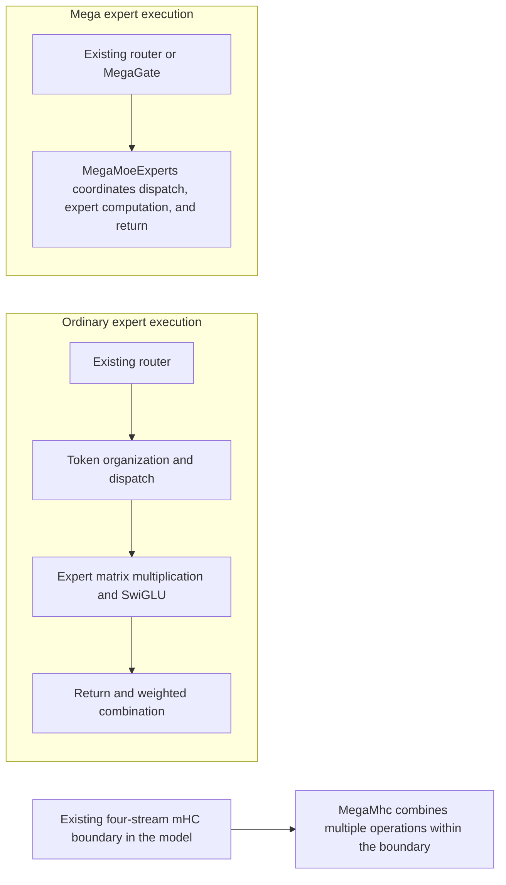

# Multicore Parallelism User Guide

**English** | [简体中文](README.zh.md)

Multicore is HyperParallel's Torch component for on-chip multicore MPMD execution.
It assigns work to AIC/AIV cores and uses core-level one-sided communication to schedule communication, matrix multiplication, and vector computation by tile, reducing kernel launches and overlapping communication with computation.
The current business interfaces provide MoE experts, a router, and four-stream shifted mHC; the three components can be used independently.

## Features and Scope

| Interface | Execution | Device and precision |
| --- | --- | --- |
| `MegaMoeExperts` | TopK dispatch, grouped SwiGLU expert computation, return, and weighted combination | Ascend NPU; BF16 activations and expert weights, FP32 routing weights |
| `MegaGate` | Linear projection, scoring, and TopK | Nonempty NPU `sqrtsoftplus` inputs use native Route; other supported cases use Torch |
| `MegaMhc` | Residual mixing, mapping prediction, and input RMSNorm for four-stream shifted mHC | Ascend NPU; BF16 activations/RMSNorm weights, FP32 mapping parameters |

MegaMoe does not include shared experts or the router's auxiliary loss; the model still executes these.
MegaMhc targets existing four-stream mHC structures. The model manages first-layer state initialization, cross-layer propagation, and final-layer merging.
See the [architecture design](docs/architecture.md) for multicore scheduling and communication-computation overlap.



## Installation and Runtime Preparation

Follow [Build and Delivery](docs/build.md) to install the current checkout, then build and activate a multicore native payload containing the required SoC.
Import the interfaces explicitly from `hyper_parallel.core.multicore`; the HyperParallel root package does not export these components.
Native libraries load on demand, and the component manages SHMEM.

Before using MegaMoe, each process must select its local NPU, initialize an HCCL process group, and configure an endpoint reachable by EP ranks:
`HYPER_PARALLEL_SHMEM_BOOTSTRAP_ENDPOINT=tcp://<root-rank-ip>:<port>`.
Pass WORLD or a subgroup explicitly as `ep_group`. EP size is derived from the group, and expert ownership follows rank order within the group.
MegaGate and MegaMhc support single-device use and do not require SHMEM initialization.

See the [MoE example](examples/moe/README.md#运行) and [mHC example](examples/mhc/README.md#运行) for runnable models and launch commands.
MoE defaults to single-node EP8 and supports other EP sizes; the dense mHC example uses one NPU.
Parameter migration and replacement code for existing models are collected in the [examples integration guide](examples/README.md).

## Public Interfaces

Embed the following snippets in an application process with its device, model inputs, and EP communication group already prepared.

### MegaGate

```python
import torch
from hyper_parallel.core.multicore import MegaGate

gate = MegaGate(
    hidden_size=512, num_experts=48, top_k=8,
    scoring_func="sqrtsoftplus", routed_scaling_factor=1.0,
).to(device="npu", dtype=torch.bfloat16)
logits, topk_weights, topk_ids = gate(hidden_states)
```

The input is `[B,S,H]`. The output is an ordinary tuple: `logits: [T,E]`, `topk_weights: [T,K]`, and `topk_ids: [T,K]`, where `T=B*S`.
Projection follows Torch autocast. Logits retain projection precision, routing weights are FP32, and indices are INT64.
`sqrtsoftplus`, `softmax`, and `sigmoid` are supported; preserve the original model's scoring definition.
`bias` / `bias_vl` are FP32 TopK correction biases. Passing an `[B,S]` `image_mask` requires `vision_enabled=True`;
the native vision path also requires a contiguous BOOL mask on the same NPU as the input. Native Route supports first-order backward only.

### MegaMoeExperts

```python
import torch
import torch.distributed as dist
from hyper_parallel.core.multicore import MegaMoeExperts

experts = MegaMoeExperts(
    hidden_size=512, intermediate_size=128, num_experts=48, top_k=8,
    ep_group=dist.group.WORLD,
).to(device="npu", dtype=torch.bfloat16)
output = experts(hidden_states, topk_ids=topk_ids, topk_weights=topk_weights)
```

`num_experts` is the global expert count and must be divisible by EP; `ep_size` can be omitted, but an explicit value must match the group size.
Input and output have the same shape. Distributed execution requires an explicit `ep_group`; WORLD is not selected automatically.

<!-- markdownlint-disable-next-line MD033 -->
<a id="输入与权重"></a>

#### Inputs and Weights

- Activations have last dimension `H`, and this rank has `T` tokens after flattening. Indices and weights both have shape `[T,K]` and use global expert IDs;
  the K IDs for a token must be distinct. Ranks may have different token counts or no tokens.
- Optional `tokens_per_expert` is an exact rank-local `[E]` histogram on the same device. It is computed internally when omitted;
  when supplied, the caller must ensure consistency with the current IDs. Contiguous INT32 is used directly; INT64 or noncontiguous inputs are converted.
- With the default `expert_weight_layout="EIO"`, local weights are `gate_up_weight: [E/EP,H,2I]` and `down_weight: [E/EP,I,H]`;
  with `"EOI"`, they are `[E/EP,2I,H]` and `[E/EP,H,I]`, and must use contiguous storage.
  The gate/up order, SwiGLU definition, and optional `swiglu_limit` must match the original model.
- `create_parameters=False` supports external parameter management. On each forward, use `expert_weights=(gate_up, down)`
  to provide the currently materialized contiguous local weights. See [examples](examples/README.md#checkpoint与参数归属) for parameter migration and checkpoints.

### MegaMhc

```python
import torch
from hyper_parallel.core.multicore import MegaMhc

mhc = MegaMhc(hidden_size=512).to(device="npu", dtype=torch.bfloat16)
residual, pre, post, mix, block_input = mhc(
    previous_output, residual, previous_pre, previous_post, previous_mix,
)
```

Inputs have shapes `[...,H]`, `[...,4,H]`, `[...,4]`, `[...,4]`, and `[...,4,4]`, respectively;
the output is an ordinary five-tensor tuple containing updated residual, pre, post, mix, and the current block input.
`phi`, `alpha`, and `bias` remain FP32 and are not rounded to BF16 by whole-model dtype conversion; `norm_weight` uses BF16.
Training requires H to be a multiple of 128 and no greater than 5760, with 20 Sinkhorn iterations; the local token count must be at least `max(40, number of AIV cores on the current device)`.
Inputs after CP/SP partitioning must also meet this lower bound. See the [mHC example](examples/mhc/model.py) for complete state wiring.

## Dynamic Tokens and Capacity

MegaMoe automatically maintains capacity from actual forward inputs, without a token limit or a dynamic/static mode switch.
Construction allocates no communication workspace. Initial binding starts with a minimum source-token capacity of 128 rows, grows on demand, and retains the high-water mark.
Scheduling plans are cached in geometric buckets, and pending backward graphs retain their original plans. Bucket sizes do not change actual token activation shapes.
Initial binding, entry into a new bucket, and growth have additional costs; stable capacity and cached plans can be reused.

`dispatch_mode="push"` is the default; `"pull"` is also available. Both use PUT for combine.
The mode must agree across EP ranks and cannot change on the same workspace. Pull writes source data only after capacity preparation and claim.

| Parameter | Push default | Purpose |
| --- | --- | --- |
| `initial_capacity_factor` | `1.25` | Initial receive capacity relative to reserved source routing rows |
| `capacity_growth_factor` | `1.25` | Receive-capacity growth multiplier; `1.0` satisfies only the current demand |

Both factors must be finite and at least 1; omission or `None` uses the defaults. Pull does not accept explicit capacity factors.
Hotspots may trigger push receive-area growth even with fixed token counts; routing drops no tokens.
Source capacity, scheduling rows, and actual owner receive counts are maintained separately: source/return areas use reserved capacity,
while computation intermediates and saved backward activations use actual received counts. An empty owner retains one ABI placeholder row.
Pull receive areas are in ordinary HBM, outside SHMEM source/return areas.

Growth may collectively restart the runtime for the same SHMEM root and then restore managed workspaces; external expert parameters do not move.
`HYPER_PARALLEL_SHMEM_HEAP_SIZE` sets a fixed byte budget. Insufficient budget or an unsafe restart causes an explicit failure.
See [SHMEM Runtime Restart](docs/shmem.md#4-runtime-restart) for the complete capacity-policy, fixed-budget, and failure-recovery contract.

## Resource Sharing and Lifecycle

Serial layers with the same configuration can share a workspace before their first forward:

```python
from hyper_parallel.core.multicore import MegaMoeExperts

MegaMoeExperts.share_execution_resources(layer.mlp.experts for layer in model.layers)
```

Sharing affects only execution resources; each layer retains independent parameters, gradients, and saved backward activations. Submissions within each root must be serial;
callers must establish input dependencies when crossing streams. Concurrent thread submissions and graph capture are unsupported.
Non-reentrant checkpointing, delayed backward, and `retain_graph=True` are supported. Complete all pending backward graphs before closing.
All SHMEM root ranks must call in the same order and use a consistent gradient-participation policy.

The runtime manages workspaces. GC only registers release; during a later initial binding, ranks coordinate reclamation of compatible orphaned resources.
Standard `dist.destroy_process_group()` performs managed cleanup before destroying the communication group.
For early release, call `experts.close()` in the same order. The last member releases a shared workspace; ordinary parameters are unaffected.
Failed close operations can be retried under safe conditions. Partial runtime release or restart failure requires exiting and restarting the process.
Timely collective cleanup is not guaranteed after abnormal exit or communication failure; see [SHMEM Lifecycle](docs/shmem.md) for limitations.

## DSV4.1 TP/SP and CP Integration

The DSV4.1 adapter supports CP and TP combined with sequence parallelism in both push and pull modes.
TP requires `sequence_parallel: true` and `ep_size > 1`; PP must remain 1.
The framework creates the EP mesh from the flattened dense DP/CP/TP domain.
Routed experts are sharded only along the expert dimension, retaining full hidden and intermediate dimensions.
Dense layers and shared experts retain their own TP layouts; tensor parallel sharding of routed expert matrices is unsupported.

The MoE boundary directly consumes tokens partitioned by CP and TP/SP.
For VLM routing, the adapter aligns the CP-local image mask with the TP-local hidden-state interval.
Shared expert TP communication remains the responsibility of its nested boundary.

For example, configure 16 ranks with TP2, CP2, EP16, and micro-batch size 1 as follows:

```yaml
accelerator:
  tp_size: 2
  cp_size: 2
  ep_size: 16
  pp_size: 1
  sequence_parallel: true
fsdp_config:
  dp_shard_size: 8
  edp_shard_size: 1
training:
  global_batch_size: 4
  micro_batch_size: 1
```

This corresponds to dense DP4, dense FSDP8, and expert FSDP1.
Merge these fields into the existing DSV4.1 configuration while retaining its module replacements and compute declarations.
After evenly partitioning a sequence of length 4096, each rank submits 1024 rows to MegaMoE.
The component maintains capacity from actual row counts after CP/SP partitioning; no additional token limit is required.
Source/receive capacity retains its historical high-water mark and does not automatically shrink for smaller inputs.
TP does not further shard routed expert matrices; shorter local sequences may also reduce MegaMoE execution efficiency.

After activating the NPU native payload, run this distributed numerical alignment matrix:

```bash
pytest -q tests/torch/multicore/test_deepseek_v41_megamoe.py -k megamoe_parallel
```

The eight-rank matrix covers TP2/CP1, TP1/CP2, TP2/CP2, push/pull, text/VLM routing,
dynamic local row counts, outputs, input gradients, routing gradients, expert gradients, and shared expert gradients.
Validation covers the MoE module and actual integration boundary, not full-model training or performance acceptance.

## Diagnostics and Performance Validation

Use [MegaKernel Profiling and Tensor Dump](docs/mega_kernel_profiling.md) to inspect internal AIC/AIV timelines
and intermediate tensors; the two tools' sessions are mutually exclusive.

Formal comparisons must fix the model, input, precision, EP ownership, and optimizer configuration; exclude compilation/growth warmup and external device processes, and disable diagnostic capture.
Component system tests check numerics and lifecycle; the [two model benchmarks](examples/README.md#独立模型与验证范围) check complete training steps.
Report each one's validation scope separately.

## Further Reading

- [Model Integration Guide and Examples](examples/README.md): existing module replacement, parameter layouts, checkpoints, and training order.
- [Build and Delivery](docs/build.md): SoC targets, native payloads, and editable installation.
- [Architecture Design](docs/architecture.md): compute graphs, task partitioning, multicore scheduling, and communication-computation overlap.
- [Profiling and Tensor Dump](docs/mega_kernel_profiling.md): internal timelines, intermediate tensors, and offline analysis.
- [Private SHMEM](docs/shmem.md): communication, capacity, and runtime lifecycle.
