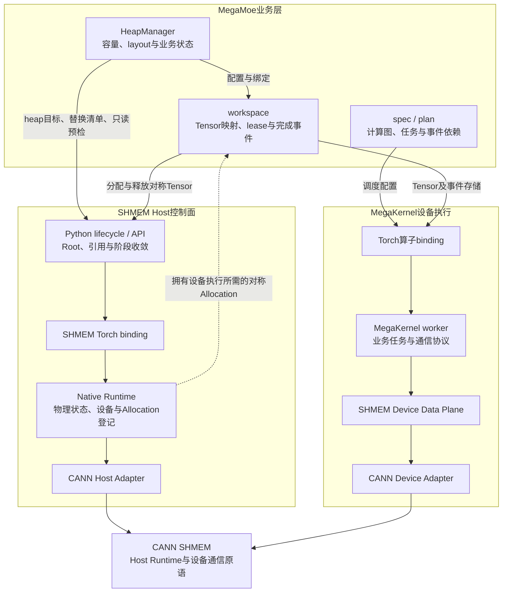
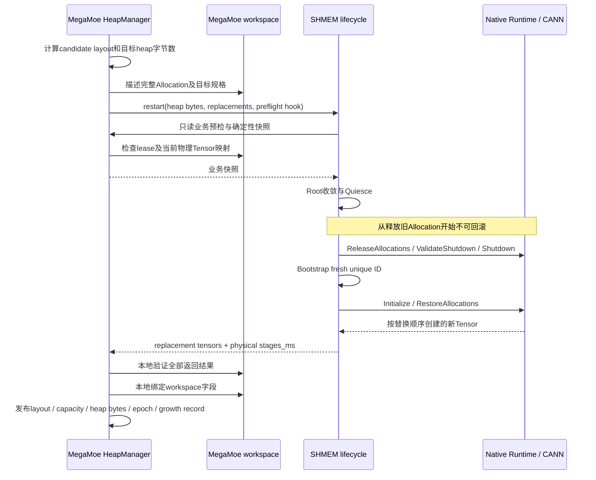
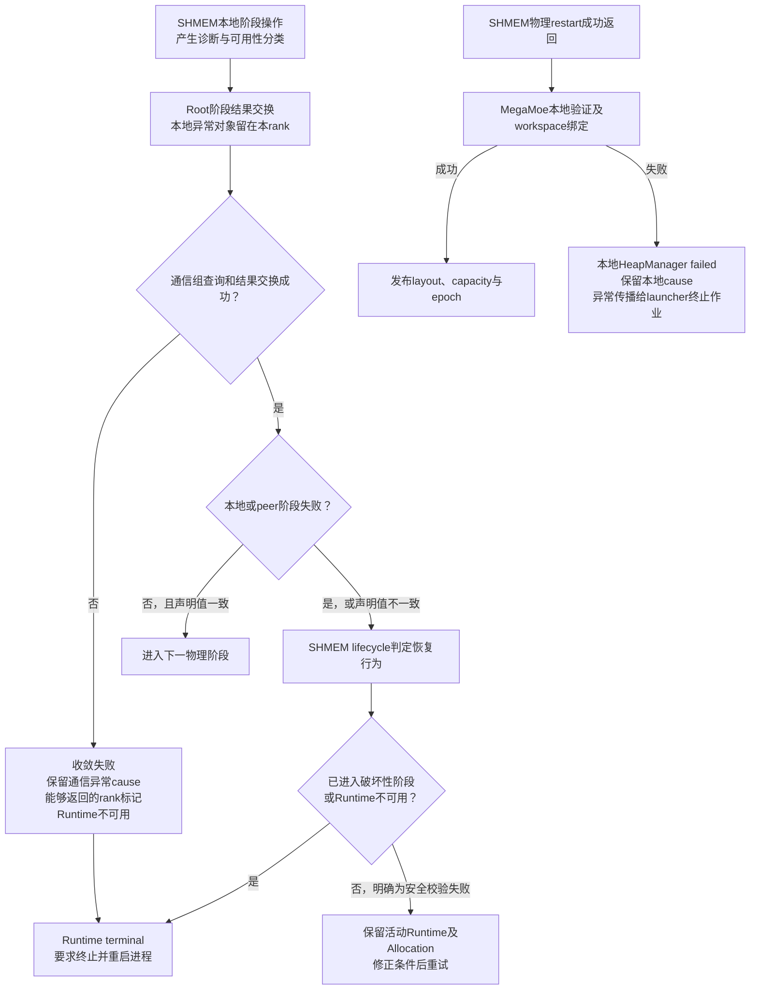

# Multicore 私有 SHMEM

SHMEM是Multicore内部的对称内存与单边通信组件。它管理进程级Runtime和对称Allocation，提供Put、Get、
Signal、Barrier与AllGather等通信机制。

## 1. 组件定位与架构

### 1.1 依赖方向

SHMEM为MegaKernel提供物理资源与通信机制。Host控制面和Device执行路径分别如下：



实线表示调用或参数传递，虚线表示物理资源依赖；图中的Host与Device路径共享同一活动Runtime及其对称内存。
Python控制面负责Root协调和引用生命周期；Native Runtime拥有物理Runtime状态和Allocation登记；CANN Adapter
隔离上游接口；Device Data Plane提供设备侧地址、数据搬移和同步机制。MegaKernel执行已提交的设备任务时，
不为每次Put/Get/Signal回到Python控制面。Host侧`shmem.put/get`是另一个显式stream提交入口。

代码层次如下：

```text
core/multicore/shmem/
├── _runtime.py       # Native与Torch模块的惰性访问
├── _lifecycle.py     # Runtime、Root、引用生命周期和Runtime restart
├── _api.py           # Allocation和通信接口
├── _debug.py         # Runtime只读诊断
└── ccsrc/
    ├── bindings/     # Torch binding
    ├── runtime/      # Native Runtime
    ├── cann/         # CANN Adapter
    ├── data_plane/   # 数据面实现
    ├── device/       # Device公共定义
    └── ops/          # AllGather等设备算子
```

### 1.2 组件职责

- 管理进程内唯一活动Runtime的初始化、引用计数、Root成员关系、关闭和terminal状态。
- 冻结并校验Runtime使用的NPU设备、Root坐标和Native配置。
- 管理对称Allocation的创建、释放、登记和合法性检查。
- 提供单边通信、信号、Barrier和AllGather，并定义其stream与Host完成语义。
- 执行调用方已经决定的Runtime restart事务，包括资源覆盖校验、quiesce、shutdown、bootstrap、
  initialize以及有序的Allocation释放和恢复。
- 提供Runtime、Native配置和活动Allocation的只读诊断。

### 1.3 接口边界与语义

调用方通过SHMEM边界提供：

- Root ProcessGroup、已选定的当前NPU设备和物理heap字节数；`acquire()`从当前设备读取并冻结设备归属。
- 对称Allocation的shape、dtype和alignment。
- 单边通信的本地Tensor、远端对称地址和Root内PE编号。
- collective调用顺序、stream依赖和资源释放时机。
- Runtime restart所需的目标heap字节数、完整Allocation替换清单及业务状态预检钩子。

SHMEM返回对称Tensor、通信入队结果、Runtime状态或restart结果；`debug_state()`提供Runtime、Native配置和
Allocation的只读事实。调用方拥有业务描述及其发布时机，SHMEM接口只表达物理资源与通信语义。

restart预检钩子只读地验证业务状态，返回可比较的确定性快照，不分配、释放资源或发布状态。SHMEM只比较快照
是否一致；阶段操作直接返回用于一致性比较的manifest，无声明值的阶段返回`None`。内部描述由生成源、写入
约束和所有者的锁维护一致性，参数、资源状态及通信完成在各自边界校验。失败处理见[失败与恢复合同](#44-失败与恢复合同)。

### 1.4 MegaMoe与SHMEM的状态所有权

MegaKernel是融合任务的执行方式；MegaMoe是使用该方式的业务模块。业务plan、workspace、物理Runtime和设备
通信协议各有独立的所有者。

| 所有者 | 负责的状态与行为 |
| --- | --- |
| [Multicore资源管理](../modules/module.py) | 模块成员、兼容资源共享、延迟绑定、协调关闭 |
| [MegaMoe spec与plan](../modules/mega_moe/plan.py) | 业务规格、正反向计算图、任务/事件配置和tiling |
| [MegaMoe HeapManager](../modules/mega_moe/heap_manager.py) | reservation、layout、容量预算、替换描述、业务epoch和growth record |
| [MegaMoe workspace](../modules/mega_moe/workspace.py) | Tensor字段映射、lease、完成事件、反向图使用关系和业务计数器布局 |
| [SHMEM lifecycle](../shmem/_lifecycle.py) | 引用、Root一致性、阶段收敛、物理restart编排和进程级不可用标记 |
| [Native Runtime](../shmem/ccsrc/runtime/runtime.cpp) | 设备归属、物理状态、Allocation登记、输入合法性及诊断事实 |
| [Device Data Plane](../shmem/ccsrc/data_plane/) | 对称地址访问、数据搬移、信号和完成机制 |

HeapManager的`ready/failed`描述业务资源是否可用；SHMEM的invalidated描述进程是否允许继续使用物理Runtime。
物理restart成功后，业务绑定仍可能失败，两者具有不同的状态转换条件。HeapManager在物理失败时查询
SHMEM健康事实并更新自身状态，不通过解析错误文案猜测状态。

容量到物理内存的转换只发生在调用方：MegaMoe根据路由需求和业务layout计算目标字节数，再交给SHMEM执行。
SHMEM知道Tensor的shape、dtype、alignment及字节范围，但不知道其中哪一维表示token或expert。

### 1.5 MegaKernel执行与通信协议

以MegaMoe为例，plan描述Dispatch、GMM、SwiGLU、Combine的任务及依赖，workspace提供对应的Tensor、
事件存储和有效容量；Torch binding将这些参数提交给设备worker。worker按业务任务决定访问的PE、槽位和时机，
调用SHMEM数据面完成传输及信号操作。

- 专家编号到Root PE的映射、Push/Pull选择、接收槽位、计数器布局和复用代次属于MegaMoe协议。
- 对称地址是否合法、访问范围、Signal操作和通信完成语义属于SHMEM机制。
- workspace lease和autograd保存对象决定何时仍有计算需要旧Tensor。SHMEM无法从Allocation登记推断这些关系。
- 调用方必须在释放或restart前停止旧Storage的使用，并建立所需的stream完成关系。对象仍存在不代表Storage仍有效。
- plan缓存只能复用与当前规格匹配的调度描述；重建后使用的物理Tensor由workspace重新绑定，不将旧地址视为稳定标识。

通信任务的具体调度见[MoE-FFN架构设计](architecture.md)，SHMEM完成语义见第3节。控制面检查位于Host调用边界，
设备通信任务不逐次经过Host检查；普通执行的正确性独立于诊断采集。

架构图展示主要调用关系。MegaMoe部分设备代码还直接访问CANN设备状态，这些调用与私有SDK版本存在耦合。
CANN Adapter负责上游机制适配，业务worker负责通信任务及协议。

### 1.6 跨层协作与Root选择

[_collective](../_collective.py)提供显式group上的结果交换、失败报告和rank诊断。
[_automatic](../_automatic.py)负责自动清理、框架teardown适配和注册Root选择，结果交换委托给共享模块。
其`exchange(value)`和`collective_call(callback, *, stage)`仅使用注册Root；需要显式group的调用使用`_collective`。

MegaMoe资源构造和workspace关闭使用所属HeapManager的`root_group`，不依赖自动清理的Root注册状态。
workspace的集体关闭及部分释放重试要求已绑定HeapManager；缺失owner时不回退到WORLD或注册Root。
通用ResourceManager的资源回收与自动清理仍使用`_automatic`的注册Root适配。

HeapManager的Configuration/LayoutAgreement使用自身Root交换业务配置，并拥有单rank配置`ValueError`契约，
SHMEM阶段使用acquire时的Root收敛物理结果。distributed未初始化时，共享交换返回本地结果；该结果不证明
Runtime健康，生命周期状态变化由SHMEM前置校验判定。

## 2. Runtime模型与生命周期

### 2.1 Root、world与PE坐标

本文中的**world**是当前获取的CANN SHMEM Root group，可能小于Torch WORLD。PE编号使用该Root group的
局部rank，不是Torch global rank。

- `acquire(None)`选择Torch WORLD；显式EP group可以是非连续子组。
- 不相交的PP或DP group使用各自group-local CANN unique ID独立bootstrap。
- 初始化、Allocation顺序、复用Barrier和最终释放只涉及Root成员，不要求无关WORLD成员参与。
- 一个进程只支持一个有序的活动membership。等价group handle可以共享Runtime；Root重叠但成员或顺序不同的
  group会被拒绝。

### 2.2 引用生命周期

SHMEM通过配对接口管理进程内唯一Runtime：

```python
from hyper_parallel.core.multicore import shmem

shmem.acquire()  # 首个引用初始化Runtime
try:
    ...
finally:
    shmem.release()  # 最后一个引用关闭Runtime
```

- 每次成功`acquire()`必须对应一次`release()`。
- 首个引用解析Root并初始化Native Runtime；后续等价Root只增加引用，不重复初始化。
- 非最后一个`release()`只减少引用。最后一个引用负责关闭Runtime。
- `root_members()`返回Root的Torch global ranks，不能把该结果当作CANN PE编号。

### 2.3 关闭与失败状态

最后一个引用释放前，调用方必须完成相关backward和设备操作、释放全部对称Allocation，并保持初始化时冻结的
NPU为当前设备。所有Root rank必须按一致顺序关闭，再销毁HCCL ProcessGroup。

- 关闭前置条件的纯校验失败会保留最后一个引用，调用方修正Allocation或设备选择后可以重试`release()`。
- Native初始化失败不产生引用。能否重新尝试还取决于设备、Root通信及上游初始化后的状态；
  Python允许再次调用不等于保证任意初始化失败后可安全重试。
- 干净关闭后，同一进程可以再次`acquire()`开启新生命周期；heap配置在新生命周期首次获取时重新生效。

关闭和restart的Runtime失效判定遵循[失败与恢复合同](#44-失败与恢复合同)。

## 3. 接口合同

所有操作都要求调用方持有尚未释放的Runtime引用，并且不得与最后一个`release()`并发。SHMEM只跟踪通过
`shmem.empty()`创建的对称Allocation；调用方负责确保使用这些Allocation的计算已经完成，再释放Allocation、
关闭Runtime或销毁ProcessGroup。

### 3.1 对称内存

- `shmem.empty(*size, dtype=None, alignment=None)`：从对称heap分配连续Tensor；`alignment`是可选的
  分配基址字节对齐。全world必须以一致顺序调用。
- `shmem.free(tensor)`：在相关stream静止后释放完整Allocation，view不能独立释放。成功后本地共享Storage
  缩为0，data pointer清空，原Tensor和全部view均失效，但shape元数据保留。

重复`free`、释放上一生命周期的Tensor或把失效Tensor传给SHMEM操作都会被拒绝。分配器可能复用已释放地址，
调用方仍应在`free`后丢弃原Tensor及全部view。既定模式是首次使用时分配、关闭时释放，不支持高频分配释放循环。

### 3.2 同步与集合操作

- `shmem.barrier(blocking=True)`：在当前NPU stream上入队world barrier。默认在返回前同步当前stream；
  `blocking=False`只保证入队，后续依赖操作必须提交到同一stream。全world按一致顺序调用阻塞Barrier，可以在
  `free()`前收敛各rank当前stream上的既有工作。
- `shmem.host_barrier()`：执行Host同步的HCCL world barrier，不经过SHMEM设备Barrier。返回时，各rank当前
  stream上早于本调用入队的工作已经完成；其他stream不在保证范围内。单PE场景为no-op。
- `shmem.all_gather(output, input)`：执行world AllGather，`output`必须为对称Tensor，槽位按world rank排列。
  零字节输入完成校验后为no-op。接口不隐含Barrier：gather前用`host_barrier()`确保各rank的input和对称output
  已经就绪；本rank stream完成后再次用`host_barrier()`确保全rank输出可读，然后才能覆写input或释放output。

Allocation、free、Barrier和AllGather等collective路径必须由全world以一致顺序调用。

### 3.3 单边通信

- `shmem.put(remote_dst, local_src, target_pe)`：把本地连续NPU Tensor按字节写入target PE的对称地址；
  源和目标字节数必须一致。
- `shmem.get(local_dst, remote_src, source_pe)`：从source PE的对称地址读取到本地连续NPU Tensor。
- `shmem.signal(remote_signal, value, target_pe, operation="set")`：对target PE的一个`int32`对称信号执行
  `set`或`add`。
- `shmem.wait_signal(signal, value, comparison="eq")`：等待本地`int32`对称信号满足`eq`、`ne`、`gt`、
  `ge`、`lt`或`le`条件。

Put、Get和Signal均为stream入队语义，返回不表示远端消费已经完成。调用方必须通过同一stream顺序、Signal协议或
显式同步建立完成关系。

### 3.4 设备归属

Runtime初始化时冻结当前NPU设备。`empty`、`barrier`、`signal`、`wait_signal`以及实际发射设备任务的非零
`put`、`get`和`all_gather`会拒绝其他设备的stream。零字节Put、Get和AllGather完成本地参数校验后不发射任务。

### 3.5 诊断

`shmem.debug_state()`只返回Runtime和Allocation事实：

- Runtime状态、Root、引用数和生效配置。
- heap的请求字节占用、剩余字节和峰值请求字节。
- 按Allocation ID排序的活动Allocation及其base和bytes。
- Tensor引用丢失但未经`free()`的泄漏Allocation。
- 最近一次失败的只读快照。

干净关闭后生命周期字段为`None`。占用量按请求字节投影；CANN heap按16字节对齐并切分余洞，真实设备侧占用
可能略高。

<a id="runtime-restart"></a>

## 4. Runtime restart

### 4.1 SHMEM restart机制

SHMEM lifecycle负责进程级Runtime引用、Root一致性和安全restart。内部调用方提交目标heap字节数、完整的
Allocation替换清单和只读业务状态预检钩子；lifecycle验证这些Allocation完整覆盖活动Runtime后，按以下顺序
执行集体事务：

```text
preflight
→ quiesce
→ release allocations
→ validate shutdown
→ shutdown
→ bootstrap
→ initialize
→ restore allocations
```

SDK bootstrap是全局状态，必须先finalize旧Runtime，再获取fresh unique ID。restart保留逻辑引用计数和
HCCL ProcessGroup，只在Root成员间collective，不要求无关WORLD成员参与。

restart包含7次stage结果收敛和1次bootstrap ID广播。每个阶段具有明确的失败归属和计时范围，阶段间的结果
收敛保证各rank进入下一本地操作前完成状态对齐。收敛次数描述本实现的执行成本，不属于公开接口合同。
`all_gather_object`与barrier具有不同的执行成本，同步次数不构成性能等价关系。

restart的前置条件为：

- 发起者是Runtime的唯一user，替换清单恰好覆盖全部活动Allocation。
- 各Root rank的业务状态和Allocation manifest只包含确定性的全局事实，不包含本地地址或timing。
- 没有活跃调用或graph capture阻止Allocation失效。
- 调用方已经停止可能访问旧物理Storage的计算。

各阶段的失败状态与恢复语义见[失败与恢复合同](#44-失败与恢复合同)。

### 4.2 调用方集成合同

调用方可以通过`acquire(root_group, heap_size_bytes=...)`指定初始物理heap。活动Runtime上的后续引用只能请求
不超过当前heap的大小。

需要改变物理heap时，内部调用方先确定目标字节数，并为每个活动Allocation声明当前完整Tensor和目标shape、dtype、
alignment。SHMEM统一收敛业务状态与物理manifest，释放旧Allocation并按声明顺序创建新Tensor。restart成功后，
旧物理Tensor Storage及其view失效；调用方在本地验证返回Tensor、绑定稳定业务对象并发布自身状态。SHMEM返回
物理结果，业务提交属于调用方的本地操作；验证或绑定失败遵循[失败与恢复合同](#44-失败与恢复合同)。

### 4.3 MegaMoe扩容的职责交接



图示为成功路径，各SHMEM阶段按[restart机制](#41-shmem-restart机制)收敛；返回后的MegaMoe验证和绑定均为本地操作。

`stages_ms`只描述SHMEM物理阶段；MegaMoe的`total_ms`覆盖替换描述构造、物理restart、本地验证、绑定及业务发布。
业务发布及其计时归属MegaMoe，不属于SHMEM物理阶段。

### 4.4 失败与恢复合同

SHMEM生命周期依据明确的状态和异常类别判定恢复行为。CANN/Native提供操作错误、符号码、可用的HBM快照和
原始detail；Native异常摘要裁剪仅适配诊断展示，不参与状态判断。

本地底层异常及traceback保留为直接cause；collective只交换可序列化的结果、失败报告与`runtime_unavailable`
标志，不传输异常对象。纯远端失败按失败rank给出摘要并抑制内部汇聚traceback。通信状态查询与结果交换属于
同一异常边界，失败时保留原始通信cause，不伪造未知的peer失败rank。

| 失败条件 | 状态与恢复行为 |
| --- | --- |
| 健康Runtime在破坏性操作前发生安全校验失败，且Root收敛成功 | 保留Runtime、引用及Allocation，修正条件后可重试 |
| 已有terminal状态、Native状态漂移或设备同步失败 | Runtime不可用，要求终止并重启进程 |
| Root通信状态变化、通信查询或结果交换失败 | 能够返回的rank标记Runtime不可用，不承诺可重试 |
| restart进入ReleaseAllocations后任一阶段失败，或final release进入Native Shutdown后失败 | Runtime保持terminal，拒绝后续操作和引用 |
| 物理restart成功后的MegaMoe本地验证失败 | 本地HeapManager进入failed，不绑定workspace、不发布layout、capacity、heap size、epoch或growth record |
| MegaMoe本地绑定失败 | 本地HeapManager进入failed，部分workspace字段可能已改变，业务状态不再继续发布 |

旧Allocation尚未释放只说明本次操作尚未破坏物理资源，不能单独证明Runtime健康。业务验证和绑定没有额外的
collective，不保证其他rank同步失败或尚未发布状态；两者失败均属于作业级不可恢复错误。失败rank保留直接cause，
不得继续训练、单rank释放或回滚新Allocation，异常必须传播给launcher以终止其余rank并重启作业。
vendor collective阻塞或进程退出依赖通信库及launcher超时。



## 5. 单边通信协议

### 5.1 Push与Pull

- **Push**：发送方通过`put`把数据写入接收方对称槽，再通过`signal`通知；接收方`wait_signal`后读取自己的
  本地对称槽。该模式适合接收方拥有消费buffer的场景。
- **Pull**：发送方把数据写入自己的对称槽并通知接收方；接收方`wait_signal`后通过`get`拉取。该模式适合
  发送方复用同一buffer多轮发布的场景。

单边通信省去对端配对的接收调用，但不改变物理链路带宽，也不自动提供跨PE完成关系。

### 5.2 协议约束

1. **Signal热点的64 B隔离**：多个来源PE或设备任务并发更新同一目标PE上的多个Signal位置时，这些位置不能
   共享64 B cacheline。热点消费者的每个Signal独占一个`alignment=64`的Allocation，或在同一Allocation中
   按64 B步长排布。不存在邻居并发写的单个Signal不需要额外的64 B基址对齐。
2. **跨rank初始化收敛**：任何远端可见写之前，所有rank必须完成相应槽位的本地初始化，并通过
   `host_barrier()`收敛。迟到的`zero_()`或`fill_()`会覆盖已经送达的远端写，表现为Signal永久等待或数据全零。
3. **初始化收敛使用Host Barrier**：`shmem.barrier()`的远端等待可能无超时自旋，互连竞争下会触发
   AICore 507015，不作为初始化收敛的替代机制。

## 6. 配置与日志

| 变量 | 默认值 | 语义 |
| --- | --- | --- |
| `HYPER_PARALLEL_SHMEM_HEAP_SIZE` | 1073741824（1 GiB） | `acquire()`未显式指定heap大小时使用的默认字节数 |
| `HYPER_PARALLEL_SHMEM_BOOTSTRAP_ENDPOINT` | `tcp://127.0.0.1:8662` | 普通WORLD或单进程初始化endpoint；子组及显式heap初始化使用独立unique ID |
| `SHMEM_UID_SOCK_IFNAME` | CANN自动选择 | 子组UID bootstrap使用的Host网卡，所有group成员必须可达 |
| `HYPER_PARALLEL_SHMEM_TIMEOUT_SEC` | 120 | Runtime超时秒数 |
| `HYPER_PARALLEL_SHMEM_DATA_ENGINE` | `mte` | 数据搬移引擎，当前只支持`mte` |
| `SHMEM_LOG_LEVEL` | `ERROR` | CANN及HP SHMEM日志级别：`DEBUG`、`INFO`、`WARN`、`ERROR`或`FATAL` |
| `SHMEM_LOG_TO_STDOUT` | `0` | `1`输出到stdout且不落盘；其他值使用文件sink |
| `SHMEM_LOG_PATH` | `${HOME}/shmem/log` | CANN及HP SHMEM日志的统一落盘目录 |

CANN和HP日志共用SHMEM原生sink，由它统一补充时间戳、级别、TID和PID，并负责级别过滤、stdout选择及文件
轮转。原始CANN正文保持`[SHM_SHMEM file:line]`格式；HP正文使用
`[HP_SHMEM file:line] [rank N] [Operation|Stage] message`。其中`rank N`是当前CANN Root WORLD内的局部
PE编号，不一定等于Torch global rank；归属未知时省略rank。初始化消息中的`NPU device N`是当前进程可见的
ACL逻辑设备编号，不表示机器上的物理卡号。HP初始化失败汇总行保留符号化Native错误名、数值码
和精简HBM快照，但不嵌入`cann_detail`；原始CANN日志、异常和`debug_state()`提供完整诊断。
`SHMEM_LOG_LEVEL=DEBUG`时，
`shmem.empty`额外记录直接调用点，可结合`allocation_base`定位泄漏来源。

## 7. 安全边界

Subgroup UID bootstrap使用未加密的Host socket。相互独立的group使用独立的rendezvous分配；共享固定的
`SHMEM_UID_SESSION_ID`会绕过该隔离机制。

CANN `aclshmem`具有以下安全属性：

- config-store通过`HYPER_PARALLEL_SHMEM_BOOTSTRAP_ENDPOINT`指定的TCP endpoint引导，当前使用
  `aclshmemx_set_conf_store_tls(false, nullptr, 0)`，未启用TLS。
- Root内任意PE可以凭对称地址，通过RMA访问其他PE的heap，不提供PE间访问隔离。
- MTE数据面传输不加密。

因此，本组件只适用于可信内网和同一集群内PE互信的场景，不应用于跨信任域部署。

## 8. 构建与制品

SHMEM没有独立对外构建开关。`--multicore on`会构建Torch Multicore及其必需的SHMEM；`--multicore off`
不交付两者的Native payload。内部`shmem/build.sh`依次构建AllGather kernel、Runtime和Torch binding。

私有库位于`core/multicore/shmem/lib`，使用专属SONAME，避免与框架自带的通用SHMEM库冲突。制品不携带
RPATH或RUNPATH，运行时搜索路径由Multicore `set_env.bash`统一配置。详见[构建与使用](build.md)。
