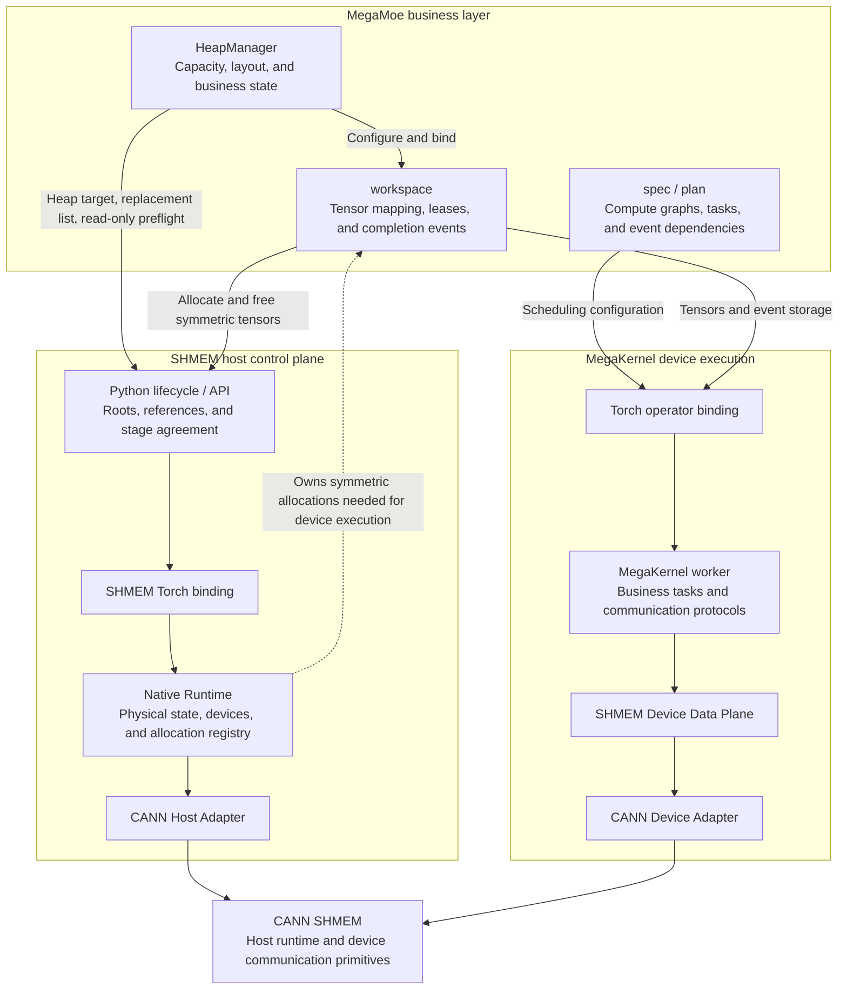
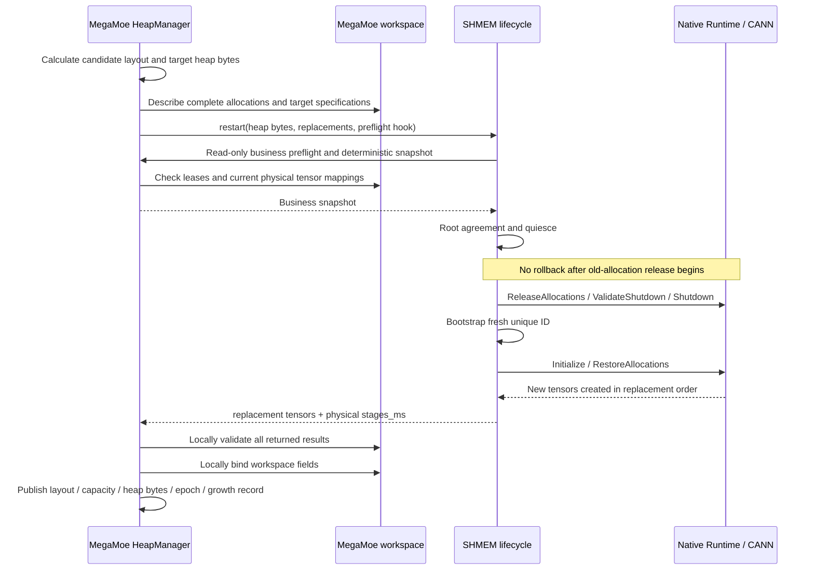
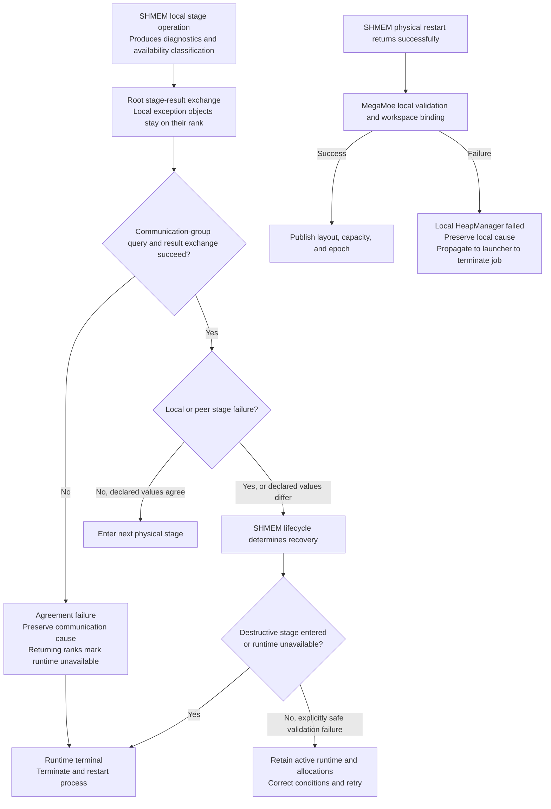

# Multicore Private SHMEM

**English** | [简体中文](shmem.zh.md)

SHMEM is Multicore's internal symmetric-memory and one-sided communication component. It manages process-level runtimes and symmetric allocations, providing Put, Get,
Signal, Barrier, AllGather, and other communication mechanisms.

## 1. Component Role and Architecture

### 1.1 Dependency Direction

SHMEM supplies physical resources and communication mechanisms to MegaKernels. The host control plane and device execution paths are shown below:



Solid arrows indicate calls or argument passing; dashed arrows indicate physical-resource dependencies. The host and device paths share the same active runtime and symmetric memory.
The Python control plane coordinates roots and reference lifecycles; the native runtime owns physical runtime state and the allocation registry; the CANN adapter
isolates upstream interfaces; and the device data plane provides device-side addressing, data movement, and synchronization. When executing submitted device tasks, a MegaKernel
does not return to the Python control plane for each Put/Get/Signal. Host-side `shmem.put/get` is a separate explicit stream-submission entry point.

The code hierarchy is:

```text
core/multicore/shmem/
├── _runtime.py       # Lazy access to native and Torch modules.
├── _lifecycle.py     # Runtime, root, and reference lifecycles; runtime restart.
├── _api.py           # Allocation and communication interfaces.
├── _debug.py         # Read-only runtime diagnostics.
└── ccsrc/
    ├── bindings/     # Torch binding
    ├── runtime/      # Native Runtime
    ├── cann/         # CANN Adapter
    ├── data_plane/   # Data-plane implementation.
    ├── device/       # Shared device definitions.
    └── ops/          # Device operators such as AllGather.
```

### 1.2 Component Responsibilities

- Manage initialization, reference counting, root membership, shutdown, and terminal state for the process's sole active runtime.
- Freeze and validate the runtime's NPU device, root coordinates, and native configuration.
- Manage creation, release, registration, and validity checks for symmetric allocations.
- Provide one-sided communication, signals, Barrier, and AllGather, defining their stream and host completion semantics.
- Execute runtime-restart transactions already planned by callers, including resource-coverage validation, quiesce, shutdown, bootstrap,
  initialization, and ordered allocation release and restoration.
- Provide read-only diagnostics for the runtime, native configuration, and active allocations.

### 1.3 Interface Boundaries and Semantics

Callers provide the following at the SHMEM boundary:

- A root ProcessGroup, the selected current NPU device, and physical heap bytes; `acquire()` reads the current device and freezes device ownership.
- Symmetric allocation shapes, dtypes, and alignments.
- Local tensors, remote symmetric addresses, and root-local PE IDs for one-sided communication.
- Collective call order, stream dependencies, and resource-release timing.
- Target heap bytes, a complete allocation-replacement list, and business-state preflight hooks for runtime restart.

SHMEM returns symmetric tensors, communication enqueue results, runtime state, or restart results; `debug_state()` exposes read-only facts about the runtime, native configuration,
and allocations. Callers own business descriptions and when to publish them; SHMEM interfaces express only physical-resource and communication semantics.

Restart preflight hooks validate business state read-only and return comparable deterministic snapshots; they do not allocate or free resources or publish state. SHMEM only compares snapshots
for agreement. Stage operations return manifests directly for consistency checks, or `None` when a stage declares no value. Generation sources, write
constraints, and owner locks maintain internal-description consistency; arguments, resource state, and communication completion are validated at their respective boundaries. See the [Failure and Recovery Contract](#44-failure-and-recovery-contract).

### 1.4 MegaMoe and SHMEM State Ownership

MegaKernel is a fused-task execution approach; MegaMoe is a business module using that approach. Business plans, workspaces, physical runtimes, and device
communication protocols have separate owners.

| Owner | State and behavior owned |
| --- | --- |
| [Multicore resource management](../modules/module.py) | Module membership, compatible resource sharing, deferred binding, coordinated close |
| [MegaMoe spec and plan](../modules/mega_moe/plan.py) | Business specifications, forward/backward compute graphs, task/event configuration, and tiling |
| [MegaMoe HeapManager](../modules/mega_moe/heap_manager.py) | Reservations, layouts, capacity budgets, replacement descriptions, business epochs, and growth records |
| [MegaMoe workspace](../modules/mega_moe/workspace.py) | Tensor-field mappings, leases, completion events, backward-graph usage relationships, and business-counter layouts |
| [SHMEM lifecycle](../shmem/_lifecycle.py) | References, root consistency, stage agreement, physical restart orchestration, and process-level unavailability markers |
| [Native Runtime](../shmem/ccsrc/runtime/runtime.cpp) | Device ownership, physical state, allocation registry, input validity, and diagnostic facts |
| [Device Data Plane](../shmem/ccsrc/data_plane) | Symmetric-address access, data movement, signals, and completion mechanisms |

HeapManager's `ready/failed` state describes business-resource availability; SHMEM's invalidated state determines whether the process may continue using the physical runtime.
Business binding may still fail after a successful physical restart, and the two have different transition conditions. On physical failure, HeapManager queries
SHMEM health facts and updates its own state without inferring status from error-message text.

Capacity is converted to physical-memory requirements only by the caller: MegaMoe calculates target bytes from routing demand and business layouts, then asks SHMEM to execute.
SHMEM knows tensor shapes, dtypes, alignments, and byte ranges, but not which dimension represents tokens or experts.

### 1.5 MegaKernel Execution and Communication Protocols

For MegaMoe, the plan describes Dispatch, GMM, SwiGLU, and Combine tasks and dependencies; the workspace supplies their tensors,
event storage, and valid capacities; and the Torch binding submits these arguments to device workers. Workers select the PE, slot, and timing according to business tasks,
then invoke the SHMEM data plane for transfers and signals.

- Expert-to-root-PE mappings, Push/Pull selection, receive slots, counter layouts, and reuse generations belong to the MegaMoe protocol.
- Symmetric-address validity, access ranges, signal operations, and communication-completion semantics belong to SHMEM mechanisms.
- Workspace leases and autograd-saved objects determine whether computation still needs old tensors. SHMEM cannot infer these relationships from its allocation registry.
- Before release or restart, callers must stop using old storage and establish the necessary stream-completion relationships. An object remaining alive does not imply its storage is valid.
- Plan caches may reuse only scheduling descriptions matching the current specification; workspaces rebind physical tensors after rebuilding, and old addresses are not stable identities.

See [MoE-FFN Architecture Design](architecture.md) for communication-task scheduling and Section 3 for SHMEM completion semantics. Control-plane checks occur at host call boundaries;
device communication tasks do not pass through host checks individually, and ordinary execution correctness does not depend on diagnostic capture.

The architecture diagram shows the main call relationships. Some MegaMoe device code also accesses CANN device state directly, coupling those calls to the private SDK version.
The CANN adapter adapts upstream mechanisms; business workers own communication tasks and protocols.

### 1.6 Cross-Layer Coordination and Root Selection

[_collective](../_collective.py) provides result exchange, failure reporting, and rank diagnostics on explicit groups.
[_automatic](../_automatic.py) handles automatic cleanup, framework teardown adaptation, and registered-root selection, delegating result exchange to the shared module.
Its `exchange(value)` and `collective_call(callback, *, stage)` use only the registered root; calls requiring an explicit group use `_collective`.

MegaMoe resource construction and workspace close use the owning HeapManager's `root_group`, independently of automatic cleanup's root registration.
Collective workspace close and partial-release retries require a bound HeapManager; a missing owner does not fall back to WORLD or the registered root.
Generic ResourceManager reclamation and automatic cleanup still use `_automatic`'s registered-root adapter.

HeapManager's Configuration/LayoutAgreement exchanges business configuration on its own root and owns the single-rank configuration `ValueError` contract;
SHMEM stages use the root from acquire to establish agreement on physical results. Without distributed initialization, shared exchange returns local results; that does not prove
runtime health, and SHMEM precondition checks determine lifecycle transitions.

## 2. Runtime Model and Lifecycle

### 2.1 Root, World, and PE Coordinates

In this document, **world** means the acquired CANN SHMEM root group, which may be smaller than Torch WORLD. PE IDs use
local ranks within that root group, not Torch global ranks.

- `acquire(None)` selects Torch WORLD; an explicit EP group may be a noncontiguous subgroup.
- Disjoint PP or DP groups bootstrap independently using group-local CANN unique IDs.
- Initialization, allocation order, reuse barriers, and final release involve only root members, without requiring unrelated WORLD members.
- A process supports only one active ordered membership. Equivalent group handles may share the runtime; overlapping roots with different members or ordering
  are rejected.

### 2.2 Reference Lifecycle

SHMEM manages the process's sole runtime through paired interfaces:

```python
from hyper_parallel.core.multicore import shmem

shmem.acquire()  # The first reference initializes the runtime.
try:
    ...
finally:
    shmem.release()  # The final reference shuts down the runtime.
```

- Every successful `acquire()` must have a matching `release()`.
- The first reference resolves the root and initializes the native runtime; subsequent equivalent roots only increment the reference count without reinitializing.
- A nonfinal `release()` only decrements the reference count. The final reference shuts down the runtime.
- `root_members()` returns the root's Torch global ranks, which must not be treated as CANN PE IDs.

### 2.3 Shutdown and Failure States

Before releasing the final reference, callers must finish relevant backward and device operations, free all symmetric allocations, and keep the NPU frozen at initialization
as the current device. All root ranks must close in the same order before destroying the HCCL ProcessGroup.

- Pure shutdown-precondition validation failures retain the final reference; callers can correct allocations or device selection and retry `release()`.
- Failed native initialization creates no reference. Retry safety also depends on the device, root communication, and state after upstream initialization;
  Python permitting another call does not guarantee safe retries after every initialization failure.
- After clean shutdown, the same process can call `acquire()` for a new lifecycle; heap configuration takes effect again on that lifecycle's first acquisition.

Runtime invalidation during shutdown and restart follows the [Failure and Recovery Contract](#44-failure-and-recovery-contract).

## 3. Interface Contracts

All operations require an unreleased runtime reference and must not run concurrently with the final `release()`. SHMEM tracks only symmetric allocations created through
`shmem.empty()`. Callers must ensure computation using those allocations has completed before freeing allocations,
shutting down the runtime, or destroying the ProcessGroup.

### 3.1 Symmetric Memory

- `shmem.empty(*size, dtype=None, alignment=None)`: allocate a contiguous tensor from the symmetric heap; optional `alignment` specifies
  the allocation base's byte alignment. All world members must call in the same order.
- `shmem.free(tensor)`: free a complete allocation after relevant streams are quiescent; views cannot be freed independently. On success, local shared storage
  shrinks to 0 and its data pointer is cleared. The original tensor and all views become invalid, while shape metadata remains.

Repeated `free`, freeing a tensor from a previous lifecycle, or passing invalid tensors to SHMEM operations is rejected. Allocators may reuse freed addresses,
so callers should discard the original tensor and all views after `free`. The intended pattern allocates on first use and frees at close; high-frequency allocation/free loops are unsupported.

### 3.2 Synchronization and Collectives

- `shmem.barrier(blocking=True)`: enqueue a world barrier on the current NPU stream. By default, synchronize the current stream before returning;
  `blocking=False` guarantees only enqueueing, and dependent operations must be submitted to the same stream. Blocking barriers called in the same order by all world members can
  complete each rank's existing current-stream work before `free()`.
- `shmem.host_barrier()`: execute a host-synchronous HCCL world barrier without using the SHMEM device barrier. On return, work enqueued before this call on each rank's current
  stream has completed; other streams are outside the guarantee. This is a no-op for a single PE.
- `shmem.all_gather(output, input)`: perform world AllGather; `output` must be symmetric, with slots ordered by world rank.
  Zero-byte input is a no-op after validation. The interface implies no barrier: use `host_barrier()` before gather to ensure each rank's input and symmetric output
  are ready; after the local stream completes, use `host_barrier()` again to ensure every rank's output is readable before overwriting input or freeing output.

Collective paths, including allocation, free, Barrier, and AllGather, must be called by all world members in the same order.

### 3.3 One-Sided Communication

- `shmem.put(remote_dst, local_src, target_pe)`: write bytes from a local contiguous NPU tensor to the target PE's symmetric address;
  source and destination byte counts must match.
- `shmem.get(local_dst, remote_src, source_pe)`: read from the source PE's symmetric address into a local contiguous NPU tensor.
- `shmem.signal(remote_signal, value, target_pe, operation="set")`: perform
  `set` or `add` on one `int32` symmetric signal on the target PE.
- `shmem.wait_signal(signal, value, comparison="eq")`: wait until a local `int32` symmetric signal satisfies `eq`, `ne`, `gt`,
  `ge`, `lt`, or `le`.

Put, Get, and Signal all enqueue on a stream; return does not mean remote consumption has completed. Callers must establish completion through same-stream ordering, a signal protocol, or
explicit synchronization.

### 3.4 Device Ownership

Runtime initialization freezes the current NPU device. `empty`, `barrier`, `signal`, `wait_signal`, and nonzero
`put`, `get`, and `all_gather` calls that launch device tasks reject streams on other devices. Zero-byte Put, Get, and AllGather perform local argument validation without launching tasks.

### 3.5 Diagnostics

`shmem.debug_state()` returns only runtime and allocation facts:

- Runtime state, root, reference count, and effective configuration.
- Requested heap bytes in use, remaining bytes, and peak requested bytes.
- Active allocations sorted by allocation ID, with their bases and byte counts.
- Leaked allocations whose tensor references were lost without `free()`.
- A read-only snapshot of the most recent failure.

Lifecycle fields become `None` after clean shutdown. Occupancy is projected from requested bytes; CANN heaps align to 16 bytes and split residual holes, so actual device-side usage
may be slightly higher.

<!-- markdownlint-disable-next-line MD033 -->
<a id="runtime-restart"></a>

## 4. Runtime restart

### 4.1 SHMEM Restart Mechanism

The SHMEM lifecycle owns process-level runtime references, root consistency, and safe restart. Internal callers submit target heap bytes, a complete
allocation-replacement list, and read-only business-state preflight hooks. After checking that these allocations fully cover the active runtime, the lifecycle executes
this collective transaction in order:

```text
preflight
→ quiesce
→ release allocations
→ validate shutdown
→ shutdown
→ bootstrap
→ initialize
→ restore allocations
```

SDK bootstrap is global state: finalize the old runtime before obtaining a fresh unique ID. Restart retains logical reference counts and
the HCCL ProcessGroup, runs collectives only among root members, and requires no unrelated WORLD members.

Restart includes seven stage-result agreement operations and one bootstrap-ID broadcast. Each stage has explicit failure ownership and timing boundaries; inter-stage result
agreement aligns rank states before the next local operation. The agreement count describes this implementation's cost and is not part of the public interface contract.
`all_gather_object` and barriers have different execution costs; synchronization counts do not imply equivalent performance.

Restart preconditions are:

- The initiator is the runtime's sole user, and the replacement list exactly covers all active allocations.
- Business-state snapshots and allocation manifests on every root rank contain only deterministic global facts, excluding local addresses and timings.
- No active calls or graph captures prevent allocation invalidation.
- The caller has stopped computation that could access old physical storage.

See the [Failure and Recovery Contract](#44-failure-and-recovery-contract) for stage failure states and recovery semantics.

### 4.2 Caller Integration Contract

Callers can specify the initial physical heap using `acquire(root_group, heap_size_bytes=...)`. Subsequent references to an active runtime may request only
sizes no greater than the current heap.

To change the physical heap, internal callers first determine target bytes and declare the current complete tensor and target shape, dtype,
alignment for every active allocation. SHMEM establishes agreement on business state and physical manifests, frees old allocations, and creates new tensors in declared order. After a successful restart,
old physical tensor storage and its views are invalid. The caller locally validates returned tensors, binds stable business objects, and publishes its own state. SHMEM returns
physical results; business commit is a caller-local operation. Validation or binding failure follows the [Failure and Recovery Contract](#44-failure-and-recovery-contract).

### 4.3 Responsibility Handoff During MegaMoe Growth



The diagram shows the successful path. Each SHMEM stage establishes agreement as described in the [restart mechanism](#41-shmem-restart-mechanism); MegaMoe validation and binding after return are local operations.

`stages_ms` describes only SHMEM physical stages; MegaMoe's `total_ms` covers replacement-description construction, physical restart, local validation, binding, and business publication.
Business publication and its timing belong to MegaMoe, outside SHMEM physical stages.

### 4.4 Failure and Recovery Contract

The SHMEM lifecycle determines recovery from explicit states and exception categories. CANN/native code supplies operation errors, symbolic codes, available HBM snapshots, and
raw detail; native exception-summary truncation serves diagnostic display only and does not affect state decisions.

Local underlying exceptions and tracebacks remain direct causes. Collectives exchange only serializable results, failure reports, and the `runtime_unavailable`
flag, never exception objects. Purely remote failures produce summaries identifying failed ranks and suppress internal aggregation tracebacks. Communication-status queries and result exchange share
a single exception boundary: failures preserve the original communication cause without inventing unknown failed-peer ranks.

| Failure condition | State and recovery behavior |
| --- | --- |
| Safe validation failure on a healthy runtime before destructive operations, with successful root agreement | Retain runtime, references, and allocations; retry after correcting conditions |
| Existing terminal state, native-state drift, or device synchronization failure | Runtime unavailable; terminate and restart the process |
| Root communication-state change, communication-query failure, or result-exchange failure | Ranks able to return mark the runtime unavailable; retry is not guaranteed |
| Any failure after restart enters ReleaseAllocations, or final release fails after entering native Shutdown | Runtime remains terminal and rejects subsequent operations and references |
| MegaMoe local validation fails after successful physical restart | Local HeapManager becomes failed; do not bind workspaces or publish layout, capacity, heap size, epoch, or growth record |
| MegaMoe local binding fails | Local HeapManager becomes failed; some workspace fields may have changed, and business-state publication stops |

Old allocations remaining unreleased proves only that this operation has not yet destroyed physical resources; it alone cannot establish runtime health. Business validation and binding add no
collectives and do not guarantee other ranks fail synchronously or have not already published state; either failure is unrecoverable at job level. Failed ranks retain direct causes;
do not continue training, release on a single rank, or roll back new allocations. Propagate the exception to the launcher to terminate other ranks and restart the job.
Blocked vendor collectives and process exits depend on communication-library and launcher timeouts.



## 5. One-Sided Communication Protocols

### 5.1 Push and Pull

- **Push**: the sender uses `put` to write into the receiver's symmetric slot, then notifies it with `signal`; after `wait_signal`, the receiver reads its own
  local symmetric slot. This suits cases where the receiver owns the consumption buffer.
- **Pull**: the sender writes into its own symmetric slot and notifies the receiver; after `wait_signal`, the receiver fetches data with `get`. This suits
  senders reusing the same buffer for multiple publication rounds.

One-sided communication removes the peer's matching receive call, but neither changes physical-link bandwidth nor automatically establishes cross-PE completion relationships.

### 5.2 Protocol Constraints

1. **64 B isolation for signal hotspots**: when multiple source PEs or device tasks concurrently update multiple signal locations on one target PE, those locations must not
   share a 64 B cache line. Each hotspot-consumer signal needs its own `alignment=64` allocation or
   a 64 B stride within one allocation. A single signal without concurrent neighboring writes needs no extra 64 B base alignment.
2. **Cross-rank initialization agreement**: before any remotely visible write, all ranks must finish local initialization of the corresponding slots and use
   `host_barrier()` to establish completion. A late `zero_()` or `fill_()` can overwrite delivered remote writes, causing indefinitely waiting signals or all-zero data.
3. **Use a host barrier for initialization agreement**: remote waits in `shmem.barrier()` may spin without a timeout and trigger
   AI Core error 507015 under interconnect contention; it is not a substitute for initialization agreement.

## 6. Configuration and Logging

| Variable | Default | Semantics |
| --- | --- | --- |
| `HYPER_PARALLEL_SHMEM_HEAP_SIZE` | 1073741824 (1 GiB) | Default bytes when `acquire()` does not explicitly specify heap size |
| `HYPER_PARALLEL_SHMEM_BOOTSTRAP_ENDPOINT` | `tcp://127.0.0.1:8662` | Ordinary WORLD or single-process initialization endpoint; subgroup and explicit-heap initialization use independent unique IDs |
| `SHMEM_UID_SOCK_IFNAME` | Automatically selected by CANN | Host network interface for subgroup UID bootstrap; reachable by every group member |
| `HYPER_PARALLEL_SHMEM_TIMEOUT_SEC` | 120 | Runtime timeout in seconds |
| `HYPER_PARALLEL_SHMEM_DATA_ENGINE` | `mte` | Data movement engine; only `mte` is currently supported |
| `SHMEM_LOG_LEVEL` | `ERROR` | CANN and HP SHMEM log level: `DEBUG`, `INFO`, `WARN`, `ERROR`, or `FATAL` |
| `SHMEM_LOG_TO_STDOUT` | `0` | `1` writes to stdout without files; other values use the file sink |
| `SHMEM_LOG_PATH` | `${HOME}/shmem/log` | Shared output directory for CANN and HP SHMEM logs |

CANN and HP logs share SHMEM's native sink, which adds timestamps, levels, TIDs, and PIDs and handles level filtering, stdout selection, and file
rotation. Original CANN message bodies retain `[SHM_SHMEM file:line]`; HP bodies use
`[HP_SHMEM file:line] [rank N] [Operation|Stage] message`. Here `rank N` is the local
PE ID in the current CANN root WORLD, not necessarily the Torch global rank; rank is omitted when ownership is unknown. `NPU device N` in initialization messages is the
ACL logical device ID visible to the process, not the machine's physical card number. HP initialization-failure summaries retain symbolic native error names, numeric codes,
and compact HBM snapshots but do not embed `cann_detail`; original CANN logs, exceptions, and `debug_state()` provide full diagnostics.
With `SHMEM_LOG_LEVEL=DEBUG`,
`shmem.empty` also records the direct call site, which can be combined with `allocation_base` to locate leak sources.

## 7. Security Boundaries

Subgroup UID bootstrap uses unencrypted host sockets. Independent groups use separate rendezvous allocations; sharing a fixed
`SHMEM_UID_SESSION_ID` bypasses that isolation.

CANN `aclshmem` has the following security properties:

- The config store bootstraps through the TCP endpoint specified by `HYPER_PARALLEL_SHMEM_BOOTSTRAP_ENDPOINT`, currently using
  `aclshmemx_set_conf_store_tls(false, nullptr, 0)` with TLS disabled.
- Any PE within the root can access another PE's heap via RMA using symmetric addresses; there is no inter-PE access isolation.
- MTE data-plane transfers are unencrypted.

The component is therefore suitable only for trusted internal networks with mutually trusted PEs in one cluster, not deployments across trust domains.

## 8. Build and Artifacts

SHMEM has no separate public build switch. `--multicore on` builds Torch Multicore and its required SHMEM; `--multicore off`
delivers neither native payload. Internally, `shmem/build.sh` builds the AllGather kernel, runtime, and Torch binding in order.

Private libraries reside in `core/multicore/shmem/lib` and use dedicated SONAMEs to avoid conflicts with generic SHMEM libraries bundled with frameworks. Artifacts contain no
RPATH or RUNPATH; Multicore's `set_env.bash` centrally configures runtime search paths. See [Build and Usage](build.md).
