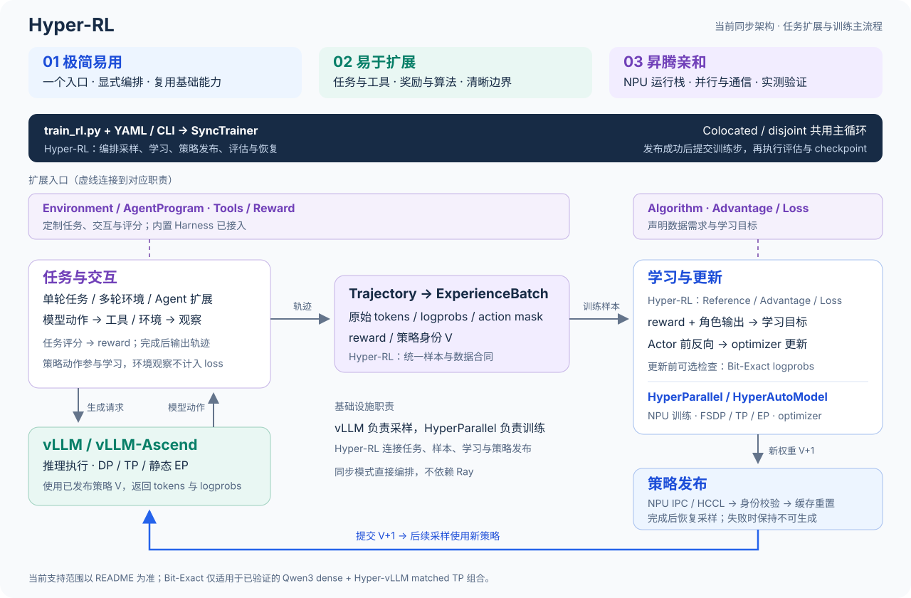

<!-- markdownlint-disable MD033 -->

<h1 align="center">
  <br>
  HyperParallel-RL · Experimental
</h1>

The current refactor retains only native-vLLM and streaming full_gather. Component replacements must be declared explicitly in this run's YAML under `train.plan_overrides`. Checkpoints use schema 2 and are incompatible with historical snapshots. The historical device results below do not establish device acceptance for this refactor.

<p align="center"><strong>A lightweight, extensible reinforcement learning framework.</strong></p>

<p align="center">Built on HyperParallel and vLLM, with explicit training orchestration and modular interfaces.</p>

<p align="center"><strong>Simple to use · Easy to extend · Ascend-friendly</strong></p>

<p align="center"><strong>English</strong> | <a href="README.zh.md">简体中文</a></p>

<p align="center"><a href="#why-hyper-rl">Why HyperParallel-RL</a> · <a href="#architecture">Architecture</a> · <a href="#installation-and-environment">Installation</a> · <a href="#quick-start">Quick Start</a> · <a href="#extensions-and-customization">Customization</a> · <a href="#supported-capabilities">Capabilities</a> · <a href="#documentation">Documentation</a> · <a href="#citation">Citation</a>
</p>
<!-- markdownlint-enable MD033 -->

---

HyperParallel-RL is a reinforcement learning framework for LLMs, VLMs, world models, embodied intelligence, and agentic AI. Its design principles are **simple to use, easy to extend, and Ascend-friendly**, with **scalable, efficient training** as its architectural goal.

Users define tasks, interactions, tools, and rewards in Python. Basic policy optimization and multi-turn agent interactions share a training pipeline. HyperParallel handles parallel training, vLLM handles sampling, and HyperParallel-RL connects them through explicit orchestration, shared trajectories, and policy publication.

> **Experimental:** Synchronous training and single-node rayless asynchronous GRPO are implemented. Models, algorithms, and topologies are validated separately; see [support details](#支持范围).

**Get started:** [Install](#installation-and-environment) → [Run one training step](#quick-start) · **Customize:** [Replace the reward function](#replace-the-reward-function)

---

<!-- markdownlint-disable-next-line MD033 -->
<a id="why-hyper-rl"></a>

## 🌟 Why HyperParallel-RL

Optional [OPD/MOPD](examples/distillation/README.md) reuses the synchronous training pipeline with a single teacher, per-sample routing across multiple teachers,
pure distillation, or joint optimization with task RL. The current objective is sampled k1 PG and requires strict tokenizer compatibility.

### 🪶 Simple to Use

Reduce deployment dependencies while keeping training easy to understand and run.

- **Minimal stack:** HyperParallel handles training and parallelism; vLLM handles sampling. Synchronous training uses direct orchestration without Ray.
- **Explicit training flow:** SyncTrainer organizes sampling, learning, weight publication, evaluation, and recovery, making execution easier to trace and debug.
- **Clear starting point:** A [pinned runtime image](docker/README.md), model configurations, and launch scripts support a Qwen3-4B [single-step check](#quick-start) of the training pipeline.
- **Human-readable, agent-traceable:** Developers use [feature navigation](../../docs/rl-navigation.md) to locate configurations, implementations, and tests. Coding agents enter through [AGENTS.md](../../AGENTS.md) and the [HyperParallel-RL rules](../../.agent/rules/hyper-rl.md), reading the same authoritative documents as needed.

### 🧩 Easy to Extend

Clear extension boundaries with a reusable training pipeline.

- **Algorithms decoupled from orchestration:** Advantage estimators and policy losses support registered extensions. Algorithms compatible with existing training roles reuse the Trainer; core orchestration customizes sampling and learning execution mechanisms.
- **Tasks, tools, and rewards in Python:** Replace scoring logic or add tool interactions without modifying distributed training or weight publication. See the [reward example](#replace-the-reward-function).
- **Two agentic interaction styles:** Environment supports framework-driven turns; AgentProgram hosts user programs. Built-in Codex / DeepSeek harnesses perform episode GRPO on actual per-call trajectories; custom programs still require adaptation. See [Agentic RL](docs/agentic_rl.md).
- **Model and backend adaptation at defined boundaries:** New models reuse HyperParallel capabilities with training/inference adapters and weight mapping. Other inference backends can be extended and independently validated in downstream forks. See [extension interfaces](docs/architecture.md#extension-points) and [infrastructure choices](docs/design.md#infrastructure-choices).

### ⚙️ Ascend-Friendly

Organize training and sampling around Ascend computation, memory, and communication capabilities.

- **FSDP training:** Reuse HyperParallel state sharding, prefetching, and compute-communication overlap with validated FSDP, TP, and EP combinations for dense and Qwen3-30B-A3B recipes. See [FSDP optimization](../../docs/guide/fsdp.md#fsdp-performance-optimization).
- **Colocated and disjoint deployment:** Qwen3 dense supports shared or separate training/inference devices, publishing weights through NPU IPC or HCCL respectively. Colocated deployment releases and restores sampling resources by phase. MoE currently requires colocation; see [supported capabilities](#supported-capabilities).
- **Streaming weight synchronization:** native-vLLM uses full_gather, sending one bucket at a time over IPC/HCCL and releasing buffers after acknowledgment.

HyperParallel also provides [one-sided communication and multicore MoE compute-communication overlap](../core/multicore/README.md) as an optimization foundation. HyperParallel-RL integration and end-to-end benefits remain to be validated.

### Published Policies and Probability Records

Preserve generation evidence, check probability differences, and define policy publication boundaries.

- **Original samples throughout training:** Preserve generated tokens, logprobs, action masks, and policy identity, avoiding changes from re-tokenization. Tool feedback and environment observations provide context and do not contribute to policy loss. See the [trajectory contract](rl/data/contracts.py).
- **Only published policies can sample:** The synchronous flow consumes trajectories from one published version. Sampling resumes only after weight transfer, worker identity checks, and cache reset complete. Parameter publication and probability consistency are validated separately.

---

<!-- markdownlint-disable-next-line MD033 -->
<a id="architecture"></a><a id="架构"></a>

## 🏗️ Architecture



User extensions define tasks and learning objectives; the HyperParallel-RL core organizes the training loop; infrastructure handles inference and parallel training. Solid arrows show the sampling-to-publication loop, and dashed arrows mark extension points.

See [Architecture](docs/architecture.md) for component and state boundaries, and [feature navigation](../../docs/rl-navigation.md) for configurations, implementations, and tests.

---

<!-- markdownlint-disable-next-line MD033 -->
<a id="installation-and-environment"></a><a id="安装与环境"></a>

## 📦 Installation and Environment

Use **repository source with the pinned runtime image**. The current runtime requires Linux ARM64 and Ascend NPUs; the basic example below uses four available NPUs and the agentic example uses two. The host needs Docker, a compatible NPU driver, and storage for models and data. See the [runtime image](docker/README.md#host-requirements) for storage and driver requirements.

### 1. Get the Source

```bash
git clone --branch rl https://gitcode.com/mindspore/hyper-parallel.git
cd hyper-parallel
```

Run all subsequent commands from the repository root. For an existing checkout, use a revision compatible with the runtime image.

### 2. Prepare the Runtime Image

```bash
docker image inspect swr.cn-east-3.myhuaweicloud.com/huawei-hyper-rl/hyper-rl:v0.23.0.post1-code-agent-arm64

npu-smi info
```

The image includes CANN, Torch / torch-npu, Transformers, and vLLM / vLLM-Ascend. The launcher mounts source, drivers, models, data, and output directories and sets import paths; no additional `pip install` is required.

Edit local source directly during development; subsequent runs mount the updated checkout. See the [runtime image documentation](docker/README.md) for downloads, digests, and dependency checks.

---

<!-- markdownlint-disable-next-line MD033 -->
<a id="quick-start"></a><a id="快速开始"></a>

## 🚀 Quick Start

Full eight-device single-turn GSM8K training defaults to the [50-step recipe and direct launch command](examples/gsm8k/README.md#run-training).
Both use 6,400 training questions, 500 validation questions, and 128 questions × 8 candidates per step; generation-phase offload and the 0.8/256 inference acceleration settings are enabled by default.
The latest 8×32 GiB single-turn and Codex runs both completed 50 steps, with strict validation rewards of 94.4% and 93.0%, respectively.
The historical 8×64 GiB verl result was 91.4%; it predates the sampling fix and used different hardware/runtime, so it cannot establish performance differences under identical configurations.
See the [GSM8K example](examples/gsm8k/README.md#training-recipes) for training recipes and launch instructions. The pinned 32 GiB verl recipe still lacks full acceptance.

The single-step entry points below are functional checks, each retaining its own device count and short-run budget.

After [environment setup](#installation-and-environment), run either example from the repository root. Replace host paths, use a complete Qwen3-4B checkpoint and tokenizer, and select idle, healthy devices with `npu-smi info`. Run sequentially when sharing devices.

<!-- markdownlint-disable-next-line MD033 -->
<a id="qwen-example"></a>

### Example 1: Basic Qwen Training

**Qwen3-4B + GSM8K, four-device single-step synchronous GRPO.** The data directory must contain `train.parquet` and `test.parquet`; each row uses `prompt` and `extra_info`, with the answer in `extra_info`. See the [data reader](rl/data/prompts.py) for parsing rules.

```bash
export HYPER_QWEN3_TP_MODEL_ROOT=/absolute/path/to/Qwen3-4B
export HYPER_QWEN3_TP_DATA_ROOT=/absolute/path/to/gsm8k
export HYPER_QWEN3_TP_RESULT_ROOT=/absolute/path/to/results/qwen
export HYPER_QWEN3_TP_VISIBLE_DEVICES=0,1,2,3
export HYPER_QWEN3_TP_TRAINER_TP=2
export HYPER_QWEN3_TP_ROLLOUT_TP=2
export HYPER_QWEN3_TP_MAX_STEPS=1
export HYPER_QWEN3_TP_IMPLEMENTATION=native
export HYPER_QWEN3_TP_WEIGHT_SYNC_STRATEGY=full_gather

./hyper_parallel/rl/examples/gsm8k/scripts/run_qwen3_tp_docker.sh colocated
```

<!-- markdownlint-disable-next-line MD033 -->
<a id="agentic-example"></a>

### Example 2: Agentic Multi-Turn Interaction

**Qwen3-4B + Search-R1, two Ascend devices.** The Codex agent searches per-question HotpotQA article files in an isolated container. Prepare data with [prepare_data.py](examples/search_r1/prepare_data.py), then follow the [Search-R1 procedure](docs/search_r1.md).

```bash
cd hyper_parallel/rl
bash examples/search_r1/scripts/run_search_r1.sh 0,1 2 /absolute/path/to/prepared-hotpotqa
```

The script uses the unified ARM64 image and verifies optimizer updates, episode artifacts, and the final checkpoint. Reserve both devices and supply the local model and prepared data paths as described in the procedure.

Other entries: [single-turn code](examples/code/README.md), [program agents](docs/agentic_rl.md), [rollout](docs/vllm_rollout.md).

**Qwen3.5-9B + SWE-Smith Code Agent.** Prepare data and task images following the [usage guide](examples/swe_smith/README.md).
First check solving independently with `examples.swe_smith.infer`, then train with `train_rl.py` and a model recipe.
Local or SSH-remote Docker is supported; the program extension and Trainer are shared with Search-R1.
See the [development guide](docs/swe_smith.md) for validated scope and remaining limitations.

### Weight Publication and Inference Sleep

Default configuration:

```yaml
rollout:
  vllm:
    sleep_level: 1
    weight_sync:
      strategy: full_gather
      bucket_size_mb: 128
```

`full_gather` aggregates weights on the communication device first, without an additional switch.
When CPU memory is constrained, explicitly select `sleep_level: 2` to discard old inference weights; complete publication is required after every sleep before resuming.
The system does not switch levels automatically. See [inference lifecycle](docs/vllm_rollout.md#policy-lifecycle) for limitations.

### CPU Threads for Model Initialization

Set the PyTorch intra-op thread count used for model construction in each training process explicitly in training YAML:

```yaml
train:
  model_init_cpu_threads: null  # Preserve the original setting by default; optionally set a positive integer such as 8.
```

This option accepts positive integers; omission or `null` preserves the current thread setting.
It applies only during Actor, Reference, and Critic model construction. A `finally` block restores the original thread count after success or failure.
Optimizer construction, training, vLLM startup, and inference use the original settings. Inter-op and OMP/MKL environment variables are unchanged.
Thread counts are per process: four training ranks configured with 8 each may require up to 32 intra-op CPU threads.

Training recipes explicitly list `model_init_cpu_threads: null` and `sleep_level: 1`, preserving the original defaults.
GSM8K Docker scripts and the Search-R1 launcher accept appended `--train.model_init_cpu_threads=8` and
`--rollout.vllm.sleep_level=2`; direct `train_rl.py` invocations use the same override format.
Non-MoE recipes do not add R3 switches. The four-device MoE Codex recipe defaults to `disabled`;
see the [GSM8K Qwen3-30B-A3B Codex example](examples/gsm8k/README.md) for launch and activation instructions.
See the [MoE and Agent guide](docs/moe_code_agent.md) for R3 configuration, implementation boundaries, and core validation entry points.

---

<!-- markdownlint-disable-next-line MD033 -->
<a id="extensions-and-customization"></a><a id="扩展与定制"></a>

## 🧩 Extensions and Customization

HyperParallel-RL exposes task, data, and algorithm extension points. Single-turn tasks and multi-turn agents share the training pipeline. Training mechanisms can be customized by modifying the relevant modules in a fork.

| Extension | Implementation entry point |
| --- | --- |
| Rewards and task environments | The [GSM8K example](examples/gsm8k/agent.py) defines environments and rewards; select tasks through `agentic.module_path` and `agentic.environment` |
| Multi-turn interaction or custom loops | [Environment](rl/agentic/envs/environment.py) provides framework-driven interaction; [AgentProgram](rl/agentic/core/program_runner.py) hosts programmatic loops. See [Agentic RL](docs/agentic_rl.md) for built-in paths and new harness integration boundaries. Environment observations are excluded from policy loss |
| Data and training samples | The [data source](rl/data/prompts.py) handles input; [trajectory and batch contracts](rl/data/contracts.py) define data entering learning |
| Learning algorithms and updates | Start with [loss](rl/algorithm/loss.py), [advantage](rl/algorithm/advantage.py), and [SyncTrainer](rl/trainer/sync.py); use [feature navigation](../../docs/rl-navigation.md) to locate tests |

### Replace the Reward Function

This example reuses the GSM8K multi-turn environment and calculator, replacing only terminal scoring. Save it as `hyper_parallel/rl/examples/gsm8k/custom_reward.py`:

```python
from examples.gsm8k.agent import GSM8KMultiTurnEnvironment, build_gsm8k_environment
from rl.agentic.core.types import EpisodeContext
from rl.agentic.envs.environment import ENVIRONMENTS
from rl.data.contracts import PromptRecord

def exact_match(answer: str, prompt: PromptRecord) -> float:
    """Score the final answer against the dataset target."""
    return float(answer.strip() == str(prompt.ground_truth).strip())

@ENVIRONMENTS.register("custom_gsm8k")
def build_environment(context: EpisodeContext) -> GSM8KMultiTurnEnvironment:
    """Reuse multi-turn tool interaction with a custom terminal reward."""
    env = build_gsm8k_environment(context)
    if not isinstance(env, GSM8KMultiTurnEnvironment):
        raise ValueError("custom_gsm8k requires interaction_mode=multi_turn")
    env.reward_function = exact_match
    return env
```

In a complete training YAML, use the `agentic` settings from the [GSM8K multi-turn configuration](examples/gsm8k/README.md#rewards-and-agent-interaction), changing `module_path` to `examples.gsm8k.custom_reward` and `environment` to `custom_gsm8k`. This example replaces only the multi-turn task's terminal scoring, leaving Trainer and policy publication unchanged.

GSM8K rule and model scorers both live in [agent.py](examples/gsm8k/agent.py). Omit the top-level `reward_model` for rule rewards.
Use the [model reward recipe](examples/gsm8k/configs/qwen3_4b_gsm8k_model_reward.yaml) with
`reward_model.scorer: examples.gsm8k.agent:score_gsm8k_environment_reward` to invoke RM scoring after generation.
See the [RM documentation](docs/reward_model.md) for shared-device transitions and configuration requirements.

---

<!-- markdownlint-disable-next-line MD033 -->
<a id="supported-capabilities"></a><a id="支持范围"></a>

## 📋 Supported Capabilities

Currently validated on **single-node Ascend 910B3**; see the [runtime image](docker/README.md) for environment requirements. ✅ Supported · ◐ Partially validated · 🧪 Components only · ○ Planned. Status applies only to listed combinations and does not establish long-term learning gains.

### Training and Tasks

| Capability | Status | Scope |
| :--- | :---: | :--- |
| **Synchronous GRPO** | ✅ | Sampling, learning, publication, evaluation, and recovery; extensible advantage/loss implementations, without Ray |
| **GSPO** | 🧪 | Qwen3 dense [complete recipe](examples/gsm8k/configs/qwen3_4b_gsm8k_gspo.yaml), sequence-normalized Actor, and metrics integrated; NPU ST pending |
| **Colocated Reward Model** | 🧪 | Optional frozen vLLM RM client, post-generation scoring callback, and [Qwen3 Dense recipe](examples/gsm8k/configs/qwen3_4b_gsm8k_model_reward.yaml) integrated; real NPU acceptance pending |
| **Single-turn and multi-turn tool tasks** | ✅ | Python environments, tools, and rewards share token-first trajectories; environment observations are excluded from loss |
| **Single-turn Python code** | ✅ | Private stdio tests, remote SandboxFusion, and all-test binary rewards; dense and MoE four-device two-step/evaluation recipes validated. See the [code example](examples/code/README.md) |
| **Programmatic agents** | ◐ | Codex / DeepSeek: actual call contexts, episode GRPO, DP padding, and failure attribution; custom programs require adaptation. See [Agentic RL](docs/agentic_rl.md) |
| **Repository Code Agent** | ◐ | SWE-Smith isolated workspaces, independent grading, and per-call GRPO; 9B short-budget RL/recovery and long-budget inference validated. Long-trajectory learning and full scale remain unverified. See [usage](examples/swe_smith/README.md) |
| **Sampling and deployment** | ✅ | Native-vLLM; Qwen3 dense supports colocated and disjoint deployment, MoE is colocated only. See [vLLM Rollout](docs/vllm_rollout.md) for DP/TP/EP combinations |
| **Weight synchronization and runtime support** | ✅ | Streaming full-gather, IPC/HCCL, policy-publication checks, checkpoint recovery, and console / W&B metrics; see the [architecture contract](docs/architecture.md) |
| **PPO / GAE / Critic** | ✅ | Dense Qwen3 internal runner validated for two-device Actor/Critic two-step updates and publication; segmented external-harness trajectories and MoE PPO unsupported |
| **Single-node asynchronous GRPO** | ◐ | Two-step NPU flows passed for Qwen3 dense internal GSM8K and Codex Search/SWE-Smith; Search includes cross-version episodes. SWE's zero rewards do not validate learning benefits. See the [async contract](docs/architecture.md#rayless-asynchronous-grpo) |
| **Multi-node asynchronous training** | ○ | Extend sampling, publication, and recovery across nodes |
| **Multimodal training and interaction** | ○ | Visual RL, media/action alignment, and multimodal agents |

With top-level `reward_model`, the Trainer creates an idle RM handle, starts or wakes the RM only after generation sleeps, and calls the `examples` async function selected by `reward_model.scorer`. Without it, environment rule functions continue scoring directly. Model scores are not automatically recorded as accuracy. Colocation supports only internal Qwen3 Dense; see the [migration and invocation contract](docs/reward_model.md). The example Qwen3-4B is a generative judge for scoring-flow validation, not a trained and calibrated preference reward model.

GSPO defaults to `kl_coef=0`, creating neither Reference nor Critic. GRPO/PPO/GSPO create Reference only when `kl_coef > 0`. GSPO requires `loss_aggregation=seq-mean-token-mean`, averaging valid action tokens within each sequence, then averaging valid sequences. MoE and external program agents still support only GRPO.

### Representative Models

| Model | Status | Validation scope or target |
| :--- | :---: | :--- |
| **Qwen3 dense** | ✅ | Single-node GRPO; Native-vLLM TP1/TP2, with Trainer TP1, pure TP2, and FSDP-shard×TP2 |
| **Qwen3-30B-A3B** | ✅ | Native vLLM, colocated GRPO; four-device TP2/EP2/EDP2 full-gather independently passed two-step updates; MoE+code full-gather passed two steps/evaluation. Hyper/MoE PPO is unsupported |
| **Qwen3.5-9B / Qwen3.8-27B** | ◐ | Public text AutoModel, FSDP TP=CP=1, colocated native-vLLM GRPO, and streamed full-gather; 9B remote short-budget loop validated, 27B not revalidated after migration. No bit-exact claim; see [scope](docs/swe_smith.md) |
| **Moonlight-16B-A3B-Instruct** | ◐ | Hyper passes two-step nonzero learning; Native publication passes, but sustained nonzero learning has not passed acceptance |
| **Qwen2.5-VL-7B-Instruct** | ○ | Image-based math questions and multimodal agents |
| **Full DeepSeek-V3 model** | ○ | Multi-node synchronous baseline and asynchronous comparison with a full checkpoint |

See [vLLM Rollout](docs/vllm_rollout.md#qwen3-30b-a3b) for Qwen3-MoE configuration and synchronization boundaries,
and the [MoE Usage and Validation Guide](docs/moe_code_agent.md) for configuration and validation entry points.
See [planned directions](#planned-directions) and [current limitations](#current-limitations).

---

<!-- markdownlint-disable-next-line MD033 -->
<a id="planned-directions"></a><a id="规划方向"></a>

## 🗺️ Planned Directions

- **Asynchronous and large-scale training:** Use a rayless runtime for concurrent sampling and learning, validate single-node asynchronous execution first, then validate multi-node training with the full DeepSeek-V3 model.
- **Multimodal training:** Establish visual RL using Qwen2.5-VL-7B-Instruct image-based math questions, then validate multimodal agent interactions.
- **Agent learning and asynchronous execution:** Improve existing multi-turn environments and program integration, validate learning on tool and stateful code tasks, and extend asynchronous execution to long-running tasks.

Each direction requires complete recipes, learning results, and resource-cost comparisons. World models and embodied intelligence remain long-term directions, with delivery scope yet to be defined.

---

<!-- markdownlint-disable-next-line MD033 -->
<a id="current-limitations"></a><a id="当前边界"></a>

## 📌 Current Limitations

- **Runtime scope:** Synchronous RL and experimental rayless asynchronous GRPO are limited to single-node Ascend; models and topologies follow the [support matrix](#支持范围). MoE does not yet support disjoint deployment or intra-expert TP. The two-device dense internal-runner PPO / Critic recipe has passed acceptance; this does not establish other combinations.
- **Recovery and accounting:** Checkpoint recovery is implemented. Synchronous sample/token consumption counters do not yet accumulate each step and must not be used to measure actual training volume. The asynchronous path counts consumed groups and valid tokens separately. See [state and recovery boundaries](docs/architecture.md#state-ownership).
- **Deployment requirements:** vLLM RLHF/refit development endpoints are intended only for trusted, isolated training networks. See the [runtime image](docker/README.md) for environment and driver requirements.

---

<!-- markdownlint-disable-next-line MD033 -->
<a id="documentation"></a><a id="文档"></a>

<!-- markdownlint-disable-next-line MD033 -->
<a id="系统测试"></a>

## System Tests

RL system tests reside in `hyper_parallel/rl/tests/st/` and are temporarily outside the main project's `tests/torch/` gate.
The six real-NPU scenarios and their original acceptance criteria remain; a passing main-project gate does not prove these scenarios ran.
Shared recipes remain in `tests/common/rl_st_cases.py` for UT and standalone ST.

Run these commands from the repository root:

```bash
# CPU self-checks: no model training or NPU jobs.
python -m pytest -q hyper_parallel/rl/tests/st/test_st_runtime.py hyper_parallel/rl/tests/st/test_st_support.py

# Run real ST explicitly only after resources are ready.
python -m pytest -vv -s hyper_parallel/rl/tests/st/test_rl_st.py
```

Run only the three GSPO scenarios with `python -m pytest -vv -s hyper_parallel/rl/tests/st/test_rl_st.py -k gspo`.
For colocated RM TP1, TP2, and recovery scenarios, use `python -m pytest -vv -s hyper_parallel/rl/tests/st/test_rl_st.py -k reward-model`.

Real ST requires `RL_ST_MODEL`, `RL_ST_DATA`, `RL_ST_DEVICES`, and a preinstalled
[unified runtime image](docker/README.md). The twelve scenarios run serially and require at most four allocated NPUs.
The data directory must contain `train.parquet` and `test.parquet`; results default to `hyper_parallel/rl/output/`.
The current Ascend image requires training to start as root; files under `/results` may be root-owned during execution.
Training scripts and ST return ownership of their artifacts to the host launching user on exit, ensuring results can be read and deleted.
Standalone ST is excluded from runtime packages; manual execution requires the full repository source.

The new MoE, code, and agent validation entry point is `tests/st/test_feature_st.py`, covering two-process CPU/Gloo padding,
explicit real SandboxFusion contract tests, and three types of training worker. UT now resides in the corresponding main-repository `tests/ut/rl/` modules.
See [feature and validation documentation](docs/moe_code_agent.md) for configuration variables, standalone commands, and boundaries for checks not run.

## 📚 Documentation

### Running and Validation

| Document | Contents |
| --- | --- |
| [Runtime Image](docker/README.md) | Image download, verification, pinned dependencies, and host requirements |
| [Agentic RL](docs/agentic_rl.md) | Internal environments, Codex / DeepSeek harness configuration, trajectories, and integration boundaries |
| [Code Agent](examples/swe_smith/README.md) | Isolated repositories, SWE grading, model recipes, and training entry points |
| [MoE Models](https://atomgit.com/mindspore/hyper-parallel/blob/f9f2696341c631327524ea37b6b2ca328076980a/hyper_parallel/rl/docs/moe_models.md) | Models, TP/EP configuration, component ownership, and validation boundaries |

### Architecture and Evolution

| Document | Contents |
| --- | --- |
| [Design Goals and Principles](docs/design.md) | Infrastructure choices, module boundaries, and extension tradeoffs |
| [HyperParallel-RL Architecture](docs/architecture.md) | Components, data contracts, training lifecycle, and boundaries |
| [vLLM Rollout](docs/vllm_rollout.md) | Resource ownership, sampling admission, weight transactions, and failure semantics |
| [Planned Directions](#planned-directions) | Future development; actual support is determined by accepted recipes |

### Development and Code Navigation

| Document | Contents |
| --- | --- |
| [Feature Navigation](../../docs/rl-navigation.md) | Configuration → entry point → branch → data/metrics → tests |
| [Module Map](../../.agent/rules/rl/module-map.md) | Subsystem ownership, code locations, and authoritative contract documents |
| [Public Module Changes](https://atomgit.com/mindspore/hyper-parallel/blob/f9f2696341c631327524ea37b6b2ca328076980a/hyper_parallel/rl/docs/public_module_changes.md) | Rationale and interface impact of changes outside the RL directory |

---

<!-- markdownlint-disable-next-line MD033 -->
<a id="citation"></a>

## 📝 Citation

If you use HyperParallel-RL, cite the software below and record the commit used in your experiments.

```bibtex
@software{hyper_rl_2026,
  title = {HyperParallel-RL: A Lightweight, Extensible Reinforcement Learning Framework},
  year  = {2026},
  url   = {https://gitcode.com/mindspore/hyper-parallel},
  note  = {HyperParallel-RL module in the HyperParallel repository}
}
```

## Rayless asynchronous GRPO

See [runtime architecture](docs/architecture.md#rayless-asynchronous-grpo) for the
single-node Qwen3 dense scope, launch entry, publication and recovery contracts.
GSM8K, Search and SWE-Smith recipes live in `examples/fully_async/configs/`.
The core contains five files, with a 1100 physical-line budget checked by
`python -m pytest hyper_parallel/rl/tests/st/test_async_core_budget.py -q`.
Shared helpers, examples and tests are counted separately. The synchronous loop remains independent.

## Colocated Asynchronous GRPO

The independent entry point is `examples/colocate_async/launch.py`, with a
[two-device GSM8K example](examples/colocate_async/configs/qwen3_4b_gsm8k.yaml).
It reuses existing sampling, trajectory, model, and publication components without changing the synchronous or disjoint fully asynchronous loops.
Scope is Qwen3 dense GRPO, internal single-turn or existing Codex multi-turn sampling, colocated vLLM, training TP=1, inference DP=1, CPU offload,
eager execution, sleep level 1, and full-gather IPC. Eight-device GSM8K/Search two-step flows have passed; learning quality and long-run stability remain unvalidated.
See the [runtime contract](docs/architecture.md#colocated-asynchronous-grpo) for execution order, configuration, and recovery restrictions.
The eight-device [Codex Search configuration](examples/colocate_async/configs/qwen3_4b_search_r1.yaml) requires the existing host broker.
Evaluation drains sampling and hands over the gateway, then rebuilds the producer from the frozen source/buffer.

Colocated GRPO can select `metrics_only` or `decoupled` with `colocate_async.off_policy.mode`,
which defaults to `off`. It supports a fixed training anchor, token-level IS correction, and optional whole-group rejection with replacement sampling.
See the [off-policy contract](docs/architecture.md#colocated-off-policy-correction) for configuration and mathematical boundaries.
