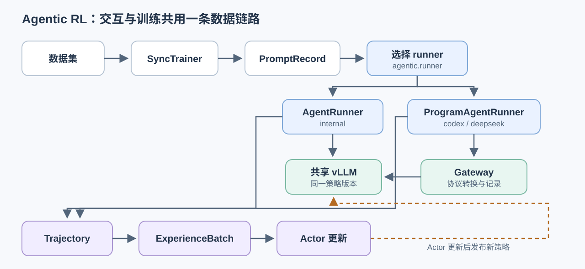

# Agentic RL：任务环境与外部 Agent 如何接入 Hyper-RL

Agentic 模块负责让模型在一个 episode 内反复执行“生成动作—调用工具—接收观察—继续生成”，并把完整过程收敛为
Hyper-RL 认识的 `Trajectory`。Hyper-RL 仍然负责数据加载、批处理、优势估计、Actor 更新、权重发布和检查点。

Agentic 决定模型如何与任务环境交互；Hyper-RL 决定这些交互数据如何用于强化学习。

## 整体关系



三种 runner 共享 `PromptRecord → Trajectory → ExperienceBatch` 训练契约，由同一个 `SyncTrainer` 编排。
一个 episode 可以包含多条逐调用 `Trajectory`；episode 是奖励单位，训练行保留各次真实生成上下文。

## 职责边界

| 层次 | 主要职责 | 不负责的内容 |
| --- | --- | --- |
| Agentic | episode 生命周期、多轮动作与观察、工具执行、终止判断、任务奖励、轨迹构造 | 优势估计、梯度更新、权重发布 |
| Rollout | 提供共享 vLLM 推理端点，返回 token ID、raw logprob 和策略身份 | 任务语义和奖励规则 |
| Hyper-RL Trainer | 构建 prompt、选择 runner、准备训练 batch、更新 Actor、发布策略并记录指标 | 具体工具如何实现 |

同步模式由 `SyncTrainer` 编排。它在 `rl/trainer.py` 中创建 rollout engine，再根据 `agentic.runner` 选择对应的
rollout manager。Agentic 不绕过 Trainer，也不直接更新模型参数。

## 三种执行路径

| `agentic.runner` | 实际入口 | episode 控制者 | 适用方式 |
| --- | --- | --- | --- |
| `internal`（默认） | `RolloutManager` → `AgentRunner` | Hyper-RL 内部循环 | 自定义环境、协议和 Python 工具 |
| `codex` | `CodexRolloutManager` → `ProgramAgentRunner` | Codex CLI program | Codex Responses 协议、shell 或 MCP 工具 |
| `deepseek` | `DeepSeekRolloutManager` → `ProgramAgentRunner` | DeepSeek Harness program | DeepSeek Chat 协议和 Harness 工具 |

配置校验只接受以上三个值。当前不能在 YAML 中填写任意第四种 runner。`ProgramAgentRunner` 虽然是公开的 Python
接口，但把新的外部 harness 接入 `SyncTrainer` 仍需要增加对应的 runtime、factory、manager 和配置校验。
DeepSeek 的实现目录是 `rl/agentic/ds_harness/`，YAML 中的 runner 值和子配置键仍分别是 `deepseek` 与
`agentic.deepseek`。

### Internal：框架内多轮交互

`AgentRunner` 为每个 `PromptRecord` 创建 `AgentSession` 和已注册的 Environment。每一轮按以下顺序运行：

1. Environment 的 `reset()` 返回初始 `Observation`。
2. `AgentRunner` 将活跃 session 左填充成 batch，并调用共享 `GenerationEngine`。
3. 生成结果作为 `Action` 交给 Environment 的 `step()`。
4. `ToolEnvironment` 使用 `InteractionProtocol` 解析最终答案或工具调用。
5. 工具调用由 `ToolExecutor` 在 `ToolRegistry` 中查找并执行，结果编码成下一轮 observation。
6. 最终答案由环境奖励函数评分；达到终止条件后，`AgentSession.build()` 生成 `Trajectory`。

已完成的 session 仍保留一个 dummy batch row，以保证所有分布式 rank 执行相同数量的 generation collective；
dummy 输出会被丢弃，不进入训练。

### 单轮 code 环境

`examples.code.agent` 注册 `code_stdio`，使用同一个 internal runner 完成一次 Python stdio 生成与远程判题。
`data.row_adapter: examples.code.prepare_data:adapt_row` 保留多消息、稳定任务 ID 和私有结构化测试；
测试不进入 prompt，代码提取不改写训练使用的采样 token/logprob。训练 TP 组仅 request owner 调用环境，
其他 rank 重放相同 observation、reward 和终止状态，避免重复判题。

全部测试按空白分词精确比较后给二值奖励；HTTP、协议或沙箱服务故障上抛，不能混成候选代码的零分。
`finish_reason=length` 随 action 传递并记录截断。数据审核、固定镜像部署与运行命令见
[单轮 code 示例](../examples/code/README.md)。

### Codex 与 DeepSeek：外部 harness 交互

两条外部路径使用相同的数据面结构：

1. manager 启动本节点的 Gateway，并读取 vLLM 当前整数 `policy_version`。
2. runtime 将该策略身份绑定到本次 episode。
3. `ProgramAgentRunner` 只在 Trainer TP 组的 request-owner rank 启动外部 program，并按本地容量逐个派发。
4. Gateway 把 Codex Responses 或 DeepSeek Chat 请求转换为 vLLM 的 `/v1/chat/completions` 请求。
5. Gateway 记录模型返回的 token ID、raw sampled-token logprob、工具调用和策略身份。
6. harness 的 trajectory builder 将记录转换为标准 `Trajectory`。
7. request-owner 将 trajectory 序列化，并通过 `synchronize_agent_payload()` 同步给同 TP 组的 sibling ranks。
8. manager 再次读取策略身份；episode 执行期间发生版本变化会直接报错。

`agentic.codex.max_concurrent_episodes_per_rank` / `agentic.deepseek.max_concurrent_episodes_per_rank`
默认8，限制每个request-owner rank的活跃program；TP1/DP8时合计最多64个，不改变训练题数或每题候选数。
程序按提交顺序回填结果，保持题组、调用身份与损失语义。一个program失败时立即记录原始异常，
停止该rank继续派发待运行候选，等待已经派发的program清理后再同步跨rank错误；不是跨rank即时取消。
调用方取消会取消并等待本地worker清理，不把部分成功轨迹交给训练。

Codex管理面注册支持同一session ID、完全相同payload的幂等重试；身份或配置冲突、已封闭/释放的会话仍拒绝。
删除不存在的session成功返回并保留释放标记，避免晚到注册重新创建会话。
只有注册和删除在明确连接错误时最多尝试3次，注册每次最多30秒；HTTP拒绝不重试，模型生成不使用此重试机制。
`program.failed`将原始错误写入session性能记录，即使清理失败也不会丢失首个原因。

Codex Gateway 按 `agentic.max_turns` 预留模型调用额度，成功、失败和取消路径均释放预留；
`agentic.codex.max_inflight_requests` 限制共享后端的同时请求数，默认 1。
最后一次调用仍保留原工具选择，额度用尽不会改写模型动作来强制答案。
普通文本任务与自定义Search-R1程序共用`CodexAgentProgram.resolve_execution_outcome`核验终态。
CLI正常退出并发出`turn.completed`、却没有最终消息时，只有最后一次调用确为reasoning-only、
`finish_reason=length`且真实token数等于该请求的`max_tokens`，才记为`output_budget_exhausted`。
还须核验策略版本、连续调用序号、可训练采样证据及无Gateway故障；缺失证据仍报错。
该终态保留所有真实调用、token、mask和log-prob，以零奖励及`max_output_tokens`截断标记进入轨迹，
不伪造最终答案、不追加修正调用、不提高预算。已有最终文本的length输出仍按任务规则评分。
正常完成的 reasoning-only 调用若以采样到的模型结束 token 终止（`finish_reason=stop`），
且没有正式答案或工具调用，则记为模型失败 `reasoning_only_eos` 并给零奖励，保留全部真实调用。
该终态不标为预算截断，不提取 reasoning 中的答案、不追加调用；没有结束 token、缺失采样证据或进程异常仍拒绝训练。
进程超时和异常退出不能被已有模型失败或预算记录覆盖；退出码为零本身也不代表任务成功。
普通文本任务在调用额度内未完成最终答案，且 CLI 与 Gateway 均确认完整调用后的预算终止时，
该候选记零奖励并标记 `truncated/max_completions`，保留所有已采样调用参与 episode 分组与训练。
额度耗尽不增加调用次数，也不改写最后一次工具动作；此行为与 R3 开关无关。
已至少完成一次采样调用后，若vLLM返回匹配已验证格式的HTTP 400上下文长度拒绝，
保留所有已采样调用，以 `context_budget_exhausted` / `max_context_tokens` 标记零奖励预算终止。
被拒绝的请求没有生成动作，不创建训练行或重新生成；初始请求超限、未知400或不完整采样证据仍拒绝训练。
此路径不截断真实prompt，不扩展上下文或生成上限。
通信故障、未知 CLI 错误或不完整轨迹仍拒绝训练，不能仅凭调用数达到上限降为零奖励。
终态读取 session 先封闭新请求，再等待在途请求排空；释放 session 同样排空。
整组 program 收尾后再同步跨 rank 错误。
标准 `tools` 与 input 中 `additional_tools` 共用工具名称映射，未知声明明确报错。

任务可以用 `agentic.codex.model_instructions` 替换CLI自带模型指令，
用 `compact_harness_context: true` 在生成前移除带已知标记的技能、权限和环境说明消息；
这会改变模型输入，只适合已确认这些说明不属于任务语义的配方，不能用于训练后的单独删减。
文件操作任务可同时设置`preserve_environment_context: true`，保留环境与权限消息，
仅过滤技能说明；默认false保持既有精简行为，未开启compact时不做过滤。
`agentic.codex.allowed_tools` 默认null，保持全部声明；显式列表只向模型公开指定工具，
空列表不公开工具。普通函数写工具名，namespace成员写`namespace.function`。
白名单名称在请求中不存在、重复/非法配置或强制tool_choice选择被排除的工具均报错，
不静默回退。显式`tool_choice: none`的终答/修正请求允许省略白名单中的工具声明，
仍保留历史工具调用与观察，不放开普通请求的名称校验。保留工具的参数、历史及响应名称映射不变；原始CLI请求和实际vLLM请求分别记录，
训练使用后者对应的真实tokens。该开关限定模型可见工具，不改变CLI执行环境的权限。

Codex 性能记录与原始协议内容分开保存。Gateway 的 `completion.queued` / `completion.admitted`
事件用于观察在途排队；成功的 `completion.recorded.payload.timing` 包含墙钟起止点、
单调时钟测得的 `queue_seconds` 和 `backend_seconds`。后者包含HTTP传输及后端完整请求，
不能直接作为纯模型计算、prefill或decode耗时。
每个session的 `performance.jsonl` 记录CLI启动、版本检查、轨迹构建及stdout接收时间，
`cli_stdout.received.line_index` 与原始 `codex-events.jsonl` 的零基行号对应。
工具开始/结束事件可用于估计工具区间，但这是父进程接收时间，不是工具内部精确计时；
各session并发区间不可相加当作整个rollout墙钟时间。原始CLI事件、token和概率证据保持原样。

`agentic.codex.overlap_preparation`通用默认关闭，Qwen3-4B GSM8K Codex配方显式开启。开启后，Trainer只提前一批CPU会话：
第一批可与vLLM冷启动重叠，后续批次在上一轮Actor更新前启动。Codex CLI、shell快照和独立工作目录保持原样。
`preparation_cpu_fraction`默认0.5，范围为(0,1]。它按训练进程可用的逻辑CPU集合，均匀选择一个子集，
仅绑定Linux准备线程及其继承的CLI/工具子进程；不修改训练主线程亲和性，也不设置Codex线程数或关闭其功能。
`preparation_max_cpus`默认null，可设正整数作为额外的逻辑CPU数量上限；两项取更严格的限制。
最终数量为`min(max(1, floor(可用逻辑CPU数 × preparation_cpu_fraction)), preparation_max_cpus)`，
其中null表示不施加额外数量上限。例如192个可用逻辑CPU、比例0.5时使用96个；再设上限64则使用64个。
同一宿主上可用CPU集合相同的rank选择同一子集，共享该预算，不是每个rank独占这么多CPU；
若各rank原本绑定不同集合，则限制分别生效，不代表宿主全局总量上限。
这是CPU亲和性范围，不是主机CPU利用率百分比、CPU时间配额或资源预留；不限制Gateway等其他线程。
预算持续作用于整个episode，CPU密集工具的执行速度也会受影响；比例设为1且数量上限为null可恢复全部可用CPU。
关闭重叠时不使用这两项准备预算。
后台事件循环不启动模型、不调用分布式collective；Gateway按session的目标policy version挂起模型请求，
主线程完成权重发布、推理唤醒和版本核查后才放行。`completion.policy_ready`及
`timing.policy_ready_at`给出放行等待结束的时间；`queue_seconds`包含该策略等待，
不能把它解释为后端缺少并发槽位。实际后端接收仍以`completion.admitted`为参考。

准备批次只可按原顺序、原问题内容和目标版本消费；取消时先停止后台程序及其子进程，再关闭Gateway。
epoch结束、验证和checkpoint边界不提前读取下一批，避免改变数据恢复或评估顺序。
当前只支持原生本地CLI路径，配置`program_callable`或`execution_callable`时拒绝开启；
自定义工作目录准备函数仍须遵守CPU准备合同。会话总超时和HTTP超时包含等待策略发布的时间，
必须覆盖重叠的训练或首次服务启动窗口，超时属于基础设施错误，不能转成零奖励。
本功能不代表异步RL：所有训练回答仍来自对应的同一已发布版本。

Codex 可按配置启动 MCP stdio server。`rl/agentic/mcp_server.py` 只是把现有 `ToolRegistry` 暴露为 MCP
`tools/list` 和 `tools/call`，不会复制或改写工具实现。

### 共用容器执行

Search-R1与SWE-Smith复用`DockerWorkspace`和`codex/container_execution.py`中的候选中继、CLI执行及输出记录。
容器只提供当前会话的模型请求通道，Codex内部的多轮shell/PTY行为保持原样；任务准备、终态评分和grader仍由示例持有。
Search-R1保留宿主broker，通过Unix socket访问训练容器内的任务反馈服务；SWE-Smith保留controller的Docker连接方式。
公共中继只转发固定模型路由，不根据任务名选择奖励；任务终止头由调用方显式传入。
非root、只读根目录及文章绑定由工作区执行参数声明，不改变SWE-Smith原有仓库写入要求。
HTTP管理请求被提取到标准库模块`core/gateway_transport.py`，旧`program_runner`导入路径继续导出同一函数和异常。
Codex公共导出按需加载，以便宿主执行器导入容器能力时不加载Torch或推理依赖。

### 仓库型 Codex Code Agent

`agentic.codex.program_callable=examples.swe_smith.agent:SWESmithProgram` 选择仓库任务，
复用 Search-R1 的程序扩展方式。`admin_auth=true` 显式启用管理鉴权，任务编排和评分由示例持有。
候选与 grader 各使用固定镜像的离线 Docker 工作区，不挂载 NPU 或 Docker socket。
控制侧管理接口鉴权，候选仅持有会话 token，通过 relay 调用共享模型；原始请求与转发后的
容器上下文分别保留，固定 CLI 的工具 schema 和压缩请求均校验。

CLI 正常退出并确认 `turn.completed` 后，停止候选、冻结提交，再由独立 grader 给出奖励。
仓库任务允许没有文字总结；已完成的调用预算耗尽也可在核验终止证据后冻结判题。
仓库任务按冻结产物评分；普通文本任务预算内没有最终答案则记零奖励。
基础设施或不完整轨迹不能降为零奖励。

SWE-Smith 子集/全量准备、Qwen3.5/3.8 配方及运行命令见
[仓库示例](../examples/swe_smith/README.md)；CPU 合同与待完成的镜像/NPU 验收见
[验证范围](../examples/swe_smith/README.md#图执行与验证范围)。

## Hyper-RL 如何消费 Agentic 结果

一次训练 step 的真实顺序位于 `SyncTrainer._train_step()`：

1. `build_prompt_records()` 把 dataloader batch 转成 `PromptRecord`。
2. 选定的 rollout manager 调用 `generate()`，返回 `ExperienceBatch`。
3. rollout engine 从 rollout residency 切回 training residency。
4. 逐调用 batch 先按 DP 最大行数补齐，再执行角色前向；`ExperiencePreparer` 根据算法需求准备训练目标。
5. Actor 使用准备好的 experience 执行更新。
6. `_publish_policy()` 把 `PolicySnapshot(version=next_step)` 发布到 vLLM。
7. vLLM 恢复 rollout residency，下一 step 使用新策略生成。

Agentic 输出与训练侧之间最重要的边界是 token-first 契约：

| 字段 | 作用 | 约束 |
| --- | --- | --- |
| `token_ids` | 完整 prompt、动作和观察序列 | rollout 返回的 ID 是训练依据，不能 decode 后再 encode |
| `attention_mask` | 标记有效 token | 必须与 `token_ids` 等长 |
| `action_mask` | 标记参与策略损失的模型动作 | 不能选中 padding；环境和工具 observation 不参与策略损失 |
| `rollout_log_probs` | rollout 策略的 next-token logprob | 使用 FP32 raw logprob，并与 next-token 位置对齐 |
| `reward` | episode 最终奖励 | 每条 trajectory 一个标量 |
| `worker_policy_version` | 记录生成使用的策略版本 | batch 内必须一致，并匹配请求的策略版本 |

`build_experience_batch()` 会验证这些 trajectory 的对齐关系，并将其填充成 `ExperienceBatch`；随后算法和 Actor
只处理标准 batch，不需要知道 episode 来自 internal、Codex 还是 DeepSeek。

## 逐调用轨迹与 episode GRPO

外部 Codex 与 DeepSeek program 每次模型调用返回一条训练行，tokens 严格等于本次真实 prompt 加 sampled action；
历史被 harness 改写或裁剪也不会伪造连续上下文。`episode_id`、`call_index` 和 `call_count`
描述完整 episode，缺失、重复调用以及 prompt/group/策略版本/奖励不一致都会报错。
旧连续轨迹构造器（含 DeepSeek）只有在后续 prompt 精确延续全部已采样 token 时才允许拼接。
分段路径的 `max_episode_tokens` 校验每次调用的真实 prompt 加 action 长度；调用总数由 `max_turns`
限制，不把重复上下文累加成单条虚构轨迹的长度。

例如同一道题的两个候选分别调用 2 次和 5 次，最终奖励为 1 和 0：GRPO 对两个 episode 计算优势，
再映射到七条调用行；准确率为 1/2，不能按调用行算成 2/7。
每条调用的动作仍参与既有有效 token 均值损失；episode 计奖并不等于每个 episode 的梯度权重相同。
评估和样例按 episode 汇总，响应长度为其所有调用的动作 token 总数。

DP rank 的调用行数不同会追加 `dp_padding` 行，保留合法上下文供前向执行，但 action mask、奖励和优势为零。
它们不参与奖励、episode 数、响应长度或损失的有效 token 分母。
分段轨迹当前只支持 GRPO；Codex/DeepSeek+PPO 在启动前拒绝，现有非分段 PPO 仍按原合同运行。

### 多轮 MoE 路由重放

`train.router_replay.mode: R3` 同时开启 vLLM capture 与 Actor replay，当前适配 internal 和 Codex。
Codex 每条调用行携带本次真实 prompt + action 的独立 `router_trace`；重写或裁剪过的上下文
不拼成连续路由，也不以最后一轮覆盖历史调用。Gateway 从 Agent 响应中提取路由，
训练行单独保存紧凑 CPU trace，TP 同步传输 bytes，审计 metadata 只保留原有 token/logprob 等证据。
episode 奖励、GRPO 优势和调用身份的合同保持不变。

internal 连续多轮仅在新 trace 保留旧有效前缀的有序 expert ID 时替换快照；缺失或冲突会报错。
后续 action 之前的工具 observation 属于必要因果前缀，最终 observation 和最后未执行的 sampled token
保持无效路由。DeepSeek 尚未适配 R3。配置、模型适配和验证范围见 [MoE R3 指南](moe_code_agent.md#moe-r3)。

## 工具失败归因与收尾

固定版本 vLLM 的 Hermes（Qwen3）或 Qwen3Coder XML（Qwen3.5 家族）只读采集原始 token、engine text、parser 输入和结果，不修改采样动作。
归因规则为：

- 原始证据一致且模型 JSON 或工具调用封装结构不合法：模型失败，保留该次动作及概率；在剩余调用额度内可重新生成。
- 原始工具 JSON 合法但解析结果不一致：基础设施失败，不进入训练。
- 工具调用缺少原始证据或证据互相矛盾：未知失败，不进入训练。

无法训练的失败拒绝整组更新，不能悄悄丢弃候选；同一 session 的后续模型失败不能覆盖已有基础设施失败。
Codex 格式重采样也计入调用额度和完整 episode；已确认的模型格式错误耗尽额度时形成零奖励终止结果。
DeepSeek 保留自己的终止方式：已记录证据的模型格式错误或明确调用额度耗尽可形成零奖励终止，
未知 SDK `error/aborted`、服务错误和解析证据不一致均拒绝训练。
外部程序结束、超时或取消后清理本程序组的工具子进程；vLLM 先优雅退出，超时才强制终止。
最终 checkpoint 在评估结束后先释放 vLLM 及其 IPC 消费者，减少保存阶段的资源竞争。

## 接入自定义 Environment

现有的自定义入口是 `agentic.module_path` 和 `ENVIRONMENTS`：

1. 在扩展模块中实现接收 `EpisodeContext` 的 environment builder。
2. 返回实现 `reset()`、`step()`、`close()` 的 Environment；需要工具时可组合 `ToolEnvironment`、
   `InteractionProtocol`、`ToolExecutor` 和 `ToolRegistry`。
3. 使用 `ENVIRONMENTS.register("name")(builder)` 注册。
4. 在 YAML 中配置同一模块路径和环境名称。

```yaml
agentic:
  runner: internal
  module_path: examples.gsm8k.agent
  environment: gsm8k_tools
  interaction_mode: multi_turn
  protocol: json_function_call
  max_turns: 2
  max_observation_tokens: 0
  max_episode_tokens: 1024
```

仓库中的 [GSM8K 环境](../examples/gsm8k/agent.py)提供单轮问答和组合 calculator 的多轮任务，
两条路径都通过同一个 `ENVIRONMENTS` registry 接入 Trainer。上面的 YAML 是 `agentic` 片段；
基础训练配置见 [GRPO 基础配方](../examples/gsm8k/configs/qwen3_4b_gsm8k_base.yaml)和
[多轮配置](../examples/gsm8k/README.md#其他功能)，训练入口为 [train_rl.py](../train_rl.py)。

### GSM8K 数值奖励

规则评分读取最后一个 `####` 后的完整数值行，或者工具 final-answer 的完整直接数值。
允许货币符号、千位分隔符、符号和小数，按十进制精确值比较；例如 `$18`、`18.00` 与 `18` 等价。
畸形数字、分式和无效最终答案不能用数值前缀或更早答案获得奖励；保留最后 300 字符的答案窗口。
实现见 [GSM8K agent](../examples/gsm8k/agent.py)，回归见
[实际奖励测试](../../../tests/ut/rl/agentic/test_gsm8k_reward.py)。

## 外部 runner 的必要配置

Codex 和 DeepSeek 除各自子配置外，还必须满足以下共享约束：

- `rollout.engine` 必须是 `vllm`。
- `rollout.vllm.logprobs_mode` 必须是 `raw_logprobs`。
- `rollout.vllm.enable_auto_tool_choice` 必须为 `true`。
- `rollout.vllm.tool_call_parser` 按模型家族选择：Qwen3 为 `hermes`，Qwen3.5 家族为 `qwen3_coder`。
  原始解析证据须来自固定运行时中对应的 parser。
- Gateway 端口不能与 vLLM 端口相同。
- Codex CLI 当前固定验证版本为 `0.152.1`。
- DeepSeek Harness SDK 当前固定验证版本为 `0.1.1rc1`。

完整配置以以下文件为准：

- [Codex 多轮配置](../examples/gsm8k/configs/qwen3_4b_gsm8k_codex_50step.yaml)
- [Qwen3-30B-A3B Codex 四卡配置与 R3 示例](../examples/gsm8k/README.md)
- [DeepSeek 多轮配置](../examples/gsm8k/configs/deepseek_multi_turn.yaml)

## 代码导航

| 关注点 | 文件 |
| --- | --- |
| 配置与 runner 约束 | `rl/config.py` |
| 同步训练编排入口 | `rl/trainer.py` |
| 三种 rollout manager | `rl/roles/rollout/worker.py` |
| Internal episode 循环 | `rl/agentic/core/trajectory_runner.py`、`session.py` |
| 外部 program 数据面 | `rl/agentic/core/program_runner.py` |
| 环境与工具组合 | `rl/agentic/envs/environment.py`、`rl/agentic/tools/` |
| Codex 适配 | `rl/agentic/codex/` |
| DeepSeek 适配 | `rl/agentic/ds_harness/` |
| MCP 工具桥接 | `rl/agentic/mcp_server.py` |
| 标准训练数据契约与 episode 分组 | `rl/dataset/contracts.py`、`batch_builder.py`、`episodes.py` |
| 原始工具证据与可训练性 | `rl/tool_protocol.py`、`rl/roles/rollout/vllm_plugin.py` |
| 共享 vLLM 与策略身份 | `rl/roles/rollout/vllm.py` |

## 当前实现边界

- 当前支持的训练算法是 GRPO、PPO 和 GSPO；外部逐调用轨迹限定 GRPO。实际验证范围以[RL 支持范围](../README.md)及
  [系统测试指南](../README.md#系统测试)为准。多节点和异步 rollout 不在本文描述的实现范围内。
- 外部 runner 复用唯一共享 vLLM endpoint，不创建第二个 rollout Router 或 rank-local server。
- External harness 的语义循环可以不同，但必须返回标准、token 对齐且策略身份一致的 `Trajectory`。
- Agentic UT 可从仓库根目录运行 `pytest -q tests/ut/rl/agentic/agentic_ut.py`；
  完整 CPU 回归与合同分组见 [Code Agent 验证范围](../examples/swe_smith/README.md#图执行与验证范围)。

## 验证入口

逐调用轨迹、episode GRPO、DP 补齐及工具失败归因的 CPU 合同位于 `tests/ut/rl/` 的
`data/`、`agentic/` 和 `trainer/` 模块；入口清单见[功能验证说明](moe_code_agent.md#单元测试)。
`hyper_parallel/rl/tests/st/test_feature_st.py` 提供独立两进程 Gloo 梯度验证及真实 agent 训练入口。
Gloo 验证不需要模型；真实训练须显式配置 CLI/SDK、模型、数据、设备与具有不等调用的任务，
并保留真实参数更新、策略版本和零损失补齐断言。CPU 用例及资源缺失时的 skip 不能代替真机验收。

## 异步 Codex 多轮任务

异步入口复用现有 Codex 程序，支持 Qwen3 dense 的 Search/SWE-Smith 多轮候选。
模型调用按实际提交版本记录，允许一个 episode 的不同调用跨版本；同步路径仍检查整个 episode 版本一致。
权重发布等待活跃模型调用结束，工具执行继续，checkpoint 边界则排空完整任务。
配置、重试、版本滞后及验证边界见[异步运行合同](architecture.md#rayless-asynchronous-grpo)。
