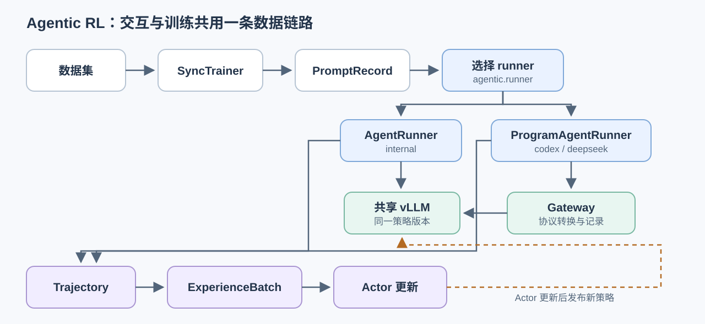

# Agentic RL: Integrating Task Environments and External Agents with Hyper-RL

**English** | [简体中文](agentic_rl.zh.md)

Agentic repeatedly runs “generate action—call tools—receive observations—continue generation” within an episode, producing
Hyper-RL `Trajectory` objects. Hyper-RL still handles data loading, batching, advantage estimation, Actor updates, weight publication, and checkpoints.

Agentic determines how the model interacts with tasks; Hyper-RL determines how those interactions train the policy.

## Overall Relationship



All three runners share the `PromptRecord → Trajectory → ExperienceBatch` contract under one `SyncTrainer`.
An episode may contain multiple per-call `Trajectory` objects. Rewards are episode-level; training rows preserve each actual generation context.

## Responsibility Boundaries

| Layer | Responsibilities | Outside its scope |
| --- | --- | --- |
| Agentic | Episode lifecycle, multi-turn actions/observations, tools, termination, task rewards, trajectory construction | Advantages, gradient updates, weight publication |
| Rollout | Shared vLLM endpoint returning token IDs, raw logprobs, policy identity | Task semantics and rewards |
| Hyper-RL Trainer | Build prompts, select runners, prepare batches, update Actor, publish policy, record metrics | Specific tool implementations |

Synchronous execution is orchestrated by `SyncTrainer` in `rl/trainer/sync.py`. `rl/trainer/build.py` constructs the rollout engine
and selects the rollout manager using `agentic.runner`. Agentic neither bypasses Trainer nor updates model parameters directly.

## Three Execution Paths

| `agentic.runner` | Entry point | Episode controller | Use case |
| --- | --- | --- | --- |
| `internal` (default) | `RolloutManager` → `AgentRunner` | Hyper-RL internal loop | Custom environments, protocols, Python tools |
| `codex` | `CodexRolloutManager` → `ProgramAgentRunner` | Codex CLI program | Codex Responses protocol, shell/MCP tools |
| `deepseek` | `DeepSeekRolloutManager` → `ProgramAgentRunner` | DeepSeek Harness program | DeepSeek Chat protocol and Harness tools |

Configuration accepts only these three values, not an arbitrary fourth runner. Although `ProgramAgentRunner` is a public Python
interface, integrating another external harness into `SyncTrainer` still requires runtime, factory, manager, and configuration-validation changes.
DeepSeek implementation lives in `rl/agentic/ds_harness/`; YAML runner and subconfiguration remain `deepseek` and
`agentic.deepseek`.

### Internal: Framework-Driven Multi-Turn Interaction

`AgentRunner` creates an `AgentSession` and registered Environment for each `PromptRecord`. Each turn proceeds as follows:

1. Environment `reset()` returns the initial `Observation`.
2. `AgentRunner` left-pads active sessions into a batch and invokes the shared `GenerationEngine`.
3. Generation becomes an `Action` passed to Environment `step()`.
4. `ToolEnvironment` parses final answers or tool calls using `InteractionProtocol`.
5. `ToolExecutor` resolves calls in `ToolRegistry` and executes them; results become the next observation.
6. The environment reward function scores the final answer; at termination, `AgentSession.build()` produces a `Trajectory`.

Completed sessions retain dummy batch rows so all distributed ranks execute the same number of generation collectives.
Dummy outputs are discarded and never enter training.

### Single-Turn Code Environment

`examples.code.agent` registers `code_stdio`, using the same internal runner for one Python stdio generation and remote grading.
`data.row_adapter: examples.code.prepare_data:adapt_row` preserves multiple messages, stable task IDs, and private structured tests.
Tests never enter prompts; code extraction does not rewrite sampled training tokens/logprobs. Only the request owner in each training TP group invokes the environment;
other ranks replay identical observations, rewards, and termination states, preventing duplicate grading.

After exact whitespace-tokenized comparison across all tests, assign binary reward. HTTP, protocol, and sandbox failures propagate rather than become zero scores for candidate code.
`finish_reason=length` travels with the action and records truncation. See the
[single-turn code example](../examples/code/README.md) for data review, pinned-image deployment, and launch commands.

### Codex and DeepSeek: External Harness Interaction

Both external paths use the same data-plane structure:

1. The manager starts this node's Gateway and reads vLLM's integer `policy_version`.
2. Runtime binds that policy identity to the episode.
3. `ProgramAgentRunner` starts external programs only on the Trainer TP group's request-owner rank, dispatching them individually according to local capacity.
4. Gateway converts Codex Responses or DeepSeek Chat requests to vLLM `/v1/chat/completions`.
5. Gateway records returned token IDs, raw sampled-token logprobs, tool calls, and policy identity.
6. The harness trajectory builder converts records to standard `Trajectory` objects.
7. The request owner serializes trajectories and synchronizes them to TP siblings with `synchronize_agent_payload()`.
8. The manager rereads policy identity; any version change during the episode raises an error.

`agentic.codex.max_concurrent_episodes_per_rank` / `agentic.deepseek.max_concurrent_episodes_per_rank`
These default to 8, limiting active programs per request-owner rank. TP1/DP8 allows at most 64 in total without changing the number of training questions or candidates per question.
Results are placed in submission order, preserving question groups, call identities, and loss semantics. A program failure immediately records the original exception,
stops that rank from dispatching pending candidates, and waits for already dispatched programs to clean up before synchronizing errors across ranks; it is not immediate cross-rank cancellation.
Caller cancellation cancels local workers and waits for cleanup; partially successful trajectories are not passed to training.

Codex management registration permits idempotent retries for the same session ID and identical payload; identity/configuration conflicts and closed/released sessions are still rejected.
Deleting a nonexistent session succeeds and retains a release marker to prevent a late registration from recreating it.
Only registration and deletion retry explicit connection errors, with at most 3 attempts and 30 seconds per registration attempt. HTTP rejections are not retried; model generation does not use this retry mechanism.
`program.failed` writes the original error into session performance records, preserving the first cause even if cleanup fails.

Codex Gateway reserves model-call slots according to `agentic.max_turns`, releasing reservations on success, failure, and cancellation.
`agentic.codex.max_inflight_requests` limits concurrent shared-backend requests and defaults to 1.
The final call retains its original tool choice; budget exhaustion does not rewrite actions to force an answer.
Ordinary text tasks and custom Search-R1 programs share `CodexAgentProgram.resolve_execution_outcome` for terminal-state validation.
When the CLI exits normally and emits `turn.completed` without a final message, the result is `output_budget_exhausted` only if the last call is genuinely reasoning-only,
with `finish_reason=length` and an actual token count equal to that request's `max_tokens`.
Policy version, consecutive call indexes, trainable sampling evidence, and the absence of Gateway failures must also be verified; missing evidence still raises an error.
This terminal state retains all actual calls, tokens, masks, and logprobs, producing a zero-reward trajectory marked as truncated by `max_output_tokens`,
without fabricating a final answer, adding a correction call, or increasing the budget. Length-limited output containing final text is still scored by task rules.
A normally completed reasoning-only call that terminates with a sampled model end token (`finish_reason=stop`),
without a formal answer or tool call, is recorded as the model failure `reasoning_only_eos`, receiving zero reward while preserving every actual call.
This state is not marked as budget truncation; no answer is extracted from reasoning and no call is added. Missing end tokens, missing sampling evidence, or abnormal process exits still reject training.
Process timeouts and abnormal exits cannot be overridden by earlier model-failure or budget records; a zero exit code alone does not establish task success.
For ordinary text tasks lacking a final answer within budget, when both CLI and Gateway confirm budget termination after complete calls,
assign zero reward and mark `truncated/max_completions`, retaining all sampled calls for episode grouping and training.
Exhaustion neither adds calls nor rewrites the last tool action; behavior is independent of R3.
After at least one completed sampling call, if vLLM returns an HTTP 400 context-length rejection matching a validated format,
all sampled calls are retained as a zero-reward budget termination marked `context_budget_exhausted` / `max_context_tokens`.
The rejected request generates no actions, so it creates no training row or replacement generation. An oversized initial request, unknown 400, or incomplete sampling evidence still rejects training.
This path does not truncate actual prompts or increase context/generation limits.
Communication failures, unknown CLI errors, and incomplete trajectories remain untrainable; reaching the call limit alone cannot justify zero reward.
Terminal session reads first close admission, then drain in-flight requests; releasing a session also drains them.
Synchronize cross-rank errors only after the entire program group finishes cleanup.
Standard `tools` and input `additional_tools` share name mapping; unknown declarations raise explicit errors.

Tasks may replace the CLI's built-in model instructions with `agentic.codex.model_instructions`
and use `compact_harness_context: true` to remove skill, permission, and environment messages with known markers before generation.
This changes model input and is suitable only for recipes that establish these messages are outside task semantics; it cannot be applied solely as post-training deletion.
File-operation tasks may also set `preserve_environment_context: true` to retain environment and permission messages,
filtering only skill instructions. The default false preserves existing compaction behavior; no filtering occurs unless compaction is enabled.
`agentic.codex.allowed_tools` defaults to null, retaining all declarations. An explicit list exposes only specified tools to the model;
an empty list exposes none. Use the tool name for ordinary functions and `namespace.function` for namespace members.
Allowlisted names absent from the request, duplicate/invalid configuration, or a forced tool_choice selecting an excluded tool raise errors,
without silent fallback. Final-answer/correction requests with explicit `tool_choice: none` may omit allowlisted tool declarations,
while retaining historical tool calls and observations; ordinary-request name validation remains strict. Retained tools preserve their parameters, history, and response-name mappings. Original CLI requests and actual vLLM requests are recorded separately,
and training uses the actual tokens corresponding to the latter. This setting limits model-visible tools without changing CLI execution permissions.

Codex performance records are stored separately from raw protocol content. Gateway `completion.queued` / `completion.admitted`
events expose in-flight queueing; successful `completion.recorded.payload.timing` records contain wall-clock start/end timestamps
and monotonic-clock `queue_seconds` and `backend_seconds`. The latter includes HTTP transport and the complete backend request,
so it cannot directly represent pure model compute, prefill, or decode time.
Each session's `performance.jsonl` records CLI startup, version checks, trajectory construction, and stdout receipt times.
`cli_stdout.received.line_index` corresponds to the zero-based line number in raw `codex-events.jsonl`.
Tool start/end events can estimate tool intervals, but these are parent-process receipt times, not precise tool-internal timings.
Overlapping session intervals cannot be summed as total rollout wall time. Raw CLI events, tokens, and probability evidence remain unchanged.

`agentic.codex.overlap_preparation` is off by default and explicitly enabled in the Qwen3-4B GSM8K Codex recipe. When enabled, Trainer prepares only one batch of CPU sessions ahead:
the first may overlap vLLM cold start, and later batches start before the preceding Actor update. Codex CLI behavior, shell snapshots, and independent workspaces remain unchanged.
`preparation_cpu_fraction` defaults to 0.5 and ranges over (0,1]. It evenly selects a subset of the logical CPUs available to the training process,
binding only Linux preparation threads and the CLI/tool subprocesses inheriting that affinity. It does not alter the main training thread's affinity, set Codex thread counts, or disable Codex features.
`preparation_max_cpus` defaults to null; a positive integer adds a logical-CPU count cap. The stricter limit applies.
The final count is `min(max(1, floor(available logical CPUs × preparation_cpu_fraction)), preparation_max_cpus)`,
where null means no additional count cap. For example, 192 available logical CPUs at fraction 0.5 use 96; an additional cap of 64 reduces this to 64.
Ranks on the same host with identical available CPU sets choose the same subset and share that budget; each rank does not exclusively own that many CPUs.
If ranks were already bound to different sets, limits apply separately and do not establish a host-wide total cap.
This is a CPU-affinity range, not a host-utilization percentage, CPU-time quota, or resource reservation; other threads such as the Gateway are unrestricted.
The budget applies for the entire episode, so CPU-intensive tools can also slow down. Set the fraction to 1 and count cap to null to restore all available CPUs.
These preparation budgets are unused when overlap is disabled.
The background event loop neither starts models nor calls distributed collectives. The Gateway holds model requests for each session's target policy version
until the main thread completes weight publication, inference wakeup, and version checks. `completion.policy_ready` and
`timing.policy_ready_at` mark the end of this release wait; `queue_seconds` includes policy waiting,
so it cannot be interpreted as a lack of backend concurrency slots. Actual backend admission is represented by `completion.admitted`.

Prepared batches can be consumed only in their original order, with original question content and target versions. Cancellation stops background programs and their children before closing the Gateway.
Epoch ends, evaluation, and checkpoint boundaries do not read the next batch ahead, preserving data recovery and evaluation order.
Only the native local CLI path is supported; enabling overlap with `program_callable` or `execution_callable` is rejected.
Custom workspace-preparation functions must still satisfy the CPU preparation contract. Overall session and HTTP timeouts include policy-publication waiting
and must cover the overlapped training or initial service-startup window. Timeouts are infrastructure errors and cannot become zero rewards.
This feature is not asynchronous RL: all training responses still come from the corresponding single published version.

Codex may start a configured MCP stdio server. `rl/agentic/mcp_server.py` exposes the existing `ToolRegistry` through MCP
`tools/list` and `tools/call`, without copying or rewriting tool implementations.

### Shared Container Execution

Search-R1 and SWE-Smith reuse `DockerWorkspace` and the candidate relay, CLI execution, and output recording in `codex/container_execution.py`.
Containers provide only the current session's model-request channel; Codex's multi-turn shell/PTY behavior remains unchanged. Examples still own task preparation, terminal scoring, and graders.
Search-R1 retains its host broker, accessing task feedback inside the training container through a Unix socket; SWE-Smith retains the controller's Docker connection.
The shared relay forwards only fixed model routes and does not choose rewards by task name; callers explicitly supply task termination headers.
Workspace execution arguments declare non-root execution, read-only roots, and article mounts without changing SWE-Smith's repository write requirements.
HTTP management requests reside in the standard-library module `core/gateway_transport.py`; the old `program_runner` import path continues exporting the same functions and exceptions.
Public Codex exports load on demand so host executors can import container functionality without loading Torch or inference dependencies.

### Repository Codex Code Agent

`agentic.codex.program_callable=examples.swe_smith.agent:SWESmithProgram` selects repository tasks,
reusing Search-R1's program extension mechanism. `admin_auth=true` explicitly enables management authentication; examples own orchestration and grading.
Candidates and graders each use offline Docker workspaces from pinned images, without NPU or Docker-socket mounts.
Controller management interfaces authenticate; candidates hold only session tokens and access the shared model through a relay. Original requests and forwarded
container contexts are retained separately; pinned-CLI tool schemas and compaction requests are validated.

After normal CLI exit and confirmed `turn.completed`, stop the candidate, freeze the submission, then obtain reward from an independent grader.
Repository tasks need no textual summary. Completed-call budget exhaustion may also freeze and grade after termination evidence is verified.
Repository tasks are scored from frozen artifacts; ordinary text tasks without final answers within budget receive zero reward.
Infrastructure failures and incomplete trajectories must not become zero rewards.

See the [repository example](../examples/swe_smith/README.md) for SWE-Smith subset/full-data preparation, Qwen3.5/3.8 recipes,
and commands. CPU contracts and pending image/NPU acceptance are described in
[validation scope](../examples/swe_smith/README.md#graph-execution-and-validation-scope).

## How Hyper-RL Consumes Agentic Results

The actual training-step order is in `SyncTrainer._train_step()`:

1. `build_prompt_records()` converts a dataloader batch to `PromptRecord` objects.
2. The selected rollout manager calls `generate()`, returning `ExperienceBatch`.
3. The rollout engine switches from rollout to training residency.
4. Per-call batches are padded to the maximum DP row count before role forwards; `ExperiencePreparer` builds objectives from algorithm requirements.
5. Actor updates from the prepared experience.
6. `_publish_policy()` publishes `PolicySnapshot(version=next_step)` to vLLM.
7. vLLM restores rollout residency; the next step generates with the new policy.

The key boundary between Agentic output and training is the token-first contract:

| Field | Purpose | Constraint |
| --- | --- | --- |
| `token_ids` | Complete prompt, action, and observation sequence | Rollout IDs are authoritative; no decode/re-encode |
| `attention_mask` | Valid tokens | Same length as `token_ids` |
| `action_mask` | Model actions contributing to policy loss | Must exclude padding and environment/tool observations |
| `rollout_log_probs` | Rollout policy next-token logprobs | FP32 raw logprobs aligned to next-token positions |
| `reward` | Final episode reward | One scalar per trajectory |
| `worker_policy_version` | Policy version used for generation | Consistent across the batch and matching the requested version |

`build_experience_batch()` validates trajectory alignment and pads into `ExperienceBatch`. Algorithms and Actor then
consume standard batches without knowing whether episodes came from internal, Codex, or DeepSeek runners.

## Per-Call Trajectories and Episode GRPO

External Codex and DeepSeek programs return one training row per model call, with tokens exactly equal to that call's actual prompt plus sampled action.
Harness rewriting/truncation never fabricates continuous context. `episode_id`, `call_index`, and `call_count`
describe the complete episode. Missing/duplicate calls or inconsistent prompts, groups, policy versions, or rewards raise errors.
Legacy continuous builders, including DeepSeek, concatenate only when later prompts exactly extend all sampled tokens.
For segmented paths, `max_episode_tokens` validates each actual prompt-plus-action length, while `max_turns`
limits call count. Repeated context is not accumulated into a fictitious single-trajectory length.

For example, two candidates for one question make two and five calls and earn rewards 1 and 0. GRPO computes advantages for the two episodes,
then maps them onto seven call rows. Accuracy is 1/2, not 2/7.
Every call's actions still participate in the existing valid-token-mean loss. Episode-level rewards do not imply equal gradient weight per episode.
Evaluation and examples aggregate by episode; response length sums action tokens across all calls.

Unequal DP call-row counts receive `dp_padding` rows with valid forward context but zero action masks, rewards, and advantages.
Padding is excluded from rewards, episode counts, response lengths, and valid-token loss denominators.
Segmented trajectories currently support only GRPO. Codex/DeepSeek+PPO is rejected before launch; existing nonsegmented PPO retains its contract.

### Multi-Turn MoE Router Replay

`train.router_replay.mode: R3` enables vLLM capture and Actor replay together, currently for internal and Codex runners.
Every Codex call row carries an independent `router_trace` for its actual prompt + action. Rewritten/truncated contexts
are not joined into continuous routing, and the last turn does not overwrite historical calls. Gateway extracts routing from agent responses;
training rows store separate compact CPU traces, TP synchronization transfers bytes, and audit metadata retains existing token/logprob evidence only.
Episode rewards, GRPO advantages, and call identity contracts are unchanged.

Internal continuous multi-turn replaces snapshots only when new traces preserve ordered expert IDs on the old valid prefix; missing/conflicting evidence raises errors.
Tool observations preceding later actions are necessary causal prefixes. Terminal observations and the final unexecuted sampled token
retain invalid routing. DeepSeek is not yet adapted to R3. See [MoE R3](moe_code_agent.md#moe-r3) for configuration, adapters, and scope.

<!-- markdownlint-disable-next-line MD033 -->
<a id="工具失败归因与收尾"></a>

## Tool Failure Attribution and Cleanup

Pinned vLLM Hermes (Qwen3) or Qwen3Coder XML (Qwen3.5 family) captures original tokens, engine text, parser input/results read-only, without altering sampled actions.
Attribution rules:

- Consistent original evidence with invalid model JSON/tool-call structure: model failure; retain actions/probabilities and permit regeneration within remaining budget.
- Valid original tool JSON but inconsistent parsing: infrastructure failure, excluded from training.
- Missing or contradictory original tool evidence: unknown failure, excluded from training.

Untrainable failures reject the whole group update; do not silently discard candidates. Later model failures cannot overwrite earlier infrastructure failures in the same session.
Codex format resampling consumes call budget and remains in the full episode. Confirmed model-format errors exhausting the budget yield zero-reward termination.
DeepSeek retains its own termination behavior: evidenced model-format errors or explicit call-budget exhaustion may produce zero-reward termination;
unknown SDK `error/aborted`, service errors, and inconsistent parsing evidence reject training.
Clean up tool subprocesses in the program group after completion, timeout, or cancellation. Shut vLLM down gracefully, forcing termination only after timeout.
For final checkpoints, release vLLM and its IPC consumers after evaluation before saving to reduce resource contention.

## Integrate a Custom Environment

Existing extension entry points are `agentic.module_path` and `ENVIRONMENTS`:

1. Implement an environment builder accepting `EpisodeContext` in an extension module.
2. Return an Environment implementing `reset()`, `step()`, and `close()`; combine `ToolEnvironment`,
   `InteractionProtocol`, `ToolExecutor`, and `ToolRegistry` when tools are needed.
3. Register with `ENVIRONMENTS.register("name")(builder)`.
4. Configure the same module path and environment name in YAML.

```yaml
agentic:
  runner: internal
  module_path: examples.gsm8k.agent
  environment: gsm8k_tools
  interaction_mode: multi_turn
  protocol: json_function_call
  max_turns: 2
  max_observation_tokens: 0
  max_episode_tokens: 1024
```

The [GSM8K environment](../examples/gsm8k/agent.py) provides single-turn QA and multi-turn calculator tasks.
Both enter Trainer through the same `ENVIRONMENTS` registry. The YAML above is an `agentic` fragment;
For complete training configuration, see the [base GRPO recipe](../examples/gsm8k/configs/qwen3_4b_gsm8k_base.yaml) and
[multi-turn configuration](../examples/gsm8k/README.md#rewards-and-agent-interaction); the training entry point is [train_rl.py](../train_rl.py).

### GSM8K Numeric Rewards

Rule scoring reads the complete numeric line after the last `####`, or the complete direct numeric tool final-answer.
Currency symbols, thousands separators, signs, and decimals are allowed, comparing exact decimal values: `$18`, `18.00`, and `18` are equivalent.
Malformed numbers, fractions, and invalid final answers cannot earn rewards from numeric prefixes or earlier answers. Retain the last 300 characters as the answer window.
See [GSM8K agent](../examples/gsm8k/agent.py) and
[actual reward tests](../../../tests/ut/rl/agentic/test_gsm8k_reward.py).

## Required External-Runner Configuration

In addition to runner-specific subconfiguration, Codex and DeepSeek must satisfy:

- `rollout.engine` must be `vllm`.
- `rollout.vllm.logprobs_mode` must be `raw_logprobs`.
- `rollout.vllm.enable_auto_tool_choice` must be `true`.
- Select `rollout.vllm.tool_call_parser` by model family: `hermes` for Qwen3, `qwen3_coder` for Qwen3.5.
  Original parser evidence must come from the corresponding parser in the pinned runtime.
- Gateway and vLLM must use different ports.
- The pinned validated Codex CLI is `0.152.1`.
- The pinned validated DeepSeek Harness SDK is `0.1.1rc1`.

The following files define complete configurations:

- [Codex multi-turn configuration](../examples/gsm8k/configs/qwen3_4b_gsm8k_codex_50step.yaml)
- [Four-Device Qwen3-30B-A3B Codex and R3](../examples/gsm8k/README.md)
- [DeepSeek Multi-Turn](../examples/gsm8k/configs/deepseek_multi_turn.yaml)

## Code Navigation

| Concern | Files |
| --- | --- |
| Configuration and runner constraints | `rl/config/validate.py` |
| Synchronous training orchestration | `rl/trainer/sync.py` |
| Three rollout managers | `rl/rollout/manager.py` |
| Internal episode loop | `rl/agentic/core/trajectory_runner.py`, `session.py` |
| External program data plane | `rl/agentic/core/program_runner.py` |
| Environments and tools | `rl/agentic/envs/environment.py`, `rl/agentic/tools/` |
| Codex adaptation | `rl/agentic/codex/` |
| DeepSeek adaptation | `rl/agentic/ds_harness/` |
| MCP tool bridge | `rl/agentic/mcp_server.py` |
| Standard training-data contracts and episode grouping | `rl/data/contracts.py`, `experience.py`, `episodes.py` |
| Raw tool evidence and trainability | `rl/tool_protocol/protocol.py`, `rl/rollout/vllm_plugin.py` |
| Shared vLLM and policy identity | `rl/rollout/vllm.py` |

## Current Implementation Boundaries

- Training algorithms currently include GRPO, PPO, and GSPO; external per-call trajectories are GRPO-only. Actual validation follows [RL support](../README.md) and
  the [system-test guide](../README.md#system-tests). Multi-node and asynchronous rollout are outside the implementation described here.
- External runners reuse the sole shared vLLM endpoint, without a second rollout router or rank-local server.
- External harness semantic loops may differ but must return standard, token-aligned `Trajectory` objects with consistent policy identity.
- Run Agentic UT from the repository root using `pytest -q tests/ut/rl/agentic/agentic_ut.py`.
  See [Code Agent validation scope](../examples/swe_smith/README.md#graph-execution-and-validation-scope) for full CPU regression and contract groupings.

## Validation Entry Points

CPU contracts for per-call trajectories, episode GRPO, DP padding, and tool-failure attribution live in `tests/ut/rl/`
`data/`, `agentic/`, and `trainer/`; see [feature validation](moe_code_agent.md#unit-tests) for entry points.
`hyper_parallel/rl/tests/st/test_feature_st.py` provides independent two-process Gloo gradient validation and real agent-training entry points.
Gloo validation needs no model. Real training requires explicit CLI/SDK, models, data, devices, and tasks with unequal call counts,
retaining real parameter-update, policy-version, and zero-loss-padding assertions. CPU tests and missing-resource skips do not replace real-device acceptance.

## Asynchronous Codex Multi-Turn Tasks

The asynchronous entry point reuses existing Codex programs for Qwen3 dense Search/SWE-Smith multi-turn candidates.
Model calls record their actual committed versions, allowing calls within an episode to span versions; the synchronous path still requires one version for the entire episode.
Weight publication waits for active model calls to finish while tools continue executing; checkpoint boundaries drain complete tasks.
See the [asynchronous runtime contract](architecture.md#rayless-asynchronous-grpo) for configuration, retries, policy lag, and validation boundaries.
