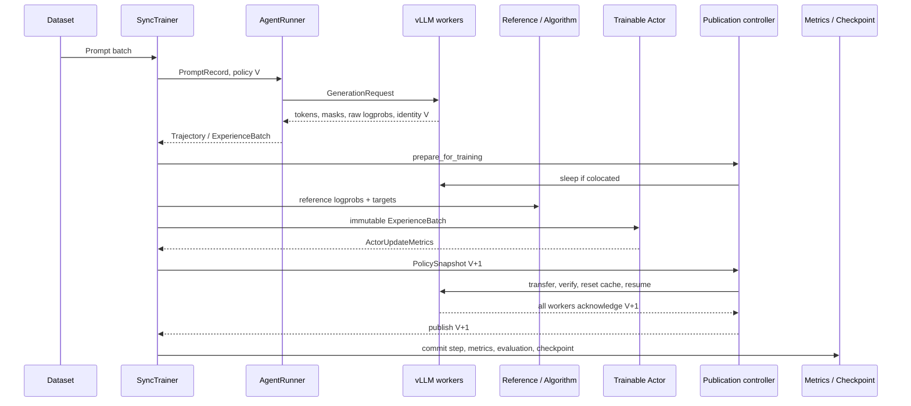

# Hyper-RL 架构

Hyper-RL 的同步路径由 `SyncTrainer` 编排：先消费已发布策略生成的数据，完成更新、传输和worker确认后提交下一策略版本。
独立的 rayless 异步路径复用角色与发布组件，见文末[异步合同](#rayless-asynchronous-grpo)。
本文维护状态所有权与失败语义；配置及运行命令见 [vLLM](vllm_rollout.md)、
[一致性](qwen3_training_inference_consistency.md)和[运行镜像](../docker/README.md)。

内置算法包括 GRPO/PPO/GSPO，接入状态与实际验收范围分开；模型、Native/Hyper rollout、学习、发布及拓扑范围见 [README](../README.md#支持范围)。
Agentic 的内部 runner 保留环境循环；Codex 与 DeepSeek Harness 使用真实逐调用轨迹和 episode GRPO，见 [Agentic RL](agentic_rl.md)。

## 系统视图

设计目标与取舍见[设计原则](design.md)。统一入口和编排器连接以下三条主线：

- **共享模型语义**：Trainer 与 Hyper-vLLM 使用同源 Qwen3 参数语义和 HyperParallel sharding contract。
- **Token-first 数据流**：`PromptRecord → Trajectory → ExperienceBatch`，生成 token 直接进入训练。
- **Verified policy 状态流**：Actor 产生 V+1，经 layout-aware 传输、identity 校验和 cache reset 后才替换 rollout 可见的 V。

`SyncTrainer` 串行控制 rollout、learning 和 publication，metrics、evaluation 和 checkpoint 只在发布成功后执行。vLLM upstream 负责 endpoint 内部的 DP request routing；Trainer TP>1 时，每个 TP group 只有一个 request owner 发起 HTTP 请求，结果随后广播给该组的其他 ranks。

## 控制面

入口 `train_rl.py` 读取 YAML 和严格的 dot-path CLI overrides，然后构造 `SyncTrainer`。初始化分为三步：

1. `rl/config.py` 校验模型、数据、算法、并行度、deployment、weight sync 和 consistency 组合。
2. Actor 和按算法需求选择的冻结 Reference 通过共享模型构建入口加载；Qwen3 dense 使用 `rl.roles.qwen3_builder.build_causal_lm`，Qwen3-MoE 与 Qwen3.5 家族使用公共 text AutoModel。
   PPO 的 `roles/policy/critic.py::build_value_model` 在标准模型构建前后边界接入价值头，
   所有参数在 TP/FSDP 规划前存在，随后由同一 HyperParallel 加载器完成构建。
   FSDP/TP、optimizer、gradient clipping 与 checkpoint 复用 master 公共能力。
3. Rollout registry 构造一个 backend-neutral `GenerationEngine`，当前实现为共享 vLLM deployment。

Trainer 初始化失败或训练退出时调用 `rl/utils/process_cleanup.py::cleanup_processes`，依次关闭 tracker、
rollout manager 和 rollout engine，再调用同文件的 `destroy_process_group` 销毁默认进程组，清理
mesh、layout、FSDP、P2P 和 redistribution 缓存。P2P 缓存使用 native-core 所在位置，
销毁失败时仍清理缓存；底层函数抛出的 RuntimeError/ValueError 由总清理入口记录为告警。
初始化及模型构建继续复用共享 runtime；共享 DeviceMesh 负责清理其内部注册表。

初始化或训练失败时，Trainer 在进入清理前记录原始异常。设置 `HYPER_RL_FAILURE_DIR` 后，
`rl/utils/failure_reporting.py` 将首个 rank 异常原子写入独立 attempt 目录；不调用设备或 collective。
宿主实验监督器读取 `failure-rank-*.json`，并兼容阶段日志中的 `status=failed`，在正常完成标记之前判定失败。
监督器只停止该 attempt 记录的容器 ID，限时停止、必要时强制终止并确认退出；训练错误不自动重试。
这是宿主监督与训练错误上报合同，不表示损坏的通信组总能自行正常清理，也不以低利用率判定失败。
没有宿主监督器的普通启动仍依赖启动器处理进程退出；仅设置报告目录不会自动终止其他 rank。

RL概率模式由 `train.token_log_probs_mode` 控制：`auto` 保持既有家族行为（Qwen3 dense、Qwen3.5分块），
`dense` 保留普通完整logits路径，`selected_chunked` 显式启用RL统一的动作位置分块概率。
`train.token_log_probs_chunk_size` 默认为512，范围1–512；只限制输出层投影位置数，不改变完整decoder上下文。
Actor/old/reference共用 `roles/policy/token_log_probs_adapter.py` 和 `token_log_probs.py`，
训练时按块重计算，参考前向不建反向图；未选择位置返回零且必须从loss中排除。
显式新模式限Qwen3/Qwen3.5 text、TP1 GRPO、consistency关闭且无蒸馏；当前GSM8K配方关闭该模式，
采用状态与结果边界见[GSM8K 配方](../examples/gsm8k/README.md)。
普通模型实例不自动启用该RL适配。Qwen3.5原有root不reshard限制继续保留。

同步路径由 `SyncTrainer` 编排。Algorithm 不启动进程、不管理设备，也不执行 checkpoint；它只声明：

- 需要哪些角色，例如 Reference 或 Critic；
- 需要哪些数据，例如 rollout logprobs、reference logprobs、values 和 returns；
- 如何构建 advantage/return；
- 如何计算 Actor/Critic loss。

GRPO、PPO 和 GSPO 共用 SyncTrainer。GSPO 在 Qwen3 dense 路径上使用分组优势、序列级重要性比率和等权序列损失；默认零 KL，不创建 Reference 或 Critic。
三种算法只在 `kl_coef > 0` 时请求 Reference；PPO 仍创建独立 Critic，固定 old values / returns 后更新两种角色，
仅发布 Actor 权重。PPO 的配置、数据语义和实际验收范围见 [PPO 配方](../examples/gsm8k/configs/qwen3_4b_gsm8k_ppo.yaml)。

可选共卡 RM 由 `rl/reward_model/` 持有冻结 vLLM 服务；业务评分函数位于 `examples/`。Trainer 仅在内部 Qwen3 Dense 的模型模式下安排 `rollout sleep → RM wake/score/sleep → Actor update`，并在评估、保存恢复和退出时核对服务状态。默认规则环境直接评分，不创建 RM。接口及验收边界见[共卡 RM 合同](reward_model.md)。

### master 模型接入

可选 OPD/MOPD 由 `rl/distillation/` 管理冻结外部教师客户端和按样本路由，复用同一个 SyncTrainer。
Teacher 只对学生的原始 token 评分，不参与 optimizer 或学生权重发布。
Batch 分别保留原始采样概率、更新前重算概率和教师概率；任务目标与 k1 PG 蒸馏分别计算。
纯 OPD 不请求任务优势、Reference 或 Critic；MOPD 每条样本只选择一个 tokenizer 兼容的 Teacher。
失败在 Actor 更新前跨 rank 传播；工具观察和 DP padding 无 loss。
Checkpoint 绑定蒸馏目标与教师元数据身份。完整合同、配方和测试见
[OPD/MOPD 示例](../examples/distillation/README.md)。

当前代码文件清单、隔离适配边界、回退范围和验证状态见 [模块导航](../../../docs/rl-navigation.md)。

`rl/config.py` 将YAML转换为共享Trainer、Optimizer和FSDP配置。Actor/优化器由
`train.accelerator.cpu_offload`控制，Reference可通过`reference_cpu_offload`独立覆盖；省略时继承Actor设置。
共卡设备驻留要求GRPO、consistency off；独立Reference卸载另限Qwen3 dense TP1；Reward Model仍要求CPU offload。
发布前等待HSDP流并重新分片，检查参数和优化器矩状态的设备，允许CPU标量计步器。

`offload_during_rollout`独立控制阶段卸载，默认false；仅支持共卡Qwen3 dense TP1 GRPO、consistency off，不含蒸馏或Reward Model。
它复用HSDP模型转换，将参数、缓冲、FP32主参数及优化器状态移至CPU，保持对象身份；
训练前睡眠vLLM并恢复各张量原设备。更新后先发布权重、再卸载训练状态、最后唤醒KV；
验证期间保持卸载，checkpoint前释放推理显存并恢复训练状态。操作要求梯度已清空，使用阻塞拷贝。
`residency/{offload,restore}_{seconds,bytes,allocated_before,allocated_after}`记录搬运开销；
卸载已计入`timing_s/weight_sync`，恢复单列为`timing_s/restore_training_state`。
共享转换清理失效flat buffer；权重接收确认后再释放闲置缓存，失败时不唤醒rollout或提交新版本。

`gradient_sync_each_micro_batch=true`逐微批归约，默认false时常驻模式延迟到mini-batch末尾；
CPU offload始终逐微批归约。两者保持每个mini-batch一次更新，延迟归约需要更多梯度显存。
`comm_fusion_zero_copy`直接传递共享FSDP选项，省略/null沿用底层默认。

Actor、old log-prob、Reference分别使用`max_tokens_per_micro_batch`、
`old_log_prob_max_tokens_per_micro_batch`、`reference_log_prob_max_tokens_per_micro_batch`；省略/null使用固定条数。
当前支持Qwen3 dense TP1 GRPO、consistency off、无蒸馏，要求完整轨迹和连续右padding。
预算包含prompt、response和padding；超预算序列独立成批且不截断，单样本容量仍需实机验收。
Actor在原optimizer mini-batch内排序并复用`FirstFitPackingSelector`，保持成员、更新次数及有效action-token归一化。
各DP rank拆分分组以对齐FSDP调用次数，无法无空批对齐时失败；概率前向恢复原行序与输出形状。
这不是跨样本packed attention；`train/micro_batches_per_rank`、`input_tokens`、`padded_input_tokens`、
`padding_fraction`记录分批工作量，其中token统计跨DP并计入所有policy epochs。

实验性`balance_dp_tokens`默认关闭，仅在同一全局optimizer mini-batch内跨DP交换完整行，要求各rank条数相同。
顺序为完整组优势→重分配→old/reference→更新，避免在残组上重算GRPO；保留身份、掩码和全部目标字段。
`timing_s/balance`须计入总时间；该开关不改变三个阶段的独立预算，也未纳入默认精度配方。

`rl/roles/model_setup.py` 只调用模型及优化器构建入口、冻结 Reference，不实现 Qwen3 的 forward 或并行切分。
纯 TP 场景继续启用 size-one FSDP，以保留 checkpoint 布局和 TP-replicated 参数的梯度归约。

普通训练（`consistency.enabled=false`）使用共享 Qwen3 的 RMSNorm 和 GQA 替换。
QKV 按 KV head 分组；MLP 保留 Transformers 原生 gate/up/down 三个投影及其通用 TP 规则，
不启用要求分段切分的 fused SwiGLU replacement。模型配置中的 head dimension 与 tied embeddings 保持原样。
`rl/roles/qwen3_builder.py` 只在本次 Qwen3 实例上提供别名完整的 planner 视图、FSDP 前的 tied 参数绑定、
以及物化后的别名恢复；共享模型加载器、planner、classifier 和参数切分函数均保持 master 原版。
Hyper-vLLM 的 Qwen3 也使用这一限定模型范围的 planner/apply 入口，不安装全局 monkey patch。
RL 的 Qwen3 构建兼容集中于 `rl/roles/qwen3_builder.py`；主项目使用共享 AutoModel 和 Qwen3 adapter。
一致性分支使用原有 HF attention recipe，
其 GRPO 验证结果不自动扩展到新增的 PPO 组合。

vLLM 的 `HyperQwen3ForCausalLM` 继续提供 paged attention/KV cache；Native-vLLM 选择保持不变。
用于训推一致性的模型适配位于 `rl/roles/rollout/consistency_models/<family>/`；
一致性校验仍由 `consistency.enabled` 控制。公共服务与生成生命周期保留在
`rl/roles/rollout/`；目录职责及导入迁移见[模块归属](../../../.agent/rules/rl/module-map.md)。
独立的 `hyper_parallel/rl/pyproject.toml` 声明 vLLM 插件入口。Docker 启动脚本通过
`docker/install_runtime.sh` 在容器临时目录构建安装，源码仍从只读挂载的 checkout 导入。

## 边界合同

跨组件传递的是少量显式对象，而不是隐含的字典约定。

| 合同 | 生产者 → 消费者 | 保证 |
| --- | --- | --- |
| `ModelRegistration` | Config → Trainer / rollout / weight sync | 模型家族、checkpoint、tokenizer、tied embedding 和 rollout implementation 使用同一身份 |
| `PromptRecord` | Dataset → AgentRunner | 稳定 prompt ID、messages、ground truth 和原始 token metadata |
| `GenerationRequest/Result` | AgentRunner ↔ GenerationEngine | backend-neutral 请求；返回 token IDs、response mask、FP32 raw logprobs 和 worker policy version |
| `Trajectory` | AgentSession / AgentProgram → batch builder | 完整 episode 或其中一次真实模型调用的 token、action mask、共享 episode 奖励和终止原因 |
| `ExperienceBatch` | batch builder / preparer → Actor / Critic | padding 后的二维 tensor 合同，以及与 next-token position 对齐的训练字段 |
| `PolicySnapshot` | Actor → publication controller | 单调递增版本、模型身份和待发布 Actor payload |

### Token-first 不变量

`GenerationResult.sequences` 中的 token IDs 是训练输入的权威来源，不能 decode 后重新 tokenize。所有训练字段围绕这些 token 对齐：

```text
sequences            [batch, tokens]
attention_mask       [batch, tokens]
action_mask          [batch, tokens]
loss_action_mask     action_mask[:, 1:]
old_log_probs        [batch, tokens - 1]
advantages           [batch, tokens - 1]
reference_log_probs  [batch, tokens - 1]
returns / values     [batch, tokens - 1] when required
```

策略生成的 EOS 是 action。Prompt、padding、环境 observation 和 EOS 后 token 不参与 policy loss。当前同步模式下，一个 `ExperienceBatch` 中的所有 trajectories 必须携带同一 worker policy version。当前以一条 token 序列及 turn span 表达轨迹；上下文压缩、历史改写和分支轨迹尚无完整训练合同。

### Agent 边界

默认 internal 路径的 `RolloutManager` 将运行配置收敛为 `AgentRunner + GenerationSettings`。AgentRunner 负责：

- 配置 rollout seed 时，为每个 prompt/sample 建立稳定 row seed；
- 驱动 single-turn 或 multi-turn `AgentSession`；
- 调用环境、工具与 reward；
- 将 observation/action 映射为 token-aligned turns；
- 输出一个完整 episode 的 `Trajectory`，或带完整调用身份的逐调用 `Trajectory` 元组。

`ProgramAgentRunner` 已通过内置 Codex / DeepSeek Harness 接入配置驱动的训练入口，复用同一轨迹与 batch 合同。任意自定义 runner 尚不能直接在 YAML 中接入，仍需适配 runtime、factory、manager 与配置校验；程序化路径的已验证范围见 [Agentic RL](agentic_rl.md) 和 [Code Agent](swe_smith.md)。

### Agentic Harness

`agentic.runner` 选择内部环境循环、Codex CLI 或 DeepSeek Harness。三条路径最终都产出同一个 token-first
`Trajectory` 类型；外部 program 每次调用一行，由 `dataset/episodes.py` 统一校验和分组。
模型返回的 token ID 和 sampled-token raw logprob 是训练证据，工具与环境内容只作为非训练上下文。

Codex 和 DeepSeek 通过本地协议 gateway 复用共享 vLLM endpoint，不创建第二个 rollout Router。
Trainer TP 组只有 request-owner rank 执行外部 harness，完整 trajectory 经对象 collective 同步给同组 rank。
每个 episode 开始和结束均校验整数 policy version。配置、接入边界与验证范围见 [Agentic RL](agentic_rl.md)。

## 一个训练步



这里的提交顺序很关键：

1. Rollout 在请求前后都验证 worker identity 没有变化。
2. 开启 consistency 时，Trainer 在 optimizer update 前 replay 同一批 token；不一致会终止该步。
3. Actor update 可以产生本地 V+1，但 `global_step` 此时尚未前进。
4. 只有 publication transaction 成功，`SyncTrainer` 才把 step 提交为 V+1，并允许记录指标或 checkpoint。

因此，训练进度代表“已经发布给 rollout 的策略”，而不是“Actor 曾经执行过一次 optimizer step”。

普通 RL 默认使用 `train.old_log_prob_source=rollout`。显式设置为 `actor` 时，
Trainer 在更新前重算并冻结训练侧概率，作为重要性比率的分母；原始采样概率继续保存在
`rollout_log_probs` 中，便于诊断。仅开启日志诊断不会改变分母；OPD 仍保留其既有重算行为。
内部 runner 使用 actor anchor 且关闭 consistency/OPD 时，可设置 `rollout.collect_log_probs=false`
省去推理侧概率计算和传输；此时不报告 Actor 与 rollout 概率差异，不能把重算值冒充采样概率。
该选项默认为 true。`rollout.seed` 控制逐轨迹稳定 seed；设为 null 时不向请求传入 seed，
可用 `rollout.vllm.seed` 设置引擎随机状态。引擎级 seed 不保证改变请求调度后仍逐条复现回答。
`rollout.vllm.disable_log_stats=true` 将统计开关传给 vLLM，默认 false；关闭后不能依赖其服务端性能统计。
`rollout.vllm.task_queue_enable=1/2` 可单独设置推理子进程的 Ascend 算子下发队列等级；
未配置时继承环境，设置此项不修改 Trainer 进程的队列模式。
`evaluation.at_end=true` 可在最后一次策略发布后评估，而无需保存 checkpoint；默认值为 false。
`evaluation.before_train=true` 在训练循环前评估当前策略（恢复时为恢复后的版本）；
`evaluation.every_n_steps` 为正整数时独立于保存间隔触发验证，0 关闭周期验证，省略或 null 沿用保存边界。
周期验证与末步验证重合时只执行一次。
AdamW 的 `train.optimizer.no_decay_params` 默认为 `[bias, norm, ln_]`，显式空列表表示所有参数参与 decay。

## 状态所有权

| 状态 | 唯一所有者 | 可见性规则 |
| --- | --- | --- |
| `global_step` | `SyncTrainer/RLTrainerState` | policy 发布成功后才前进 |
| `epoch` | `SyncTrainer/RLTrainerState` | 数据迭代耗尽、重新建立迭代器时推进 |
| `consumed_samples/tokens` | `RLTrainerState` | 当前保存与恢复字段，但训练步未累加；不作为实际消费量指标 |
| Actor weights、optimizer、scheduler | `Actor` | 训练侧立即更新；rollout 侧必须经过 publication |
| Reference weights | Frozen `Actor` | 运行期间不更新 |
| Algorithm requirements 与数学 | `RLAlgorithm` | 初始化时选择，step 内保持不变 |
| Episode token/turn state | `AgentSession` | 完成后冻结为 `Trajectory` |
| Rollout policy version/phase | `ActorRolloutWeightSync` | pending version 在提交前不可生成 |
| Worker weights 与 KV cache | vLLM workers | admission 打开前必须完成版本提交和 cache reset |
| Durable resume state | `RLCheckpointManager` | `checkpoint_complete.json` 最后原子发布 |

这个所有权表是判断新功能应该放在哪里的依据。新逻辑如果需要同时修改多个所有者，必须先定义新的跨边界合同，不能依赖读取另一个组件的内部字段。

## 两种 Deployment

Colocated 与 disjoint 共用 Trainer、GenerationEngine、Agent contracts 和 publication API；差异只在资源 residency 与 transport。

| 维度 | Colocated | Disjoint |
| --- | --- | --- |
| 设备 | Trainer 与 rollout 共享完整 NPU 集合 | Trainer 与 rollout 使用不相交设备 |
| Rollout residency | 训练前 sleep，发布后 wake | 长期 resident |
| 发布期间 | scheduler 与设备内存按阶段切换 | pause admission，worker 保持 resident |
| Weight transport | NPU IPC | HCCL |
| 成功提交 | wake weights → transfer → verify → reset cache → resume | pause → transfer → verify → reset cache → resume |
| 失败状态 | 保持不可生成或重新 pause | admission 保持关闭 |

Colocated controller 的主要状态为：

```text
rollout(V) -> training -> publishing(V+1 pending) -> rollout(V+1)
```

Disjoint 不需要 training residency 切换，但 publication 期间仍会关闭 admission。两者都不允许 generation 观察 pending policy。

## 权重发布与失败原子性

运行时只检查 worker 提交的整数策略版本；generation 前后版本必须一致。正常训练不计算内容摘要，也不写参数清单。

默认使用 packed full-gather：按稳定名称逐参数 materialize，只有 Trainer rank 0 打包完整参数，worker 通过 vLLM `load_weights()` 加载；每个 ACK 后释放当前 bucket，不物化整份模型。`bucket_size_mb` 是合桶阈值，单个超大参数可以超过该值。TP1/TP2 均可显式选择 direct-reshard，只传输 source/destination layout 的交集，并继续严格限制 fragment 大小。

两种策略共用 Qwen3 dense 的 canonical adapter、DP/TP 布局与事务校验。Qwen3-MoE 通过同一同步边界处理专家参数；仅支持共卡 native vLLM，具体 TP/EP/EDP 组合见 [MoE 说明](moe_code_agent.md)。Qwen3 dense 保留 colocated、disjoint 与适用的 Bit-Exact 路径。

共享 Qwen3 的融合 QKV 权重由 RL 的 `weight_sync/model_adapter.py` 描述为标准 HF 权重的行区间。
full-gather 按物理融合参数合桶，接收方按元数据还原 Q/K/V 后调用 vLLM `load_weights()`；
不会额外 gather 三次 QKV。direct-reshard 在本地 FSDP/TP 分片与这些行区间之间求交，
继续使用现有的 fragment 限额、IPC/HCCL 路由和事务提交机制。未融合参数保持原有协议。

融合后的 DCP 使用模型实际参数布局，恢复任务应采用相同的模型适配配置。
迁移前的 HF 参数布局 DCP 不能直接作为融合模型的续训 checkpoint；可先在原运行时导出 HF 模型，
再作为新训练的初始模型加载（这不迁移 optimizer 和训练进度）。HF 导出始终还原原始参数命名和布局。

任何权重同步阶段失败都会跨 Trainer rank 传播并终止当前运行。系统不执行 abort、策略 fallback 或同进程恢复；失败时 rollout version、Trainer `global_step` 和 checkpoint 都不会提交。

同步实现通过跨 rank 错误传播处理 rollout、publication 和 checkpoint 失败；进程退出、通信超时等新增多节点故障场景仍需独立设计与验证。

## Checkpoint 与恢复

Checkpoint 生命周期由顶层 `rl/checkpoint.py::RLCheckpointManager` 持有，不属于在线 Weight Sync。

Checkpoint 包含：

- Actor distributed state；PPO 还包含 Critic backbone 与 value head；
- 每个可训练角色独立的 optimizer 与 scheduler；
- CPU/NPU RNG；
- stateful dataloader；
- global step、epoch 和消费计数字段（当前消费计数未在训练步累加）；
- 完整 resolved config。

模型 state collective 保存，rank-local runtime state 分 rank 保存，最后由 rank 0 原子写入
`checkpoint_complete.json`。缺少完成标记、world size 不一致或 Critic 所有权不匹配时拒绝恢复。
恢复 optimizer 使用 RL 局部的 `SkipDTensorDispatch`，覆盖共享 optimizer 的惰性 fused 初始化。

`save_final=true` 时，最终还会通过 HyperAutoModel `CheckpointManager.save_pretrained` 将完整 Actor 权重导出到 `step_N/hf/`，由所有 rank 参与参数聚合，rank 0 保存 HF safetensors、模型配置与 tokenizer。导出保留权重实际 dtype 和原始 HF 参数命名，可直接作为 Transformers/vLLM 的模型目录；rank 0 需要容纳完整 CPU state dict 的内存。该目录只用于推理，续训仍指定 `step_N/`。HF 导出失败会终止运行，但已完成的 DCP 续训数据仍可恢复。

导出配置的 `architectures` 使用 `ModelRegistration.hf_architecture`，避免 Transformers 把训练时动态生成的 `HSDP*` 包装类名写入推理配置；导出过程也恢复 live model 的原生架构标识。

最终保存仅复用本轮已经成功写出的同一步 checkpoint；从其他目录恢复或零步结束时也会写出最终状态。`verify_reload=true` 在 HF 导出前重新加载最终 DCP 模型。恢复时最后设置 CPU/device RNG，避免其他状态加载消耗恢复后的随机序列。

Resume 后，如果 Trainer step 高于 rollout 初始版本，Trainer 会在第一次 generation 前先发布恢复后的 Actor，保证 rollout 从相同 policy version 继续。

## 扩展点

| 扩展 | 接口 | 不应改变的边界 |
| --- | --- | --- |
| 新算法 | `register_algorithm` + `RLAlgorithm` | 显式声明 role/data requirements；训练编排仍由 Trainer 负责 |
| 新 advantage | `register_advantage_estimator` | 输入输出保持 next-token 对齐 |
| 下游 rollout backend 适配 | `RolloutEngineRegistry` + `GenerationEngine` | 返回 authoritative tokens、mask、logprobs 和 policy version |
| 新环境 | `agentic.module_path` + Environment | 最终输出 `Trajectory` |
| 程序化 Agent | AgentProgram / ProgramAgentRunner | 内置 Harness 已接入；新增 runner 需适配，边界见 [Agentic RL](agentic_rl.md) |
| 新 reward | 在任务环境或 `examples/` 的 Agent 中计算 | reward 与 trajectory/group identity 对齐 |
| 新模型 | `ModelRegistration`、HyperAutoModel 与 rollout adapter | 训练/推理参数语义和 weight layout 必须可映射 |

注册成功只代表组件可构造，不代表具备端到端支持。新能力还需要 shipped recipe、代表测试和对应运行门禁。

## 演进边界（规划）

单节点异步已有独立实现，遵守下节的分组、滞后、发布与恢复合同，不再以 Ray 调度作为前置假设。
多节点、更多并行组合、多模态与世界模型仍按[支持范围](../README.md#支持范围)和
[规划方向](../README.md#规划方向)分别推进，不能由主项目能力推导为 RL 已支持。
新场景仍需保留真实生成上下文、策略身份、奖励证据与明确的副作用语义；外部工具不承诺 exactly-once。

## 阅读代码

需要定位具体实现时，参阅 [模块导航](../../../docs/rl-navigation.md)、[PPO 配方](../examples/gsm8k/configs/qwen3_4b_gsm8k_ppo.yaml)
和 [测试入口](../README.md#系统测试)。架构文档不重复维护函数级路径。

公共 token 计数和优势/价值统计不依赖采样 log-prob 返回。
缺少独立采样概率或未执行诊断前向时，只报告 `training/rollout_probs_diff_valid=0`，不构造概率差值；
`training/total_tokens` 和对应吞吐继续按有效样本统计，排除 DP 补齐样本。

## Rayless asynchronous GRPO

`examples/async_training/launch.py` composes the existing roles with an independent asynchronous loop. `SyncTrainer`
retains its synchronous loop and strict version defaults. The supported scope is single-node Qwen3 dense GRPO with
disjoint vLLM devices, using internal single-turn tasks or Codex Search/Code/SWE-Smith programs. PPO, MoE, Qwen3.5,
internal multi-turn, model rewards, distillation and synchronous consistency gates are rejected. Codex inline evaluation
must be disabled.

```bash
bash hyper_parallel/rl/examples/async_training/scripts/run_async_training.sh \
  hyper_parallel/rl/examples/async_training/configs/qwen3_4b_gsm8k_grpo.yaml \
  --model.weights_path=/models/Qwen3-4B --model.tokenizer_path=/models/Qwen3-4B \
  --data.train_path=/data/gsm8k/train.parquet --data.test_path=/data/gsm8k/test.parquet
```

Select nonoverlapping training/inference devices and matching parallel sizes. Search accepts `--fully-async` and
four/eight `--devices`; SWE-Smith uses its async recipe and separate `--devices` / `--rollout-devices`. Task logic
remains in examples.

Rank zero reserves capacity for complete groups; a spawned CPU producer never joins training collectives. Batches retain
original behavior probabilities, call versions and continuation segments. Staleness uses the oldest action; consumption
commits after all ranks update. Infrastructure failures retry then discard a whole group; malformed trajectory contracts
fail the run.

Publication closes request admission. Internal requests preserve aborted output and resume its exact prefix; Codex calls
drain before weights change, then subsequent calls observe the new committed version. Tool execution need not finish for
publication. Buffer limits bound serialized payloads, not total process RSS.

Checkpointing drains tasks, saves model/optimizer/RNG, then atomically commits `async_complete.json` with source cursor,
ready groups, credits and configuration identity. The latest complete checkpoint is selected automatically unless an
explicit load path is provided. Corrupt/incompatible committed state fails; restored Actor weights are republished
before sampling. External side effects are not exactly-once.

Optional `async_training.audit_dir` records events and backward tensors; audit IO affects timing. Consumed-response
diagnostics live under `rollouts/` beside the audit or checkpoint output.

UT covers protocol, publication, recovery and sync isolation. `tests/st/test_async_training.py` checks two/four-rank
CPU/Gloo updates and recovery, independently of NPU/task-quality acceptance.
