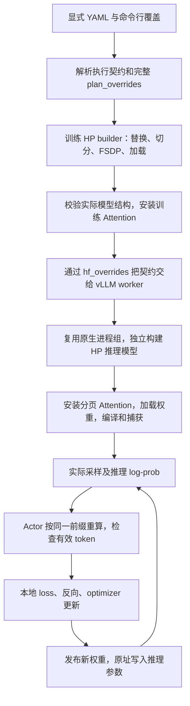

# Unified Execution：训推统一执行

Unified Execution 让 HyperParallel 训练与 vLLM 推理复用模型、参数语义和关键数值计算，
同时保留各自的执行方式：训练需要 autograd、FSDP 和本地 loss；推理需要调度、分页 KV cache 和图回放。
本文解释整个调用链、Attention、CP/PCP、TP/SP 与权重发布；
专家路由、通信和合并详见 [MoE 实现](unified_execution_moe.md)。

## 一致性比较的对象

比较前提是**同一权重版本、同一 token 前缀、同一逻辑位置**。训练 padding、CP 本地片段和
推理扁平 token 必须先恢复到相同坐标。目标是有效 token 的前向结果一致；两步 RL 示例检查
实际采样 token 的 log-prob，而完整词表 logits 由模型设备测试另外检查。

前向逐位一致不意味着反向跨并行规模逐位一致。梯度通信可能改变累加顺序，反向按独立参考和
逐参数误差门槛验证正确性。也不要求不同调度下的随机采样轨迹完全相同。
`CP=1`、`PCP=1` 不安装对应的新增适配，保持原有计算路径。

## 从配置到一次训练更新

入口是 [run_consistency.py](../examples/consistency/scripts/run_consistency.py)，
它调用正常的 `build_trainer()` 与 RL 循环，只在 optimizer 更新前增加一致性检查。
[两份显式 YAML 与运行矩阵](../examples/consistency/README.md#配置与验证矩阵) 决定两端的拓扑和组件。



配置解析在 [core/contract.py](../rl/unified_execution/core/contract.py) 和
[core/execution_plan.py](../rl/unified_execution/core/execution_plan.py) 中进行：

- `build_unified_payload()` 携带完整 `train.plan_overrides`、训练/推理各自的并行度、数值策略和指纹。
- worker 的 `parse_unified_payload()` 重新计算派生声明及指纹，防止配置漂移。
- [capture_training_structure()](../rl/unified_execution/core/validation.py) 检查实际模块、参数逻辑形状、
  参数别名及可执行 forward 路径；推理在安装缓存桥接之前运行同一结构检查。
- 训练与推理各自提供 EP 执行路径校验，允许通信实现不同，同时检查共享 router、专家所有权和数值规则。

`train.accelerator.cp` 与 `rollout.vllm.context_parallel_size` 独立，后者表示推理 PCP。
推理不会自动继承训练 CP；也不把 HP 的训练 CP wrapper 安装到推理模型。

## 模型构建与职责归属

| 层次 | 代码 | 职责 |
| --- | --- | --- |
| 执行契约 | [core/](../rl/unified_execution/core/) | 配方、数值策略、结构和能力校验 |
| 模型组成 | [models/](../rl/unified_execution/models/) | Qwen3/Dense/MoE 描述、已有构建工厂与共用绑定 |
| 数值算子 | [ops/](../rl/unified_execution/ops/) | V4 Attention、PIK、MoE 通信与合并 |
| HP 接入 | [runtimes/hyper_parallel/](../rl/unified_execution/runtimes/hyper_parallel/) | 模型构建、训练 Attention/CP、可微 EP |
| vLLM 接入 | [runtimes/vllm/](../rl/unified_execution/runtimes/vllm/) | 模型协议、并行域、缓存、图执行和权重加载 |

[trainer/build.py](../rl/trainer/build.py) 通过正常的角色模型入口调用 HP builder。
HP 负责 meta 模型构建、模块替换、并行方法和布局绑定、TP/EP 切分、FSDP、参数物化与加载。
RL 提供显式配方，不维护第二套 decoder forward 或分片算法。

Qwen3-MoE 配方中的主要替换是 RMSNorm、`GQAAttention`、attention `o_proj` 的 `PikLinear`、
`GroupedExperts`，以及 EP/CP 的方法绑定。
[replace_attention_with_pik()](../rl/unified_execution/models/bindings.py) 组合 Attention 与其输出投影的替换，
避免同时声明父、子模块替换。`PikLinear` 复用原 Parameter，后续切分和优化器仍由 HP 管理。

推理端的注册与建模是两个阶段：

1. [vllm_plugin.py](../rl/rollout/vllm_plugin.py) 注册
   [entrypoints.py](../rl/unified_execution/runtimes/vllm/entrypoints.py) 中支持编译的模型入口。
2. [model.py](../rl/unified_execution/runtimes/vllm/model.py) 先建立并行上下文，再调用
   [build_inference_model()](../rl/unified_execution/runtimes/hyper_parallel/builder.py) 构建独立的 HP 模型。
   它使用同一完整配方，按 worker 的 TP/SP/EP 拓扑应用布局；随后校验模型结构并安装缓存桥接。

`models/bindings.py` 不导入运行时。vLLM 的编译入口和可选 Ascend Attention 后端保持独立导入边界，
普通训练或配置检查不会提前加载推理编译器。

## Batch 与 TP/SP 的数值规则

### Level 3 与 Attention 补丁

[batch_invariant.py](../rl/unified_execution/core/batch_invariant.py) 在训练进程和每个推理 worker 中
分别安装、核验 `torch_npu.npu.set_deterministic_level(3)`。
默认关闭 `fill_uninitialized_memory`，但保留各算子的有效性掩码；两者含义不同。
不额外叠加 vLLM-Ascend 的全局 batch-invariant 补丁。

Attention 使用 [V4 适配](../rl/unified_execution/ops/attention/flash_attention_npu_v4.py) 和
[canonical rowsum 补丁](../docker/patches/flash-attn-npu-v4-canonical-rowsum.patch)，
使完整 KV tile 与尾块遵循同一 softmax 规约规则。只开 Level 3 不能代替这个补丁。

### PIK 固定全局规约树

[ops/pik/](../rl/unified_execution/ops/pik/) 将矩阵乘法的全局 K 维划成固定数量的 leaf。
改变 TP 只改变 leaf 的归属，不改变 leaf 内的计算和全局二叉树。

```text
输入 [..., K/TP]、权重 [N, K/TP]
    → 本地 leaf BMM [L_local, M, N]
    → FP32 固定子树 [M, N]
    → 搬运各 rank 子树，按全局固定树合并
    → 转为 BF16；SP 时返回本 rank 的序列行
```

普通 AllReduce 的树可能随 TP 改变，因此 PIK 自己拥有最终规约；HP 的输出边界声明为
已经完成规约的 Replicate，或 SP 的 Shard(1)，避免重复求和。
非 SP 训练反向仍保留 HP 的下游梯度 SUM 语义。
Dense 模型覆盖 `o_proj` 和 MLP `down_proj`；当前 MoE 配方仅对 `o_proj` 使用 PIK，专家内部没有 ETP/PIK。

## 训练 Attention 与 CP

[install_training_attention()](../rl/unified_execution/runtimes/hyper_parallel/attention.py) 安装共享 Attention
接口和模型入口元数据准备。投影、Q/K norm、RoPE、输出投影仍使用原 HP 模型。

设 batch 为 B，物理序列长度为 S，本地头数为 Nq/Nkv，head dim 为 D：

| 情况 | 输入与计算 | 返回 |
| --- | --- | --- |
| CP1、无 padding | Q/K/V 从 BNSD 转为 BSND，直接调用 dense V4 | `[B,S,Nq,D]` |
| CP1、有 padding | 只取有效行为 `[T,N,D]`，用每个样本的累计长度调用 varlen V4 | scatter 回 `[B,S,Nq,D]`，padding 行为零 |
| CP>1 | 本地 Q `[B,Nq,S/CP,D]`，先汇聚全局 K/V，再按文档前缀打包 | `[B,S/CP,Nq,D]` |

元数据在模型入口准备一次，decoder 层复用。去 padding 只发生在 Attention 核心，不能理解为
整个模型的 embedding、线性层或 RL batch 都没有 padding。不同样本通过各自累计长度隔离，
不会把两个样本或 packed 文档当作同一个因果序列。

### CP 的前缀算法

`unified_cp_attention_wrapper()` 通过 HP 的方法替换协议绑定已有 CP mesh，保留原 attention forward。
[flex_cp_allgather](../../distributed/context_parallel/collectives.py) 负责可微 K/V 通信。
对一个文档内本地查询区间 `[a,b)`，调用的是：

```text
Q = Q[a:b]                长度 b-a
K/V = K/V[:b]            长度 b
右下对齐 causal mask    第 i 个本地 Q 可见到 a+i
```

V4 仍按完整 KV 前缀进行一次 Attention，没有跨 CP 的 softmax、LSE 或 attention output 合并。
这保留了前向规约顺序；K/V 的反向通信可能改变浮点累加顺序，因此梯度验证使用容差。
空查询 rank 仍参与 K/V 前向与反向通信，避免通信次数不一致。

### RL 坐标与 loss

[workers/adapters/context_parallel.py](../rl/workers/adapters/context_parallel.py) 在**全局序列**上生成
next-token labels，再调用 `CPBatchSharder` 切片。这样一个 rank 的最后一个 query 仍预测下一个
rank 的首 token；RoPE 使用全局位置，padding mask 也保持全局坐标。

Actor 的训练 loss 留在 CP 本地；仅对 detached 的 old/reference log-prob 汇聚每 token 的标量，
不汇聚完整词表 logits。末尾虚拟 label 和对齐 padding 由零 loss mask 排除。
[actor.py](../rl/workers/actor.py) 区分逻辑 DP 与 DP×CP 梯度域，按全局有效 token 数缩放 loss，
补偿梯度平均；同一 TP×CP 组只提交一次 rollout 请求。

## 推理 Attention 与 PCP

[attention/bridge.py](../rl/unified_execution/runtimes/vllm/attention/bridge.py) 把 HP 的
`[1,N,L,D]` Q/K/V 转成原生调度行 `[T,N*D]`，剔除 HP SP 对齐行；随后恢复 `[1,L,Nq,D]` 输出。
原生调度产生的请求、图 bucket 和 PCP padding 仍由 vLLM 元数据解释。

[attention/ascend_v4.py](../rl/unified_execution/runtimes/vllm/attention/ascend_v4.py) 保留原生 KV 写入，
把缓存、block table、query 起点和每请求 KV 长度交给共享 V4：

```text
GQAAttention 的 QKV / RoPE
    → vLLM Attention
    → 原生 slot_mapping 写入 KV cache
    → UnifiedAscendAttentionImpl.forward_impl
    → V4 直接读取 paged KV；原址写入 output
```

KV 按逻辑 `[pages, block_size, Nkv, D]` 视图读取，物理 strides 由后端保留。
`UnifiedAttentionMetadataBuilder` 在图捕获外准备/刷新设备元数据，避免捕获中临时构建调度信息。
prefix cache、chunked prefill、decode 和 `FULL_AND_PIECEWISE` 继续由原生 runner 管理。

PCP>1 复用 Ascend MRV2 的 prefill 分段、decode 请求归属、KV 汇聚与缓存机制。
局部 Q 仍匹配完整 KV 前缀，不进行跨 PCP 的 Attention 部分和规约。
HP 推理模型的 CP 维度保持 1；worker 数是 `DP × PCP × TP`，调度器副本数仍是 DP。
专家域与跨 PCP 分片见 [MoE 所有权](unified_execution_moe.md#专家域与权重所有权)。

仅 PCP>1 worker 将返回概率适配为以下公式，输入来自推理自身：

```python
# logits: [R,V]，原生采样/top-k 已选定 token_ids: [R,K]
logits.float().log_softmax(dim=-1).gather(-1, token_ids.long())
```

这对应 [compute_pcp_token_log_probs()](../rl/unified_execution/runtimes/vllm/model.py)，
只统一最后的概率规约，不改变采样 token、top-k IDs 或排名，也不从 Actor 回填结果。
PCP1 不安装该适配。FP32 全词表临时结果需要按 R×V 预算显存。
PCP-only 不保证 KV cache 显存按 PCP 倍数下降；收益取决于 prefill 占比与通信成本。

## 权重加载与在线发布

[rl/weight_sync/](../rl/weight_sync/) 拥有发布协议，
[LogicalWeightLoader](../rl/unified_execution/runtimes/vllm/weights.py) 拥有统一模型的权重解释。
两端进程和物理布局独立，通过 HF 逻辑名称及张量含义衔接：

```text
训练参数 / DTensor → full_gather 发布桶与转换元数据
    → 推理 worker 恢复逻辑 HF 权重
    → HP WeightConverter 逆映射得到融合参数的全局行
    → 与当前 TP/EP shard 求交
    → copy_ / index_copy_ 写入原 Parameter
```

Q/K/V 可以独立到达，不必暂存完整融合投影。专家的逐专家 HF 权重转换为 HP EIO 区域，
只写本 rank 拥有的专家。`begin()`/`finish()` 检查重复、缺失和 tied aliases 的一致性。
原址写入保留图持有的参数地址，下一次回放使用新权重。
PCP 发布将 DP×PCP 作为接收副本坐标，保持实际 TP 宽度，覆盖所有 worker。

## 支持范围与验收

当前统一路径覆盖 Qwen3 Dense/MoE 的已验证配置。训练使用 FSDP/TP/SP/CP/EP，推理使用
DP/TP/SP/PCP/EP；支持这些轴不等于所有组合都已验收。
CP 可选 1/2/4，PCP 可选 1/2/4，PP 与 GQA DCP 固定为 1。

CP>1 的 RL 路径限定同步 token-mean GRPO、dense token log-prob、BF16、Level 3、V4 和 PIK；
MoE 两侧需 EP>1。动态 token batching、DP balancing、AC、loss parallel、R3、Critic/PPO 和蒸馏
不在该 CP 路径范围。任意 Attention bias 和滑窗也不受支持。
`TP1/DP2/EP2 + PIK` 推理仍存在重复绑定限制；不要把可解析的拓扑当作完整模型验收。

| 检查 | 入口与判定 |
| --- | --- |
| 正常 RL 训推前向 | [两步示例](../examples/consistency/README.md)：每步有效 token 非空、有限，采样 log-prob 最大/平均差值为 0 |
| CP 算子和模型 | [test_context_parallel.py](../tests/st/test_context_parallel.py)：有效 logits/概率前向逐位对照，完整参数梯度与 CP1 参考比较 |
| PCP 通信、缓存和发布 | [test_prefill_context_parallel.py](../tests/st/test_prefill_context_parallel.py)：专家域、分页 Attention 非图/图、完整两步 RL |
| MoE 路由和反向 | [MoE 验收](unified_execution_moe.md#验证与性能边界) |

模型梯度要求每个张量 `||Δg||₂ <= 0.02*||g_ref||₂ + 1e-7`，
且 `max|Δg| <= 0.05*max|g_ref| + 1e-7`；缺失或非有限梯度直接失败。
小型模型的逐参数对照已经通过；原始完整 Qwen3-MoE 的对照曾有超门槛项，尚不能宣称其全部梯度验收完成。
四层模型的非零更新与发布通过，也不能替代原始完整模型的逐参数检查。

## 运行环境

当前示例面向 Linux ARM64 / Ascend 910B；固定镜像包含 CANN 9.2.1、PyTorch 2.10.0、
torch-npu 2.10.0.post7、vLLM/vLLM-Ascend 0.30.0 和 Transformers 5.14.1。
运行时另加载带 canonical rowsum 补丁的 `flash_attn_npu-0.5.0+hpbi1` wheel。
安装、镜像身份和 wheel 校验见 [示例环境准备](../examples/consistency/README.md#本地复现)，
构建方式见 [Docker 文档](../docker/README.md#构建-v4-补丁-wheel)。
这组依赖是当前已验证环境，不代表其他版本或设备只凭导入成功就达到数值一致性。
