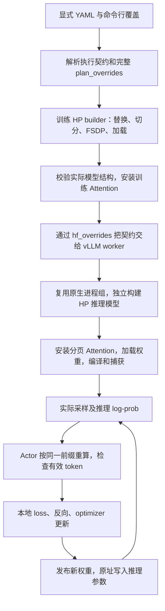

# Qwen3 训推统一执行实现

同一份 Qwen3 权重在两个进程中执行：Actor 使用 HP 模型进行评分、反向传播和更新；vLLM worker 独立构建 HP 模型，使用原生调度、分页 KV 和图回放生成 token。两端通过逻辑权重、全局 token 位置和相同的前向规约顺序对齐。

建议沿一份实际配方阅读。[四层 MoE 的 CP/PCP 配方](../examples/consistency/configs/qwen3_moe_4l_cp_rl.yaml)在训练侧配置 TP2、SP、CP2、EP2，在推理侧配置 DP1、TP2、PCP2、EP4，关闭推理 SP。四张卡在两端承担不同的 token 和专家分片；下文以这份配方解释 Attention、MoE 和权重发布如何衔接。适配其他模型时的技术选型和放行方法见[训推一致实现指导大纲](unified_execution_design.md)。

按一次前向的数据流，可以从[模型构建](#模型构建与职责归属)读到[行投影](#pik-固定全局规约树)、[训练 Attention](#训练-attention-与-cp)、[推理分页 Attention](#推理-attention-与-pcp)和[MoE](#moe-与专家并行)。需要排查“第一次生成正确，更新后开始偏离”时，可直接查看[权重发布](#权重加载与在线发布)和[验收口径](#支持范围与验收)。

## 一致性比较的对象

比较前提是**同一权重版本、同一 token 前缀、同一逻辑位置**。训练 padding、CP 本地片段和
推理扁平 token 必须先恢复到相同坐标。目标是有效 token 的前向结果一致；两步 RL 示例检查
实际采样 token 的 log-prob，而完整词表 logits 由模型设备测试另外检查。

前向逐位一致不意味着反向跨并行规模逐位一致。梯度通信可能改变累加顺序，反向按独立参考和
逐参数误差门槛验证正确性。即使固定前缀的概率相同，采样随机数不同也可以选出不同 token。诊断时应保存一次 rollout 的实际 token IDs，让 Actor 对这条轨迹重算。数值差的最大值为零和直接比较存储字节是两种检验：示例使用前者；需要区分正零、负零等位级差异时，设备测试比较连续张量的字节视图。
`CP=1`、`PCP=1` 不安装对应的新增适配，保持原有计算路径。

## 从配置到一次训练更新

入口是 [run_consistency.py](../examples/consistency/scripts/run_consistency.py)，
它调用正常的 `build_trainer()` 与 RL 循环，只在 optimizer 更新前增加一致性检查。
[示例配方与运行矩阵](../examples/consistency/README.md#配置与验证矩阵) 决定两端的拓扑和组件。



配置解析在 [contract.py](../rl/unified_execution/contract.py) 和
[execution_plan.py](../rl/unified_execution/execution_plan.py) 中进行。
分组书写的 `match` 在 RL 配置入口按声明顺序展开为 HP 的方法或布局规则。训练和 rollout 使用同一份解析结果，纯模块替换可以直接使用 HP 的分组匹配。

- `build_unified_payload()` 携带完整 `train.plan_overrides`、训练/推理各自的并行度、数值策略和指纹。
- worker 的 `parse_unified_payload()` 重新计算派生声明及指纹，防止配置漂移。
- [capture_training_structure()](../rl/unified_execution/models/structure.py) 检查实际模块、参数逻辑形状、
  参数别名及可执行 forward 路径；推理在安装缓存桥接之前运行同一结构检查。
- 训练与推理各自提供 EP 执行路径校验，允许通信实现不同，同时检查共享 router、专家所有权和数值规则。

`train.accelerator.cp` 与 `rollout.vllm.context_parallel_size` 独立，后者表示推理 PCP。
推理的 PCP 独立配置，由 vLLM 调度。

在同步训练的一步中，`SyncTrainer._train_step()` 先取得 rollout，再调用 `targets.prepare()` 生成训练目标，之后才依次执行 `actor.update(experience)` 和 `publication.publish(next_step)`。两步示例把检查挂在 `targets.prepare` 返回处。如果在发布之后才拿同一批 response 重算，所用权重已经改变，即使两端实现完全相同，也不应期待相同概率。[同步训练循环](../rl/trainer/sync.py) · [示例的检查位置](../examples/consistency/scripts/run_consistency.py)

## 模型构建与职责归属

| 层次 | 代码 | 职责 |
| --- | --- | --- |
| 执行契约 | [contract.py](../rl/unified_execution/contract.py) | 配方、数值策略和并行能力校验 |
| 模型组成 | [models/](../rl/unified_execution/models/) | Qwen3 Dense/MoE 描述、注册与结构校验 |
| 共享模块 | [modules/](../rl/unified_execution/modules/) | 构造 HP GQA 与 PIK 行并行投影，访问 V4 Attention |
| 训练接入 | [training/](../rl/unified_execution/training/) | 训练 Attention/CP 与 HP 专家空输入适配 |
| vLLM 接入 | [vllm/](../rl/unified_execution/vllm/) | 独立建模、并行域、分页缓存、图执行和权重加载 |

[trainer/build.py](../rl/trainer/build.py) 通过正常的角色模型入口调用 HP builder。
HP 负责 meta 模型构建、模块替换、并行方法和布局绑定、TP/EP 切分、FSDP、参数物化与加载。
RL 提供显式配方，不维护第二套 decoder forward 或分片算法。

Qwen3-MoE 使用 HP 的 RMSNorm、GQA 和 GroupedExperts。GQA 工厂先完成模型特定的 QKV 权重转换，再根据 CP 拓扑构造 HP 的本地或 CP GQA，并将其 `o_proj` 换成 `PikLinear`。Dense Qwen3 的 MLP `down_proj` 使用同一个 Linear 工厂。工厂保留原 Parameter，在构造时从当前角色的 TP mesh 准备 PIK；随后 HP 切分权重。两个投影都直接调用 `PikLinear.forward`。[GQA 构造](../rl/unified_execution/modules/grouped_query_attention.py) · [PIK 行投影](../rl/unified_execution/modules/row_parallel_linear.py) · [Dense 配方](../examples/consistency/configs/qwen3_4b_rl.yaml)

GQA 工厂将本层的并行声明交给 Qwen3 planner。它沿用 HP 的头切分和输入布局，将输出声明为 PIK 已生成的目标布局，避免再规约一次。CP mesh 由 HP 的原生绑定流程交给 CP GQA。训练端另外安装 V4 核心计算接口，专家合并沿用 HP GroupedExperts 的原生实现。[planner 接入](../rl/workers/adapters/qwen3.py) · [训练 GQA](../rl/unified_execution/training/grouped_query_attention.py) · [专家合并](../../components/modules/moe/grouped_experts/grouped_experts.py)

推理端的注册与建模是两个阶段：

1. [vllm_plugin.py](../rl/rollout/vllm_plugin.py) 注册
   [entrypoints.py](../rl/unified_execution/vllm/entrypoints.py) 中支持编译的模型入口。
2. [qwen3.py](../rl/unified_execution/vllm/qwen3.py) 先建立并行上下文，再调用
   [build_inference_model()](../rl/unified_execution/vllm/model_builder.py) 构建独立的 HP 模型。
   它使用同一完整配方，按 worker 的 TP/SP/EP 拓扑应用布局；随后校验模型结构并安装缓存桥接。

worker 构造 HP 模型并核验 Actor 的结构指纹后，`optimize_rollout_projections()` 在实际的行投影上绑定推理 PIK，在支持的 GQA 上绑定融合的 `project_qkv`。HP 的 GQA forward 继续调用自己的输入准备、Attention 和输出投影；`install_paged_attention()` 只接入分页核心。实际 forward 将调度行放入带 batch 轴的 HP decoder，传入逻辑位置并关闭 HF 自身的 cache。输出裁回原始调度行数，vLLM 选定需要评分的行后，`compute_logits()` 才调用 HP 的 LM head。缓存读写由接入的分页 Attention 负责。[worker 构建、forward 与 compute_logits](../rl/unified_execution/vllm/qwen3.py) · [分页桥接](../rl/unified_execution/vllm/attention/paged_attention.py)

## Batch 与 TP/SP 的数值规则

### Level 3 与 Attention 补丁

[公共 Level 3 实现](../../components/parallelism_invariant/utils/batch_invariant.py) 在训练进程和每个推理 worker 中分别安装、核验数值策略。
[RL 适配层](../rl/unified_execution/batch_invariant.py) 在初始化和核验时检查 vLLM 的全局补丁冲突。
默认关闭 `fill_uninitialized_memory`，但保留各算子的有效性掩码；两者含义不同。
不额外叠加 vLLM-Ascend 的全局 batch-invariant 补丁。

Attention 使用 [V4 适配](../rl/unified_execution/modules/flash_attention_v4.py) 和
[canonical rowsum 补丁](../docker/patches/flash-attn-npu-v4-canonical-rowsum.patch)，
使完整 KV tile 与尾块遵循同一 softmax 规约规则。只开 Level 3 不能代替这个补丁。

### PIK 固定全局规约树

[公共 PIK 算子](../../components/parallelism_invariant/row_parallel_linear/) 将矩阵乘法的全局 K 维划成固定数量的 leaf。
改变 TP 只改变 leaf 的归属，不改变 leaf 内的计算和全局二叉树。

配方默认使用 `num_leaves: auto`：配置解析时取 `G=max(训练 TP, 推理 TP)`，
并将同一个具体 G 写入训练计划和推理 payload，运行中保持不变。两侧 TP 必须是 2 的幂（包括 1），
且模型全局 K 必须可被 G 整除。例如 TP4/TP4 使用 G4，每 rank 一个 leaf；TP4/TP2 同样使用 G4，
推理每 rank 两个 leaf。仅要求 TP 为偶数不足以满足完整子树约束。

仍可显式指定较大的 `num_leaves`，用于多种拓扑之间共用同一数值基线。
自动模式保证当前训练/推理配置对共用一棵树；如果另一次运行的最大 TP 改变，G 也会改变，
不承诺这两次运行的结果逐位相同。改变 G 后，需要按新的共享计划重新验证训推一致性。

```text
输入 [..., K/TP]、权重 [N, K/TP]
    → 本地 leaf BMM [L_local, M, N]
    → FP32 固定子树 [M, N]
    → 搬运各 rank 子树，按全局固定树合并
    → 转为 BF16；SP 时返回本 rank 的序列行
```

以 G4 为例，TP1 在一张卡上计算四个叶子；TP2 让 rank 0 持有 L0、L1，rank 1 持有 L2、L3。两者最终都计算 `(L0 + L1) + (L2 + L3)`。中途若把各 rank 的 FP32 子树根先转回 BF16，就会在 TP2 中额外引入一次舍入。公共实现分别处理本地叶子乘法、子树搬运和最终输出转换。[本地 GEMM](../../components/parallelism_invariant/row_parallel_linear/gemm.py) · [子树通信](../../components/parallelism_invariant/row_parallel_linear/collectives.py) · [输出与反向](../../components/parallelism_invariant/row_parallel_linear/linear.py)

普通 AllReduce 的树可能随 TP 改变，因此 PIK 自己拥有最终规约；HP 的输出边界声明为
已经完成规约的 Replicate，或 SP 的 Shard(1)，避免重复求和。
非 SP 训练反向仍保留 HP 的下游梯度 SUM 语义。

统一 rollout 在 HP 替换产生的 `PikLinear` 上按组件选择优化，在 `G=TP=2`、strided 叶布局、默认 all-gather 配方下可使用两叶特例。稠密 4B 的这条路径覆盖 Attention 的 `o_proj` 和 MLP 的 `down_proj`。每个 rank 用本地 BF16 Linear 产生一个 BF16 叶值，全局树仅有一个加法节点，其最终 BF16 舍入可由这两个叶值的 BF16 SUM 实现。bias 加在规约后，SP 按原序列轴取回本地行。其他树形仍用显式固定树。训练和 Actor 重算保留原有梯度路径。[公共 PIK 推理入口](../../components/parallelism_invariant/row_parallel_linear/linear.py)
Dense 模型覆盖 `o_proj` 和 MLP `down_proj`；当前 MoE 配方仅对 `o_proj` 使用 PIK，专家内部没有 ETP/PIK。

## 训练 Attention 与 CP

[bind_gqa_v4_backend()](../rl/unified_execution/training/grouped_query_attention.py) 安装共享 Attention
接口和模型入口元数据准备。投影、Q/K norm、RoPE、输出投影仍使用原 HP 模型。

设 batch 为 B，物理序列长度为 S，本地头数为 Nq/Nkv，head dim 为 D：

| 情况 | 输入与计算 | 返回 |
| --- | --- | --- |
| CP1、无 padding、未按文档打包 | Q/K/V 从 BNSD 转为 BSND，直接调用 dense V4 | `[B,S,Nq,D]` |
| CP1、有 padding | 只取有效行为 `[T,N,D]`，用每个样本的累计长度调用 varlen V4 | scatter 回 `[B,S,Nq,D]`，padding 行为零 |
| CP>1 | 本地 Q `[B,Nq,S/CP,D]`，先汇聚全局 K/V，再按文档前缀打包 | `[B,S/CP,Nq,D]` |

模型入口为本批次保存有效 token mask。第一层收到 HP 的文档边界后生成 V4 长度和索引，后续层和重计算复用。去 padding 只发生在 Attention 核心，不能理解为
整个模型的 embedding、线性层或 RL batch 都没有 padding。不同样本通过各自累计长度隔离，
不会把两个样本或 packed 文档当作同一个因果序列。

### CP 的前缀算法

组合后的 GQA 沿用 HP 的参数和输入分片，并将计算输出声明为 PIK 已完成规约的布局。HP planner 根据模块声明为 CP 成员绑定已有 mesh。
[HP CP GQA](../../components/modules/attention/grouped_query_attention/cp_grouped_query_attention.py) 负责可微 K/V 交换、物理文档前缀和输出恢复。V4 接口根据同一组文档边界剔除 padding。
对一个文档内本地查询区间 `[a,b)`，调用的是：

```text
Q = Q[a:b]                长度 b-a
K/V = K/V[:b]            长度 b
右下对齐 causal mask    第 i 个本地 Q 可见到 a+i
```

V4 仍按完整 KV 前缀进行一次 Attention，没有跨 CP 的 softmax、LSE 或 attention output 合并。
例如文档有 8 个有效 token，某 rank 持有位置 4–7 的 Q。该 rank 提供 4 行 Q 和 8 行 K/V，第一行 Q 可见位置 0–4，最后一行可见位置 0–7。HP 将实际的 Q/KV 文档结束位置交给 `gqa_v4_forward()`。无 padding 时 V4 直接消费这些片段；有 padding 时 `prepare_v4_batch()` 为本次前向缓存有效行索引和 V4 累计长度，各层共享。

这保留了前向规约顺序；K/V 的反向通信可能改变浮点累加顺序，因此梯度验证使用容差。
空查询 rank 仍参与 K/V 前向与反向通信，避免通信次数不一致。

### RL 坐标与 loss

[workers/adapters/context_parallel.py](../rl/workers/adapters/context_parallel.py) 在**全局序列**上生成
next-token labels，再调用 `CPBatchSharder` 切片。这样一个 rank 的最后一个 query 仍预测下一个
rank 的首 token；RoPE 使用全局位置，padding mask 也保持全局坐标。

Actor 的训练 loss 留在 CP 本地；仅对 detached 的 old/reference log-prob 汇聚每 token 的标量，
不汇聚完整词表 logits。末尾虚拟 label 和对齐 padding 由零 loss mask 排除。
[actor.py](../rl/workers/actor.py) 区分逻辑 DP 与 DP×CP 梯度域，按全局有效 token 数缩放 loss，
补偿梯度平均；同一 TP×CP 组只提交一次 rollout 请求。

## 推理 Attention 与 PCP

[attention/paged_attention.py](../rl/unified_execution/vllm/attention/paged_attention.py) 把 HP 的
`[1,N,L,D]` Q/K/V 转成原生调度行 `[T,N*D]`，剔除 HP SP 对齐行；随后恢复 `[1,L,Nq,D]` 输出。
原生调度产生的请求、图 bucket 和 PCP padding 仍由 vLLM 元数据解释。

统一 rollout 按 HP `GroupedQueryAttentionModule` 的布局和 Q/K 归一化实现选择快路径。对于已覆盖的完整半旋转布局，128 维 BF16 Q/K head 使用融合的 RMSNorm 和半旋转 RoPE。算子直接读取 HP 的交错 QKV、本地归一化参数及当前 token 的 cos/sin。先按 head 计算 FP32 均方与 epsilon，保留训练参考的设备 `torch.rsqrt`，再融合归一化、权重乘法及旋转，保留中间 BF16 舍入点。HP 完成 TP/SP 切分后，worker 将该实现绑定到本地 GQA 的 `project_qkv`，在线发布后继续读取同一参数地址。其他 Attention 布局沿用共享实现。[Q/K 内核](../rl/unified_execution/vllm/attention/qk_norm_rope.py) · [推理绑定](../rl/unified_execution/vllm/attention/grouped_query_attention.py)

[attention/backend_v4.py](../rl/unified_execution/vllm/attention/backend_v4.py) 保留原生 KV 写入，
把缓存、block table、query 起点和每请求 KV 长度交给共享 V4：

```text
GroupedQueryAttentionModule 的 QKV / RoPE
    → vLLM Attention
    → 原生 slot_mapping 写入 KV cache
    → UnifiedAscendAttentionImpl.forward_impl
    → V4 直接读取 paged KV；原址写入 output
```

KV 按逻辑 `[pages, block_size, Nkv, D]` 视图读取，物理 strides 由后端保留。
`UnifiedAttentionMetadataBuilder` 在图捕获外准备/刷新设备元数据，避免捕获中临时构建调度信息。
原生 runner 决定 prefix 命中、chunked prefill、decode 和图档位。V4 实现在图模式下接受 `FULL_AND_PIECEWISE` 和 `FULL_DECODE_ONLY`。后者只捕获 decode，因此分析 prefill 性能时需记录实际图模式。

PCP>1 复用 Ascend MRV2 的 prefill 分段、decode 请求归属、KV 汇聚与缓存机制。
局部 Q 仍匹配完整 KV 前缀，不进行跨 PCP 的 Attention 部分和规约。
HP 推理模型的 CP 维度保持 1；worker 数是 `DP × PCP × TP`，调度器副本数仍是 DP。
专家域与跨 PCP 分片见 [专家域与权重所有权](#专家域与权重所有权)。

仅 PCP>1 worker 将返回概率适配为以下公式，输入来自推理自身：

```python
# logits: [R,V]，原生采样/top-k 已选定 token_ids: [R,K]
logits.float().log_softmax(dim=-1).gather(-1, token_ids.long())
```

这对应 [compute_pcp_token_log_probs()](../rl/unified_execution/vllm/pcp_log_probs.py)，
只统一最后的概率规约，不改变采样 token、top-k IDs 或排名，也不从 Actor 回填结果。
PCP1 不安装该适配。FP32 全词表临时结果需要按 R×V 预算显存。
PCP-only 不保证 KV cache 显存按 PCP 倍数下降；收益取决于 prefill 占比与通信成本。

## MoE 与专家并行

### 数值契约

设本 rank 有 T 个 token、每 token 选择 K 个专家、hidden size 为 H、专家总数为 E，EP 度为 P：

| 张量 | shape | 含义 |
| --- | --- | --- |
| `states` | `[T,H]` | 进入 MoE 的本地 token 行 |
| `indices` | `[T,K]` | 原始 top-k 槽位顺序中的全局专家 ID |
| `weights` | `[T,K]` | router 输出的原始分数（Qwen3 BF16 模型会将归一化分数转回 BF16） |
| `routes` | `[T,K,H]` | 每个槽位对应的未加权专家输出 |
| 输出 | `[T,H]` | 按固定顺序合并后的结果 |

每条 `(source rank, token, top-k slot)` 路由恰好计算一次；不丢弃拥塞专家的 token。
训练专家使用 HP 模块族的 `[E,2I,H]` 和 `[E,H,I]` 参数，执行 SwiGLU 和 grouped GEMM。发布时按专家和投影切成 HF 逻辑权重，接收端按自身物理布局写入。
专家输出回到源 token 后，两端使用 [HP 原生 unpermute](../../components/functional/moe_token_unpermute.py) 按 router 的原始权重合并。
训练传入专家排列的逆索引；推理 EP>1 已在通信前还原槽位，传入顺序索引。源端收齐各槽位后才进行加权求和。

### 绑定和执行边界

训练和推理均执行 Qwen3 原生 MoE block 和 router。router 选择专家后调用 `self.experts(states, ids, weights)`。两侧使用 HP 的专家分片声明，沿专家维切分完整矩阵。

| 角色 | 专家子模块的执行路径 |
| --- | --- |
| 训练 EP1/EP>1 | HP GroupedExperts 的五阶段 forward，源端调用 [GroupedExpertsModule.unpermute](../../components/modules/moe/grouped_experts/grouped_experts.py) |
| 推理 EP1 | 直接复用上述 HP 本地专家模块和原生 unpermute，可捕获固定 token 档位 |
| 推理 EP>1 | 构造 [RolloutEPGroupedExperts](../rl/unified_execution/vllm/moe/grouped_experts.py)，使用 vLLM-Ascend 本地路由和专家 FFN，未加权槽位回到源 rank 后合并 |

角色在建模前由 worker 的 EP 配置决定。`*.mlp.experts` 是唯一的专家替换边界。推理侧的变体只作用于 worker 自己的配方副本。

### 专家域与权重所有权

训练继续使用 HP 的专家 mesh；CP 可以参与专家域，不另设一套专家分片。
推理在原生 `DP × PCP × TP` 的 rank 顺序上构建 HP mesh，EP 度必须整除该域：

```text
DP1 × PCP2 × TP2：rank 顺序 [0,1,2,3]
EP2 → [0,1] 与 [2,3]，每组各有完整专家集合的两个分片
EP4 → [0,1,2,3]，专家分片跨两个 PCP 平面
```

较小的 EP 自然落在 TP 内，较大的 EP 跨 PCP 或 DP；没有额外的“跨 PCP”开关。
PCP1 时退化为 DP×TP。推理把 PCP 折入 HP 的非 TP 构建轴，但 HP 模型 CP 仍为 1，
不改变 vLLM 调度器的 DP/PCP 语义。

一个 EP rank 拥有连续的 E/P 个专家。
[parallel_context.py](../rl/unified_execution/vllm/parallel_context.py) 负责通信域，
[LogicalWeightLoader](../rl/unified_execution/vllm/weight_loader.py) 按同一布局解释权重。
发布按逻辑 `[E,O,I]` 坐标写入本地专家参数，
只复制本 rank 所有的专家。发布接收端覆盖 DP×PCP 副本坐标，并保留实际 TP 宽度。

更新使用原址 `copy_`，不替换 Parameter；图中的地址保持有效。EP1 使用 HP 本地专家路径。专家所有权由 HP 管理，也没有专家内部 ETP/PIK。

### 训练端的动态 AllToAll

模型 router 调用 [HP GroupedExperts](../../components/modules/moe/grouped_experts/grouped_experts.py)。
EP 成员将槽位发送给专家所在 rank，完成本地 grouped GEMM 后将结果送回源端；
EP1 执行相同的专家数学。Actor 与 Reference 在 `unpermute` 使用本次 permute 返回的索引，
将未加权的专家输出和 router 权重交给同一个 NPU 算子，恢复槽位并返回 `[T,H]`。空源 rank 经过 [RL 空输入适配](../rl/unified_execution/training/grouped_experts.py)，保留专家输出 dtype 以及到 router 的梯度连接。
反向检查输入、router 权重和专家参数的梯度正确性。

### 推理端的专家计算与图回放

EP>1 时每个 worker 创建一个模型级的 [AscendFusedExpertsBackend](../rl/unified_execution/vllm/moe/fused_experts.py)。每层的 `RolloutEPGroupedExperts.forward()` 调用同文件的 [rollout_experts 图算子](../rl/unified_execution/vllm/moe/grouped_experts.py)。该算子依次调用共享后端的 `token_dispatch()` 收集并排列专家输入、`compute_experts()` 执行 vLLM-Ascend 原生专家 MLP、`token_combine()` 归还未加权槽位，最后调用 `moe_token_unpermute()` 加权求和。每层沿用自己的 router 和 HP 分片。初始化、在线发布和下一次 forward 均使用同一组参数地址。

1. **确定行归属。** 在一个 HP EP 组内，同一 TP 平面且 SP 关闭的 lane 共享 token 行。每个 lane 只与其他平面的对应 lane 交换不同的源行。SP 开启时每个 lane 都是独立来源。EP 子组独立处理自己的 token 和全局编号的专家。
2. **收集输入。** 多来源组对齐实际调度行数，将 BF16 隐状态和 int32 专家 ID 的原始位装入一条 AllGather 消息。ID 不会因低精度舍入改变。padding 使用超出真实专家范围的哨兵。整个 EP 组都拥有同一份行时省略这次交换。router 权重留在源 rank。
3. **执行本地专家。** 调用 vLLM-Ascend 的 `DeviceOperator.npu_moe_init_routing`，显式传入当前 HP 分片的专家区间。将路由计数和本地权重的连续 `[E,I,O]` 视图交给 `apply_moe_mlp`。这里复用原生路由和专家计算内核，worker 仍负责 HP 与 vLLM 的并行布局适配。
4. **归还并合并。** [槽位还原内核](../rl/unified_execution/vllm/moe/restore_slots.py) 在一次访存中判断专家所有权、按逆排列读出真实贡献、为非 owner 填零。每个 rank 拥有不同源行时，EP reduce-scatter 将槽位送回各自的源 rank。组内有 TP 副本时，EP all-reduce 拼齐槽位，各 rank 取回自己的源行。不同 DP 副本按公共物理行数通信，再裁回各自的实际行数。每个槽位恰有一个 owner，其余 rank 填零；通信将 BF16 视作等宽 int16，对唯一有效贡献和其他 rank 的零求和，保留负零等位模式。

源行尺寸由 `_gather_source_rows()` 取得。在需要对齐不同来源时，多 DP 使用调度元数据中的最大行数；单副本可使用图描述符的物理 token 数，再换算为每个 SP rank 的行数。padding 使用 ID E（真实专家编号为 0 至 E−1）。路由算子只接收本 rank 的 `active_expert_range`，`apply_moe_mlp()` 按返回的专家计数计算有效行。这样每个 rank 可按相同形状参与通信，同时每块本地专家权重只作用于路由到它的 token。[源行、专家计算和返回分支](../rl/unified_execution/vllm/moe/fused_experts.py)

例如 TP2、PCP2、EP4 且关闭 SP 时，rank 0 与 1 共享一组 token，2 与 3 共享另一组。0 与 2、1 与 3 分别交换源行。四个 rank 用一次 EP all-reduce 拼齐未加权槽位，0 与 1 取第一份源行，2 与 3 取第二份。开启 SP 后，四个 rank 各自代表一个来源，reduce-scatter 直接把所需的行送回各自的 rank。

源端用顺序索引 `arange(T*K)`、按槽位展平的专家输出和原始 router 分数调用训练侧同一个算子。[源端合并调用](../rl/unified_execution/vllm/moe/grouped_experts.py)

### 图执行的职责划分

`hyper_rl::rollout_experts` 将本层的两份权重、hidden states 和 router 的选择显式传入图。EP>1 worker 为每个模型前缀在 `static_forward_context` 中注册一个通信与计算后端。每个图节点直接引用自己的层权重，图重放继续读取原址发布后的值。分片完成后一次性将本地参数整理为 GMM 需要的物理顺序，保留 HP 的逻辑形状和参数对象；每轮 decode 通过转置视图读取连续的 `[E,I,O]` 矩阵。

eager 和图模式共用同一套专家计算。
图回放主要减少主机发射开销；未被图覆盖的 prefill 或尺寸仍由原生 runner 执行。
训练动态通信与推理图通信可以不同，数值契约不能因此放宽。

## 权重加载与在线发布

[rl/weight_sync/](../rl/weight_sync/) 拥有发布协议，
[LogicalWeightLoader](../rl/unified_execution/vllm/weight_loader.py) 拥有统一模型的权重解释。
两端进程和物理布局独立，通过 HF 逻辑名称及张量含义衔接：

```text
训练参数 / DTensor → full_gather 发布桶与转换元数据
    → 推理 worker 恢复逻辑 HF 权重
    → HP WeightConverter 逆映射得到融合参数的全局行
    → 与当前 TP/EP shard 求交
    → copy_ / index_copy_ 写入原 Parameter
```

Q/K/V 可以独立到达，不必暂存完整融合投影。专家的逐专家 HF 权重写入 HP 的逻辑专家切片，
只写本 rank 拥有的专家。`begin()`/`finish()` 检查重复、缺失和 tied aliases 的一致性。
原址写入保留图持有的参数地址，下一次回放使用新权重。
PCP 发布将 DP×PCP 作为接收副本坐标，保持实际 TP 宽度，覆盖所有 worker。

例如训练 EP2、推理 EP4 时，同一个逻辑专家可能在两端属于不同 rank。`LogicalWeightLoader._load_weight()` 先根据逻辑名称和预期形状识别投影，再查看 `destination.local_region`。目标在本地时，按逻辑切片原址复制矩阵；目标在别的 rank 时，只记录该逻辑名称已收到。融合 QKV 则通过 `_copy_rows()` 写入本地拥有的行。这样 sender 可以按逻辑名称统一发流，各 receiver 按自身拓扑定位参数。[逻辑权重到本地分片](../rl/unified_execution/vllm/weight_loader.py)

### Rollout 期间的训练状态卸载

同步共置 GRPO 中，`train.accelerator.cpu_offload` 控制 Actor 更新时的驻留位置，
`reference_cpu_offload` 独立控制 Reference。`offload_during_rollout` 控制生成期间的训练状态卸载。开启后，首次生成前各训练 rank 将本地模型分片和优化器状态搬到 CPU。
后续每步先发布新权重，等推理 worker 确认接收，再卸载 Actor 的参数分片、FP32 主权重与 Adam 状态并唤醒 KV cache。
下次训练时先让 vLLM 休眠，再将每个张量恢复到原设备；原本在 CPU 上的 Reference 分片继续由 FSDP 管理。
已有配方也可直接传入 `--train.accelerator.offload_during_rollout=true`。
各 rank 只搬运自己持有的张量，沿用模型已有的 FSDP、TP、SP、CP 和专家布局。推理侧的 DP、TP、PCP 和 EP 在发布时决定接收分片。[发布与训练状态卸载的调用顺序](../rl/weight_sync/publication.py)

## 支持范围与验收

当前统一路径覆盖 Qwen3 Dense/MoE 的已验证配置。训练使用 FSDP/TP/SP/CP/EP，推理使用
DP/TP/SP/PCP/EP；支持这些轴不等于所有组合都已验收。
CP 可选 1/2/4，PCP 可选 1/2/4，PP 与 GQA DCP 固定为 1。

CP>1 的 RL 路径限定同步 token-mean GRPO、dense token log-prob、BF16、Level 3、V4 和 PIK；
MoE 两侧需 EP>1。动态 token batching、DP balancing、AC、loss parallel、R3、Critic/PPO 和蒸馏
不在该 CP 路径范围。任意 Attention bias 和滑窗也不受支持。
TP1 的 PIK 在构造时使用本地上下文。完整模型验收还需核对实际采样与权重发布。

| 检查 | 入口与判定 |
| --- | --- |
| 正常 RL 训推前向 | [两步示例](../examples/consistency/README.md)：每步有效 token 非空、有限，采样 log-prob 最大/平均差值为 0 |
| CP 算子和模型 | [test_context_parallel.py](../tests/st/test_context_parallel.py)：有效 logits/概率前向逐位对照，完整参数梯度与 CP1 参考比较 |
| PCP 通信、缓存和发布 | [CP/PCP 系统测试](../tests/st/test_context_parallel.py)：核对专家域、分页 Attention eager/图回放、两个版本的 rollout |
| PIK、MoE 与推理图 | [算子系统测试](../tests/st/test_unified_execution.py)：TP 投影、专家 dispatch/逆排列、空源行、更新权重后的输出和图回放 |

模型测试将初始参数、有效 token 的全词表 logits、梯度、更新后参数分别与 CP1 基线比较。梯度逐张量要求 `||Δg||₂ <= 0.02*||g_ref||₂ + 1e-7` 且 `max|Δg| <= 0.05*max|g_ref| + 1e-7`；更新后的权重另做 `allclose(atol=.002, rtol=.02)`。两项独立记录，便于区分反向误差与优化器更新后的误差。[逐参数判定](../tests/st/_context_parallel_gradients.py)

## 运行环境

示例的 Ascend ARM64 镜像包含 CANN 9.2.1、PyTorch 2.10.0、
torch-npu 2.10.0.post7、vLLM/vLLM-Ascend 0.30.0 和 Transformers 5.14.1。
运行时另加载带 canonical rowsum 补丁的 `flash_attn_npu-0.5.0+hpbi1` wheel。
安装、镜像身份和 wheel 校验见 [示例环境准备](../examples/consistency/README.md#本地复现)，
构建方式见 [Docker 文档](../docker/README.md#构建-v4-补丁-wheel)。
这组依赖是当前已验证环境，不代表其他版本或设备只凭导入成功就达到数值一致性。
