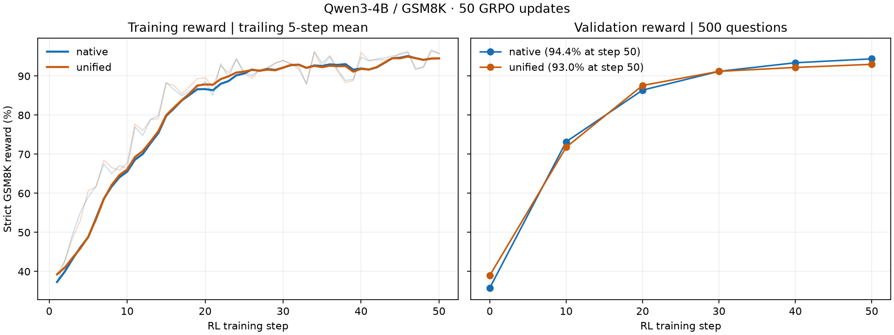
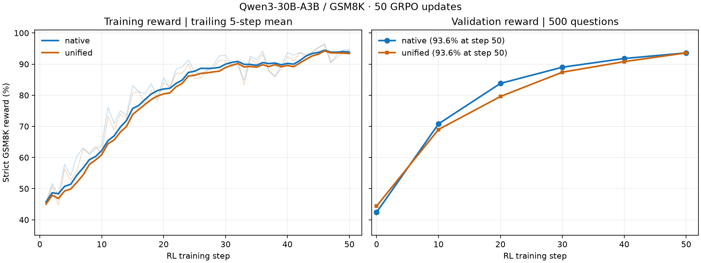

# GSM8K training examples

**English** | [简体中文](README.zh.md)

Use the paired native and unified runs to compare GSM8K reward, step time and rollout throughput with full models. To check sampled-token log-probability equality after an operator or parallelism change, use the [two-step consistency checks](../consistency/README.md).

## 50-step training recipes

| Model | Native | Unified | Launcher |
| --- | --- | --- | --- |
| Qwen3-4B · 8 NPUs | [Config](configs/qwen3_4b_gsm8k_native_50step.yaml) | [Config](configs/qwen3_4b_gsm8k_unified_50step.yaml) | [Host Docker launcher](scripts/run_qwen3_4b_8npu.sh) · [Commands](#launch-on-eight-devices) |
| Qwen3-30B-A3B · 16 NPUs | [Config](configs/qwen3_30b_a3b_gsm8k_native_16npu.yaml) | [Config](configs/qwen3_30b_a3b_gsm8k_unified_16npu.yaml) | [In-container launcher](scripts/run_qwen3_moe_16npu.sh) · [Commands](#launch-on-sixteen-devices) |

Both models use the same [data preparation and checksum verification](#prepare-the-data). See [50-step results](#50-step-results) for the measured rewards.

## Other training recipes

| Task | Configuration |
| --- | --- |
| Qwen3-4B with Codex | [Codex GRPO](configs/qwen3_4b_gsm8k_codex_50step.yaml) |
| GSPO with the internal runner | [GSPO](configs/qwen3_4b_gsm8k_gspo.yaml) |
| PPO with a Critic and the internal runner | [PPO](configs/qwen3_4b_gsm8k_ppo.yaml) |
| Model-based rewards with the internal runner | [Reward Model](configs/qwen3_4b_gsm8k_model_reward.yaml) |
| DeepSeek Harness | [DeepSeek Harness](configs/deepseek_multi_turn.yaml) |
| Qwen3-30B-A3B with the internal runner | [MoE GRPO](configs/qwen3_30b_a3b_gsm8k_vllm.yaml) |
| Qwen3-30B-A3B with Codex | [MoE Codex](configs/qwen3_30b_a3b_codex_multi_turn.yaml) |

Select a recipe for the algorithm and agent runner, then override deployment-specific paths in the CLI.
The Codex recipe retains its existing 50-step filename; use `--train.max_steps` to choose the run length.
See the [MoE guide](../../docs/moe_code_agent.md) for router replay and the
[Agentic RL guide](../../docs/agentic_rl.md) for external runners.

## Run training

Run from the repository root. Each update uses 128 questions with 8 responses per question and a limit of 1,024 generated tokens per response. Training samples at temperature 1. Validation uses greedy generation on 500 fixed questions.

### Prepare the data

Start from the full RL-format GSM8K train/test parquet files (7,473/1,319 rows, with `prompt` and `extra_info`). The script samples 6,400/500 rows without replacement, initializes Python seed 42 independently for each split and preserves draw order. If the prepared files are already available, skip sampling and verify the digests below.

~~~bash
example=hyper_parallel/rl/examples/gsm8k
export GSM8K_DATA=/absolute/path/to/gsm8k-6400-500
source_data=/absolute/path/to/full-rl-format-gsm8k
mkdir -p "$GSM8K_DATA"
docker run --rm --network none --user "$(id -u):$(id -g)" -e HOME=/tmp \
  -v "$PWD/$example/scripts:/scripts:ro" -v "$source_data:/source:ro" \
  -v "$GSM8K_DATA:/prepared" --entrypoint python \
  swr.cn-east-3.myhuaweicloud.com/huawei-hyper-rl/hyper-rl:v0.23.0.post1-code-agent-arm64 \
  /scripts/prepare_50step_data.py /source /prepared
~~~

Verify the prepared splits on the host.

~~~bash
(cd "$GSM8K_DATA" && sha256sum -c - <<'SHA256'
c6042460fb5167bee9f972177c643ecb7f25c33333d77b852415d04cc0239670  train.parquet
29e894be64353f5d4b2caa445be5b9e33d4e1dfd5c73a0bd337db247013ee29a  test.parquet
SHA256
)
~~~

### Launch on eight devices

The full Qwen3-4B model uses FSDP8/TP1 for training and DP4 × TP2 for rollout. Both recipes use Actor-recomputed old log-probabilities, graph execution, prefix caching and chunked prefill. Unified also uses Level 3, PIK and V4 attention.

Run the two commands sequentially on eight available NPUs. Give each run a new results directory. The recipes save every five steps. Allow about 540 GiB per run for ten checkpoints at the measured size of about 53 GiB each, plus space for logs. The launcher selects the image and installs the RL runtime from the mounted checkout. Unified requires the patched V4 wheel. [Wheel build script](../../docker/build_v4_wheel.sh) · [Runtime images](../../docker/README.md)

~~~bash
export GSM8K_MODEL=/absolute/path/to/Qwen3-4B
runs=/absolute/path/to/results
GSM8K_RESULTS="$runs/native" "$example/scripts/run_qwen3_4b_8npu.sh" native

export V4_WHEEL=/absolute/path/to/flash_attn_npu-0.5.0+hpbi1-cp312-cp312-linux_aarch64.whl
GSM8K_RESULTS="$runs/unified" "$example/scripts/run_qwen3_4b_8npu.sh" unified
~~~

For offline installation, set `EXTRA_WHEELS` to a directory containing the wheels for `peft==0.21.2` and `accelerate==1.12.0`. Logs go to `$GSM8K_RESULTS/train.log`. The resolved configuration is in `checkpoints/effective_config.json`. Append `--train.max_steps=3` for a short smoke run.

### Launch on sixteen devices

Run sequentially from the repository root inside a container with Hyper-RL, vLLM-Ascend 0.30 and the required operators installed. The full Qwen3-30B-A3B model uses FSDP8/TP2/EP8 for training and DP8/TP2/EP16 for rollout. Both recipes use full decode graphs and up to 128 sequences per engine. The launcher creates a separate run directory under `GSM8K_RESULTS` for each invocation.

~~~bash
export GSM8K_MODEL=/models/Qwen3-30B-A3B
export GSM8K_DATA=/data/gsm8k-6400-500
export GSM8K_RESULTS=/results
runner=hyper_parallel/rl/examples/gsm8k/scripts/run_qwen3_moe_16npu.sh
bash "$runner" native 50
bash "$runner" unified 50
~~~

Use `2` in place of `50` for a smoke run. Native defaults to disabled router replay. Append `--train.router_replay.mode=R3` to the native command to enable it. Each run records sampled-token probability differences between Actor and rollout in `train.log`, launch metadata in `run-info.txt` and device samples in `resources.log`.

## 50-step results

### Qwen3-4B

Both runs completed 50 single-turn GRPO updates on eight NPUs, using rule-based rewards and greedy evaluation on the same 500 questions. Native used vLLM 0.23 and Unified used vLLM 0.30.

| Metric | Native | Unified |
| --- | ---: | ---: |
| Initial validation correct | 179/500 (35.8%) | 195/500 (39.0%) |
| Step 50 validation correct | 472/500 (94.4%) | 465/500 (93.0%) |
| Mean training seconds/step, steps 41–50 | 89.08 | 116.61 |
| Rollout output tokens/s, steps 41–50 | 12,219 | 11,184 |

Step time includes rollout, training and weight publication. Validation and checkpointing are timed separately. Rollout throughput divides total generated tokens by total generation time in the window. Separate unified checks at steps 5 and 25 compared full-vocabulary logits for 380,967 and 211,810 response tokens respectively. The maximum absolute difference was zero in both. Three independent cold-start evaluations of the unified step 50 weights each scored 465/500 (mean 93.0%, sample standard deviation 0). All 500 response texts and per-question rewards matched. This measures evaluation repeatability for fixed weights. Each training curve represents one run.

### Qwen3-30B-A3B

At step 50, native and unified each answered 468/500 questions correctly (93.6%). Both runs recorded valid probability comparisons at every training step. Unified reported a maximum absolute sampled-token log-probability difference of zero in all 50 steps. Mean training step time was 248.25 s for native and 371.61 s for unified.

## Rewards and agent interaction

The rule-based reward is implemented in `agent.py::compute_gsm8k_reward()`.
It extracts the answer from the generated text and compares it with the dataset answer.
The model-based reward recipe uses its configured reward model instead.

Use the selected YAML recipe to configure multi-turn interaction, chat templates,
turn limits, and observation budgets. CLI overrides can adjust these values for a run.

See the [vLLM guide](../../docs/vllm_rollout.md) for rollout settings.
