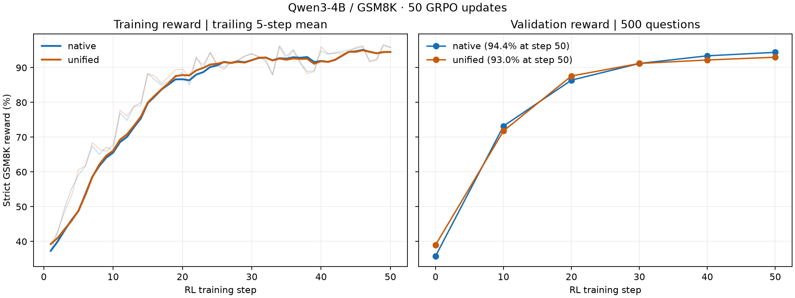
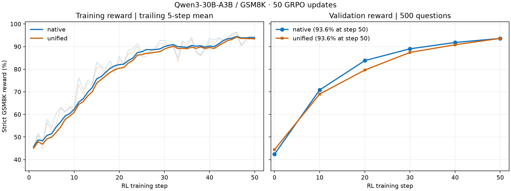

# GSM8K 训练示例

[English](README.md) | **简体中文**

这里提供完整模型在 GSM8K 上的 native 与 unified 训练对照，比较 reward、耗时和吞吐。验证算子或并行改动后逐 token 的 log-prob 是否一致，请使用[两步数值验收](../consistency/README.md)。

## 50 步训练配方

| 模型 | Native | Unified | 运行入口 |
| --- | --- | --- | --- |
| Qwen3-4B · 8 NPU | [配置](configs/qwen3_4b_gsm8k_native_50step.yaml) | [配置](configs/qwen3_4b_gsm8k_unified_50step.yaml) | [宿主机 Docker 启动器](scripts/run_qwen3_4b_8npu.sh) · [运行命令](#启动八卡实验) |
| Qwen3-30B-A3B · 16 NPU | [配置](configs/qwen3_30b_a3b_gsm8k_native_16npu.yaml) | [配置](configs/qwen3_30b_a3b_gsm8k_unified_16npu.yaml) | [容器内启动器](scripts/run_qwen3_moe_16npu.sh) · [运行命令](#启动十六卡实验) |

两组实验共用[数据划分](#划分-gsm8k-数据集)和[文件校验](#校验训练集和验证集)流程。训练与验证结果见 [50 步结果](#50-步结果)。

## 其他训练配方

| 任务 | 配置 |
| --- | --- |
| Qwen3-4B，使用 Codex | [Codex GRPO](configs/qwen3_4b_gsm8k_codex_50step.yaml) |
| GSPO，使用内部 runner | [GSPO](configs/qwen3_4b_gsm8k_gspo.yaml) |
| PPO，使用 Critic 与内部 runner | [PPO](configs/qwen3_4b_gsm8k_ppo.yaml) |
| 模型奖励，使用内部 runner | [Reward Model](configs/qwen3_4b_gsm8k_model_reward.yaml) |
| DeepSeek Harness | [DeepSeek Harness](configs/deepseek_multi_turn.yaml) |
| Qwen3-30B-A3B，使用内部 runner | [MoE GRPO](configs/qwen3_30b_a3b_gsm8k_vllm.yaml) |
| Qwen3-30B-A3B，使用 Codex | [MoE Codex](configs/qwen3_30b_a3b_codex_multi_turn.yaml) |

按算法和 agent runner 选择配方，再通过 CLI 覆盖部署相关路径。
Codex 配方保留已有的 50-step 文件名；实际运行步数由 `--train.max_steps` 选择。
路由重放见 [MoE 指南](../../docs/moe_code_agent.zh.md)，
外部 runner 见 [Agentic RL 指南](../../docs/agentic_rl.zh.md)。

## 运行训练

从仓库根目录启动。每步使用 128 道题，每题采样 8 个回答，生成上限为 1,024 token。训练温度为 1，验证在固定的 500 题上贪心生成。

### 划分 GSM8K 数据集

输入目录需要包含 RL 格式的 `train.parquet` 和 `test.parquet`，两者均含 `prompt` 和 `extra_info` 列。从原始训练集和测试集分别抽样：

| 原始文件 | 抽样 | 用途 |
| --- | --- | --- |
| `train.parquet` | 从 7,473 题中抽 6,400 题 | 每步 128 题，50 步使用全部 6,400 题 |
| `test.parquet` | 从 1,319 题中抽 500 题 | 每次验证都使用这 500 题 |

[数据准备脚本](scripts/prepare_50step_data.py)对两个文件分别初始化 `random.Random(42)`，无放回抽样，按抽取顺序写出。训练配置设置了 `data.shuffle: false`。先在仓库根目录设置示例和切分目录：

~~~bash
example=hyper_parallel/rl/examples/gsm8k
export GSM8K_DATA=/absolute/path/to/gsm8k-6400-500
~~~

已有切分文件时直接进入校验。首次准备数据时执行：

~~~bash
source_data=/absolute/path/to/full-rl-format-gsm8k
mkdir -p "$GSM8K_DATA"
docker run --rm --network none --user "$(id -u):$(id -g)" -e HOME=/tmp \
  -v "$PWD/$example/scripts:/scripts:ro" -v "$source_data:/source:ro" \
  -v "$GSM8K_DATA:/prepared" --entrypoint python \
  swr.cn-east-3.myhuaweicloud.com/huawei-hyper-rl/hyper-rl:v0.23.0.post1-code-agent-arm64 \
  /scripts/prepare_50step_data.py /source /prepared
~~~

### 校验训练集和验证集

在宿主机执行以下命令。两个文件都显示 `OK` 即可按相同题目和顺序复现实验。

~~~bash
(cd "$GSM8K_DATA" && sha256sum -c - <<'SHA256'
c6042460fb5167bee9f972177c643ecb7f25c33333d77b852415d04cc0239670  train.parquet
29e894be64353f5d4b2caa445be5b9e33d4e1dfd5c73a0bd337db247013ee29a  test.parquet
SHA256
)
~~~

### 启动八卡实验

完整 Qwen3-4B 采用训练 FSDP8/TP1、rollout DP4 × TP2。两份配方均由 Actor 重算旧策略 log-prob，使用图执行、前缀缓存和 chunked prefill；unified 还启用 Level 3、PIK 和 V4 Attention。

在可用的八张 NPU 上依次执行。每组使用独立的新结果目录，每 5 步保存一次。按本次约 53 GiB/份的记录，每组为十份 checkpoint 预留约 540 GiB 及日志空间。启动脚本选择对应镜像并安装挂载仓库的 RL 运行时。unified 需要修补版 V4 wheel，可用仓库的[构建脚本](../../docker/build_v4_wheel.sh)生成。[镜像说明](../../docker/README.zh.md)

~~~bash
export GSM8K_MODEL=/absolute/path/to/Qwen3-4B
runs=/absolute/path/to/results
GSM8K_RESULTS="$runs/native" "$example/scripts/run_qwen3_4b_8npu.sh" native

export V4_WHEEL=/absolute/path/to/flash_attn_npu-0.5.0+hpbi1-cp312-cp312-linux_aarch64.whl
GSM8K_RESULTS="$runs/unified" "$example/scripts/run_qwen3_4b_8npu.sh" unified
~~~

离线运行时可设置 `EXTRA_WHEELS`，指向包含 `peft==0.21.2` 和 `accelerate==1.12.0` 两个 wheel 的目录。日志写入 `$GSM8K_RESULTS/train.log`，实际解析配置位于 `checkpoints/effective_config.json`。冒烟检查可在命令末尾加 `--train.max_steps=3`。

### 启动十六卡实验

在已安装 Hyper-RL、vLLM-Ascend 0.30 及所需算子的容器内，从仓库根目录依次运行。完整 Qwen3-30B-A3B 使用训练 FSDP8/TP2/EP8，rollout DP8/TP2/EP16。两份配方均启用 decode 全图，每个 engine 最大并发 128。启动器在 `GSM8K_RESULTS` 下为每次运行创建单独目录。

~~~bash
export GSM8K_MODEL=/models/Qwen3-30B-A3B
export GSM8K_DATA=/data/gsm8k-6400-500
export GSM8K_RESULTS=/results
runner=hyper_parallel/rl/examples/gsm8k/scripts/run_qwen3_moe_16npu.sh
bash "$runner" native 50
bash "$runner" unified 50
~~~

短跑可将 `50` 改为 `2`。Native 默认关闭 R3；给 native 命令追加 `--train.router_replay.mode=R3` 即可验证路由回放。每次训练的 `train.log` 都记录 Actor 与 rollout 的采样 token 概率差，运行信息和设备采样分别写入 `run-info.txt` 和 `resources.log`。

## 50 步结果

### Qwen3-4B

两组均在八张 NPU 上完成了 50 步单轮 GRPO 训练，使用规则奖励，并在相同的 500 道题上贪心评估。Native 使用 vLLM 0.23，Unified 使用 vLLM 0.30。

| 指标 | Native | Unified |
| --- | ---: | ---: |
| 初始验证答对 | 179/500（35.8%） | 195/500（39.0%） |
| 第 50 步验证答对 | 472/500（94.4%） | 465/500（93.0%） |
| 第 41–50 步平均训练秒/步 | 89.08 | 116.61 |
| 第 41–50 步 rollout 输出 tokens/s | 12,219 | 11,184 |

训练步计时包含 rollout、训练和权重发布，评估与 checkpoint 另外计时。输出吞吐按区间总输出 token 数除以总生成时间计算。unified 第 5、25 步的独立复核分别覆盖 380,967、211,810 个响应 token，两次全词表 logits 最大绝对差均为 0。对同一份 unified step 50 权重独立冷启动复评三次，均为 465/500，均值 93.0%，样本标准差为 0，500 题的回答文本与逐题 reward 均一致。该复评衡量固定权重的评估重复性。两条训练曲线各来自一次独立训练。

### Qwen3-30B-A3B

第 50 步，native 和 unified 均答对 468/500（93.6%）。两组每个训练步均有有效的概率对照，unified 在全部 50 步的采样 token 最大绝对 log-prob 差均为 0。50 步平均训练耗时分别为 248.25 秒/步和 371.61 秒/步。

## 奖励与 Agent 交互

规则奖励由 `agent.py::compute_gsm8k_reward()` 实现。
它从生成文本中提取答案，并与数据集答案比较。
模型奖励配方改用其配置的奖励模型。

通过所选 YAML 配方配置多轮交互、聊天模板、
轮次上限及观察预算，也可使用 CLI 覆盖本次运行的这些设置。

rollout 配置见 [vLLM 指南](../../docs/vllm_rollout.zh.md)。
