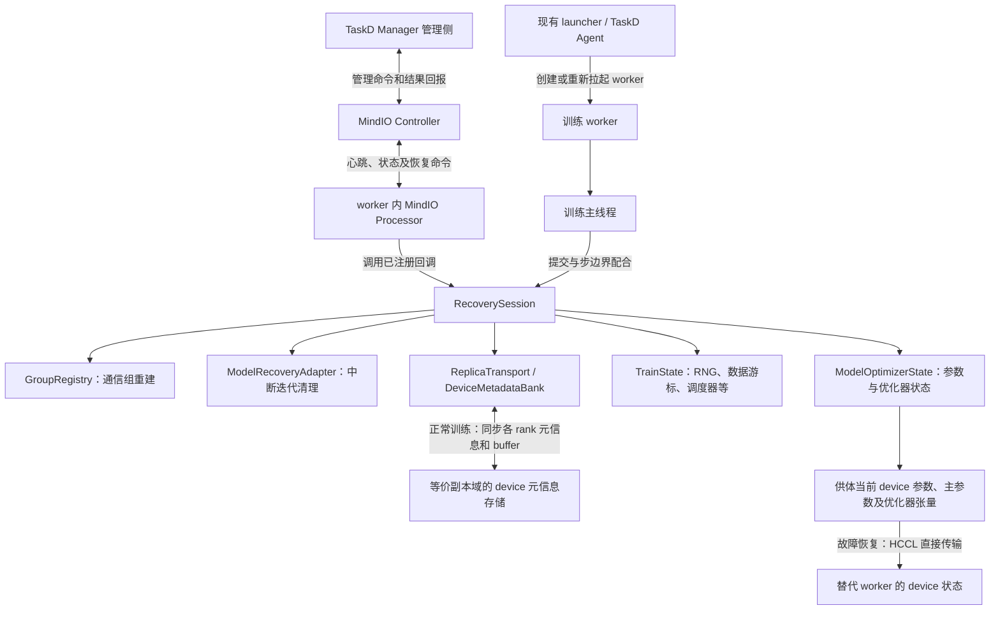
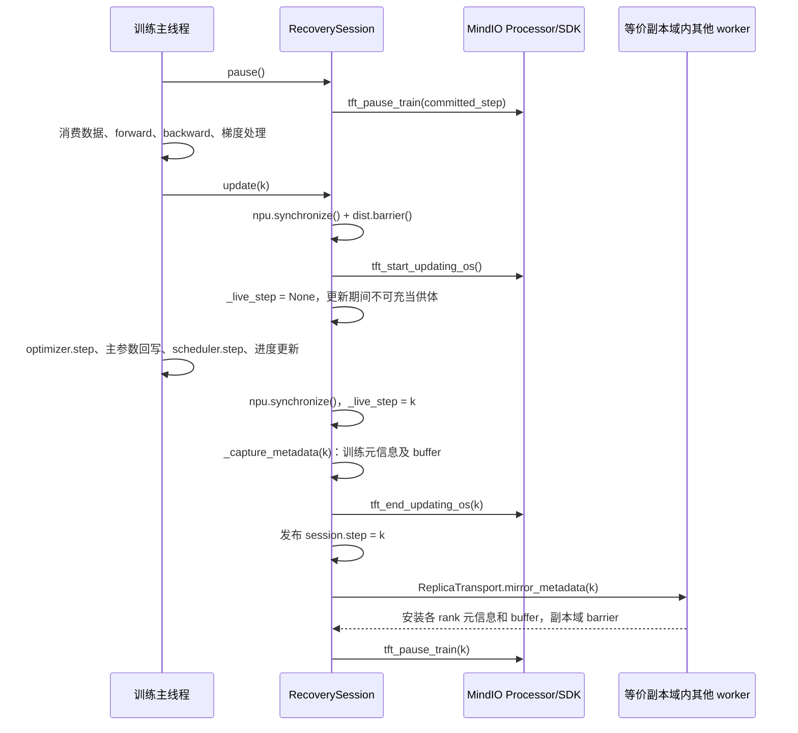
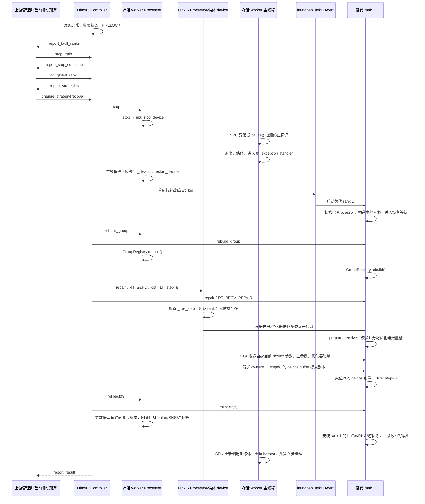

# HyperParallel 进程级快恢：当前实现流程与接口

本文依据 `feat/process-recovery` 分支工作区中的实现，说明初始化、正常训练、故障恢复和训练重入的调用关系。沿用原文的章节、时序图和逐阶段接口说明，内容更新为**从存活等价副本的 device 直接复制参数和优化器状态**。代码仍在验证中，本文不把待联调能力作为已经完成的生产能力。

## 1. 总体结构与职责

当前实现通过 MindIO 调度恢复，通过 torch-npu 停止和重新启用设备、重建 HCCL 通信，通过 HyperParallel 恢复训练状态。模型参数、FP32 主参数和优化器张量直接取自存活等价副本当前的 device 状态，不生成或恢复这些张量的 CPU 快照，也不从磁盘 checkpoint 兜底。

RNG、数据游标、自定义 rank provider 等不能套用供体的状态。这些必要训练元信息及可变 model buffer 在正常训练时按 `owner + step` 复制到等价副本域；元信息以 device 字节缓冲保存，buffer 的提交副本也保留在 device 上。Trainer 的进度、调度器和补日志 provider 不再每步向副本发送，只在各 rank 本地保留同一步快照，故障修复时再从供体取得。恢复时 Python 元信息需要经 CPU 序列化和解析，参数、主参数及优化器矩不经 CPU 中转。



职责边界：

- **Controller**：MindIO 的恢复协调器，负责状态收集、PRELOCK 和恢复指令调度。HyperParallel 没有重新实现其状态机。
- **Processor**：位于训练 worker 内，接收 Controller 命令，进入 MindIO 的 Python 回调包装逻辑，再调用 HyperParallel 注册的回调。
- **RecoverySession**：连接 Processor 与训练运行时，提供正常提交、设备停止、清理、通信重建、状态修复和回滚入口。
- **训练主线程**：执行 forward/backward、优化器更新、训练元信息及 buffer 的保存/同步和步边界配合；故障后退出当前训练体，等待 SDK 调度，再重新进入训练体。
- **launcher / TaskD Agent**：负责进程生命周期。`RecoverySession` 本身不创建替代 worker。
- **TaskD Manager / ClusterD**：属于框架外管理链路。HyperParallel 训练代码没有直接调用它们的 Python API；测试 harness 已接入真实 TaskD 的 Controller 转发和 Agent 重启接口，但上游策略决策、Manager→Agent 网络传输及 Pod 重建仍有验证边界，见第 7 节。

核心代码入口：[session.py](../hyper_parallel/core/fault_tolerance/session.py)、[Trainer 接入](../hyper_parallel/trainer/runtime/fault_tolerance.py)。

## 2. Controller 启动方式

### 2.1 显式配置地址：rank 0 启动

```yaml
worker_recovery:
  enable_worker_reboot: true
  controller_ip: "192.168.1.10"
  controller_port: 8000
```

`RecoverySession.initialize()` 在 rank 0 调用：

```python
tft_init_controller(0, world_size, False, True, False)
tft_start_controller(controller_ip, controller_port, False, "")
```

Controller 位于 rank 0 worker 的同一进程中，运行由 MindIO 的原生后台线程推进；这里没有创建 Controller 子进程。其他 rank 不执行这两项初始化。

所有 rank 随后启动 Processor：

```python
tft_init_processor(rank, world_size, False, False, "", False, True, False)
tft_start_processor(controller_ip, controller_port)
tft_is_reboot_node()
```

`tft_is_reboot_node()` 用于区分首次启动和故障后的替代 worker。上面两处初始化均关闭 `enable_local_copy`；参数修复由 HyperParallel 的 device 传输通道执行，MindIO 负责调度。

### 2.2 不配置地址和端口：TaskD 启动

```yaml
worker_recovery:
  enable_worker_reboot: true
```

此模式下 HyperParallel 不创建 Controller，仅创建 Processor。由 TaskD 的部署和启动入口负责创建 Controller，HyperParallel 不会因为省略地址而自行启动一个 TaskD 进程。

`RecoverySession._controller_endpoint()` 按以下顺序查找部署环境中的地址：

1. `PROCESSOR_ADDR`。
2. `CONTROLLER_ADDR`。
3. `TTP_ADDR`。
4. `MASTER_ADDR`。

端口读取 `TTP_PORT`。这里要求地址确实指向 TaskD 所托管的 Controller；不会使用各 worker 自己的 `POD_IP`，也不会拿训练 rendezvous 的 `MASTER_PORT` 代替 Controller 端口。缺少地址或端口时明确报错。

环境变量来自部署系统，用户不需要在 HyperParallel 配置中重复提供。TaskD 主机接口测试已验证 Manager 启动 Controller、8 个 Processor 通过部署环境连接，并在测试管理环境通过新版 device 故障恢复；这不等于生产管理全链路已经验收，具体覆盖范围见第 7 节。TaskD/Go 动态库使用的部署环境应在库导入前注入。

本地 TaskD 的实际启动入口是 `Manager.start_taskd_manager()` → `Manager.start_controller()` → `init_controller()`，参见 [TaskD manager.py](../mind-cluster/component/taskd/taskd/python/framework/manager/manager.py) 和 [controller.py](../mind-cluster/component/taskd/taskd/python/framework/manager/controller.py)。两种模式必须保持唯一的 Controller 启动方。

配置实现：[config.py](../hyper_parallel/core/fault_tolerance/config.py)。显式提供 IP 但省略端口时，当前保留默认端口 8000；仅提供端口而没有 IP 会报错。

## 3. 初始化与恢复对象绑定

### 3.1 Trainer 构造接入

`recovery_constructor()` 在开启特性时创建 `RecoverySession`，先调用 `initialize()`，然后在 `session.groups` 上下文中构造模型、mesh 和通信组。

`GroupRegistry` 记录需要恢复的通信组及创建顺序。替代 worker 执行相同的本地构造路径，但避免初始化权重时的跨 rank 通信：

- `is_recovery_reboot()` 识别替代 worker 构造上下文。
- `distribute_tensor()` 在该上下文中使用本地切片路径，避免默认源 rank 广播/散发导致替代 worker 等待尚在恢复中的存活 rank。
- 模型构造入口跳过初始权重加载，等待恢复回调从等价副本 device 写入状态。
- 模型、mesh 和优化器都在 `session.groups` 上下文内构造，使训练组和 Muon 的优化器子组完整登记；不会为开启快恢自动改写 Muon 的状态去重配置。

这不意味着替代 worker 完全不执行构造函数：**替代 worker 需要重新构造本地模型和优化器对象；存活 worker 仅重新进入训练体。**

### 3.2 训练开始时绑定状态

`_train_recoverable()` 创建 `TrainState`，注册进度、日志和学习率调度器等 provider，随后调用：

```python
session.attach(model, optimizer, train_state, global_step)
```

`attach()` 完成：

1. 创建 `ModelRecoveryAdapter`，绑定需要清理的策略运行时。
2. 创建 `ModelOptimizerState`，建立参数、buffer、主参数、优化器状态与稳定参数名之间的映射。
3. 调用 `ReplicaTopology.discover()`，从 DeviceMesh/placements 推导模型候选副本，再按实际优化器状态 owner 筛选完整副本；没有完整副本时，在注册 MindIO 副本关系前报错。
4. 调用 `tft_set_optimizer_replica(rank, replica_info)`，向 MindIO 注册本 rank 所在的等价副本域，格式为 `[{"rank_list": ranks, "replica_cnt": len(ranks), "replica_shift": 0}]`。
5. 调用 `tft_register_*_handler()` 注册恢复回调。
6. 按确定顺序创建各等价副本域的 HCCL 修复组，将 `ReplicaTransport` 绑定到会话构造时已创建的 `DeviceMetadataBank`；该 bank 的 `replica_providers` 在 attach 时取自 `TrainState`，最后封存通信组登记。

当前 device 路径不调用 `tft_set_dp_group_info()`。用户不需要配置 `replica_groups`、worker 地址、备份端口或 run ID。

所有恢复相关通信组应在 attach 完成前创建或显式注册；attach 后禁止临时创建新的受管理组。

### 3.3 自动副本关系

`ReplicaTopology.discover()` 根据实际参数布局推导等价副本，不再通过 world size 或 rank 编号任意配对：

1. `device_replica_ranks()` 读取参数的 DeviceMesh/placements，仅允许变化 `Replicate` 维度的坐标，保留分片维度坐标。
2. `model_replica_candidates()` 对所有参数声明的布局候选副本取交集，得到可以恢复**整个本地参数集合**的副本域。
3. `ModelOptimizerState` 从 Muon 二次分组后的 `no_comm` 和各 assignment 的 `owned_params` 提取实际状态归属，按稳定参数名生成 `optimizer_ownership` 指纹。HP AdamW 则对自身参数组中的全部参数持有状态。此处根据初始化后的分配计划判断，不等待第一次 `step()` 懒创建动量。
4. 原始 worker 通过 `dist.all_gather_object()` 交换候选域、schema 和 `optimizer_ownership`。`ReplicaTopology.from_profiles()` 先校验模型候选域对称及基础布局一致，再筛出实际优化器状态归属也相同的成员，形成完整状态副本域。每个 rank 至少需要一个其他完整副本，且当前实现要求各域副本数相同。这里校验布局与状态归属，不逐元素校验数值；数值等价仍依赖正确的副本初始化和正常训练同步。
5. 已验证描述写入现有 rendezvous store。替代 worker 从 store 读取并核对自己的布局和优化器状态归属，避免 attach 时要求存活 rank 再参与一次全局拓扑交换。

例如 HSDP 的 2×4 mesh 排列为 `[[0,1,2,3],[4,5,6,7]]`，placements 为 `[Replicate(), Shard(0)]` 时，模型候选域为 `(0,4)、(1,5)、(2,6)、(3,7)`。对于 HP AdamW，或 Muon `hsdp_replica_count=1` 且实际分配保留完整本地状态的情形，这些候选域也是完整状态副本域。rank 1 故障时，rank 5 直接发送**自己持有、与 rank 1 等价的 device 参数及优化器张量**，不再保存 rank 1 的 CPU 参数快照。

TP/EP 与 DP 组合时，也必须保持 TP/EP 分片坐标一致并具有真实冗余。仅有 TP/EP、没有等价副本时 attach 会报错；不同分片即使形状相同也不能互相替代。当前按全模型本地状态取交集，不支持每个参数分别选择不同供体再拼装恢复。未声明 DeviceMesh/placements 的普通本地参数只将自身 rank 作为候选，不自动推导出远端副本。

Muon 必须结合 `hsdp_replica_count` 的实际分组结果判断。当前优化器将该值用于复制维度上的去重子组大小；参数值本身不等于快恢可用的完整副本数。假设同一模型分片的候选域是 `{0,1,2,3}`，去重子组为 `{0,1}` 与 `{2,3}`，状态 A 分别由 rank 0、2 持有，状态 B 分别由 rank 1、3 持有，则完整状态副本域应为 `{0,2}` 和 `{1,3}`，而不是原来的四卡模型副本域。

如果模型候选域仅有 `{1,5}`，Muon 又把状态在两者间完全去重，则两者均没有其他完整状态副本。此时 attach 提前报错 `no complete device replica for model and optimizer state; worker recovery cannot be enabled`，并提示检查 `hsdp_replica_count` 和实际 owner 分配。框架保留已有配置，不自动关闭去重或隐式增加状态冗余；调用方需要使用确实具备完整状态副本的训练布局或优化器配置。

框架不重新安排物理节点或机架布局。整节点掉电能否恢复，还取决于该节点之外是否存在存活等价副本及可用元信息；单机 8 卡测试只能证明进程故障路径。

实现：[topology.py](../hyper_parallel/core/fault_tolerance/topology.py)、[transport.py](../hyper_parallel/core/fault_tolerance/transport.py)。

## 4. 正常训练：什么时候算提交了一步

首次进入 `RecoverySession.run(body)` 时，原始 worker 先同步，保存并复制初始训练元信息和可变 buffer。若原始训练从已有正常 checkpoint 启动，额外通过 `tft_report_load_ckpt_step(step)` 告知已加载步数。故障快恢及替代 worker 不读磁盘 checkpoint。

每一步的主线程顺序如下：



具体接口：

- `recovery_optimizer_update()`：将 Trainer 的优化器、调度器和进度更新包进 `session.update()`。
- `RecoverySession.update()`：进入更新窗口前完成设备同步和默认组 barrier，使 forward/backward 通信阻塞不被算作一次进行中的优化器更新。
- `tft_start_updating_os()`：当前调用不传 step，进入 SDK 优化器更新窗口；随后设置 `_live_step=None`，标记这份 device 状态正被修改。
- `_capture_metadata(k)`：在优化器、主参数回写、调度器和进度更新完成且设备同步后，`update()` 先将 `_live_step` 标为 `k`，再调用此接口。它调用 `ModelOptimizerState.rank_state()` 保存可变 buffer 的 device 副本，调用 `TrainState.capture()` 捕获 RNG、游标和 provider。`DeviceMetadataBank.put()` 将显式声明的 `replica_providers` 分离为本地 CPU 元信息快照，其余目标 rank 状态编码为 device 字节缓冲。不捕获模型参数、主参数或优化器矩。
- `tft_end_updating_os(k)`：本地更新和元信息捕获完成后上报完成步数，再设置 `session.step=k`。优化器更新中途异常不会调用 end。
- `ReplicaTransport.mirror_metadata(k)`：在 end 之后通过副本域 `dist.all_gather()` 交换必要元信息长度、device 字节缓冲及各 rank 的可变 buffer，安装到 `DeviceMetadataBank`，最后通过副本域 barrier 确认。Trainer 进度、调度器和日志已从此阶段移除；参数和优化器矩也不参与。字节缓冲长度达到本组最大值时直接作为输入，不再额外分配并拷贝；较短输入才填充。
- `pause()`：元信息同步后先检查 `_stopped`，已停止则抛出 `FORCE STOP`；未停止才调用 `tft_pause_train(k)`。

这里有两个完成条件：`tft_end_updating_os(k)` 在 SDK 内标记本地更新完成；随后 `mirror_metadata(k)` 返回才表示该副本域的目标 rank 必要元信息和 buffer 已复制完成。SDK 的 `FinishedUpdate()` 会先置 `Updated/step=k`，再等待 PRELOCK 上限释放，因此主线程可能停在 end 内，尚未执行 `session.step=k` 和镜像。即使 Controller 已看到步数 `k`，也可能因目标 rank 的精确元信息尚未复制而恢复失败，不能把 end 当作远端副本已经就绪。

`DeviceMetadataBank` 按 `owner + step` 保留两个版本的元信息和 buffer，**不保留两个版本的权重或优化器张量**。device 参数只有当前有效版本，供体必须满足 `_live_step == recovery_step`。若已经进入部分更新，或 Controller 选定较早步数而存活副本已前进，不能靠这个元信息版本环把参数回滚；没有匹配的有效供体或目标 rank 元信息时明确失败。

本轮优化不删除已接入的必要状态保护：Python、NumPy、Torch CPU/device 及显式 Generator RNG、loader 消费游标及动态缓存、自定义 rank provider、module extra state 和 model buffer 仍按原路径保留，未登记的 RNG tracker 或外部可变状态不会自动捕获。框架不能仅凭 buffer 的名字或 `persistent=False` 认定其只读，普通 loader 也不能一概用 `step × batch_size` 替代。底层 `TrainState` 默认所有 provider 都按 rank 保护，只有显式列出的 `replica_providers` 才省略逐步发送；Trainer 自动列出自己的进度、调度器和日志，无新增用户训练配置。日志允许取供体同一步指标，带 `source_rank`，不承诺故障 rank 局部指标精确恢复。必要状态的通信、barrier 及当前 end 顺序本轮不变，前述恢复窗口仍待后续协议调整。

## 5. 第 8 步完成后 rank 1 退出：端到端恢复

场景前提：实际布局中 rank 1 与 rank 5 是等价副本；第 8 步更新及该步元信息、buffer 的副本域同步已完成，随后开始第 9 步 forward；rank 1 异常退出，rank 0、rank 5 及管理链路存活。rank 5 的 `_live_step` 仍为 8，持有有效等价参数和优化器状态，并保存 rank 1 的第 8 步元信息及 buffer。以下以 MindIO 最终选定第 8 步恢复为例，不意味着任意故障都固定选择最大步数或第 8 步。



上图的“存活 worker Processor”代表包括 rank 5 在内的存活进程回调路径；单独展开 rank 5 是为了说明供体发送动作，不表示它另外创建了进程。rank 5 同样参加前面的 stop/clean/rebuild 和后面的 rollback。

上图表达逻辑依赖，不要求设备停止与替代进程启动在不同组件间严格串行。管理侧可以在符合协议的前提下并行推进；具体时机需以 TaskD 联调结果为准。

### 5.1 发现故障、选定恢复策略

这部分由 MindIO 与外部管理侧负责，HyperParallel 没有调用一个“选择恢复步数”的接口。

当前测试驱动使用真实 MindIO 管理接口：

- `tft_register_mindx_callback("report_fault_ranks", ...)`：接收故障 rank 上报。
- `tft_notify_controller_stop_train(fault_ranks, "stop")`：请求停止训练推进，对应管理层 stop_train。
- `tft_notify_controller_on_global_rank(fault_ranks, timeout)`：通知故障 rank 并获取可行策略。
- `tft_register_mindx_callback("report_strategies", ...)`：接收可用策略。
- `tft_notify_controller_change_strategy("recover", "")`：选择进程级恢复策略。

`stop_train` 是发给 Controller 的管理命令；下面的 `_stop()` 是 Controller 调度 Processor 后落实到训练设备的动作，两者不是同一个接口。PRELOCK 限制优化器推进，并不保证任意 forward 立即返回。rank 退出后，其他 rank 的 forward/backward 可能阻塞，必须由设备停止和 SDK 异常循环解除。

测试入口：[测试管理驱动](../tests/torch/fault_tolerance/_test_process_recovery.py)。默认使用测试驱动转发命令并重拉起进程，也可启用真实 TaskD Controller 转发和 Agent 重启适配；新版 device 路径的验收进度与各组件的覆盖范围见第 7 节。

### 5.2 停止设备：`_stop()`

注册接口为 `tft_register_stop_handler(self._stop)`。

`RecoverySession._stop()` 先设置 `_stopped=True`，再调用：

```python
torch_npu.npu.stop_device(local_rank)
```

这使进行中的设备计算或通信退出。主线程因 NPU 异常退出训练体；若处于 CPU 轮询，则在 `session.pause()` 检测到标记后抛出 `RuntimeError("FORCE STOP")`。SDK 的 `tft_exception_handler` 接管异常和主线程停止应答。

### 5.3 清理：`_clean()`

注册接口为 `tft_register_clean_handler(self._clean)`。

主线程停稳后，`RecoverySession._clean()` 调用以下动作；入口要求 `_stopped=True`，明确拒绝 `is_uce_error=True` 的 UCE 修复：

1. `ModelRecoveryAdapter.abort_iteration()`：遍历去重后的已登记分片调度器，清理其保留的中断迭代状态。
2. 分片调度路径进入 `scheduler.abort_iter_state()`，丢弃失败 Work、清理分片梯度并恢复分片视图。TP/EP 的恢复核心不依赖该调度器；其临时 autograd 工作随训练体退出释放，参数梯度还会在 rollback 统一清空。
3. `torch_npu.npu.restart_device(local_rank)`：重新启用设备。
4. `torch_npu.npu._recovery.update_npu_tensor_to_safe()`：为保留的本地参数、主参数、优化器张量、元信息字节缓冲和 buffer 更新设备恢复安全标记，允许后续在重启后的设备上使用。这一步不重新构造这些张量的数值；随后清除 `_stopped` 并返回 0。本地 CPU provider 快照不参与设备安全标记。

这里不会等待已经失效的旧通信 Work 完成。实现：[adapters.py](../hyper_parallel/core/fault_tolerance/adapters.py)。

### 5.4 替代 worker 初始化及等待

外部 launcher/TaskD Agent 重新拉起 rank 1。新进程初始化 Processor，通过 `tft_is_reboot_node()` 识别为替代节点，重新构造本地模型、优化器、loader 和通信组描述，然后 attach。

替代 worker 此时不能执行依赖存活训练 rank 配合的初始化 collective。当前分两阶段处理：

- **构造期本地准备**：沿用原 rank、world size、mesh 布局和存活的 rendezvous store。框架 `new_group()` 仍调用真实 `dist.new_group()`，使用关键字参数按原顺序创建和登记 HCCL 懒初始化组；要求 `TORCH_DIST_INIT_BARRIER=0`、不使用 `device_id`、`use_local_synchronization` 或自定义 `pg_options`，避免此时立即建链或执行建组 barrier。替代 worker 只与 store 和 Controller 完成必要连接，不依赖存活 worker 进入训练 collective。
- **延后跨 rank 操作**：`distribute_tensor()` 将 `src_data_rank` 设为 `None`，改走本地切片，不广播或 scatter 初始权重；模型构造跳过初始 checkpoint 加载。`ReplicaTopology.discover()` 从 store 读取原始 worker 已验证的描述，不重新 all-gather；Muon 延后分片形状收集，优化器子组按登记目录创建，不执行构造期拓扑 all-gather。替代 worker 也跳过 `run()` 中只供原始 worker 执行的首次 barrier 和元信息镜像。
- **Trainer 内置数据构造**：`_build_dataset()` 下游也有需要处理的通信。`resolve_data_paths()` 原始启动时执行正常发现，并将实际有序路径清单按 rank 和配置摘要保存到默认 store；替代 worker 直接读取，跳过目录发现的两个 `all_gather_object()`，不以重新本地扫描代替原顺序，清单缺失或格式无效时直接报错。`build_dataset_for_dataloader()` 在替代 worker 上保留 TP 输入归属及 `data_index_cache` 语义，直接本地构造所需 Dataset，跳过原缓存写入 rank 的等待和 barrier。`_cache_index_file()` 对对象存储索引复用本地缓存，缺失时由替代 worker 自行下载到临时位置，完成后原子发布，不执行全局 barrier。原始 worker 的缓存同步不变，不增加每步通信或用户配置；原始数据和 store 仍须可访问。
- **协调后恢复通信**：下一节的 `rebuild_group` 回调由 Controller 下发给参与恢复的存活与替代 worker；全体按同样顺序重建默认组及各成员组，随后进行 Muon 形状收集和供体状态传输。

实现没有全局替换 `torch.distributed.barrier()` 或任意通信接口。未经适配的自定义模型构造、loader 或插件若直接执行 barrier、broadcast、all-gather，仍可能等待处于恢复状态的旧 rank，必须改为本地准备，或移到重建后所有对应 rank 都会进入且顺序一致的恢复同步阶段；只在替代 worker 上延后调用仍会阻塞，仅登记外部 group 也不会自动处理这些 collective。上述约束适用于当前固定 world size 的 HCCL 路径，不能据此宣称任意 Trainer 构造或任意新节点都能直接进入恢复。

按当前 BaseTrainer/TextTrainer 生命周期，`_build_lr_scheduler()`、`_build_training_context()` 及默认 callback 注册是本地准备；已禁用的 compile、CP/PP、offload 等组合在构造前由恢复配置检查拒绝。`get_batch()` 的 TP 数据广播、训练指标归约、恢复后的 checkpoint ledger 同步，以及训练结束时 `destroy_distributed()` 的 barrier 属于重建通信之后的阶段，不应为了替代 worker 初始化将这些操作全局删除。

在 `RecoverySession.run()` 内，替代 worker 通过 `RuntimeError("ARF FINISH")` 进入 MindIO SDK 的恢复等待路径。其 `_live_step` 初始为 `None`；它不执行原始 worker 的初始元信息镜像，不把随机初始化参数发布成有效副本，也不重新读取初始 checkpoint。参数和优化器张量等待 `_repair()` 接收后才成为有效 device 状态。

### 5.5 重建通信：`_rebuild()`

注册接口为 `tft_register_rebuild_group_handler(self._rebuild)`。

`_rebuild()` → `GroupRegistry.rebuild()`：

```python
dist.reinit_process_group(group=None, rebuild_link=True)
dist.reinit_process_group(group=recorded_group, rebuild_link=True)
```

先重建默认组，再按原创建顺序重建本 rank 参与的各个训练组和副本修复组，保留模型、mesh、bucket 持有的 group 对象引用。

Muon 在此后由 `ModelOptimizerState.rebuild_runtime_state()` 调用各 Muon 叶子的
`rebuild_recovery_state()`，由所有 rank 共同刷新分片形状元数据及其派生的分配缓存。
替代 worker 构造时跳过该形状 all-gather，避免存活 rank 尚未进入 rebuild 时发生等待。
优化器细分副本组时使用 `recovery_optimizer_subgroup()` 从已记录 mesh 组目录确定性创建并登记组，
不在替代 worker 构造期间执行全局拓扑 all-gather；这些组随后同样由 `GroupRegistry` 原位重建。

rank 0 自托管 Controller 模式下，rank 0 退出会同时丢失 Controller，本实现明确拒绝把它当作普通 worker 故障继续恢复。TaskD 托管模式已调整这一检查，但 rank 0 替换、rendezvous 生命周期等仍待实际验证。

### 5.6 复制并安装状态：`_repair()`

注册接口为 `tft_register_repair_handler(self._repair)`。Processor 传入恢复 step 和 `repair_info` 中的 `repair_type/src/dst`。

- **供体 rank 5** 收到 `RT_SEND`：`RecoverySession._repair()` 先检查 `_live_step == step`，再调用 `ReplicaTransport.send(destination=1, step=8)`。
- **恢复端 rank 1** 收到 `RT_RECV_REPAIR`：`_repair()` 从 `src/dst` 配对中找到自己唯一的供体，调用 `ReplicaTransport.receive(source=5, step=8)`；接收成功后才设置 `_live_step=8`。

供体侧 `ReplicaTransport.send()` 的具体动作：

1. `DeviceMetadataBank.get(destination, step)` 取出**目标 rank** 的训练元信息和可变 buffer，不含目标 rank 的参数或优化器矩。
2. `DeviceMetadataBank.metadata(destination, step)` 解码目标 rank 必要元信息，再合并供体在相同步数的本地 `replica_providers` 快照；缺少精确版本会报错，不从最新版本拼凑。`ModelOptimizerState.metadata()` 描述供体的 schema、优化器参数组配置、非张量状态及各优化器张量的形状/dtype；与上述完整元信息一起编码为传输头。进度、调度器和补日志内容到此时才发送。
3. `ModelOptimizerState.tensor_items()` 返回供体自己当前的模型参数、独立 FP32 主参数和优化器张量的本地存储引用。
4. `_send_tensor()` 通过 `dist.send(..., group=replica_group)` 按最多 4 MiB 的张量块发送这些 device 数值，再发送目标 rank 的可变 buffer 提交副本。非连续张量可能在 device 上形成连续临时缓冲，不转为 CPU 权重快照。

恢复端 `ReplicaTransport.receive()` 的具体动作：

1. 用 `dist.recv()` 收到传输头，检查 `owner == self.rank` 和 `step`。
2. `ModelOptimizerState.prepare_receive()` 校验 schema 及实际优化器状态归属指纹，恢复优化器组配置、非张量状态，并在目标 device 分配其应持有的 AdamW 矩或 Muon 动量槽，保留模型 Parameter 和主参数对象身份。
3. 按与供体相同的 `tensor_items()` 顺序调用 `_receive_tensor()`，在 device 接收后用 `copy_()` 写入目标张量。当前接收实现为每个张量分配同尺寸 device 暂存，再分块接收；并非整条链路零拷贝。
4. 接收目标 rank 的可变 buffer，调用 `DeviceMetadataBank.put()` 保存该 rank 的精确步数元信息，将供体同一步的 `replica_providers` 留为本地快照，等待 rollback 安装。

因此，实际权重写回入口是 [ReplicaTransport.receive() / _receive_tensor()](../hyper_parallel/core/fault_tolerance/transport.py)，优化器槽准备入口是 [ModelOptimizerState.prepare_receive()](../hyper_parallel/core/fault_tolerance/state.py)。旧的 `ModelOptimizerState.capture()/restore()` 完整 CPU 快照入口已删除。

状态层支持纯 Muon 和 Muon+AdamW 组合，包括 Muon `momentum_buffer`、参数组 `step`、学习率和动量配置。schema 校验包括叶子优化器类型及参数归属，拒绝把 AdamW 状态当作 Muon 状态接收。Muon 的 NS 输入、分片 gather 临时缓冲和异步通信句柄由中断迭代清理，不作为持久状态发送，也不在回调中等待失效的旧句柄。新版 device 路径的验证结果见第 7 节。

这里传输由 HyperParallel 的 `ReplicaTransport` 实现，MindIO 负责调度源和目标；没有调用 MindIO 的模型权重搬运封装。

### 5.7 全体回滚：`_rollback()`

注册接口为 `tft_register_rollback_handler(self._rollback)`。

所有参与恢复的 rank 的核心回滚动作如下：

```python
snapshot = bank.get(self.rank, step)
metadata = bank.metadata(self.rank, step)
model_state.restore_rank_state(snapshot["buffers"], metadata["extra"])
train_state.restore(metadata["state"])
```

执行上述动作前，`_rollback()` 必须检查 `_live_step == step`。恢复 rank 状态后还执行设备同步，设置 `session.step=step` 和 `_resume_iterator=True`。替代 rank 的参数、主参数和优化器张量已经在 repair 阶段由供体写入；存活 rank 保留符合目标步数的有效 device 状态。rollback 不从 CPU 快照重写这些张量，也不支持把已前进的参数自动倒回较早步数。

存活 rank 仍需要恢复自身 rank 状态：第 9 步 forward 可能已经改变 buffer、消耗随机数和数据，即使尚未执行 optimizer，也不能仅恢复新进程。`bank.metadata()` 只解析必要训练元信息并合并本地精确步数的 provider 快照，没有模型参数、主参数或优化器矩。

恢复对象包括：

- **repair 阶段**：等价供体当前 device 上的模型参数、优化器主参数、AdamW 一阶/二阶矩、Muon 动量，以及优化器步数和参数组配置。
- **rollback 阶段**：本 rank 的第 8 步 buffer、自定义 module extra state；`restore_rank_state()` 还将 FP32 主参数回写计算参数，并清空 `grad/main_grad` 等迭代梯度。
- Python、NumPy、Torch CPU、NPU 及显式注册 Generator 的 RNG 状态。
- loader 消费位置、Trainer global_step/epoch、学习率调度器。
- Trainer 恢复供体同一步已采集的 loss、loss_dict、grad_norm 日志状态，`source_rank` 标识来源；存活 rank 使用自己的本地快照。尚未单独实现零梯度数量或外部日志系统的幂等补写。

`TrainState.restore()` 调用 loader/provider 的 `load_state_dict()`，这里不通过跳过 N 个 batch 近似回滚。

以当前 Trainer 中 rank 1 从 rank 5 恢复为例：**参数和优化器张量取 rank 5 自己的等价 device 状态；RNG、数据游标、未声明可共用的 provider、module extra state 和 buffer 取此前保存在副本域内的 rank 1 状态；进度、调度器与补日志取 rank 5 的第 8 步本地快照。** 副本参数等价不意味着每个 rank 消费相同数据或具有相同 RNG；底层 `TrainState` 默认不声明 `replica_providers`，不能将 Trainer 的省略发送策略套用于任意自定义 provider。

### 5.8 训练主线程重入

SDK 在恢复完成后重新调用 `RecoverySession.run()` 包装的训练体。

`_train_recoverable()` 内的 `_body()` 使用恢复后的进度重新计算本 epoch 的起点，并调用 `active.make_iterator()` 创建新 iterator。回滚后创建 iterator 会保护已恢复 RNG，避免 DataLoader 构造 iterator 再次消耗随机数。

存活 worker 不重复模型构造、初始 checkpoint 加载和完整 `on_train_begin()`。替代 worker 只补非 checkpoint 开始回调；内置回调的该入口为本地操作，自定义回调若加入 collective 仍须适配。每次进入 `_body()` 时，若存在 `CheckpointerCallback`，通过 rank 0 广播实际重复保存标记，避免只有替代 worker 进入保存 collective；该逻辑已有 CPU 回归覆盖，完整 Trainer 的多卡 checkpoint 联调仍待验证。

训练重新从第 9 步的数据开始执行，随后正常完成 `update(9)`。Controller 在观察到恢复后的运行状态后通过 `report_result` 回报结果。

## 6. 主线程与回调线程如何配合

正常 forward/backward、optimizer、`_capture_metadata()` / `mirror_metadata()`、pause 和训练体重入都属于训练主线程路径。正常训练不会在这条路径捕获或复制完整模型及优化器 CPU 快照。

stop、clean、rebuild、repair、rollback 是由 MindIO Processor 的命令/回调路径调度，不是主线程在训练循环中主动顺次调用。Processor 的原生执行线程通过 SDK 包装进入 Python；HyperParallel 没有为这些回调另建一个恢复进程，也不依赖固定 Python 线程名。正常训练体返回时，主线程先做 barrier，再按 rank 逆序逐个销毁 Processor、每轮 barrier，rank 0 最后断开，随后由 SDK 包装负责后续清理。

正确性依赖两条路径之间的协议：先限制更新推进，再停止设备并取得主线程停止应答，之后清理、重建和恢复状态，最后允许主线程继续。不能让 repair 与仍在写参数的 optimizer 并发执行。

device 供体还必须满足 `_live_step` 与恢复 step 一致。`tft_start_updating_os()` / `tft_end_updating_os()` 和 PRELOCK 用于限制优化器推进；它们不能把所有副本中断的更新重新变成完整版本，也不能替代目标 rank 元信息复制完成的检查。

## 7. 当前验证结果与待办

**元信息发送精简与当前范围补验（2026-11-06）**

- 当前相关 CPU 组合回归为 126 项测试、76 个子用例通过，执行范围为 fault_tolerance、data 以及 Trainer 的 distributed_runtime、text_trainer、base 用例；包括分片清理、副本推导、provider 精简、精确版本、变长传输，以及路径清单复用、缓存 barrier 归属和原子索引下载。对象存储下载使用 SDK mock，不是实际 S3/MSC 服务验收；该总数不与下述历史阶段结果累计。
- zbx 新隔离目录中，8 卡 HSDP + AdamW FP32、TaskD 托管 Controller 与 Agent 重启适配的 HSDP + Muon FP32 两组有效用例在 Trainer 数据启动适配后重新通过；harness 实际执行 indexed 目录发现和 Dataset 缓存构建辅助函数，替代 rank 1 独自读清单并跳过启动 barrier。在第 8 步后终止 rank 1，恢复到第 12 步，最终参数、主参数、优化器、调度器、RNG 和游标与基线精确一致，正常退出。调度器采用 `replica_providers`；进度和补日志由 CPU 回归覆盖，仍不等同于完整 Trainer 或真实 indexed 数据读取训练验收。
- 此前元信息精简阶段，TaskD 首次启动因新隔离环境缺少 `grpc` 在基线初始化前失败；补齐验证环境依赖后重跑通过，该次失败不计为有效恢复验收。本轮数据启动适配的两组运行均正常退出，SDK 未更改。
- 此前范围收敛后运行的 8 卡 HSDP + Muon/AdamW BF16 已通过，覆盖 FP32 主参数、第 8 步后终止 rank 1、恢复到第 12 步以及最终状态精确对比，正常退出。本轮新增数据启动辅助函数后重测的是上述两组 FP32；启动及通信重建仍使用真实 MindIO、torch-npu 和 HCCL。
- 本轮不提供吞吐提升比例，也不宣称消除了逐步通信。RNG、loader、可变 buffer 等必要保护、end 后复制窗口及既有验证边界仍然保留。

device 副本拷贝版本验证（截至 2026-11-05）：

- 加入 Muon 实际状态 owner 筛选后，历史阶段相关 CPU 回归为 372 项测试、137 个子用例通过；其中 fault_tolerance 单测为 39 项、18 个子用例通过。两组有重叠，不能相加作为测试总数，也不是当前工作区重新运行的结果。
- CPU 传输模拟使用真实 HP AdamW、Muon 和混合 BF16 主参数，检查发送的是 live 张量、接收后的状态及继续更新结果。布局单测覆盖副本坐标推导，以及拒绝无冗余 TP/EP 分片。这些不是 NPU 多卡验收。
- zbx 8 卡 HSDP + AdamW FP32：device 故障恢复及状态精确对比曾通过，正常退出。
- zbx 8 卡 HSDP + Muon FP32，本轮两个配置均通过：2×4 mesh、`hsdp_replica_count=1`，以及 4×2 mesh、`hsdp_replica_count=2`。后者保留 Muon 状态去重，从另一个去重子组找到完整本地状态副本；两者均在第 8 步后终止 rank 1，从 rank 5 修复，继续至第 12 步，8 个 rank 最终状态与基线精确一致，退出码均为 0。
- 无完整副本的实际 8 卡反例：2×4 mesh、Muon `hsdp_replica_count=2`，两个模型副本之间状态完全去重。8 个 rank 均在首次 forward/optimizer.step 前收到 `no complete device replica` 错误，反例检查正常结束，未将该配置注册为可用恢复拓扑。
- 此前 HSDP + Muon 失败用例中，rank 0–3 有动量、rank 4–7 无动量，却被误认作完整副本。已移除快恢路径隐式改写 Muon 去重配置的逻辑，保留显式 `hsdp_replica_count`，并以实际 owner 分配筛选供体；不能将早先错误拓扑下的运行作为有效验收。
- HSDP + Muon/AdamW BF16 已通过 device 恢复，包含 FP32 主参数，最终状态与基线精确一致，正常退出。TaskD 托管 Controller + 真实 Agent 重启适配的 HSDP + Muon FP32 也通过新版 device 恢复；其上游仍为协议测试对端，Manager→Agent 命令仍由测试驱动投递。
- **仍存在独立待办**：此前 `tft_destroy_processor()` 原生销毁路径间歇出现 `pure virtual method called` / `SIGABRT`。下面的专项复验未再次复现，问题仍标为“未定位”，不能据此认定已修复。TaskD 验证仍未覆盖生产管理网络、真实 ClusterD 策略决策或 Pod 重建。

**MindIO 销毁异常专项复验（2026-11-05，已完成）**

- 环境为 MindIO 26.2.0、Torch 2.12.0+cu130、torch-npu 2.12.0、Python 3.12.13、aarch64；结果中保存了 SDK 原生库 SHA-256，便于复现时核对二进制。
- 原生接口复验共 44 轮，每轮 8 个 Processor，其中串行退出 22 轮、并发退出 22 轮；每个进程连续调用销毁接口 3 次。12 轮加载原生栈捕获库，32 轮不加载，共 352 次活跃 Processor 正常退出，均未复现。重复调用次数不重复计为 Processor 生命周期。
- 完整 8 卡复验共 7 轮，均为 HSDP + AdamW FP32：rank 0 托管 Controller 4 轮，TaskD 托管 Controller 和真实 Agent 适配 3 轮。每轮分别运行无故障基线及第 8 步后终止 rank 1 的恢复场景，恢复至第 12 步；7 轮均通过最终状态精确对比并正常退出。5 轮带调用记录和原生栈捕获，2 轮为原训练代码、不加载捕获库的对照。
- 完整复验对应 112 次正常 Processor 退出，与原生接口复验合计 **464 次正常退出，未复现原异常**。7 次预期故障 SIGKILL 不计入正常退出。带调用记录的部分共捕获 334 次销毁接口进入及 334 次返回，未发现缺失返回；其中包含 Controller、SDK 重复清理和空实例清理，不将该数当作活跃 Processor 数量。
- 捕获库仅用于复验进程，在进入 `__cxa_pure_virtual` 时打印原生栈后继续 `abort()`，保留异常退出状态。本轮没有新的原生崩溃栈。测试管理驱动补充检查 TaskD Manager 退出码，防止训练 worker 成功后漏报管理进程的异常销毁。
- 初版调用探针曾重复加载 SDK 的 SWIG 模块，导致 5 次初始化失败；这些运行尚未进入正常训练和销毁复验，已单独标记为无效并剔除。修正后的探针复用 SDK 已加载的模块实例。
- 本次结论为“限定环境与上述场景下未复现”，不是“间歇故障已修复”。现有生产销毁顺序保持原样；后续如再次出现，需要结合已准备的原生栈捕获进一步定位。

专项证据：[结果与环境摘要](validation/mindio-shutdown-20261105/summary.json)。完整脚本和日志保存在本地验证归档中，归档不含训练权重文件。

此前的 CPU 完整快照版本曾验证 HSDP、TP、EP、TP+EP、Muon/AdamW 组合，并记录过 147 项及 372 项等不同阶段的回归结果。这些记录对应旧状态复制方式，不作为本版本 device 恢复的通过结论；尤其旧版支持无冗余 TP/EP 的主动远端备份，不能等同于当前等价副本恢复。

补充：此前 TaskD/MindIO 主机接口验证（旧状态复制版本，2026-11-04）

1. 真实 TaskD Manager 启动 Controller；8 个 HyperParallel Processor 不配置 IP/port，依靠部署环境连接成功。
2. 命令通过真实 TaskD `backend_send_callback()` → `send_msg_to_controller()` 转发到 Controller；
   四类结果通过真实 TaskD Go 后端发送到 Recover 协议测试对端，并检查实际 RPC 到达。
3. 使用真实 TaskD Agent 命令队列分发 → `recover_in_place()` → TaskD 的 Torch 重启适配，
   由真实 `LocalElasticAgent` / `PContext` 重拉起 rank 1。
4. HSDP + Muon/AdamW BF16 的 8 卡用例通过：第 8 步提交后在 forward 阶段终止 rank 1，
   恢复到第 12 步，与基线逐 rank 精确比较权重、主参数、优化器、调度器、RNG 和数据游标；其余 rank PID 保持。

验证边界：ClusterD 是仅实现四类回报接口的 gRPC 测试对端；恢复决策由测试驱动提供，
重启命令由测试驱动直接投递到真实 Agent 队列。因此此前验证覆盖组件接口和旧版训练状态恢复，
没有覆盖真实 ClusterD 策略决策、Manager→Agent 网络传输、Pod 重建或物理断电。
用例入口为 [TaskD Controller 验证适配](../tests/torch/fault_tolerance/taskd_control.py) 和
[TaskD Agent 验证适配](../tests/torch/fault_tolerance/taskd_agent.py)。

当前没有 Kubernetes 测试集群，按用户确认暂不安排真实 ClusterD/Pod 重建验收。剩余验收包括带冗余 TP/EP、多 rank 故障、完整 Trainer、MindIO 销毁异常定位、优化器更新中途及元信息复制窗口。当前还要求固定 world size、HCCL、meta 构造、无后台预取和 `num_workers=0`；构造后只检查外层 loader 的该属性，包装 loader 的底层 worker 数仍需保证。配置/状态检查会拒绝 CP/PP、offload/swap、激活重计算、FP16、UCE、AMSGrad、compile 等未接入组合；受保护 model buffer 必须位于 worker device。大模型状态占用、吞吐损失、恢复耗时及跨物理节点副本布局仍需专项验证。
