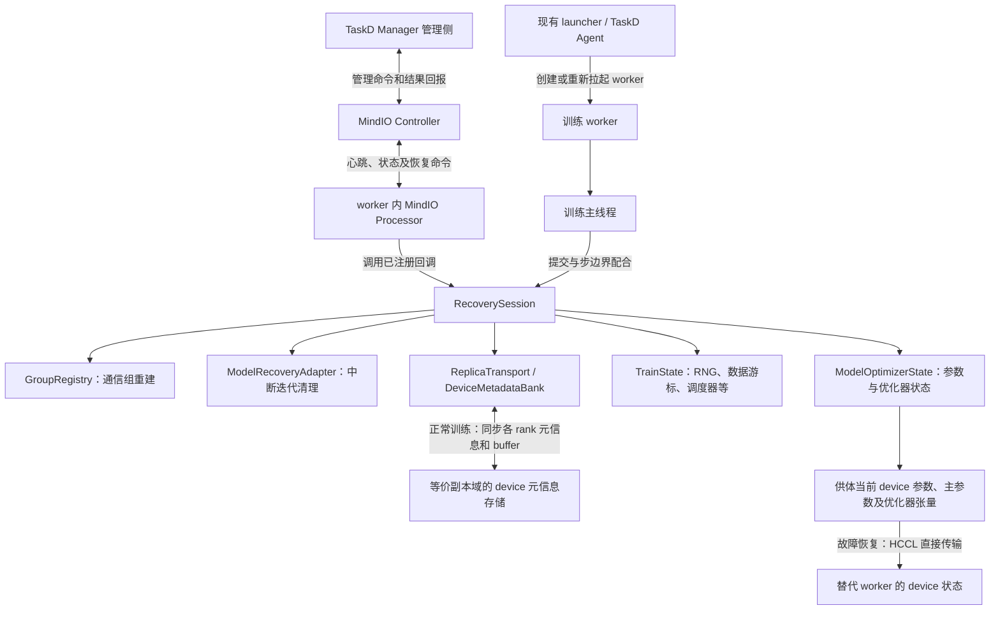
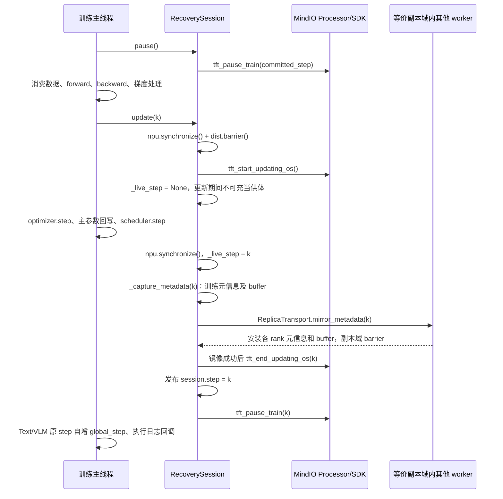
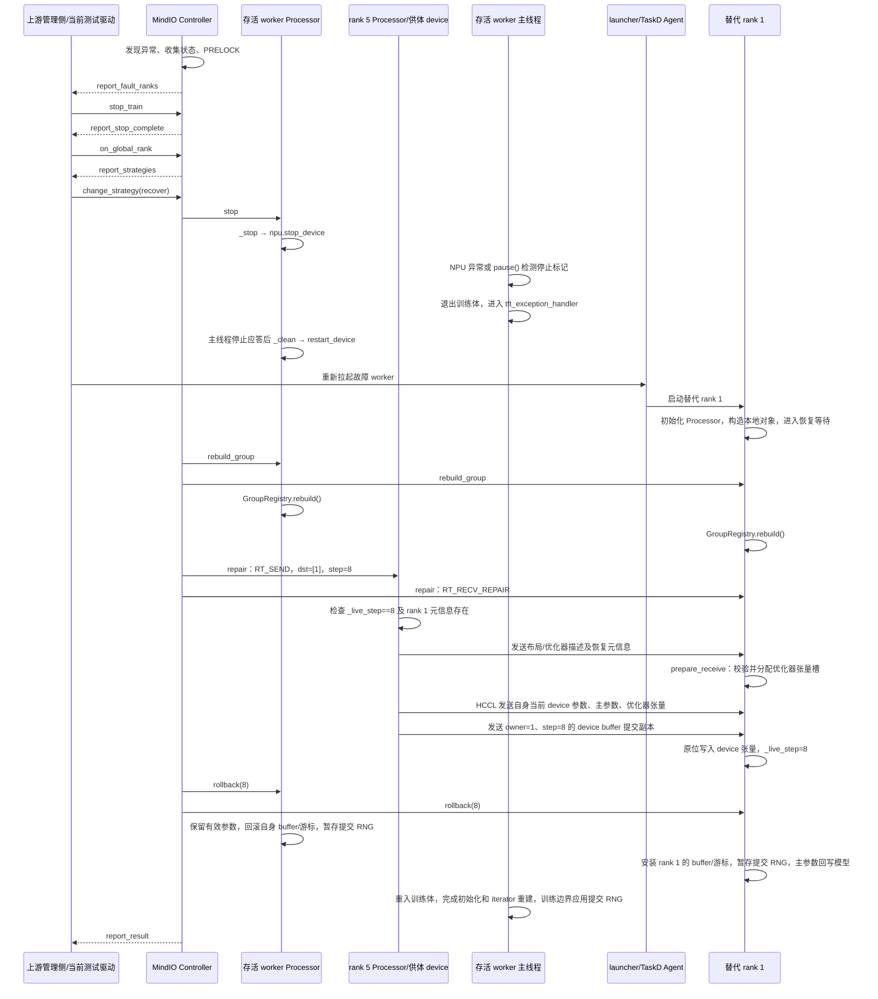
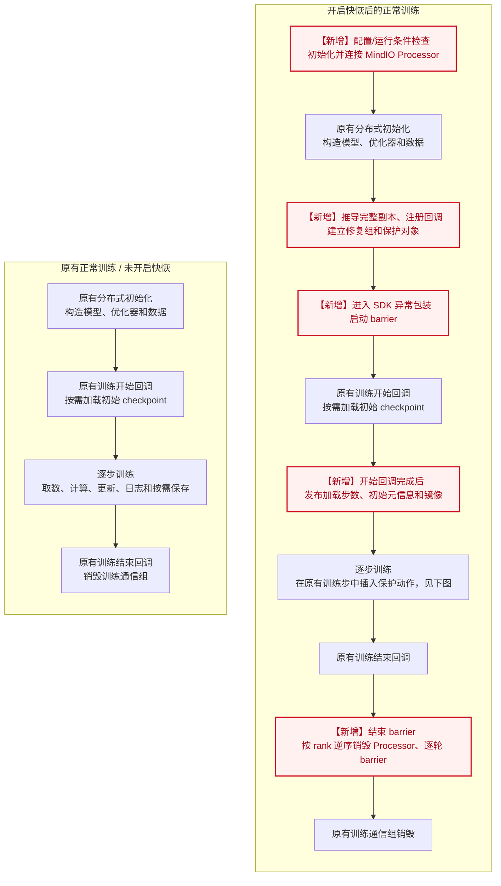
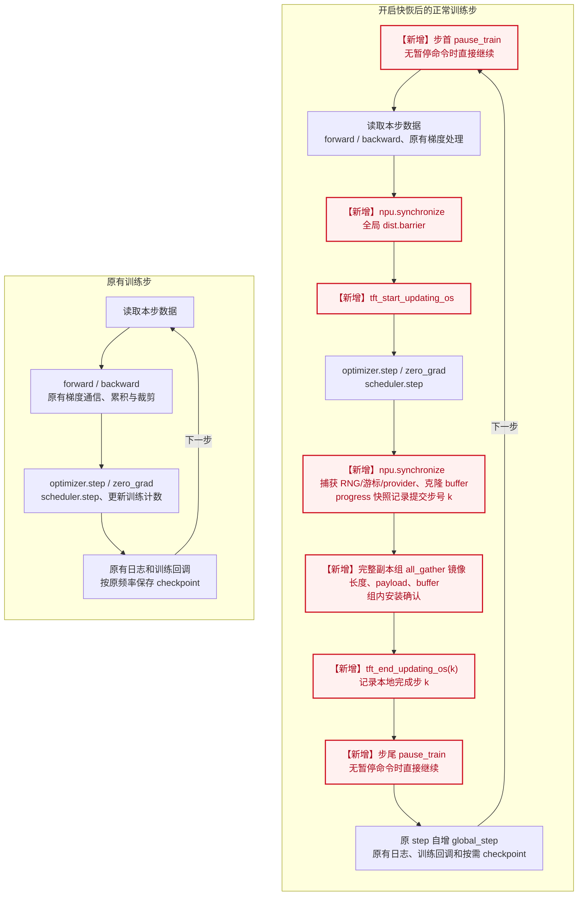
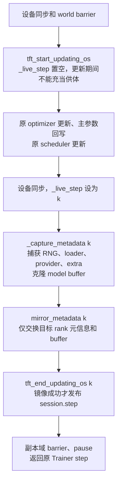

# HyperParallel 进程级快恢：当前实现流程与接口

本文依据 `feat/process-recovery` 分支工作区中的实现，说明初始化、正常训练、故障恢复和训练重入的调用关系。沿用原文的章节、时序图和逐阶段接口说明，内容更新为**从存活等价副本的 device 直接复制参数和优化器状态**。代码仍在验证中，本文不把待联调能力作为已经完成的生产能力。

## 1. 总体结构与职责

当前实现通过 MindIO 调度恢复，通过 torch-npu 停止和重新启用设备、重建 HCCL 通信，通过 HyperParallel 恢复训练状态。模型参数、FP32 主参数和优化器张量直接取自存活等价副本当前的 device 状态，不生成或恢复这些张量的 CPU 快照，也不从磁盘 checkpoint 兜底。

RNG、数据游标、module extra state 等不能套用供体的状态。这些必要训练元信息及可变 model buffer 在正常训练时按 `owner + step` 复制到等价副本域；元信息以 device 字节缓冲保存，buffer 的提交副本也保留在 device 上。Trainer 的进度和调度器通过唯一的 `replica_providers` 对象映射登记，不每步向副本发送，只在各 rank 本地保留同一步快照，故障修复时再从供体取得；历史 loss、loss_dict、grad_norm 不再由快恢额外保存或恢复。恢复时 Python 元信息需要经 CPU 序列化和解析，参数、主参数及优化器矩不经 CPU 中转。



职责边界：

- **Controller**：MindIO 的恢复协调器，负责状态收集、PRELOCK 和恢复指令调度。HyperParallel 没有重新实现其状态机。
- **Processor**：位于训练 worker 内，接收 Controller 命令，进入 MindIO 的 Python 回调包装逻辑，再调用 HyperParallel 注册的回调。
- **RecoverySession**：连接 Processor 与训练运行时，提供正常提交、设备停止、清理、通信重建、状态修复和回滚入口。
- **训练主线程**：执行 forward/backward、优化器更新、训练元信息及 buffer 的保存/同步和步边界配合；故障后退出当前训练体，等待 SDK 调度，再重新进入训练体。
- **launcher / TaskD Agent**：负责进程生命周期。`RecoverySession` 本身不创建替代 worker。
- **TaskD Manager / ClusterD**：属于框架外管理链路。HyperParallel 训练代码没有直接调用它们的 Python API；测试 harness 已接入真实 TaskD 的 Controller 转发和 Agent 重启接口，但上游策略决策、Manager→Agent 网络传输及 Pod 重建仍有验证边界，见第 7 节。

核心代码入口：[session.py](../hyper_parallel/core/fault_tolerance/session.py)、[Trainer 接入](../hyper_parallel/trainer/runtime/fault_tolerance.py)。

## 2. Controller 启动方式

### 2.1 显式配置地址：rank 0 启动

```yaml
worker_recovery:
  enable_worker_reboot: true
  controller_ip: "192.168.1.10"
  controller_port: 8000
```

`RecoverySession.initialize()` 在 rank 0 调用：

```python
tft_init_controller(0, world_size, False, True, False)
tft_start_controller(controller_ip, controller_port, False, "")
```

Controller 位于 rank 0 worker 的同一进程中，运行由 MindIO 的原生后台线程推进；这里没有创建 Controller 子进程。其他 rank 不执行这两项初始化。

所有 rank 随后启动 Processor：

```python
tft_init_processor(rank, world_size, False, False, "", False, True, False)
tft_start_processor(controller_ip, controller_port)
tft_is_reboot_node()
```

`tft_is_reboot_node()` 用于区分首次启动和故障后的替代 worker。上面两处初始化均关闭 `enable_local_copy`；参数修复由 HyperParallel 的 device 传输通道执行，MindIO 负责调度。

### 2.2 不配置地址和端口：TaskD 启动

```yaml
worker_recovery:
  enable_worker_reboot: true
```

此模式下 HyperParallel 不创建 Controller，仅创建 Processor。由 TaskD 的部署和启动入口负责创建 Controller，HyperParallel 不会因为省略地址而自行启动一个 TaskD 进程。

`RecoverySession._controller_endpoint()` 按以下顺序查找部署环境中的地址：

1. `PROCESSOR_ADDR`。
2. `CONTROLLER_ADDR`。
3. `TTP_ADDR`。
4. `MASTER_ADDR`。

端口读取 `TTP_PORT`。这里要求地址确实指向 TaskD 所托管的 Controller；不会使用各 worker 自己的 `POD_IP`，也不会拿训练 rendezvous 的 `MASTER_PORT` 代替 Controller 端口。缺少地址或端口时明确报错。

环境变量来自部署系统，用户不需要在 HyperParallel 配置中重复提供。TaskD 主机接口测试已验证 Manager 启动 Controller、8 个 Processor 通过部署环境连接，并在测试管理环境通过新版 device 故障恢复；这不等于生产管理全链路已经验收，具体覆盖范围见第 7 节。TaskD/Go 动态库使用的部署环境应在库导入前注入。

本地 TaskD 的实际启动入口是 `Manager.start_taskd_manager()` → `Manager.start_controller()` → `init_controller()`，参见 [TaskD manager.py](../mind-cluster/component/taskd/taskd/python/framework/manager/manager.py) 和 [controller.py](../mind-cluster/component/taskd/taskd/python/framework/manager/controller.py)。两种模式必须保持唯一的 Controller 启动方。

配置实现：[config.py](../hyper_parallel/core/fault_tolerance/config.py)。显式提供 IP 但省略端口时，当前保留默认端口 8000；仅提供端口而没有 IP 会报错。

## 3. 初始化与恢复对象绑定

### 3.1 Trainer 构造接入

`recovery_constructor()` 在开启特性时创建 `RecoverySession`，先调用 `initialize()`，然后在 `session.groups` 上下文中构造模型、mesh 和通信组。

`GroupRegistry` 记录需要恢复的通信组及创建顺序。替代 worker 执行相同的本地构造路径，但避免初始化权重时的跨 rank 通信：

- `is_recovery_reboot()` 识别当前受管会话是否属于替代 worker，数据构造及延迟首次打开索引仍需保留该身份。
- `is_recovery_bootstrapping()` 仅在替代 worker 且 `GroupRegistry.sealed=False` 时为真；模型分发、materialize 和 Muon 初始化以此判断是否跳过初始化通信。attach 封闭组登记后，该判断为假，恢复后的正常训练不能继续跳过通信。
- `distribute_tensor()` 在该上下文中使用本地切片路径，避免默认源 rank 广播/散发导致替代 worker 等待尚在恢复中的存活 rank。
- 模型构造入口跳过初始权重加载，等待恢复回调从等价副本 device 写入状态。
- 模型、mesh 和优化器都在 `session.groups` 上下文内构造，使训练组和 Muon 的优化器子组完整登记；不会为开启快恢自动改写 Muon 的状态去重配置。

这不意味着替代 worker 完全不执行构造函数：**替代 worker 需要重新构造本地模型和优化器对象；存活 worker 仅重新进入训练体。**

### 3.2 训练开始时绑定状态

`_train_recoverable()` 创建 `TrainState`，通过 `replica_providers={"progress": ..., "scheduler_0": ...}` 对象映射登记进度和学习率调度器，loader、RNG 和 generators 独立处理；随后调用：

```python
session.attach(model, optimizer, train_state, global_step)
```

`attach()` 完成：

1. 创建 `ModelRecoveryAdapter`，绑定需要清理的策略运行时。
2. 创建 `ModelOptimizerState`，建立参数、buffer、主参数、优化器状态与稳定参数名之间的映射。
3. 调用 `ReplicaTopology.discover()`，从 DeviceMesh/placements 推导模型候选副本，再按实际优化器状态 owner 筛选完整副本；没有完整副本时，在注册 MindIO 副本关系前报错。
4. 调用 `tft_set_optimizer_replica(rank, replica_info)`，向 MindIO 注册本 rank 所在的等价副本域，格式为 `[{"rank_list": ranks, "replica_cnt": len(ranks), "replica_shift": 0}]`。
5. 调用 `tft_register_*_handler()` 注册恢复回调。
6. get_metadata_group 优先查询 Hyper 的 EXISTING_COMM_GROUPS，校验实际成员与 HCCL 后端后复用同一句柄，全 world 域复用默认组。未命中时仅 attach 补建一次懒初始化元信息组，并显式登记重建。ReplicaTransport 通过该组 all_gather 镜像必要状态；repair 仍按 MindIO rank_list 使用临时组做 P2P。

当前 device 路径不调用 `tft_set_dp_group_info()`。用户不需要配置 `replica_groups`、worker 地址、备份端口或 run ID。

所有恢复相关通信组应在 attach 完成前创建或显式注册；attach 后禁止临时创建新的受管理组。

### 3.3 自动副本关系

`ReplicaTopology.discover()` 根据实际参数布局推导等价副本，不再通过 world size 或 rank 编号任意配对：

1. `device_replica_ranks()` 读取参数的 DeviceMesh/placements，仅允许变化 `Replicate` 维度的坐标，保留分片维度坐标。
2. `model_replica_candidates()` 对所有参数声明的布局候选副本取交集，得到可以恢复**整个本地参数集合**的副本域。
3. `ModelOptimizerState` 从 Muon 二次分组后的 `no_comm` 和各 assignment 的 `owned_params` 提取实际状态归属，按稳定参数名生成 `optimizer_ownership` 指纹。HP AdamW 则对自身参数组中的全部参数持有状态。此处根据初始化后的分配计划判断，不等待第一次 `step()` 懒创建动量。
4. 原始 worker 通过 `dist.all_gather_object()` 交换候选域、schema 和 `optimizer_ownership`。`ReplicaTopology.from_profiles()` 先校验模型候选域对称及基础布局一致，再筛出实际优化器状态归属也相同的成员，形成完整状态副本域。每个 rank 至少需要一个其他完整副本，且当前实现要求各域副本数相同。这里校验布局与状态归属，不逐元素校验数值；数值等价仍依赖正确的副本初始化和正常训练同步。
5. 原始与替代 worker 都根据本地 DeviceMesh/placements 和 Muon 的实际 owner_by_index、复制维坐标及有效子组大小推导完整副本。原始 worker 另做一次全员描述校验；替代 worker 不查询 Store、不发起拓扑 all-gather，修复接收头仍校验 schema/ownership。实际供体以 MindIO 的 src/dst 指令为准。

例如 HSDP 的 2×4 mesh 排列为 `[[0,1,2,3],[4,5,6,7]]`，placements 为 `[Replicate(), Shard(0)]` 时，模型候选域为 `(0,4)、(1,5)、(2,6)、(3,7)`。对于 HP AdamW，或 Muon `hsdp_replica_count=1` 且实际分配保留完整本地状态的情形，这些候选域也是完整状态副本域。rank 1 故障时，rank 5 直接发送**自己持有、与 rank 1 等价的 device 参数及优化器张量**，不再保存 rank 1 的 CPU 参数快照。

TP/EP 与 DP 组合时，也必须保持 TP/EP 分片坐标一致并具有真实冗余。仅有 TP/EP、没有等价副本时 attach 会报错；不同分片即使形状相同也不能互相替代。当前按全模型本地状态取交集，不支持每个参数分别选择不同供体再拼装恢复。未声明 DeviceMesh/placements 的普通本地参数只将自身 rank 作为候选，不自动推导出远端副本。

Muon 必须结合 `hsdp_replica_count` 的实际分组结果判断。当前优化器将该值用于复制维度上的去重子组大小；参数值本身不等于快恢可用的完整副本数。假设同一模型分片的候选域是 `{0,1,2,3}`，去重子组为 `{0,1}` 与 `{2,3}`，状态 A 分别由 rank 0、2 持有，状态 B 分别由 rank 1、3 持有，则完整状态副本域应为 `{0,2}` 和 `{1,3}`，而不是原来的四卡模型副本域。

如果模型候选域仅有 `{1,5}`，Muon 又把状态在两者间完全去重，则两者均没有其他完整状态副本。此时 attach 提前报错 `no complete device replica for model and optimizer state; worker recovery cannot be enabled`，并提示检查 `hsdp_replica_count` 和实际 owner 分配。框架保留已有配置，不自动关闭去重或隐式增加状态冗余；调用方需要使用确实具备完整状态副本的训练布局或优化器配置。

框架不重新安排物理节点或机架布局。整节点掉电能否恢复，还取决于该节点之外是否存在存活等价副本及可用元信息；单机 8 卡测试只能证明进程故障路径。

实现：[topology.py](../hyper_parallel/core/fault_tolerance/topology.py)、[transport.py](../hyper_parallel/core/fault_tolerance/transport.py)。

## 4. 正常训练：什么时候算提交了一步

Trainer 统一使用 session.run(body)，不额外增加首次 world barrier。原始 worker 进入原 train 执行 on_train_begin，其后的 recovery_train_initialized 调用 publish_initial_state，以正常 checkpoint 加载后的步数和 live 对象捕获、镜像初始训练元信息，并按需 tft_report_load_ckpt_step。run 不在 body 前发布状态，底层自定义训练体也须在初始化完成、取数前显式发布。一次性标记确保原始启动仅发布一次，替代进程及恢复重入不发布初始状态；故障快恢不读磁盘 checkpoint。

每一步的主线程顺序如下：



具体接口：

- `recovery_optimizer_update()`：将 Trainer 的优化器和调度器更新包进 `session.update()`；临时标记本次提交步号，由 progress provider 写入快照。Trainer 自身的 global_step 自增仍位于原 step 的位置。
- `RecoverySession.update()`：进入更新窗口前完成设备同步和默认组 barrier，使 forward/backward 通信阻塞不被算作一次进行中的优化器更新。
- `tft_start_updating_os()`：当前调用不传 step，进入 SDK 优化器更新窗口；随后设置 `_live_step=None`，标记这份 device 状态正被修改。
- `_capture_metadata(k)`：在优化器、主参数回写和调度器更新完成且设备同步后，`update()` 先将 `_live_step` 标为 `k`，再调用此接口。它调用 `ModelOptimizerState.rank_state()` 保存可变 buffer 的 device 副本，调用 `TrainState.capture()` 捕获 RNG、游标和 provider；progress 快照取本次提交步号 `k`，无需提前改变 Text/VLM 的原生计数器。`DeviceMetadataBank.put()` 将显式声明的 `replica_providers` 分离为本地 CPU 元信息快照，其余目标 rank 状态编码为 device 字节缓冲。不捕获模型参数、主参数或优化器矩。
- `tft_end_updating_os(k)`：本地更新、元信息捕获和必要镜像全部成功后上报完成步数，再设置 `session.step=k`。优化器更新或镜像失败均不调用 end。
- `ReplicaTransport.mirror_metadata(k)`：在 end 之前通过成员完全匹配的元信息组 all_gather 长度、payload 和各 buffer，再在组内 barrier 确认安装。短 payload 补齐到本组最大长度，已有最大长度的输入直接复用；接收按原长度截取，保留本 rank 原提交快照。组在 attach 解析、必要时创建，不在每步新建。进度/scheduler、LOGS、参数和优化器矩不参与逐步发送。
- `pause()`：元信息同步后先检查 `_stopped`，已停止则抛出 `FORCE STOP`；未停止才调用 `tft_pause_train(k)`。

提交顺序为：完成本地更新和捕获 → 必要元信息镜像与安装确认成功 → `tft_end_updating_os(k)` → `session.step=k`。镜像失败由 `_mirror_metadata()` 转为 MetadataMirrorError，保留原异常链，SDK 通用异常分支上报 RS_UNKNOWN 后向外抛出，不提交本步、不走 RuntimeError 恢复重试。异常上报及退出协调仍可能等待；这不是自动回退到上一版本。镜像成功是提交的必要条件，恢复仍需满足供体、步号和完整状态条件。SDK FinishedUpdate 先置 Updated/step=k，再等待 PRELOCK 上限释放，因此主线程可能尚未设置 session.step；此时必要镜像已完成。

`DeviceMetadataBank` 按 `owner + step` 保留两个版本的元信息和 buffer，**不保留两个版本的权重或优化器张量**。device 参数只有当前有效版本，供体必须满足 `_live_step == recovery_step`。若已经进入部分更新，或 Controller 选定较早步数而存活副本已前进，不能靠这个元信息版本环把参数回滚；没有匹配的有效供体或目标 rank 元信息时明确失败。

当前保留已接入的必要状态保护：Python、NumPy、Torch CPU/device 及显式 Generator RNG、loader 消费游标及动态缓存、module extra state 和 model buffer 仍按原路径保留，未登记的 RNG tracker 或外部可变状态不会自动捕获。框架不能仅凭 buffer 的名字或 `persistent=False` 认定其只读，普通 loader 也不能一概用 `step × batch_size` 替代。`TrainState.replica_providers` 是唯一的公共对象映射，其中所有对象的状态都要求副本等价；捕获后整体本地保留，不进入逐步镜像。Trainer 自动登记进度和调度器，不再传递通用 providers 和额外名称集合，也不增加用户配置。rank 专属自定义状态须通过其所属的 loader、generator、module extra state 等路径接入，不能放入公共映射。历史指标不再作为 LOGS provider 保护，正常日志仍由原 Trainer 输出。必要状态通过完整副本组 all_gather 和组内安装确认，当前先镜像成功再调用 end；镜像失败按终止处理，不将不完整状态作为已提交步。

## 5. 第 8 步完成后 rank 1 退出：端到端恢复

场景前提：实际布局中 rank 1 与 rank 5 是等价副本；第 8 步更新及该步元信息、buffer 的副本域同步已完成，随后开始第 9 步 forward；rank 1 异常退出，rank 0、rank 5 及管理链路存活。rank 5 的 `_live_step` 仍为 8，持有有效等价参数和优化器状态，并保存 rank 1 的第 8 步元信息及 buffer。以下以 MindIO 最终选定第 8 步恢复为例，不意味着任意故障都固定选择最大步数或第 8 步。



上图的“存活 worker Processor”代表包括 rank 5 在内的存活进程回调路径；单独展开 rank 5 是为了说明供体发送动作，不表示它另外创建了进程。rank 5 同样参加前面的 stop/clean/rebuild 和后面的 rollback。

上图表达逻辑依赖，不要求设备停止与替代进程启动在不同组件间严格串行。管理侧可以在符合协议的前提下并行推进；具体时机需以 TaskD 联调结果为准。

### 5.1 发现故障、选定恢复策略

这部分由 MindIO 与外部管理侧负责，HyperParallel 没有调用一个“选择恢复步数”的接口。

当前测试驱动使用真实 MindIO 管理接口：

- `tft_register_mindx_callback("report_fault_ranks", ...)`：接收故障 rank 上报。
- `tft_notify_controller_stop_train(fault_ranks, "stop")`：请求停止训练推进，对应管理层 stop_train。
- `tft_notify_controller_on_global_rank(fault_ranks, timeout)`：通知故障 rank 并获取可行策略。
- `tft_register_mindx_callback("report_strategies", ...)`：接收可用策略。
- `tft_notify_controller_change_strategy("recover", "")`：选择进程级恢复策略。

`stop_train` 是发给 Controller 的管理命令；下面的 `_stop()` 是 Controller 调度 Processor 后落实到训练设备的动作，两者不是同一个接口。PRELOCK 限制优化器推进，并不保证任意 forward 立即返回。rank 退出后，其他 rank 的 forward/backward 可能阻塞，必须由设备停止和 SDK 异常循环解除。

测试入口：[测试管理驱动](../tests/torch/fault_tolerance/_test_process_recovery.py)。默认使用测试驱动转发命令并重拉起进程，也可启用真实 TaskD Controller 转发和 Agent 重启适配；新版 device 路径的验收进度与各组件的覆盖范围见第 7 节。

### 5.2 停止设备：`_stop()`

注册接口为 `tft_register_stop_handler(self._stop)`。

`RecoverySession._stop()` 先设置 `_stopped=True`，再调用：

```python
torch_npu.npu.stop_device(local_rank)
```

这使进行中的设备计算或通信退出。主线程因 NPU 异常退出训练体；若处于 CPU 轮询，则在 `session.pause()` 检测到标记后抛出 `RuntimeError("FORCE STOP")`。SDK 的 `tft_exception_handler` 接管异常和主线程停止应答。

### 5.3 清理：`_clean()`

注册接口为 `tft_register_clean_handler(self._clean)`。

主线程停稳后，`RecoverySession._clean()` 调用以下动作；入口要求 `_stopped=True`，明确拒绝 `is_uce_error=True` 的 UCE 修复：

1. `ModelRecoveryAdapter.abort_iteration()`：遍历去重后的已登记分片调度器，清理其保留的中断迭代状态。
2. 分片调度路径进入 `scheduler.abort_iter_state()`，丢弃失败 Work、清理分片梯度并恢复分片视图。TP/EP 的恢复核心不依赖该调度器；其临时 autograd 工作随训练体退出释放，参数梯度还会在 rollback 统一清空。
3. `torch_npu.npu.restart_device(local_rank)`：重新启用设备。
4. `torch_npu.npu._recovery.update_npu_tensor_to_safe()`：为保留的本地参数、主参数、优化器张量、元信息字节缓冲和 buffer 更新设备恢复安全标记，允许后续在重启后的设备上使用。这一步不重新构造这些张量的数值；随后清除 `_stopped` 并返回 0。本地 CPU provider 快照不参与设备安全标记。

这里不会等待已经失效的旧通信 Work 完成。实现：[adapters.py](../hyper_parallel/core/fault_tolerance/adapters.py)。

### 5.4 替代 worker 初始化及等待

外部 launcher/TaskD Agent 重新拉起 rank 1。新进程初始化 Processor，通过 `tft_is_reboot_node()` 识别为替代节点，重新构造本地模型、优化器、loader 和通信组描述，然后 attach。

替代 worker 此时不能执行依赖存活训练 rank 配合的初始化 collective。当前分两阶段处理：

- **构造期本地准备**：沿用原 rank、world size、mesh 布局和存活的 rendezvous store。框架 `new_group()` 仍调用真实 `dist.new_group()`，使用关键字参数按原顺序创建和登记 HCCL 懒初始化组；要求 `TORCH_DIST_INIT_BARRIER=0`、不使用 `device_id`、`use_local_synchronization` 或自定义 `pg_options`，避免此时立即建链或执行建组 barrier。替代 worker 只与 store 和 Controller 完成必要连接，不依赖存活 worker 进入训练 collective。
- **延后跨 rank 操作**：distribute_tensor 使用本地切片，模型构造跳过初始 checkpoint 加载；ReplicaTopology.discover 本地重建副本和 Muon owner 关系，不读取 Store 拓扑缓存。Muon 延后分片形状收集，优化器子组按已有目录创建。run 不增加首次 world barrier，替代 worker 的初始发布标记关闭，不参加原始启动元信息镜像。
- **Trainer 内置数据构造**：开启快恢时，原始和替代 worker 均本地解析 indexed 路径，按确定顺序遍历目录和文件，显式 blend 保留配置顺序；不缓存 Store 清单，也不执行目录发现 all-gather。数据文件集合及必要索引必须稳定、可访问。Dataset 构造保留输入归属和 data_index_cache 语义，替代 worker 跳过原缓存 barrier；对象存储索引复用本地缓存或本地下载后原子发布。正常未开启快恢的发现流程不变。
- **协调后恢复通信**：下一节的 `rebuild_group` 回调由 Controller 下发给参与恢复的存活与替代 worker；全体按同样顺序重建默认组及各成员组，随后进行 Muon 形状收集和供体状态传输。

实现没有全局替换 `torch.distributed.barrier()` 或任意通信接口。未经适配的自定义模型构造、loader 或插件若直接执行 barrier、broadcast、all-gather，仍可能等待处于恢复状态的旧 rank，必须改为本地准备，或移到重建后所有对应 rank 都会进入且顺序一致的恢复同步阶段；只在替代 worker 上延后调用仍会阻塞，仅登记外部 group 也不会自动处理这些 collective。上述约束适用于当前固定 world size 的 HCCL 路径，不能据此宣称任意 Trainer 构造或任意新节点都能直接进入恢复。

按当前 BaseTrainer/TextTrainer 生命周期，`_build_lr_scheduler()`、`_build_training_context()` 及默认 callback 注册是本地准备；已禁用的 compile、CP/PP、offload 等组合在构造前由恢复配置检查拒绝。`get_batch()` 的 TP 数据广播、训练指标归约、恢复后的 checkpoint ledger 同步，以及训练结束时 `destroy_distributed()` 的 barrier 属于重建通信之后的阶段，不应为了替代 worker 初始化将这些操作全局删除。

在 `RecoverySession.run()` 内，替代 worker 通过 `RuntimeError("ARF FINISH")` 进入 MindIO SDK 的恢复等待路径。其 `_live_step` 初始为 `None`；它不执行原始 worker 的初始元信息镜像，不把随机初始化参数发布成有效副本，也不重新读取初始 checkpoint。参数和优化器张量等待 `_repair()` 接收后才成为有效 device 状态。

### 5.5 重建通信：`_rebuild()`

注册接口为 `tft_register_rebuild_group_handler(self._rebuild)`。

`_rebuild()` → `GroupRegistry.rebuild()`：

```python
dist.reinit_process_group(group=None, rebuild_link=True)
dist.reinit_process_group(group=recorded_group, rebuild_link=True)
```

先对默认组及本 rank 参与的已登记训练、优化器、元信息组按原顺序执行 reinit，保留模型、mesh、bucket 和传输对象的句柄引用。镜像组优先复用缓存，缺失才补建；repair 使用的临时组不作为常驻组登记。

本地 reinit 结束后由 Processor 回复 MindIO Controller；Controller::HcclCommGroupRepair 等待全体回复后才进入 repair，替代原来的 Store 就绪标记。重建回调不执行任何新 collective，避免较慢 rank 清理建链 key 时破坏已开始的通信。generation 仅是本进程重建次数，不再从 Store 获取全局代数。

Muon 的 ModelOptimizerState.rebuild_runtime_state() 延后到全体 rollback 回调，再调用各叶子的
`rebuild_recovery_state()`，由所有 rank 共同刷新分片形状元数据及其派生的分配缓存。
替代 worker 构造时跳过该形状 all-gather，避免存活 rank 尚未进入 rebuild 时发生等待。
优化器细分副本组时使用 `recovery_optimizer_subgroup()` 从已记录 mesh 组目录确定性创建并登记组，
不在替代 worker 构造期间执行全局拓扑 all-gather；这些组随后同样由 `GroupRegistry` 原位重建。

rank 0 自托管 Controller 模式下，rank 0 退出会同时丢失 Controller，本实现明确拒绝把它当作普通 worker 故障继续恢复。TaskD 托管模式已调整这一检查，但 rank 0 替换、rendezvous 生命周期等仍待实际验证。

### 5.6 复制并安装状态：`_repair()`

注册接口为 `tft_register_repair_handler(self._repair)`。Processor 传入恢复 step 和 `repair_info` 中的 `repair_type/src/dst`。

- **供体 rank 5** 收到 `RT_SEND`：`RecoverySession._repair()` 先检查 `_live_step == step`，再调用 `ReplicaTransport.send(destination=1, step=8)`。
- **恢复端 rank 1** 收到 `RT_RECV_REPAIR`：`_repair()` 从 `src/dst` 配对中找到自己唯一的供体，调用 `ReplicaTransport.receive(source=5, step=8)`；接收成功后才设置 `_live_step=8`。

供体侧 `ReplicaTransport.send()` 的具体动作：

1. `DeviceMetadataBank.get(destination, step)` 取出**目标 rank** 的训练元信息和可变 buffer，不含目标 rank 的参数或优化器矩。
2. `DeviceMetadataBank.metadata(destination, step)` 解码目标 rank 必要元信息，再合并供体在相同步数的本地 `replica_state` 快照；缺少精确版本会报错，不从最新版本拼凑。`ModelOptimizerState.metadata()` 描述供体的 schema、优化器参数组配置、非张量状态及各优化器张量的形状/dtype；与上述完整元信息一起编码为传输头。公共进度和调度器状态到此时才发送，传输头不包含历史 LOGS provider。
3. `ModelOptimizerState.tensor_items()` 返回供体自己当前的模型参数、独立 FP32 主参数和优化器张量的本地存储引用。
4. `_send_tensor()` 通过 `dist.send(..., group=replica_group)` 按最多 4 MiB 的张量块发送这些 device 数值，再发送目标 rank 的可变 buffer 提交副本。非连续张量可能在 device 上形成连续临时缓冲，不转为 CPU 权重快照。

恢复端 `ReplicaTransport.receive()` 的具体动作：

1. 用 `dist.recv()` 收到传输头，检查 `owner == self.rank` 和 `step`。
2. `ModelOptimizerState.prepare_receive()` 校验 schema 及实际优化器状态归属指纹，恢复优化器组配置、非张量状态，并在目标 device 分配其应持有的 AdamW 矩或 Muon 动量槽，保留模型 Parameter 和主参数对象身份。
3. 按与供体相同的 `tensor_items()` 顺序调用 `_receive_tensor()`，在 device 接收后用 `copy_()` 写入目标张量。当前接收实现为每个张量分配同尺寸 device 暂存，再分块接收；并非整条链路零拷贝。
4. 接收目标 rank 的可变 buffer，调用 `DeviceMetadataBank.put()` 保存该 rank 的精确步数元信息，将供体同一步的 `replica_state` 留为本地快照，等待 rollback 安装。

因此，实际权重写回入口是 [ReplicaTransport.receive() / _receive_tensor()](../hyper_parallel/core/fault_tolerance/transport.py)，优化器槽准备入口是 [ModelOptimizerState.prepare_receive()](../hyper_parallel/core/fault_tolerance/state.py)。旧的 `ModelOptimizerState.capture()/restore()` 完整 CPU 快照入口已删除。

状态层支持纯 Muon 和 Muon+AdamW 组合，包括 Muon `momentum_buffer`、参数组 `step`、学习率和动量配置。schema 校验包括叶子优化器类型及参数归属，拒绝把 AdamW 状态当作 Muon 状态接收。Muon 的 NS 输入、分片 gather 临时缓冲和异步通信句柄由中断迭代清理，不作为持久状态发送，也不在回调中等待失效的旧句柄。新版 device 路径的验证结果见第 7 节。

这里传输由 HyperParallel 的 `ReplicaTransport` 实现，MindIO 负责调度源和目标；没有调用 MindIO 的模型权重搬运封装。

### 5.7 全体回滚：`_rollback()`

注册接口为 `tft_register_rollback_handler(self._rollback)`。

所有参与恢复的 rank 的核心回滚动作如下：

```python
snapshot = bank.get(self.rank, step)
metadata = bank.metadata(self.rank, step)
model_state.restore_rank_state(snapshot["buffers"], metadata["extra"])
train_state.restore(metadata["state"])
```

执行上述动作前，`_rollback()` 必须检查 `_live_step == step`。恢复 buffer/extra、loader 和公共 provider 后执行设备同步，设置 `session.step=step`。提交 RNG/generators 只独立冻结到 TrainState._pending_rng，等主线程完成重入初始化后再应用，不再维护 `_resume_iterator` 标记。替代 rank 的参数、主参数和优化器张量已经在 repair 阶段由供体写入；存活 rank 保留符合目标步数的有效 device 状态。rollback 不从 CPU 快照重写这些张量，也不支持把已前进的参数自动倒回较早步数。

存活 rank 仍需要恢复自身 rank 状态：第 9 步 forward 可能已经改变 buffer、消耗随机数和数据，即使尚未执行 optimizer，也不能仅恢复新进程。`bank.metadata()` 只解析必要训练元信息并合并本地精确步数的 provider 快照，没有模型参数、主参数或优化器矩。

恢复对象包括：

- **repair 阶段**：等价供体当前 device 上的模型参数、优化器主参数、AdamW 一阶/二阶矩、Muon 动量，以及优化器步数和参数组配置。
- **rollback 阶段**：本 rank 的第 8 步 buffer、自定义 module extra state；`restore_rank_state()` 还将 FP32 主参数回写计算参数，并清空 `grad/main_grad` 等迭代梯度。
- **主线程重入后的训练边界**：应用暂存的 Python、NumPy、Torch CPU、NPU 及显式注册 Generator 的提交 RNG。
- loader 消费位置、Trainer global_step/epoch、学习率调度器。
- 不恢复故障前的 loss、loss_dict、grad_norm 等历史指标，也不补写外部日志系统历史记录；重入原训练后照常计算并输出新训练步的指标。

`TrainState.restore()` 调用 loader/provider 的 `load_state_dict()`，这里不通过跳过 N 个 batch 近似回滚。

以当前 Trainer 中 rank 1 从 rank 5 恢复为例：**参数和优化器张量取 rank 5 自己的等价 device 状态；RNG、数据游标、module extra state 和 buffer 取此前保存在副本域内的 rank 1 状态；进度与调度器取 rank 5 的第 8 步本地快照，不取供体历史 loss。** 副本参数等价不意味着每个 rank 消费相同数据或具有相同 RNG；公共 `replica_providers` 映射只能接入已确认副本等价的对象，不能将任意 rank 专属自定义状态放入其中。

### 5.8 训练主线程重入

SDK 在恢复完成后重新调用 `RecoverySession.run()` 包装的训练体。

**callback 初始化通信限制**：on_train_begin 中的初始化应能在本地执行。新增 callback 如果包含 barrier、broadcast、all-gather 等集体通信，必须专门适配并验证通信组已可用，且所有组成员会在同一阶段、以相同顺序参与；替代 worker 单独执行而存活成员仍在恢复等待时，可能因通信不匹配而阻塞。框架不会自动识别或跳过任意 callback 中的通信。当前内置 checkpoint 的初始读盘在恢复重入时明确跳过；该处理不构成任意新增通信回调的兼容保证。

`_train_recoverable()` 只绑定对象、登记恢复回调和包裹原 train，不再手动调用或拦截 on_train_begin。原 train 在完整开始入口返回后调用 recovery_train_initialized，首次启动才发布初始状态；在 epoch 开始逻辑与原生 iterator 构造均完成后，recovery_epoch_initialized 只判断 rng_restore_pending，仅 rollback 留有提交 RNG 时才调用 session.finish_restore → TrainState.finish_restore，成功后自动撤销触发。普通 epoch 不调用这两个收尾接口，失败保留待恢复状态；恢复 epoch 即使无剩余 step，也先完成再进入下一 epoch。

存活 worker 不重复模型构造，但与替代 worker 一样，在 SDK 重入原 train 时正常执行 on_train_begin。checkpoint callback 根据替代身份或待恢复 RNG 跳过初始磁盘加载，保留配置打印等本地动作；tqdm 先关闭旧进度条再重建。_body 中的 checkpoint 保存标记广播仍在全体恢复后执行。自定义初始化 callback 若包含集体通信，必须单独适配其通信组、成员参与和调用顺序；框架不自动跳过。

Base/Text/VLM 共用 step、optimizer 和恢复初始化适配。abort_profilers 不再拦截，按原生异常路径正常执行；当前快恢仍禁止启用内存和性能分析。on_train_begin、on_train_end 和通信组销毁均由原 train 正常执行。step 装饰器只保留 pause，epoch 结束处不新增 pause；恢复 RNG 的一次性收尾由初始化入口根据待恢复状态触发。原训练计数顺序不变，提交快照使用 `_recovery_committing_step` 记录 optimizer 提交步号。

训练重新从第 9 步的数据开始执行，随后正常完成 `update(9)`。Controller 在观察到恢复后的运行状态后通过 `report_result` 回报结果。

## 6. 主线程与回调线程如何配合

正常 forward/backward、optimizer、`_capture_metadata()` / `mirror_metadata()`、pause 和训练体重入都属于训练主线程路径。正常训练不会在这条路径捕获或复制完整模型及优化器 CPU 快照。

stop、clean、rebuild、repair、rollback 是由 MindIO Processor 的命令/回调路径调度，不是主线程在训练循环中主动顺次调用。Processor 的原生执行线程通过 SDK 包装进入 Python；HyperParallel 没有为这些回调另建一个恢复进程，也不依赖固定 Python 线程名。正常训练体返回时，主线程先做 barrier，再按 rank 逆序逐个销毁 Processor、每轮 barrier，rank 0 最后断开，随后由 SDK 包装负责后续清理。

正确性依赖两条路径之间的协议：先限制更新推进，再停止设备并取得主线程停止应答，之后清理、重建和恢复状态，最后允许主线程继续。不能让 repair 与仍在写参数的 optimizer 并发执行。

memory_profiler.stop、abort_profilers 和 on_train_end 均保留原 train 路径，不再拦截或由外层重复终止 profiler。训练组在原 train 中销毁，MindIO 正常销毁由 tft_exception_handler 完成，Session 不额外增加退出 barrier。不缓存已完成训练的返回值；SDK 若在销毁异常后进入 RETRY，可能重入已完成训练体，当前仅注释说明这一未覆盖场景。

退出 barrier 是 HyperParallel 的协调措施，不是 MindIO 接口的前置条件：先确认所有训练体结束，再按 rank 逆序销毁 Processor、每轮对齐，避免 rank 0 的 SDK 包装提前关闭本地 Controller。MindIO 的 [Processor::Destroy / ReportBeforeDestroy](../mind-cluster/component/mindio/tft/src/csrc/framework/processor/processor.cpp#L455) 通过 TCP 上报退出心跳、关闭客户端并等待后台线程；[SDK 的 ttp_destroy](../mind-cluster/component/mindio/tft/src/python/framework_ttp/ttp_decorator.py#L911) 在 rank 0 本地托管模式会关闭 Controller。可以用现有 rendezvous Store 的完成/退出通知替代 HCCL barrier，从而解除这段协调对默认训练组的依赖；当前未实施这一替换，不能只删除同步而保留原关闭顺序。此说明只针对退出阶段，不表示可以删除 optimizer 边界或状态镜像所需的训练同步。

device 供体还必须满足 `_live_step` 与恢复 step 一致。`tft_start_updating_os()` / `tft_end_updating_os()` 和 PRELOCK 用于限制优化器推进；它们不能把所有副本中断的更新重新变成完整版本，也不能替代目标 rank 元信息复制完成的检查。

## 7. 当前验证结果与待办

**2026-11-12 镜像成功后才提交（当前代码）**：必要元信息镜像和副本域安装确认先于 tft_end_updating_os(k)；镜像失败保持旧 session.step，不调用 end 或 pause。MetadataMirrorError 直接继承 Exception，SDK 通用异常分支上报 RS_UNKNOWN 后向外抛出，不进入 RuntimeError 恢复重试。CPU 快恢单测 **92 项、51 个子用例通过**；提取本地 MindIO 实际装饰器并模拟设备/上报接口，验证只执行一次训练体、上报 RS_UNKNOWN、保留原异常链，且不调用等待 repair 或重入训练。上报接口本身的退出等待、Controller 策略和真实 NPU 故障仍需远程验收；不将此前 8 进程集体通信验证当作本次提交顺序的端到端验收。见 [镜像提交顺序验证记录](validation/mirror-before-commit-20261112/summary.json)。

**2026-11-12 多副本镜像集体通信（调整提交顺序前）**：正常元信息镜像改为完整副本组 all_gather，attach 优先通过 get_created_group/EXISTING_COMM_GROUPS 复用成员完全匹配的 HCCL 句柄，全 world 域复用默认组；未命中时仅补建本 rank 域的懒初始化镜像组并登记 reinit，要求关闭初始化 barrier、默认组不绑定 device_id。repair 仍按 MindIO 指令建立临时组做 P2P。快恢 CPU 单测 **92 项、49 个子用例通过**；真实 8 进程 Gloo 分别覆盖每域 4、8 个副本，不等长元信息及 buffer 镜像、同轮四目标修复均精确一致。未运行性能对比或真实进程替换，HCCL 懒建链与提速幅度尚未验收；zbx SSH 仍超时。见 [集体镜像与组复用验证记录](validation/metadata-collective-20261112/summary.json)。

**2026-11-11 初始发布入口简化**：删除 run 的延后开关和 body 前发布分支，Trainer 在 on_train_begin 完成后显式发布，底层用例在初始化完成、取数前显式发布；一次性标记继续阻止替代进程及恢复重入发布初始值。当前快恢 CPU 单测 **86 项、47 个子用例通过**，受影响代码 Pylint、语法检查通过；底层 Ascend 用例仅完成入口适配和语法检查，未做本次 NPU 复验。见 [初始发布简化验证记录](validation/explicit-initial-publication-20261111/summary.json)。

**2026-11-11 本地重建优化（历史 P2P 版本）**：移除副本拓扑、indexed 路径清单及重建就绪标记三类快恢专用 Store 记录；替代进程本地推导布局/Muon owner 并确定性解析数据。正常镜像复用默认组定向 P2P，repair 根据 MindIO rank_list 建临时组，Muon 形状收集延后到全体 rollback；不预埋训练完成后的 SDK 退出重试处理。快恢 CPU 单测 **86 项、47 个子用例通过**；本地真实 8 进程 Gloo 验证了不等长元信息、四个目标同轮传输及状态精确一致，未注入真实进程故障。扩展检查存在 Windows 路径、POSIX 权限断言及组合导入冲突；本地 Python/NumPy 与支持版本有差异，editable 安装被 Python 版本限制拒绝。zbx SSH 连接超时，当前 MindIO/TaskD/HCCL 端到端复验尚未完成，历史 NPU 结果不作为本次改动验收。见 [本地重建验证记录](validation/local-bootstrap-20261111/summary.json)。

**原生开始入口与一次性恢复触发（2026-11-11）**

- on_train_begin 不再使用生命周期装饰器，也不由外层手动调用。原 train 正常执行全部开始回调；checkpoint callback 对替代身份或待恢复 RNG 跳过初始读盘，tqdm 在重入时关闭旧进度条后重建。新增 callback 在快恢初始化中应不依赖集体通信；如必须依赖，需针对该场景重新适配并验证，框架不会自动跳过。
- 初始元信息统一显式发布：原 on_train_begin 完成后，recovery_train_initialized 调用 publish_initial_state，重新绑定并校验模型/优化器布局，按实际加载步数保存、镜像和上报。已恢复的重入不重新发布初始状态；底层自定义训练体同步显式发布，不再保留 run 内的提前发布分支。
- epoch 初始化入口仅检查 TrainState.rng_restore_pending。正常启动和普通 epoch 不调用 Session/TrainState 的 finish_restore；rollback 后激活一次，成功应用 RNG 后自动撤销，失败保留待恢复状态，再次 rollback 重新激活。没有额外维护独立的一次性标记。
- 13 项本地协议专项检查通过，覆盖原生开始分发、checkpoint 重入跳过、tqdm 重建、正常加载步数发布、布局变化拒绝及一次性触发/失败重试。检查提取原接口 AST，使用标准库 RNG 和模型布局描述替身，不验证真实 Torch/NPU RNG、完整 Tensor 绑定、DCP 或 HCCL 行为。

记录见 [原生开始与一次性恢复本地检查](validation/native-start-one-shot-local-20261111/summary.json)。本轮 zbx SSH 端口 22 连接超时，本地缺少 Torch/pytest，未执行完整仓库 UT 或 NPU 复验；下述历史 CPU/NPU 结果不作为当前修改的实测证据。

随后按 Trainer 仅注册一个 CheckpointerCallback 的实际结构，保存步数同步改为单 callback、单个已保存步数处理，接口更名为 `_synchronize_checkpoint_saved_step()`，删除 callback 列表及 zip 遍历。15 项本地协议专项检查通过，包含单值广播回写和无 callback 时不发起通信；仍不等同于真实 Torch/HCCL 或完整仓库 UT。见 [单 checkpoint 已保存步数同步本地记录](validation/checkpoint-saved-step-local-20261111/summary.json)。

**历史：原生结束回调与 epoch 初始化收尾（2026-11-10）**

- 删除 Base/Text/VLM 的 on_train_end 生命周期拦截及外层调用，原 train 正常执行结束回调；原 memory_profiler.stop 路径保留。训练体成功返回后缓存结果，SDK 退出重试不重复执行已完成的训练体或结束回调；退出错误仍会按既有机制处理，不以此宣称错误被忽略。
- 移除 prepare_training 和 step/epoch-end 上的 RNG 恢复检查，步首恢复为仅 pause。各原 train 在 on_epoch_begin 与 iterator 构造均完成后调用一次 recovery_epoch_initialized → session.finish_restore → TrainState.finish_restore；每个 epoch 一次。恢复 epoch 无剩余 step 的情况同样覆盖，不改变正常下一 epoch 的随机消耗。
- CPU 组合回归 **195 项、114 个子用例通过**，覆盖 Base/Text/VLM 原生循环、跨 epoch 随机回调、收尾调用次数、原生结束回调先于 SDK 退出错误、退出重试不重跑完成训练。
- zbx 真实 MindIO/TaskD/HCCL、8 卡缩小 Qwen3 MoE、2×4 HSDP、Muon/AdamW FP32 的 rank 4～7 同批故障复验通过：第 8 步后故障，恢复后继续第 12 步，全部 rank 最终受保护状态与基线精确一致，开始入口次数、PID 与正常退出检查通过。开始/epoch 回调继续主动消耗各类随机数；NPU 本轮为单 epoch，跨 epoch 与退出错误注入由 CPU 回归覆盖。

源码摘要及结果见 [原生结束与 epoch 收尾验证记录](validation/native-end-epoch-rng-20261110/summary.json)。退出阶段的 HCCL barrier 仍为当前 HyperParallel 协调实现，本轮没有改成 Store 协调或取消它们。

**历史：删除外层重复 profiler 停止（2026-11-10）**

仅删除快恢外层的 memory_profiler.stop 及无用 import，保留原 train 的正常/异常停止路径、SDK 退出后的一次性结束回调和通信组销毁。相关 CPU 回归 **80 项、53 个子用例通过**；本次未重跑 NPU，下述 RNG 多卡记录仍对应当时源码。见 [profiler 停止精简验证记录](validation/remove-duplicate-profiler-stop-20261110/summary.json)。

**历史：提交 RNG 在训练边界一次性应用（2026-11-10）**

- rollback 恢复 loader/provider 后，仅独立暂存提交 RNG/generators；不在 Processor 回调中设置随机源。开始回调、epoch 开始回调和原生 iterator 构造完成后，首次训练边界通过 prepare_training/finish_restore 应用提交版本并清除暂存，不再捕获构造前的当前 RNG，也不维护重复的 `_resume_iterator` 标记。
- BaseTrainer 的 iterator 与 epoch 开始回调顺序不同于 Text/VLM，因此最终应用点设在首个 train_step 前。若恢复的 epoch 已无剩余 step，则在原 on_epoch_end 前完成，保留下一 epoch 正常初始化的随机消耗。原生训练体与回调执行顺序不变；正常训练仅增加待恢复状态判断，epoch 结束前复用一次 pause 边界。
- CPU 组合回归 **193 项、114 个子用例通过**：覆盖随机消耗型 loader/provider 回写、替代开始回调、epoch 回调、iterator 构造、失败构造后重试、正常 iterator 随机推进，以及 Base/Text/VLM 原生循环与跨 epoch 精确参数一致性。
- zbx 真实 MindIO/TaskD/HCCL、缩小 Qwen3 MoE、8 卡 2×4 HSDP、混合 Muon/AdamW FP32 的 rank 4～7 同批故障复验通过。开始及 epoch 开始观察器主动消耗 Python、NumPy、Torch CPU、NPU 和 loader Generator；第 8 步后故障，修复后继续至第 12 步，全部 rank 最终受保护状态与基线精确一致，PID、开始入口次数和正常退出检查通过。跨 epoch 随机回调由 CPU 回归覆盖，本轮多卡仍为单 epoch 场景。

源码摘要和结果见 [提交 RNG 延后应用验证记录](validation/deferred-rng-20261110/summary.json)。本轮不涉及新的状态传输字段或额外逐步元信息通信，ClusterD/Pod 与活跃 checkpoint 的验收边界保持原样。

**历史：首次 iterator 重建精简（2026-11-10）**

- `make_iterator(preserve_rng=True)` 只临时捕获 RNG/generators，撤销原生 iterator 构造的额外随机数消耗；不再调用完整 capture，也不访问 loader/provider 的 state_dict 或 load_state_dict。每步提交的完整快照内容保持不变。
- fault_tolerance CPU 回归 **72 项、38 个子用例通过**。测试禁止 iterator 重建访问 loader/provider 状态接口，并检查原生迭代器身份、构造期间合法状态变化及随机序列。本次没有重复运行 NPU，快照格式和通信未调整。

源码摘要及结果见 [iterator 随机状态保护验证记录](validation/iterator-rng-only-20261110/summary.json)。

**公共快照字段命名（2026-11-10）**

- 对象注册参数及成员仍叫 replica_providers；仅将 capture、bank 分离合并、restore 和测试中的实际状态字典字段更名为 replica_state，与 rank_state 对应。对象接口、恢复顺序及通信次数不变。
- 字段更名后的 fault_tolerance CPU 回归 **72 项、38 个子用例通过**，涵盖分组快照、精确版本、目标 rank 与供体状态组合、直接张量传输及 Trainer 重入。本次没有重复运行 NPU；下文的多卡记录仍对应各自当时的字段版本，不改写为本次实测。

源码摘要及结果见 [公共快照字段验证记录](validation/replica-state-name-20261110/summary.json)。当前格式以附录 F.1 为准。

**训练快照按归属分组（2026-11-10）**

- `TrainState.capture()` 返回 rank_state 与 replica_providers 两个顶层分组；rank_state 内含 loader、rng、generators，rng 内含 Python/NumPy/Torch CPU/device 状态。原 loader、device、generators 对象字段及公共状态对象映射继续保留，没有新增 own_provider 注册表。
- bank 将 rank_state 整体作为逐步镜像的训练状态，将 replica_providers 整体按 step 本地保留；repair 接收后重新组成同一快照结构。buffer/extra 仍由 ModelOptimizerState 管理，不迁入 TrainState；通信次数和模型 device 恢复方式不变。
- rollback 顺序为 loader → replica_providers → RNG/generators；提取 `_restore_rng()` 统一随机状态回写。iterator 重建只使用该随机状态入口，不重置 loader/provider，也不撤销 iterator 构造时合法更新的数据位置。
- CPU 组合回归 **190 项、114 个子用例通过**，新增随机消耗型 loader/provider 回写测试，验证分组结构、恢复顺序及最终 RNG/Generator 序列；原生 iterator 测试同时检查构造后游标变化不会被回退。元信息银行、精确版本、空公共映射和直接 device 传输测试同步新格式。
- zbx 真实 MindIO/TaskD/HCCL、缩小 Qwen3 MoE、8 卡 2×4 HSDP、混合 Muon/AdamW FP32 的 rank 4～7 同批故障复验通过：第 8 步后终止目标，device 修复后继续至第 12 步，全部 rank 最终受保护状态与基线精确一致，PID、开始入口次数和正常退出检查通过。验收导出均具有两个顶层快照分组及完整 rank_state 子结构。

源码摘要、分组结构及 PID 见 [快照分组验证记录](validation/grouped-rank-state-20261110/summary.json)，日志位于 zbx `/home/zbx/hp_texttrainer_recovery_20261109_202040/rank_state_smoke_20261110_175406/`。以下保留此前版本的真实验证记录；当前快照以附录 F.1 的分组格式为准。

**公共状态映射精简（2026-11-10）**

- `TrainState` 只接收一份 `replica_providers` 对象映射，删除原 providers 映射与额外名称集合的组合接口；构造参数、对象字段及快照字段统一命名。loader、RNG、generators 仍独立按目标 rank 保存和恢复。
- `DeviceMetadataBank` 删除 provider 名称登记及其 Session 传递链路，直接将完整 replica_providers 快照按 step 本地保留；镜像 payload 不包含该字段，repair 时再与目标 rank 的 RNG、loader、extra 合并。没有 provider 的空映射也按同一规则处理，缺少精确版本继续报错。
- 新接口收敛为副本等价状态注册，不再支持将任意 rank 专属状态混入该公共映射；此类状态须通过所属 loader、generator、module extra state 等恢复路径接入。用户训练配置不变。
- CPU 组合回归 **189 项、114 个子用例通过**，包含对象映射绑定、接口/快照 schema 校验、完整公共状态不进入逐步镜像、目标 rank 状态与供体同一步公共状态合并、空映射以及 AdamW/Muon/BF16 主参数传输回归。首轮部署漏同步 transport.py 造成新旧代码混用；补齐后 CPU 通过，再进行多卡验收。
- zbx 真实 MindIO/TaskD/HCCL、缩小 Qwen3 MoE、8 卡 2×4 HSDP、Muon/AdamW FP32 的 rank 4～7 同批故障复验通过：从第 8 步 device 状态修复并继续到第 12 步，全部 rank 最终受保护状态与基线精确一致，PID、开始入口次数和正常退出检查通过。导出数据仅含 replica_providers 字段，不再含旧 providers 字段。

源码摘要、状态字段及 PID 见 [公共状态映射验证记录](validation/replica-provider-mapping-20261110/summary.json)，日志位于 zbx `/home/zbx/hp_texttrainer_recovery_20261109_202040/replica_providers_smoke_20261110_172811/`。以下保留旧接口各阶段的真实记录，历史 providers/名称集合描述不作为当前 API。

**删除快恢历史 LOGS 状态（2026-11-10）**

- 移除内置 logs provider、快恢专用的 loss/loss_dict/grad_norm 采集及本地快照、repair 传输和恢复后历史指标输出。Trainer 原有指标计算、on_step_end、日志回调和进度条保留；当前自动注册的公共 provider 为 progress 和 scheduler。
- 更新 provider 集合检查并删除已移除日志适配器的测试。CPU 组合回归 **189 项、114 个子用例通过**，包含 fault_tolerance、data、Base/Text/VLM、checkpoint、原生迭代器、profiler 生命周期，以及 Logging/Tqdm/EnvironMeter 原有回调。
- zbx 真实 MindIO/TaskD/HCCL、缩小 Qwen3 MoE、8 卡 2×4 HSDP、Muon/AdamW FP32 的 rank 4～7 同批故障用例通过：第 8 步后终止四进程，从完整副本 device 修复，继续至第 12 步，全部 rank 最终受保护状态与无故障基线精确一致，故障 PID 替换、存活 PID 保持，worker/Manager 正常退出。
- 验收导出的 baseline/recovery TrainState 均仅包含 progress、scheduler_0 provider，无历史 logs；worker 日志不再出现恢复历史指标输出，第 9～12 步原有正常日志仍有记录。开始入口的次数、步数与恢复代数检查继续通过。
- 此变更减少指标复制、本地快照及故障修复头内容，不减少 RNG、游标、buffer 必要镜像的 collective 或 barrier 次数。仍不覆盖真实 ClusterD/Pod 替换、活跃 DCP 或所有多模态组合。

源码摘要、provider 集合、正常日志步数和 PID 见 [删除 LOGS 验证记录](validation/remove-recovery-logs-20261110/summary.json)，原始日志位于 zbx `/home/zbx/hp_texttrainer_recovery_20261109_202040/remove_logs_smoke_20261110_155734/`。下文保留变更前各阶段的真实记录及数量；历史记录中 logs 的验收不代表当前仍保留该恢复项。

**替代 worker 开始回调入口修正（2026-11-10）**

- 移除快恢适配器中手工筛选、逐项调用 callback 的逻辑。替代 worker 在 repair/rollback 完成后调用一次原始 `trainer.on_train_begin()`，保留 Trainer 自身扩展及完整 callback 分发；后续重入不重复执行。
- Checkpoint callback 的开始入口与配置日志照常执行；只在 `_load_checkpoint()` 进入路径发现之前，根据组上下文保留的替代身份跳过初始磁盘恢复。该判断不依赖已经被 SDK 清除的 `session.reboot`，也不依赖已经结束的 bootstrap 阶段。原始启动正常加载和后续保存逻辑未改动。
- 两个新增回归用例在修正前均失败：Trainer 自身开始初始化和 Checkpoint callback 被绕过，以及替代 worker 仍进入磁盘路径解析。修正后包含 checkpoint callback 的 CPU 组合回归为 **181 项、108 个子用例通过**；覆盖完整入口、恢复后的步号、成功初始化只执行一次、配置日志保留、磁盘路径/加载跳过，以及既有普通 checkpoint 恢复用例。
- zbx 8 卡完整 TextTrainer、缩小 Qwen3 MoE、FP32、2×4 HSDP、混合 Muon/AdamW 的 rank 4～7 同批故障用例通过。新增原始开始入口观察：baseline 所有 rank 仅在第 0 步执行一次；故障运行中，存活 rank 不重复，四个替代进程分别在第 8 步、恢复代数 1 执行一次。继续到第 12 步后，全部 rank 最终状态与基线精确一致，PID 替换及正常退出检查通过。
- 多卡用例仍关闭 checkpoint 写出与磁盘恢复；Checkpoint 读盘避让由实际 callback 的 CPU 用例覆盖，不扩大为活跃 DCP 保存/加载或自定义 collective 初始化的多卡验收。

源码摘要、开始入口记录、PID 和验证边界见 [替代开始回调验证记录](validation/replacement-train-begin-20261110/summary.json)，原始日志位于 zbx `/home/zbx/hp_texttrainer_recovery_20261109_202040/callback_begin_smoke_20261110_145513/`。以下保留此前各阶段记录，数量不累加。

**原生 Trainer 循环接入与复验（2026-11-10）**

- `_train_recoverable()` 不再复制 epoch/step 循环；适配器绑定状态后由 `session.run()` 调用各 Trainer 原始 `train()`，故障修复后重新进入同一函数。Base/Text/VLM 共用生命周期、迭代器、step 暂停及 optimizer 提交接入点，后续修改原 train 的训练循环无需同步另一份快恢循环。
- 保留 Base 的前置计数、Text/VLM 的后置计数顺序；progress provider 在 optimizer 提交快照中记录 `_recovery_committing_step`，不再由快恢提前改写原生 global_step。一次性开始/结束回调和通信组销毁通过上下文标记延后，避免 SDK 重试时重复初始化或提前销毁训练组。
- CPU 组合回归 **157 项测试、106 个子用例通过**，覆盖 fault_tolerance、data、Base/Text/VLM、distributed_runtime、data_iterator 和 memory_profiler_lifecycle。三个 Trainer 的实际原始循环均验证单次故障重入与跨 epoch 恢复；同时检查 Muon/AdamW、scheduler、精确参数、原生迭代器工厂及 RNG、一次性回调和销毁顺序。CPU 用例将单步计算和分布式边界替换为 CPU 实现，不代表完整 VLM 模型的 NPU 验收。
- zbx 真实 MindIO/TaskD/HCCL 的完整 TextTrainer、缩小 Qwen3 MoE、FP32、2×4 HSDP、混合 Muon/AdamW 两组均通过：rank 1 故障，以及 rank 4～7 同批故障。第 8 步后终止目标，由完整副本 device 修复并继续到第 12 步；全部 8 个 rank 的最终训练状态与各自无故障基线递归精确一致，故障 PID 替换、存活 PID 保持，worker/TaskD Manager 正常退出。
- 本轮仍使用管理策略协议测试对端，不扩大 ClusterD/Pod 重建范围；VLM 多模态完整训练、活跃 checkpoint 写出、连续多轮故障等仍需专项验收。NPU 实测后只补充了函数 docstring；归档校验可执行 AST 未变，并对最终源码重新执行 CPU 回归。

源码摘要、供体、PID 和结果见 [原生 Trainer 循环验证记录](validation/native-trainer-reentry-20261110/summary.json)，原始日志位于 zbx `/home/zbx/hp_texttrainer_recovery_20261109_202040/native_train_smoke_20261110_121240/`。本轮结果与下述历史阶段测试数量不累加；附录 E 依据当前源码重新抽取。

**运行时异常清理修正（2026-11-10）**

- 删除 `run()` 中按 `entered` 推断 Processor 已销毁的逻辑；只有实际销毁调用成功返回才清除资源标记。SDK 包装器在 `try` 内构造，包装失败和普通训练异常均可在离开 SDK 循环后清理；恢复重试期间保留 running 保护。正常结束原有的全员对齐、逆序断开 Processor、SDK 退出顺序不变。
- Session 异常清理失败会记录日志、保留标记供后续重试，并重新抛出最初的异常；正常完成时的清理失败仍直接报错。Trainer 外层也分别尝试清理 profiler/session，避免第二次 close 或 profiler 清理覆盖原始异常。TaskD 托管 Controller 继续由管理端拥有，worker 不销毁它。
- 修正前，训练异常遗漏 Processor 清理、SDK 包装构造失败遗留 running 状态、清理失败无法保留资源状态三个回归均失败。修正后的 fault_tolerance CPU 回归为 **68 项、35 个子用例通过**；包含相关 data、Trainer 用例的组合回归为 **141 项、86 个子用例通过**，两组数量不累加。
- 额外调用实际安装的 MindIO Python 异常包装器验证普通异常传播；该探针将上报、销毁和 NPU 操作替换为 mock，确认由 HyperParallel 补清理、Processor 先于自持 Controller、原始异常保留。它不是原生多 rank 致命异常销毁验收。
- zbx 上真实 MindIO/TaskD/HCCL 的缩小 Qwen3 MoE、8 卡 2×4 HSDP、混合 Muon/AdamW FP32、完整 TextTrainer 基线与 rank 1 故障恢复复验通过：第 8 步后终止 rank 1，从 rank 5 device 修复，继续至第 12 步，全部 rank 状态与基线精确一致，PID 和 worker/Manager 退出检查通过。本轮未重测四进程同批故障，也不扩大到原生强制退出或 SIGKILL 下执行 Python 清理的能力。

源码摘要、测试结果、PID 和验证边界见 [运行时清理验证记录](validation/runtime-cleanup-20261110/summary.json)。原始日志位于 zbx `/home/zbx/hp_texttrainer_recovery_20261109_202040/cleanup_smoke_20261110_111648/`，修正前失败记录位于同级 `cleanup_20261110_110831/`。

**完整 TextTrainer 端到端补验（2026-11-09）**

- 参考 `examples/training_demo/qwen3_moe/run_parallel_full_offline.sh` 的入口和离线 recipe，在 zbx 独立 checkout/venv 运行正式 `train_text.main()` → `TextTrainer(config)` → `trainer.train()`。采用缩小 Qwen3 MoE、真实 Indexed Dataset/FixedBatchDataLoader、混合 Muon/AdamW 和 MultiLRScheduler；8 卡 FP32、2×4 HSDP、Muon `hsdp_replica_count=1`，训练 12 步。
- 两组均通过：第 8 步完成后终止 rank 1，以及同批终止 rank 4～7；替代进程分别从完整副本 device 修复，继续至第 12 步。全部 8 个 rank 的参数/优化器张量、优化器元信息、scheduler、RNG、真实 loader、Trainer progress/logs 最终状态与无故障基线递归精确一致，存活 PID 保持、故障 PID 替换，worker 和 TaskD Manager 正常退出。
- 测试包装只增加 step 观察/故障门控和 `on_train_end` 后验收导出，实际训练循环、数据消费、优化器更新与恢复逻辑仍执行正式 Trainer 实现。本轮没有新增产品代码修复；模型不是完整 30B，初始权重由原始 worker 从本地 HF fixture 加载，训练 checkpoint 保存/恢复关闭，替代 worker 不从磁盘恢复。
- 对外 ST 入口 `HP_RUN_TEXT_TRAINER_RECOVERY_ST=1 ...::test_text_trainer_replacement` 另行复验通过，自动选择 TaskD 模式，无需额外设置 Controller/Agent 测试变量。启动入口的子 pytest 由单进程 torchrun 承载，实际 8 个训练 worker 及其替换仍由 TaskD/Torch Agent 管理，不是故障后重新启动全部 8 个进程。
- 本轮证据见 [TextTrainer 验证记录](validation/text-trainer-recovery-20261109/summary.json)、[实际 Trainer 配置](validation/text-trainer-recovery-20261109/trainer-config.yaml) 和 [缩小模型配置](validation/text-trainer-recovery-20261109/model-config.json)。附录 E 已按 TextTrainer 入口重写，附录 A 保留历史底层用例，避免把此前未经过完整 Trainer 的结果改写成 Trainer 实测。

**设计与实现复审（2026-11-09）**

- 本轮按配置与会话生命周期、组登记与重建、副本及优化器状态归属、device 传输、Trainer 接入和替代构造逐项检查。现有模块职责和调用边界继续保留，没有为统一命名而移动文件或改变对外配置，也没有调整正常训练的逐步保护及元信息传输协议。
- 修正替代身份与构造阶段混用：原先 `groups.reboot` 在恢复后仍为真，导致 DTensor 分发、模型 materialize 和 Muon 缓存重建的后续调用仍可能走初始化避让路径。现在这三处使用 `is_recovery_bootstrapping()`，以 attach 封闭组登记为构造阶段终点；数据路径继续保留替代身份，避免延迟首次打开索引时等待旧 rank。详见第 3.1 节及附录 D.1。
- 补充 `run()` 的初始化状态检查：Processor 关闭后不能仅因训练对象仍已 attach 就再次执行训练。变更前，已关闭会话测试和替代进程恢复后张量分发测试均失败；修正后相关 CPU 组合回归为 **131 项测试、76 个子用例通过**，覆盖 fault_tolerance、data 及 Trainer 的 distributed_runtime、text_trainer、base。
- 8 卡 HSDP 用例新增恢复重入后的真实张量分发检查：同一恢复代数只检查一次，全部 rank 必须正确执行广播/scatter；它不消耗训练随机数、不修改模型参数，且仅存在于验证脚本，不增加正常训练产品路径中的通信。
- zbx 上使用真实 MindIO、TaskD、torch-npu 和 HCCL，HSDP + Muon FP32 的 rank 4～7 同批故障、HSDP + AdamW FP32 的 rank 1 故障均复验通过。每组 8 个 rank 均通过上述张量分发检查，继续至第 12 步，最终训练状态与无故障基线精确一致；存活 PID 保持、故障 PID 替换、worker 与 Manager 正常退出。此轮仍使用管理协议测试对端，不扩大 ClusterD/Pod 验证范围。

本轮源码摘要、PID 和测试结果见 [设计复审验证记录](validation/recovery-design-review-20261109/summary.json)，原始日志保存在 zbx 的 `/home/zbx/hp_recovery_metadata_opt_20261106/design_audit_20261109_192431/`。历史阶段结果继续按下文各自日期和范围保留，不与本轮测试数量累加。

**四进程同批故障补验（2026-11-09）**

- zbx 8 卡 2×4 HSDP，TaskD 托管 Controller 和真实 Agent 批量重启，Muon FP32（`hsdp_replica_count=1`）及 AdamW FP32 两组均通过：第 8 步完成后同批终止 rank 4～7，分别从 rank 0～3 的 device 修复，继续到第 12 步，最终状态与基线精确一致，存活 PID 保持，故障 PID 全部替换，worker 和 Manager 正常退出。
- 首轮 Muon 在原实现下未通过，四个替代 worker 阻塞于重建回调中的形状 all-gather。补充全体 rank 完成组重建后的 CPU Store 同步，再开始恢复 collective 后，上述两组复验通过。此结论对应修正后的实现，不将原版本标为已通过。
- 相关 fault_tolerance CPU 回归为 55 项、25 个子用例通过，包括恢复阶段同步顺序和替代进程恢复代数检查；与其他阶段测试总数不累加。详见附录 A.7。

**元信息发送精简与当前范围补验（2026-11-06）**

- 当前相关 CPU 组合回归为 126 项测试、76 个子用例通过，执行范围为 fault_tolerance、data 以及 Trainer 的 distributed_runtime、text_trainer、base 用例；包括分片清理、副本推导、provider 精简、精确版本、变长传输，以及路径清单复用、缓存 barrier 归属和原子索引下载。对象存储下载使用 SDK mock，不是实际 S3/MSC 服务验收；该总数不与下述历史阶段结果累计。
- zbx 新隔离目录中，8 卡 HSDP + AdamW FP32、TaskD 托管 Controller 与 Agent 重启适配的 HSDP + Muon FP32 两组有效用例在 Trainer 数据启动适配后重新通过；harness 实际执行 indexed 目录发现和 Dataset 缓存构建辅助函数，替代 rank 1 独自读清单并跳过启动 barrier。在第 8 步后终止 rank 1，恢复到第 12 步，最终参数、主参数、优化器、调度器、RNG 和游标与基线精确一致，正常退出。调度器采用 `replica_providers`；进度和补日志由 CPU 回归覆盖，仍不等同于完整 Trainer 或真实 indexed 数据读取训练验收。
- 此前元信息精简阶段，TaskD 首次启动因新隔离环境缺少 `grpc` 在基线初始化前失败；补齐验证环境依赖后重跑通过，该次失败不计为有效恢复验收。本轮数据启动适配的两组运行均正常退出，SDK 未更改。
- 此前范围收敛后运行的 8 卡 HSDP + Muon/AdamW BF16 已通过，覆盖 FP32 主参数、第 8 步后终止 rank 1、恢复到第 12 步以及最终状态精确对比，正常退出。本轮新增数据启动辅助函数后重测的是上述两组 FP32；启动及通信重建仍使用真实 MindIO、torch-npu 和 HCCL。
- 本轮不提供吞吐提升比例，也不宣称消除了逐步通信。RNG、loader、可变 buffer 等必要保护、end 后复制窗口及既有验证边界仍然保留。

device 副本拷贝版本验证（截至 2026-11-05）：

- 加入 Muon 实际状态 owner 筛选后，历史阶段相关 CPU 回归为 372 项测试、137 个子用例通过；其中 fault_tolerance 单测为 39 项、18 个子用例通过。两组有重叠，不能相加作为测试总数，也不是当前工作区重新运行的结果。
- CPU 传输模拟使用真实 HP AdamW、Muon 和混合 BF16 主参数，检查发送的是 live 张量、接收后的状态及继续更新结果。布局单测覆盖副本坐标推导，以及拒绝无冗余 TP/EP 分片。这些不是 NPU 多卡验收。
- zbx 8 卡 HSDP + AdamW FP32：device 故障恢复及状态精确对比曾通过，正常退出。
- zbx 8 卡 HSDP + Muon FP32，本轮两个配置均通过：2×4 mesh、`hsdp_replica_count=1`，以及 4×2 mesh、`hsdp_replica_count=2`。后者保留 Muon 状态去重，从另一个去重子组找到完整本地状态副本；两者均在第 8 步后终止 rank 1，从 rank 5 修复，继续至第 12 步，8 个 rank 最终状态与基线精确一致，退出码均为 0。
- 无完整副本的实际 8 卡反例：2×4 mesh、Muon `hsdp_replica_count=2`，两个模型副本之间状态完全去重。8 个 rank 均在首次 forward/optimizer.step 前收到 `no complete device replica` 错误，反例检查正常结束，未将该配置注册为可用恢复拓扑。
- 此前 HSDP + Muon 失败用例中，rank 0–3 有动量、rank 4–7 无动量，却被误认作完整副本。已移除快恢路径隐式改写 Muon 去重配置的逻辑，保留显式 `hsdp_replica_count`，并以实际 owner 分配筛选供体；不能将早先错误拓扑下的运行作为有效验收。
- HSDP + Muon/AdamW BF16 已通过 device 恢复，包含 FP32 主参数，最终状态与基线精确一致，正常退出。TaskD 托管 Controller + 真实 Agent 重启适配的 HSDP + Muon FP32 也通过新版 device 恢复；其上游仍为协议测试对端，Manager→Agent 命令仍由测试驱动投递。
- **仍存在独立待办**：此前 `tft_destroy_processor()` 原生销毁路径间歇出现 `pure virtual method called` / `SIGABRT`。下面的专项复验未再次复现，问题仍标为“未定位”，不能据此认定已修复。TaskD 验证仍未覆盖生产管理网络、真实 ClusterD 策略决策或 Pod 重建。

**MindIO 销毁异常专项复验（2026-11-05，已完成）**

- 环境为 MindIO 26.2.0、Torch 2.12.0+cu130、torch-npu 2.12.0、Python 3.12.13、aarch64；结果中保存了 SDK 原生库 SHA-256，便于复现时核对二进制。
- 原生接口复验共 44 轮，每轮 8 个 Processor，其中串行退出 22 轮、并发退出 22 轮；每个进程连续调用销毁接口 3 次。12 轮加载原生栈捕获库，32 轮不加载，共 352 次活跃 Processor 正常退出，均未复现。重复调用次数不重复计为 Processor 生命周期。
- 完整 8 卡复验共 7 轮，均为 HSDP + AdamW FP32：rank 0 托管 Controller 4 轮，TaskD 托管 Controller 和真实 Agent 适配 3 轮。每轮分别运行无故障基线及第 8 步后终止 rank 1 的恢复场景，恢复至第 12 步；7 轮均通过最终状态精确对比并正常退出。5 轮带调用记录和原生栈捕获，2 轮为原训练代码、不加载捕获库的对照。
- 完整复验对应 112 次正常 Processor 退出，与原生接口复验合计 **464 次正常退出，未复现原异常**。7 次预期故障 SIGKILL 不计入正常退出。带调用记录的部分共捕获 334 次销毁接口进入及 334 次返回，未发现缺失返回；其中包含 Controller、SDK 重复清理和空实例清理，不将该数当作活跃 Processor 数量。
- 捕获库仅用于复验进程，在进入 `__cxa_pure_virtual` 时打印原生栈后继续 `abort()`，保留异常退出状态。本轮没有新的原生崩溃栈。测试管理驱动补充检查 TaskD Manager 退出码，防止训练 worker 成功后漏报管理进程的异常销毁。
- 初版调用探针曾重复加载 SDK 的 SWIG 模块，导致 5 次初始化失败；这些运行尚未进入正常训练和销毁复验，已单独标记为无效并剔除。修正后的探针复用 SDK 已加载的模块实例。
- 本次结论为“限定环境与上述场景下未复现”，不是“间歇故障已修复”。现有生产销毁顺序保持原样；后续如再次出现，需要结合已准备的原生栈捕获进一步定位。

专项证据：[结果与环境摘要](validation/mindio-shutdown-20261105/summary.json)。完整脚本和日志保存在本地验证归档中，归档不含训练权重文件。

此前的 CPU 完整快照版本曾验证 HSDP、TP、EP、TP+EP、Muon/AdamW 组合，并记录过 147 项及 372 项等不同阶段的回归结果。这些记录对应旧状态复制方式，不作为本版本 device 恢复的通过结论；尤其旧版支持无冗余 TP/EP 的主动远端备份，不能等同于当前等价副本恢复。

补充：此前 TaskD/MindIO 主机接口验证（旧状态复制版本，2026-11-04）

1. 真实 TaskD Manager 启动 Controller；8 个 HyperParallel Processor 不配置 IP/port，依靠部署环境连接成功。
2. 命令通过真实 TaskD `backend_send_callback()` → `send_msg_to_controller()` 转发到 Controller；
   四类结果通过真实 TaskD Go 后端发送到 Recover 协议测试对端，并检查实际 RPC 到达。
3. 使用真实 TaskD Agent 命令队列分发 → `recover_in_place()` → TaskD 的 Torch 重启适配，
   由真实 `LocalElasticAgent` / `PContext` 重拉起 rank 1。
4. HSDP + Muon/AdamW BF16 的 8 卡用例通过：第 8 步提交后在 forward 阶段终止 rank 1，
   恢复到第 12 步，与基线逐 rank 精确比较权重、主参数、优化器、调度器、RNG 和数据游标；其余 rank PID 保持。

验证边界：ClusterD 是仅实现四类回报接口的 gRPC 测试对端；恢复决策由测试驱动提供，
重启命令由测试驱动直接投递到真实 Agent 队列。因此此前验证覆盖组件接口和旧版训练状态恢复，
没有覆盖真实 ClusterD 策略决策、Manager→Agent 网络传输、Pod 重建或物理断电。
用例入口为 [TaskD Controller 验证适配](../tests/torch/fault_tolerance/taskd_control.py) 和
[TaskD Agent 验证适配](../tests/torch/fault_tolerance/taskd_agent.py)。

当前没有 Kubernetes 测试集群，按用户确认暂不安排真实 ClusterD/Pod 重建验收。剩余验收包括带冗余 TP/EP、其他多 rank 故障组合与连续多轮故障、完整 Trainer 的更多组合（BF16、checkpoint 活跃写出等）、MindIO 销毁异常定位、优化器更新中途及元信息复制窗口。当前还要求固定 world size、HCCL、meta 构造、无后台预取和 `num_workers=0`；构造后只检查外层 loader 的该属性，包装 loader 的底层 worker 数仍需保证。配置/状态检查会拒绝 CP/PP、offload/swap、激活重计算、FP16、UCE、AMSGrad、compile 等未接入组合；受保护 model buffer 必须位于 worker device。大模型状态占用、吞吐损失、恢复耗时及跨物理节点副本布局仍需专项验证。

## 附录 A. zbx 实测场景的端到端快恢执行过程

### A.1 场景、组件及验证边界

本附录以 **2026-11-06 在 zbx（ascend129）实际通过的 `trainer_bootstrap_hsdp_muon_taskd` 用例**为主线。8 张 Ascend NPU 各运行一个 worker，采用 2×4 HSDP mesh、FP32 和 Muon，`hsdp_replica_count=1`。完整状态副本域由框架推导为 `(0,4)`、`(1,5)`、`(2,6)`、`(3,7)`；实测由 rank 5 向替代 rank 1 发送第 8 步 device 状态。

用例先运行无故障基线至第 12 步，再运行故障组：全部 worker 完成第 8 步后，允许存活 worker 发起第 9 步 forward，随后向 rank 1 发送 SIGKILL。rank 1 在测试门控中尚未开始第 9 步计算；门控只保证注入位置，不负责通知 Controller 故障。恢复目标是保留存活进程，将 rank 1 重新拉起，回到第 8 步的已提交状态，从第 9 步重算并训练至第 12 步。

本次实际使用的组件及职责如下：

- **MindIO Controller**：由真实 TaskD Manager 托管；不是 rank 0 托管模式。负责故障感知、状态收集、PRELOCK、策略交互和各恢复阶段调度。
- **MindIO Processor**：位于各 worker 进程内，其原生后台执行路径接收指令并调用 HyperParallel 注册的 Python 回调；训练主线程运行训练体及 SDK 异常循环。
- **TaskD Manager**：实际执行 Controller 初始化、命令转发及 Go 后端上报。
- **TaskD Agent / Torch 适配**：实际分发重启消息、执行 `recover_in_place()`，通过 `LocalElasticAgent` / `PContext` 创建替代进程。
- **管理测试驱动及 Recover 协议测试对端**：代替 ClusterD 提供 `stop_train`、故障 rank 通知和 `recover` 决策；测试驱动将重启消息直接投递给真实 Agent 队列。没有执行真实 ClusterD 策略决策、Manager→Agent 网络传输、Pod 重建或物理节点断电。

用例直接使用 `RecoverySession` / `TrainState` 和小模型训练循环，调用了 Trainer 使用的目录发现、Dataset 缓存构建辅助函数；不是完整 Trainer 或真实 indexed 数据读取训练验收。数据位置由可保存/恢复的 `Cursor.position` 表示。此用例注册调度器状态为 `replica_providers`，没有注册 Trainer 的进度或补日志 provider。

对应实现入口为 [8 卡恢复用例](../tests/torch/fault_tolerance/_test_process_recovery.py)、[TaskD 管理验证适配](../tests/torch/fault_tolerance/taskd_control.py)、[TaskD Agent 验证适配](../tests/torch/fault_tolerance/taskd_agent.py) 和 [RecoverySession](../hyper_parallel/core/fault_tolerance/session.py)。下面的顺序表示协议依赖；选择 `recover` 后，存活端设备处理与替代进程启动可以交叠。

### A.2 启动并保护第 8 步状态

**第 1 步：测试驱动准备管理端、Store 和 TaskD Agent。**

- **执行方与接口**：测试驱动 `_manage_phase()` 创建独立 `dist.TCPStore(..., is_master=True, wait_for_workers=False)`；`taskd_control.run()` 调用 `init_taskd_manager(config)`、`start_taskd_manager()`。TaskD 的 `start_controller()` → `init_controller()` 调用 `tft_init_controller()` / `tft_start_controller()` 并注册管理回调。
- **动作与信息**：设置验证作业 ID、`WORLD_SIZE=8`、`PROCESS_RECOVER=on`、Controller 地址/`TTP_PORT` 等部署环境；`TaskdProcessSupervisor` 调用 `patch_torch_method()`、`init_taskd_agent()`、`register_func("RESTART", local_agent._restart_workers)`，启动 8 个 worker。
- **效果**：Controller 与 Store 的生命周期独立于 rank 1；后面只替换 rank 1 时，管理和 rendezvous 服务仍可访问。这些环境及端口由测试部署层提供，不是新增训练用户配置。

**第 2 步：每个 worker 连接 Processor，建立训练对象。**

- **执行方与接口**：worker 主线程创建 `RecoveryConfig(True)`，调用 `RecoverySession.initialize()` → `tft_init_processor()`、`tft_start_processor(address, port)`、`tft_is_reboot_node()`；随后连接独立 Store，调用 `dist.init_process_group("hccl", ...)`。
- **动作与信息**：未配置 Controller IP/port，`_controller_endpoint()` 从部署环境解析地址和端口。首次启动返回非 reboot。主线程在 `session.groups` 上下文内创建 DeviceMesh、HSDP 模型和 Muon，记录通信组；初始化数据路径、调度器及游标。
- **效果**：8 个 Processor 进入同一 Controller 管理域；训练对象与通信组均有恢复登记。`TORCH_DIST_INIT_BARRIER=0` 关闭建组时的初始化 barrier，不能据此省略训练期间正常 collective。

**第 3 步：登记完整副本关系和恢复回调。**

- **执行方与接口**：主线程调用 `session.attach(model, optimizer, TrainState(...))` → `ReplicaTopology.discover()` → `tft_set_optimizer_replica(rank, replica_info)`，以及 `tft_register_stop_handler()`、`tft_register_clean_handler()`、`tft_register_rebuild_group_handler()`、`tft_register_repair_handler()`、`tft_register_rollback_handler()`、`tft_register_stream_sync_handler()`。
- **动作与信息**：从模型 placements 和 Muon 实际状态 owner 筛选完整副本，而不是只按 HSDP 的模型副本维度判断。rank 1 注册的域为 `[1,5]`，对应 `replica_cnt=2`、`replica_shift=0`；创建修复通道并封闭通信组登记。
- **效果**：MindIO 知道可以从哪个 rank 修复 rank 1；Processor 知道各恢复命令对应哪个 HyperParallel 回调。若 Muon 去重后没有完整副本，应在此报错，不能继续等待故障再处理。

**第 4 步：正常完成第 1～8 步，提交更新并保护必要元信息。**

- **执行方与接口**：主线程进入 `session.run(body)`，由 `tft_exception_handler` 包装训练体；每步 forward/backward、梯度处理后进入 `with session.update(k)`，依次执行设备同步、world barrier、`tft_start_updating_os()`、优化器/调度器更新、`_capture_metadata(k)`、`tft_end_updating_os(k)`、`ReplicaTransport.mirror_metadata(k)`、`session.pause()`。
- **动作与信息**：end 上报已完成更新的步数 `k`；镜像只保护目标 rank 的 RNG、loader 游标、必要额外元信息和可变 buffer。调度器作为显式声明的副本等价 provider，在各 rank 本地保存精确步数版本，不每步重复发送。模型参数和 Muon 动量继续保留在供体 device 上，不生成或传输完整 CPU 权重快照。
- **效果**：本次注入前全部 rank 均已完成第 8 步镜像，记录为 `step=8, cursor=8`。rank 5 的 device 持有可作为 rank 1 副本的第 8 步参数/动量，同时保存 owner=1 的第 8 步必要元信息；它们是后续两类不同来源的恢复数据。本项为历史实测记录；当前第 4 章实现已调整为镜像成功后才调用 end，不能将历史故障覆盖范围视为新顺序的设备验收。

### A.3 故障发现、PRELOCK 和管理决策

**第 5 步：测试驱动终止 rank 1，存活 worker 的第 9 步无法正常完成。**

- **执行方与接口**：测试驱动读取 8 个 `rank*.json`，确认最小完成步数达到 8；创建 `forward_go`，等待 `forward_started0` 标记，再执行 `children[1].kill()`。
- **动作与信息**：rank 1 进程退出，不再响应 Processor 心跳。其他 rank 已获准执行第 9 步 forward，可能阻塞在 HSDP 参数 all-gather 或后续计算/通信；`forward_started0` 仅表示即将执行 forward，不是精确算子位置探针。
- **效果**：产生真实 worker 丢失及 HCCL 中断场景；第 9 步没有形成有效优化器提交。测试驱动没有在 kill 时主动调用 MindIO 的故障通知接口。

**第 6 步：Controller 先感知故障，收集状态并执行 PRELOCK。**

- **执行方与接口**：MindIO 原生故障/心跳状态机收敛异常 rank，`DoPause()` 收集 Processor 状态，`Prelock()` → `SelectLockStep()` 选择更新上限并向可响应、状态合格的 Processor 下发 PRELOCK。
- **动作与信息**：收集的内容包括 Processor 记录的已完成优化器步数、更新状态、运行/设备及数据可用状态；不是 forward 的 Python 循环编号。`SelectLockStep()` 对状态表中记录的 step 取最大值，并另外筛选 PRELOCK 接收者。本次已提交记录均停在 8，所以选定 `repairStep=8`。Processor 收到 PRELOCK 后将 `limitStep_` 设为 8 并回复状态。
- **效果**：限制后续优化器推进，为第 8 步恢复建立边界。PRELOCK 不会让已经阻塞的第 9 步 forward 自动返回，也不要求主线程继续走到 `optimizer.step()`；设备中断在后续 stop 阶段完成。本次日志中的接收和回滚记录最终确认恢复步数为 8，内部选择逻辑依据 MindIO 源码解释，不把它描述成测试脚本设置的步数。

**第 7 步：Controller 经 TaskD 上报故障，管理驱动请求 stop_train。**

- **执行方与接口**：Controller 调用已注册的 `report_fault_ranks` 管理回调；TaskD `report_process_fault()` → `controller_send_to_backend()` → Go 后端 → 测试对端 `Recover.ReportProcessFault`。驱动收到上报后，经 `backend_send_callback()` → `send_msg_to_controller("stop_train", data)` → `tft_notify_controller_stop_train(fault_ranks, "stop")` 请求停止训练推进。
- **动作与信息**：实测故障字典为 `{1: 1}`，JSON 日志中键序列化为 `"1"`；这是 rank 到故障类别的映射，不是 rank 到 step 的映射。Controller 在已经完成 PRELOCK 的此路径上衔接管理交互，返回停止完成确认；不能将它当作又一次优化器更新或实际设备停止。
- **效果**：TaskD 将 `report_stop_complete(code=0, msg="stop ok", fault_ranks={1:1})` 经 `Recover.ReportStopComplete` 发到测试对端。这里的 stop_complete 表示管理停止请求完成，不代表 `_stop()` / `npu.stop_device()` 已执行完。

**第 8 步：管理驱动通知故障全集，Controller 给出策略，驱动选择 recover。**

- **执行方与接口**：驱动经相同 TaskD 入口发送 `on_global_rank` → `tft_notify_controller_on_global_rank({1:1}, timeout=1)`；Controller 调用 `report_strategies`，TaskD `report_recover_strategy()` → Go 后端 → `Recover.ReportRecoverStrategy`。驱动再发送 `change_strategy` → `tft_notify_controller_change_strategy("recover", "")`。
- **动作与信息**：本次实际上报的候选策略是 `["exit", "dump", "recover"]`。驱动确认含有 `recover` 后选择该策略；不能因 SDK 列出 dump 就认为 HyperParallel 实现了磁盘恢复，当前 dump 回调仍明确拒绝。该管理往返还产生了一次重复故障上报，测试驱动避免重复发送 stop。
- **效果**：Controller 获得继续进程级修复的管理决策。至此才推进 recover 下的设备处理和替代进程重启；本次不包含“由 ClusterD 判断是否重建 Pod”的生产决策过程。

### A.4 停止设备、重拉 worker 并重建通信

**第 9 步：存活 Processor 执行 stop，主线程退出当前训练体。**

- **执行方与接口**：Controller 调度 Processor 的 stop 回调 → `RecoverySession._stop()` → 设置 `_stopped=True` → `torch_npu.npu.stop_device(local_rank)`。
- **动作与信息**：中断存活 rank 上尚未完成的设备计算/通信。主线程若阻塞在 NPU 调用，将因异常退出 forward/backward；若停在用例的 CPU 门控轮询，则 `session.pause()` 检测标记并抛出 `RuntimeError("FORCE STOP")`，由 `tft_exception_handler` 接管并完成主线程停止应答。
- **效果**：设备不再执行当前失败迭代，主线程不再写训练状态。回调线程可以继续清理，主线程则在 SDK 恢复协议中等待；不是由主线程自行按顺序调用 repair/rollback。

**第 10 步：存活 Processor 执行 clean，保留可用于恢复的 device 状态。**

- **执行方与接口**：主线程停止应答后，Processor 调用 `RecoverySession._clean()` → `ModelRecoveryAdapter.abort_iteration()` → `npu.restart_device(local_rank)`；对受保护张量调用 `torch_npu.npu._recovery.update_npu_tensor_to_safe()`。
- **动作与信息**：清除 HSDP 失败迭代的临时通信/调度状态和梯度等残留，不等待已失败的异步 Work；重新启用设备，并处理模型、优化器、元信息缓存及 buffer 的张量安全状态。
- **效果**：存活端可以重建链路并再次执行设备操作；已提交的第 8 步参数和动量作为供体状态继续保留。该流程不支持 UCE 损坏修复，不会从 CPU 权重备份恢复。

**第 11 步：真实 TaskD Agent 原地重拉 rank 1。**

- **执行方与接口**：本次驱动在发出 `change_strategy(recover)` 后调用 `TaskdProcessSupervisor.launch(1, 1)`，向真实 Agent 的 `msg_queue` 放入 `RESTARTWORKERCODE`、`message="[1]"`，再执行 `handle_message()` → `recover_in_place()` → 注册的 `RESTART` → TaskD Torch `_restart_workers` / `_start_workers` 适配。
- **动作与信息**：Agent 解析故障 rank 列表 `[1]`，设置 `RESTART_FAULT_PROCESS_TYPE=worker`，获取对应 Worker 子集，由 Torch/PContext 创建新进程。旧 rank 1 PID 为 **3842328**，替代进程 PID 为 **3844053**；逻辑 rank/local rank/world size 仍为 `1/1/8`。
- **效果**：只替换 rank 1，其他 worker 不重启。重启消息投递由测试驱动代替管理网络；本步骤可与第 9～10 步交叠，不应理解为等待所有 clean 完成后才允许创建新进程。

**第 12 步：替代 worker 完成本地构造，进入 SDK 修复等待。**

- **执行方与接口**：新 rank 1 重新调用 `initialize()`，`tft_is_reboot_node()` 返回 reboot；连接原 Store，重建本地模型/优化器/组描述，调用 `attach()`。`session.run()` 中首次进入受 SDK 包装的训练函数时抛出 `RuntimeError("ARF FINISH")`，进入 SDK 的替代节点恢复路径。
- **动作与信息**：`resolve_data_paths()` 从已有 Store 读取本 rank 原启动时发布的路径清单；`build_dataset_for_dataloader()` 走 reboot 分支，本地构造并跳过原缓存 barrier；Muon 初始化中需要跨 rank 的运行时信息在后续统一重建阶段补齐。替代 worker 不执行原始 worker 的首次 world barrier、初始元信息镜像或 checkpoint 加载。
- **效果**：新进程不会为了启动时的数据发现/缓存同步等待停在 SDK 中的旧 worker；此时新对象的参数和优化器状态仍不可用于训练，必须等 device 修复完成。上述适配只覆盖框架已接入路径，不能自动跳过用户自定义初始化 collective。

**第 13 步：Controller 调度新旧 worker 共同重建 HCCL 通信。**

- **执行方与接口**：Processor 调用 `RecoverySession._rebuild(fault_ranks, ...)` → `GroupRegistry.rebuild()` → `dist.reinit_process_group(group=None, rebuild_link=True)`，再按记录顺序对所属子组调用同一接口；随后执行 `ModelOptimizerState.rebuild_runtime_state()`。
- **动作与信息**：在全部相关 rank 都处于恢复阶段时重建默认组、模型/优化器子组和修复通道；保留存活端已有组句柄，再补齐 Muon 运行时形状/缓存信息。2026-11-09 的四进程验证后补充了全体 rank 的 CPU Store 就绪同步，确保全部 reinit 完成才进行 Muon collective，详见附录 A.7；此项不计入 2026-11-06 原实测行为。不是替代 rank 独自在启动阶段执行需要旧 worker 配合的任意 collective。
- **效果**：新旧进程的 HCCL 链路可再次通信，组代数变为 1。实测 rank 1 和 rank 5 均记录 `Recovery groups rebuilt ... generation=1`。

### A.5 从 device 副本修复、回滚并继续训练

**第 14 步：Controller 指定 rank 5 供数，rank 1 接收第 8 步状态。**

- **执行方与接口**：Controller 下发 repair；rank 5 的 Processor 调用 `_repair(step=8, repair_info=RT_SEND, ...)` → `ReplicaTransport.send(destination=1, step=8)`；rank 1 的 Processor 调用 `_repair(..., RT_RECV_REPAIR, ...)` → `ReplicaTransport.receive(source=5, step=8)`。
- **动作与信息**：发送端先验证 `_live_step==8`。修复头包含优化器结构/标量信息、`owner=1`、`step=8` 及训练元信息；通过 HCCL `dist.send()` / `dist.recv()` 发送头、供体当前 device 参数及 Muon 动量等张量、owner=1 的受保护 buffer。接收端验证 owner、step、结构及归属，创建需要的优化器槽位，分块接收到 device 临时张量后 `copy_()` 写入受保护对象。
- **效果**：rank 1 的模型和优化器 device 状态达到有效第 8 步，设置 `_live_step=8`。实测日志为 `Recovery state received: rank=1 source=5 step=8`。供体参数来自 rank 5 当前 device，并没有从 rank 5 的 CPU 快照中寻找 owner=1 的完整模型权重。

**第 15 步：区分“等价副本状态”和“rank 自身状态”，执行 rollback。**

- **执行方与接口**：Controller 调度各 Processor 的 `RecoverySession._rollback(8, ...)` → `DeviceMetadataBank.get()/metadata()` → `ModelOptimizerState.restore_rank_state()`、`TrainState.restore()`，最后设备同步。
- **动作与信息**：rank 1 使用镜像保护的 **owner=1、step=8** 的 RNG、数据游标及可变 buffer；调度器采用 rank 5 本地保存的等价第 8 步 provider 版本，在修复时随头发送。存活 worker 恢复各自第 8 步的 rank 状态，丢弃失败第 9 步产生的临时进度和随机数消耗。该历史实测版本设置 `session.step=8`、`_resume_iterator=True`；当前实现改为独立暂存提交 RNG，在主线程重入初始化后的训练边界应用；不能直接拿 rank 5 的 RNG/游标替换 rank 1 的状态。
- **效果**：本次游标回到 8，下一次取数/生成输入对应第 9 步；所有 worker 的参数版本、调度器版本及逻辑进度重新对齐。日志确认 rank 1、rank 5 均完成 `Recovery rollback completed ... step=8`。没有注册的第三方状态不在此恢复范围。

**第 16 步：SDK 放行主线程，重新执行第 9～12 步并报告恢复成功。**

- **执行方与接口**：恢复协议完成后，`tft_exception_handler` 重新调用训练体 `body(session)`；循环读取 `active.step+1`，从第 9 步继续，照常执行 forward/backward 和 `session.update(k)`。Controller 观察修复后的有效心跳后调用 `report_result`；TaskD `report_recover_status()` → Go 后端 → `Recover.ReportRecoverStatus`。
- **动作与信息**：本附录原实测版本直接读取恢复后的 Cursor.position 生成输入。当前底层用例先创建 iterator，仅在 train_state.rng_restore_pending 成立时调用一次 session.finish_restore，然后进入原 step 循环；完整 Trainer 使用同样的一次性触发条件。历史实测成功结果和当前源码区别见附录 E/F。
- **效果**：原 rank 1 承担的训练重新加入，8 个 rank 继续到第 12 步。成功上报依赖恢复后的心跳，不是“Python 接收回调返回就立即认定整个训练完成”；用例结束前短暂等待以免小模型先退出而漏过该心跳。

**第 17 步：验收状态一致性，并按协议退出。**

- **执行方与接口**：训练完成后，用例写出 `final{rank}.pt` 验收产物；`session.run()` 在主线程做 barrier，按 rank 逆序调用 `tft_destroy_processor()` 并在各轮同步，rank 0 最后断开，随后 SDK 继续清理；worker 调用 `dist.destroy_process_group()`。管理驱动检查 worker 和 TaskD Manager 退出码。
- **动作与信息**：`assert_same_tree()` 对故障组与基线逐 rank 精确比较 device 张量导出的最终值、优化器元信息、调度器、RNG 和数据游标，张量使用 `rtol=0, atol=0`。本 FP32 Muon 用例无独立低精度主参数；BF16 主参数覆盖属于正文列出的其他用例。验收文件在训练结束后生成，恢复过程不读取这些文件。
- **效果**：8 个 rank 最终状态与无故障基线精确一致，rank 1 PID 发生变化，其余 7 个 PID 保持原值；worker 和 Manager 正常退出。本次用例通过不能据此宣称此前 MindIO 间歇销毁异常已定位或修复。

### A.6 本次实测的记录和定位方式

远程证据目录为：

```text
/home/zbx/hp_recovery_metadata_opt_20261106/
  st_trainer_bootstrap_hsdp_muon_taskd/test_worker_replacement0/
    baseline/
    recovery/
      evidence.json
      control_events.jsonl
      upstream_rpc.jsonl
      agent_events.jsonl
      taskd_manager.log
      agent_logs/
```

- `evidence.json`：故障注入时 8 个 worker 的 `step=8/cursor=8`、管理事件以及新旧 PID 对照。
- `control_events.jsonl`：依次记录故障、停止完成、再次故障汇总、候选策略及恢复结果。
- `upstream_rpc.jsonl`：记录实际到达协议测试对端的 `ReportProcessFault`、`ReportStopComplete`、`ReportRecoverStrategy`、`ReportRecoverStatus`；本次故障上报 2 次，其余各 1 次。
- `agent_events.jsonl`：记录 rank 1 经 `taskd_recover_in_place` 从 PID 3842328 替换为 3844053。
- `taskd_manager.log` 和 `agent_logs/`：分别定位管理命令转发，以及 worker 的设备停止/清理、通信重建、`source=5 step=8` 接收和回滚记录。

本次整项 pytest 用例退出码为 0，耗时 212.27 秒，包含基线、两次初始化、故障检测、恢复、状态对比及退出；该值不是纯恢复耗时，不作为吞吐或恢复时延性能结论。

### A.7 rank 4～7 同批退出及批量恢复实测（2026-11-09）

本次沿用 A.1 的单机 8 卡、2×4 HSDP 场景，将故障集合从 `[1]` 扩展为 `[4,5,6,7]`，分别运行 Muon FP32（`hsdp_replica_count=1`）和 AdamW FP32。训练仍为第 8 步提交完成后，在第 9 步 forward 门控处注入故障，恢复至第 12 步，与各自无故障基线精确比较。

**注入、调度及恢复过程：**

1. `_manage_phase()` 确认 8 个 rank 均为 `step=8/cursor=8`，放行存活 worker 的第 9 步 forward，随后连续向 rank 4～7 发送 SIGKILL。两组发送四个信号的时间跨度分别约 18.0 ms、1.7 ms，是同一批故障注入，不是完成一次恢复后再注入下一次。
2. MindIO 自行感知故障，PRELOCK 后经 TaskD 上报 `{4:1,5:1,6:1,7:1}`；管理测试驱动完成 `stop_train`、`on_global_rank` 和 `change_strategy("recover")` 往返。两组均实际上报 `["exit","dump","recover"]`，驱动选择 recover。
3. 驱动调用 `TaskdProcessSupervisor.launch_workers((4,5,6,7), 1)`，向真实 TaskD Agent 投递**一条** `RESTARTWORKERCODE` 消息，消息体为 `[4,5,6,7]`。Agent 的 `recover_in_place()` 获取四个 Worker 的子集，经 Torch/PContext 重新创建四个进程。没有对每个 rank 分别走四轮恢复策略。
4. 存活 rank 0～3 经 stop/clean；替代 rank 4～7 独自完成可恢复启动并进入 SDK 等待。Controller 调度全体 rank 重建通信组；新增的 CPU Store 同步确保全体完成 reinit，才允许 Muon 形状收集及后续修复通信。
5. Controller 调度四组 device 修复，实测日志逐一确认 `source=0 → rank=4`、`source=1 → rank=5`、`source=2 → rank=6`、`source=3 → rank=7`，恢复 step 均为 8。权重和优化器张量来自供体当前 device；目标 rank 的 RNG、游标及必要元信息仍按原 owner 恢复，没有 CPU 权重快照或磁盘恢复。
6. 全体 rank rollback 到第 8 步，从第 9 步重新训练至第 12 步。Controller 上报 `code=0, strategy="recover"`；用例检查全部存活 PID 保持、全部故障 PID 替换，逐 rank 精确比较状态，最后检查 worker 及 TaskD Manager 正常退出。

**首次失败及修正：**

- 未加入恢复阶段同步的首轮 Muon 用例退出码为 1，不能作为通过记录；新 rank 4～7 的栈停在 `Muon.rebuild_recovery_state()` → `_build_param_shard_metadata()` → `_allgather_shapes_for_group()` → `dist.all_gather_into_tensor()`。
- 原实现只保证每个 rank 自己按顺序 reinit，没有保证其他 rank 也完成。源码检查发现，torch-npu reinit 会删除旧建链 Store key；如果快速 rank 已发布新的建链信息，较慢 rank 的删除动作可能破坏新通信。当时版本的 `GroupRegistry.rebuild()` 在全部本地 reinit 后，使用已有 CPU Store 发布并等待全体就绪，再进入任何恢复 collective；不以 HCCL barrier 代替这一同步。
- 该同步仅在故障恢复阶段执行，无新增用户配置或正常训练逐步通信。Store 中保存按逻辑 rank 的恢复计数，避免替代进程本地代数重置而命中旧就绪标记；本次没有验证连续多轮故障，不能仅凭这一机制将多轮场景标为已验收。

**复验结果：**

- Muon FP32：退出码 0，8 个 rank 均达到 `step=12/cursor=12`；最终参数、Muon 动量、优化器元信息、调度器及 RNG/游标与基线精确一致，rank 0～3 PID 保持，rank 4～7 PID 全部改变。
- AdamW FP32：退出码 0，同样通过最终参数、优化器矩及元信息、调度器、RNG/游标和 PID 检查。两组均使用 `rtol=0, atol=0` 比较张量，均正常退出；FP32 用例不据此声称覆盖独立低精度主参数恢复。
- 本轮 fault_tolerance CPU 回归为 55 项、25 个子用例通过。两组 NPU 用例整项耗时分别为 229.31 秒和 224.21 秒，包含基线、启动、恢复、对比及退出，不是纯快恢时延。

结果与 PID、供体配对、版本及验证源码摘要见 [四进程快恢验证记录](validation/multi-worker-recovery-20261109/summary.json)。复验日志保存在 zbx 的 `/home/zbx/hp_recovery_metadata_opt_20261106/multi_fault_fenced_20261109_104950/`；首轮失败日志单独保留于同级 `multi_fault_20261109_104244/`。

本次证明的是：**在完整副本仍存活、管理端及 Store 可用的前提下，修正后的实现可在同一轮恢复中重拉并修复四个 worker。** 本次仍由测试驱动提供 ClusterD 侧决策和 Agent 消息投递，四个新进程使用原主机上的健康 NPU；没有覆盖整节点隔离、替换物理节点、真实 Pod 重建、UCE 或全部副本丢失。

## 附录 B. 开启快恢前后，正常训练流程的变化与开销

本节比较“原有正常训练”与“开启 `enable_worker_reboot`、全程没有故障”的执行路径，以当前 TextTrainer 为例。一个训练步对应一次优化器更新；梯度累积的多个 micro-batch 包含在 forward/backward 节点内，不按每个 micro-batch 重复执行这里的提交保护。图中**红色边框、红色文字且带【新增】的节点**表示快恢额外执行的动作，其余节点表示原有训练动作。红色不表示发生故障。

### B.1 总体流程对比：启动、持续训练、正常退出



总体图省略了原有回调细节。开启快恢后，模型/mesh/优化器构造位于通信组登记上下文中；Muon 子组按既有目录确定性重建，保留 owner 计划。原始和替代 worker 均本地解析 indexed 路径并使用同一确定排序，不再将路径清单发布到 Store。

若配置 Controller IP/port，rank 0 在同一 worker 进程内启动原生后台 Controller；否则连接 TaskD Manager 托管的 Controller。所有 worker 都增加 Processor 的后台心跳和指令监听。此后台控制链路贯穿正常训练，不需要训练主线程每步主动请求 Controller 分配一次训练许可。

启动时本地检查完整模型及优化器副本，原始 worker 额外交换描述校验一次并登记恢复回调，不保存 Store 拓扑。进入 SDK 后，原 train 执行 on_train_begin，再由 publish_initial_state 发布加载后的初始元信息及非零步数；恢复重入不再发布初始状态或加载初始 checkpoint。Checkpoint 保存标记广播仅在重入入口执行，不是每步操作。

### B.2 每个训练步的主线程流程对比



原流程已有的设备同步、HSDP/TP 等训练通信、梯度处理及日志通信合并在原有节点中；红色节点只表示快恢额外插入的动作，不能理解为原流程完全没有同步或通信。主路径分别见 [Trainer 接入](../hyper_parallel/trainer/runtime/fault_tolerance.py)、[更新保护](../hyper_parallel/core/fault_tolerance/session.py) 和 [副本元信息传输](../hyper_parallel/core/fault_tolerance/transport.py)。

### B.3 一次优化器更新额外执行什么

- **进入本步之前**：Trainer 只调用 session.pause → tft_pause_train，不在每步执行 finish_restore 或读取/设置 RNG。epoch 初始化末尾的入口仅判断一次 rng_restore_pending；正常启动和普通 epoch 不调用 Session/TrainState 的收尾接口，只有 rollback 后激活一次，成功后撤销；on_epoch_end 不新增 pause。
- **优化器更新之前**：`session.update(k)` 调用 `_sync()` → `npu.synchronize()`，再执行默认 world 的 `dist.barrier()`，将 forward/backward 和原有梯度通信留在 SDK 更新窗口之外。之后调用 `tft_start_updating_os()`，标记开始修改 device 状态。
- **原有更新动作**：优化器、清梯度、主参数回写及 scheduler 仍执行原有逻辑；progress 快照使用本次提交步号，Text/VLM 的原生计数器仍在更新窗口返回后自增。快恢没有额外再算一轮 forward/backward 或 optimizer.step。
- **优化器更新之后**：再次 `npu.synchronize()`，然后 `_capture_metadata(k)`。`TrainState.capture()` 读取并复制 Python/NumPy/Torch CPU/NPU RNG、已登记 generator、loader 游标和 provider 状态；`ModelOptimizerState.rank_state()` 克隆全部已登记 model buffer，并读取 module extra state。
- **必要状态发送到副本**：`mirror_metadata(k)` 先 all-gather 各 rank 元信息长度，再 all-gather 元信息 payload，随后对每个 buffer 分别执行 all-gather，最后做副本域 barrier。各次通信均等待完成；失败则抛出 MetadataMirrorError 终止，不提交本步、不进入 SDK 的 RuntimeError 恢复重试分支。
- **提交完成状态**：仅在必要镜像成功后调用 `tft_end_updating_os(k)`，再更新 `session.step`，最后执行步尾 `pause()`。
- **原有步结束动作**：Text/VLM 原 step 自增 global_step，继续执行日志、回调及用户原来配置的按需 checkpoint 保存。开启快恢没有增加每步写磁盘 checkpoint 的要求。

因此，假设本地模型登记了 B 个 buffer，当前快恢每个优化器更新步额外插入 **2 次显式 NPU synchronize、1 次 world barrier、2+B 次副本域 all-gather、1 次副本域 barrier，以及 start/end 和步首/步尾暂停检查**；这是快恢插入的调用数量，不是把训练原有同步也统计在内后的总数。未登记 buffer 时 B=0，但元信息的两次 all-gather 和副本域 barrier 仍会执行。

### B.4 每步复制什么、保留多少状态

- **模型权重、独立 FP32 主参数、AdamW 矩和 Muon 动量**：正常训练使用各等价副本本来的 device 状态，不为快恢逐步克隆整份 CPU 权重或把整份优化器状态发送到另一副本；这些张量在故障 repair 阶段才由供体执行 device 传输。
- **RNG、数据游标和 module extra state**：每步捕获并序列化为 CPU 字节，再放到 NPU 字节缓冲中参与镜像。不同 rank 的这类状态需要按目标 owner 保存，不能直接用供体自身状态替代。
- **model buffer**：当前对全部 `model.named_buffers()` 做本地 device clone，并按 buffer 逐个镜像；包括被登记的非持久 buffer，没有根据“静态”“可重建”或大小自动省略。因此 buffer 较多或较大时，不能把保护成本统称为很小的元信息开销。
- **Trainer 进度、scheduler provider**：仍每步捕获，`replica_providers` 中对象产生的 `replica_state` 不进入逐步发送 payload，只在各 rank 本地保留精确步数的 CPU 元信息版本；故障修复时才随恢复头发送给目标。历史 loss、loss_dict、grad_norm 不再进入快恢快照或传输，原训练日志保留。
- **版本与内存**：`DeviceMetadataBank` 为副本域内各 owner 保留最近 2 个版本的必要元信息和 buffer，并为本地副本等价 provider 保留 2 个版本；还有通信期间的长度、填充、接收列表和临时缓冲。新增 device 内存随副本域大小、payload 和 buffer 总量增长，不是两份完整模型/优化器快照。

当前使用 `async_op=True` 发起元信息通信，但每次立即进入 `_wait()` 等待，不能将其描述成与下一训练步计算重叠的后台备份。未完成时 `_wait()` 按 10 ms 间隔轮询；这是轮询间隔，不表示每次通信必然固定增加 10 ms。端到端影响同时包含小消息延迟、跨 rank 等待、CPU 状态捕获/序列化、H2D 字节传输及 buffer 克隆/通信，不能只按发送字节数推算。

已删除快恢专用的指标字典复制及梯度范数标量转换；原训练为正常日志进行的指标处理保留。元信息长度解析仍使用 device 标量 `.item()`，因此前述“2 次 NPU synchronize”只统计快恢显式调用，不代表所有隐式同步和 CPU/device 数据交换的总数。删除历史 LOGS 不减少 RNG、游标及 buffer 保护原有的 collective 次数。

### B.5 正常退出、关闭开关及运行条件

正常训练体结束时新增一次 world barrier，然后按 rank 逆序逐个调用 `tft_destroy_processor()`，每轮再执行一次 world barrier，rank 0 最后断开；随后由 SDK 包装继续清理，再执行原有训练结束回调和训练通信组销毁。TaskD 托管 Controller 的整体生命周期仍由管理端负责。

未开启 `enable_worker_reboot` 时，Trainer 走原有构造及训练体，不初始化 MindIO，不增加上述快恢设备同步、barrier、状态捕获和镜像。代码中仍保留 Python 装饰器/条件判断和空更新上下文的轻量分支，因此不宣称 Python 调用开销严格为零。

开启后需要满足当前接入条件：Trainer 使用 meta 构造、eager、`num_workers=0`、无后台预取及可保存/恢复游标；offload/swap、compile 等未接入组合会被检查拒绝，不会被框架静默关闭。如果原有训练依赖这些能力，需要同时考虑运行条件变化，不能把调整配置后测得的全部性能差异只归因于上述同步和复制。

历史四进程版本的 GroupRegistry.rebuild CPU Store 就绪同步仅在故障恢复阶段执行。当前已改为 MindIO 等待全体重建回复，并将 Muon 形状收集移到全体 rollback，不再保存快恢专用 Store 就绪记录；本次优化尚需 NPU 复验。正常首次启动的额外 world barrier 已删除，初始镜像和 checkpoint 标记广播仍保留。

目前验证记录是功能及状态一致性验收，没有在相同模型、配置和输入下完成开关前后的稳态吞吐/峰值内存对比，不能给出“几乎无开销”或固定百分比的结论。

## 附录 C. 替代 worker 的重启方式

本节说明故障 worker 被替换时，谁负责创建新进程、执行什么入口，以及单进程与多进程重启的区别。以下以单机 8 卡、原 Agent/Controller/Store 存活为例；这是 TaskD 已接管 Torch Agent 的路径，不表示任意未接入 TaskD 的 torchrun 都会自动支持局部进程重启。新进程识别恢复身份及处理启动通信的过程见附录 D；整节点及 Agent 同时丢失、需要新 Pod/物理节点接管的验证边界仍见附录 A.7。

### C.1 恢复时直接创建 Python 训练子进程，不重跑整条 torchrun

首次启动时，用户可以通过 torchrun 启动训练。下面是入口示意，实际部署还需要 TaskD/Torch 适配生效：

```bash
torchrun --nproc_per_node=8 train.py --config config.yaml
```

torchrun 对应的 Agent 管理本机 8 个训练 worker。rank 1 故障后，已有 TaskD Agent 收到故障列表 `[1]`，只为这个逻辑 rank 创建一个新的训练子进程，复用原训练入口与参数，不重新执行一次上面的 8 进程 torchrun 命令。

对常规 Python 训练脚本，恢复动作可简化理解为下面的等价示意。地址、端口和全部 TorchElastic 环境由 Agent 沿用/构造；这里不是要求用户手工执行的完整启动命令：

```bash
RANK=1 LOCAL_RANK=1 WORLD_SIZE=8 LOCAL_WORLD_SIZE=8 \
MASTER_ADDR="$MASTER_ADDR" MASTER_PORT="$MASTER_PORT" \
RESTART_FAULT_PROCESS_TYPE=worker \
python train.py --config config.yaml
```

其中 `RANK=1` 表示替换原逻辑 rank 1，`LOCAL_RANK=1` 在本例中对应本机第 1 张逻辑设备；`WORLD_SIZE=8` 和 `LOCAL_WORLD_SIZE=8` 描述原作业及本机 worker 规模，不要求这个 Python 进程再生成 8 个子进程。实际创建数量由传给 Agent 的故障 Worker 子集决定。新进程从训练入口重新执行构造；存活 worker 不重新执行整个脚本，只在恢复完成后重入训练体。

### C.2 rank 4～7 故障时，一次命令创建四个 Python 子进程

多个 worker 在同一轮故障中退出时，仍然不重新执行一条 8 进程 torchrun。TaskD Agent 收到 `[4,5,6,7]`，遍历故障子集，为每个 Worker 使用原训练入口和参数创建一个 Python 训练进程：

```text
已有 TaskD Agent 收到故障列表 [4,5,6,7]
  ├─ Python 训练子进程：RANK=4，LOCAL_RANK=4，WORLD_SIZE=8
  ├─ Python 训练子进程：RANK=5，LOCAL_RANK=5，WORLD_SIZE=8
  ├─ Python 训练子进程：RANK=6，LOCAL_RANK=6，WORLD_SIZE=8
  └─ Python 训练子进程：RANK=7，LOCAL_RANK=7，WORLD_SIZE=8

rank 0～3：保留原 PID，等待统一恢复
```

上图的 rank/local rank 对应本节单机 8 卡场景，环境变量由 Agent 在创建子进程前设置。一次批量命令不要求四个进程在完全相同的瞬间启动，也不是依次做四轮完整恢复；四个替代进程到位后共同参加同一轮通信重建及修复。附录 A.7 的 zbx 实测使用的就是该路径。

### C.3 TaskD/Torch 的实际重启调用链

TaskD 内部实际调用关系为：

```text
故障列表 [1]
  → recover_in_place(message)
  → get_fault_workers(original_worker_group, [1])
  → RESTART(fault_worker_group)
  → patch_restart_workers(fault_worker_group)
  → patch_start_workers(fault_worker_group)
  → 对子集中的每个 Worker 构造原 entrypoint、args 和 rank 环境
  → start_processes(...) / PContext 创建训练子进程
  → 将新 PID 更新回原 WorkerGroup
```

`get_fault_workers()` 保留原 spec、Store 和组信息，只筛选 `workers` 集合；`patch_start_workers()` 遍历筛选后的集合。其内部每个 PContext 使用的 `args[0]` / `envs[0]` 是该上下文唯一子进程的编号，不会把环境中的逻辑 `RANK=1` 改成 rank 0。发送 `[1]` 创建一个替代进程；发送 `[4,5,6,7]` 则在同一轮命令处理中创建四个，附录 A.7 已实际验证后者。

第三方源码对应 `mind-cluster/component/taskd/taskd/python/framework/agent/pt_agent/pt_agent.py` 中的 `recover_in_place()` / `get_fault_workers()`，以及 `python/adaptor/patch/torch_patch.py` 中的 `patch_restart_workers()` / `patch_start_workers()` / `get_worker_env()`。仓库中的 [TaskD Agent 验证适配](../tests/torch/fault_tolerance/taskd_agent.py) 调用上述真实实现；zbx 用例由测试驱动构造 `LocalElasticAgent`，没有在故障时另起一条 8 进程 torchrun。

## 附录 D. 替代 worker 启动阶段的通信处理

本节说明替代进程已经由 Agent 创建后，如何在存活 worker 的训练主线程尚处于 SDK 等待时完成构造，以及何时让新旧 rank 共同执行恢复通信。这里是对已知通信点逐项本地化、读取已有描述、跳过启动同步或延后执行，不是全局关闭分布式通信。进程创建方式见附录 C。

### D.1 新进程如何识别自己是替代 worker

Agent 保留原 rank/world size，并设置 `RESTART_FAULT_PROCESS_TYPE=worker`。HyperParallel 构造恢复会话后，`RecoverySession.initialize()` 调用 `tft_init_processor()`、`tft_start_processor()` 连接原 Controller，再通过 `tft_is_reboot_node()` 获取替代节点身份，设置 `session.reboot` 和 `session.groups.reboot`。

在 `session.groups` 上下文中，模型、数据和优化器的已适配路径通过恢复身份与构造阶段判断是否采用本地启动分支。因此，“跳过哪些通信”不是由 torchrun 命令行自动推断，也不是单独设置某个环境变量就能完成；还依赖存活 Controller 中的恢复状态和框架显式接入的分支。

本轮设计复审进一步区分了身份与阶段：数据路径继续使用 `is_recovery_reboot()`，使恢复后延迟首次打开的索引也不等待旧 rank；DTensor 分发、模型 materialize 和 Muon 初始化改用 `is_recovery_bootstrapping()`。后者在 attach 设置 `sealed=True` 后为假，正常训练中的后续调用恢复原有通信，不能继续根据替代身份跳过。`is_recovery_enabled()` 则只表示当前处于恢复会话上下文。

入口见 [Processor 初始化](../hyper_parallel/core/fault_tolerance/session.py) 和 [恢复构造上下文](../hyper_parallel/core/fault_tolerance/groups.py)。

### D.2 启动阶段如何避开需要存活 worker 参与的通信

此阶段允许新进程连接 Controller、分布式初始化所需的 rendezvous Store 和原数据服务；拓扑和数据路径在本地重建。需要避免的是新进程单独发起、却要求存活 rank 同时参与的 collective。

1. **默认组和 `new_group()`：创建真实组对象，采用懒建链。** 新进程沿用原 rank/world size 和可访问的 Store，仍执行分布式初始化及相同顺序的组对象创建。`GroupRegistry` 要求 HCCL、`TORCH_DIST_INIT_BARRIER=0`，不允许传入触发立即建链的 `device_id`，通用训练组包装不启用 `use_local_synchronization`；镜像组未命中时的专用补建使用成员哈希命名、关闭初始化 barrier 且不绑定 device_id，见附录 E.5。创建对象不等于完成设备 collective，也不是用假组替代真实组；不能在替代进程中另起一个等待完整 world 全员重新到齐的启动 rendezvous。
2. **模型权重初始化广播/scatter：改成本地分片构造。** `distribute_tensor()` 在 reboot 分支使用 `src_data_rank=None`，不再向 rank 0 等待初始化权重分发；模型 materialize 路径分配本地存储后跳过初始加载/初始化分支，后续由 repair 填入有效 device 值。见 [DTensor 构造](../hyper_parallel/core/dtensor/dtensor.py) 和 [模型 materialize](../hyper_parallel/models/_transformers/model_builder.py)。
3. **副本关系：本地重建。** 原始 worker 启动时额外交换描述校验；替代 worker 根据参数布局和 Muon 分配计划本地推导，无 Store 拓扑缓存。见 [ReplicaTopology.discover()](../hyper_parallel/core/fault_tolerance/topology.py)。
4. **Muon 形状 all-gather：延后执行。** `Muon.reset_optimizer_parameters()` 在 reboot 构造时跳过 `_build_param_shard_metadata()`；待全体进入恢复回调后，再由 `rebuild_recovery_state()` 共同收集。优化器细分子组通过 `recovery_optimizer_subgroup()` 使用已登记组目录确定性构造，避免启动期间另做 world 拓扑收集。见 [Muon 初始化及重建](../hyper_parallel/core/optimizer/muon.py) 和 [通信组登记](../hyper_parallel/core/fault_tolerance/groups.py)。
5. **首次 DTensor RNG tracker 的同步广播：避免在新进程首次使用时触发。** 对 reboot 且存在 DTensor 的模型，若本地 tracker 尚未创建，`ModelRecoveryAdapter` 使用 `OffsetBasedRNGTracker(run_state_sync=False)` 构造，避免懒初始化要求旧 rank 参与广播。实际随机状态恢复仍以已登记的 `TrainState` 状态为准，不表示任意第三方 RNG tracker 已自动接入。见 [ModelRecoveryAdapter](../hyper_parallel/core/fault_tolerance/adapters.py)。
6. **数据发现和缓存 barrier：本地处理。** 原始和替代 worker 均使用相同的确定性本地路径解析，不缓存 Store 清单；原文件集合及必要索引须稳定可访问。Dataset 构建保留数据归属、替代进程跳过缓存 barrier，对象存储索引缺失时本地下载后原子发布。见 [路径发现](../hyper_parallel/data/indexed/indexed_data_config.py)、[Dataset 构建](../hyper_parallel/data/parallel/dataloader_parallel.py) 和 [索引缓存](../hyper_parallel/data/tools/io.py)。
7. **初始状态捕获和镜像：替代 worker 跳过。** RecoverySession.run 不增加首次 world barrier；初始状态统一由初始化完成后的显式 publish_initial_state 发布，替代进程标记为关闭。替代 worker 首次进入 SDK 包装函数时抛出 ARF FINISH，由 tft_exception_handler 进入恢复等待；此时不进入 forward/backward、不读磁盘 checkpoint，也不发布本地临时初始化值。见 [RecoverySession.run()](../hyper_parallel/core/fault_tolerance/session.py)。

### D.3 正常 worker 在等待，为什么后面的恢复通信能执行

“正常 worker 等待”指其训练主线程退出失败训练体后，在 MindIO SDK 恢复协议中等待；Processor 的指令处理和 Python 恢复回调仍然可以执行，不是整个进程被冻结。

阶段衔接如下：

```text
替代 worker 主线程：本地构造 → attach → SDK 恢复等待
存活 worker 主线程：退出失败迭代 → 停止应答 → SDK 恢复等待

Controller 确认替代 worker 到位，统一调度各 Processor：
  rebuild_group 回调
    → 重建默认组及各 rank 所属的已登记子组
    → Processor 回复，MindIO Controller 等待全体完成 reinit
    → 此回调不执行新的 collective，也不写 Store 就绪标记
  repair 回调
    → 按 MindIO rank_list 建立临时组，device 传输完成后释放
  rollback 回调
    → Muon 形状收集及运行时重建，再恢复游标、buffer 等，暂存 RNG
  SDK 放行
    → 各训练主线程重新进入训练体，执行后续正常 collective
```

RecoverySession._rebuild 只执行本地 GroupRegistry.rebuild，完成后回复 MindIO；Controller 收齐全体回复才进入 repair。各修复参与方按 rank_list 建立临时组。ModelOptimizerState.rebuild_runtime_state 延后到全体 rollback，保证 Muon collective 不与 reinit 清理竞争。历史 Store 同步的失败背景保留在附录 A.7，当前替代实现尚需 NPU 复验。

此时 Muon all-gather 的对应 rank 都已进入回调，因而能够配合通信，不需要先让存活 worker 的训练主线程恢复 forward。repair 阶段同样由供体及替代 rank 的回调配对执行。等 SDK 放行后，Trainer 训练体中的 checkpoint 保存标记广播、正常取数/训练通信等才继续执行；它们不会由新进程在独自构造时提前发起。

### D.4 适配边界与验证范围

上述处理覆盖当前框架已显式接入的构造和恢复路径，没有全局拦截或忽略 `torch.distributed` 的通信。若用户自定义模型、Dataset、provider 或回调在替代启动期间自行调用 barrier、broadcast、all-gather，仍可能等待无法配合的旧 rank。

这类操作必须改成本地准备或读取已有描述，或安排到相关 rank 共同参与且调用顺序一致的恢复阶段。仅把 collective 移到“新进程启动代码的更后面”，或仅对新进程调用，并不能解决问题；任意跳过会影响参数正确性的通信也不可行。

历史单进程及 rank 4～7 四进程底层用例验证了 TaskD/Torch 局部重拉、框架替代构造、统一通信重建、device 修复和继续训练；它们本身没有运行完整 Trainer。2026-11-09 后续已补充缩小 Qwen3 MoE 的正式 TextTrainer、真实 Indexed Dataset/FixedBatchDataLoader、Muon/AdamW、FP32 两组同类故障验收，详见第 7 节及附录 E。这不代表任意用户自定义初始化、所有 Trainer 配置或整节点隔离/新 Pod 接管均已验收。Controller、Store、原数据及有效 device 副本仍须可访问。

## 附录 E. 以 TextTrainer 为入口逐段拆解进程级快恢

### E.1 阅读范围、版本与执行路径

本附录以正式训练入口 `examples.training_demo.train_text.main()`、`TextTrainer` 和其快恢装饰器为主线，说明训练对象构造、正常步提交、异常等待、device 修复、状态回滚和 Trainer 重入。沿用“第 8 步完成、rank 1 退出、rank 5 供数、继续至第 12 步”的场景；最后说明 rank 4～7 同批故障的分支。附录 A～D 保留原有用途及历史实测记录。

本次验证配置从 `examples/training_demo/qwen3_moe/train_parallel_full_offline.yaml` 派生，沿用 `run_parallel_full_offline.sh` 中的模块入口、离线 Indexed Dataset、Qwen3 MoE 模型替换和混合 Muon/AdamW 优化器。模型缩小为 2 层、hidden size 64、4 专家、词表 1024，序列长度 32、FP32、12 步；8 卡改用 2×4 HSDP，Muon `hsdp_replica_count=1`，关闭当前不支持的激活重计算、异步 checkpoint 和 stress detection。不是完整 Qwen3-30B-A3B 的容量或吞吐验收。

启动脚本默认的 FSDP8 没有完整冗余副本，不能直接沿用来验证副本快恢。测试管理程序负责持有 Store、驱动真实 TaskD Agent/Manager 并注入故障；训练进程实际调用 demo `main()`，没有以测试循环替换 `TextTrainer.train()`。管理策略对端和 Manager→Agent 命令投递仍由测试驱动提供，不扩大为真实 ClusterD/Pod 重建验收。

以下代码块由本地源码抽取，`L数字` 是实际行号。编号解释关键判断、调用和等待；主线程与 Processor 回调线程并发执行，章节顺序表达依赖关系，不表示全局串行。MindIO/TaskD 第三方摘录来自本地 `mind-cluster/component/`；源码解释不等于对已安装二进制逐行打点。

2026-11-09，zbx 的 rank 1 与 rank 4～7 两组完整 TextTrainer 故障用例及公开 ST 启动入口已通过，历史配置和记录见 [TextTrainer 实测记录](validation/text-trainer-recovery-20261109/summary.json)。2026-11-10，移除快恢中的重复训练循环、改为调用原始 train 后，两组再次通过：第 12 步全部 rank 的最终训练状态与无故障基线精确一致，PID 和正常退出检查通过；当前证据见 [原生循环复验记录](validation/native-trainer-reentry-20261110/summary.json)。日志保存在 `/home/zbx/hp_texttrainer_recovery_20261109_202040/native_train_smoke_20261110_121240/`。下文按当前源码展开，不将历史附录 A 的底层用例改写为 Trainer 实测。

同日将替代 worker 改为调用完整开始入口后，rank 4～7 同批故障再次通过，并逐 rank 核对原始入口执行的 PID、步数、恢复代数和次数；见 [替代开始回调复验记录](validation/replacement-train-begin-20261110/summary.json)。本附录已同步该路径及 Checkpoint 加载入口的避让判断。

当前版本进一步删除快恢历史 LOGS 状态，公共 provider 仅保留 progress 和 scheduler；四进程故障复验、最终状态精确比较以及第 9～12 步原有正常日志检查通过，见 [删除 LOGS 复验记录](validation/remove-recovery-logs-20261110/summary.json)。下文使用当前源码，早期版本的日志快照及补日志行为不再属于本路径。

公共状态注册随后统一为 `replica_providers` 对象映射，不再另传名称集合；CPU 回归及四进程故障复验通过，见 [公共状态映射复验记录](validation/replica-provider-mapping-20261110/summary.json)。本文代码和职责说明已同步该接口。

上一轮快照分成 rank_state 与 replica_providers 两组；当时按分组格式的四进程故障恢复及最终状态精确比较通过，见 [快照分组复验记录](validation/grouped-rank-state-20261110/summary.json)。该历史记录的字段名尚未区分对象与快照。

当前将公共快照字段更名为 replica_state，与 rank_state 对应；对象注册映射仍叫 replica_providers。字段更名后的 CPU 快照、序列化传输及恢复回归通过，见 [快照字段命名验证](validation/replica-state-name-20261110/summary.json)，本轮未重复多卡验收。

之前曾将首次 iterator 保护精简为只捕获 RNG/generators，相关历史 CPU 记录见 [iterator 随机状态保护验证](validation/iterator-rng-only-20261110/summary.json)。当前改为 rollback 暂存提交 RNG，在恢复初始化后的首个训练边界一次性应用，避免开始回调和 epoch 重入引入随机偏移；不再使用构造前的当前 RNG 作为恢复来源。

当前 CPU 组合回归 193 项、114 个子用例通过；zbx 8 卡 rank 4～7 同批故障复验通过，观察器在 on_train_begin/on_epoch_begin 中主动消耗 Python、NumPy、Torch CPU、NPU 和 loader Generator，全部最终受保护状态与基线精确一致。该 NPU 用例为单 epoch，跨 epoch 的随机回调及原生训练循环由 CPU 回归覆盖。见 [提交 RNG 延后应用验证记录](validation/deferred-rng-20261110/summary.json)。

上述记录对应历史版本：后续将 RNG 移到原 train 的 epoch 初始化收尾钩子，去掉每步 finish_restore 和 epoch-end 暂停，恢复原生 on_train_end；当时还包含完成训练结果缓存，当前已按不预埋原则移除，仅注释说明 SDK 退出异常重试的边界。当时 CPU **195 项、114 个子用例通过**，8 卡 rank 4～7 同批故障复验通过，全部最终受保护状态精确一致。见 [原生结束与 epoch 收尾验证记录](validation/native-end-epoch-rng-20261110/summary.json)。这些历史结果不作为当前本地重建和临时修复组实现的 NPU 验收。

2026-11-11 当前源码已恢复原生 on_train_begin，并将 RNG 收尾收紧为仅待恢复时触发。13 项本地协议专项检查通过，使用原接口 AST 和标准库 RNG/布局描述替身；不等同于完整仓库 UT、真实 Torch RNG、DCP 或 NPU 验证。zbx SSH 端口 22 连接超时，本轮未完成远程验证；上述 2026-11-10 数值仍仅属于历史版本。见 [原生开始与一次性恢复本地记录](validation/native-start-one-shot-local-20261111/summary.json)。

### E.2 正式入口：解析配置、构造 TextTrainer、调用 train

[train_text.py:L22–L26 · main](../examples/training_demo/train_text.py#L22-L26)

```text
L0022 | def main() -> None:
L0023 |     """Build Trainer components and execute the configured training loop."""
L0024 |     config: TrainerConfig = parse_training_args()
L0025 |     trainer = TextTrainer(config)
L0026 |     trainer.train()
```

1. `parse_training_args()` 解析 YAML 与 CLI 覆盖项，包括 `worker_recovery.enable_worker_reboot=true`。生产脚本由 torchrun 提供 rank 环境，本次测试由真实 TaskD/Torch Agent 提供同类环境。
2. `TextTrainer(config)` 首先进入 `@recovery_constructor` 的包装函数；不是先完整构造 Trainer，再补建 Processor。
3. 构造成功后调用 `trainer.train()`。快恢开启时，`@recovery_train_loop` 将原始 `train` 函数交给会话执行；正常运行和修复重入都执行 TextTrainer 原有方法体，没有另外维护一份 epoch/step 循环。
4. 故障替代进程重新执行相同入口和配置、重新构造自己的 Python 对象；存活 rank 保留原对象并在 SDK 等待。`owner=1` 表示逻辑 rank，不是旧进程 PID。

### E.3 管理端准备：Store、Controller、Agent 与初始 worker

定位：[_test_process_recovery.py:L329–L476 · \_manage\_phase](../tests/torch/fault_tolerance/_test_process_recovery.py#L329-L476)、[taskd_control.py:L32–L93 · run](../tests/torch/fault_tolerance/taskd_control.py#L32-L93)、[taskd_agent.py:L43–L67 · TaskdProcessSupervisor.\_\_init\_\_](../tests/torch/fault_tolerance/taskd_agent.py#L43-L67)。

1. `_manage_phase()` 分配 Controller 和 Store 端口，创建独立 `TCPStore(..., wait_for_workers=False)`。Store 服务端位于管理进程，rank 1 退出不会带走它。
2. TaskD 模式设置 `MINDX_TASK_ID`、`PROCESS_RECOVER=on`、`TTP_PORT` 等环境，启动独立 Manager。`taskd_control.run()` 初始化真实 TaskD Manager，并由它启动 MindIO Controller。
3. Recover 协议测试对端接收真实 Go 后端 RPC；包装器只在原发送函数完成后记录 `control_events.jsonl`，不把日志写入冒充接口成功。
4. `TaskdProcessSupervisor` 调用 `patch_torch_method()`，绑定原 Store、WorkerSpec、LocalElasticAgent 和 rank 0～7 的 Worker；`init_taskd_agent()` 与 `register_func("RESTART", ...)` 接入真实局部重启。
5. Agent 为每个 rank 启动训练子进程。测试 worker 适配设置环境和配置参数后调用 `train_text.main()`；保留 PID 用于检查存活进程没有被整体重启。
6. 本次 `dataset.data_path` 指向真实 `.bin/.idx`。旧底层用例创建的空启动前缀不作为 Trainer 数据输入；TextTrainer 实际执行 Indexed Dataset 构建、缓存和批读取。

### E.4 TextTrainer 构造：先 Processor，再分布式、模型、数据和优化器

[fault_tolerance.py:L55–L84 · recovery\_constructor](../hyper_parallel/trainer/runtime/fault_tolerance.py#L55-L84)

```text
L0055 | def recovery_constructor(initialize: Callable) -> Callable:
L0056 |     """Bootstrap the Processor before the Trainer constructs meshes or models.
L0057 |
L0058 |     Args:
L0059 |         initialize: Original Trainer constructor accepting its training configuration.
L0060 |
L0061 |     Returns:
L0062 |         Constructor wrapper that registers groups during native initialization.
L0063 |     """
L0064 |     @wraps(initialize)
L0065 |     def _construct(trainer: Any, config: Any) -> None:
L0066 |         recovery_config = vars(config).get("worker_recovery")
L0067 |         if recovery_config is None or not recovery_config.enable_worker_reboot:
L0068 |             initialize(trainer, config)
L0069 |             vars(trainer).get("base", trainer).recovery = None
L0070 |             return
L0071 |         validate_recovery_config(config)
L0072 |         session = RecoverySession(recovery_config)
L0073 |         try:
L0074 |             session.initialize()
L0075 |             with session.groups:
L0076 |                 initialize(trainer, config)
L0077 |             base = vars(trainer).get("base", trainer)
L0078 |             base.recovery = session
L0079 |             if getattr(base.train_dataloader, "num_workers", 0) != 0:
L0080 |                 raise ValueError("worker recovery currently requires DataLoader num_workers=0")
L0081 |         except BaseException:
L0082 |             session.close()
L0083 |             raise
L0084 |     return _construct
```

1. 读取 `worker_recovery`；未开启时直接执行原构造，并令 `base.recovery=None`。本例开启，先执行 `validate_recovery_config()` 检查受支持范围。
2. 构造 `RecoverySession` 并 `initialize()`，此时模型、优化器和 DataLoader 尚未建立。构造失败时 `session.close()` 释放已初始化资源。
3. `with session.groups` 覆盖原 TextTrainer 构造过程，使 mesh、模型、数据和优化器能识别当前恢复上下文，并登记创建的通信组。
4. 原构造返回后将 session 挂到 `trainer.base.recovery`，再检查 DataLoader `num_workers=0`。不是由使用者逐项手工 attach 框架对象。

构造 session 时的身份读取见 [session.py:L54–L88 · RecoverySession.\_\_init\_\_](../hyper_parallel/core/fault_tolerance/session.py#L54-L88)：默认组未初始化时从启动环境读取 `RANK/WORLD_SIZE`，不会调用 `dist.get_rank()/get_world_size()`；默认组初始化后才使用这两个 API。本地编号统一通过 `dist.get_node_local_rank()` 读取 `LOCAL_RANK`，该 API 不依赖默认组，缺失时直接报错而非默认选择 0 卡。TaskD 替代进程保留原逻辑 rank、本地 rank 与全作业 world size；bank 使用全局 rank 标识状态 owner，使用本地 rank 选择 device。

[session.py:L90–L118 · RecoverySession.initialize](../hyper_parallel/core/fault_tolerance/session.py#L90-L118)

```text
L0090 |     def initialize(self) -> None:
L0091 |         """Start an explicitly configured Controller or connect to TaskD's Controller."""
L0092 |         if self._processor_initialized:
L0093 |             raise RuntimeError("Processor is already initialized")
L0094 |         controller_ip, controller_port = self._controller_endpoint()
L0095 |         try:
L0096 |             if self.rank == 0 and self.config.controller_ip:
L0097 |                 # MindIO builds with separate Controller/Processor native
L0098 |                 # loggers need distinct paths when both live in rank zero.
L0099 |                 log_path = os.environ.get("TTP_LOG_PATH")
L0100 |                 os.environ["TTP_LOG_PATH"] = os.path.join(log_path or "logs", "controller")
L0101 |                 try:
L0102 |                     self.sdk.tft_init_controller(0, self.world_size, False, True, False)
L0103 |                     self._controller_initialized = True
L0104 |                     self.sdk.tft_start_controller(controller_ip, controller_port, False, "")
L0105 |                 finally:
L0106 |                     if log_path is None:
L0107 |                         os.environ.pop("TTP_LOG_PATH", None)
L0108 |                     else:
L0109 |                         os.environ["TTP_LOG_PATH"] = log_path
L0110 |             self.sdk.tft_init_processor(self.rank, self.world_size, False, False, "", False, True, False)
L0111 |             # Allow close() to release the Processor if startup or reboot detection fails.
L0112 |             self._processor_initialized = True
L0113 |             self.sdk.tft_start_processor(controller_ip, controller_port)
L0114 |             self.reboot = self.sdk.tft_is_reboot_node()
L0115 |             self.groups.reboot = self.reboot
L0116 |         except BaseException:
L0117 |             self.close()
L0118 |             raise
```

1. 本例未配置 Controller IP/port，由 TaskD 托管 Controller；所有 worker 均不进入 rank 0 内嵌 Controller 分支。`_controller_endpoint()` 读取部署地址及 `TTP_PORT`。
2. `tft_init_processor(..., enable_local_copy=False, enable_arf=True)` 初始化当前训练进程内的 Processor。成功后立即设 `_processor_initialized=True`，保证随后连接 Controller 或查询替代身份失败时，`close()` 仍能销毁已创建的 Processor；启动完成后无需再重复赋值。`tft_start_processor()` 连接 Controller。
3. `tft_is_reboot_node()` 结果分别写入 `session.reboot` 和 `groups.reboot`。原始进程为 False；替代进程为 True，两个字段承担不同用途。

身份查询的直接实现如下：

本地第三方源码：`mind-cluster/component/mindio/tft/src/python/framework_ttp/ttp_decorator.py:1140`（至 L1149，`tft_is_reboot_node`）。

```text
L1140 | def tft_is_reboot_node():
L1141 |     global rank_, repair_id_
L1142 |     processor_repair_id = ttp_c2python_api.get_repair_id()
L1143 |     reboot_flag = processor_repair_id != 0
L1144 |     if reboot_flag and not check_pytorch_version():
L1145 |         processor_repair_id = processor_repair_id + 0.5
L1146 |         repair_id_ = processor_repair_id
L1147 |     if reboot_flag:
L1148 |         ttp_logger.LOGGER.info("[TFT] node reboot, rank:%s repair_id:%s ", rank_, repair_id_)
L1149 |     return reboot_flag
```

1. Python 调用 C++ `get_repair_id()`，读取当前 Processor 保存的 `repairId_`，判断其是否非零；不读取启动器环境变量。
2. Controller 最初的修复编号为 0，异常处理时递增；`HandleRegister()` 将当前编号写入注册回复。Processor 的 `HandleControllerReply()` 从回复保存编号，之后上面的查询才能用于启动身份判定。
3. 因而正常首次注册返回 0，替代进程在恢复期间注册得到非零编号。存活 Processor 后续处理恢复指令也可能更新该编号，不能在任意训练时刻仅凭这个查询判断是否为新进程；HyperParallel 在启动注册后查询一次并保存结果。

[text_trainer.py:L46–L81 · TextTrainer.\_\_init\_\_](../hyper_parallel/trainer/text_trainer.py#L46-L81)

```text
L0046 |     @recovery_constructor
L0047 |     def __init__(self, config: TrainerConfig) -> None:
L0048 |         """Build the text Trainer in the same explicit order as VeOmni."""
L0049 |         self.base = BaseTrainer.__new__(BaseTrainer)
L0050 |         self.base.config = config
L0051 |
L0052 |         self.base._setup()
L0053 |         memory_profiler.reset(
L0054 |             self.base.config.memory,
L0055 |             global_rank=self.base.global_rank,
L0056 |             tp_rank=self.base.mesh.tp_rank,
L0057 |             dp_rank=self.base.mesh.dp_rank,
L0058 |         )
L0059 |         self.base._build_model()
L0060 |         self.base._build_loss()
L0061 |
L0062 |         # datasets
L0063 |         self._build_model_assets()
L0064 |         self._build_data_transform()
L0065 |         self.base._build_dataset()
L0066 |
L0067 |         # dataloader
L0068 |         self._build_collate_fn()
L0069 |         self.base._build_dataloader()
L0070 |
L0071 |         # get_batch
L0072 |         self._build_get_batch()
L0073 |         self.base.attach_model_integration_data_pipeline()
L0074 |         self.base._compute_train_iters()
L0075 |
L0076 |         self.base._build_optimizer()
L0077 |         self.base.model_integration.attach_optimizer(self.base.optimizer)
L0078 |         self.base._build_lr_scheduler()
L0079 |         self.base._build_training_context()
L0080 |         self.base._build_graph_compiler()
L0081 |         self.base._init_callbacks()
```

1. 创建 `BaseTrainer` 容器并绑定配置；`base._setup()` 初始化默认组、当前 NPU、DistributedSetup/DeviceMesh 和随机种子。
2. `_build_model()` 调用模型构造链，在 meta 上建模、应用 Qwen3 MoE 替换与 HSDP、materialize 并读取初始 HF 权重；本例原始 worker 正常读模型 fixture，替代 worker 仅建立待修复的本地存储。
3. `_build_loss()` 后依次构造 pretokenized tokenizer、数据变换、Indexed Dataset、collate、真实 FixedBatchDataLoader 与 TextParallelBatch；`_compute_train_iters()` 确定步数和 epoch 边界。
4. `_build_optimizer()` 建立实际混合 Muon/AdamW，再建立 MultiLRScheduler、训练上下文和回调。Muon `hsdp_replica_count=1` 是验证配置显式选择，不由快恢修改。
5. 上述构造均处于组登记上下文。不能在替代进程构造阶段执行需要存活 rank 同时进入的额外 collective；框架避让和重建详见 E.14～E.15。

### E.5 train 装饰器与 attach：把 Trainer 实际状态纳入保护

定位：[text_trainer.py:L311–L368 · TextTrainer.train](../hyper_parallel/trainer/text_trainer.py#L311-L368)。

[fault_tolerance.py:L108–L127 · recovery\_train\_loop](../hyper_parallel/trainer/runtime/fault_tolerance.py#L108-L127)

```text
L0108 | def recovery_train_loop(train: Callable) -> Callable:
L0109 |     """Run the original Trainer entry point inside the recovery exception loop.
L0110 |
L0111 |     Args:
L0112 |         train: Original Trainer train method, including its native epoch/step loop.
L0113 |
L0114 |     Returns:
L0115 |         Entry wrapper that preserves the original method's result.
L0116 |     """
L0117 |     @wraps(train)
L0118 |     def _run(trainer: Any) -> Any:
L0119 |         base = vars(trainer).get("base", trainer)
L0120 |         session = vars(base).get("recovery")
L0121 |         if session is None:
L0122 |             return train(trainer)
L0123 |         try:
L0124 |             return _train_recoverable(trainer, base, session, train)
L0125 |         finally:
L0126 |             session.close()
L0127 |     return _run
```

1. 包装函数取 `base.recovery`。未开启时直接执行原 `train()`；本例将它作为第四个参数传入 `_train_recoverable(trainer, base, session, train)`。该适配器仅绑定状态和包裹执行，不拥有 epoch/step 循环。
2. 正常和异常路径统一在 finally 中执行 session.close，不再重复终止 profiler。该兜底覆盖 TrainState 构造、session.attach 等进入 Session.run 之前的失败；进入过 run 且资源已成功释放时，close 根据标记直接返回。清理成功则保留原 train 返回值或原始异常；清理失败直接向外传播，原始异常保留在异常链中。

[fault_tolerance.py:L232–L239 · \_train\_recoverable](../hyper_parallel/trainer/runtime/fault_tolerance.py#L232-L239)

```text
L0232 |     replica_providers = {"progress": _TrainerProgress(base)}
L0233 |     schedulers = base.lr_scheduler if isinstance(base.lr_scheduler, list) else [base.lr_scheduler]
L0234 |     replica_providers.update({f"scheduler_{index}": scheduler for index, scheduler in enumerate(schedulers)
L0235 |                               if scheduler is not None})
L0236 |     data_generator = getattr(base.train_dataloader, "generator", None)
L0237 |     generators = {"data_loader": data_generator} if data_generator is not None else {}
L0238 |     state = TrainState(base.train_dataloader, replica_providers, session.npu, generators)
L0239 |     session.attach(base.model, base.optimizer, state, base.state.global_step)
```

1. 适配器不再手动调用 on_train_begin，也不设置替代开始入口标记。它先登记实际训练对象和修复回调，再将原 train 交给 SDK；原 train 自己执行完整开始入口。
2. `replica_providers` 是名称到对象的唯一公共状态映射，包含 `_TrainerProgress` 和实际 scheduler；DataLoader、RNG、generators 独立管理。历史 loss、loss_dict、grad_norm 不注册为恢复状态。
3. `TrainState(loader, replica_providers, device, generators)` 只传一次映射，不再另传 provider 名称集合。progress/scheduler 每步本地留快照，故障时从等价供体取得；rank 自己的 RNG、loader 状态和必要 buffer 仍需镜像保护。
4. session.attach 绑定真实对象和已有布局，初始 step 通常为 0；正常 checkpoint 若加载出非零进度，随后在原 on_train_begin 完成后的初始化钩子中统一更新 Session 步数、重新绑定并验证状态布局、捕获及镜像初始状态。

当前 TrainState.capture() 快照具有 rank_state 与 replica_state 两个顶层分组：前者含 loader、rng、generators，后者含 replica_providers 中各对象的 state_dict() 结果。bank 整体分离这两个分组，正常镜像只携带 rank_state；这不改变原有对象接口，也不改变模型 buffer/extra 的归属，具体结构见附录 F.1。

[session.py:L139–L183 · RecoverySession.attach](../hyper_parallel/core/fault_tolerance/session.py#L139-L183)

```text
L0139 |     def attach(self, model: torch.nn.Module, optimizer: Any, train_state: TrainState, step: int = 0) -> None:
L0140 |         """Bind protected objects and register recovery callbacks.
L0141 |
L0142 |         The caller must have built an eager model without
L0143 |         activation/optimizer offload or external mutable state. Initial
L0144 |         checkpoint loading is permitted only on original workers.
L0145 |
L0146 |         Args:
L0147 |             model: Materialized model whose persistent local state is protected.
L0148 |             optimizer: Optimizer or collection of supported optimizer leaves.
L0149 |             train_state: Rank-owned and replica-equivalent training state adapter.
L0150 |             step: Number of completed optimizer updates before training starts.
L0151 |         """
L0152 |         if not self._processor_initialized or self.model_state is not None:
L0153 |             raise RuntimeError("initialize once before attaching training state")
L0154 |         if not dist.is_initialized() or dist.get_rank() != self.rank or str(dist.get_backend()) != "hccl":
L0155 |             raise ValueError("attach requires the matching initialized HCCL world")
L0156 |         if dist.get_world_size() != self.world_size or step < 0:
L0157 |             raise ValueError("world size or checkpoint step disagrees with recovery configuration")
L0158 |         self.adapter = ModelRecoveryAdapter(model, reboot=self.reboot)
L0159 |         self.model_state = ModelOptimizerState(model, optimizer)
L0160 |         self.topology = ReplicaTopology.discover(self.model_state, self.rank, self.world_size, self.reboot)
L0161 |         self.train_state = train_state
L0162 |         self.step = step
L0163 |         self._live_step = None if self.reboot else step
L0164 |         ranks = list(self.topology.members(self.rank))
L0165 |         replicas = len(ranks)
L0166 |         replica_info = [{"rank_list": ranks, "replica_cnt": replicas, "replica_shift": 0}]
L0167 |         self.sdk.tft_set_optimizer_replica(self.rank, replica_info)
L0168 |         handlers = {
L0169 |             "stop": self._stop,
L0170 |             "clean": self._clean,
L0171 |             "repair": self._repair,
L0172 |             "rollback": self._rollback,
L0173 |             "rebuild_group": self._rebuild,
L0174 |             "stream_sync": self._sync,
L0175 |             "save_ckpt": self._unsupported_dump,
L0176 |             "rename": self._unsupported_dump
L0177 |         }
L0178 |         for name, handler in handlers.items():
L0179 |             getattr(self.sdk, f"tft_register_{name}_handler")(handler)
L0180 |         group = self.topology.get_metadata_group(self.rank, self.groups)
L0181 |         self.channel = ReplicaTransport(group, self.bank, self.model_state,
L0182 |                                         torch.device("npu", self.local_rank))
L0183 |         self.groups.sealed = True
```

1. 检查 Processor、HCCL 默认组、rank、world size、step 与重复 attach；构造 `ModelRecoveryAdapter` 和 `ModelOptimizerState`，不导出 CPU 权重快照。
2. `ReplicaTopology.discover()` 根据模型布局和 Muon 实际 owner 分配本地推导完整副本域，原始 worker 额外交换描述校验一次，不再写入 Store。本例 rank 1 的域为 `(1,5)`；替代进程本地重算，没有完整副本则提前报错。
3. 构造 `replica_info=[{'rank_list':[1,5], 'replica_cnt':2, 'replica_shift':0}]`，调用 `tft_set_optimizer_replica()`；Controller 据此选择可用供体。
4. `tft_register_*_handler()` 登记 stop、clean、repair、rollback、rebuild_group、stream_sync 回调；此时只登记，不执行修复。save_ckpt/rename 指向明确报错的磁盘恢复未支持分支。
5. get_metadata_group 优先复用成员完全匹配的已有 HCCL 组，全 world 副本直接使用默认组；缺失时只补建本 rank 所属域的元信息组并登记重建。ReplicaTransport 正常镜像通过该组 all_gather；repair 阶段仍按 MindIO rank_list 创建临时组做 P2P，结束即释放。随后 groups.sealed=True，结束构造阶段，替代身份保留但 is_recovery_bootstrapping() 此后为假。

成员匹配与缓存查询的实际实现如下：

[communication.py:L107–L112 · get\_created\_group](../hyper_parallel/core/utils/communication.py#L107-L112)

```text
L0107 | def get_created_group(rank_list: Union[list[int], tuple[int, ...]]):
L0108 |     """Return an existing process group by rank list, or ``None``."""
L0109 |     group_key = str(tuple(sorted(rank_list)))
L0110 |     if group_key in EXISTING_COMM_GROUPS:
L0111 |         return EXISTING_COMM_GROUPS[group_key]
L0112 |     return None
```

[topology.py:L125–L156 · ReplicaTopology.get\_metadata\_group](../hyper_parallel/core/fault_tolerance/topology.py#L125-L156)

```text
L0125 |     def get_metadata_group(self, rank: int, registry: GroupRegistry) -> Any:
L0126 |         """Reuse an exact HCCL replica group or construct a lazy group-local handle.
L0127 |
L0128 |         Args:
L0129 |             rank: Global rank whose complete replicas exchange metadata.
L0130 |             registry: Recovery catalog that preserves handles across communication rebuild.
L0131 |
L0132 |         Returns:
L0133 |             An existing or newly registered HCCL group with exactly the replica members.
L0134 |         """
L0135 |         ranks = tuple(sorted(self.members(rank)))
L0136 |         group = get_created_group(ranks)
L0137 |         if group is None:
L0138 |             if ranks == tuple(range(dist.get_world_size())):
L0139 |                 group = dist.group.WORLD
L0140 |             else:
L0141 |                 if os.getenv("TORCH_DIST_INIT_BARRIER", "0") != "0":
L0142 |                     raise ValueError("metadata group bootstrap requires TORCH_DIST_INIT_BARRIER=0")
L0143 |                 if getattr(dist.group.WORLD, "bound_device_id", None) is not None:
L0144 |                     raise ValueError("metadata group bootstrap requires a default group without bound device_id")
L0145 |                 # Hashed names depend on members, not the creation count of other
L0146 |                 # replica domains. No device_id keeps replacement HCCL setup lazy.
L0147 |                 group = dist.new_group(ranks=list(ranks), backend="hccl", use_local_synchronization=True,
L0148 |                                        group_desc="recovery_metadata")
L0149 |         if str(dist.get_backend(group)) != "hccl":
L0150 |             raise ValueError("cached metadata group must use HCCL")
L0151 |         if tuple(sorted(dist.get_process_group_ranks(group))) != ranks:
L0152 |             raise ValueError("cached metadata group members differ from complete device replicas")
L0153 |         if group is not dist.group.WORLD:
L0154 |             registry.register(group, purpose="recovery_metadata")
L0155 |         EXISTING_COMM_GROUPS[str(ranks)] = group
L0156 |         return group
```

1. EXISTING_COMM_GROUPS 是各进程本地的全局 map，键为 str(tuple(sorted(ranks)))；查找只读本地组句柄，不要求远端 worker 配合，也不是新的 Store 拓扑缓存。
2. Torch 公开的 get_process_group_ranks(group) 用于核对实际成员，get_backend(group) 核对 HCCL；缓存键相同不足以跳过这两项校验。Torch 源码存在私有按 rank/tag 查找函数，当前不依赖它。
3. 命中后登记同一 group 对象到 GroupRegistry，已有登记不重复添加；默认组由 rebuild 原有路径处理，不增加重复登记。后续 all_gather 使用组实际 rank 顺序安装 owner，不能只假定缓存键的排序就是输出顺序。
4. 未命中时使用成员哈希命名的局部组构造，use_local_synchronization=True；要求 TORCH_DIST_INIT_BARRIER=0，且默认组未绑定 device_id，HCCL 只构造懒句柄、不执行启动 barrier 或 collective。该专用补建不经过禁止局部同步的通用训练组包装，但会显式登记重建；各成员按同一模型/mesh 构造流程建立一致的本地缓存和句柄。
5. 元信息组只在 attach 阶段解析、必要时创建一次，不在每个 step 新建或销毁；随原训练流程统一释放，故障时原位 reinit。错误后端或错误成员的缓存条目会提前报错，不借用不匹配组。当前 CPU 验证不等同于 NPU 懒建链或性能验收。

### E.6 首次 run：保护初始状态，再进入真实 Trainer 循环

定位：[session.py:L275–L313 · RecoverySession.run](../hyper_parallel/core/fault_tolerance/session.py#L275-L313)。

[session.py:L296–L307 · RecoverySession.run](../hyper_parallel/core/fault_tolerance/session.py#L296-L307)

```text
L0296 |         @self.sdk.tft_exception_handler
L0297 |         def _train(session):
L0298 |             if session.reboot:
L0299 |                 session.reboot = False
L0300 |                 raise RuntimeError("ARF FINISH")
L0301 |             return body(session)
L0302 |
L0303 |         self._running = True
L0304 |         self._initial_state_pending = not self.reboot
L0305 |         try:
L0306 |             with self.groups:
L0307 |                 result = _train(self)
```

1. `run()` 检查 Processor 已初始化、训练对象已 attach、没有并发 run；已关闭会话不能重用。`_train()` 在 `try` 外定义，通过 `@self.sdk.tft_exception_handler` 装饰；随后在 `try` 内调用并处理训练执行期间的异常。
2. Trainer 统一使用 session.run(body)，不额外执行首次 world barrier。原始 worker 进入原 train 执行 on_train_begin，再通过 recovery_train_initialized → publish_initial_state 显式捕获并镜像初始元信息；加载步数非零时再报告 tft_report_load_ckpt_step。run 不在 body 前发布，底层用例也在 body 初始化完成后显式调用发布接口。标记在 run 中设为 not self.reboot，首次发布成功后清除；替代进程及恢复重入不发布。
3. `_train()` 使用 `@self.sdk.tft_exception_handler` 装饰器，在 `with self.groups` 中调用 `_train(self)` 时进入 SDK 包装器；原始 worker 调用 `_body()`，替代 worker 首次主动触发 `ARF FINISH` 转入修复等待。

[fault_tolerance.py:L241–L243 · \_train\_recoverable.\_body](../hyper_parallel/trainer/runtime/fault_tolerance.py#L241-L243)

```text
L0241 |     def _body(active: RecoverySession) -> Any:
L0242 |         _synchronize_checkpoint_saved_step(base, active)
L0243 |         return train(trainer)
```

1. `_synchronize_checkpoint_saved_step()` 提取唯一的 CheckpointerCallback，通过 rank 0 广播其单个 _last_saved_step 并回写；不再构造 callback 列表或逐项 zip，没有该 callback 时不分配 Tensor、不发起通信。该操作在全体恢复完成重入后执行，不在替代进程的孤立构造阶段执行。
2. 替代进程在修复完成后进入同一原 train；它与存活 worker 都正常执行各自 on_train_begin。开始入口不再经过生命周期拦截，也不由适配器额外调用。
3. `_body()` 直接调用 `train(trainer)`，不再使用 ContextVar 标记或生命周期拦截；异常向外传播后，SDK 决定等待、修复或重新进入这个原始方法。
4. 适配器没有计算起始 epoch/step，也没有遍历 batch；下面的原始 TextTrainer 方法负责这些动作。BaseTrainer、VLMTrainer 使用同一组装饰器，不另写快恢训练循环。

[text_trainer.py:L311–L368 · TextTrainer.train](../hyper_parallel/trainer/text_trainer.py#L311-L368)

```text
L0311 |     @recovery_train_loop
L0312 |     def train(self) -> None:
L0313 |         """Run the configured global optimizer steps by Dataset epoch."""
L0314 |         try:
L0315 |             config = self.base.config
L0316 |             self.on_train_begin()
L0317 |             recovery_train_initialized(self.base)
L0318 |             logger.info(
L0319 |                 "Rank%s Start training. Global step: %s. Train iters: %s. Start epoch: %s. Train epochs: %s.",
L0320 |                 self.base.local_rank,
L0321 |                 self.base.state.global_step,
L0322 |                 self.base.train_iters,
L0323 |                 self.base.state.epoch,
L0324 |                 self.base.train_epochs,
L0325 |             )
L0326 |
L0327 |             # Checkpoint resume restores state.global_step, state.epoch, and the DataLoader cursor.
L0328 |             for epoch in range(self.base.state.epoch, self.base.train_epochs):
L0329 |                 train_dataloader = self.base.train_dataloader
L0330 |                 if hasattr(train_dataloader, "set_epoch"):
L0331 |                     train_dataloader.set_epoch(epoch)
L0332 |
L0333 |                 self.base.state.epoch = epoch
L0334 |                 self.on_epoch_begin()
L0335 |                 data_iterator = recovery_data_iterator(self.base)
L0336 |                 recovery_epoch_initialized(self.base)
L0337 |                 start_step = self.base.state.global_step - epoch * self.base.train_steps
L0338 |                 train_steps = min(self.base.train_steps, self.base.train_iters - epoch * self.base.train_steps)
L0339 |                 for _ in range(start_step, train_steps):
L0340 |                     try:
L0341 |                         self.train_step(data_iterator)
L0342 |                     except StopIteration:
L0343 |                         logger.info(
L0344 |                             "epoch:%s Dataloader finished with drop_last %s", epoch, config.dataloader.drop_last
L0345 |                         )
L0346 |                         break
L0347 |
L0348 |                 self.on_epoch_end()
L0349 |                 self.base.state.epoch = epoch + 1
L0350 |                 print_device_mem_info(f"VRAM usage after epoch {epoch + 1}")
L0351 |                 if self.base.state.global_step >= self.base.train_iters:
L0352 |                     break
L0353 |
L0354 |             memory_profiler.stop()
L0355 |             self.on_train_end()
L0356 |
L0357 |         except BaseException:
L0358 |             try:
L0359 |                 memory_profiler.stop()
L0360 |             # Snapshot export must preserve the training error even if interrupted.
L0361 |             except BaseException:  # pylint: disable=broad-exception-caught
L0362 |                 logger.exception("Failed to save memory snapshot after training error.")
L0363 |             finally:
L0364 |                 self.base.abort_profilers()
L0365 |             raise
L0366 |
L0367 |         synchronize()
L0368 |         self.base.destroy_distributed()
```

1. 原循环读取恢复后的 `global_step/epoch`，调用 loader `set_epoch()` 并计算 `start_step`，保留原来的 StopIteration、epoch 回调和结束判断。
2. 迭代器构造通过 `recovery_data_iterator()` 接入会话；Text/VLM 仍使用 `iter(loader)`，BaseTrainer 则传入原有 HyperIter 工厂，不改变各自的迭代器类型。
3. `train_step()` 的 `recovery_train_step` 装饰器在原 step 前只执行 `session.pause()`；关闭快恢时直接调用原 step。RNG 恢复不在此处，也不在 on_epoch_end 上增加装饰器。
4. 各原 train 在 on_epoch_begin 和 iterator 构造均完成后进入 `recovery_epoch_initialized(base)`，只检查 `session.train_state.rng_restore_pending`。只有 rollback 留下待恢复 RNG 时才调用 session.finish_restore → TrainState.finish_restore；成功清除暂存后，一次性触发自动撤销，普通 epoch 不调用这两个接口。Base 的入口位于 on_epoch_begin 后，Text/VLM 位于 iterator 构造后；每个 epoch 只有一次状态判断，不随 step 次数增长，恢复 epoch 无剩余 step 时也先完成再进入下一 epoch。失败保留待恢复状态供重试，再次 rollback 会重新激活，不维护额外的独立标记。
5. abort_profilers 不再通过生命周期装饰器拦截，memory_profiler.stop 和 abort_profilers 均沿原生异常清理路径执行。当前快恢仍禁止启用内存和性能分析，不代表分析功能已支持恢复。on_train_begin、on_train_end 和通信组销毁均由原 train 正常执行。新增 callback 的初始化集体通信不会自动被跳过，须专门确认通信组、所有参与成员和执行顺序。

[fault_tolerance.py:L178–L186 · recovery\_train\_initialized](../hyper_parallel/trainer/runtime/fault_tolerance.py#L178-L186)

```text
L0178 | def recovery_train_initialized(base: Any) -> None:
L0179 |     """Publish initial recovery state after native start callbacks complete.
L0180 |
L0181 |     Args:
L0182 |         base: Trainer whose callbacks have loaded any normal initial checkpoint.
L0183 |     """
L0184 |     session = vars(base).get("recovery")
L0185 |     if session is not None:
L0186 |         session.publish_initial_state(base.state.global_step)
```

[session.py:L190–L210 · RecoverySession.publish\_initial\_state](../hyper_parallel/core/fault_tolerance/session.py#L190-L210)

```text
L0190 |     def publish_initial_state(self, step: int) -> None:
L0191 |         """Publish the initial committed state after native start callbacks finish.
L0192 |
L0193 |         Args:
L0194 |             step: Completed updates after any normal initial checkpoint load.
L0195 |         """
L0196 |         if not self._initial_state_pending:
L0197 |             return
L0198 |         state = ModelOptimizerState(self.model_state.model, self.model_state.leaves)
L0199 |         if (state.schema != self.model_state.schema
L0200 |                 or state.optimizer_ownership != self.model_state.optimizer_ownership):
L0201 |             raise RuntimeError("training initialization changed the validated recovery layout")
L0202 |         self.model_state = state
L0203 |         self.channel.state = state
L0204 |         self.step = step
L0205 |         self._live_step = step
L0206 |         self._capture_metadata(step)
L0207 |         self._mirror_metadata(step)
L0208 |         if step:
L0209 |             self.sdk.tft_report_load_ckpt_step(step)
L0210 |         self._initial_state_pending = False
```

[fault_tolerance.py:L149–L164 · recovery\_data\_iterator](../hyper_parallel/trainer/runtime/fault_tolerance.py#L149-L164)

```text
L0149 | def recovery_data_iterator(base: Any, factory: Callable[[], Any] = None) -> Any:
L0150 |     """Build the native iterator before epoch initialization finalizes restored RNG.
L0151 |
L0152 |     Args:
L0153 |         base: Trainer owning the DataLoader and optional recovery session.
L0154 |         factory: Original iterator constructor, including any native wrapper.
L0155 |
L0156 |     Returns:
L0157 |         The original iterator type, or None when no DataLoader is configured.
L0158 |     """
L0159 |     if factory is None:
L0160 |         if base.train_dataloader is None:
L0161 |             return None
L0162 |         factory = partial(iter, base.train_dataloader)
L0163 |     session = vars(base).get("recovery")
L0164 |     return factory() if session is None else session.make_iterator(factory)
```

[fault_tolerance.py:L130–L146 · recovery\_train\_step](../hyper_parallel/trainer/runtime/fault_tolerance.py#L130-L146)

```text
L0130 | def recovery_train_step(train_step: Callable) -> Callable:
L0131 |     """Honor recovery commands before invoking the native Trainer step.
L0132 |
L0133 |     Args:
L0134 |         train_step: Original Trainer step implementation.
L0135 |
L0136 |     Returns:
L0137 |         Step wrapper preserving the original return value and counter updates.
L0138 |     """
L0139 |     @wraps(train_step)
L0140 |     def _run_step(trainer: Any, *args: Any, **kwargs: Any) -> Any:
L0141 |         base = vars(trainer).get("base", trainer)
L0142 |         session = vars(base).get("recovery")
L0143 |         if session is not None:
L0144 |             session.pause()
L0145 |         return train_step(trainer, *args, **kwargs)
L0146 |     return _run_step
```

[fault_tolerance.py:L167–L175 · recovery\_epoch\_initialized](../hyper_parallel/trainer/runtime/fault_tolerance.py#L167-L175)

```text
L0167 | def recovery_epoch_initialized(base: Any) -> None:
L0168 |     """Run one pending restore after native epoch callbacks and iterator construction.
L0169 |
L0170 |     Args:
L0171 |         base: Trainer owning the initialized DataLoader and optional recovery session.
L0172 |     """
L0173 |     session = vars(base).get("recovery")
L0174 |     if session is not None and session.train_state.rng_restore_pending:
L0175 |         session.finish_restore()
```

[session.py:L271–L273 · RecoverySession.finish\_restore](../hyper_parallel/core/fault_tolerance/session.py#L271-L273)

```text
L0271 |     def finish_restore(self) -> None:
L0272 |         """Apply pending RNG once after native epoch initialization completes."""
L0273 |         self.train_state.finish_restore()
```

[base.py:L1060–L1073 · BaseTrainer.abort\_profilers](../hyper_parallel/trainer/base.py#L1060-L1073)

```text
L1060 |     def abort_profilers(self) -> None:
L1061 |         """Release process-local profiling resources while preserving a training error."""
L1062 |         try:
L1063 |             memory_profiler.abort()
L1064 |         # Cleanup must also preserve the training error if interrupted.
L1065 |         except BaseException:  # pylint: disable=broad-exception-caught
L1066 |             logger.exception("Failed to stop memory profiling while aborting training.")
L1067 |         profiler_callback = getattr(self, "profiler_callback", None)
L1068 |         if profiler_callback is not None:
L1069 |             try:
L1070 |                 profiler_callback.close()
L1071 |             # Cleanup must also preserve the training error if interrupted.
L1072 |             except BaseException:  # pylint: disable=broad-exception-caught
L1073 |                 logger.exception("Failed to stop performance profiling while aborting training.")
```

abort_profilers 正常释放本地分析资源，其自身的清理保护保留原始训练异常；不再设置活动 Trainer 标记或跳过清理。这不改变构造期通信避让机制，也不将任意 collective 全局改为空操作。

Checkpoint callback 的 on_train_begin 仍打印配置并调用加载入口。_load_checkpoint 对替代身份或 train_state.rng_restore_pending 成立的恢复重入返回，覆盖存活与替代 worker；不回退到初始磁盘 checkpoint。tqdm 重入时先关闭本地旧进度条再重建。

[checkpoint_callback.py:L451–L459 · CheckpointerCallback.\_load\_checkpoint](../hyper_parallel/trainer/callbacks/checkpoint_callback.py#L451-L459)

```text
L0451 |     def _load_checkpoint(self) -> None:
L0452 |         """Restore a checkpoint into the trainer's live objects."""
L0453 |         # Replica repair has already restored live state. Loading the initial
L0454 |         # checkpoint again would overwrite it and enter unmatched DCP collectives.
L0455 |         session = vars(self.trainer).get("recovery")
L0456 |         if is_recovery_reboot() or (session is not None and session.train_state.rng_restore_pending):
L0457 |             logger.info("Skipping initial disk checkpoint restore during worker recovery")
L0458 |             return
L0459 |         restore_path = self._resolve_restore_path()
```

is_recovery_reboot 保留替代身份，rng_restore_pending 则在 RNG 最终应用前标识包含存活 worker 的恢复重入；不能仅凭替代身份决定是否跳过 checkpoint 加载。跳过发生在路径发现、优化器槽初始化和 DCP load 之前。其他 callback 正常执行；其新增集体通信必须单独适配验证，框架不会自动识别或跳过。

### E.7 第 8 步如何经过 TextTrainer 成为有效提交

[text_trainer.py:L254–L309 · TextTrainer.train\_step](../hyper_parallel/trainer/text_trainer.py#L254-L309)

```text
L0254 |     @recovery_train_step
L0255 |     def train_step(self, data_iterator: Any) -> Dict[str, float]:
L0256 |         """Execute one text training step.
L0257 |
L0258 |         Args:
L0259 |             data_iterator: Iterator providing the step's micro-batches.
L0260 |
L0261 |         Returns:
L0262 |             Aggregated loss and gradient norm for the completed step.
L0263 |         """
L0264 |         memory_profiler.step()
L0265 |         num_micro_steps = self.base.num_micro_batches
L0266 |
L0267 |         self.on_step_begin()
L0268 |         self.base.model_integration.begin_step(self.base.state.global_step + 1)
L0269 |         synchronize()
L0270 |
L0271 |         total_loss = 0.0
L0272 |         total_loss_dict = defaultdict(int)
L0273 |
L0274 |         for micro_step in range(num_micro_steps):
L0275 |             self.base.model_reshard(micro_step, num_micro_steps)
L0276 |             self.base.configure_fsdp_gradient_sync(
L0277 |                 micro_step,
L0278 |                 num_micro_steps,
L0279 |             )
L0280 |             self.base.begin_fsdp_runtime_diagnostics(micro_step)
L0281 |             loss, loss_dict = self.forward_backward_step(
L0282 |                 data_iterator,
L0283 |                 num_micro_steps,
L0284 |             )
L0285 |
L0286 |             total_loss += loss.item()
L0287 |             for loss_name, loss_value in loss_dict.items():
L0288 |                 total_loss_dict[loss_name] += loss_value.item()
L0289 |
L0290 |         grad_norm = self.base.prepare_optimizer_step()
L0291 |         self.base.step_optimizers_and_schedulers()
L0292 |
L0293 |         # Checkpoint and logging callbacks observe the number of completed
L0294 |         # optimizer updates.
L0295 |         self.base.state.global_step += 1
L0296 |         grad_norm_value = float(grad_norm)
L0297 |         self.base._end_model_integration_step(  # pylint: disable=protected-access
L0298 |             {"loss": total_loss, "grad_norm": grad_norm_value}
L0299 |         )
L0300 |         self.on_step_end(
L0301 |             loss=total_loss,
L0302 |             loss_dict=total_loss_dict,
L0303 |             grad_norm=grad_norm_value,
L0304 |         )
L0305 |
L0306 |         return {
L0307 |             "loss": total_loss,
L0308 |             "grad_norm": grad_norm_value,
L0309 |         }
```

1. `on_step_begin()` 后遍历真实 micro-batch；`forward_backward_step()` 从 Indexed DataLoader 取得批次，执行 Qwen3 MoE forward、loss 和 backward，HSDP 通信实际参与训练。
2. `prepare_optimizer_step()` 准备梯度并裁剪；loss 和梯度范数保留原训练用途，不再为快恢额外采集日志快照。
3. `base.step_optimizers_and_schedulers()` 被 `@recovery_optimizer_update` 包装；返回后 TextTrainer 按原有顺序自增 `global_step` 并执行日志回调，快恢不接管原方法的计数逻辑。

[fault_tolerance.py:L189–L213 · recovery\_optimizer\_update](../hyper_parallel/trainer/runtime/fault_tolerance.py#L189-L213)

```text
L0189 | def recovery_optimizer_update(step: Callable) -> Callable:
L0190 |     """Keep both Trainer step conventions inside one committed transaction.
L0191 |
L0192 |     Args:
L0193 |         step: Original optimizer and scheduler update method.
L0194 |
L0195 |     Returns:
L0196 |         Update wrapper that captures the committed step without changing native counters.
L0197 |     """
L0198 |     @wraps(step)
L0199 |     def _step(base: Any) -> Any:
L0200 |         session = vars(base).get("recovery")
L0201 |         if session is not None:
L0202 |             committing_step = session.step + 1
L0203 |             transaction = session.update(committing_step)
L0204 |             base._recovery_committing_step = committing_step
L0205 |         else:
L0206 |             transaction = nullcontext()
L0207 |         try:
L0208 |             with transaction:
L0209 |                 return step(base)
L0210 |         finally:
L0211 |             if session is not None:
L0212 |                 vars(base).pop("_recovery_committing_step", None)
L0213 |     return _step
```

[base.py:L956–L976 · BaseTrainer.step\_optimizers\_and\_schedulers](../hyper_parallel/trainer/base.py#L956-L976)

```text
L0956 |     @recovery_optimizer_update
L0957 |     def step_optimizers_and_schedulers(self) -> None:
L0958 |         """Step every optimizer and scheduler, then expose the final state."""
L0959 |         optimizers = self.optimizer if isinstance(self.optimizer, list) else [self.optimizer]
L0960 |         for optimizer in optimizers:
L0961 |             # Keep zeros_like dispatched so lazily created optimizer states retain DTensor metadata.
L0962 |             with SkipDTensorDispatch(no_skip={torch.zeros_like}):
L0963 |                 optimizer.step()
L0964 |             optimizer.zero_grad()
L0965 |         moe_monitor = getattr(self, "moe_monitor", None)
L0966 |         if moe_monitor is not None:
L0967 |             moe_monitor.on_step_end()
L0968 |         self.model_integration.after_optimizer()
L0969 |
L0970 |         schedulers = (
L0971 |             self.lr_scheduler
L0972 |             if isinstance(self.lr_scheduler, list)
L0973 |             else ([self.lr_scheduler] if self.lr_scheduler is not None else [])
L0974 |         )
L0975 |         for scheduler in schedulers:
L0976 |             scheduler.step()
```

1. 装饰器进入 `session.update(session.step+1)`；被包裹的方法执行真实 Muon/AdamW step、梯度清理、主参数回写及 scheduler 更新，具体顺序见摘录。
2. 装饰器只计算一次 committing_step=session.step+1，同时传给 session.update 并写入 `_recovery_committing_step`；`_TrainerProgress.state_dict()` 在提交快照中使用同一个步号，保证 Text/VLM 尚未执行后置自增时，快照仍记录已完成的更新。`finally` 删除临时标记，不直接修改 Trainer 的计数器。

[fault_tolerance.py:L87–L105 · \_TrainerProgress](../hyper_parallel/trainer/runtime/fault_tolerance.py#L87-L105)

```text
L0087 | class _TrainerProgress:
L0088 |     """Expose the authoritative committed counters without invoking DCP state_dict."""
L0089 |
L0090 |     def __init__(self, base: Any) -> None:
L0091 |         """Bind the Trainer whose progress participates in the transaction."""
L0092 |         self.base = base
L0093 |
L0094 |     def state_dict(self) -> dict[str, int]:
L0095 |         """Capture committed counters without collective checkpoint export."""
L0096 |         state = asdict(self.base.state)
L0097 |         committing_step = vars(self.base).get("_recovery_committing_step")
L0098 |         if committing_step is not None:
L0099 |             state["global_step"] = committing_step
L0100 |         return state
L0101 |
L0102 |     def load_state_dict(self, state: dict[str, int]) -> None:
L0103 |         """Restore progress before recreating the training iterator."""
L0104 |         self.base.state.global_step = state["global_step"]
L0105 |         self.base.state.epoch = state["epoch"]
```

BaseTrainer 原本在 forward 前自增，Text/VLM 原本在 optimizer 后自增；两种原生顺序均保留。修复时 progress provider 将提交步号恢复到 Trainer，下一次原始 train 据此计算起点。

[session.py:L212–L248 · RecoverySession.update](../hyper_parallel/core/fault_tolerance/session.py#L212-L248)

```text
L0212 |     @contextmanager
L0213 |     def update(self, step: int) -> Iterator[None]:
L0214 |         """Guard one positive, consecutive optimizer/scheduler update transaction.
L0215 |
L0216 |         Data consumption and forward/backward precede this context. All
L0217 |         writes to optimizer-owned values, main-to-model copyback and scheduler
L0218 |         must complete inside the context. Progress providers must capture the
L0219 |         committed step even if the native Trainer advances its counter later.
L0220 |         No ``end_updating_os`` is reported after a partial update or failed metadata mirror.
L0221 |
L0222 |         Args:
L0223 |             step: Next positive, consecutive committed optimizer step.
L0224 |
L0225 |         Yields:
L0226 |             Control to the native optimizer and scheduler update.
L0227 |         """
L0228 |         if not self._running or self._in_update or step != self.step + 1:
L0229 |             raise RuntimeError("updates must be consecutive transactions inside session.run")
L0230 |         # Keep blocked forward/backward/gradient communication outside the
L0231 |         # SDK update window so PRELOCK can fence the last completed step.
L0232 |         self._sync()
L0233 |         if dist.is_initialized():
L0234 |             dist.barrier()
L0235 |         self.sdk.tft_start_updating_os()
L0236 |         self._in_update = True
L0237 |         self._live_step = None
L0238 |         try:
L0239 |             yield
L0240 |             self._sync()
L0241 |             self._live_step = step
L0242 |             self._capture_metadata(step)
L0243 |             self._mirror_metadata(step)
L0244 |             self.sdk.tft_end_updating_os(step)
L0245 |             self.step = step
L0246 |             self.pause()
L0247 |         finally:
L0248 |             self._in_update = False
```

[session.py:L250–L257 · RecoverySession.\_mirror\_metadata](../hyper_parallel/core/fault_tolerance/session.py#L250-L257)

```text
L0250 |     def _mirror_metadata(self, step: int) -> None:
L0251 |         """Require a complete metadata mirror before publishing a recoverable step."""
L0252 |         try:
L0253 |             self.channel.mirror_metadata(step)
L0254 |         except Exception as error:
L0255 |             # MindIO retries classified RuntimeErrors; incomplete mirrors must
L0256 |             # use its non-retry exception path even if retry is enabled later.
L0257 |             raise MetadataMirrorError(f"metadata mirror failed at step {step}; recovery is unavailable") from error
```

1. `_sync()` 与 world barrier 完成后 `tft_start_updating_os()`；更新期间 `_live_step=None`，不把半更新 device 状态作为供体。
2. `yield` 返回装饰器，执行上面的 optimizer/scheduler 更新；progress provider 捕获本次提交步号。失败时不会报告本步 end。
3. 成功后同步设备、记录 `_live_step=8`，捕获 Trainer RNG、DataLoader 游标、progress/scheduler 及 rank buffer。公共 provider 先本地保存，必要的 rank 状态进入镜像 payload。
4. 必要元信息镜像和副本域安装确认成功后，才调用 `tft_end_updating_os(8)`，返回后令 `session.step=8` 并 pause。镜像失败抛出非 RuntimeError 的 MetadataMirrorError，保留原异常链，不提交本步，也不进入 SDK 的 RuntimeError 恢复重试分支。
5. 返回 TextTrainer 后由原 step 自增 `global_step`，执行 `on_step_end()` 日志等回调。本次 checkpoint 写出关闭，不将磁盘保存当作 device 恢复来源。测试观察器只在真实 step 返回后写进度 JSON，不负责更新权重、global_step 或 DataLoader 游标。

正常镜像的集体通信实现如下，mirror 复用 attach 已绑定的完整副本组，不再展开为每个 peer 的 P2P：

[transport.py:L136–L164 · ReplicaTransport.mirror\_metadata](../hyper_parallel/core/fault_tolerance/transport.py#L136-L164)

```text
L0136 |     def mirror_metadata(self, step: int) -> None:
L0137 |         """Mirror RNG/cursor and rank-local buffers; never mirror parameter or moment values.
L0138 |
L0139 |         Args:
L0140 |             step: Exact committed step whose rank metadata must be mirrored.
L0141 |         """
L0142 |         entry = self.bank.get(self.bank.rank, step)
L0143 |         size = torch.tensor([entry["payload"].numel()], dtype=torch.int64, device=self.device)
L0144 |         sizes = [torch.empty_like(size) for _ in self.ranks]
L0145 |         self._wait(dist.all_gather(sizes, size, group=self.group, async_op=True))
L0146 |         lengths = [int(value.item()) for value in sizes]
L0147 |         payload = entry["payload"]
L0148 |         if payload.numel() < max(lengths):
L0149 |             padded = torch.empty(max(lengths), dtype=torch.uint8, device=self.device)
L0150 |             padded[:payload.numel()].copy_(payload)
L0151 |             padded[payload.numel():].zero_()
L0152 |             payload = padded
L0153 |         payloads = [torch.empty_like(payload) for _ in self.ranks]
L0154 |         self._wait(dist.all_gather(payloads, payload, group=self.group, async_op=True))
L0155 |         buffers = [{} for _ in self.ranks]
L0156 |         for name, tensor in sorted(entry["buffers"].items()):
L0157 |             values = [torch.empty_like(tensor) for _ in self.ranks]
L0158 |             self._wait(dist.all_gather(values, tensor.contiguous(), group=self.group, async_op=True))
L0159 |             for saved, value in zip(buffers, values):
L0160 |                 saved[name] = value
L0161 |         for owner, length, value, saved in zip(self.ranks, lengths, payloads, buffers):
L0162 |             if owner != self.bank.rank:
L0163 |                 self.bank.install(owner, step, value[:length], saved)
L0164 |         self._wait(dist.barrier(group=self.group, async_op=True))
```

1. 先 all_gather 长度，再按本组最大长度准备 payload；只有短输入需要补齐，最大输入直接复用。buffer 按固定名称顺序 all_gather，不含模型参数或优化器矩。
2. 按 get_process_group_ranks 返回的真实组内顺序安装 peer 的 owner 版本，保留本 rank 已 capture 的原快照；最后组内 barrier 确认安装完成。借用的组和缺失时补建的组都只初始化一次，恢复时原位重建，不在每步创建或销毁。

### E.8 第 9 步的测试故障门控与 SIGKILL 注入

定位：[text_trainer_recovery.py:L77–L151 · worker](../tests/torch/fault_tolerance/text_trainer_recovery.py#L77-L151)、[_test_process_recovery.py:L329–L476 · \_manage\_phase](../tests/torch/fault_tolerance/_test_process_recovery.py#L329-L476)。

[text_trainer_recovery.py:L119–L126 · worker.\_step](../tests/torch/fault_tolerance/text_trainer_recovery.py#L119-L126)

```text
L0119 |         active = trainer.base.recovery
L0120 |         step = trainer.base.state.global_step + 1
L0121 |         if options.fault and step == 9 and active.groups.generation == 0:
L0122 |             while rank in faults or not (directory / "forward_go").exists():
L0123 |                 active.pause()
L0124 |                 time.sleep(0.02)
L0125 |             (directory / f"forward_started{rank}").touch()
L0126 |         result = original_step(trainer, iterator)
```

1. 观察包装器只在首次第 9 步触发门控。故障 rank 1 持续调用 `pause()` 等待，其他 rank 等管理端的 `forward_go` 标记，不改写 Trainer 训练逻辑。
2. 管理端读到全部 rank 已提交第 8 步，创建标记；存活端随后调用原始 `TextTrainer.train_step()`，实际消耗第 9 步的数据并进入 forward。
3. `forward_started` 标记位于原 step 调用之前，管理端再短等 0.2 秒后 SIGKILL；它不是设备算子内部的精确探针，故障位置按此边界描述。
4. 被杀进程不能再执行 Python 清理；存活端可能阻塞在模型通信。Controller 的状态来自 Processor 上报，不读取测试 JSON。最后有效提交是第 8 步，第 9 步临时消耗的数据不能当作已提交进度。

### E.9 Controller 如何选步、Processor 如何落实 PRELOCK

本地第三方入口：`mind-cluster/component/mindio/tft/src/csrc/framework/controller/controller.cpp` 的 `DoPause()` / `Prelock()` / `SelectLockStep()`，以及对应 processor 文件的 `HandlePrelock()`。

本地第三方源码：`mind-cluster/component/mindio/tft/src/csrc/framework/controller/controller.cpp:2555`（至 L2579，`Controller::SelectLockStep`）。

```text
L2555 | std::pair<int64_t, std::vector<int32_t>> Controller::SelectLockStep()
L2556 | {
L2557 |     AutoLock statusMapLock(statusMapLock_, TYPE_READ);
L2558 |     AutoLock errorRankLock(errorRankLock_, TYPE_READ);
L2559 |
L2560 |     int64_t step = -1;
L2561 |     int64_t curTime = GetNowTime();
L2562 |     std::vector<int32_t> ranks;
L2563 |
L2564 |     for (auto &[rank, status] : statusMap_) {
L2565 |         step = step > status.step ? step : status.step;
L2566 |
L2567 |         if ((status.run_status != TTP_STATUS_NORMAL) ||
L2568 |             ((curTime - status.lastUpdateTime) / TIME_CHECKER_INTERVAL > HEART_BEAT_MAX_LOSS) ||
L2569 |             (status.data_aval != TTP_STATUS_NORMAL) ||
L2570 |             (status.npu_status != TTP_STATUS_NORMAL) ||
L2571 |             (errorRankMsg_.count(rank))) {
L2572 |             continue;
L2573 |         }
L2574 |
L2575 |         ranks.push_back(rank);
L2576 |     }
L2577 |
L2578 |     return {step, ranks};
L2579 | }
```

1. Controller 根据心跳、连接及状态检测到异常后，`DoPause()` 先向仍可连接的 Processor 收集新状态，再收敛故障 rank。不能把测试驱动写的 JSON 当成 Controller 的步数来源。
2. `SelectLockStep()` 遍历状态表，先用 `status.step` 更新最大记录步，再检查运行、心跳、数据、NPU 和故障集合，筛选 PRELOCK 接收者。取最大步与选健康接收者是两个操作。
3. 本例所有最后提交记录为 8，因此 `Prelock()` 将 `repairStep_=8`，构造包含 step/sn 的消息，经 `ACTION_OP_PRELOCK` 下发；如果选到 0，则源码直接返回错误。
4. `HandlePrelock()` 尝试将 Processor 状态切为暂停，再在锁内写入 `limitStep_=8` 和 `lockStep_=8`。它检查更新状态及本地步范围，满足条件才回复；超前可要求重试，等待超时也会失败。
5. 这些语句由 Processor 指令路径执行，不要求正在阻塞的训练主线程先走到优化器。限制影响未来更新入口/更新结束处的等待，解除当前失败设备操作仍需要下面的 stop。

### E.10 管理往返：每个上报触发哪个 if/elif

定位：[_test_process_recovery.py:L329–L476 · \_manage\_phase](../tests/torch/fault_tolerance/_test_process_recovery.py#L329-L476)、[taskd_control.py:L32–L93 · run](../tests/torch/fault_tolerance/taskd_control.py#L32-L93)。管理端循环从 `control_events.jsonl` 按 offset 读取记录，放入队列，再分发下面的分支：

[_test_process_recovery.py:L434–L455 · \_manage\_phase](../tests/torch/fault_tolerance/_test_process_recovery.py#L434-L455)

```text
L0434 |             if action == "report_fault_ranks" and not stopped:
L0435 |                 stopped = True
L0436 |                 _command("stop", values[0])
L0437 |             elif action == "report_stop_complete":
L0438 |                 assert values[0] == 0, values
L0439 |                 _command("strategies", values[2])
L0440 |             elif action == "report_strategies" and not strategy:
L0441 |                 assert "recover" in values[1], values
L0442 |                 assert set(map(int, values[0])) == set(fault_ranks), (
L0443 |                     f"reported_fault_ranks={values[0]}, injected_fault_ranks={fault_ranks}")
L0444 |                 strategy = True
L0445 |                 _command("recover")
L0446 |                 for rank in fault_ranks:
L0447 |                     children[rank].wait(timeout=10)
L0448 |                 if supervisor is not None:
L0449 |                     children.update(supervisor.launch_workers(fault_ranks, 1))
L0450 |                 else:
L0451 |                     for rank in fault_ranks:
L0452 |                         _launch(rank, 1)
L0453 |             elif action == "report_result":
L0454 |                 assert values[0] == 0, values
L0455 |                 recovered = True
```

1. `report_fault_ranks` 携带 `{1:1}`；`not stopped` 防止重复触发。先设 `stopped=True`，再 `_command('stop', fault_ranks)`。
2. `_command()` 将 JSON 写入 TaskD Manager 适配进程的 stdin 并 flush；控制适配把 `stop` 映射为 `stop_train`，经 `backend_send_callback()` 解析为 `ControllerMessage`，再 `send_msg_to_controller()` 调用 `tft_notify_controller_stop_train(fault_ranks,'stop')`。
3. 本例 Controller 已完成 PRELOCK，`MindXInnerInteraction()` 等到 stop_train 管理事件后返回 `ReportStopComplete(...,'stop ok',...)`；这里不重新执行一次 device stop。真实 Go 后端完成 `ReportStopComplete` RPC 后，包装器才记录对应事件。
4. 管理循环收到 `report_stop_complete`，先检查 code=0，再发送 `strategies`；控制适配映射到 `on_global_rank`，调用 `tft_notify_controller_on_global_rank(fault_ranks,1)`。Controller 再汇总一次异常并报告候选策略。
5. 收到 `report_strategies` 时检查含 `recover`，且故障集合等于实际注入集合；再设 `strategy=True` 并 `_command('recover')`。SDK 列出 dump 不是 HyperParallel 实现了 dump。
6. `recover` 映射为 `change_strategy`，参数是 `strategy='recover', params=''`，经 TaskD 调用 `tft_notify_controller_change_strategy()`。设备 stop/clean 与替代进程启动从这里以后可以交叠。
7. 先等待旧故障子进程结束，再调用 supervisor 的 `launch_workers(fault_ranks,1)`；最后一个 `report_result` 分支检查 code=0，再设 `recovered=True`。它不是立即认定第 12 步训练及退出均成功，结束条件还要另行检查。

### E.11 stop：回调线程停止设备，主线程完成停止应答

定位：本地第三方源码：`mind-cluster/component/mindio/tft/src/python/framework_ttp/ttp_decorator.py:606`（至 L624，`stop_callback`）。、[session.py:L259–L269 · RecoverySession.pause](../hyper_parallel/core/fault_tolerance/session.py#L259-L269)。

[session.py:L330–L336 · RecoverySession.\_stop](../hyper_parallel/core/fault_tolerance/session.py#L330-L336)

```text
L0330 |     def _stop(self, train_args, ctx) -> None:
L0331 |         del train_args, ctx
L0332 |         self._stopped = True
L0333 |         result = self.npu.stop_device(self.local_rank)
L0334 |         if result not in (None, 0):
L0335 |             raise RuntimeError(f"NPU stop_device failed: {result}")
L0336 |         logger.info("Recovery device stopped: rank=%s step=%s", self.rank, self.step)
```

1. Processor 收到 stop 指令后，经 SDK `stop_callback()` → `SaveHandler.execute_stop()` 调用上面的绑定方法。`train_args/ctx` 当前不使用，`del` 不会删除模型对象。
2. `_stopped=True` 是主线程步边界可观察的停止标记；`npu.stop_device(local_rank)` 中止该进程设备上的计算/通信。非成功返回会抛错，不报告成功。
3. SDK 的 stop 包装随后调用 `tft_reset_limit_step()`，用于释放可能停在更新限制处的主线程；然后在 `force_stop_cond_` 等主线程停止应答。SDK 对 UCE/重试类错误另有分支，本例不据此宣称支持 UCE。
4. 存活主线程若停在 NPU 调用，会因设备错误退出训练体；若停在用例的 CPU 轮询，下一次 `pause()` 检查到 `_stopped`，直接抛 `RuntimeError('FORCE STOP')`，不再调用正常 pause 接口。
5. SDK `tft_exception_handler.wrapper` 捕获 RuntimeError，按 `fault_handles/fault_types` 分类；`FORCE STOP` 映射为 `RS_NORMAL`，这里表示配合停止的存活进程，不表示继续执行训练。
6. `report_and_wait()` 调用 `tft_report_error()`；`RS_NORMAL` 路径触发 `notify_stop_callback_return()`，使等待的 stop 回调获得主线程应答。主线程再进 `tft_wait_next_action()` 等 stop/clean 阶段结果。
7. 下一阶段返回可重试后，包装器 `finally` 中 `gc.collect()` / `empty_cache()` 清理失败迭代临时对象；`tft_wait_repair_action()` 最终进入原生 `Processor::WaitRepairAction()` → `WaitNextAction()` → `sem_wait()`。训练主线程在此等待 repair/rollback 完成。

### E.12 clean：释放失败迭代残留，恢复设备可用性

[session.py:L338–L353 · RecoverySession.\_clean](../hyper_parallel/core/fault_tolerance/session.py#L338-L353)

```text
L0338 |     def _clean(self, is_uce_error, train_args, ctx) -> int:
L0339 |         del train_args, ctx
L0340 |         if is_uce_error or not self._stopped:
L0341 |             raise RuntimeError("clean requires a completed device stop; UCE recovery is unsupported")
L0342 |         self.npu.set_device(self.local_rank)
L0343 |         self.adapter.abort_iteration()
L0344 |         self.npu.restart_device(self.local_rank)
L0345 |         recovery = importlib.import_module("torch_npu.npu._recovery")
L0346 |         tensors = [tensor for _, tensor in self.model_state.tensor_items()]
L0347 |         tensors.extend(self.bank.tensors())
L0348 |         tensors.extend(self.model_state.buffers.values())
L0349 |         for tensor in tensors:
L0350 |             recovery.update_npu_tensor_to_safe(local_tensor(tensor))
L0351 |         self._stopped = False
L0352 |         logger.info("Recovery device cleaned: rank=%s", self.rank)
L0353 |         return 0
```

1. SDK `clean_callback()` → `SaveHandler.execute_clean()` 将 UCE 标志、训练参数和上下文传入。`is_uce_error=True` 或未完成 stop 时立刻报错，不进入后面的设备恢复动作。
2. `set_device()` 选中本 rank 的本地设备；`adapter.abort_iteration()` 清理 HSDP 持有的失败迭代状态，不等待已经失败的异步 Work。
3. `restart_device()` 重新启用设备。代码不是重新构造全部 Parameter，也不是从 CPU 快照重装模型。
4. `tensor_items()` 列出实际模型/优化器张量，再加 bank 中的元信息/buffer 副本及模型 buffer；循环对本地 tensor 调用 `update_npu_tensor_to_safe()`。
5. 全部完成后才 `_stopped=False` 并返回 0；该 0 经 SDK 作为 clean 成功结果返回 Controller。主线程仍处于 SDK 等待，不会因为此字段清零就自行恢复训练。

### E.13 Agent 局部拉起：只替换目标 Worker 的 PID

[taskd_agent.py:L73–L92 · TaskdProcessSupervisor.launch\_workers](../tests/torch/fault_tolerance/taskd_agent.py#L73-L92)

```text
L0073 |     def launch_workers(self, ranks: tuple[int, ...], generation: int) -> dict[int, subprocess.Popen]:
L0074 |         """Start a worker subset, using one Agent message for a batch restart."""
L0075 |         group = self.local._worker_group  # pylint: disable=protected-access
L0076 |         if generation:
L0077 |             old_pids = {rank: group.workers[rank].id for rank in ranks}
L0078 |             self.agent.msg_queue.put(SimpleNamespace(code=constants.RESTARTWORKERCODE,
L0079 |                                                       message=json.dumps(ranks)))
L0080 |             self.agent.handle_message()
L0081 |             with (self.directory / "agent_events.jsonl").open("a", encoding="utf-8") as stream:
L0082 |                 for rank in ranks:
L0083 |                     stream.write(json.dumps({"rank": rank, "old_pid": old_pids[rank],
L0084 |                                              "new_pid": group.workers[rank].id, "fault_ranks": ranks,
L0085 |                                              "action": "taskd_recover_in_place"}) + "\n")
L0086 |         else:
L0087 |             workers = get_fault_workers(group, list(ranks))
L0088 |             worker_ids = self.local._start_workers(workers)  # pylint: disable=protected-access
L0089 |             for rank, worker_id in worker_ids.items():
L0090 |                 group.workers[rank].id = worker_id
L0091 |         contexts = self.local._pcontext_dict  # pylint: disable=protected-access
L0092 |         return {rank: contexts[rank].subprocess_handlers[0].proc for rank in ranks}
```

1. 恢复时 `generation=1`，进入 if 分支，先保存目标 rank 的旧 PID；首批启动走 else，不投递恢复消息。
2. 只向真实 Agent 队列放入一次 `RESTARTWORKERCODE`，消息是 `[1]`；`handle_message()` 将它分发到 `recover_in_place()`。
3. TaskD 解析列表并设 `RESTART_FAULT_PROCESS_TYPE=worker`；`get_fault_workers()` 从原组筛选 rank 1，保留原 spec、Store 和组信息。
4. `RESTART` 绑定到 Torch 的适配方法：`patch_restart_workers()` 对这个子集执行 stop/start；`patch_start_workers()` 遍历子集，每个 Worker 分别构造原 entrypoint/args 及 `RANK/LOCAL_RANK/WORLD_SIZE/MASTER_*` 环境，调用 `start_processes()`。
5. 原 WorkerGroup 的 rank 1 PID 被更新，其他 Worker 的 PID 不改；适配器从 `_pcontext_dict[1]` 返回新进程句柄，测试管理端更新 `children[1]`。
6. 新进程执行原 Python 训练入口；它不是一次新的 `torchrun --nproc_per_node=8`。`WORLD_SIZE=8` 保持全作业规模，不决定这次再创建 8 个进程。详细启动例子见附录 C。

### E.14 替代 rank 1 再次进入 TextTrainer：构造与训练重入的区别

1. TaskD Agent 启动新 Python 进程，入口参数与配置保持不变、逻辑 rank 仍为 1；再次执行 demo `main()` 和 `TextTrainer(config)`，创建全新 session/model/optimizer/DataLoader。
2. 构造装饰器先 initialize；`tft_is_reboot_node()` 返回 True，分别设置 `session.reboot` 与 `groups.reboot`。此时旧 rank 的训练主线程仍在 SDK 等待，不能参与新进程自己的初始化 collective。
3. `base._setup()` 复用原 Store 建默认组和 mesh；组登记包装关闭构造 barrier。DTensor 分发、模型 materialize、Muon 初始化通过 `is_recovery_bootstrapping()` 避免跨 rank 通信；初始模型 checkpoint 不重新读入。
4. 数据路径按与原始 worker 相同的规则本地确定性解析，不读取已发布清单；替代身份用于避让数据构建及索引缓存 barrier。真实 DataLoader 仍正常建立，初始游标稍后由 rollback 恢复；延迟首次打开索引也保留替代身份判断。
5. 再次 train 进入适配器，重新绑定 progress/scheduler provider，attach 本地推导完整副本并登记给 MindIO，不读取 Store 拓扑或要求全员交换；先进入 SDK 修复等待，完成后由原 train 自己执行开始入口。
6. attach 后 step 初始为 0、`_live_step=None`，不能据此训练；`sealed=True` 只结束构造阶段。run 不包含首次 world barrier；替代进程初始发布标记关闭，首次 `_train` 清除 session.reboot 并抛出 ARF FINISH 进入 SDK 修复等待，没有执行 Trainer `_body`。
7. `groups.reboot` 保留身份，供数据延迟打开使用；它不再决定恢复后是否跳过模型/优化器通信。attach 后 `is_recovery_bootstrapping()` 为假，正常训练入口的通信语义恢复。

### E.15 rebuild_group：全体 reinit 完成后才允许通信

定位：[session.py:L355–L360 · RecoverySession.\_rebuild](../hyper_parallel/core/fault_tolerance/session.py#L355-L360)、本地第三方源码：`mind-cluster/component/mindio/tft/src/python/framework_ttp/ttp_decorator.py:693`（至 L699，`execute_rebuild_group`）。。

[groups.py:L150–L162 · GroupRegistry.rebuild](../hyper_parallel/core/fault_tolerance/groups.py#L150-L162)

```text
L0150 |     def rebuild(self) -> None:
L0151 |         """Reinitialize member groups locally; MindIO fences completion before repair."""
L0152 |         reinit = getattr(dist, "reinit_process_group", None)
L0153 |         if not callable(reinit):
L0154 |             raise RuntimeError("torch-npu reinit_process_group is required for process recovery")
L0155 |         reinit(group=None, rebuild_link=True)
L0156 |         rank = dist.get_rank()
L0157 |         seen = set()
L0158 |         for descriptor in self.groups:
L0159 |             if rank in descriptor.ranks and id(descriptor.group) not in seen:
L0160 |                 reinit(group=descriptor.group, rebuild_link=True)
L0161 |                 seen.add(id(descriptor.group))
L0162 |         self.generation += 1
```

1. Controller 确认替代 Processor 注册到位，向新旧 rank 下发通信重建指令。SDK `execute_rebuild_group(fault_ranks,repair_id)` 记录修复编号，再调用绑定的 `_rebuild()`；执行者是 Processor 回调路径，主线程仍在等待信号量。
2. `_rebuild()` 的 rank 0 自托管丢失检查对本例不触发，然后调用 `groups.rebuild()`。
3. `reinit(group=None,rebuild_link=True)` 处理默认组；按登记顺序遍历，仅对当前 rank 参与且尚未处理过的实际组句柄调用 reinit，`seen` 避免同一对象重复处理。
4. 本地 reinit 结束即返回，不写 Store 就绪标记，也不在此发起形状收集或 HCCL barrier。generation 仅记录本进程成功重建次数，不是跨替代进程持久化的全局轮次。
5. 每个 Processor 将回调结果回复 Controller；Controller::HcclCommGroupRepair 的同步 action 等待全体回复，随后 ARFRepair 才进入 repair。清理旧建链 key 与后续通信之间的阶段屏障由 MindIO 保证。
6. Muon.rebuild_recovery_state 的形状 all-gather 延后到全体 rollback，此时全员已完成重建及 repair；刷新 batch/broadcast/分类缓存并复查 owner。不能在当前本地重建回调内提前通信。
7. reinit 主要清理旧连接，不等于 HCCL 链路已经实际初始化；子集 repair 使用 MindIO rank_list 对应的临时修复组，避免默认 world 懒建链要求未参与 repair 的 rank 加入。历史 Store 同步的失败背景见附录 A.7，当前替代方案仍需 NPU 复验。

### E.16 repair 参数如何进入 HyperParallel 回调

本地 MindIO 的 `DefaultReplicaManager::RepairSelectReplica()` 按异常目标查找同域正常供体，要求供体数据状态及 step 合格；本例选出 rank 5 → rank 1。不是 HyperParallel 固定指定“rank 1 永远找 rank 5”，只是本拓扑下完整候选只有这对。

本地第三方源码：`mind-cluster/component/mindio/tft/src/python/framework_ttp/ttp_decorator.py:205`（至 L228，`SaveHandler.set_repair_rollback_config`）。

```text
L0205 |     def set_repair_rollback_config(self, args: ttp_c2python_api.RepairContext):
L0206 |         repair_type, step, optim_idxs = args.type, args.step, args.group_idx
L0207 |         src_ranks, dest_ranks, rank_list, zit_param = args.src_rank, args.dst_rank, args.rank_list, args.zit_param
L0208 |         save_handler.set_repair_step(step)
L0209 |         if repair_type in [RepairType.RT_UCE_HIGHLEVEL.value, RepairType.RT_LOAD_REBUILD.value]:
L0210 |             need_rebuild = True
L0211 |         else:
L0212 |             need_rebuild = False
L0213 |         error_ranks = dest_ranks
L0214 |
L0215 |         # dict
L0216 |         repair_info = {
L0217 |             "type": optim_idxs,
L0218 |             "repair_type": repair_type,
L0219 |             "src": src_ranks,
L0220 |             "dst": dest_ranks,
L0221 |             "rank_list": rank_list,
L0222 |         }
L0223 |
L0224 |         self._repair_step = step
L0225 |         self._need_rebuild = need_rebuild
L0226 |         self._error_ranks = error_ranks
L0227 |         self._repair_info = repair_info
L0228 |         self._zit_param = zit_param
```

1. Controller 的 repair 消息携带类型、step、src/dst、组索引和 repair_id；SDK `repair_callback()` 设置当前修复编号并调用上面的转换方法。
2. `repair_info['repair_type']` 保存发送还是接收类型，`src/dst` 保存 rank 列表；`error_ranks=dest_ranks`。SDK 保存它们，随后 `SaveHandler.execute_repair()` 将这些字段作为参数传入注册的 `session._repair()`。
3. SDK 的 `need_rebuild` 对特定 repair 类型设值；它不是前面独立 `rebuild_group` 是否已经执行的证明。HyperParallel 的 `_repair()` 当前丢弃该参数，通信重建已经由前一步完成。

[session.py:L362–L386 · RecoverySession.\_repair](../hyper_parallel/core/fault_tolerance/session.py#L362-L386)

```text
L0362 |     def _repair(self, step, need_rebuild, error_ranks, repair_info, train_args, ctx) -> None:
L0363 |         del need_rebuild, error_ranks, train_args, ctx
L0364 |         repair_type = repair_info["repair_type"]
L0365 |         sending = repair_type == self.sdk.RepairType.RT_SEND.value
L0366 |         if not sending and repair_type != self.sdk.RepairType.RT_RECV_REPAIR.value:
L0367 |             raise RuntimeError(f"replica-only recovery does not support repair strategy {repair_type}")
L0368 |         if sending and self._live_step != step:
L0369 |             raise RuntimeError("donor does not hold valid device state at the requested recovery step")
L0370 |         pairs = list(zip(repair_info["src"], repair_info["dst"]))
L0371 |         sources = [source for source, destination in pairs if destination == self.rank]
L0372 |         if not sending and len(sources) != 1:
L0373 |             raise RuntimeError("dense recovery requires exactly one source per destination")
L0374 |         # Reinit clears old links; the default world may still be lazy here.
L0375 |         # Only the peers named by MindIO participate in this temporary group.
L0376 |         group = dist.new_group(ranks=repair_info["rank_list"], backend="hccl", use_local_synchronization=True)
L0377 |         try:
L0378 |             if sending:
L0379 |                 for destination in repair_info["dst"]:
L0380 |                     self.channel.send(destination, step, group)
L0381 |             else:
L0382 |                 self.channel.receive(sources[0], step, group)
L0383 |                 self._live_step = step
L0384 |                 logger.info("Recovery state received: rank=%s source=%s step=%s", self.rank, sources[0], step)
L0385 |         finally:
L0386 |             dist.destroy_process_group(group)
```

1. rank 5 进入 RT_SEND 分支：检查 `_live_step==8`；不匹配时抛错，不能把第 9 步部分更新当成第 8 步发送。
2. 新 rank 1 按 zip(src,dst) 找出指向自己的唯一 source。双方按 MindIO rank_list 创建临时 HCCL 组，use_local_synchronization=True，只要求指定成员参加；调用 channel.send(1,8,group) 或 channel.receive(5,8,group)，finally 销毁临时组。
3. 接收成功才 _live_step=8。其他策略类型直接拒绝，不自动降级为 CPU 或磁盘恢复。实际供体以 MindIO 指令为准，本地推导只校验其确实具备完整等价状态。

### E.17 供体 send：头、live 张量、目标 buffer 的发送顺序

[transport.py:L180–L200 · ReplicaTransport.send](../hyper_parallel/core/fault_tolerance/transport.py#L180-L200)

```text
L0180 |     def send(self, destination: int, step: int, group: Any = None) -> None:
L0181 |         """Send metadata, then the donor's current device tensors, never a stored weight copy.
L0182 |
L0183 |         Args:
L0184 |             destination: Global rank of the replacement full replica.
L0185 |             step: Exact committed step selected by MindIO.
L0186 |             group: MindIO-selected temporary repair group, or the default group.
L0187 |         """
L0188 |         if destination not in self.ranks or destination == self.bank.rank:
L0189 |             raise ValueError("destination is not an equivalent device replica")
L0190 |         entry = self.bank.get(destination, step)
L0191 |         header = {"optimizer": self.state.metadata(), "training": self.bank.metadata(destination, step),
L0192 |                   "owner": destination, "step": step}
L0193 |         payload = device_bytes(header, self.device)
L0194 |         dist.send(torch.tensor([payload.numel()], dtype=torch.int64, device=self.device),
L0195 |                   dst=destination, group=group)
L0196 |         self._send_tensor(payload, destination, group)
L0197 |         for _, tensor in self.state.tensor_items():
L0198 |             self._send_tensor(tensor, destination, group)
L0199 |         for _, tensor in sorted(entry["buffers"].items()):
L0200 |             self._send_tensor(tensor, destination, group)
```

1. 检查目标在同一完整副本域且不是供体自己；`bank.get(destination=1,step=8)` 取的是 owner=1 的精确元信息版本，不是权重快照。
2. `state.metadata()` 描述参数/状态结构、owner 计划、优化器选项及非张量标量；`bank.metadata(1,8)` 解码目标 rank 的必要元信息，再合入供体自身第 8 步的 progress/scheduler provider。
3. 构造头 `owner=1,step=8`；`device_bytes()` 将头序列化为 device 字节，先 `dist.send()` 一个长度，再 `_send_tensor(payload,1)` 发送头。
4. 按 `state.tensor_items()` 的固定顺序发送当前 device 参数及优化器张量。本例混合优化器发送 FP32 Muon 动量和 AdamW 一、二阶矩；独立低精度主参数属于其他混合精度用例，不在此虚构一份。
5. 最后按名称排序发送 owner=1 的提交 buffer。`_send_tensor()` 展平张量，以约 4 MiB 为上限分块 `dist.send()`；发送与接收必须遵循相同枚举顺序。
6. 参数/动量来自 rank 5 当前 device，必要 rank 状态来自 bank 的 owner=1 条目，公共 provider 来自供体同一步的 CPU 元信息版本；这三类来源不能混为“直接拿 rank 5 所有状态”。

### E.18 接收 receive：原位安装张量后才确认有效版本

[transport.py:L202–L227 · ReplicaTransport.receive](../hyper_parallel/core/fault_tolerance/transport.py#L202-L227)

```text
L0202 |     def receive(self, source: int, step: int, group: Any = None) -> None:
L0203 |         """Receive weights directly into device storage, rebuilding optimizer slots in place.
L0204 |
L0205 |         Args:
L0206 |             source: Global rank of the full device-state donor selected by MindIO.
L0207 |             step: Exact committed step selected by MindIO.
L0208 |             group: MindIO-selected temporary repair group, or the default group.
L0209 |         """
L0210 |         if source not in self.ranks or source == self.bank.rank:
L0211 |             raise ValueError("source is not an equivalent device replica")
L0212 |         length = torch.empty(1, dtype=torch.int64, device=self.device)
L0213 |         dist.recv(length, src=source, group=group)
L0214 |         if length.item() <= 0:
L0215 |             raise RuntimeError("empty device repair header")
L0216 |         payload = torch.empty(int(length.item()), dtype=torch.uint8, device=self.device)
L0217 |         self._receive_tensor(payload, source, group)
L0218 |         header = decode(payload.cpu().numpy().tobytes())
L0219 |         if header["owner"] != self.bank.rank or header["step"] != step:
L0220 |             raise RuntimeError("repair metadata belongs to another logical rank or step")
L0221 |         self.state.prepare_receive(header["optimizer"])
L0222 |         for _, tensor in self.state.tensor_items():
L0223 |             self._receive_tensor(tensor, source, group)
L0224 |         buffers = {name: torch.empty_like(tensor) for name, tensor in self.state.buffers.items()}
L0225 |         for _, tensor in sorted(buffers.items()):
L0226 |             self._receive_tensor(tensor, source, group)
L0227 |         self.bank.put(step, header["training"], buffers)
```

1. 检查 source 合法；先接收头长度，非正数报错，再按长度分配 NPU 字节缓冲，接收并解码头。这里头部 Python 元信息经 CPU 解析，不表示参数值经 CPU 中转。
2. 比较 `header.owner==1`、`header.step==8`；任何不匹配都拒绝，防止装错逻辑 rank 或版本。
3. `prepare_receive()` 检查 schema 和 optimizer ownership；恢复优化器组选项，按发送端描述在本地创建正确 dtype/shape 的优化器槽位，非张量值直接从头恢复。
4. 按同样 `tensor_items()` 顺序，`_receive_tensor()` 逐块接收到 device 临时存储，再 `copy_()` 写入持久对象。Parameter 身份保留，不用新模型对象替换原引用。
5. 接收目标 buffer，再 `bank.put(8,header.training,buffers)`。这一步把必要状态及 provider 安装到新进程 bank，但尚未把 RNG/loader 状态应用到训练运行时。
6. 返回 `_repair()` 后才 `_live_step=8`；若中途接收或校验失败，不会把残缺状态标成有效。

### E.19 rollback：恢复 TextTrainer 的 RNG、数据位置和进度

[session.py:L388–L402 · RecoverySession.\_rollback](../hyper_parallel/core/fault_tolerance/session.py#L388-L402)

```text
L0388 |     def _rollback(self, step, train_args, ctx) -> None:
L0389 |         del train_args, ctx
L0390 |         if self._live_step != step:
L0391 |             raise RuntimeError("device state requires replica repair before rollback; no CPU snapshot fallback exists")
L0392 |         # MindIO waits for all rebuild and repair replies before global rollback.
L0393 |         # Muon's shape collectives must not run while a peer still clears HCCL keys.
L0394 |         self.model_state.rebuild_runtime_state()
L0395 |         snapshot = self.bank.get(self.rank, step)
L0396 |         self.npu.set_device(self.local_rank)
L0397 |         metadata = self.bank.metadata(self.rank, step)
L0398 |         self.model_state.restore_rank_state(snapshot["buffers"], metadata["extra"])
L0399 |         self.train_state.restore(metadata["state"])
L0400 |         self._sync()
L0401 |         self.step = step
L0402 |         logger.info("Recovery rollback completed: rank=%s step=%s", self.rank, step)
```

1. 检查 `_live_step==8`；新 rank 必须先成功接收 device 张量，不能只凭 CPU 元信息恢复权重。
2. 全员先执行 ModelOptimizerState.rebuild_runtime_state，刷新 Muon 形状及 owner 计划，此时 MindIO 已完成全体重建及 repair。随后 bank.get(self.rank,8) 取精确元信息，rank 1 取 owner=1、rank 5 取 owner=5；缺版本直接报错。
3. `restore_rank_state()` 应用提交 buffer/extra、清理梯度；本次 FP32 配置没有独立低精度主参数。
4. `TrainState.restore()` 先读取 rank_state.loader，将真实 FixedBatchDataLoader 恢复至第 8 步对应位置；再将 replica_state 中的快照交给 progress/scheduler 对象恢复；最后独立冻结 rank_state.rng/generators，暂不设置随机源。不要把测试 JSON 或旧 Cursor 示例当成这里的数据恢复来源。
5. `_TrainerProgress.load_state_dict()` 恢复 `base.state.global_step=8` 和 epoch；实际 MultiLRScheduler 恢复第 8 步调度状态。不安装历史 loss、loss_dict 或 grad_norm。
6. RNG、loader 和必要 buffer 属于 owner=1；公共 progress/scheduler 可以来自等价供体的同一步版本。不能把供体的 rank 专属 RNG/游标覆盖给故障 rank。
7. _sync 后 session.step=8，Processor 回报完成；TrainState.restore 已恢复 loader/provider，提交 RNG/generators 暂存于 `_pending_rng`。SDK 重入后原 train 正常执行开始及 epoch 初始化、构造 iterator；初始化入口只判断 rng_restore_pending，成立时才调用 finish_restore，成功后撤销触发。普通 epoch 不调用收尾，失败则保留待恢复状态；恢复 epoch 即使无剩余 step，也先完成再进入下一 epoch。

[state.py:L292–L311 · TrainState.restore](../hyper_parallel/core/fault_tolerance/state.py#L292-L311)

```text
L0292 |     def restore(self, state: Mapping[str, Any]) -> None:
L0293 |         """Restore training state and defer committed RNG until training resumes.
L0294 |
L0295 |         Args:
L0296 |             state: Rank-specific loader/RNG state and replica-equivalent provider snapshot.
L0297 |
L0298 |         Note:
L0299 |             Call finish_restore after recovery initialization and before consuming data.
L0300 |             Trainer integration does this once after epoch callbacks and iterator construction.
L0301 |         """
L0302 |         if set(state["replica_state"]) != set(self.replica_providers):
L0303 |             raise RuntimeError("replica training state provider schema mismatch")
L0304 |         rank_state = state["rank_state"]
L0305 |         if set(rank_state["generators"]) != set(self.generators):
L0306 |             raise RuntimeError("custom RNG generator schema mismatch")
L0307 |         if self.loader.load_state_dict(copy.deepcopy(rank_state["loader"])) is False:
L0308 |             raise RuntimeError("data loader refused the consumed-data cursor rollback")
L0309 |         for name, provider in self.replica_providers.items():
L0310 |             provider.load_state_dict(copy.deepcopy(state["replica_state"][name]))
L0311 |         self._pending_rng = freeze({"rng": rank_state["rng"], "generators": rank_state["generators"]})
```

[state.py:L324–L327 · TrainState.rng\_restore\_pending](../hyper_parallel/core/fault_tolerance/state.py#L324-L327)

```text
L0324 |     @property
L0325 |     def rng_restore_pending(self) -> bool:
L0326 |         """Whether committed RNG awaits completion of recovery initialization."""
L0327 |         return self._pending_rng is not None
```

[state.py:L329–L333 · TrainState.finish\_restore](../hyper_parallel/core/fault_tolerance/state.py#L329-L333)

```text
L0329 |     def finish_restore(self) -> None:
L0330 |         """Apply pending committed RNG once after recovery initialization finishes."""
L0331 |         if self._pending_rng is not None:
L0332 |             self._restore_rng(self._pending_rng)
L0333 |             self._pending_rng = None
```

### E.20 SDK 重入：回到 TextTrainer 循环、日志和正常退出

1. repair/rollback 完成后，原生等待返回；SDK 将成功映射为 `Action.RETRY`，再次调用 `_train(session)`，再进入真实 `_train_recoverable._body()`。
2. 读取恢复的 global_step=8/epoch=0；所有重入 worker 都由原 train 执行完整 on_train_begin，checkpoint callback 仅跳过初始读盘，其他本地初始化正常执行。下一 train_step 从第 9 步继续，故障门控因 generation=1 不再触发。
3. `_body()` 再次调用原始 `TextTrainer.train()`；原循环重建 DataLoader iterator，重跑未提交的第 9 步数据。forward/backward、Muon/AdamW 和 scheduler 都走正常 Trainer 路径，训练进度、loss、梯度范数与日志回调继续更新。
4. 本次关闭 checkpoint 写出与恢复，因此没有 CheckpointerCallback，也没有实际执行 checkpoint ledger 的广播分支；该分支仍有源码说明和 CPU 测试，不能借此轮将其标为 NPU 已验收。
5. 达到第 12 步后，测试观察器短等 Controller 心跳，再返回原始 step。原循环执行 epoch 结束回调；训练结束回调与通信组销毁在活动训练体中暂缓，`_body()` 保留原 train 返回值（内置 Trainer 为 None），不人为改成 global_step。
6. 原 train 按其正常路径执行 memory_profiler.stop、on_train_end 和 destroy_distributed。当前不缓存完成标记或训练返回值；SDK 的训练和销毁共用异常重试循环，若销毁异常后获得 RETRY，可能重入已完成训练体，代码仅注释说明这一边界，不预埋处理。正常 MindIO 销毁由 tft_exception_handler 完成，Session 不再预先销毁 Processor 或增加退出 barrier。SDK 正常返回后清除资源标记；正常和异常路径统一在 finally 中解除 running 保护并直接调用 close。close 成功时原训练异常自动向外传播；若 close 也失败，则向外传播清理异常，原训练异常保留在异常链中。
7. 当前开始观察器不再加生命周期装饰器：baseline 各 rank 记录一次 (step=0,generation=0)，recovery 各 rank 还会记录一次 (step=8,generation=1)，包括存活 worker；历史 2026-11-10 记录仍按当时的一次性开始约定保留。结束观察器在原 on_train_end 后导出验收状态，位于 SDK 退出协调前；文件不作为恢复输入。2026-11-11 修改尚未完成远程复验，不将旧日志当成新实现实测。
8. 管理端同时检查 Controller `report_result(code=0)`、全部当前 worker 成功退出、故障 PID 替换且存活 PID 保持；TaskD Manager 的退出码另行检查。
9. pytest 对全部 8 个 rank 的最终模型、优化器、scheduler、RNG、真实 loader、progress 等受保护状态递归精确比较，张量使用 `rtol=0,atol=0`；当前比较不包含快恢历史 LOGS provider。正常继续训练、最终状态一致与正常退出是独立检查项。

正常或异常离开 SDK 包装器后的统一清理路径如下：

[session.py:L310–L313 · RecoverySession.run](../hyper_parallel/core/fault_tolerance/session.py#L310-L313)

```text
L0310 |         finally:
L0311 |             self._running = False
L0312 |             self.close()
L0313 |         return result
```

[session.py:L315–L324 · RecoverySession.close](../hyper_parallel/core/fault_tolerance/session.py#L315-L324)

```text
L0315 |     def close(self) -> None:
L0316 |         """Release initialized resources outside the active SDK training loop."""
L0317 |         if self._running:
L0318 |             return
L0319 |         if self._processor_initialized:
L0320 |             self.sdk.tft_destroy_processor()
L0321 |             self._processor_initialized = False
L0322 |         if self._controller_initialized:
L0323 |             self.sdk.tft_destroy_controller()
L0324 |             self._controller_initialized = False
```

1. 当前约定为 rank0 自启动或 TaskD 外部托管两种模式。SDK 正常返回后，run 直接清除 Processor 和 Controller 的待清理标记，不再判断 MINDX_TASK_ID：本地 Controller 已由 SDK 销毁，外部托管 Controller 本来就不由 worker 清理。SDK 销毁抛异常时不会执行清零，close 依照保留标记兜底；对应销毁成功后才清除标记。
2. SDK 内部处理故障并重试时，外层 `run()` 尚未退出，`_running=True`，`close()` 不会打断正在进行的恢复。只有 SDK 正常完成或异常向外传播后，才解除 running 保护并清理。
3. 异常路径先销毁 Processor，再处理本进程持有的 Controller。Processor 销毁失败会保留标记并停止后续 Controller 销毁；清理异常直接向外传播，外层可再次尝试清理。
4. 正常完成时清理失败则直接向外报错。`_controller_initialized=True` 表示本 Session 初始化了本地 Controller 且仍待清理；SDK 正常销毁或 close 销毁成功后清为 False。TaskD 外部启动的 Controller 不设置此标记，也不由 worker 销毁；该字段表达资源存续状态，而非历史创建归属。
5. Trainer 外层同样通过 finally 直接调用 session.close，覆盖进入 Session.run 前的失败，不重复执行 profiler 清理。若清理失败，原异常保留在异常链中。这仅覆盖 Python 可执行的清理路径，不代表 SIGKILL 或原生强制退出仍能执行 Python 清理。

### E.21 rank 4～7 同批故障时，Trainer 与管理路径如何重复执行

1. 故障集合为 `(4,5,6,7)`；四个目标停在首次第 9 步的测试门控，rank 0～3 获准调用原始 TextTrainer step，管理端连续 SIGKILL 四个目标。
2. Controller 汇总四个故障 rank，管理策略往返只推进一轮；`launch_workers(fault_ranks,1)` 只发送一条包含四个 rank 的 Agent 重启消息，Torch 内部遍历创建四个新 Python 进程。
3. 四个新进程分别重新执行 demo `main()`、TextTrainer 构造、attach、`ARF FINISH` 和修复等待。存活 Trainer 不重建，world size 保持 8。
4. MindIO 等待全体重建完成后选择 0→4、1→5、2→6、3→7 等完整供体，各修复成员按指令建立临时组；每个目标独立校验 owner/step 并接收。全体随后在 rollback 执行 Muon collective 及状态回滚；不使用 Store ready 记录。
5. 新旧 Trainer 各自基于恢复的进度与 loader 重建迭代器，继续第 9～12 步。没有从供体复制 Python Trainer 实例，也没有重新执行一条启动全部 8 个 worker 的 torchrun。
6. 最终对四个故障 rank 要求 PID 全部变化，对四个存活 rank 要求 PID 保持，全部 8 个 rank 的最终状态均参与基线精确比较。附录 A.7 的历史底层用例与本次完整 Trainer 用例分别保留证据，不混为同一运行。

### E.22 沿 TextTrainer 源码排查时应核对的条件

- **未进入快恢构造**：确认实际入口是带装饰器的 TextTrainer，配置解析后存在 worker_recovery 且 enable_worker_reboot 开启；Processor 必须先于模型与数据构造。
- **attach 失败**：检查模型布局和实际 Muon owner 是否存在完整副本；FSDP8 无冗余不能直接启用副本快恢，也不能靠多个不完整供体拼凑。
- **新 worker 构造阻塞**：区分模型初始加载、通信、数据清单和缓存 barrier，检查替代身份与构造阶段；不要通过全局屏蔽 collective 解决。
- **rebuild/repair 失败**：分别核对 MindIO 全员重建回复、临时组的 rank_list 及参与顺序、供体 live step、目标 owner/schema 和必要元信息精确版本。
- **已 repair 但训练不继续**：先检查 stop 主线程应答、rollback 回报和 SDK 原生等待返回，再看真实 Trainer 是否基于恢复的 global_step/epoch 重新建立 iterator。
- **最终状态不一致**：区分权重/优化器、实际 scheduler、RNG、DataLoader 游标和 Trainer progress；不能只凭 loss 相近或 Controller 成功上报宣布通过。历史 loss 不属于当前恢复状态。
- **验证范围**：本轮是缩小 Qwen3 MoE 的完整 TextTrainer 主路径，TP/EP/CP/PP、BF16、checkpoint 活跃写出、更新中途故障、连续多轮故障和整节点/Pod 替换仍需各自验收，不能从本附录推导为全部通过。

### E.23 FORCE STOP 与 ARF FINISH：异常分类、等待与重入

入口见 [session.py:L275–L313 · RecoverySession.run](../hyper_parallel/core/fault_tolerance/session.py#L275-L313) 和 本地第三方源码：`mind-cluster/component/mindio/tft/src/python/framework_ttp/ttp_decorator.py:903`（至 L1007，`tft_exception_handler`）。。两类 RuntimeError 都由 SDK 包装器捕获，但对应不同进程角色和协议阶段；不是抛异常后直接结束整个训练任务。

**存活 worker：stop_device 中断训练，主线程抛 FORCE STOP。**

```text
Processor 回调线程：stop_callback → _stop → npu.stop_device
训练主线程：设备计算/通信抛 FORCE STOP，或 pause 检测停止标记主动抛出
  → 原生 Trainer except 执行 memory_profiler.stop / abort_profilers 后再次抛出
  → SDK tft_exception_handler 捕获 RuntimeError
  → 匹配 FORCE STOP，分类为 RS_NORMAL
  → tft_report_error → notify_stop_callback_return
  → tft_wait_next_action 等 stop/clean 阶段完成
  → tft_wait_repair_action 等修复、回滚及继续动作
  → 收到 RETRY，SDK while 再次调用 _train → body → 原生 train
```

1. stop_device 中断旧迭代，而非删除训练进程。torch-npu 的计算和通信异常路径会生成包含 FORCE STOP 的错误文本；当前 pause 的 CPU 步边界分支也主动使用该文本。实际匹配依据是异常内容，不是泛称的“stop device error”。
2. SDK 的 fault_handles 将 FORCE STOP 归为同名分类，fault_types 再映射为 RS_NORMAL。这里表示存活 worker 已按协议停止主线程，不代表故障已恢复或可以直接继续训练。
3. tft_report_error(RS_NORMAL) 在本地通知 force_stop_cond，使 SDK stop_callback 获得主线程停止应答；回调可继续完成并向 Controller 回复。状态上报、主线程应答和设备停止是相互配合的不同动作，不能当成同一调用。
4. 主线程先在 tft_wait_next_action 等停止、清理结果，再在包装器 finally 中进入 tft_wait_repair_action；rebuild/repair/rollback 由 Processor 回调路径执行，主线程等待放行，不自行顺序调用这些恢复接口。

相关接口位置：本地第三方源码：`mind-cluster/component/mindio/tft/src/python/framework_ttp/ttp_decorator.py:606`（至 L624，`stop_callback`）。、本地第三方源码：`mind-cluster/component/mindio/tft/src/python/framework_ttp/ttp_decorator.py:1235`（至 L1260，`tft_report_error`）。、本地第三方源码：`mind-cluster/component/mindio/tft/src/python/framework_ttp/ttp_decorator.py:1263`（至 L1266，`notify_stop_callback_return`）。。

**替代 worker：本地构造完成，主动抛 ARF FINISH。**

[session.py:L297–L301 · RecoverySession.run](../hyper_parallel/core/fault_tolerance/session.py#L297-L301)

```text
L0297 |         def _train(session):
L0298 |             if session.reboot:
L0299 |                 session.reboot = False
L0300 |                 raise RuntimeError("ARF FINISH")
L0301 |             return body(session)
```

```text
新进程完成模型、优化器、DataLoader 构造和 attach
  → 首次进入 _train，session.reboot=True
  → 先置 session.reboot=False，再抛 ARF FINISH，不执行 body
  → SDK 捕获，分类为 RS_PREREPAIR_FINISH 并上报准备完成
  → 跳过 tft_wait_next_action
  → tft_wait_repair_action 等通信重建、状态接收、rollback 及继续动作
  → 收到 RETRY，再次进入 _train；此时 reboot=False，执行原生训练体
```

1. ARF FINISH 表示“新进程准备好接受修复”，不表示模型权重已经恢复完成。抛出之前只修改首次重启分支标记，原逻辑 rank 和 groups.reboot 保留。
2. SDK 将其上报为 RS_PREREPAIR_FINISH，不触发 FORCE STOP 使用的主线程停止应答，也不进入 stop/clean 等待；新进程没有旧失败迭代需要中断清理。
3. 两条路径随后汇合到 tft_wait_repair_action。其返回 RETRY 后，SDK 循环才重入训练；恢复后的 global_step、epoch 和 loader 决定从哪里继续，正常开始回调仍由原 train 执行，提交 RNG 在 epoch 初始化收尾时应用。

两类异常的第一阶段等待差异直接来自 SDK：

本地第三方源码：`mind-cluster/component/mindio/tft/src/python/framework_ttp/ttp_decorator.py:917`（至 L923，`tft_exception_handler.report_and_wait`）。

```text
L0917 |     def report_and_wait(exception, error_code):
L0918 |         tft_report_error(ReportState[fault_types[exception]].value, error_code)
L0919 |         # wait stop & clean finish
L0920 |         if exception not in ['ARF FINISH', 'STEP FINISH', 'OTHER']:
L0921 |             ret = tft_wait_next_action()
L0922 |             if ret != Action.RETRY.value:
L0923 |                 wrap_exit()
```

第二阶段等待见 本地第三方源码：`mind-cluster/component/mindio/tft/src/python/framework_ttp/ttp_decorator.py:1275`（至 L1282，`tft_wait_repair_action`）。。若返回的动作不是 RETRY，SDK 按退出路径处理；只有异常最终向外传播时，Session.run 才进入其 finally 清理。正常修复等待期间 run 尚未返回，不能把 SDK 内部的 finally 与 Session.run 的 finally 混淆。

**区分设备停止导致的训练异常与 stop 回调自身失败。** `_stop()` 内的 stop_device 若返回失败，会抛出 NPU stop_device failed；SDK SaveHandler.execute_stop 将回调异常转换为失败返回值，走 Controller 的动作失败处理。这不是上述训练主线程 FORCE STOP 的正常握手分支。普通错误文本若未命中分类，也不能直接按 FORCE STOP 或 ARF FINISH 解释。

### E.24 优化器提交步数：从 Trainer 到 Processor，再供 Controller 选步

调用入口是 [base.py:L956–L976 · BaseTrainer.step\_optimizers\_and\_schedulers](../hyper_parallel/trainer/base.py#L956-L976) 上的装饰器 [fault_tolerance.py:L189–L213 · recovery\_optimizer\_update](../hyper_parallel/trainer/runtime/fault_tolerance.py#L189-L213)；实际提交点是 [session.py:L212–L248 · RecoverySession.update](../hyper_parallel/core/fault_tolerance/session.py#L212-L248) 中的 tft_end_updating_os(step)。

```text
BaseTrainer.step_optimizers_and_schedulers
  → recovery_optimizer_update 计算 k = session.step + 1
  → with session.update(k)
      → 设备同步 / 当前更新边界的 world barrier
      → tft_start_updating_os，进入优化器更新窗口
      → yield：执行原生各 optimizer.step / zero_grad / scheduler.step
      → 设备同步，确认更新完成
      → _live_step=k，_capture_metadata(k) 保存本地提交元信息
      → _mirror_metadata(k)：必要 rank 状态镜像和安装确认；失败则终止
      → tft_end_updating_os(k)，通知本地 Processor 完成本步
      → session.step=k，再 pause
```

1. k 表示完成的 optimizer 更新次数，不是 forward 次数或梯度累积的 micro-step 数量。使用 session.step+1，不依赖 Base 与 Text/VLM 在不同位置自增 global_step；progress provider 通过本次提交标记记录 k。
2. start_updating 先将 Processor 的数据状态置为 Updating；更新窗口包住实际 optimizer、主参数回写、scheduler、本地元信息捕获及必要镜像，前面的 forward/backward 和梯度处理不在该窗口内。
3. yield 内若抛异常，后面的设备同步、capture 和 end 不会执行；finally 只清除本地更新中标记，不把半更新状态报告为本步完成。

MindIO Python 接口如下：

本地第三方源码：`mind-cluster/component/mindio/tft/src/python/framework_ttp/ttp_decorator.py:1203`（至 L1210，`tft_end_updating_os`）。

```text
L1203 | def tft_end_updating_os(step: int):
L1204 |     """
L1205 |     notify processor already finished updating optimizer state
L1206 |     """
L1207 |     ret = ttp_c2python_api.end_updating(step)
L1208 |     if ret != RET_OK:
L1209 |         ttp_logger.LOGGER.error(f"notify end to updating os failed, error num:{ret}")
L1210 |         raise Exception(f"notify end to updating os failed, error num:{ret}")
```

1. 该接口通过 ttp_c2python_api.end_updating → C2Python SetFinished → Processor::FinishedUpdate 调用本地 Processor；传入 k，不传权重、优化器张量或 checkpoint 文件。
2. Processor 检查步数大于 0；在 Updating 状态下将其改为 Updated，并记录 trainStatus_.step=k。最后 WaitForLimitStepRelease 配合 PRELOCK 上限，必要时会等待，不是单纯赋值后立即返回。

本地第三方源码：`mind-cluster/component/mindio/tft/src/csrc/framework/processor/processor.cpp:300`（至 L318，`Processor::FinishedUpdate`）。

```text
L0300 | TResult Processor::FinishedUpdate(int64_t step)
L0301 | {
L0302 |     TTP_ASSERT_RETURN(step > 0 && step < INT64_MAX, TTP_ERROR);
L0303 |     TTP_LOG_DEBUG("processor:" << rank_ << " end to update, step: " << step);
L0304 |     int64_t nowStep;
L0305 |     {
L0306 |         std::unique_lock<std::mutex> lck(statusMutex_);
L0307 |         if (trainStatus_.data_status == Updating) {
L0308 |             trainStatus_.data_status = Updated;
L0309 |             trainStatus_.step = step;
L0310 |             TTP_LOG_DEBUG("processor:" << rank_ << " updated os success, step: " << step);
L0311 |         }
L0312 |         auto range = GetNowStep();
L0313 |         nowStep = range.second;
L0314 |     }
L0315 |
L0316 |     WaitForLimitStepRelease(nowStep);
L0317 |     return TTP_OK;
L0318 | }
```

1. Controller 后续通过 Processor 的状态上报、状态查询得到该步数和数据状态，用于 PRELOCK 选步及供体有效性判断。不能把每步 end 理解为直接向 Controller 上传一次模型或完整 checkpoint。
2. HyperParallel 先完成必要元信息镜像，再调用 end，返回后才设置 session.step=k。镜像成功是提交的必要条件，不代表任意组合故障都可恢复；仍需存在目标步的有效 device 供体。镜像失败保持旧 session.step，不调用 end 或 pause；MetadataMirrorError 直接继承 Exception，SDK 的通用异常分支上报 RS_UNKNOWN 后向外抛出，不进入等待 repair 后重入训练的循环。上报本身可能等待退出协调，并不保证立即退出。
3. 正常启动加载非零 checkpoint 使用的是另一接口 tft_report_load_ckpt_step(k)，由 publish_initial_state 上报初始进度；它不是每个 optimizer 更新的提交接口。位置见 本地第三方源码：`mind-cluster/component/mindio/tft/src/python/framework_ttp/ttp_decorator.py:1213`（至 L1217，`tft_report_load_ckpt_step`）。。

## 附录 F. 快恢涉及的数据：保存、传输与恢复清单

### F.1 范围与总体分类

本附录依据当前 HyperParallel 实现说明状态如何保存、故障时从哪里取，以及 repair、rollback 和训练重入分别安装什么。沿用“第 8 步提交后 rank 1 退出，由 rank 5 供体修复，从第 9 步继续”的场景。这里的 rank 1、5 必须经完整副本校验，包括模型布局和实际优化器状态归属；不能仅凭参数形状相同就互相替代。

各类状态的管理职责如下：

```text
RecoverySession：协调保存和恢复
├─ ModelOptimizerState
│  ├─ 模型参数、主参数、优化器状态
│  └─ buffer、module extra state 的获取与回写
├─ TrainState
│  ├─ loader、RNG、generators
│  └─ replica_providers：progress、scheduler（名称到对象的映射）
├─ DeviceMetadataBank：保留各 owner、step 的提交版本
└─ ReplicaTransport：镜像及故障修复传输
```

[ModelOptimizerState](../hyper_parallel/core/fault_tolerance/state.py) 绑定模型和优化器的持久状态引用，负责 buffer/extra state 的快照及回写；同文件中的 `TrainState` 负责训练数据位置、随机状态和 progress/scheduler 的捕获及恢复。buffer 和 extra state 不由 TrainState 管理。

[RecoverySession._capture_metadata()](../hyper_parallel/core/fault_tolerance/session.py) 分别调用两类对象，再将结果交给 [DeviceMetadataBank](../hyper_parallel/core/fault_tolerance/transport.py) 保存。rollback 时先调用 `ModelOptimizerState.restore_rank_state()`，再调用 `TrainState.restore()`。bank 保留的是必要元信息、buffer 提交副本和公共 provider 快照，不是模型权重或优化器张量的历史快照；这些大张量仍使用供体有效的 live device 状态。`ReplicaTransport` 负责镜像、发送和接收，状态如何捕获及写回由上述状态对象负责。

`TrainState` 持有 loader、device、generators 和 replica_providers 对象的方式不变，`capture()` 返回的快照按恢复来源分成两个顶层分组：

```python
{
    "rank_state": {
        "loader": ...,
        "rng": {"python": ..., "numpy": ..., "torch": ..., "device": ...},
        "generators": {"data_loader": ...},
    },
    "replica_state": {"progress": ..., "scheduler_0": ...},
}
```

`rank_state` 保存原 rank 的 loader、全局 RNG 和显式 Generator 状态，需要按 owner 镜像；`replica_state` 保存已确认副本等价的提交状态，只在本地留版本、修复时发送。对象映射仍叫 `replica_providers`，其各对象的 state_dict() 结果才进入 `replica_state`。这是快照格式的分组，不是新增 own_provider 对象注册表；模型 buffer/extra 仍通过 ModelOptimizerState 的独立路径管理，未搬入 TrainState。上面的字段排列用于展示归属，不表示捕获接口的调用顺序。

“保存”包含三种不同含义，不能统称为每步备份整份模型：

1. **使用正常训练已有的 device 副本**：模型参数、独立 FP32 主参数和优化器张量不为快恢逐步克隆；故障时读取供体当前有效 device 数值。
2. **按目标 rank 保存并逐步镜像**：RNG、数据游标、module extra state 和模型 buffer，需要保留故障 rank 自己的提交版本。
3. **每步本地保存，修复时才发送**：Trainer 进度和学习率调度器作为 `replica_providers`，在各 rank 本地保留提交快照，替代 worker 可使用供体同一步版本。历史 LOGS 不再属于恢复状态。

| 状态 | 正常训练如何保护 | 故障 rank 1 如何恢复 |
| --- | --- | --- |
| 模型计算参数 | 使用各完整副本已有的 live device 参数，不做逐步权重快照 | rank 5 当前有效参数经 HCCL 发送，写入 rank 1 的原有参数存储 |
| 独立 FP32 主参数（存在时） | 使用优化器已有的 device 主参数，不做逐步快照 | 从 rank 5 传输；rollback 时将主参数数值回写计算参数 |
| AdamW 矩、Muon 动量等优化器张量 | 使用完整副本实际拥有的 device 状态，不逐步复制这些张量 | 根据供体描述创建接收槽，再传输张量数值 |
| 优化器参数组选项及非张量状态 | 保留在正常优化器对象中；repair 发送时生成当前描述 | 从供体恢复组配置、计数和非张量状态 |
| 各类 RNG、显式 Generator | 每步捕获目标 rank 状态，编码为 device 字节缓冲并镜像 | 取 owner=1、step=8 的版本，rollback 暂存，重入初始化后的首个训练边界应用 |
| DataLoader 游标及其可恢复内部状态 | 每步调用 loader.state_dict()，按目标 rank 镜像 | 调用 rank 1 新 loader 的 load_state_dict()，再重建 iterator |
| 模型 buffer、module extra state | buffer 在 device 克隆并镜像，extra 随目标 rank 元信息镜像 | 恢复 rank 1 第 8 步的 buffer/extra，不套用 rank 5 自身版本 |
| Trainer global_step、epoch | progress provider 每步捕获，本地保留 | 取 rank 5 第 8 步快照，写回 rank 1 TrainerState |
| 学习率调度器 | scheduler provider 每步捕获，本地保留 | 取 rank 5 同一步快照，恢复调度位置和相应学习率 |
| 历史 LOGS：loss、loss_dict、grad_norm 等 | 不为快恢额外采集、保存或镜像 | 不恢复历史指标；继续训练后由原 Trainer 计算并输出新指标 |

模型和优化器入口见 [ModelOptimizerState](../hyper_parallel/core/fault_tolerance/state.py)，元信息版本及传输入口见 [DeviceMetadataBank / ReplicaTransport](../hyper_parallel/core/fault_tolerance/transport.py)。通信组、进程及临时运行状态另外按 F.9 的方式重建，不属于上表中的逐步数值快照。

### F.2 保存时机、存放位置与版本含义

**首次进入训练**：原始 worker 由 RecoverySession.run 直接进入 SDK 保护的训练体，不增加首次 world barrier。原生 on_train_begin 完成后，recovery_train_initialized 显式调用 publish_initial_state，才捕获和镜像初始状态；默认第 0 步，加载 checkpoint 时按加载后步数发布。run 不提前发布，也不提供延后开关；底层自定义训练体在初始化完成、取数前同样显式发布。一次性标记在 run 中按原始/替代身份设置，发布成功后清除，避免恢复重入重复发布。替代 worker 先进入 SDK 修复等待，后续发布调用直接返回。

**每个 optimizer 更新步**：`RecoverySession.update(k)` 的次序如下，forward/backward 和梯度处理发生在这个窗口之前。



`_capture_metadata()` 调用 `ModelOptimizerState.rank_state()` 和 `TrainState.capture()`，再交给 `DeviceMetadataBank.put()`：

- `_entries[owner][step]` 保存 device 元信息字节缓冲和该 owner 的 buffer 提交副本；其中训练状态只带 rank_state 分组，module extra state 另外保存。镜像后，各等价副本持有相应 owner 的记录。
- `_replica_entries[step]` 保存本 rank 的 progress/scheduler 公共 provider 快照。这是本地 CPU 元信息，不进入正常训练逐步 all_gather 镜像的 payload。
- 两类存储目前均按各自 step 保留最多 **2 个版本**。这不是两份权重或优化器历史快照，不能据此将 live device 参数任意回退两步。
- 元信息经 `torch.save(BytesIO)` 编码，再放到 NPU uint8 缓冲参与 HCCL 通信；这里的 `torch.save()` 写入内存流，不是每步写磁盘 checkpoint。解码时可经 CPU 解析 Python 状态，参数和优化器张量不经 CPU 中转。

`tft_end_updating_os(k)` 仅在必要元信息镜像和副本域安装确认成功后调用。镜像失败抛出 MetadataMirrorError，不提交步数、不调用 pause，也不进入 SDK 的 RuntimeError 恢复重试分支；异常上报和退出协调仍可能等待。镜像成功是提交的必要条件，并不保证任意故障组合都有可用供体。恢复必须同时满足供体 `_live_step==k`、目标 rank 元信息精确版本存在、所需公共 provider 精确版本存在；缺少任一项都报错，不用其他步数拼凑。

提交与镜像顺序见 [RecoverySession.update() / _capture_metadata()](../hyper_parallel/core/fault_tolerance/session.py)，版本组织见 [DeviceMetadataBank.put() / install() / metadata()](../hyper_parallel/core/fault_tolerance/transport.py)。

### F.3 模型权重、FP32 主参数和优化器状态

**模型计算参数与主参数**

`ModelOptimizerState` 在 attach 时绑定模型参数的稳定名称和原有对象；`tensor_items()` 返回本地 device 存储引用，不调用完整模型 state_dict，也不生成 CPU 权重快照。有独立主参数且该对象与计算参数不同时，传输列表还包含其主参数。FP32 训练未必有独立主参数，不能理解为每份权重都会额外创建一个 FP32 副本。

repair 时，供体 `_repair()` 收到 `RT_SEND`，检查有效 device step 后调用 `ReplicaTransport.send()`。接收端收到 `RT_RECV_REPAIR`，调用 `receive()`；参数数值经 `_send_tensor()` / `_receive_tensor()` 直接通过 HCCL 传输，最终 `copy_()` 到原持久参数存储，保留模型 Parameter 身份。当前接收端有 device 暂存，并非整条链路零拷贝。

**优化器张量状态**

- HP AdamW 的 `exp_avg`、`exp_avg_sq` 等张量状态通过同一 device 通道发送；AMSGrad 当前被拒绝，不能把其额外矩状态列为已支持。
- HP Muon 的 `momentum_buffer` 也走同一通道；Muon 的 HSDP 二次分组可能将状态去重，只有实际 optimizer owner 也相同的 rank 才能作为完整供体。
- 混合 Muon/AdamW 会遍历全部 optimizer leaf，不只恢复其中一个优化器。
- `metadata()` 描述已存在状态的形状、dtype 和归属；接收端 `prepare_receive()` 据此重建其应有的状态槽。初始阶段尚未懒创建的状态不会凭空按别的版本补齐。

**优化器参数组及非张量状态**

`metadata()` 在 repair 发送时生成供体当前描述，包含 schema、optimizer ownership、参数组除 `params` 引用外的选项，以及各参数非张量 state 值。例如当前 HP AdamW 的参数组 `step`、学习率、betas、eps、weight_decay 属于这一类；若某个状态值实际为 Tensor，则按张量描述和 device 通道处理。

接收端 `prepare_receive()` 先校验布局与状态归属，再恢复参数组选项、非张量值和张量槽，随后接收数值。这些 live 优化器元信息没有单独做每步跨副本备份，依赖供体持有目标步数的完整有效状态。

**存活 rank 与故障 rank 的区别**

故障 rank 从供体接收上述模型和优化器状态。未被要求接收修复的存活 rank 继续使用自身有效 device 状态，不从 CPU 快照重写权重。当前实现不会将已经前进的 live 参数自动倒回更早版本；所有可用副本的目标状态都损坏或没有完整供体时，无法通过本方案恢复。

### F.4 RNG 与显式 Generator

`TrainState.capture()` 每步保存以下随机状态：

- Python 全局 `random.getstate()`。
- NumPy 全局 `np.random.get_state()`。
- Torch CPU 全局 `torch.get_rng_state()`。
- 当前 worker device 的 `npu.get_rng_state()`。
- `TrainState.generators` 中显式登记的每个 Torch Generator 的 `get_state()`；Trainer 当前会在 loader 暴露非空 `generator` 时将它登记为 `data_loader`。

上述状态属于目标 rank，进入必要元信息镜像。rank 1 即使与 rank 5 参数等价，也可能消耗不同样本和随机数，因此恢复 rank 1 的 owner=1 快照，而不是 rank 5 自己的 RNG。

rollback 中，`TrainState.restore()` 从 rank_state.loader 恢复 loader，再用 replica_state 恢复 replica_providers 中的对象。rank_state.rng 和 rank_state.generators 只独立冻结到 `_pending_rng`，此时不调用随机源的设置接口，也不将 loader/provider 留在待应用 RNG 中。

SDK 重入后，存活和替代 worker 均由原 train 正常执行 on_train_begin，原训练体执行 epoch 开始逻辑并通过 `make_iterator(factory=...)` 构造原生 iterator。各原 train 在两者均完成后进入 recovery_epoch_initialized，只检查 `TrainState.rng_restore_pending`。该只读属性直接对应 `_pending_rng` 是否存在，不复制另一套标记；仅 rollback 留下提交 RNG 时，才调用 session.finish_restore → TrainState.finish_restore，用暂存提交版本设置 Python、NumPy、Torch CPU、NPU 及显式 Generator。成功清除 `_pending_rng` 后，触发条件自动撤销，正常 epoch 不再调用这两个收尾接口；应用失败保留待恢复状态，再次 rollback 则重新激活。构造期间合法游标变化被保留，不重新捕获当前 RNG，也不调用 loader/provider 的状态接口。

最终应用点不能统一设在 make_iterator 的末尾：BaseTrainer 先创建 HyperIter 再调用 on_epoch_begin，而 Text/VLM 的顺序相反。因此 Base 在 on_epoch_begin 后进入初始化钩子，Text/VLM 在 iterator 构造后进入；每个 epoch 只判断一次就绪状态，正常启动和普通 epoch 均不调用 finish_restore，也不在 on_epoch_end 前新增 pause。若恢复的 epoch 已无剩余 step，初始化收尾仍会先应用提交 RNG，从而保留下一个 epoch 正常初始化的随机消耗。底层自定义训练体也应在重建后、下一次取数据前，仅在 train_state.rng_restore_pending 成立时调用一次 session.finish_restore，不能把 restore 返回等同于 RNG 已应用。

当前 DTensor 随机执行使用 device/显式 Generator 状态；替代 worker 的 `OffsetBasedRNGTracker(run_state_sync=False)` 在 attach 时本地建立，避免首次随机操作再次触发初始化广播。该运行时对象不作为一个 Python 对象跨进程复制。

本实现不自动发现任意自定义随机源，例如独立的 NumPy Generator、用户自行持有但未登记的 Torch Generator。额外的 rank 专属随机源应通过对应的 Generator 映射或所属 loader/module extra state 接入，不能作为公共 replica_providers 冒充副本等价状态；不能把“恢复全局 RNG”理解为覆盖进程内所有随机源。

`FixedBatchDataLoader` 在构造时创建 Torch Generator 并传给 StatefulDataLoader 父类，因而存在 `.generator` 属性。zbx 的 TorchData 0.11.0 探针中，保存 loader.state_dict()、推进 generator 后再 load_state_dict()，数据游标能恢复，generator 状态未恢复，重新创建 iterator 后也未恢复。因此当前 Trainer 保留对外层 loader.generator 的显式登记，不能仅因有 state_dict 接口就认定这份状态重复。动态 batch wrapper 没有暴露同样的外层属性，其 source_dataloader 内部 generator 也不能据此声称已被自动登记；若统一收口到 loader.state_dict，需要先补全 loader 自身的随机状态保存/恢复。见 [DataLoader generator 探针](validation/replica-provider-mapping-20261110/dataloader-generator-probe.json)。

入口见 [TrainState.capture() / restore() / finish_restore() / make_iterator()](../hyper_parallel/core/fault_tolerance/state.py) 和 [ModelRecoveryAdapter](../hyper_parallel/core/fault_tolerance/adapters.py)。

### F.5 数据游标、采样状态与动态 batch 缓存

快恢保存的是 `train_dataloader.state_dict()` 返回的可恢复状态，不保存训练数据集的完整内容，也不把供体自己消费的数据位置当作目标 rank 的位置。

- 固定 batch 的源采样状态包括 consumed_samples、epoch、global_batch_size、dp_world_size 等，具体结构由真实 loader/sampler 决定。
- 动态 batch loader 的 state_dict 还包含 source_dataloader 状态、未消费候选 buffer、save_by_idx 和 buffer_token_count；缓存可能按索引或内容表示，不能一律称为几个整数，也不能认为动态缓存已从镜像中省略。
- 这些内容按 owner+step 逐步镜像。恢复时原 loader 对象先重新构造，再调用 `load_state_dict()` 安装目标 rank 的精确状态；失败或拒绝恢复会向外报错。
- 原始 `train()` 在恢复后的 epoch/global_step 上重建 iterator，重跑未提交的第 9 步，不通过简单跳过 N 个 batch 近似定位。

loader 状态应描述之后继续消费所需的位置及缓存，而非孤立的预取进度。当前快恢要求无后台预取、底层 DataLoader num_workers=0；构造后的检查只读取外层 loader 的 worker 属性，包装 loader 的底层配置仍须满足要求。

数据文件、已生成的 indexed 缓存和访问配置仍来自原数据来源。原始和替代 worker 使用相同的确定性本地路径解析，不缓存 Store 清单或执行目录发现 collective；显式 blend 保留配置顺序。要求文件集合及必要索引保持稳定可访问，路径解析不替代每步 loader 状态恢复。

具体状态结构见 [batch_sampler.py](../hyper_parallel/data/parallel/batch_sampler.py)、[动态 batching loader](../hyper_parallel/data/batching/build_dataloader.py)，路径复用见 [indexed_data_config.py](../hyper_parallel/data/indexed/indexed_data_config.py)。

### F.6 模型 buffer、module extra state 与自定义 provider

**模型 buffer**：`ModelOptimizerState.rank_state()` 对全部已登记 `model.named_buffers()` 的本地 device 值做 detach/clone，随后按目标 owner 镜像。当前没有根据大小、名称或 persistent=False 自动省略 buffer；因此 buffer 可能是显著的每步复制成本。

故障端 repair 时先收到目标 rank 第 8 步的 buffer 副本并装入 bank；rollback 时，故障端和存活端都调用 `restore_rank_state()`，将各自 owner 的 buffer 提交值写回原 buffer。这样才能丢弃失败 forward 可能修改的 buffer，不能只修复新进程。

**module extra state**：仅对实现了自定义 `get_extra_state()` 的 module，按稳定模块名保存结果，并在 rollback 时调用 `set_extra_state()`。内容随目标 rank 元信息镜像，不是供体自身的任意 Python 属性。元信息中的 Tensor 必须在 CPU；若需要保护 device 张量，应登记为模型 buffer，当前 `freeze()` 会拒绝直接混入元信息的 device Tensor。

**公共状态映射**：`TrainState.replica_providers` 直接保存实现 `state_dict()/load_state_dict()` 的对象，要求这些操作不执行 collective，且内容在完整副本间等价。当前正式 Trainer 只登记 progress、scheduler；构造参数和成员字段叫 replica_providers，快照及传输中的实际状态字典叫 replica_state，不再维护通用 providers 和额外的名称集合。rank 专属自定义状态不能放进对象映射，应按其所属的 loader、generator、module extra state 等路径接入；未接入状态不会自动保护。

### F.7 progress、学习率调度器与日志边界

progress 和 scheduler 由 Trainer 注册为公共 provider，正常训练每步捕获后只在本地 `_replica_entries[step]` 保留，故障 repair 时才随恢复头发送。LOGS 不再注册为 provider。

**progress**：`_TrainerProgress` 暴露 `TrainerState.global_step/epoch`。BaseTrainer 在 forward 前自增 global_step，Text/VLM 在 optimizer 返回后自增；原顺序不变，提交时通过 `_recovery_committing_step=k` 让快照记为第 k 步。rollback 调用其 `load_state_dict()`，将进度写回当前 Trainer 对象。

**scheduler**：注册的是 `base.lr_scheduler` 中的实际对象。正式训练通常是 `LRSchedulersContainer`，内部按 Muon/AdamW 等子优化器名称保存各调度器状态；若外层确实为 list，则依次登记 scheduler_0、scheduler_1 等。恢复时调用其 `load_state_dict()`；容器还将恢复后的 last LR 回填相应 optimizer 参数组，保证继续调度的位置一致。当前供体可共用的前提是完整副本执行相同提交进度和调度策略。

**LOGS（不纳入恢复）**：删除了快恢专用的历史指标采集、快照、repair 发送和重入输出。loss、loss_dict、grad_norm 仍由原 Trainer 为当前训练步计算、记录和输出；恢复到第 8 步后重新执行第 9 步，只输出继续训练产生的新指标，不依赖故障前的历史 loss。

故障 rank 1 的公共 provider 可来自 rank 5 的第 8 步快照，progress/scheduler 依赖副本等价；不再从供体取得历史 loss。存活 rank rollback 使用自己本地的第 8 步 provider 快照。

当前不补写故障前的 loss、梯度范数或零梯度数量，也没有实现 TensorBoard/WandB 等外部系统历史日志的幂等补写。日志文件句柄、进度条对象、各 callback 的任意内部字段及环境指标累计计数不被自动迁移；存活和替代进程均由重入的原 train 执行 on_train_begin，重新初始化本地开始入口。删除历史 LOGS 不改变这些正常日志入口。

入口见 [Trainer provider 适配器](../hyper_parallel/trainer/runtime/fault_tolerance.py)、[LRSchedulersContainer](../hyper_parallel/core/optimizer/lr_scheduler.py)。

### F.8 repair、rollback 与重入：状态安装的实际先后

以 rank 1 从 rank 5 恢复第 8 步为例：

1. **停止和清理**：Controller 调度 Processor 回调，`_stop()` 停止设备；主线程退出失败训练体进入 SDK。`_clean()` 清理中断迭代、重启设备，并对保留张量更新安全标记。这一步不从备份重写权重数值。
2. **重建通信**：全员 _rebuild 原位重建训练、优化器和已登记元信息组；元信息组优先复用本地缓存，缺失时 attach 只补建一次。Processor 回复后由 MindIO 等待全体完成，不写 Store 就绪标记，也不在本阶段刷新 Muon 形状元数据。
3. **准备恢复头**：rank 5 检查 `_live_step==8`，从 bank 取 owner=1 的第 8 步必要元信息及 buffer，并合入 rank 5 本地同一步的 progress/scheduler；附带供体当前优化器描述、owner 和 step。不包含历史 loss。
4. **repair 接收**：rank 1 校验 owner/step/schema/optimizer ownership，恢复优化器组配置和接收槽，接收计算参数、独立主参数及优化器张量；再接收 owner=1 的 buffer。训练元信息先放入 bank，此时尚未设置实际运行 RNG/loader。
5. **rollback 安装 rank 状态**：所有参与恢复的 rank 都要求自己的 _live_step==8；全体先执行 Muon 形状收集及运行时重建，再调用 restore_rank_state 写回各自 buffer/extra、主参数回写计算参数并清理梯度。
6. **rollback 安装训练状态**：`TrainState.restore()` 依次恢复 rank_state.loader、replica_state 对应的公共对象，最后独立暂存 rank_state.rng/generators，尚不设置随机源。故障 rank 的必要状态属于 owner=1，公共状态可以来自 rank 5；存活 rank 使用自己的版本。
7. **发布恢复完成**：设备同步后设置 session.step=8，回报完成；提交 RNG 在 TrainState 中暂存，尚未应用。repair 数据已经到 bank、rollback 应用训练对象、主线程最终设置 RNG 是三个不同阶段，不再维护 `_resume_iterator` 标记。
8. **原训练重入**：SDK 重入训练体；有 CheckpointerCallback 时先通过 rank 0 广播当前已保存步标记，所有重入 worker 在原 train 中正常执行开始入口，checkpoint callback 根据替代身份或待恢复 RNG 跳过初始读盘；其他本地回调正常执行。原 train 完成 epoch 开始逻辑及原生 iterator 重建后，调用 recovery_epoch_initialized/finish_restore 一次性应用提交 RNG，再从第 9 步继续；恢复 epoch 即使无剩余 step，也先完成初始化收尾，再正常进入下一 epoch。

核心调用关系：

```text
正常提交：update(k)
          ├─ optimizer / scheduler 原更新
          ├─ _capture_metadata(k) → rank_state() + TrainState.capture() → bank.put()
          └─ mirror_metadata(k) 成功 → tft_end_updating_os(k)

故障修复：_repair(k)
          ├─ 按 MindIO rank_list 创建临时修复组，finally 销毁
          ├─ send() → 目标 rank 元信息 + 供体公共 provider + live device 参数/优化器 + 目标 buffer
          └─ receive() → prepare_receive() + device copy + bank.put()

全员回滚：_rollback(k)
          ├─ rebuild_runtime_state() → Muon 形状收集及 owner 复查
          ├─ restore_rank_state() → buffer / extra / 主参数回写 / 清梯度
          └─ TrainState.restore() → loader / replica_state 恢复，提交 RNG+generators 暂存

继续训练：原 train() → 开始/epoch 初始化与原生 iterator
          └─ recovery_epoch_initialized() → finish_restore() → 原 step 循环
             初始化末尾只判断就绪状态；仅 rollback 后激活一次，成功后自动撤销
```

### F.9 清理重建的状态、外部依赖及当前边界

- **梯度和 autograd 临时状态**：不保存失败步的 grad/main_grad，不恢复到半次 backward；rollback 清空梯度，HSDP 调度器清理失败 Work、视图及临时引用，重新计算未提交步。
- **Muon 临时状态**：持久动量通过 device 恢复；NS 输入、gather 临时缓冲、旧通信 Work 不作为备份传输。通信重建后调用 `rebuild_recovery_state()` 重新获得必要形状等运行时描述，并检查 optimizer ownership 未变化。
- **通信组与控制状态**：GroupRegistry 记录组描述及创建顺序，恢复时调用 `dist.reinit_process_group(..., rebuild_link=True)`，不是序列化旧 ProcessGroup、socket 或通信句柄。MindIO 自行管理心跳、PRELOCK/limitStep 和调度；HyperParallel 的 session.step/live_step 用于提交及供体有效性检查，不作为模型张量发送。
- **拓扑与启动信息**：替代进程从模型布局和 Muon 的实际 owner 计划本地推导副本，数据路径本地确定性解析；不在 Store 缓存 profiles、schema/ownership 或路径清单。原始进程启动时仍交换描述校验一次，修复接收头继续校验 schema/ownership。模型/优化器/loader 对象及配置由原入口重建，rank 环境由启动器提供。
- **Checkpoint 保存标记**：`_synchronize_checkpoint_saved_step()` 提取唯一 CheckpointerCallback，在全员重入后通过 rank 0 广播单个 `_last_saved_step` 并回写，统一重复保存判断；不创建 callback 列表，没有该 callback 时直接返回。它不是逐步镜像的完整 callback 快照。活跃 DCP 保存的完整多卡联调仍未验收，不能据此承诺外部 checkpoint 写出严格一次。
- **磁盘与外部存储**：本方案没有故障恢复的磁盘 checkpoint 兜底。原始训练启动可按正常配置加载 checkpoint；替代 worker 仅从 device 副本恢复。原数据、必要 indexed 缓存/访问服务、Store 和 Controller 仍须可用。
- **未接入状态**：FP16 GradScaler、offload/swap、CP/PP 调度、激活重计算、外部模型可变状态等仍属于当前拒绝或尚未接入的组合，不能从本附录推导为均已保存；未登记的自定义状态也不受自动保护。

当前 zbx 完整 TextTrainer 实测覆盖缩小 Qwen3 MoE、FP32、2×4 HSDP、Muon/AdamW、真实 Indexed Dataset、单 rank 及后四 rank 故障；最终比较包含模型/优化器及 TrainState 等受保护状态。该证据不自动覆盖任意在线数据、额外 Generator、外部日志系统、所有 buffer/extra state 组合、活跃 DCP 或真实节点/Pod 替换；详细版本及范围仍以第 7 节对应记录为准。
