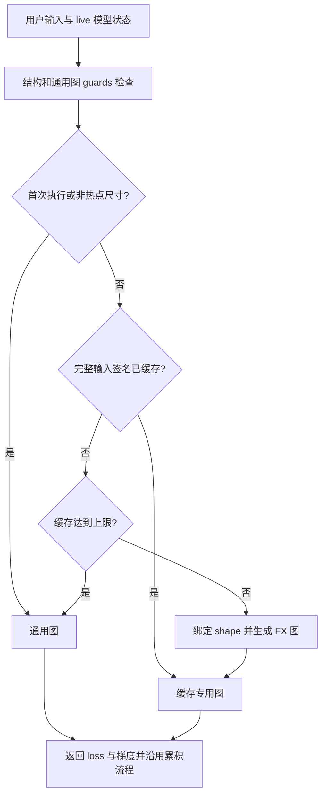

# 通用符号图与按尺寸懒生成 FX 专用图

尺寸特化采用 “one general-shape graph + lazy per-size FX specialization”：先捕获一份通用符号联合图，完成既有并行 Pass；运行时遇到配置的热点尺寸，再从该图生成并缓存绑定具体 shape 的 FX 图。其他尺寸继续运行通用图。

这里的特化生成独立 `GraphModule` 和 Python 执行代码，不调用 Inductor、NPU kernel compiler 或 NPU Graph capture。未绑定的表达式保留动态形式，因此专用图并不保证完全静态，也不承诺吞吐提升。以下链接相对于仓库根目录，行号按当前实现核对。

## 1. 与 MagiCompiler 的对应关系

MagiCompiler 的 `PiecewiseBackend` 保留 general-shape callable，首次执行通用图，之后对 `compile_sizes` 中的尺寸懒调用后端编译并缓存。这里沿用其调度思路，实现范围为 FX shape 特化。

| MagiCompiler 中的机制 | HyperParallel 中的对应实现 |
| --- | --- |
| general-shape callable | `JointGraph.graph_module` 保存通用符号联合图 |
| 首次通用执行 | 首次热点命中也先执行通用图 |
| `compile_sizes` | YAML / Python 参数指定热点尺寸 |
| `sym_shape_indices[0]` | 自动选择首个符号输入轴，或显式指定输入路径与轴 |
| `ConcreteSizeEntry` | 保存尺寸、专用 `GraphModule` 和折叠节点数 |
| 按 runtime size 查询产物 | 先筛选尺寸，再按完整用户输入元数据查询缓存 |
| `compiler_manager.compile()` | `specialize_graph()` 绑定符号并生成 FX 代码 |
| 后端编译与持久缓存 | 当前未接入 |

HyperParallel 不导入或依赖 MagiCompiler；没有引入其 piecewise partition、后端管理或磁盘缓存体系。

## 2. 配置与边界校验

真实文本训练 YAML 的 `compile` 段可以使用：

```yaml
compile:
  enabled: true
  use_joint_graph: true
  dynamic: true
  compile_sizes: [116, 120, 127]
  compile_size_input: model_inputs.input_ids
  compile_size_dim: 1
  max_specializations: 8
```

字段定义见 [CompileConfig](hyper_parallel/models/build_options.py#L113)，参数继承和动态模式检查见 [GraphCompiler.__init__](hyper_parallel/compile/compiler.py#L104)。显式 Python 参数优先；省略时继承 `trainer_config.compile`，未提供配置时使用默认值。

| 参数 | 默认值与校验 |
| --- | --- |
| `compile_sizes` | 默认 `None`，空列表也关闭特化；非空时必须启用 `dynamic=True` 或提供 `dynamic_arg_dims` |
| `compile_size_input` | 默认自动选择扁平用户输入中的首个符号轴；显式值必须是可解析到 Tensor 叶子的非空点分路径 |
| `compile_size_dim` | 显式路径默认使用 `-1`；支持负轴，必须是整数且不越界；自动选择时轴来自符号输入 |
| `max_specializations` | 默认 `8`，必须是正整数；限制完整输入签名数量 |

[validate_compile_sizes()](hyper_parallel/compile/size_specialization.py#L38) 接受整数列表或元组，拒绝负数、布尔值及其他元素，并去重。容量校验即使在特化关闭时也执行。

[尺寸选择器](hyper_parallel/compile/size_specialization.py#L115) 在首次捕获后、并行 Pass 改写模型前校验。不存在的路径、非 Tensor 叶子、非法轴都会报错；自动模式找不到符号维度也会报错。显式路径从 `forward_backward(**inputs)` 的顶层关键字开始，例如 `x`、`batch.x` 或文本训练中的 `model_inputs.input_ids`。

`compile_sizes` 接受 `0/1` 并不表示通用图能覆盖这些尺寸；是否可执行仍由原有 shape guards 决定。文本训练建议显式选择序列轴，避免自动模式选到 batch 轴。

## 3. 首次通用执行与缓存分派

[GraphCompiler.compile()](hyper_parallel/compile/compiler.py#L168) 捕获一次联合图，建立分派器，再运行既有并行 Pass。后续特化从完成 Pass 的图派生，不重新捕获模型，也不再次分片真实参数。



[run_traced_graph()](hyper_parallel/compile/tracer/graph_tracer.py#L651) 先检查模型状态名称、输入 pytree 结构和 guards，再进入 `torch.no_grad()` 执行通用图或分派器。缓存命中同样经过 guards；失败时直接报错，不生成变体、不执行图或通信，也不自动 retrace。

[分派器主流程](hyper_parallel/compile/size_specialization.py#L157) 的首次执行始终使用通用图。这是首次图执行的 warmup 策略：即使用户预先调用了 `compiler.compile()`，下一次首次 `forward_backward()` 仍走通用图。

配置热点 `[5, 7]`、其他元数据不变时，长度 `5 → 7 → 7 → 9 → 5 → 5` 分别对应：通用执行、生成 7 的图、命中 7、通用执行、生成 5 的图、命中 5。预期通用执行 2 次、专用执行 4 次、缓存命中 2 次、生成 2 份专用图。

下面展示直接使用公共入口的方式，等价行为在现有 UT 中验证：

```python
import torch
from hyper_parallel.compile import GraphCompiler, PassConfig

def train_fn(model, x):
    return model(x).square().mean()

model = torch.nn.Linear(4, 3)
compiler = GraphCompiler(
    model, train_fn,
    device=torch.device("cpu"),
    pass_config=PassConfig(fsdp_enabled=False),
    dynamic_arg_dims={"x": [0, 1]},
    compile_sizes=[5, 7], compile_size_input="x", compile_size_dim=1,
)
for length in (5, 7, 7, 9, 5, 5):
    model.zero_grad()
    loss, loss_dict = compiler.forward_backward(x=torch.randn(2, length, 4))
print(compiler.specialization_stats)
```

## 4. 特化只绑定 shape，数据与通信保持运行期执行

[specialize_graph()](hyper_parallel/compile/size_specialization.py#L49) 使用当前用户 Tensor 的元数据绑定通用图符号：

```python
guards = joint_graph.input_guards
tensors = [value for value in user_inputs if isinstance(value, torch.Tensor)]
bindings = guards.shape_env.bind_symbols(guards.fake_tensors, tensors)
```

它只折叠白名单内的 shape 查询和整数算术，且节点的 `meta["val"]` 必须是 `SymInt`，替换符号后能够得到整数。例如 `[2, 7, 4]` 下的 `batch * length` 可绑定为 `14`，相应 `view(x, [batch * length, 4])` 变为 `view(x, [14, 4])`。

其余节点通过 `graph.node_copy()` 复制，最后生成独立 `GraphModule`；通用图不被改写。复制时移除旧的符号 Tensor 元数据，避免把它误当作变体的具体元数据。

生成过程读取 shape 元数据，不执行 Tensor 算子、forward/backward、collectives 或 RNG。已存在的 FSDP all-gather、reduce-scatter 与等待节点保留在生成图中，随后正常执行；生成变体不会额外插入或提前执行通信。

[完整输入签名](hyper_parallel/compile/size_specialization.py#L137) 包括所有用户 Tensor 的 shape、stride、storage offset、dtype、device、layout、requires_grad，以及非 Tensor 叶子的类型和值。分派尺寸只是热点筛选条件，并非完整缓存键。

因此 `[2, 7, 4]` 和 `[3, 7, 4]` 即使都命中长度 `7`，也需要两份图。部分元数据由 guards 固定；缓存键仍完整记录它们。改变 dtype、别名关系或关联尺寸时，先按通用图契约检查，不会靠缓存键绕过 guards。

容量按签名计数，不按热点长度计数。达到 `max_specializations` 后，新签名回退到通用图；已经缓存的签名继续命中。当前没有淘汰、磁盘持久化或跨 rank 共享；每个 compiler 独立维护缓存。

缓存不保存真实用户 Tensor 或其存储，也不将权重、Tensor 标量值或随机数据折叠为捕获值。[执行入口](hyper_parallel/compile/tracer/graph_tracer.py#L681) 每次读取 live 模型参数和缓冲；优化器更新与梯度累积沿用原有流程。

文本训练中的 `token_counts.current` 与 `token_counts.step` 由 [BaseTrainer.forward_backward_step()](hyper_parallel/trainer/base.py#L771) 显式传入图。[图训练函数](hyper_parallel/trainer/base.py#L557) 和 [loss 聚合](hyper_parallel/trainer/runtime/metrics.py#L105) 消费当前 Tensor 值；相同 shape 下 token 数变化仍会改变 loss 权重与梯度，不需要重新生成图。

## 5. 统计接口与验证入口

[GraphCompiler.specialization_stats](hyper_parallel/compile/compiler.py#L164) 返回只读统计快照；未建立分派器或关闭特化时为 `{}`。[GraphTrainer](hyper_parallel/compile/trainer.py#L103) 将配置和执行委托给 compiler，目前没有另设公开统计属性；BaseTrainer 可通过 `trainer.graph_compiler.specialization_stats` 读取。

| 字段 | 含义 |
| --- | --- |
| `general_calls` | warmup、非热点和容量回退的通用图执行次数 |
| `specialized_calls` / `cache_hits` | 专用执行总次数 / 复用已有条目的次数 |
| `compilations` / `cached_variants` | 已生成且缓存的 FX 图数量，不是模型捕获或底层 kernel 编译次数 |
| `compiled_sizes` | 已缓存条目的尺寸去重列表；同尺寸可对应多个签名 |
| `folded_nodes` | 缓存图中折叠的 shape 节点总数，不按执行次数累加 |
| `capacity_fallbacks` / `last_dispatch` | 容量导致的回退次数 / 最近一次分派类型 |

当前可复现的逻辑验证集中在 [test_size_specialization.py](tests/ut/compile/test_size_specialization.py#L35) 和 [test_dynamic_shapes.py](tests/ut/compile/test_dynamic_shapes.py#L40)：

- 热点 warmup、懒生成、命中、非热点回退、不同次级维度与缓存上限。
- 真实 FX 代码变化、shape 节点折叠、loss/梯度对照、live 权重与梯度累积。
- 配置继承、选择器校验、guards 优先、输入存储释放和 RNG 状态。
- BaseTrainer 的动态配置与运行期 token 权重，以及符号 padding 的 causal loss。

```bash
python -m pytest tests/ut/compile/test_dynamic_shapes.py \
  tests/ut/compile/test_size_specialization.py -q
```

UT 使用 CPU，分布式逻辑通过 mock 验证。普通 NPU smoke 使用现有 TextTrainer、真实模型结构和 TP2 + FSDP2 的数据与训练流程，补充集成路径验证；它不替代逐参数精度对照或吞吐基准。

## 6. 普通四卡文本训练 smoke

从仓库根目录运行，模型路径须包含配置和 tokenizer。默认 YAML 随机初始化模型结构，运行 6 个 optimizer step；`prepare_dynamic_text.py` 生成多种长度的本地文本，不需要下载数据：

```bash
python -m hyper_parallel.compile.examples.automodel_text_graph.prepare_dynamic_text

ASCEND_RT_VISIBLE_DEVICES=0,1,2,3 \
OUTPUT_DIR=./output/automodel_text_graph/specialized_npu \
bash hyper_parallel/compile/examples/automodel_text_graph/run.sh \
  hyper_parallel/compile/examples/automodel_text_graph/train_online_lm_graph_dynamic_tp2_fsdp2.yaml \
  --model.pretrained_model_name_or_path=/path/to/Qwen3-0.6B \
  '--compile.compile_sizes=[116,120,127]' \
  --compile.compile_size_input=model_inputs.input_ids \
  --compile.compile_size_dim=1
```

[run.sh](hyper_parallel/compile/examples/automodel_text_graph/run.sh#L52) 默认启动 `scripts/train_lm.py`，接受已有 CLI 覆盖，输出普通训练日志。[动态 YAML](hyper_parallel/compile/examples/automodel_text_graph/train_online_lm_graph_dynamic_tp2_fsdp2.yaml#L40) 中的三项特化配置可选；省略后运行通用符号图。

检查训练完成、loss 有限和热点反复出现时的 `Generated size-specialized FX graph` 日志。实际 packing 长度依赖 tokenizer 和数据；`[116, 120, 127]` 是该示例的可选热点配置，其他输入应按重复出现的尺寸调整。普通入口不自动导出专门的逐 rank 审计 JSON。

当前验证入口为现有 UT 与普通训练命令。动态 PP、guard 失败后自动 retrace、缓存淘汰、持久缓存、后端 kernel 编译和跨进程缓存共享仍在本实现范围之外。
